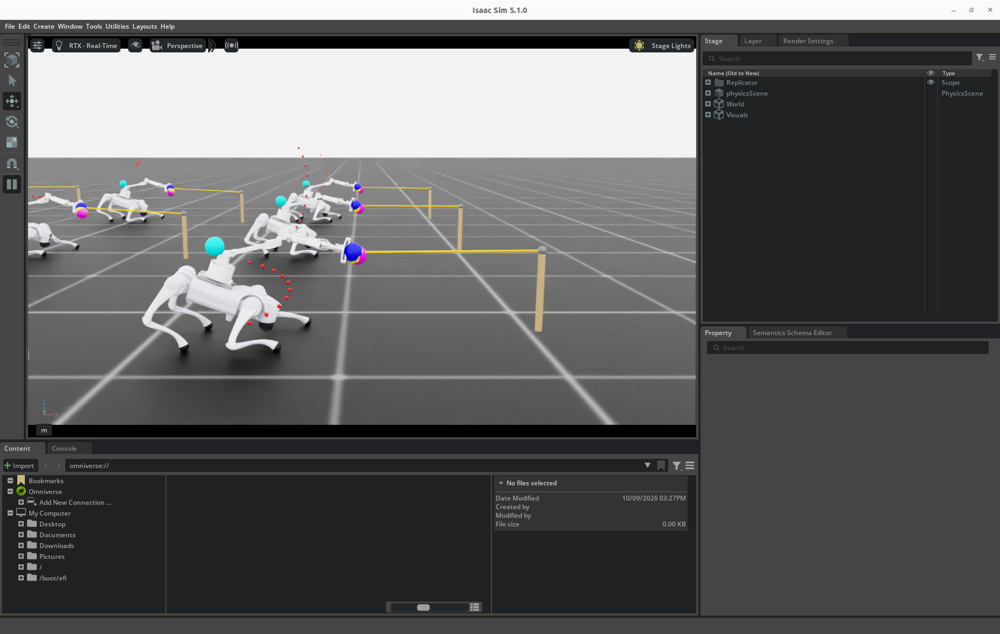
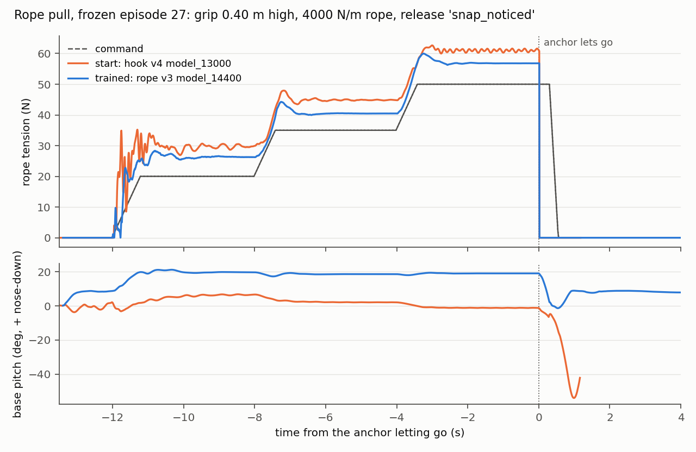
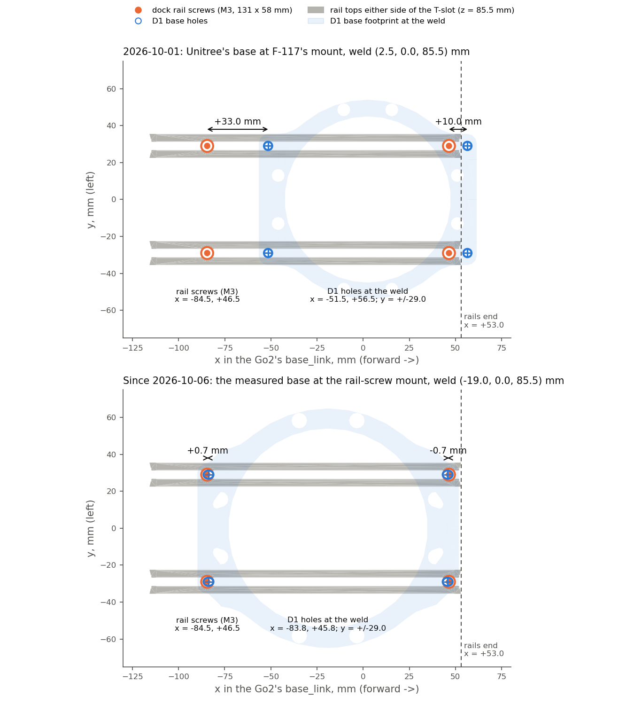

# Week 4 — 5–11 October 2026

**Status:** in progress
**Focus:** Establish physical free-space control and first instrumented contact; resolve force and transfer feasibility

## Planned

From the [revised Thesis B plan](../../docs/thesis_b_plan.md#thesis-b-weekly-schedule),
16 September 2026. This replaces the original Appendix A timing; earlier dated logs remain historical evidence.

- **Reuse, simulation and learning:** Obtain repeatable simulated pressing and box phases; run P1/P3 pilots and start matched seeds once the configuration is stable.
- **Hardware and camera:** Complete G5 evidence; perform instrumented low-force contact after entry checks; compare estimated/measured forces and identify dynamics/timing mismatches.
- **Evidence and deliverable:** Week 4 scope decision: protect the tagged-box sequence; defer extra tasks/large-workspace locomotion if needed. Label any sensor-assisted diagnostic method separately.
- **Gate focus:** G5; G6 begins; G2 before substantive contact comparisons.

## Checklist

- [ ] Physical free-space pose tracking meets frozen tolerances without falls or limit violations
- [ ] Hold/abort behaviour exercised and logged
- [ ] Simulated pressing and box engagement phases pass declared task cases
- [ ] First instrumented physical contact recorded after G2/G5 and simulation evidence
- [ ] Force-estimator error, contact loss and force peaks measured independently
- [ ] Measured dynamics/timing updates versioned consistently across comparisons
- [ ] Core-scope decision and any deferrals documented

## Log

<!-- Dated entries (### YYYY-MM-DD · topic). For each: the exact command or change, the outcome in numbers,
     and what it does and does not show. Record runs with ./dashboard.py record. -->

### 2026-10-09 · Watching the rope pull: a viewer demo, with the rope drawn

**Lukas:** "can you spin up visualisation of the rope pulling from earlier", then, after watching, "you can close the
simulation now. I have taken some screenshots too which I would like you to add to the weekly log".

**What was added for it.**
- *The rope in the viewer* (`unifp_train/rope_vis.py`, drawn by `Go2D1RopeEnv` beside UniFP's own overlay):
  - the rope from the jaw centre to the load, orange while taut (≥ 0.5 N) and grey while slack, gone once a snap
    leaves it carrying nothing, red while a slipping load drags on it;
  - the post it was tied to, brown, red once the anchor has let go;
  - the load, a small sphere where the rope ends now.
  UniFP's markers stay: blue the controlled point, magenta the force-displaced target, yellow the goal, cyan the
  goal-sphere centre, and the arrows at the tool (blue the force applied, green the force commanded, 1 cm per newton).
- *`--rope_demo`* for `play`: the frozen development episodes at the 0.40 m grip and 4,000 N/m (20 / 35 / 50 N for
  4 s each, then the snap noticed, the snap unnoticed and the slip), one per environment and repeating. The figure's
  episode is environment 0, which the camera follows, set side-on to show the lean, the rope and its post.
- *`--real_time`* for `play`: each policy step held to 20 ms, so the viewer runs at the robot's own speed.

`./run_unifp_train.py play --task rope --rope_demo --real_time --steps 200000 --checkpoint checkpoints/unifp_go2d1_rope_v3_polish_model_14600.pt`
([run](#/week/4/run/20261009T042731_play_seed1_rope_demo_view)), after a 40-step headless check of the same path
([run](#/week/4/run/20261009T042712_play_seed1_rope_demo_check): 9 environments, no error). It ran for about five
minutes and was closed from outside at Lukas's request. It did not leave through its loop, so its `run.json` was set
to "interrupted" by hand and holds no step count. Nothing was measured: this is for watching, and the numbers are the
ones already recorded for this checkpoint (F-136).

**Lukas's screenshots** (`screenshots/`, 15:28:49 and 15:30:27, the whole Isaac Sim window):

- *What they show.* The polished policy (`14600`) mid-pull, every rope orange (taut) and every post brown (holding),
  so both were taken during a hold, before the release. Each robot crouches with its body low and pitched nose-down
  into the rope. The arm reaches straight out along the rope, the jaws (blue and magenta spheres) at its near end. The
  ropes run level at the grip's 0.40 m to posts 1 m on. This is the posture F-133 measured: crouched 4–9 cm, ~15–19°
  nose-down, the arm within a few degrees of the rope's line. The nearest robot is almost certainly environment 0 (the
  figure's episode, straight ahead), the one the camera follows. The two frames are about four demo loops apart, and
  the pose is the same in both: the policy settles into the same posture every time.
- *What to discount.* The red dotted arcs are UniFP's goal-trajectory samples. Under a rope the goal is held on the
  grip (`HeldGoals`), but the trajectory keeps running underneath it, so the dots show a path the arm is not following
  and mean nothing here. The cyan spheres above the bodies are the goal-sphere centres, not part of the rope task.
- *What they do not show:* the release. Both are in a hold, and neither has the force arrows long enough to read the
  tension. The release is in `figures/rope_pull.png`.

### 2026-10-08 · Unitree's D1 CAD against the URDF: the forearm is 6.8 mm short in `d1.urdf`

**Lukas:** "I noticed the d1 cad file has the correct dimensions compared to the urdf. Are you able to compare them?
You can find both on the unitree website".

**Finding the files.** The D1 developer page (support.unitree.com/home/en/developer/D1Arm_services) refuses scripted
requests (Tencent EdgeOne, HTTP 567, as in Week 2). Its scripts, read off the Wayback Machine, load each page from
`https://robot-api.unitree.com/doc`, which answers. The D1 page (updated 2026-07-20) names the arm the **D1-550** (3152 g,
550 mm without the jaws, 670 mm with them) and links six archives (`third_party/unitree_d1_cad/NOTICE.md`):
- two URDFs of **different arms**: `d1_description` (the one `d1_arm/d1.urdf` descends from) and `d1_550_description`;
- two STEP models, the "simplified" one and the "D1-550" one, which turn out to be the same 74 bodies at the same
  places: one arm, posed lying along −y with the forearm folded back over the upper arm;
- the D1-550 gripper's plastic parts.

**How the CAD was measured** (`python3 d1_arm/compare_cad.py <D1-550 .stp> <d1_550_description.urdf>`). Each joint
axis is the line on which many cylindrical faces are coaxial: servo housings, output flanges, bearings (Joint2 46
faces, Joint3 44, Joint5 20). The base comes from its lowest face and its 2.25 mm-radius holes, the fingertips from
the furthest vertex past the wrist. The same pose-independent quantities come from each URDF's own forward kinematics
and meshes. Checked against an OpenCASCADE reading of the same STEP (a scratch install, not needed by the script):
identical to 0.01 mm.

| mm | Unitree CAD | `d1.urdf` (this repo) | Unitree D1-550 URDF |
| --- | --- | --- | --- |
| Joint2 axis above the base's bottom face | 130.80 | 132.30 (+1.50) | 131.60 (+0.80) |
| upper arm, Joint2 → Joint3 | 270.00 | 269.30 (−0.70) | 270.00 |
| elbow offset, Joint3 axis → forearm roll line | 41.32 | 42.00 (+0.68) | 41.32 |
| **forearm, Joint3 → Joint5 along the roll line** | **204.67** | **197.88 (−6.79)** | 204.68 |
| Joint5 → fingertips, jaws closed | 206.38 | 208.10 (+1.72) | 206.30 |
| Joint5 → Joint6 frame | (flange at 77.75) | 82.50 | 77.70 |
| mounting holes, along × across the rail | 130 × 58 | 130 × 58 (measured, F-126) | 130 × 58 |
| base footprint | 132 Ø flange, tabs to 140 | 141.6 × 129.6 | 140 × 132 |
| base bottom → rotating plate | 74.0 (underside), 75.5 (top) | Joint1 at 76.0 (measured) | Joint1 at 73.8 |
| effort limits Joint1…6 (N·m) | — | 3.3, 3.3, 1.7, 1.7, 1.7, 1.7 | 3.33, 3.33, **3.33**, 1.67, 1.67, 1.67 |

What it shows:
- **The CAD agrees with what Lukas measured on the base:** holes 130 × 58 mm, the housing's B-spline side reaching
  ~63.4 mm from the axis (~126 mm across; measured 126), the rotating plate 74.0–75.5 mm above the bottom (measured 76).
  And **the D1-550 URDF agrees with the CAD to 0.1 mm** on every arm length. The shoulder is the exception, at 0.8 mm.
- **`d1.urdf`'s arm is the older `d1_description`'s.** Its forearm is 6.79 mm short; its hand reaches 1.72 mm further past
  the wrist; the upper arm and the elbow offset are each 0.7 mm off. The shoulder sits 1.5 mm high because the measured
  76 mm base (F-126) was stacked under `d1_description`'s 56.3 mm to the shoulder, where the CAD has 54.8.
- **What it costs.** A scratch copy of `d1.urdf` with the CAD's lengths in its own frames (Joint2 z 0.0548, Joint3 y
  0.2700, Joint4 y 0.04133, Joint5 z 0.14697, Joint6 x 0.0808) puts the jaw centre (`Link6 + (0, 0, 0.1051)`) **6.0 mm
  from where `d1.urdf` puts it at the median of 20,000 random joint configurations within limits** (p90 7.3 mm, max
  8.6 mm). At q = 0 it is 5.1 mm further out along the forearm and 1.5 mm lower. Everything that reads `d1.urdf` carries
  that error: the simulation, every trained policy's controlled point, the scripted demos, and `d1_ik.py`, the real
  arm's IK.
- **The elbow's torque is in question.** In the CAD the shoulder and elbow servos have identical cylinders (radii 4.0,
  4.5, 6.0, 6.8, 7.0, 7.2, 7.5, 13.0 mm), the wrist pitch a smaller set, and the D1-550 URDF gives the elbow 3.33 N·m
  like the shoulder. The page's spec table still says J2 (the elbow) 1.7 N·m, which is what `d1.urdf` and `motor_model.py`
  use. The same housing can hold a different gearbox, so this is unresolved, not a correction. It matters: the rope
  pull runs the elbow at its 1.7 N·m limit (F-135).

What it does not show:
- Measurements of the real arm's links. The CAD is Unitree's simplified model. It matches the base Lukas measured, and
  that is the only part of it checked against the arm. The forearm difference, 7 mm between the Joint3 and Joint5
  axes, is big enough to settle with calipers: 204.7 mm (CAD) or 197.9 mm (`d1.urdf`).
- The masses. Neither URDF carries the motors (F-126's README note: 0.72 and 0.88 kg of shells against 3.152 kg), and
  the STEP has no materials.

**Not changed: `d1.urdf`.** Correcting it changes the controlled point of every policy here, as F-126's base did (F-127),
and the real arm's IK. Two ways, Lukas's call: patch `d1.urdf`'s five origins to the CAD's lengths, keeping its names,
frames, servo signs (F-030, F-034) and hand mesh (the scratch copy above); or move to `d1_550_description` wholesale,
whose link names, joint axes and hand mesh all differ.

### 2026-10-07 · A steady pull on a rope, and the rope letting go: a task built, and where the pull policy stands

**Lukas:** "im particularly insterested in training pulling force on the go2 with the d1 arm fully taut like a pulled
rope (claw with interlocking teeth). I want to know if its possible to train a policy to output a consistent pulling
force (so no repeating tugs) using whole body control to use the feet and legs - and for the robot to recover if the
thing the robot is pulling suddenly stops providing the resistive force. you have a day of gpu to investigate and
train this".

**Where this starts.** The hook task's pull (F-103) is the nearest thing: hook v4 `model_13000` holds 60 N through a
*ring* with the arm drawn straight and the body pitched, on Unitree's base. Two things it never measured are the
question here: whether the force is steady (the staircase scored a 1 s mean) and what happens when the resistance
goes (the fixture never let go). The ring also carries the arm's weight and holds the tool sideways, which a rope
does not.

**First check: does the pull survive the measured robot?**
`./run_unifp_train.py hook_eval --task hook --headless --fixture_kind ring --checkpoint logs/unifp_train/20260924T080558_train_seed1_hook_pull_v4/model_13000.pt`
([run](#/week/4/run/20261007T060919_hook_eval_seed1_ring_v4_13000_measured)): yes. 60 N sustained median (p10 60),
60/60 held to 50 N and 59/60 at 60 N, no falls, the arm at 100% of a joint limit at every level, overshooting the low
levels (15.2 N applied at 10 N). Read off the trace at 50 Hz, the force over the last 1.5 s of each hold has a
std of 3.2 N at 10 N and 0.27–0.72 N at 20–60 N (peak-to-peak 12.5 N and 1.3–2.5 N): steady when loaded, shaky light.

**The task built: `--task rope`** (`unifp_train/rope.py`, `rope_cfg.py`, `rope_env.py`, `rope_rewards.py`,
`rope_eval.py`; `tests/test_rope.py`, 22 tests, CPU):
- *The rope* (`rope.RopeTether`): tension only, along the line from the jaw centre to the anchor, `k * stretch +
  c * rate` while stretched, never negative, zero when slack. Nothing across the line: a 1 m rope at 40 N holds the
  tool sideways at 40 N/m, against the ring's 2,000. The claw's teeth hold the rope at the jaw centre for the whole
  episode; nothing can slip off. Stepped at the physics rate.
- *The anchor giving way* (`release`): its capacity falls from the tension of the moment to a residual, and while
  the rope would carry more it pays out. Snap (to 0 at once), slip (to 10–50%, within 0.2 s, a load breaking free and
  dragging), fade (to 0 over 0.1–0.5 s). In training half the rope episodes release, 2–11 s after the rope is
  tied, once at least 10 N is commanded.
- *The task layer* notices 0.1–0.6 s later, or never (20% of releases). Then it ramps the command to zero at 200 N/s
  and slides the goal back to the grip placement in the body frame. Until then the policy is told to keep pulling.
- *Episode:* the goal to a grip placement (the hook task's sampler), the rope tied once the tool settles, running
  0.3–2 m (log-uniform) straight out against the pull (back toward the robot, ±0.5 rad yaw, ±0.35 rad elevation),
  500–6,000 N/m. The command ramps between levels held 2–5 s up to a curriculum ceiling (30 → 60 N). The robot
  stands. 20% of episodes are UniFP's free-space task, as in the hook task.
- *Rewards* (`rope_cfg.WEIGHTS`): the hook task's force tracking (gated off once the anchor lets go), arm torque
  margin and tool speed, plus `rope_ripple` (the tension's total variation against the command's over the four
  physics substeps of a policy step, squared), `rope_slack` (substeps slack while ≥ 3 N is commanded),
  `rope_upset` (base horizontal speed² + ¼ roll/pitch rate² for 3 s after a release) and `rope_fallen` (once).
  A rope episode also ends if the trunk touches the ground.
- *Frozen evaluation* (`rope_eval`, set before any policy was trained on the task): nine grip placements (0.25 /
  0.40 / 0.55 m × −0.3 / 0 / +0.3 rad, 0.45 m out), a 1 m rope pulled straight back at 1,000 or 4,000 N/m, 20 / 35 /
  50 N held 4 s each, read over the last 2 s at 200 Hz; then at the end of the 50 N hold the anchor snaps (noticed
  after 0.3 s), snaps unnoticed, or slips to 20% (noticed), with 4 s to recover. 54 episodes; run here with
  `--repeats 2` (108). Steadiness is the std, the shake left after a 0.2 s running mean, the slack fraction, *tugs*
  and the dominant frequency. Recovery is a strict fall (tilt past 34°, base below 0.15 m or the trunk touching), the
  base's excursion and speed, the pitch change, the tool's lunge relative to the body, feet lifted, and the time to
  settle.
- *Two scoring changes, both made before any trained policy was scored, neither changing the episodes.* The first
  baseline's trace showed 10–35 N swings at ~5 Hz in the first second after the rope was tied on a 20 N command,
  which the last-2-s window never sees. So each level is now also scored over its *whole hold*, tie-on and ramp
  included (`hold_tugs`, `hold_peak_n`, `hold_overshoot_n`). And a *tug* is now a tension peak standing at least 25% of
  the command (and 3 N) above the troughs either side, counted while at least 10 N is commanded (`rope_cfg.TUG_*`).
  The first definition, a drop below 75% of the command after being above 90%, missed surges *above* the command and
  found tugs in 8 of 108 first holds where the trace has them in nearly all. `python -m unifp_train.rope_eval <run dir>`
  rescored the baselines from their saved traces.

**Smoke and stiffness.** [Zero actions](#/week/4/run/20261007T062729_smoke_seed1_rope_smoke), 64 × 900 steps: the
interface checks pass, releases fire, nothing falls, peak tension 5.7 N (the arm resting on the rope). Hook v4 driving
it with no releases at a fixed 2,000 / 6,000 / 20,000 N/m
([2k](#/week/4/run/20261007T062814_play_seed1_rope_play_v4_k2000),
[6k](#/week/4/run/20261007T062841_play_seed1_rope_play_v4_k6000),
[20k](#/week/4/run/20261007T062907_play_seed1_rope_play_v4_k20000)): no falls, peak tension 107 / 138 / 88 N against
a 30 N peak command. The frozen evaluation's trace puts those peaks in the first second after the rope is tied
(median 36 N, max 80 N): the policy overshooting, not the spring ringing. At 4,000 N/m the high-frequency shake in the
holds is 0.04–0.19 N.

**Baselines on the frozen development set** (`./run_unifp_train.py rope_eval --task rope --headless --repeats 2 --checkpoint <…>`):

| | [zero actions](#/week/4/run/20261007T063225_rope_eval_seed1_rope_eval_zero) | [hook v4 `model_13000`](#/week/4/run/20261007T062950_rope_eval_seed1_rope_eval_v4_13000) |
| --- | --- | --- |
| held at 20 / 35 / 50 N | 0 / 0 / 0 of 108 | 108 / 108 / 108 |
| mean tension at 20 / 35 / 50 N | 0.4 / 0.3 / 0.3 N | **29.9 / 43.4 / 56.9 N** (over by 50 / 24 / 14%) |
| tension std, median (p90) | — | 0.61 (1.30) / 0.18 (1.71) / 0.22 (1.29) N |
| tugs over the whole hold, 20 / 35 / 50 N (episodes with any) | 4 / 0 / 0 (the arm bouncing 3–5 N on the rope as the command passes 10 N) | **107 / 17 / 5 of 108** (321 / 101 / 45 tugs) |
| tugs in the last 2 s; slack | — | 5 / 5 / 1 episodes; slack 0 |
| peak tension over the hold, median | 2.8 / 0.5 / 0.3 N | 36.9 / 47.5 / 58.8 N (over the command by 23.9 / 12.5 / 9.1 N) |
| arm's worst joint, pitch | — | 100% of its limit; +6.5° / +3.1° / −0.5° nose-down |
| arm against the rope's line | — | 11.9° / 9.2° / 7.8° |
| fell after the release (snap noticed / unnoticed / slip) | 0 / 0 / 0 of 36 (nothing to recover from) | **36 / 33 / 35 of 36** |

How it falls (one snap traced step by step): the base runs backward at up to 0.8 m/s, the rear sinks (0.31 → 0.21 m
in 0.4 s), and the robot pitches nose-up past 1 rad and goes over on its back 0.7 s after the snap. The pitch change
is 55° median in every release kind; 104 of the 108 falls end the episode on tilt.

What it shows: once settled, the hook policy's pull on a rope is steady (std 0.2–0.6 N), but too strong by 7–10 N.
Getting there it tugs: about three snatches every time the rope is tied (107 of 108), peaking near 37 N on a 20 N
command, and in a sixth of the steps up to 35 N. It cannot survive the rope letting go. What it does not show:
anything about a stiffer tether than 4,000 N/m, a real rope (~10⁵ N/m), or a floor less grippy than μ = 1.0.

**v1: recovery learnt, the pull given up for it.**
`./run_unifp_train.py train --task rope --num_envs 4096 --iterations 1500 --headless --resume_from logs/unifp_train/20260924T080558_train_seed1_hook_pull_v4/model_13000.pt --resume_arm_std 0.6 --run_name rope_v1`
([run](#/week/4/run/20261007T063306_train_seed1_rope_v1)), stopped at 852 of 1,500 iterations (42 min) because the
force was falling:

| development set | [`13400`](#/week/4/run/20261007T065244_rope_eval_seed1_rope_eval_v1_13400) (400 it.) | [`13800`](#/week/4/run/20261007T071226_rope_eval_seed1_rope_eval_v1_13800) (800 it.) |
| --- | --- | --- |
| held 20 / 35 / 50 N | 108 / 13 / 0 | 108 / 0 / 0 |
| mean tension at 20 / 35 / 50 N | 24.1 / 24.7 / 25.4 N | 19.6 / 19.1 / 18.8 N |
| tugs over the whole hold (episodes) | 108 / 17 / 3 (487 at 20 N) | 102 / 6 / 0 |
| base pitch; arm against the rope; elbow (Joint3) | −15.7° (nose-up); 35°; +0.83 rad | +0.4°; 33°; +0.33 rad |
| **fell after the release** | **0 / 0 / 0 of 36** | **0 / 0 / 0 of 36** |
| base excursion; pitch change; settled (base still) | 7–10 cm; 12–18°; 1.0–2.1 s | 6–13 cm; 8–9°; 1.2–1.8 s |

So a policy can learn to ride out the rope letting go, in 400 iterations: 0 falls in 108 against the baseline's 104.
But v1 did it by no longer pulling: the tension caps at 20–25 N whatever is commanded, with the elbow flipped to the
other side (v4: −0.64 to −1.03 rad) and the arm 33–35° off the rope, and it tugs at ~2.5 Hz. What went wrong, read
from the run:
- *The first update threw the posture away.* The adaptive learning rate starts at 1e-3 on a resume and was cut to
  its floor within that update, but the first minibatches had already moved the policy: KL 0.93 (then 0.008–0.026).
- *The ripple term paid for bending the arm.* It was the largest penalty in training (−1.3 to −1.4 per
  episode-second), mostly exploration noise: an arm straight along the rope turns joint noise into tension, a bent one
  does not.
- *The curriculum promoted on noise.* Its average is updated on every reset batch (~24 per iteration), so at 0.05 it
  spanned about one iteration. The ceiling reached 50 N while the pull fell to 20 N, and 30 N short the force term
  (exponentials of 3 and 12 N) has almost no slope.

The recovery numbers were rescored with "settled" meaning the base still for 0.5 s. The first scoring also asked for
the tool still, but after the task layer notices, the goal moves on purpose, so nearly every noticed release read
"never settled".

**v2** changes all of those at once (this is a search for a recipe that works; the separate controls come after):
`--learning_rate_scale 0.1` (adaptive, starting at 1e-4: first-update KL 0.012), `rope_ripple` −1.0 → −0.2, a new
`rope_taut_arm` term at 1.0 (exp(−angle / 0.25 rad) between the shoulder-to-jaw line and the rope, while pulling: the
posture asked for, and the one that carries force, F-101), a third, 40 N-wide exponential in the force term (shares
0.4 / 0.4 / 0.2), and the curriculum's average ten times slower (0.005) with promotion at under 25% error.
`./run_unifp_train.py train --task rope --num_envs 4096 --iterations 1500 --headless --resume_from <v4 13000> --resume_arm_std 0.6 --learning_rate_scale 0.1 --run_name rope_v2`.

| v2 on the development set | [`13200`](#/week/4/run/20261007T072651_rope_eval_seed1_rope_eval_v2_13200) (200 it.) | [`13400`](#/week/4/run/20261007T073700_rope_eval_seed1_rope_eval_v2_13400) (400 it.) |
| --- | --- | --- |
| held 20 / 35 / 50 N | 108 / 106 / 105 | 108 / 108 / 108 |
| mean tension at 20 / 35 / 50 N | 20.5 / 32.0 / 44.6 N | 22.9 / 39.8 / 57.9 N |
| std in the last 2 s, median (p90) | 0.61 (1.18) / 0.23 (0.70) / 0.10 (0.30) N | 0.46 (1.04) / 0.42 (2.97) / 0.82 (5.81) N |
| tugs over the whole hold (episodes) | 89 / 3 / 0 | 78 / 25 / 12 |
| arm against the rope; pitch | 5.5 / 4.0 / 7.2°; +4.1 / +2.5 / +0.5° | 4.4 / 3.1 / 2.8°; +4.5 / +4.8 / +6.8° |
| fell after: snap noticed / unnoticed / slip (of 36) | **21** / 0 / 0 | **8** / 2 / 0 |

With the posture kept, the pull is back, accurate and taut: at 200 iterations 20.5 / 32.0 / 44.6 N for 20 / 35 /
50 N, the arm 4–7° off the rope (v4 8–12°, v1 33–35°), the tension's std 0.1–0.6 N. It still tugs while the rope is
tied on (89 of 108 first holds). Recovery is coming but not there. The noticed snap is the hard one: 21 of 36 fall at
200 iterations. Traced, it is not the baseline's backward lurch. The front feet unload within 0.3 s and stay off, the
rear legs push the base up from 0.23 to 0.37 m, and the robot rears over over about a second (pitch to −1 rad). At 400
iterations 8 of 36 still do, and the 35 and 50 N holds have started to oscillate at ~4 Hz in some episodes (p90 std
3.0 and 5.8 N), overshooting by 5–8 N. Training continues; the later checkpoints are below.

**What the tugs are.** Episode 27 traced over 40 steps of its 50 N hold: all four feet stay down and the pitch holds
at 5.6–5.9°. The spike train repeats every ~13 policy steps (3.8 Hz), in phase with Joint1 (the arm's yaw), which
cycles between 52% and 100% of its limit while Joints 2, 3 and 5 sit saturated. The tool moves at up to 0.27 m/s. It
is a limit cycle in an arm working at its torque limits, not the legs re-stepping. None of v2's terms prices it well:
`rope_ripple` sees only variation within 20 ms, and the force term's fine width (3 N) is the wobble's own size.

**Why it over-pulls.** At `13600` (600 it., [run](#/week/4/run/20261007T074726_rope_eval_seed1_rope_eval_v2_13600)) falls are down to 4 / 0 / 0 of 36. But the
pull has drifted to 25.6 / 43.0 / 63.6 N for 20 / 35 / 50 N, the base nose-down 9–12°, still with tugs at 35 N in 38
of 108 episodes. The policy's own estimate agrees (26.1 / 40.5 / 59.0 N), so it is not misreading the force. In
training, with action noise on, the frontier's relative error is 0.11–0.15; deterministic, it is +27%. The likely
reading: the policy has learnt to pull hard enough that its *noisy* self meets the command, and the noise has grown
back (arm std 0.6 → 0.77–1.01 by `13600`, legs 0.6–1.2). The hook v4 policy, trained with an arm std of ~1.6,
over-pulls by 50% at 20 N, which fits.

*Tested directly* (`rope_eval --stochastic`, a diagnosis rather than the frozen measurement: actions sampled with the
checkpoint's own noise, [run](#/week/4/run/20261007T075125_rope_eval_seed1_rope_eval_v2_13600_stochastic)): with its training noise on, `13600` pulls **23.6 / 36.9 / 51.3 N**
for 20 / 35 / 50 N, against 25.6 / 43.0 / 63.6 N deterministic. So the over-pull is learnt compensation for the
policy's own exploration noise. That noise is large: on, the tension's std is 5–7 N, with tugs throughout, and the
feet lift ~100 times in 4 s (its estimate still agrees, 23.9 / 37.9 / 52.7 N). v2 was stopped at 891 iterations
([run](#/week/4/run/20261007T071643_train_seed1_rope_v2)). SIGINT reaches the training loop only by luck: Isaac's
physics-timer callback catches the `KeyboardInterrupt` the handler raises, logs it and carries on, so it took seven
signals.

**v3**: the v2 recipe plus the new `rope_wobble` term at −1.0 (the force error's squared deviation from its
own 0.3 s running mean, averaged over the physics substeps, in units of (2 N)², capped at 4: what the evaluation's std
and tugs see; a steady offset or a tracked ramp costs nothing), and the exploration noise cut, as the insertion recipe
does: `--resume_arm_std 0.3 --resume_leg_std 0.4 --entropy_coef 0.002` (`--resume_leg_std` added for this). From
hook v4 `13000` again, so the recipe is one run from a released checkpoint:
`./run_unifp_train.py train --task rope --num_envs 4096 --iterations 2000 --headless --resume_from <v4 13000> --resume_arm_std 0.3 --resume_leg_std 0.4 --entropy_coef 0.002 --learning_rate_scale 0.1 --rope_weight rope_wobble -1.0 --run_name rope_v3`
(`20261007T080223_train_seed1_rope_v3`). The first updates' KL is 0.21 / 0.12 / 0.07: the same step reads larger against a smaller noise.

| v3 on the development set | [`13200`](#/week/4/run/20261007T081300_rope_eval_seed1_rope_eval_v3_13200) (200 it.) | [`13400`](#/week/4/run/20261007T082311_rope_eval_seed1_rope_eval_v3_13400) (400 it.) |
| --- | --- | --- |
| held 20 / 35 / 50 N | 108 / 57 / 18 | **108 / 108 / 108** |
| mean tension at 20 / 35 / 50 N | 21.5 / 28.2 / 33.4 N | 25.6 / 38.7 / 52.6 N |
| std in the last 2 s, median (p90) | 0.49 (0.74) / 0.15 (0.41) / 0.15 (0.31) N | 0.35 (0.92) / 0.10 (0.19) / 0.18 (2.08) N |
| tugs over the whole hold (episodes) | 72 / 0 / 0 | 95 / **0 / 0** |
| arm against the rope; pitch | 15 / 13 / 12°; −4 to −6° | 5.9 / 7.2 / 6.6°; +4.3 / +6.1 / +9.0° |
| fell after: snap noticed / unnoticed / slip (of 36) | **0 / 0 / 0** | **0 / 0 / 0** |
| base excursion; pitch change; settled | 8–17 cm; 8°; 0.4–1.4 s | 6–14 cm; 9–15°; 0.6–1.3 s |

At 400 iterations v3 does most of what was asked. It holds every level, within 2.6–5.6 N over the command, with the
tension's std 0.1–0.35 N and no tug in any 35 or 50 N hold, the arm 6–7° off the rope and the base pitched into the
pull. It rides out every release (0 of 108; the base moves 6–14 cm and settles within 1.3 s). Two things are left:
- *The tie-on still snatches:* 95 of 108 first holds, swinging 15–35 N for about 1.5 s as the rope goes taut on a
  ramping 20 N command.
- *Some 50 N holds rock:* episode 27 sways at ~2.5 Hz between 54 and 60 N with the base pitching 7–10° in step. That is
  under the 25% that makes a tug, but shows in the p90 std (2.1 N).

**The curriculum, again.** v3's ceiling went 30 → 55 N in 239 iterations, as fast as the 50-iteration minimum
allows. After each promotion the average restarted from the first batch, and at 0.005 per batch it stayed that batch
for hundreds of batches. From now on (`--curriculum_rule window`, the default) the frontier is judged on its error
summed over the window since the last promotion, forgetting by halves every 25 iterations it does not promote;
`--curriculum_rule ema` reproduces v1–v3.

**A held-out test set** (`--rope_set test`, `rope_cfg.TEST_*`), frozen at 20:10 before any policy was run on it. The
development set has now been used to diagnose three versions and will choose the checkpoint, so its numbers are
optimistic. The test set changes everything it can: 4 grips (0.30 / 0.48 m high, ±0.2 rad, 0.50 m out), ropes of 0.5
and 1.5 m at 2,000 and 6,000 N/m, the pull tilted ±0.15 rad, levels of 15 / 30 / 45 N, and other releases (a snap
noticed after 0.15 s, a fade over 0.3 s noticed at 0.45 s, a slip to 35% never noticed). 48 episodes, to be run once
on the chosen checkpoint. Its plumbing was checked with zero actions only
([run](#/week/4/run/20261007T080434_rope_eval_seed1_rope_test_zero): holds nothing, nothing to fall from).

| v3, continued | [`13600`](#/week/4/run/20261007T083305_rope_eval_seed1_rope_eval_v3_13600) (600 it.) | [`13800`](#/week/4/run/20261007T084316_rope_eval_seed1_rope_eval_v3_13800) (800 it.) | [`14000`](#/week/4/run/20261007T085326_rope_eval_seed1_rope_eval_v3_14000) (1,000 it.) |
| --- | --- | --- | --- |
| held 20 / 35 / 50 N | 108 / 108 / 108 | 108 / 108 / 107 | 108 / 108 / 107 |
| mean tension at 20 / 35 / 50 N | 24.7 / 36.2 / 51.4 N | 22.0 / 33.7 / 52.0 N | 22.6 / 40.0 / 53.4 N |
| std in the last 2 s, median (p90) | 0.25 (0.33) / 0.05 (0.09) / 0.10 (1.66) N | 0.48 (0.62) / 0.06 (0.93) / 0.17 (1.21) N | 0.32 (0.45) / 0.10 (0.18) / 0.07 (0.23) N |
| episodes with 0 / 1 / 2 / 3 / 4+ tugs in the first (20 N) hold | 47 / 31 / 22 / 8 / 0 | 6 / 61 / 35 / 6 / 0 | (68 with any, 90 tugs) |
| tugs at 35 and 50 N | none | none | none |
| arm against the rope; pitch (nose-down) | 2.4–5.9°; 8–13° | 4.4–7.0°; 7–13° | 4.4–7.5°; 10–12° |
| fell after the release (of 108); feet lifted | **0**; 0 | **0**; 0 | **0**; 0 |
| base excursion; settled | 7–11 cm; 0.8–1.1 s | 7–14 cm; 0.8–1.1 s | 9–12 cm; 0.7–1.1 s |

From 400 iterations on, v3 holds its gains. No fall in 432 releases across four checkpoints, no foot lifted, every
35 and 50 N hold steady, and the first hold's tugging down from the baseline's repeated snatching (4 or more in 27 of
108 first holds, 3 in 21; median overshoot 24 N) to at most one or two (median overshoot 7–8 N). What is left of
"tugs" is that single snatch as the rope comes taut on a ramping command. The arm carries the pull with Joint2 and
Joint3 at their limits along a straight line, while the body leans 8–13° nose-down into it with roughly half to
two-thirds of its weight on the front feet.

At [`14400`](#/week/4/run/20261007T091308_rope_eval_seed1_rope_eval_v3_14400) (1,400 it.) the tie-on tugging is the lowest yet (39 of 108
first holds, 57 tugs), still no fall and every hold steady (std 0.02–0.49 N), but the pull has drifted 5–8 N over
the command (26.1 / 40.4 / 55.2 N) with the base 15–17° nose-down.

**How the checkpoint will be chosen** (written at 20:16, before `14800` and `15000` were scored): on the development
set, (1) fewest falls after the release, then (2) fewest episodes with a tug in any hold, then (3) the smallest median
absolute force error across 20 / 35 / 50 N. Steadiness ranks above accuracy because steadiness is what was asked for.
The chosen checkpoint alone then runs the held-out test set, once.

**The rest of v3, and the choice.** [`14800`](#/week/4/run/20261007T093247_rope_eval_seed1_rope_eval_v3_14800): 0 falls, tugs in 68 first
holds, 24.8 / 40.4 / 55.7 N. [`14999`](#/week/4/run/20261007T094826_rope_eval_seed1_rope_eval_v3_14999), the run's last: tugs in 79, 25.3 /
39.9 / 53.0 N, and **8 of 36 unnoticed snaps "fall"**, the first in any v3 checkpoint. Traced, none tips. All 8 are
from the low, left grips (0.25 and 0.40 m high, −0.3 rad), where the robot already crouches to ~0.19 m to pull. Told to
keep pulling 50 N into nothing, it sinks to 0.143–0.148 m, upright (pitch within ±4°, all four feet loaded), under
the strict criterion's 0.15 m. They count as falls by the frozen rule, and the trace says what they are.

By the rule written at 20:16 the order is:

| checkpoint | falls | episodes with any tug | mean abs force error | held |
| --- | --- | --- | --- | --- |
| **`14400`** | 0 | **39** | 5.5 N | 324 / 324 |
| `13600` | 0 | 61 | 2.4 N | 324 / 324 |
| `14000` | 0 | 68 | 3.6 N | 323 / 324 |
| `14800` | 0 | 68 | 5.3 N | 324 / 324 |
| `13200` | 0 | 72 | 8.3 N | 183 / 324 |
| `13400` | 0 | 95 | 4.0 N | 324 / 324 |
| `13800` | 0 | 102 | 1.8 N | 323 / 324 |
| `14999` | 8 | 79 | 4.4 N | 324 / 324 |

**`14400` is chosen.** The rule as written does not ask for every level held, which would have put `13200` above
`13400`. It does not change the choice.

The run ([`20261007T080223_train_seed1_rope_v3`](#/week/4/run/20261007T080223_train_seed1_rope_v3)) finished 2,000
iterations in 101 min. A queue for seeds 2 and 3 and three controls waited for checkpoints named `model_<start +
iterations>.pt`. rsl-rl's last is `model_<start + iterations − 1>.pt` (`14999` here), so the queue would have hung
after seed 2. It was restarted with the right names, seed 2's training untouched.

**The held-out test set, run once on `14400`** ([run](#/week/4/run/20261007T095046_rope_eval_seed1_rope_eval_v3_14400_test),
`--rope_set test`, 96 episodes):

| | 15 N | 30 N | 45 N |
| --- | --- | --- | --- |
| held | 96 / 96 | 96 / 96 | 96 / 96 |
| mean tension | 22.3 N | 34.6 N | 50.4 N |
| std in the last 2 s, median (p90) | 0.28 (0.42) N | 0.09 (0.17) N | 0.03 (0.06) N |
| episodes with a tug over the hold | 61 (93 tugs) | 18 | 0 |
| arm against the rope; pitch | 6.1°; +20.8° | 5.0°; +17.5° | 2.6°; +17.7° |

| release (never trained or tuned on) | fell | base excursion | settled |
| --- | --- | --- | --- |
| snap, noticed after 0.15 s | **0 / 32** | 8 cm | 0.9 s |
| fade over 0.3 s, noticed at 0.45 s | **0 / 32** | 7 cm | 1.2 s |
| slip to 35%, never noticed | **0 / 32** | 7 cm | 0.7 s (15 never: still reeling in a load that drags at ~16 N while told to pull 45) |

It carries to ropes of 0.5 and 1.5 m, 2,000 and 6,000 N/m, pulls tilted ±0.15 rad and new grips: every level held
steadily, no fall, no foot lifted. It over-pulls by 5–7 N, and the tie-on snatch remains (61 of 96 first holds).

*[`figures/rope_pull.png`](figures/rope_pull.png)* (`python3 results/week_04/figures/rope_pull.py --runs <v4 run> <v3 14400 run> --env 27`,
extract in `rope_pull.json`): frozen episode 27 (0.40 m grip, 4,000 N/m, snap noticed after 0.3 s), aligned on the
release. The start snatches as the rope is tied, over-pulls 7–10 N and goes over backward after the snap. The trained
policy snatches once, then runs flat, leaning 19° nose-down into the pull. When the rope goes it pitches back to ~0°
and settles at +8°.

**Sensitivity and diagnosis on `14400`** (development placements; none of these is a frozen set):

| condition | held 20 / 35 / 50 N | mean tension | episodes with a tug | fell after release |
| --- | --- | --- | --- | --- |
| as evaluated ([run](#/week/4/run/20261007T091308_rope_eval_seed1_rope_eval_v3_14400)) | 108 / 108 / 108 | 26.1 / 40.4 / 55.2 N | 39 / 0 / 0 | 0 / 0 / 0 |
| **legs frozen** (`--freeze_legs`: leg actions zeroed, the arm still the policy's; [run](#/week/4/run/20261007T095241_rope_eval_seed1_rope_eval_v3_14400_legsfrozen)) | 108 / **0 / 0** | **17.2 / 17.9 / 19.7 N** | 27 / 0 / 2 | 2 / 1 / 1 (+3 before the release) |
| command ramp 10 N/s, not 25 (`--rope_ramp 10`; [run](#/week/4/run/20261007T095827_rope_eval_seed1_rope_eval_v3_14400_ramp10)) | 108 / 108 / 108 | 26.4 / 41.3 / 55.7 N | **7** / 0 / 0 | 0 / 0 / 0 |
| 30 / 50 / **70 N** (`--eval_levels 30 50 70`; [run](#/week/4/run/20261007T100020_rope_eval_seed1_rope_eval_v3_14400_to70)) | 108 / 108 / 108 | 35.3 / 55.1 / **74.9 N** | 36 / 0 / 0 | **0 / 0 / 0** (from 70 N) |
| ropes of 10,000 and 20,000 N/m (`--rope_stiffness`; [run](#/week/4/run/20261007T095437_rope_eval_seed1_rope_eval_v3_14400_k10k20k)) | 108 / 108 / 108 | 26.7 / 41.6 / 57.6 N | 56 / 14 / 6 (all the 35 and 50 N ones at 20,000) | 0 / 0 / 0 |
| floor μ = 0.5 (`--ground_friction 0.5`; [run](#/week/4/run/20261007T095631_rope_eval_seed1_rope_eval_v3_14400_mu05)) | 108 / 108 / 108 | 24.1 / 36.0 / 50.2 N | 31 / 0 / 0 | 0 / **22** / 0 |

What they show:
- *The legs make most of the force.* With its legs held at the default stance, the same policy's arm pulls 17–20 N
  whatever is asked, 20–26° off the rope, and three robots tip forward before any release. With the whole body it
  pulls 55 N at 50 N commanded, and holds 70 N. Roughly two-thirds of the pull is the body's doing.
- *The tie-on snatch is mostly the command's ramp.* At 10 N/s instead of 25, 7 first holds tug instead of 39. A task
  layer can choose that; the policy was not retrained.
- *70 N is held as steadily as 50* (std 0.12 N, no tugs) with Joint5 joining Joint2 and Joint3 at their limits, and a
  snap from 70 N is survived in 108 of 108.
- *A stiffer rope than trained is fine at 10,000 N/m.* At 20,000 a minority of holds oscillate: 14 of 54 at 35 N and 6
  of 54 at 50 N, up to 15 tugs/s and a std up to 20 N. Whether that is the closed loop or an explicit 5 ms spring at
  20 kN/m is not separated. A real rope is stiffer still: a compliant element in the line would be wise on hardware.
- *On μ = 0.5, unnoticed snaps "fall" 22 of 36.* None ends the episode and none tips: all dip to 0.140–0.149 m about
  2 s after the snap, upright with the trunk clear, and come back up to ~0.18 m. It is the same crouch as `14999`'s,
  under a strict line drawn at 0.15 m. Noticed snaps and slips: 0.

**How it survives the rope going** (the 50 N hold, then 4 s after the release, development set):

| | pitch at 50 N | base height | weight on the front feet | arm off the rope | pitch after the release: lowest (p10), at 4 s |
| --- | --- | --- | --- | --- | --- |
| hook v4 `13000` | −0.5° (level) | 0.30 m | 73% | 7.8° | **−55.7°** (−56.9°), fallen |
| v3 `14400` (seed 1) | +15.1° (nose-down) | 0.21 m | 47% | 2.9° | −0.4° (−3.3°), +7.3° |
| seed 2 `13600` | +15.5° | 0.26 m | 65% | 7.1° | −1.1° (−7.1°), +8.5° |

The trained policies crouch 4–9 cm and lean into the rope nose-down about 15°, the arm straight along it. When the
rope goes, the release spends that lean bringing the body back to level instead of past it. The start pulled level
and tall, so the same release rotated it nose-up past the point of no return. Both seeds found the same posture.

**Controls** (the v3 recipe minus one thing, seed 1, 600 iterations, scored at `13599` against v3's `13600`; development
set):

| | held (of 324) | mean tension at 20 / 35 / 50 N | std in the last 2 s, median | episodes with a tug (at 35 / 50 N) | fell after: snap noticed / unnoticed / slip |
| --- | --- | --- | --- | --- | --- |
| v3 `13600` | 324 | 24.7 / 36.2 / 51.4 N | 0.25 / 0.05 / 0.10 N | 61 (0 / 0) | **0 / 0 / 0** |
| no releases in training (`--release_prob 0`; [run](#/week/4/run/20261007T115601_rope_eval_seed1_rope_eval_rope_v3_ctl_norelease_13599)) | 324 | 24.3 / 36.2 / 50.7 N | 0.75 / 0.07 / 0.05 N | 93 (0 / 0) | **24 / 22 / 0** of 36 |
| no taut-arm term (`--rope_weight rope_taut_arm 0`; [run](#/week/4/run/20261007T122545_rope_eval_seed1_rope_eval_rope_v3_ctl_notaut_13599)) | 322 | 26.5 / 36.6 / 48.8 N | 0.27 / 0.22 / 0.48 N | 63 (0 / 0) | 0 / 0 / 0 |
| no wobble term (`--rope_weight rope_wobble 0`; [run](#/week/4/run/20261007T125525_rope_eval_seed1_rope_eval_rope_v3_ctl_nowobble_13599)) | 318 | 23.7 / 38.7 / 55.6 N | 0.67 / 0.14 / 0.13 N | **108** (1 / 0) | 0 / 0 / 0 |
| *for reference:* v2 `13600` (high noise, no wobble term) | 324 | 25.6 / 43.0 / 63.6 N | 0.56 / 1.12 / 1.10 N | 97 (**38** / 1) | 4 / 0 / 0 |

Without releases the pull is as steady and as accurate, but 46 of the 72 snaps fall (pitch change 60–62°, the base
running back 0.3 m at 0.5 m/s). So the recovery is learnt from the releases, not from the rest of the recipe. The
slip, which leaves a 20% drag on the rope, is survived either way, and 46 is fewer than the baseline's 104: the lean
into the rope helps a little by itself.

Without the taut-arm term almost nothing changes: no fall, 322 of 324 held, the arm 5–9° off the rope against v3's
2–6°, the base pitched 14–19° nose-down. Once the scaled learning rate keeps the starting policy's straight arm, the arm
stays in line without being paid for it. The term was added in v2 alongside that fix, so v2 could not separate the two.
One seed; a difference of a few degrees is within what seeds differ by.

Without the wobble term recovery is untouched, but every one of the 108 first holds snatches (v3: 61) and 6 of the
50 N holds are missed. The 35 and 50 N holds stay steady (one tug in 216). v2 at the same iteration had the tug train at
35 N in 38 episodes. Its only differences from this control are the noise (arm 0.6 growing to ~1, legs ~1, against 0.3
and 0.4) and the curriculum's record, so **the noise cut is what removed the repeated tugging in the holds**. The wobble
term is what roughly halves the snatching as the rope is tied on.

**What each part of the recipe does,** read off the controls (one seed each, 600 iterations):
- recovery: the releases in training (without them, 46 of 108 fall);
- steady holds: cutting the exploration noise (v2 → no-wobble control: tug trains in 38 → 1 of 108 35 N holds);
- fewer tie-on snatches: the wobble term (108 → 61 of 108 first holds);
- the arm in line with the rope: keeping the starting policy's posture through the first update (the scaled learning
  rate, F-131). The taut-arm term adds little on top.

**Overnight: three one-change variants of the recipe for the hardware questions** (seed 1, 1,000 iterations each,
queued to start only when nothing else was on the GPU).

*A heavier arm margin* (`--rope_weight arm_torque_margin -12`, three times v3's;
[run](#/week/4/run/20261007T125657_train_seed1_rope_v3_margin12)): it does not take the load off the arm. Joint2 and Joint3
stay at 100% of their limits at every level, at 600 iterations
([run](#/week/4/run/20261007T132641_rope_eval_seed1_rope_eval_rope_v3_margin12_13600)) and at 1,000
([run](#/week/4/run/20261007T134620_rope_eval_seed1_rope_eval_rope_v3_margin12_13999)). Only Joint1 eases (14–47% at 20–35 N against 28–56%).
What the extra price buys is less pull: 21.4 / 30.6 / 41.3 N at 1,000 iterations, 242 of 324 held (v3: 323), still no
fall. The statics say why. With the rope's line 3–6° off the arm's, it passes ~4 cm from the shoulder's axis: ~2 N·m on
Joint2 at 50 N before the arm's own weight, against its published 3.3 N·m; the elbow (Joint3) has 1.7. Getting under it needs the line
within a degree or two of the joint, which F-101 found fragile. On this arm a held rope pull of tens of newtons
saturates the shoulder and elbow, whatever the reward says; the only question is whether the real servos tolerate it.

*Trained on stiffer ropes* (`--rope_stiffness_range 500 20000` against 500–6,000;
[run](#/week/4/run/20261007T134654_train_seed1_rope_v3_stiff20k)). On ropes of 10,000 and 20,000 N/m
([run](#/week/4/run/20261007T143650_rope_eval_seed1_rope_eval_rope_v3_stiff20k_13999_k10k20k), against v3 `14400`'s): at 20,000 N/m the
oscillation is mostly gone. The worst std is 0.9 N at 35 N (v3: 6.4) and 4.8 N at 50 N (v3: 19.7); episodes tugging at
35 / 50 N, 0 / 4 (v3: 14 / 6). But it costs the pull: 50 N held in 48 and 51 of 54 there, and 291 of 324 on the
development set ([run](#/week/4/run/20261007T143610_rope_eval_seed1_rope_eval_rope_v3_stiff20k_13999); v3 323). And it brings back real
falls, 1 of 108 on the development set and 2 of 108 on the stiff ropes. All are unnoticed snaps from low grips, and
these do tip, sideways (roll 43–46°), unlike the crouches. At this budget it is a trade, not an improvement. A
stiff tether is better met with a compliant element in the line than by training.

*The windowed curriculum* (`--curriculum_rule window`, the default since the fix;
[run](#/week/4/run/20261007T143724_train_seed1_rope_v3_window)). The ceiling still reached 60 N by 420 iterations, on a
window error of 11%, so v3's fast promotions were earned rather than noise. At 600 iterations
([run](#/week/4/run/20261007T150710_rope_eval_seed1_rope_eval_rope_v3_window_13600)) it matches v3: 0 falls, 324 held, the most accurate of
any run (mean error 1.3 N). At 1,000 ([run](#/week/4/run/20261007T152706_rope_eval_seed1_rope_eval_rope_v3_window_13999)) it has the fewest
tie-on tugs of any (24 of 108) but holds 50 N at 43.5 N (301 of 324 held), and one unnoticed snap rolls to 35°, past
the strict 34°, before recovering. No consistent difference from one seed; v3's recipe stands.

**A low-noise polish** (F-132's prediction tested): `14400` continued 400 iterations at noise 0.15 (arm) / 0.2 (legs),
otherwise the v3 recipe:
`./run_unifp_train.py train --task rope --num_envs 4096 --headless --iterations 400 --resume_from <v3 model_14400.pt> --resume_arm_std 0.15 --resume_leg_std 0.2 --entropy_coef 0.002 --learning_rate_scale 0.1 --rope_weight rope_wobble -1.0 --curriculum_rule ema --run_name rope_v3_polish`
([run](#/week/4/run/20261007T152825_train_seed1_rope_v3_polish)).

| | v3 `14400` | polish [`14600`](#/week/4/run/20261007T153901_rope_eval_seed1_rope_eval_rope_v3_polish_14600) (+200 it.) | polish [`14799`](#/week/4/run/20261007T154912_rope_eval_seed1_rope_eval_rope_v3_polish_14799) (+400 it.) |
| --- | --- | --- | --- |
| mean tension at 20 / 35 / 50 N | 26.1 / 40.4 / 55.2 N | **22.0 / 34.7 / 50.1 N** | 24.6 / 39.6 / 54.6 N |
| std in the last 2 s, median | 0.49 / 0.06 / 0.02 N | 0.21 / 0.14 / 0.05 N | 0.22 / 0.07 / 0.09 N |
| episodes with a tug (all at tie-on) | 39 | **19** (21 tugs) | 19 |
| fell after the release (of 108) | 0 | **0** | 1 (an upright crouch to 0.1496 m) |
| held (of 324) | 324 | 324 | 324 |

By the selection rule `14600` is first on every count, so it ran the held-out set once
([run](#/week/4/run/20261007T155042_rope_eval_seed1_rope_eval_rope_v3_polish_14600_test)): all 288 holds held at **17.4 / 30.0 / 44.3 N** for
15 / 30 / 45 N (v3 `14400`: 22.3 / 34.6 / 50.4), std 0.04–0.11 N, no tug at 30 or 45 N, and **0 of 96 releases
fallen**. The tie-on snatch is smaller (peak 19.7 N on 15 N against 24.1) but counted in more first holds (75 of 96
against 61): at 15 N a tug only needs to stand 3.75 N proud. It is
`checkpoints/unifp_go2d1_rope_v3_polish_model_14600.pt`, the rope policy to use.

**Seeds** (the v3 recipe exactly, `--curriculum_rule ema`, 1,000 iterations each from hook v4 `13000`; development set,
108 releases per checkpoint):

| seed, checkpoint | fell after the release | held (of 324) | mean tension at 20 / 35 / 50 N | episodes with a tug (all but 6 at tie-on) | tugs at 35 / 50 N |
| --- | --- | --- | --- | --- | --- |
| 1, `13400` / `13600` / `14000` | 0 / 0 / 0 | 324 / 324 / 323 | 25.6 / 38.7 / 52.6; 24.7 / 36.2 / 51.4; 22.6 / 40.0 / 53.4 | 95 / 61 / 68 | none |
| 2, [`13400`](#/week/4/run/20261007T100643_rope_eval_seed1_rope_eval_rope_v3_seed2_13400) / [`13600`](#/week/4/run/20261007T101657_rope_eval_seed1_rope_eval_rope_v3_seed2_13600) / [`13999`](#/week/4/run/20261007T103636_rope_eval_seed1_rope_eval_rope_v3_seed2_13999) | 0 / 0 / 0 | 324 / 324 / 322 | 26.0 / 37.2 / 50.0; 26.8 / 37.5 / 51.0; 26.7 / 42.2 / 56.2 | 79 / 52 / 80 | none |
| 3, [`13400`](#/week/4/run/20261007T105647_rope_eval_seed1_rope_eval_rope_v3_seed3_13400) / [`13600`](#/week/4/run/20261007T110657_rope_eval_seed1_rope_eval_rope_v3_seed3_13600) / [`13999`](#/week/4/run/20261007T112637_rope_eval_seed1_rope_eval_rope_v3_seed3_13999) | 0 / 0 / 0 | **208** / 324 / 324 | 19.9 / 30.5 / 40.7; 23.8 / 36.5 / 49.3; 26.8 / 38.3 / 51.0 | 59 / 77 / **31** | 22 / 0 at `13400`, 6 / 0 at `13600`, none at `13999` |

The recipe reproduces. In all three seeds, from 600 iterations on, the levels are held steadily (all 324 holds at
600 iterations, 322–324 at 1,000; std 0.04–0.65 N median), there is no tug at 50 N, and no release is fallen from: 0 of 972 across the nine checkpoints scored at 400
iterations or more. Seed 3 is slower to the posture: at 400 iterations it pulls 20 / 31 / 41 N, nose-up 1–3°, with the
arm 8–12° off the rope, as seed 1 did at 200. Its last checkpoint has the fewest tie-on tugs of any (31 of 108).
Runs: [seed 2](#/week/4/run/20261007T094255_train_seed2_rope_v3_seed2),
[seed 3](#/week/4/run/20261007T103710_train_seed3_rope_v3_seed3).

### 2026-10-06 · The UniFP box demo's door pull on the measured robot: where it fails, and a script that gets back to 12 of 32

**Lukas:** "Can we try fix the unifp door pull". The demo is `./demos/unifp/run_demo.py --task combiner --attempts 16
--headless --wrist`, `57499` with the roll servoed. On the measured robot it opened [0/16](#/week/4/run/20261006T015358_combiner_unifp_wrist_seed1_mb_scene_box_57499)
at seed 1 and [1/16](#/week/4/run/20261006T100000_combiner_unifp_wrist_seed2_mb_pull_default_s2) at seed 2.

**The old robot, reproduced.** The seed-1 run was made with code not yet committed, so `9b403c6` (Unitree's base)
was checked out in a scratch worktree with `mount.py` set back to (0, 0, 0.08), and `56000` run:
- seed 1: [11/16](#/week/4/run/20261006T094052_combiner_unifp_wrist_seed1_oldrobot_box_s1), with the same latch count and the
  same 45.39° median door as the recorded run, so the reproduction is faithful;
- seed 2: [9/16](#/week/4/run/20261006T094154_combiner_unifp_wrist_seed2_oldrobot_box_s2).

So the target is **20 of 32**.

**Where it fails.** Phase by phase from `trace.csv` (median end of phase, old robot against measured):
- **The turn, first.** The lever reaches 42.8° on the old robot and 0° on the measured one, after peaking at 32.5°.
  - The jaws' sideways error at the end of the turn is 1.7 cm against 3.1 cm.
  - The hand pitches about twice as much through the turn: the approach elevation swings 25° against 54°.
  - The lever stalls short of the latch's 45°. Held there into the crack, the jaws slide along the bar until they
    come off, and the lever springs back.
- **The ease, next.** Once the turn was fixed (below), several grips were lost as the lever was let back up from
  the turn to 0°.

**What was tried** (16 attempts each, seed 1 unless marked; opened / latch released):

| change | opened | latch | |
| --- | --- | --- | --- |
| goal correction (`--goal_correction`) | [3](#/week/4/run/20261006T091950_combiner_unifp_wrist_corr_seed1_mb_pull_gc) | 5 | |
| turn to 60° (`--turn_deg 60`) | [3](#/week/4/run/20261006T092050_combiner_unifp_wrist_seed1_mb_pull_t60) | 6 | |
| both | [4](#/week/4/run/20261006T092150_combiner_unifp_wrist_corr_seed1_mb_pull_t60gc) | 9 | turn slower (4 s) worse: 1 |
| pitch servoed too (`--wrist_joints 56`) | [2](#/week/4/run/20261006T092855_combiner_unifp_wrist_seed1_mb_pull_w56) | 2 | alone, no help |
| 60° + correction + pitch servo | [5](#/week/4/run/20261006T092548_combiner_unifp_wrist_corr_seed1_mb_pull_t60gc_w56) | **15** | the turn fixed; grips lost after it |
| as above, at 55° (60° is the lever's stop) | 3 | 13 | |
| **55° + correction + pitch servo, lever eased only to 30° (`--ease_deg 30`)** | [**9**](#/week/4/run/20261006T093246_combiner_unifp_wrist_corr_seed1_mb_pull_t55gc_w56_e30) | 13 | eased to 40°: 9; not eased: 6 |
| the same at seed 2 | [**3**](#/week/4/run/20261006T093814_combiner_unifp_wrist_corr_seed2_mb_pull_t55gc_w56_e30_s2) | 6 | old robot 9 |
| box 19 mm in, as relative to the old arm | 2–6 | | worse with the pitch servo |
| post higher, 0.43 / 0.45 m | [7](#/week/4/run/20261006T094334_combiner_unifp_wrist_corr_seed1_mb_pull_best_post0.43_s1) / 5; seed 2: 3 / 3 | | |
| earlier fine-tune checkpoints 56400 / 56800 / 57200 | 3+2 / [3](#/week/4/run/20261006T095021_combiner_unifp_wrist_corr_seed1_mb_pull_best_ck56800_s1)+0 / 2+5 | | 56800 fell once |
| goal correction kept through the lever phases (an option written for this, then removed) | [2](#/week/4/run/20261006T095524_combiner_unifp_wrist_corr_hold_seed1_mb_pull_best_hold_s1)+0 held, 2+[3](#/week/4/run/20261006T095831_combiner_unifp_wrist_corr_follow_seed2_mb_pull_best_follow_s2) integrated | | worse: the dropped offset was not the problem |

**Result.** `--turn_deg 55 --goal_correction --wrist_joints 56 --ease_deg 30` opens **9 + 3 = 12 of 32** across
seeds 1 and 2: from 1/32 as it was, against 20/32 on the old robot. No falls in any run.

What it shows:
- The measured robot's policy moves the lever less well than the old robot's did. Holding the hand's pitch fixes
  the turn: the latch releases 13–15 of 16 at seed 1.
- Letting the lever up only partway keeps the bar in the jaws.
- What remains, mostly at seed 2, is the lever stalling at 30–44° in about half the attempts. No script setting
  tried moves it.

What it does not show:
- That this is UniFP alone. It is UniFP with the wrist's pitch and roll servoed and the reach's goal correction,
  a different controller from the `--wrist` baseline (F-096). It is quoted as such and is not the demo's default.
- More than two seeds, and anything on hardware.

The remaining gap looks like the reach policy's push on the lever: a position-only policy and its 1,500-iteration
fine-tune. The mechanism controller opens the same box 16/16.

### 2026-10-06 · The scripted scenes re-placed with the arm

**Lukas:** "Yes, update the scripted scenes", rather than re-pin the four failing tests to the new behaviour.

**The rule.** Every scene was set against the arm at the legacy mount on Unitree's base. The measured arm's shoulder
stands **(−19.0, 0, +28.2) mm** from there: the mount moved −19 mm and +5.5 mm (F-125), and the base grew 22.7 mm
(F-126). This is `mount.ARM_SHIFT_FROM_LEGACY_M`. `tests/test_workspace.py` checks it against forward kinematics:
Link6 moves by exactly that from the Week 1 legacy run.

- Scene objects move by the shift. Ones standing on the real floor in PhysX move horizontally only.
- The arm's own pose grids are defined above the mount. They rise with the taller base (+22.7 mm, `JOINT1_HEIGHT_M −
  LEGACY_JOINT1_HEIGHT_M`), so they sit where they were relative to the shoulder.

| scene | change | why |
| --- | --- | --- |
| cup pick survey (`grasp.SURVEY_PAST_THE_HEAD`) | heights 0.335/0.285/0.235 → 0.358/0.308/0.258 m above the mount | At 0.335 m the sightline past the dog's head crossed the trunk proxy, because the mount moved 19 mm back and the head did not. The planner fell back to 25 cm ahead. Raised with the shoulder, the 20 cm pose sees past the head again (clear from 0.345 m). |
| combiner search stops (`press.SearchParams`) | camera 0.30 → 0.3227, target 0.24 → 0.2627 m above the mount | Same reason. Without it, `test_a_close_look_before_a_grip_turns_the_camera_to_spare_the_wrist` saved at most 0.41 rad, not > 0.5. |
| cup pick demo (`run_pick_demo.py`) | cups 19 mm back: default (0.401, 0.03), both random regions | On the floor, so horizontal only. |
| lying combiner demo (`run_combiner_demo.py`) | boxes 19 mm back | On the floor, so horizontal only. `sample_placement` is unchanged, because the tests use it too. |
| UniFP cup table (`props.CUP_SCENE_SHIFT_M`) | the full shift: top 0.6282 m, cup x 0.496 | The heights were chosen for where the arm's hand arrives level. Raised only, the far cups' grasp leaves UniFP's goal sphere (0.587 > 0.58 m). |
| UniFP box post (`props.BOX_SCENE_SHIFT_M`) | +28.2 mm (0.4082 m), distance kept | The goal sphere is fixed to the base, not the arm. Moved 19 mm in as well, the door's pull leaves it at the side stances. `side_stance` was fixed for the shift. |
| pick tests (`test_pick_demo.py`) | `CUP_XY`, `BASE_HEIGHT` by the full shift; the survey test expects 0.358 m and 0.528 m above the floor; the random-cup tests measure from the shifted region, plus a test that it is shifted | Pure geometry, so the scenes go exactly where they were relative to the arm. |
| combiner tests (`test_turn.py`) | `box_in_base` adds the full shift | Pure geometry. |

**Tests:** 648 run, **647 pass**. All four tests that failed since `de1442c` were looked at. Three pass: survey,
pivot (9.9 mm against 10), and wall grasp (0.00 mm off the axis, from 3.47). The fourth still fails.

**The one that still fails:** `test_finds_the_tag_plans_on_the_close_look_and_pushes_through_the_arc`, at 5.18 mm
against 5.0. This is not the scene.

- The close-look camera stands where it should relative to the tag in every variant: 250 mm out, 26–33 mm above,
  6–7.5° off its normal.
- The box pose error follows the tag's estimated rotation: 1.9°, 1.1°, 0.15° gave 12.1, 7.8, 0.8 mm. The box's origin
  is about 0.35 m from the tag, so a nearly frontal planar tag's rotation noise reaches it amplified.
- Over 24 placements around the test's, the same sequence gives median 2.9 mm, p90 6.4–6.7 mm, max 8–9 mm, 19 of 24
  under 5 mm. That is the same with the box at the old arm-relative height and on the floor.
- The test's single placement passed on the old arm and lands in the tail now; small changes flip it, and the limit
  is inside the estimator's noise. Left failing for Lukas: widen the limit to what the estimator delivers, or improve
  the close look.

**The PhysX demos on the re-placed scenes:**

| demo | measured robot, scenes as they were | re-placed | old robot |
| --- | --- | --- | --- |
| lying cup pick, 11 sweep episodes (`--sweep_mode stops --seed 42`) | — | [**11/11**](#/week/4/run/20261006T015838_424641Z_pick_seed42), lift 0.117–0.119 m | 11/11 (F-069) |
| lying combiner grip-and-pull, 0.3 N·m, seeds 42 / 2026 | — | [**8/9**](#/week/4/run/20261006T013906_978543Z_combiner_seed42), [**8/8**](#/week/4/run/20261006T014641_393589Z_combiner_seed2026) | 9/9, 8/8 (F-075) |
| standing combiner, mechanism `17499`, 16 N·m door | 15/16 | [**16/16**](#/week/4/run/20261006T015458_combiner_mech_law_seed1_mb_scene_door16_17499) | 16/16 |
| lever demo, `21496`, −30° | 16/16 | [**16/16**](#/week/4/run/20261006T015603_combiner_mech_law_seed1_mb_scene_lever_21496) | 9/16 (20497) |
| insertion, `21400`, seed 2 (scene unchanged) | 46/48 | [46/48](#/week/4/run/20261006T015711_insertion_policy_seed2_mb_scene_ins_21400_s2) | 43/48 (21200) |
| UniFP cup, `57499` | 2/16 | [**7/16**](#/week/4/run/20261006T015332_cup_unifp_wrist_seed1_mb_scene_cup_57499) (10 picked, 3 spilt) | 12/16 (56000) |
| UniFP box, `57499` | 1/16 | [0/16](#/week/4/run/20261006T015358_combiner_unifp_wrist_seed1_mb_scene_box_57499) | 11/16 (56000) |

- **The lying combiner's** one miss lost the lever (169 mm slip, latch not released). Several plans note "door opened
  to 44–48 deg, where the arm stops reaching". The taller arm reaches a floor box less far, which re-placing cannot give
  back.
- **The UniFP box is not a placement problem.**
  - Probes: [moved fully](#/week/4/run/20261006T013007_combiner_unifp_wrist_seed1_mb_scene_full_combiner_57499) 3/16;
    [raised only](#/week/4/run/20261006T013233_combiner_unifp_wrist_seed1_mb_scene_zonly_combiner_57499) 3/16;
    [the CLI version](#/week/4/run/20261006T011333_combiner_unifp_wrist_seed1_mb_box_wrist_57499_shifted_probe) 6/16;
    with `56000` [0/16](#/week/4/run/20261006T013133_combiner_unifp_wrist_seed1_mb_scene_full_combiner_56000).
  - Two placements within 4 mm of each other gave 3/16 and 0/16.
  - In every case the jaws arrive within about 2 cm, the latch releases in 0–8 of 16, and the door then does not move
    (median 0.5°). The scripted pull with the position-only policy does not open the door on the measured robot. It
    needs its own diagnosis, not a placement.
- **The UniFP cup** recovers to 7/16 with its table moved with the arm (2/16 before), against 12/16. Spilling remains
  the main loss. Cup probes: [moved, 57499](#/week/4/run/20261006T012941_cup_unifp_wrist_seed1_mb_scene_full_cup_57499)
  7/16, [moved, 56000](#/week/4/run/20261006T013107_cup_unifp_wrist_seed1_mb_scene_full_cup_56000) 5/16.

**Also.** The lying cup pick needs `ultralytics`, which was not installed in `env_isaaclab` on this machine. The
[first attempt](#/week/4/run/20261006T013900_761689Z_pick_seed42) crashed on it. It was installed as the README says
(`pip install --no-deps ultralytics==8.3.228 ultralytics-thop==2.0.18`); numpy stays 1.26.0. `run_pick_demo.sh`
exited 0 on that crash, so a queue cannot tell a crash from a finished run.

What it does not show: the scenes are placed relative to the model's arm, which is as right as F-125/F-126; one seed
per demo; nothing on hardware.

### 2026-10-06 · The measured base's holes across the rail: 58 mm, as Unitree's; the mesh follows

**Lukas:** "The screws are still 58mm apart on the real model." `de1442c`'s mesh had scaled them by 1.2, to 69.6 mm
(F-126's scope: not measured). That put them 5.8 mm outboard of the rail screws.

**Change** (`d1_arm/measured_base.py`, then `python3 d1_arm/measured_base.py`):

- **What changes.** The flange and its lip (Unitree's bottom 7 mm) keep Unitree's size across the rail at the
  mounting tabs. y is scaled 1.0 beyond |x| = 51.5 mm on Unitree's base, which holds the holes whole, and 1.20 inside
  48 mm, blended smoothly. x and z are untouched.
- **Checks.**
  - No triangle flips against the plain 1.20 scaling. A 1.5 mm blend flipped four on the tab's top face, and taking
    only the bottom 5 mm sheared the lip by 3.2 mm; the version kept has neither.
  - Where the lip meets the cylinder at the tabs, the two differ by up to 1.8 mm.
  - The holes come out at **(±64.8, ±29.0) mm**: over all four rail screws, 0.0 mm across and 0.7 mm along (129.6 mm
    against the CAD's 131).
  - The holes are drawn as 5.4 × 4.5 mm ovals, and four internal bolt holes in the blend as teardrops. Neither size
    was measured.
- **Tests.** `tests/test_dock.py` gains a test that finds the holes in the mesh and checks them over the screws
  across. 10/10 pass.
- **Figures.** `d1_dock_holes.py` fits ellipses now. The bottom panel shows all four holes on the screws:

**G0** (`python run_position_only.py verify --headless --num_envs 8`):
[25/25](#/week/4/run/20261006T005827_176584Z_verify_seed42). The resting tip, its 2.32 mm drift, the box's 17.42 cm
and Link6's 0.74 µm are identical to the digit to [yesterday's](#/week/4/run/20261005T101328_795845Z_verify_seed42).
Only the flange's shape changed: no mass, no kinematics, nothing it touches. So the fine-tuned policies and their
scores (F-127) stand and were not retrained.

What it does not show: the flange's real outline, the holes' real size (M4 in Unitree's model, M6 in a reseller's
D1-T listing), or anything about the robot that the screws' positions do not already fix.

### 2026-10-05 · The measured D1 base merged into `mechanism-demo`; G0 passes; the demos' policies to be retrained on it

**Why.** Lukas asked (2026-10-01) for the demos to be retrained with the D1's real dimensions. They were measured on
2026-09-30 and committed to `origin/main` as `de1442c`, from another machine. That is why the Claude Code sessions on
this PC did not have them (Week 3, 2026-10-03). `de1442c` sits on `e93eef7`. This branch split from there before the UniFP
merge, F-117's dock mount and every demo since, so none of its policies or demos had the measured base.

**The merge** (`git merge --no-commit origin/main`; staged, not committed):

- **Sixteen files conflicted**, nearly all the same change made two ways.
  - `mount.ARM_MOUNT_POS_M` stays the single source and is now `de1442c`'s **(−0.019, 0, 0.0855) m**: on the rails'
    tops, midway between their screws.
  - `weld.D1_MOUNT_POS` is kept as an alias, so main's launchers still import it.
  - F-117's mount is kept as `mount.DOCK_CAD_ARM_MOUNT_POS_M` (0.0025, 0, 0.0855), to name what this branch's runs
    of 2026-09-26 to 10-05 were built on.
- **From `de1442c` unchanged:**
  - Joint1 at 76.0 mm on `base_link_measured.STL` (`d1_arm/measured_base.py`);
  - `task_space`'s re-measured stance;
  - the workspace and IK test pins;
  - `go2_d1.urdf`'s mount, Joint1 and base mesh.
- **`tests/test_dock.py`** now checks that the measured base's holes (±65 mm) sit over both rail screws fore-aft, within
  1.5 mm. It used to check that Unitree's (±54 mm) rear pair was on the rails.
- **Findings renumbered.** `de1442c`'s **F-078 and F-079 are F-125 and F-126 here.** This branch's F-078 to F-093 are
  the UniFP findings (`e9eefdd`). Each carries a *Numbered* line saying so. F-125 has a merge note: on this branch it
  replaced F-117's mount, not (0, 0, 0.08). F-117 is marked superseded for its fore-aft place; the rails' height stands.
- **Tests:** `python -m unittest discover -s . -p "test_*.py"` in the Isaac env, 645 run, **641 pass, 4 fail**. The four
  are the ones `de1442c` reported on main:
  - the pick survey;
  - the pivot;
  - the wide-cup wall grasp;
  - the combiner tag pose.

  Their scenes are fixed in the base frame and were tuned for the old arm. They wait on Lukas's call (Week 3 Issues).
  Every test this branch added passes against the measured base: UniFP, mechanism, insertion, press, wipe, dock,
  pose feasibility.

**G0** (`python run_position_only.py verify --headless --num_envs 8`):
[verify on the merged tree](#/week/4/run/20261005T101328_795845Z_verify_seed42), **25/25**, `arm_mount_m` (−0.019, 0,
0.0855). Link6 matches URDF kinematics to 0.74 µm and the tool point to 1.3 µm. The resting tip is (0.3383, −0.0141,
0.7929) m, 2.3 mm from `task_space`'s recorded tip, and the target box is 17.4 cm from it. These are `de1442c`'s numbers
on main, so this branch's extra code leaves the robot the same.

**Do the measured base's holes line up with the rail screws?** This was Lukas's question of 2026-10-01, re-asked of
the new model. Script: [`d1_dock_holes.py`](../week_03/figures/d1_dock_holes.py), now two panels.

- **Fore-aft: yes.** The holes are 129.6 mm apart and land 0.7 mm from each rail screw (131.0 mm apart).
- **Across: no, in the mesh.** `measured_base.py` scaled Unitree's 58 mm by 1.2, to 69.6 mm, which nobody measured
  (F-126's scope). That puts the holes 5.8 mm outboard of the screws, on the rails' outer edges, not over their
  T-slots. If the arm bolts straight onto the rail screws, as Lukas reports, the real spacing across is 58 mm.
- **Effect:** visual only. The holes take no part in the physics, and the flange outline changes the base's collision
  shape by millimetres, at the dock, where nothing collides. Not changed; a ruler across the real holes settles it.

**What this changes for the demos.** Every checkpoint in `checkpoints/` was trained on Unitree's 53.3 mm base. The
reach (`56000`) and mechanism (`17499`, `20497`) policies were at (0, 0, 0.08); the insertion, press and wipe runs
were at F-117's mount or older. At the real robot's shoulder that is (−19.0, 0, +28.2) mm or (−21.5, 0, +22.7) mm
away. F-118 measured that the reaching policy misses by about the whole shift. Each demo's policy is to be fine-tuned
on the measured robot and re-scored on its frozen set before its demo is re-run.

## Results

### Retraining the demos' policies on the measured robot (in progress)

Queue (one GPU job at a time): each released checkpoint is scored first on the measured robot, then fine-tuned with
its own lineage's recipe, then re-scored on the same frozen sets. Only the robot differs.

- **Reach** (`56000`): `--task unifp --tool_point fingertip`, as trained; adaptive rate, UniFP's armature.
- **Mechanism and lever** (`17499`, `20497`): `--task mechanism --force_law` with their recorded flags; adaptive rate,
  0.01 kg·m² armature.
- **Insertion, press and wipe** (`21200`): pinned 1e-5 rate, `--resume_arm_std 0.15`. The press and wipe pilots re-run
  from `21200` exactly as on 2026-09-29.

**Before retraining: the released checkpoints on the measured robot.** One seed. The frozen sets are unchanged.

| policy | frozen set | on its trained robot | on the measured robot |
| --- | --- | --- | --- |
| reach `56000` | 50-episode manifest `94e576a6…`, fingertip, settled error median / p90 | 1.51 / 2.17 cm (F-118) | [**4.35 / 4.86 cm**](#/week/4/run/20261005T101716_eval_seed20260921_mb_base_reach56000), 0 falls |
| mechanism `17499` | held-out test, law + bleed, opened of 512 | 503 (button 119) | [**498** (button 114)](#/week/4/run/20261005T101740_mech_eval_seed1_mb_base_mech_test_17499), 0 falls |
| lever `20497` | levers ≤ 0.6 m, square / spindle / tip side, of 120 each | 98 / 89 / 117 | [**89 / 79 / 112**](#/week/4/run/20261005T101808_mech_eval_seed1_mb_base_lever_20497), 0 falls |
| insertion `21200` | 96 lateral slots, seated (damaged) | 75 (1) (F-122) | [**33 (0)**](#/week/4/run/20261005T101834_ins_eval_seed1_mb_base_ins_lateral_21200), tip 10.5 mm off at the layer's start |
| insertion `21200` | 96 detent slots, seated (damaged) | 71 | [**29 (4)**](#/week/4/run/20261005T101911_ins_eval_seed1_mb_base_ins_detent_21200) |

What it shows:
- **The reach policy misses by about the shoulder's move.** That move is 3.4 cm, and the policy cannot see it,
  as F-118 predicted from translations of the mount.
- **The mechanism test hardly notices**, because it closes the grasp wherever the hand stops (F-115). The demo is
  where a reach error would show.
- **Insertion loses more than half its slots**, and the detent set now damages four. A millimetre task does not absorb
  a 2–3 cm move of the shoulder.

What it does not show: anything about the fine-tuned policies (below), or the PhysX demos.

**After fine-tuning: every saved checkpoint on the same frozen sets** (2026-10-06). Fine-tune runs:
[reach](#/week/4/run/20261005T101948_train_seed1_reach_mb), [mechanism](#/week/4/run/20261005T112628_train_seed1_mech_law_mb),
[lever](#/week/4/run/20261005T121345_train_seed1_mech_lever_mb), [insertion](#/week/4/run/20261005T130117_train_seed3_ins_mb),
[press pilot](#/week/4/run/20261005T134706_train_seed1_press_pilot_mb), [wipe pilot](#/week/4/run/20261005T140645_train_seed1_wipe_pilot_mb).

| policy | checkpoint | frozen set result | vs. trained robot / unretrained on the measured one |
| --- | --- | --- | --- |
| reach | [56400](#/week/4/run/20261005T142648_eval_seed20260921_mb_reach_model_56400) · [56800](#/week/4/run/20261005T142713_eval_seed20260921_mb_reach_model_56800) · [57200](#/week/4/run/20261005T142737_eval_seed20260921_mb_reach_model_57200) · [**57499**](#/week/4/run/20261005T142802_eval_seed20260921_mb_reach_model_57499) | median / p90: 1.89 / 2.53 · 1.64 / 2.73 · 1.77 / 2.12 · **1.70 / 2.16 cm**; 0 falls in all | 1.51 / 2.17 · 4.35 / 4.86 |
| mechanism | [18000](#/week/4/run/20261005T142826_mech_eval_seed1_mb_mech_test_model_18000) · [18400](#/week/4/run/20261005T142853_mech_eval_seed1_mb_mech_test_model_18400) · [18498](#/week/4/run/20261005T142920_mech_eval_seed1_mb_mech_test_model_18498) | held-out test, of 512: 481 · 474 · 443 (button 103 · 90 · 67) | 503 · **498** |
| lever | [21000](#/week/4/run/20261005T142947_mech_eval_seed1_mb_lever_model_21000) · [21400](#/week/4/run/20261005T143040_mech_eval_seed1_mb_lever_model_21400) · [**21496**](#/week/4/run/20261005T143134_mech_eval_seed1_mb_lever_model_21496) | levers ≤ 0.6 m, of 360: 337 (9 falls) · 332 · **343** (120 / 103 / 120) | 304 · 280 |
| lever, held-out test | [21000](#/week/4/run/20261005T143013_mech_eval_seed1_mb_lever_test_model_21000) · [21400](#/week/4/run/20261005T143107_mech_eval_seed1_mb_lever_test_model_21400) · [**21496**](#/week/4/run/20261005T143200_mech_eval_seed1_mb_lever_test_model_21496) | of 512: 435 · 473 · **505** (button 123) | 20497: 88/128 button (F-114) |
| insertion | [**21400**](#/week/4/run/20261005T143227_ins_eval_seed1_mb_ins_lateral_model_21400) · [21600](#/week/4/run/20261005T143341_ins_eval_seed1_mb_ins_lateral_model_21600) · [21800](#/week/4/run/20261005T143453_ins_eval_seed1_mb_ins_lateral_model_21800) · [21999](#/week/4/run/20261005T143606_ins_eval_seed1_mb_ins_lateral_model_21999) | lateral seated: **73** · 73 · 48 · 33 (damaged 1 · 1 · 1 · 0) | 75 · 33 |
| insertion, detent | [**21400**](#/week/4/run/20261005T143304_ins_eval_seed1_mb_ins_detent_model_21400) · [21600](#/week/4/run/20261005T143417_ins_eval_seed1_mb_ins_detent_model_21600) · [21800](#/week/4/run/20261005T143530_ins_eval_seed1_mb_ins_detent_model_21800) · [21999](#/week/4/run/20261005T143643_ins_eval_seed1_mb_ins_detent_model_21999) | seated: **68** · 57 · 46 · 32 (damaged 4 · 4 · 3 · 2) | 71 · 29 |
| press pilot | model_21599: [panel](#/week/4/run/20261005T143719_press_eval_seed1_mb_press_panel_pilot) · [force](#/week/4/run/20261005T143745_press_eval_seed1_mb_press_force_pilot) · [recessed](#/week/4/run/20261005T143810_press_eval_seed1_mb_press_recessed_pilot) | 63/96 · 19/48 · 31/72 (3 damaged in recessed) | pilot_c on the old robot: 49 · 20 · 23 |
| wipe pilot | [model_21599](#/week/4/run/20261005T143836_wipe_eval_seed1_mb_wipe_pilot) | 23/36, completion 0.94, contact 1.0, pad tilt 9.3° | pilot_c: 16/36 |

What it shows:

- **The reach policy relearns the arm in 400 iterations.** It goes from 4.35 to 1.6–1.9 cm, and the final checkpoint's
  p90 (2.16 cm) is its trained robot's (2.17). Chosen: `57499`. It is the steadiest on p90, and its median is within
  0.06 cm of the best.
- **Continuing the mechanism policy made it worse, not better.** The held-out test fell from 498 to 443, mostly the
  button. These runs cannot separate the measured robot from simply training on: there is no control continued on the
  old robot. The mechanism lineage resumes at rsl-rl's adaptive rate; the insertion lineage pins 1e-5 for exactly
  this kind of drift (F-121). As retrained, none of these checkpoints replaces `17499` on this test.
- **The lever policy improved on every set.** `21496` opens 343 of 360 levers against 304 on its trained robot. On the
  held-out mechanism test it opens 505 of 512 with the button back (123/128), against 20497's 88 and 17499's 119.
  That is the mechanism lineage's best checkpoint on both tests, but two of its three saved checkpoints were worse,
  and 21000 fell 9 times on levers. Again there is no old-robot control.
- **Insertion recovers early and then declines, as on the old robot** (F-121, F-122). `21400`, 200 iterations in,
  seats 73/96 lateral and 68/96 detent: two and three slots short of the trained robot. By 21999 it is back at the
  unretrained level. Chosen: `21400`, on the lateral set, as F-122 chose.
- **Both pilots score higher than their old-robot runs**: press panel 63 against 49, wipe 23 against 16.
  - The press gain is at 0.70 m (13/32 against 3) and 0.78 m (30 against 21); at 0.86 m it is 20 against 25.
  - The probe gives most of it: 43/48 against 32.
  - It is one seed each on two robots, so the robot and chance cannot be separated. It is not evidence that the
    taller shoulder helps pressing.

What it does not show: the PhysX demos (below); a second seed of anything; a control continued on the old robot, which
the mechanism and lever results need before "worse" or "better" can be put down to the robot.

**The PhysX demos on the measured robot** (2026-10-06): each original checkpoint against its fine-tune, with the
command its headline came from (`checkpoints/README.md`, F-096, F-110, F-114, F-122).

| demo | original checkpoint | fine-tuned | original on its own robot |
| --- | --- | --- | --- |
| insertion, compliant key, 2 mm, seeds 2 / 3 / 4 | `21200`: [39/48](#/week/4/run/20261005T144931_insertion_policy_seed2_mb_unifp_go2d1_insertion_seed3_model_21200_lat2_s2), [40/48](#/week/4/run/20261005T145044_insertion_policy_seed3_mb_unifp_go2d1_insertion_seed3_model_21200_lat2_s3), [78/96](#/week/4/run/20261005T145157_insertion_policy_seed4_mb_unifp_go2d1_insertion_seed3_model_21200_lat2_n96_s4) | `21400`: [**46/48**](#/week/4/run/20261005T145416_insertion_policy_seed2_mb_model_21400_lat2_s2), [**45/48**](#/week/4/run/20261005T145529_insertion_policy_seed3_mb_model_21400_lat2_s3), [**85/96**](#/week/4/run/20261005T145643_insertion_policy_seed4_mb_model_21400_lat2_n96_s4); no damage, no falls | 43, 43, 80 |
| lever (−30°, 1.2 N·m lever, 16 N·m door, `--correct_entry`) | `20497`: [10/16](#/week/4/run/20261005T144719_combiner_mech_law_seed1_mb_lever_stm30_h12_d16_unifp_go2d1_mech_lever_model_20497) | `21496`: [**16/16**](#/week/4/run/20261005T144823_combiner_mech_law_seed1_mb_lever_stm30_h12_d16_model_21496) | 9/16 |
| combiner, mechanism controller, 16 N·m door | `17499`: [**15/16**](#/week/4/run/20261005T144407_combiner_mech_law_seed1_mb_door16_unifp_go2d1_mech_law_model_17499) | `18000`: [12/16](#/week/4/run/20261005T144511_combiner_mech_law_seed1_mb_door16_model_18000); lever `21496`: [0/16](#/week/4/run/20261005T144616_combiner_mech_law_seed1_mb_door16_model_21496) (no `--correct_entry`, F-114) | 16/16 |
| UniFP cup pick, wrist roll | `56000`: [5/16](#/week/4/run/20261005T144117_cup_unifp_wrist_seed1_mb_cup_wrist_unifp_go2d1_isaaclab_model_56000) | `57499`: [2/16](#/week/4/run/20261005T144241_cup_unifp_wrist_seed1_mb_cup_wrist_model_57499) (7 picked, 5 spilt) | 12/16 |
| UniFP box, wrist roll | `56000`: [0/16](#/week/4/run/20261005T144143_combiner_unifp_wrist_seed1_mb_box_wrist_unifp_go2d1_isaaclab_model_56000) | `57499`: [1/16](#/week/4/run/20261005T144307_combiner_unifp_wrist_seed1_mb_box_wrist_model_57499) | 11/16 |

What it shows:

- **Insertion and the lever demo are better on the measured robot than they were on the old one.** No falls or damage
  anywhere.
- **The combiner keeps its unretrained controller.** `17499` loses one attempt (15/16). Its fine-tune loses four.
- **The UniFP cup and box demos fail with either policy, and the policy is not the reason.**
  - In the box, the fine-tune arrives closer than `56000` did on the old robot: 1.7 cm against 2.7 cm. The latch
    releases in 7 of 16, but the door then does not move: median 0.5°, against 45°.
  - In the cup, 7 of 16 are picked and 5 spilt; none spilt before.
  - Both scripts' scenes sit at fixed spots in the base frame, tuned for the old arm. That is the same issue as the
    four scripted-demo tests, and it is read from the summaries, not traced.

**Delivered.** Three checkpoints are copied into `checkpoints/` with SHA256 sums and a README section: reach `57499`,
lever `21496`, insertion `21400`. `demos/unifp/run_demo.py`'s reach default is now `57499`. `MECH_CHECKPOINT` stays
`17499`. Finding: F-127.

<!-- Tables of metrics and links to figures. Recorded runs are listed by the dashboard automatically. -->

## Findings this week

- [F-137](../findings.md): Unitree's D1 CAD matches its D1-550 URDF and Lukas's measured base, not `d1.urdf`, whose
  arm is the older `d1_description`'s: the forearm 6.8 mm short, the hand 1.7 mm long, the jaw centre 6.0 mm off at the
  median of random poses (max 8.6). The elbow's torque (1.7 or 3.33 N·m) is in question.

- [F-136](../findings.md): a 200-iteration polish of the rope policy at half the noise brings the pull onto the
  command (held-out: 17.4 / 30.0 / 44.3 N for 15 / 30 / 45, against 22.3 / 34.6 / 50.4) with no fall in 96 held-out
  releases, as F-132 predicted.

- [F-135](../findings.md): three hardware-aimed variants of the rope recipe do not improve it: a heavier arm-torque
  price lowers the pull without unloading Joint2/Joint3; training on stiffer ropes trades force and some sideways
  falls for steadiness at 20,000 N/m; the windowed curriculum changes nothing consistent.

- [F-134](../findings.md): in the rope recipe, training on releases teaches recovery (without them 46 of 108 fall);
  cutting the exploration noise removes the repeated tugging; the wobble term halves the tie-on snatch; a term paying
  for the taut arm adds little once the starting posture is kept.

- [F-133](../findings.md): the whole-body policy can be trained to hold a steady rope pull (20–50 N, no repeated
  tugging, tension std ≤ 0.5 N) and to survive the rope letting go (0 of 972 releases fallen across three seeds; 0 of
  96 on the held-out set), by crouching and leaning into the rope with the arm straight along it; the legs make about
  two-thirds of the force (arm alone: 17–20 N).

- [F-130](../findings.md): on a rope, the hook task's 60 N pull policy holds a settled pull steadily but snatches the
  rope about three times each time it is tied on, pulls 7–10 N over, and falls over backward in 104 of 108 releases.

- [F-131](../findings.md): trained against releases, the pull policy learns not to fall within 400 iterations; but
  if the first update throws away its straight-arm posture, it gets there by no longer pulling (v1: 20–25 N).

- [F-132](../findings.md): the rope policy's deterministic over-pull is learnt compensation for its own exploration
  noise (stochastic 1–4 N off, deterministic up to 27% over); cutting the noise brings it to within 2–5 N.

- [F-129](../findings.md): the UniFP box demo's door pull fails on the measured robot because the lever's turn
  stalls and the grip slips; a scripted fix (pitch servo, goal correction, 55° turn, eased to 30°) gets 12 of 32
  against the old robot's 20.

- [F-128](../findings.md): re-placed with the arm, the scripted demos come back to their old-robot results (lying
  cup pick 11/11, lying combiner 8/9 and 8/8, standing combiner 16/16); the tag test's limit is inside the estimator's
  noise; the UniFP box fails for a reason that is not its placement.

- [F-127](../findings.md): on the measured robot the released policies miss by the shoulder's move; fine-tuned there,
  reach is back to 1.70 cm, insertion (46/48, 45/48, 85/96) and the lever demo (16/16) beat their old-robot scores, the
  mechanism fine-tune got worse (keep `17499`, 15/16), and the UniFP cup and box demos fail with either policy.

## Issues and risks

- **The rope-pull policy runs Joint2 and Joint3 at their torque limits while it pulls** (Joint5 too at 70 N), as every
  pull policy here has (F-103). The arm-margin term prices it and does not stop it. What a real D1 does at stall for
  seconds (trip, heat, F-028's dropped arm) is unmeasured. Before any physical pull: measure the servos' stall and
  continuous torque, and train with a heavier margin to see what force survives.
- **The rope task's rope is a 500–6,000 N/m spring; a real 1 m rope is ~10⁵ N/m.** At 20,000 N/m a minority of
  holds oscillate. A physical pull should put a compliant element in the line until a stiffer tether is shown.
- **After an unnoticed release the policy is still told to pull,** and on a μ = 0.5 floor it then sinks below the
  strict 0.15 m line in 22 of 36 (upright). The task layer should notice a release (the estimate collapsing, or the
  tool's sudden move) and drop the command; noticed releases are 0 of 108 there.

- ~~Four scripted-demo tests fail on the measured robot~~ Scenes re-placed with the arm (2026-10-06, Lukas's call):
  three pass. The combiner tag-pose test still fails at 5.18 mm against 5.0, inside the tag estimator's noise (p90
  about 6.5 mm over placements). Widen the limit or improve the close look: Lukas's call.
- **The UniFP box demo on the measured robot** (2026-10-06, F-129): the lever's turn stalls and the grip slips along
  the bar. With the pitch servoed, goal correction, a 55° turn and the lever eased only to 30°, it opens 12 of 32
  across two seeds (old robot 20 of 32, as it was 1 of 32). The rest is the lever stalling at 30–44°. The UniFP cup
  is at 7/16 against 12, losing mostly to spills.
- `run_pick_demo.sh` exits 0 when the demo crashes.
- ~~The measured base's holes across the rail are unmeasured~~ Resolved 2026-10-06: 58 mm (Lukas). The mesh has it.

## Next week

- **The rope pull, toward hardware** (F-133): measure the D1 servos' stall and continuous torque under a held pull
  (luggage scale on the straightened arm, F-101's suggestion); a compliant element in the line; a task layer that ramps
  at ≤ 10 N/s and drops the command when the force estimate collapses. Whether the rope pull becomes a thesis task
  (a row in the plan's contact-task table) is Lukas's call; it is not one now.

- The UniFP box demo's remaining gap (12 of 32 against 20): the reach policy's push on the lever. Lukas's call whether
  that is worth a fine-tune, or the mechanism controller is the demo.
- The combiner tag test: widen its limit to the estimator's noise, or improve the close look (Lukas's call).
- A mechanism fine-tune at the pinned rate (F-121) before concluding `17499` cannot be adapted; and an old-robot
  control for one fine-tune, to separate the robot from the extra training.
