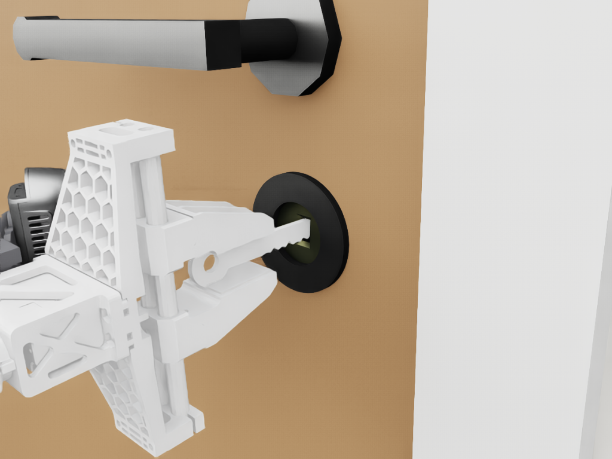
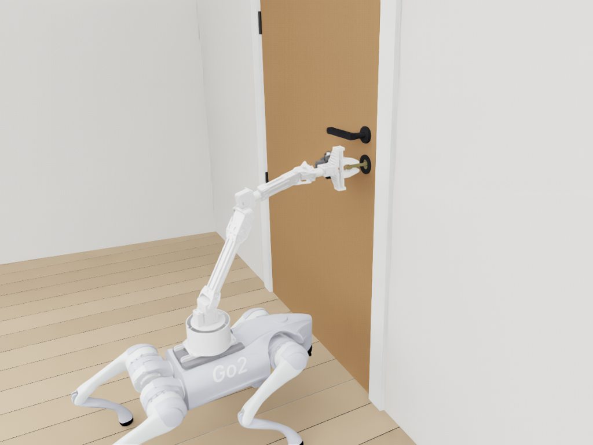
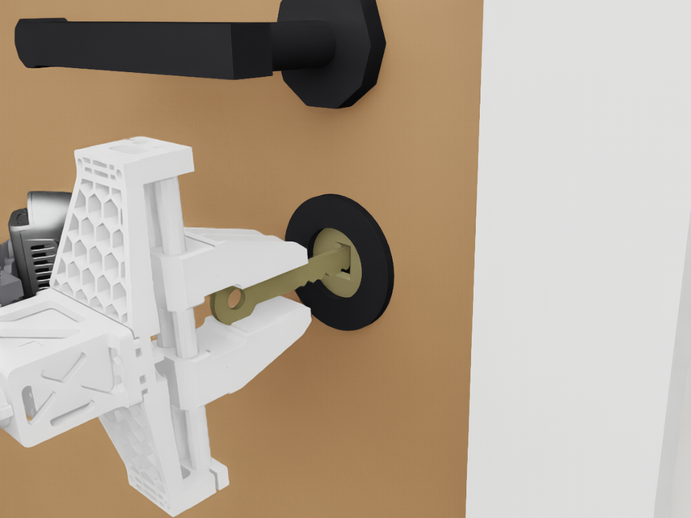
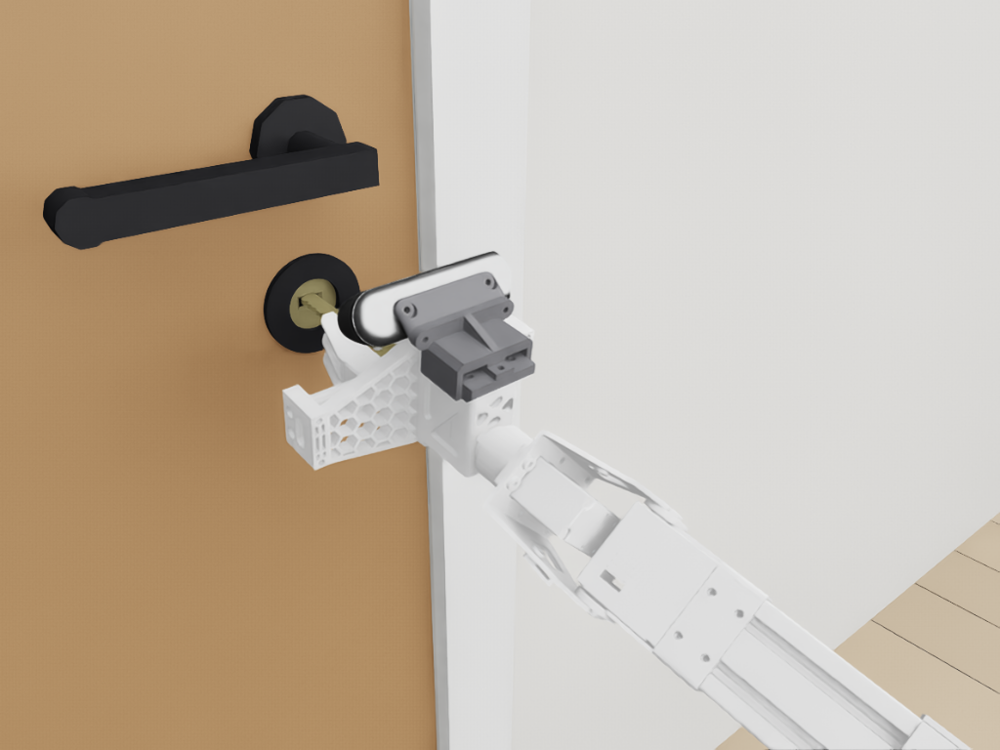
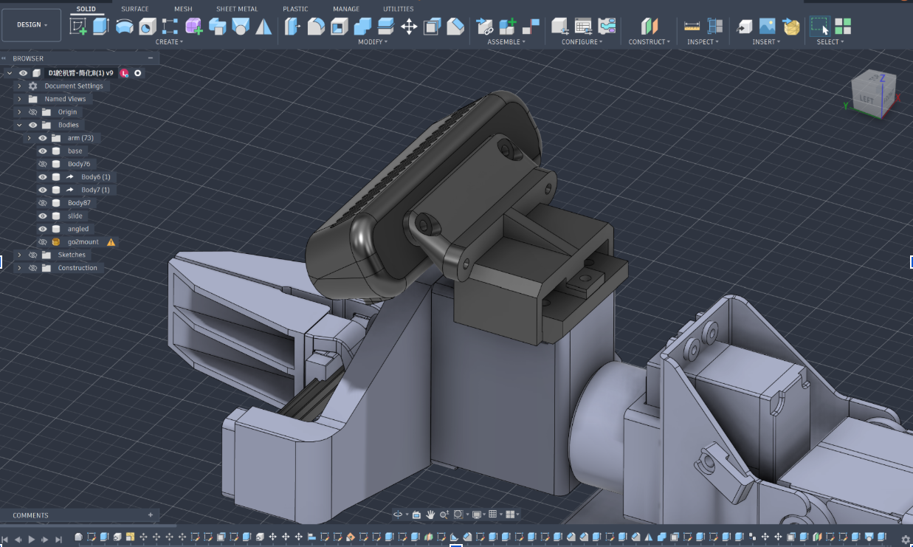
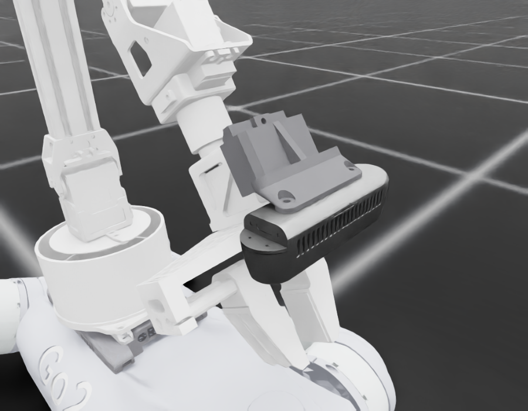
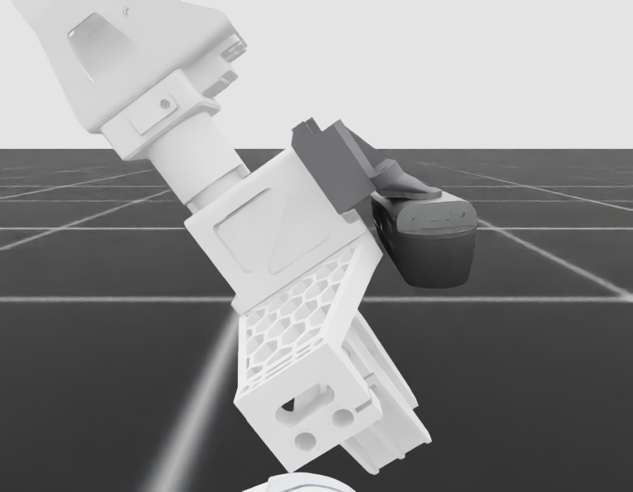

# Week 4 — 5–11 October 2026

**Status:** in progress
**Focus:** Establish physical free-space control and first instrumented contact; resolve force and transfer feasibility

## Planned

From the [revised Thesis B plan](../../docs/thesis_b_plan.md#thesis-b-weekly-schedule),
16 September 2026. This replaces the original Appendix A timing; earlier dated logs remain historical evidence.

- **Reuse, simulation and learning:** Obtain repeatable simulated pressing and box phases; run P1/P3 pilots and start matched seeds once the configuration is stable.
- **Hardware and camera:** Complete G5 evidence; perform instrumented low-force contact after entry checks; compare estimated/measured forces and identify dynamics/timing mismatches.
- **Evidence and deliverable:** Week 4 scope decision: protect the tagged-box sequence; defer extra tasks/large-workspace locomotion if needed. Label any sensor-assisted diagnostic method separately.
- **Gate focus:** G5; G6 begins; G2 before substantive contact comparisons.

## Checklist

- [ ] Physical free-space pose tracking meets frozen tolerances without falls or limit violations
- [ ] Hold/abort behaviour exercised and logged
- [ ] Simulated pressing and box engagement phases pass declared task cases
- [ ] First instrumented physical contact recorded after G2/G5 and simulation evidence
- [ ] Force-estimator error, contact loss and force peaks measured independently
- [ ] Measured dynamics/timing updates versioned consistently across comparisons
- [ ] Core-scope decision and any deferrals documented

## Log

<!-- Dated entries (### YYYY-MM-DD · topic). For each: the exact command or change, the outcome in numbers,
     and what it does and does not show. Record runs with ./dashboard.py record. -->

### 2026-10-09 · The D1 given Unitree's CAD lengths (F-139) and a 3.33 N·m shoulder and elbow (F-140), and everything that reads them re-run

**Lukas:** "can you modify the urdf to match the cad file, and then rerun all the tests that this change would affect.
you have over a day of gpu for this". This follows F-137 (2026-10-08).

**Numbering (2026-10-13):** written as F-138–F-140, renumbered F-139–F-141 when `origin/main`'s 81b3a13 was merged in:
its F-138 (the wrist camera's bracket, below) took the number first.

**The change: five joint origins in `d1_arm/d1.urdf`.** The rule: every joint axis sits at q = 0 where the CAD puts it.
Each origin's component along its own joint's axis is kept, so `d1_description`'s meshes stay where they sit on their
axes. `python3 d1_arm/compare_cad.py <D1-550 .stp> <d1_550_description.urdf>` prints the result against both.

| origin | before | after | what it sets | CAD |
| --- | --- | --- | --- | --- |
| Joint2 z | 0.0563 | 0.0548 | shoulder above the base's bottom face | 130.80 mm |
| Joint3 y | 0.2693 | 0.27 | upper arm, Joint2 → Joint3 | 270.00 |
| Joint3 z | 0.0009 | 0 | the forearm's roll line off Joint1's axis (was 1.40 mm) | 0.50 |
| Joint4 y | 0.042 | 0.041325 | elbow offset, Joint3 axis → roll line | 41.32 |
| Joint5 z | 0.14018 | 0.146973 | forearm, Joint3 → Joint5 along the roll line | 204.67 |
| Joint6 x | 0.0825 | 0.080781 | Joint5 → the closed fingertips | 206.38 |

- **Matched.** Every row of `compare_cad.py` now matches the CAD to 0.01 mm, and the wrist roll's line sits 0.38 mm off
  Joint1's axis, as in the CAD.
- **One residual.** The wrist roll line sits 0.98 mm below the forearm's, against the CAD's 0.62. Unitree's D1-550 URDF
  has 0.97 too; left as it was.
- **Joint3 z** is beyond F-137's five lengths. The CAD's 0.50 mm comes from the coaxial-cylinder fit, with its sign
  mapped through the elbow's geometry. The D1-550 URDF has −0.50 mm, the same.

What was kept, and why:
- **The hand: `d1_description`'s.**
  - The controlled point and everything fixed in the hand's frames sit on it: `TOOL_OFFSET_M`, the jaw centre
    (`Link6 + 0.1051`), the L-claw lips, `grasp.py`'s finger measurements and the key.
  - It is not the CAD's hand. The D1-550 URDF's jaws are 67 mm long against 62, and its gripper housing starts ~6 mm
    nearer the wrist. Its jaws close to a 0 mm gap and open to 66 mm; `d1.urdf`'s go from 17.2 mm to 77.2 mm.
  - Placing the tips on the CAD's puts this hand's housing ~6 mm further out than the CAD's. None of it was measured
    on the arm.
- **The link meshes: `d1_description`'s, each on its CAD axis.** They still overlap at every joint. The forearm tube now
  reaches 6.5 mm into the wrist housing, where it reached 13.3.
- **The inertials: unchanged in their link frames.** They are shells, which the weld scales to 3.152 kg.
- **The effort limits, at first: Unitree's spec table**, Joint3 1.7 N·m, since the CAD does not settle it (F-137).
  Lukas then set the shoulder and elbow to 3.33 N·m (below).

**One measurement disagrees with the CAD.** Lukas's ruler (2026-09-30, F-126) put the shoulder 76 + 56.3 = 132.3 mm above
the base's bottom face. The CAD has 130.8: its rotating plate's top at 75.5, then 55.3 to the shoulder axis. The URDF
follows the CAD, as asked. A caliper reading from the bottom face to the shoulder axis settles the 1.5 mm.
`measured_base.py`'s docstring now says so; its table of what was measured is unchanged.

**Also changed:**
- **`description/go2_d1.urdf`, rebuilt:**
  `python3 description/build_go2_d1_urdf.py ~/go2_ws/Go2RemoteConnection/description/go2/go2.urdf`.
  - The diff is the five origins and nothing else.
  - The script's default source, P2Dingo's `go2.urdf`, now draws a heatshield whose meshes are not in this repository,
    so it was not used.
- **`demos/cup/d1_ui/server.py`** reads the shoulder height off `d1.urdf`. It had `0.076 + 0.0563` written in, which
  went stale for the second time.
- **`mount.ARM_SHIFT_FROM_LEGACY_M`: unchanged.** It is the base's move, and the scenes were not moved again for a
  1.5 mm shoulder. Its comment says the arm above the base changed.
- **`task_space.ZERO_ACTION_TIP_M`: re-measured** (below).
- **The README's table row and `d1.urdf`'s header** say what changed.

**Not changed:**
- The Isaac Gym asset (`~/thesis_b_legacy/UniFP/resources/robots/go2d1/go2d1.urdf`, from
  `unifp_go2d1/build_asset.py`). It has been stale since 2026-09-20: it was not rebuilt after F-125 or F-126 either,
  and nothing current uses it.
- **The real arm.** `d1_ik.py` and `d1_hardware.py` read `d1.urdf` at import, and `demos/cup/run_ui.sh` copies it to the
  dog on deploy. The next deploy plans with the CAD lengths. Nothing was run on hardware.

**Tests** (`python -m unittest discover -s . -p "test_*.py"`, Isaac env):
- **Old arm**, HEAD `054983a` in a scratch worktree: 674 run, 1 fail. It is the combiner tag-pose test, at 5.18 mm
  against 5.0, as since 2026-10-06.
- **Corrected arm**, before re-pinning: 3 fail, all in `tests/test_workspace.py`, all forward-kinematics pins.
  - Link6 at the zero pose: (0.2614, −0.0013, 0.5281) → (0.2665, −0.0004, 0.5266) m.
  - The tool point: (0.3867, −0.0139, 0.5277) → (0.3918, −0.0130, 0.5262) m.
  - The scenes' shift as the move of the whole arm. That was true only while the arm above its base was
    `d1_description`'s. Now renamed `test_the_scenes_shift_is_the_arms_base_move_from_the_legacy_one`. It checks
    Link1's move from the legacy arm against the shift exactly. It checks Link6's against the shift plus the arm's own
    change at the zero pose, (+5.07, +0.90, −1.48) mm.
- **After re-pinning: 674 run, all pass** (5 skipped). `tests/test_evidence.py` passes on the system Python.
- **The tag-pose test now passes, at 3.94 mm.** Take that as chance, not a fix: F-128 put the estimator's p90 at
  ~6.5 mm over placements.

**G0** (`python run_position_only.py verify --headless --num_envs 8`):
[**25/25**](#/week/4/run/20261009T044449_261854Z_verify_seed42).
- Link6 matches URDF kinematics to 0.64 µm and the tool point to 0.72 µm.
- The resting tip is (0.3435, −0.0131, 0.7913) m, 5.8 mm from the recorded one (2.3 mm before).
- The box is 17.2 cm from it, against 17.4.

**Stance probe** (Week 3's `stance_probe.py`, run from a copy with its `/home/lukas` paths changed;
[json](figures/stance_probe_cad_arm.json)):
- The base settles at (−0.0570, 0, 0.2736) m, unchanged to 0.1 mm.
- The resting tip is **(0.3430, −0.0131, 0.7890) m**: +5.2, +1.0 and −1.6 mm from before. `task_space.ZERO_ACTION_TIP_M`
  holds it.

**The CPU models on both arms:**
- **Workspace** (`python -m position_only.workspace --out …`; [json](figures/d1_workspace_cad_arm.json),
  [png](figures/d1_workspace_cad_arm.png)). At the settled height the pincer tip reaches 98.71% of the target box, all
  of it clear and holdable (old arm 98.99%). The model misses the measured resting tip by 13.7 mm (13.5).
- **F-101's force study and the direction capacities.** The Week 2 scripts were run on copies, so their records stand
  ([json](figures/force_transmission_study_cad_arm.json), [json](figures/direction_capacity_cad_arm.json)).
  - The arm-alone capacities agree to 1%. The typical horizontal pull's median is 9.43 N against 9.44; down 9.1
    against 9.2; up 2.5 against 2.6. So `mech_cfg.LEVER_PEAK_N`'s basis stands.
  - The best robust standing pull is 45.0 N against 49.2. The search's best posture moved from a 0.45 m handle to
    0.40 m.
  - Pulling stays the stable direction. At the level 0.35 m posture no pull destabilises the pinned arm at any
    stiffness scale; a push does at 36–360 N.

**Then the shoulder and elbow: 3.33 N·m.** Mid-session Lukas wrote: "Actually, I'm pretty convinced the shoulder and
elbow motors are the same so we should retrain assuming 3.33 for both".
- **Changed, all four copies at once.** Joint2 3.3 → 3.33 and Joint3 1.7 → 3.33 N·m in:
  - `d1.urdf`'s `<limit effort>` (rebuilt into `description/go2_d1.urdf`);
  - `motor_model.D1_EFFORT_LIMIT_NM` (the force drives), labelled URDF-unverified with its source: the D1-550 URDF, the
    CAD's identical housings (F-137), Lukas's call;
  - `unifp_isaaclab/interface.TORQUE_LIMITS` (the UniFP actuator, the torque-limit reward, the arm-margin terms);
  - `position_only/workspace.EFFORT_LIMIT_NM` (holdability in the scripted planners).
- **Unchanged.** Joint1 stays at the table's 3.3 and Joint4–6 at 1.7: Lukas named only the shoulder and elbow.
- **Recorded.** `run_unifp_train.py` writes `arm_effort_limits_nm` into every run's `run.json`, so a run says which elbow
  it had.
- **Docs that stated the old limits:** `docs/position_only_environment.md` (the torque limits) and
  `unifp_train/README.md` (which rope policy goes with which elbow) now say both.
- **The insertion fine-tune that had just started** on the 1.7 N·m elbow was stopped after 10 iterations and recorded as
  interrupted ([run](#/week/4/run/20261009T060853_train_seed3_ins_cadft)).
- **Tests.**
  - New: `test_the_arm_effort_limits_agree_everywhere` (the four copies).
  - The arm-margin test now takes Joint3's limit from `interface`; it had 1.7 written in.
  - The two Isaac Gym fidelity tests keep comparing against their recordings, now with the departure stated.
    - `test_control_constants` checks the recording's 3.3 and 1.7, then expects 3.33.
    - The reward replay patches the recording's own limits in for its run.
  - **675 run, all pass** (5 skipped). `test_evidence` passes on the system Python.
- **Position-only manifests now report a condition mismatch.** They record the effort limits in their conditions, so a
  position-only frozen evaluation on this robot is flagged as a different robot, which it is. The UniFP manifests
  record no limits.
- **G0** ([verify](#/week/4/run/20261009T061304_980982Z_verify_seed42)): **25/25**.
  - Link6 0.71 µm, the tool point 0.84 µm.
  - The resting tip is 2.3 mm from the re-measured one: the elbow's limit does not move the rest pose.
- **The CPU models with the 3.33 N·m elbow** ([json](figures/direction_capacity_cad_arm_elbow333.json),
  [json](figures/force_transmission_study_cad_arm_elbow333.json)). Medians, the arm alone:

  | | 1.7 N·m elbow | 3.33 N·m elbow |
  | --- | --- | --- |
  | lift (up) | 2.5 N | 5.8 N |
  | push down | 9.1 N | 12.3 N |
  | pull back | 9.4 N | 10.4 N |
  | typical horizontal pull | 9.43 N | 10.47 N |
  | best robust standing pull | 45.0 N | 64.6 N |

  - The joint that binds first moves from Joint3 to Joint1 and Joint2.
  - `mech_cfg.LEVER_PEAK_N` (3–35 N) was drawn against the 1.7 N·m capacities ("median 9 N downward") and is not
    changed, so the mechanism tasks stay as they were.
  - The target box stays 98.71% reachable, clear and holdable: at the settled height reach limits it, not torque.

**The checkpoints in use, on their frozen sets, on all three robots.**
- Every evaluation ran today with the same code on the same GPU. The two corrected robots ran from this tree; the old
  arm ran from the worktree at `054983a`.
- The old-arm numbers reproduce F-127's and F-136's exactly. So these evaluations are deterministic here, and every
  difference below comes from the robot.

| policy | frozen set | old arm | CAD lengths, elbow 1.7 | CAD lengths, elbow 3.33 |
| --- | --- | --- | --- | --- |
| reach `57499` | 50 episodes, fingertip, settled median / p90 | [1.70 / 2.16 cm](#/week/4/run/20261009T045509_eval_seed20260921_old_base_reach57499) | [1.71 / 2.16 cm](#/week/4/run/20261009T044740_eval_seed20260921_cad_base_reach57499) | [1.78 / 2.19 cm](#/week/4/run/20261009T061339_eval_seed20260921_c33_base_reach57499) |
| mechanism `17499` | held-out test, of 512 | [498](#/week/4/run/20261009T045537_mech_eval_seed1_old_base_mech_test_17499) (button 114) | [497](#/week/4/run/20261009T044810_mech_eval_seed1_cad_base_mech_test_17499) (button 113) | [491](#/week/4/run/20261009T061417_mech_eval_seed1_c33_base_mech_test_17499) (button 107), **4 falls** |
| lever `21496` | levers ≤ 0.6 m, of 360 | [343](#/week/4/run/20261009T045607_mech_eval_seed1_old_base_lever_21496) | [344](#/week/4/run/20261009T044848_mech_eval_seed1_cad_base_lever_21496) | [336](#/week/4/run/20261009T061453_mech_eval_seed1_c33_base_lever_21496) |
| lever `21496` | held-out test, of 512 | [505](#/week/4/run/20261009T045637_mech_eval_seed1_old_base_lever_test_21496) (button 123) | [502](#/week/4/run/20261009T044918_mech_eval_seed1_cad_base_lever_test_21496) (button 119) | [492](#/week/4/run/20261009T061525_mech_eval_seed1_c33_base_lever_test_21496) (button 108) |
| insertion `21400` | 96 lateral, seated (damaged) | [73 (1)](#/week/4/run/20261009T045707_ins_eval_seed1_old_base_ins_lateral_21400) | [77 (1)](#/week/4/run/20261009T044948_ins_eval_seed1_cad_base_ins_lateral_21400) | [76 (1)](#/week/4/run/20261009T061557_ins_eval_seed1_c33_base_ins_lateral_21400) |
| insertion `21400` | 96 detent, seated (damaged) | [68 (4)](#/week/4/run/20261009T045748_ins_eval_seed1_old_base_ins_detent_21400) | [67 (**8**)](#/week/4/run/20261009T045028_ins_eval_seed1_cad_base_ins_detent_21400) | [79 (2)](#/week/4/run/20261009T061638_ins_eval_seed1_c33_base_ins_detent_21400) |
| rope `14600` | development, mean at 20 / 35 / 50 N; falls | [22.0 / 34.7 / 50.1 N; 0 of 108](#/week/4/run/20261009T045829_rope_eval_seed1_old_base_rope_dev_14600) | [21.7 / 34.3 / 49.8 N; 0 of 108](#/week/4/run/20261009T045111_rope_eval_seed1_cad_base_rope_dev_14600) | [**26.8 / 40.3 / 56.0 N**; 0 of 108](#/week/4/run/20261009T061718_rope_eval_seed1_c33_base_rope_dev_14600) |
| rope `14600` | held out, mean at 15 / 30 / 45 N; falls | [17.4 / 30.0 / 44.3 N; 0 of 192](#/week/4/run/20261009T045905_rope_eval_seed1_old_base_rope_test_14600) | [16.8 / 29.6 / 43.9 N; 0 of 192](#/week/4/run/20261009T045152_rope_eval_seed1_cad_base_rope_test_14600) | [**21.3 / 35.6 / 51.1 N**; 0 of 192](#/week/4/run/20261009T061753_rope_eval_seed1_c33_base_rope_test_14600) |
| press pilot `21599` | panel / force / recessed | [63/96](#/week/4/run/20261009T045944_press_eval_seed1_old_base_press_panel_pilot) / [19/48](#/week/4/run/20261009T050012_press_eval_seed1_old_base_press_force_pilot) / [31/72](#/week/4/run/20261009T050040_press_eval_seed1_old_base_press_recessed_pilot) (3 damaged) | [64/96](#/week/4/run/20261009T045247_press_eval_seed1_cad_base_press_panel_pilot) / [21/48](#/week/4/run/20261009T045320_press_eval_seed1_cad_base_press_force_pilot) (2 damaged) / [30/72](#/week/4/run/20261009T045351_press_eval_seed1_cad_base_press_recessed_pilot) (3) | [57/96](#/week/4/run/20261009T061828_press_eval_seed1_c33_base_press_panel_pilot) / [20/48](#/week/4/run/20261009T061856_press_eval_seed1_c33_base_press_force_pilot) / [30/72](#/week/4/run/20261009T061929_press_eval_seed1_c33_base_press_recessed_pilot) (1) |
| wipe pilot `21599` | 36 paths | [23/36](#/week/4/run/20261009T050109_wipe_eval_seed1_old_base_wipe_pilot), pad tilt 9.3° | [22/36](#/week/4/run/20261009T045422_wipe_eval_seed1_cad_base_wipe_pilot), 8.7° | [21/36](#/week/4/run/20261009T062001_wipe_eval_seed1_c33_base_wipe_pilot), 8.6° |

What it shows:
- **The lengths alone: the closed-loop policies hardly notice the 6 mm.**
  - The reach policy's error is unchanged: it tracks the measured tool point, wherever the kinematics put it.
  - The mechanism and lever policies move by 1–4 episodes of 360–512.
  - The rope pull holds every level with no fall, about 0.4 N lower than before.
  - Insertion, the millimetre task, moves most: 4 more lateral slots seated, but 8 detent slots damaged against 4.
  - None of this is a loss the size of F-127's. The base change cost the unretrained reach policy 1.51 → 4.35 cm, and
    insertion (`21200`) 75 → 33 lateral slots.
- **The 3.33 N·m elbow matters more than the lengths.**
  - **The rope policy over-pulls by ~6 N** at every level (held out 21.3 / 35.6 / 51.1 N for 15 / 30 / 45). It learnt
    to pull against an elbow that saturated at 1.7 N·m (F-135), and a stronger elbow adds force the policy did not
    expect. Still no fall in 300 releases.
  - **The mechanism controller falls for the first time:** 4 times, all on the button's two highest levels, and it
    opens 491 of 512. The lever policy loses 8 levers and 10 of the test.
  - **Insertion's detent damage drops back** (2, seating 79). Whether that is the elbow or chance is not separable on
    one set.
  - Reach and wipe barely move. The press panel loses 6.

What it does not show: anything at hardware scale (nothing ran on the arm), or a second seed. Each difference holds for
these sets on this GPU. Differences of 1–4 episodes are within what any small perturbation moves.

**The PhysX demos on all three robots.** Each demo was run on each today, with the commands of
2026-10-06 (F-127–F-129) and the checkpoints in use.

| demo | old arm | CAD lengths, elbow 1.7 | CAD lengths, elbow 3.33 |
| --- | --- | --- | --- |
| UniFP cup, `57499`, `--wrist` | [7/16](#/week/4/run/20261009T053144_cup_unifp_wrist_seed1_old_cup_57499) (10 picked, 3 spilt, 1 knocked over) | [10/16](#/week/4/run/20261009T050209_cup_unifp_wrist_seed1_cad_cup_57499) (13 picked, 3 spilt) | [6/16](#/week/4/run/20261009T062109_cup_unifp_wrist_seed1_c33_cup_57499) (9 picked, 3 spilt, 1 knocked over) |
| UniFP box, `57499`, `--wrist` | [0/16](#/week/4/run/20261009T053210_combiner_unifp_wrist_seed1_old_box_57499) | [1/16](#/week/4/run/20261009T050235_combiner_unifp_wrist_seed1_cad_box_57499) | [3/16](#/week/4/run/20261009T062138_combiner_unifp_wrist_seed1_c33_box_57499) |
| UniFP box, scripted fix, seeds 1 + 2 | [9](#/week/4/run/20261009T053311_combiner_unifp_wrist_corr_seed1_old_boxfix_s1) + [3](#/week/4/run/20261009T053413_combiner_unifp_wrist_corr_seed2_old_boxfix_s2) = 12/32 | [7](#/week/4/run/20261009T050336_combiner_unifp_wrist_corr_seed1_cad_boxfix_s1) + [4](#/week/4/run/20261009T050439_combiner_unifp_wrist_corr_seed2_cad_boxfix_s2) = 11/32 | [2](#/week/4/run/20261009T062244_combiner_unifp_wrist_corr_seed1_c33_boxfix_s1) + [3](#/week/4/run/20261009T062347_combiner_unifp_wrist_corr_seed2_c33_boxfix_s2) = **5/32** |
| standing combiner, mechanism `17499`, 16 N·m door | [16/16](#/week/4/run/20261009T053515_combiner_mech_law_seed1_old_door16_17499) | [16/16](#/week/4/run/20261009T050542_combiner_mech_law_seed1_cad_door16_17499) | [16/16](#/week/4/run/20261009T062450_combiner_mech_law_seed1_c33_door16_17499) |
| lever demo, `21496` | [16/16](#/week/4/run/20261009T053620_combiner_mech_law_seed1_old_lever_21496) | [16/16](#/week/4/run/20261009T050646_combiner_mech_law_seed1_cad_lever_21496) | [**9/16, 2 falls**](#/week/4/run/20261009T062555_combiner_mech_law_seed1_c33_lever_21496) |
| insertion, `21400`, seeds 2 / 3 / 4 | [46/48](#/week/4/run/20261009T053729_insertion_policy_seed2_old_ins_21400_s2), [45/48](#/week/4/run/20261009T053843_insertion_policy_seed3_old_ins_21400_s3), [88/96](#/week/4/run/20261009T053959_insertion_policy_seed4_old_ins_21400_s4) | [47/48](#/week/4/run/20261009T050755_insertion_policy_seed2_cad_ins_21400_s2), [46/48](#/week/4/run/20261009T050910_insertion_policy_seed3_cad_ins_21400_s3), [88/96](#/week/4/run/20261009T051023_insertion_policy_seed4_cad_ins_21400_s4); no damage, no falls in either | [44/48](#/week/4/run/20261009T062704_insertion_policy_seed2_c33_ins_21400_s2), [44/48](#/week/4/run/20261009T062818_insertion_policy_seed3_c33_ins_21400_s3), [89/96](#/week/4/run/20261009T062932_insertion_policy_seed4_c33_ins_21400_s4); no damage, no falls |
| lying cup pick, 11 sweep stops | [11/11](#/week/4/run/20261009T054226_035077Z_pick_seed42) | [11/11](#/week/4/run/20261009T051242_847159Z_pick_seed42), lift 0.117–0.119 m in both | [11/11](#/week/4/run/20261009T063153_608379Z_pick_seed42) |
| lying combiner, 0.3 N·m, seeds 42 / 2026 | [8/9](#/week/4/run/20261009T055042_283323Z_combiner_seed42), [8/8](#/week/4/run/20261009T055823_450019Z_combiner_seed2026) | [**4/9**](#/week/4/run/20261009T052042_706021Z_combiner_seed42), [**6/8**](#/week/4/run/20261009T052551_047380Z_combiner_seed2026) | [4/9](#/week/4/run/20261009T063959_157314Z_combiner_seed42), [6/8](#/week/4/run/20261009T064508_850577Z_combiner_seed2026), the same −40° stop |

**The lying combiner's regression is a tolerance, not a plan.**
- **Every failure is the same.** The sequence never arrives at its −40° search stop: "no arrival (worst joint error
  0.031 rad; per joint [0.007, 0.008, 0.007, 0.031, 0.006, 0.027])".
- **The success/failure split is exact.** Every attempt that saw the tag at +0° or −20° opened its door. Every one
  that needed the −40° stop failed.
- **The old arm was on the edge already.** It arrived at that stop with a 0.0291 rad error, inside the 0.03 rad
  `Timing.arrive_tolerance_rad` by 0.0009. The new geometry settles at 0.031, just outside.
- **What holds the joints off target.** Joint4's drive target is the command (−0.3194 rad) but the joint rests at
  −0.3501, under a projected joint force of 0.023 N·m; Joint6 holds 0.026 rad off on 0.0002 N·m.
- **Not a contact.** The arm's links stay ≥ 30 mm apart at both poses. A run with the articulation's self-collisions
  off fails identically, to the third decimal
  ([diagnostic](#/week/4/run/20261009T060518_586613Z_combiner_seed42)).
- **A loose end in the servo model.** These torques read like weak, inertia-scaled drives rather than the 4000 N·m/rad
  force drive `d1_servo` sets: Joint6 sits 0.027 rad off on 0.0002 N·m, while Joint3 needs 1.07 N·m for 0.0066 rad.
  Both arms are the same here, and this change does not cause it; worth checking against F-010 separately.
- **Not changed.** The 0.03 rad tolerance is shared with the real arm's pick sequence (`demos/cup/pick_demo/sequence.py`),
  so loosening it is Lukas's call. A probe with 0.035 rad, in memory only, is queued.

**The walking playback's self-test** (`./run_sim.sh --headless --no_ros2 --selftest 10 --selftest_command …`, Week 1's
command; the import's acceleration drives on the arm, as playback keeps them):

| command | old arm | CAD lengths, elbow 1.7 | CAD lengths, elbow 3.33 |
| --- | --- | --- | --- |
| forward 1.0 m/s | [94.9%](#/week/4/run/20261009T060814_409239Z_playback_arm_+1.0_+0.0_+0.0), tilt 6.8°, arm 3.2 cm off its teleop target | [95.6%](#/week/4/run/20261009T060723_680696Z_playback_arm_+1.0_+0.0_+0.0), 6.9°, 3.6 cm | [94.6%](#/week/4/run/20261009T065120_500492Z_playback_arm_+1.0_+0.0_+0.0), 7.1°, 3.3 cm |
| sideways 0.5 m/s | [87.9%](#/week/4/run/20261009T060830_978830Z_playback_arm_+0.0_+0.5_+0.0), 7.0°, 3.4 cm | [87.8%](#/week/4/run/20261009T060740_637696Z_playback_arm_+0.0_+0.5_+0.0), 7.7°, 3.3 cm | [88.2%](#/week/4/run/20261009T065137_298237Z_playback_arm_+0.0_+0.5_+0.0), 7.9°, 3.4 cm |
| turning 1.0 rad/s | [96.3%](#/week/4/run/20261009T060848_356722Z_playback_arm_+0.0_+0.0_+1.0), 25.3°, 2.8 cm | [102.1%](#/week/4/run/20261009T060757_497285Z_playback_arm_+0.0_+0.0_+1.0), 23.8°, 3.2 cm | [100.7%](#/week/4/run/20261009T065154_222992Z_playback_arm_+0.0_+0.0_+1.0), 27.1°, 3.4 cm |

No falls; the walking policy notices neither the arm's lengths nor its elbow.

What the demos show:
- **The lengths alone cost one demo.** The lying combiner fails on a tolerance (above); every other demo is within an
  attempt or two, or better.
- **The 3.33 N·m elbow costs the force demos, unretrained.**
  - The lever demo falls from 16/16 to 9/16, with 2 falls.
  - The UniFP box's scripted fix falls from 11/32 to 5/32.
  - The standing combiner keeps 16/16, as do insertion (44/44/89) and the lying cup pick (11/11).
  - The elbow changes nothing in the lying combiner: the same −40° stop fails.

**The fine-tunes on the 3.33 N·m robot, each with its control.** Each lineage was continued with its own recipe from
the checkpoint in use, once on this robot and once, identically, on the old arm (the worktree). The control is the one
F-127 lacked: it separates what the robot does from what more training does. Every saved checkpoint was scored on the
same frozen sets.

*Insertion* (`21400`, 800 iterations at the pinned 1e-5 rate, curriculum from level 0.8, arm noise 0.15, seed 3: F-127's
recipe). Runs: [3.33 N·m](#/week/4/run/20261009T065159_train_seed3_ins_c33ft), [old arm](#/week/4/run/20261009T074210_train_seed3_ins_oldft).

| checkpoint | 3.33 N·m: lateral / detent seated (damaged) | old arm: lateral / detent seated (damaged) |
| --- | --- | --- |
| `21400`, as it is | 76 (1) / 79 (2) | 73 (1) / 68 (4) |
| 21600 | [46 (0)](#/week/4/run/20261009T073714_ins_eval_seed1_c33ft_ins_lateral_model_21600) / [50 (1)](#/week/4/run/20261009T073752_ins_eval_seed1_c33ft_ins_detent_model_21600) | [49 (0)](#/week/4/run/20261009T082847_ins_eval_seed1_oldft_ins_lateral_model_21600) / [49 (0)](#/week/4/run/20261009T082924_ins_eval_seed1_oldft_ins_detent_model_21600) |
| 21800 | [54 (0)](#/week/4/run/20261009T073829_ins_eval_seed1_c33ft_ins_lateral_model_21800) / [45 (2)](#/week/4/run/20261009T073906_ins_eval_seed1_c33ft_ins_detent_model_21800) | [38 (11)](#/week/4/run/20261009T083002_ins_eval_seed1_oldft_ins_lateral_model_21800) / [32 (14)](#/week/4/run/20261009T083039_ins_eval_seed1_oldft_ins_detent_model_21800) |
| 22000 | [59 (0)](#/week/4/run/20261009T073943_ins_eval_seed1_c33ft_ins_lateral_model_22000) / [44 (4)](#/week/4/run/20261009T074020_ins_eval_seed1_c33ft_ins_detent_model_22000) | [48 (6)](#/week/4/run/20261009T083116_ins_eval_seed1_oldft_ins_lateral_model_22000) / [48 (4)](#/week/4/run/20261009T083153_ins_eval_seed1_oldft_ins_detent_model_22000) |
| 22199 | [31 (0)](#/week/4/run/20261009T074057_ins_eval_seed1_c33ft_ins_lateral_model_22199) / [25 (0)](#/week/4/run/20261009T074134_ins_eval_seed1_c33ft_ins_detent_model_22199) | [41 (15)](#/week/4/run/20261009T083230_ins_eval_seed1_oldft_ins_lateral_model_22199) / [41 (14)](#/week/4/run/20261009T083307_ins_eval_seed1_oldft_ins_detent_model_22199) |

What it shows:
- **Every checkpoint of both runs is worse than where it started.** The control falls the same way, so it is the
  recipe, not the robot.
- **This is F-121's decline.** `21400` was already the best, 200 iterations into F-127's run of this recipe.
  Restarting the recipe from there (its curriculum back at level 0.8, its noise reset) goes straight downhill.
- **Insertion keeps `21400`.** On the 3.33 N·m robot it seats 76 and 79, with 1 and 2 damaged, as well as or better
  than on the old arm.

Not shown: whether a gentler continuation (fewer iterations, no curriculum restart) would help; nothing here asked for
one.

*Reach* (`57499`, 1,500 iterations, UniFP's recipe at the fingertip: F-127's). Runs:
[3.33 N·m](#/week/4/run/20261009T083344_train_seed1_reach_c33ft), [old arm](#/week/4/run/20261009T094213_train_seed1_reach_oldft).
Settled tool-tip error on the frozen 50 episodes, median / p90, no falls anywhere:

| checkpoint | 3.33 N·m | old arm |
| --- | --- | --- |
| `57499`, as it is | 1.78 / 2.19 cm | 1.70 / 2.16 cm |
| 58000 | [1.54 / 2.10](#/week/4/run/20261009T094034_eval_seed20260921_c33ft_reach_model_58000) | [1.84 / 2.72](#/week/4/run/20261009T104855_eval_seed20260921_oldft_reach_model_58000) |
| 58400 | [**1.40 / 1.93**](#/week/4/run/20261009T094059_eval_seed20260921_c33ft_reach_model_58400) | [1.67 / 2.24](#/week/4/run/20261009T104920_eval_seed20260921_oldft_reach_model_58400) |
| 58800 | [1.60 / 2.02](#/week/4/run/20261009T094124_eval_seed20260921_c33ft_reach_model_58800) | [1.57 / 2.29](#/week/4/run/20261009T104945_eval_seed20260921_oldft_reach_model_58800) |
| 58998 | [1.85 / 2.90](#/week/4/run/20261009T094149_eval_seed20260921_c33ft_reach_model_58998) | [1.65 / 2.41](#/week/4/run/20261009T105009_eval_seed20260921_oldft_reach_model_58998) |

What it shows:
- **On the 3.33 N·m robot the fine-tune helps.** `58400` reaches 1.40 / 1.93 cm, the best this reach policy has
  scored on any robot (F-118: 1.51 / 2.17 on its own). Three of the four checkpoints beat `57499` on both numbers.
- **On the old arm the same training helps less.** The median falls to 1.57 cm at best, but every p90 is worse than
  `57499`'s 2.16.
- **The checkpoints swing by 0.3–0.5 cm.** So the gap between the arms is about the size of that swing.
- **Candidate: `58400`**, re-scored in the demos below.

Not shown: a second seed. `58400` was chosen on the set it is scored on, as F-127 chose `57499`, so its number is the
optimistic one.

*Lever* (`21496`, 1,000 iterations, the lever recipe: F-114's, as in F-127). Runs:
[3.33 N·m](#/week/4/run/20261009T105034_train_seed1_lever_c33ft), [old arm](#/week/4/run/20261009T114145_train_seed1_lever_oldft).

| checkpoint | 3.33 N·m: levers of 360 (falls) / test of 512 | old arm: levers (falls) / test |
| --- | --- | --- |
| `21496`, as it is | 336 (0) / 492 | 343 (0) / 505 |
| 22000 | [344 (3)](#/week/4/run/20261009T113901_mech_eval_seed1_c33ft_lever_model_22000) / [474](#/week/4/run/20261009T113928_mech_eval_seed1_c33ft_lever_test_model_22000) | [354 (1)](#/week/4/run/20261009T122955_mech_eval_seed1_oldft_lever_model_22000) / [506](#/week/4/run/20261009T123022_mech_eval_seed1_oldft_lever_test_model_22000) |
| 22400 | [344 (**12**)](#/week/4/run/20261009T113956_mech_eval_seed1_c33ft_lever_model_22400) / [494](#/week/4/run/20261009T114022_mech_eval_seed1_c33ft_lever_test_model_22400) | [332 (0)](#/week/4/run/20261009T123050_mech_eval_seed1_oldft_lever_model_22400) / [441](#/week/4/run/20261009T123117_mech_eval_seed1_oldft_lever_test_model_22400) |
| 22495 | [352 (7)](#/week/4/run/20261009T114050_mech_eval_seed1_c33ft_lever_model_22495) / [479](#/week/4/run/20261009T114117_mech_eval_seed1_c33ft_lever_test_model_22495) | [349 (4)](#/week/4/run/20261009T123144_mech_eval_seed1_oldft_lever_model_22495) / [429](#/week/4/run/20261009T123211_mech_eval_seed1_oldft_lever_test_model_22495) |

What it shows:
- **On the 3.33 N·m robot the fine-tune opens more levers but starts falling.** It reaches 344–352 of 360 against
  336, but with 3–12 falls where `21496` had none. No checkpoint beats `21496` on the held-out test (474–494 against
  492).
- **The control shows the same churn.** It swings 332–354 and 429–506, with up to 4 falls.
- **The robot cannot be credited with any of it.** No checkpoint is a clear choice; the lever demo below decides
  between them.

*Mechanism* (`17499`, 1,000 iterations, its recipe at a pinned 1e-5 rate: new here). F-127's run at the adaptive rate
made it worse, and its log asked for this. Runs: [3.33 N·m](#/week/4/run/20261009T123239_train_seed1_mech_c33ft),
[old arm](#/week/4/run/20261009T132139_train_seed1_mech_oldft). Held-out mechanism test, of 512:

| checkpoint | 3.33 N·m | old arm |
| --- | --- | --- |
| `17499`, as it is | 491 (button 107), 4 falls | 498 (button 114), 0 falls |
| 18000 | [**497** (button 116), 0 falls](#/week/4/run/20261009T132016_mech_eval_seed1_c33ft_mech_test_model_18000) | [437 (button 70)](#/week/4/run/20261009T140933_mech_eval_seed1_oldft_mech_test_model_18000) |
| 18400 | [465 (button 83)](#/week/4/run/20261009T132044_mech_eval_seed1_c33ft_mech_test_model_18400) | [483 (button 103)](#/week/4/run/20261009T141001_mech_eval_seed1_oldft_mech_test_model_18400) |
| 18498 | [493 (button 119; door 118)](#/week/4/run/20261009T132112_mech_eval_seed1_c33ft_mech_test_model_18498) | [437 (button 65)](#/week/4/run/20261009T141028_mech_eval_seed1_oldft_mech_test_model_18498) |

What it shows:
- **On the 3.33 N·m robot the pinned fine-tune repairs what the elbow broke.** `18000` opens 497 with no fall
  (`17499` on this robot: 491 with 4); `18498` opens 493.
- **On the old arm the same training makes it worse.** Every checkpoint scores 437–483 against 498, mostly losing the
  button, as F-127's adaptive-rate fine-tune did.
- **So this gain is the robot's, not the training's.** The control rules out "more training helps". The pinned rate
  alone does not stop continued training from eroding the button on the robot it was trained on.
- **Candidate: `18000`**, re-scored in the standing-combiner demo below.

*Rope* (`14600`, 400 iterations, F-136's polish recipe again). Runs:
[3.33 N·m](#/week/4/run/20261009T141056_train_seed1_rope_c33ft), [old arm](#/week/4/run/20261009T143121_train_seed1_rope_oldft).
Development set: mean tension at 20 / 35 / 50 N; tie-on tugs (episodes); falls after a release, of 108:

| checkpoint | 3.33 N·m | old arm |
| --- | --- | --- |
| `14600`, as it is | 26.8 / 40.3 / 56.0 N; 32; 0 | 22.0 / 34.7 / 50.1 N; 19; 0 |
| 14800 | [24.3 / 35.5 / 48.8 N; 52; **2**](#/week/4/run/20261009T143014_rope_eval_seed1_c33ft_rope_dev_model_14800) | [21.1 / 34.1 / 49.2 N; 25; 0](#/week/4/run/20261009T145037_rope_eval_seed1_oldft_rope_dev_model_14800) |
| 14999 | [25.0 / 35.2 / 48.2 N; 29; **15**](#/week/4/run/20261009T143048_rope_eval_seed1_c33ft_rope_dev_model_14999) (one 50 N hold lost) | [22.7 / 35.9 / 50.6 N; 25; 9](#/week/4/run/20261009T145111_rope_eval_seed1_oldft_rope_dev_model_14999) |

What it shows:
- **The polish pulls the 3.33 N·m robot's over-pull back onto the command at 35 and 50 N.** At 20 N it stays 4–5 N over.
- **It brings the sinking back.** Every "fall" here is an unnoticed snap, and none terminated: upright crouches below
  the strict 0.15 m line, as F-133 traced. There are 2 of 36 at +200 and 15 of 36 at +400. The control sinks too
  (9 at +400): continuing the polish past +200 erodes it on either robot, as F-136 saw.
- **By the rope's selection rule** (falls, then tugged episodes, then force error, then holds; Week 4, 2026-10-07),
  `14600` is still first on this robot: 0 falls, 6 N over at every level. `14800` is second.
- **Two more seeds of the same polish** (3.33 N·m robot), so the rule has more to choose from. Development set, mean
  tension at 20 / 35 / 50 N, and falls after a release, of 108:
  - seed 2 ([run](#/week/4/run/20261009T163108_train_seed2_rope_c33ft_s2)): `14800` 25.3 / 35.6 / 48.6 N, 9 falls; `14999`
    26.2 / 35.2 / 48.4 N, 7.
  - seed 3 ([run](#/week/4/run/20261009T165205_train_seed3_rope_c33ft_s3)): `14800` 23.0 / 32.3 / 43.9 N, 6 falls (6 holds lost);
    `14999` 26.7 / 36.5 / 49.6 N, 19.
- **No polished checkpoint, of six, keeps the recovery.** Every one sinks in 2–19 unnoticed snaps, and none
  terminates. By the rule `14600` stays first: on this robot it holds 21.3 / 35.6 / 51.1 N for 15 / 30 / 45 on the
  held-out set, with no fall in 192 releases (above), 6 N over.
- **So the polish cannot retune this policy for the stronger elbow without losing its recovery.** F-133's whole v3
  recipe is being re-run on this robot from hook v4 `13000` (below).

*Press and wipe pilots* (400 iterations each from insertion `21200`, the pilots of 2026-09-29 and F-127). Runs: press
[3.33 N·m](#/week/4/run/20261009T145145_train_seed1_press_c33pilot) / [old arm](#/week/4/run/20261009T153354_train_seed1_press_oldpilot), wipe
[3.33 N·m](#/week/4/run/20261009T151257_train_seed1_wipe_c33pilot) / [old arm](#/week/4/run/20261009T155509_train_seed1_wipe_oldpilot).

| set | 3.33 N·m | old arm, today | old arm, F-127 (2026-10-05) |
| --- | --- | --- | --- |
| press panel, of 96 | [69](#/week/4/run/20261009T151140_press_eval_seed1_c33pilot_press_panel) | [34](#/week/4/run/20261009T155350_press_eval_seed1_oldpilot_press_panel) | 63 |
| press force, of 48 (damaged) | [19 (1)](#/week/4/run/20261009T151206_press_eval_seed1_c33pilot_press_force) | [10 (1)](#/week/4/run/20261009T155417_press_eval_seed1_oldpilot_press_force) | 19 |
| press recessed, of 72 (damaged) | [30 (0)](#/week/4/run/20261009T151232_press_eval_seed1_c33pilot_press_recessed) | [16 (5)](#/week/4/run/20261009T155442_press_eval_seed1_oldpilot_press_recessed) | 31 (3) |
| wipe, of 36 | [23](#/week/4/run/20261009T153312_wipe_eval_seed1_c33pilot_wipe), pad tilt 7.3° | [24](#/week/4/run/20261009T161526_wipe_eval_seed1_oldpilot_wipe), 7.9° | 23, 9.3° |

What it shows:
- **The old-arm pilot is not reproducible.** Today's repeat scores 34 panels against F-127's 63, with the same robot,
  recipe, start and seed. The 3.33 N·m robot's 69 therefore says nothing about the robot.
  - Training is not bit-reproducible here, though the evaluations are.
  - At 400 iterations the press pilot's spread between runs is ~30 of 96.
- **The wipe pilot repeats** (23, 24, 23).
- **Use.** The pilots are 400-iteration probes, not deliverables. The 3.33 N·m robot's press and wipe pilots are as
  good as any.

**The lying combiner's tolerance, tested** (`probe_tolerance.py`: the motions' `arrive_tolerance_rad` 0.035 rad instead
of 0.03, in memory only, nothing in the repository changed; 3.33 N·m robot):
[**9/9**](#/week/4/run/20261009T161606_199334Z_combiner_seed42) and [**8/8**](#/week/4/run/20261009T162341_457877Z_combiner_seed2026).
Every attempt that went to the −40° stop arrived there at 0.0309 rad and opened its door. So the tolerance is the only
thing between this demo and 17/17 (old arm 16/17). Changing it is Lukas's call: the real arm's pick sequence uses the
same `Timing` and its 0.03 rad arrival criterion.

**The candidates in the PhysX demos, on the 3.33 N·m robot**, against the checkpoints in use on the same robot (above):

| demo | in use | fine-tuned candidate |
| --- | --- | --- |
| UniFP cup, `--wrist` | `57499`: 6/16 (9 picked, 3 spilt) | `58400`: [**10/16**](#/week/4/run/20261009T171259_cup_unifp_wrist_seed1_c33_cup_58400) (11 picked, 1 spilt), jaws 1.9 cm off on arrival against 3.4 |
| UniFP box, `--wrist` | `57499`: 3/16 | `58400`: [1/16](#/week/4/run/20261009T171325_combiner_unifp_wrist_seed1_c33_box_58400) |
| UniFP box, scripted fix, seeds 1 + 2 | `57499`: 2 + 3 = 5/32 | `58400`: [0](#/week/4/run/20261009T171427_combiner_unifp_wrist_corr_seed1_c33_boxfix_58400_s1) + [0](#/week/4/run/20261009T171527_combiner_unifp_wrist_corr_seed2_c33_boxfix_58400_s2) = **0/32**; the lever turned to ~25° |
| standing combiner, 16 N·m door | `17499`: 16/16 | `18000`: [13/16](#/week/4/run/20261009T171628_combiner_mech_law_seed1_c33_door16_18000) |
| lever demo, −30°, 1.2 N·m lever | `21496`: 9/16, 2 falls | [`22000`](#/week/4/run/20261009T171732_combiner_mech_law_seed1_c33_lever_22000), [`22400`](#/week/4/run/20261009T171835_combiner_mech_law_seed1_c33_lever_22400), [`22495`](#/week/4/run/20261009T171938_combiner_mech_law_seed1_c33_lever_22495): **0/16 each**, the claw lost on the bar every time |

What it shows:
- **Mechanism: the frozen-set gain does not reach the demo.** `18000` opens 13/16 against `17499`'s 16/16, as F-127's
  fine-tune did (12/16). `17499` stays the mechanism controller.
- **Lever: the fine-tunes cannot hold the bar.** Their frozen sets close the grasp wherever the hand stops (F-115), so
  they never test the L-claw's entry; the demo does, and all three lose the bar in every attempt. `21496` stays. On
  this robot that is 9/16 with 2 falls, where it was 16/16 on the 1.7 N·m elbow: **a regression the retraining did not
  repair.**
- **Reach: `58400` is better where it reaches, worse where it pushes.** It wins the frozen set (1.40 against
  1.78 cm) and the cup (10/16 against 6/16, a third of the spills). It loses the box: its scripted fix was tuned on
  `57499` (F-129) and now turns the lever only ~25°. The box's demo controller is the mechanism one (16/16).

*Rope, retrained.* The polish could not retune `14600` for the stronger elbow without bringing back the sinking. So F-133's
whole v3 recipe was re-run on the 3.33 N·m robot, from hook v4 `13000`: 2,000 iterations, `--curriculum_rule ema`
(v3's rule), arm noise 0.3, legs 0.4, learning rate scaled 0.1, `rope_wobble` −1, seed 1
([run](#/week/4/run/20261009T172054_train_seed1_rope_v3_c33)). Every saved checkpoint was scored on the development set:

| checkpoint | mean at 20 / 35 / 50 N | falls of 108 | episodes with a tug | mean force error | held |
| --- | --- | --- | --- | --- | --- |
| `14600` polish, as it is | 26.8 / 40.3 / 56.0 N | 0 | 32 | 6.0 N | 324 / 324 |
| [`13200`](#/week/4/run/20261009T185653_rope_eval_seed1_c33_rope_v3_dev_model_13200) | 24.2 / 28.1 / 32.8 N | 0 | 49 | 9.4 N | 165 / 324 |
| [`13400`](#/week/4/run/20261009T185727_rope_eval_seed1_c33_rope_v3_dev_model_13400) | 27.4 / 38.6 / 49.0 N | 0 | 93 | 4.0 N | 311 / 324 |
| [`13600`](#/week/4/run/20261009T185800_rope_eval_seed1_c33_rope_v3_dev_model_13600) | 22.5 / 37.6 / 49.5 N | 0 | 96 | 1.9 N | 324 / 324 |
| [`13800`](#/week/4/run/20261009T185833_rope_eval_seed1_c33_rope_v3_dev_model_13800) | 24.6 / 33.2 / 44.3 N | 0 | 19 | 4.0 N | 323 / 324 |
| [`14000`](#/week/4/run/20261009T185907_rope_eval_seed1_c33_rope_v3_dev_model_14000) | 24.5 / 35.0 / 47.3 N | 0 | 13 | 2.4 N | 324 / 324 |
| [`14200`](#/week/4/run/20261009T185939_rope_eval_seed1_c33_rope_v3_dev_model_14200) | 26.5 / 35.8 / 48.7 N | 0 | 1 | 2.9 N | 324 / 324 |
| [`14400`](#/week/4/run/20261009T190012_rope_eval_seed1_c33_rope_v3_dev_model_14400) | 25.0 / 34.4 / 48.6 N | 0 | 0 | 2.3 N | 324 / 324 |
| [**`14600`**](#/week/4/run/20261009T190045_rope_eval_seed1_c33_rope_v3_dev_model_14600) | 25.1 / 35.0 / 48.9 N | 0 | 0 | 2.1 N | 324 / 324 |
| [`14800`](#/week/4/run/20261009T190118_rope_eval_seed1_c33_rope_v3_dev_model_14800) | 25.2 / 35.6 / 49.8 N | 0 | 1 | 2.0 N | 324 / 324 |
| [`14999`](#/week/4/run/20261009T190151_rope_eval_seed1_c33_rope_v3_dev_model_14999) | 25.1 / 36.0 / 50.7 N | 0 | 0 | 2.3 N | 324 / 324 |

- **By the rope's rule, `14600` is first.** No fall anywhere, so the rule falls through to the tugs, and three
  checkpoints have none. Of those, `14600` has the smallest force error.
- **The held-out set, run once on it** ([run](#/week/4/run/20261009T190302_rope_eval_seed1_c33_rope_v3_test_14600)):
  **21.9 / 31.9 / 45.2 N** for 15 / 30 / 45 N, std 0.06–0.21 N, all 576 holds held, no fall in 192 releases.
  - The unretrained polish on this robot: 21.3 / 35.6 / 51.1 N.
  - Tie-on tugs in 28 and 20 of 192 first holds at 15 and 30 N (147 at 15 N before), none at 45 N.
  - 15 N stays ~7 N over, as it was.
- **It pulls with a different posture.** It leans 3.6–5.4° nose-down at 15–45 N, where every earlier rope policy
  leaned 20–24°. The front feet's share of the weight is 0.58–0.64. Joint2 and Joint3 sit at their 3.33 N·m limits
  through the pull. With twice the elbow, the policy found it cheaper to pull with the arm than to lean. If the real
  elbow is 1.7 N·m, that is exactly the wrong policy for it.

**Delivered.**
- **Added to `checkpoints/`**, with SHA256 sums and a new top section in `checkpoints/README.md`:
  - `unifp_go2d1_isaaclab_cad333_model_58400.pt` (reach), now `demos/unifp/run_demo.py`'s reach default;
  - `unifp_go2d1_rope_cad333_model_14600.pt` (rope).
- **Unchanged:** mechanism `17499`, lever `21496`, insertion `21400`.
- **Not changed:** the lying combiner's tolerance, which is Lukas's call.

### 2026-10-09 · The insertion demo dressed as a door, with the wrist RealSense on its bracket

**Lukas:** "can you decorate the scene to look like its putting a key into a door? also add in the realsense and its
mount".

**What was added** (`demos/insertion/`; all of it is drawn only, and none of it is in the physics):
- *A door in a room* (`asset.build_scenery_usd`, `build_floor_usd`):
  - the scene: a 0.90 m wooden door with its keyway 75 mm from the free edge, in a wall with white casing and three
    hinges, a side wall making a corner, and a floor of boards;
  - the lock: a matte-black escutcheon round the keyway and a lever handle 92 mm above it. Through the escutcheon's
    16 mm opening shows the physical lock's face, now brass, with its channel dark: a lock cylinder and its keyway.
  - how it is placed: each attempt at the true slot's mouth and axis, but upright. The lock turns with the blade's
    roll, and the door must not, so the scenery is posed apart from it (`env.py`, an `XformPrimView`). The door's
    face stands 2 mm proud of the lock's face.
- *The key* (`key.key_mesh`, `asset.build_key_usd`): a brass key with a ring bow between the fingers, a neck, and
  bitting cut into the blade's top edge, hung on the blade's link so a compliant key tilts as one piece. Past the
  fingertips it lies inside the 10 × 3 mm collider (tested), so the drawn key never goes where the collider does not.
  The URDF now draws no key and no black grip box: the importer dropped the mesh's URDF colour and drew it white
  (first render, below).
- *The wrist RealSense and its bracket*: `demos/cup/pick_demo`'s D435 case and the bracket from Lukas's CAD (F-138),
  under Link6 at the saved mount (`wrist_mount.json`, "from CAD, not measured").
- *Flags*: `run_demo.py --scenery` and `--camera_body`, on by default in the viewer and off headless, so a measuring
  run spawns what it always has; the key is drawn in both. With the scenery on, the viewer looks from behind the
  robot's right at the door, fixed in environment 0 so the mouse can move it (it followed the robot before). With
  more than one robot and the scenery on, the environments are spread 4 m apart, not 2.5, to make room for each wall.
  `run_demo.sh` gets all of it by default.

**Checks:** 9 insertion tests (2 more need pxr and skip outside Kit). The scenery, floor and key USDs carry no
collider, rigid body or mass. The escutcheon's opening clears the mouth and chamfer by 4 mm at any roll. The full
suite passes, 686 tests. Three headless renders of the same two attempts, through
`figures/insertion_scene_renders.py`, which wraps `run_demo.py` and adds four offscreen cameras:
`... --checkpoint checkpoints/unifp_go2d1_insertion_seed3_measured_model_21400.pt --compliant_key --num_envs 1
--attempts 2 --lateral_mm 2 --hold_s 1.5 --headless --enable_cameras --scenery --camera_body`. Lukas's P2Dingo sim
(`main.py --robot go2 --enable_cameras`) was on the GPU for the first, and Lukas agreed to running alongside it.

| run | what changed | attempt 0 (level blade, 0.83 m) | attempt 1 (upright) |
| --- | --- | --- | --- |
| [render 1](#/week/4/run/20261009T084853_insertion_policy_seed1_render_check) | door, key mesh in the URDF, RealSense | not seated, tip −0.07 mm, engaged at step 202 | seated in 1.60 s |
| [render 2](#/week/4/run/20261009T085344_insertion_policy_seed1_render_check2) | key as its own brass USD, floor, half-metallic metals | not seated, −0.26 mm, step 155 | seated in 1.46 s |
| [render 3](#/week/4/run/20261009T085600_insertion_policy_seed1_render_check3) | side wall, longer right wall: the figures | not seated, −0.16 mm, step 183 | seated in 1.56 s |

The same plan without any of it, in the [loop launcher's check](#/week/4/run/20261009T075231_insertion_policy_seed1_loop_check),
gave attempt 0 not seated at −0.12 mm, engaged at step 194, and attempt 1 seated. The runs differ step to step because
the demo never seeds its environment (Isaac Lab warns "Seed not set for the environment"). `--seed` fixes the slot
draws and nothing else. So whether the decoration leaves the physics alone could not be checked by comparing runs.
That rests on the drawn pieces having no physics APIs (tested), and on the camera, bracket and key being children of
links whose inertia the URDF gives.

**First render, before the fixes:** the key drawn white, and the escutcheon and handle black on one side and grey on
the other. A fully metallic surface here has nothing to reflect but the sky and the black ground. Metals are now half
metallic, and the hardware is matte black on purpose.

**The figures** (render 3):

- *What they show.* The scene reads as a robot putting a key into a door. The key goes into the cylinder through
  the escutcheon's opening, its bow held between the fingers. The RealSense and its bracket clear the lever and the
  casing in both blade orientations rendered. The camera sits above the gripper with a level blade and beside it with
  an upright one, since it turns with the roll.
- *What they do not show.* The viewer itself: these are offscreen renders from the same scene, and the viewer's
  default view is the room figure's, not checked in a window. The wrist camera's own image was not rendered: its case
  is drawn, but there is no camera sensor. The camera and bracket add no mass, and the policy was trained without
  them, so how the real arm carries them is not shown. The door, handle and floor are decoration, not a measured
  door. The lock behind the escutcheon is still the training's slot sizes. The handle does nothing.

### 2026-10-09 · Watching the key insertion on a loop: a launcher

**Lukas:** "can you add a .sh launch file that opens looping visualisation of the insertion demo".

**What was added.**
- *`demos/insertion/run_demo.sh`*: the Isaac environment (as `demos/cup/run_pick_demo.sh` sets it up, with the same
  GPU note), then `run_demo.py --checkpoint checkpoints/unifp_go2d1_insertion_seed3_measured_model_21400.pt
  --compliant_key --num_envs 1 --lateral_mm 2 --loop --hold_s 3`, with any arguments appended.
- *`run_demo.py --loop`*: a new batch of attempts is drawn after each one ends, until the window is closed.
  `summary.json`, `run.json` and `trace.csv` are now written after every batch, not once at the end, for loop and
  fixed runs alike. If the window closes mid-attempt, that attempt is left out and the run's status is `closed`.
- *`--hold_s`*: an attempt ends this long after its key seats, instead of running the whole 16 s episode. It cuts the
  record short: peak force and final depth stop at the hold. That is why the README says to measure without it.
- *`--realtime`* (on by default in the viewer, `--no-realtime` turns it off): each policy step is held to its 20 ms
  of wall time, with no catching up after a slow stretch. Headless runs are not paced, as before.

**Check:** `timeout -s INT 420 ./demos/insertion/run_demo.sh --headless --no-realtime --run_name loop_check`
([Insertion loop launcher: headless check](#/week/4/run/20261009T075231_insertion_policy_seed1_loop_check)). It
looped through 44 attempts in about 6 minutes after start-up and was stopped from outside. `SIGINT` ended the
process without leaving the loop, so its `run.json` was set to "interrupted" by hand. The 44 finished attempts were
all in `summary.json`. Seated 38/44, no falls, no damage, median time to seat 1.6 s; attempts with a seated key ended
3 s after the seat (attempt 43 at step 513 of 800). All six misses were level blades at 0.77–0.84 m, the tip resting
on the face (−0.12 to −0.35 mm). That is the case F-120–F-122 name as the one still failing, a level blade high up.

**What it does not show.** The viewer itself. The launcher was not opened on the display, so real-time pacing and the
window-close exit (status `closed`) were not run. It is also not a measurement: it uses one seed, `--hold_s` cuts each
record short, and the 38/44 is from draws no other run uses. It stands beside the frozen-set and 48-attempt numbers in
`checkpoints/README.md` (46/48 at 2 mm), not in place of them.

### 2026-10-09 · The wrist camera's bracket from its CAD: the simulator's extrinsics, and the bracket drawn (F-138)

**Lukas:** "there are 3 stl files in my downloads folder in meter units. they describe the mount that I will be using
to put the realsense on the d1 arm. can you add this into the sim so that the sim now uses the correct extrinsics and
shows the mount visually too". The files, exported from Fusion 360 the same day, are in the frame of Unitree's D1-550
STEP (the arm lying along −y): `mount_only.stl` (the bracket, 3 bodies), `d435i_with_mount.stl` (+ a D435i, 4 bodies)
and `d435i_with_mount_and_arm.stl` (+ Unitree's arm, 279 bodies). Not committed: the last two carry Unitree's and a
third-party camera's geometry. Their sha256 are in `demos/cup/pick_demo/assets/bracket/registration.json`.

**Lukas's screenshot** (`screenshots/03_fusion_wrist_camera_bracket.png`, Fusion 360): the bracket on the D1-550's
gripper, from above and to the side. The D435i sits on top of the gripper's housing, pitched down towards the jaws,
held by its back on a plate with two screw lugs. The plate is on an angled piece ("angled" in the browser) on a part
that clamps to the housing ("slide"). The arm's upper links and the wrist are behind it.

**How the mount was found** (`python -m demos.cup.pick_demo.bracket <the three files> --write`; the method is in
`bracket.py`'s docstring):
- *Link6 in the CAD:*
  - The z axis is the wrist roll line, from 6 rings of the wrist flange (centres within 0.11 mm).
  - The roll is fixed by the jaw axis: the fingers sit level either side of the roll line, along CAD x.
  - The origin along the line comes from fitting `d1.urdf`'s own Link6 mesh to the CAD's gripper: y = 10.56 mm, median
    1.38 mm, 42% within 1 mm.
  - That minimum is shallow: the cost rises only 3–4% at ±1 mm. That mesh is the older `d1_description` hand, not the
    D1-550's (F-137).
  - An unconstrained fit tilted the roll axis 0.65° and rolled it 1°. The cost barely changes with either, so both are
    the meshes' differences, not the bracket.
- *The camera:*
  - The export's D435i faces are planes. The front normal is 30.003° below the approach axis, yaw −0.004°.
  - The bracket holds the case by its back. Its plate is flush with the case's back face (to 0.001 mm) and has two
    3.0 mm holes 45.000 mm apart: the D435's two M3 mounting holes, 45.000 mm apart on Intel's case too.
  - Intel's case (the mesh the simulator draws) is put there, back on the plate and holes on holes. It sits on the
    export's case back to 0.14 mm median. `camera_body.MESH_TO_OPTICAL` then gives the colour optical frame.
  - The export's D435i is not Intel's: 90.74 × 24.74 × 24.10 mm against 89.91 × 25.00 × 25.05. Its lens marks are 1–2 mm
    out. It is used for the orientation and the handedness only: its projector and left imager sit at −11 and +18 mm
    along the case, Intel's at −11.5 and +17.5, so the colour lens is at the same end.
  - A first attempt, ICP of the whole case, found a 14° pitch. It was a local minimum on a near-symmetric box (all four
    flips scored 0.86–0.95 mm), which is why the faces and holes are used instead.
- *The result,* colour optical frame in Link6: **xyz (−49.05, 32.81, 61.33) mm, rpy (−30, 0, −90)°**, optical axis
  (0.500, 0, 0.866). The saved default it replaces (2026-09-17, aligned by eye in the console) was (−61, 34, 67) mm,
  (0, 0, −90)°: **13.3 mm and 30° away.** That one pointed the camera straight along the gripper.

**What changed in the code:**
- `wrist_mount.json` is now this mount, `measured: false`, its `method` starting "cad". `camera.load_mount` labels such
  a file "from CAD, not measured" rather than "aligned by eye".
- `assets/bracket/wrist_bracket_link6.stl` is the bracket in Link6. It is spawned visual-only under the Link6 prim
  (`camera_asset.build_bracket_usd`, `scene.bracket_cfg`) wherever the camera body is drawn: the pick, the combiner and
  the body renders. It is fixed to Link6, not to the mount, as the real bracket is bolted to the gripper.
- `demos/cup/tests/test_bracket.py` (7 tests) checks the committed results against one another, without the export:
  - the mount's 30°;
  - Intel's M3 holes on the bracket's holes (to 0.05 mm);
  - the case's back on the plate (to 0.02 mm);
  - the bracket out of the view and on top of the gripper.

**Checks** (`bracket.py`'s registration, in Link6):
- The case is 3.0 mm clear of `d1.urdf`'s Link6 mesh and 2.8 mm clear of the CAD's own hand.
- The bracket is 1.6 mm clear of the Link6 mesh. In the CAD it rests on the D1-550's hand, which that mesh is not, so
  in the simulator it floats 1.6 mm.
- The pick's coarse shell test (`camera_body.clearance_report`, bounding corners against a box) reports an "OVERLAPS"
  of 1.9 mm. The meshes do not touch, so that warning is the box's.
- Neither the case nor the bracket enters the colour view at the model's eye. At F-052's rendered eye, the case parts
  in front are 3–11 mm away, inside the 20 mm near clip.
- The closed fingertips enter the colour image's right edge (u ≈ 580 of 640). The jaw centre sits just outside
  (u ≈ 642, preset and bench calibration alike), because the colour lens is at the case's end, 33 mm to the side.

**Render** (`./demos/cup/run_camera_body_view.sh`, headless, alongside Lukas's P2Dingo simulation with his OK;
[run](#/week/4/run/20261009T065528_402141Z)): the arm in the pick's observe pose, four views. The grey bracket is on
the gripper's top face, and the D435 hangs from its plate with its vented back up and its front towards the jaws, as in
the CAD.

**What it broke, and what was done:**
- *The combiner's tag search.* `press.plan_search` asks for a camera pose looking at a point at the tag's height, 10°
  down from 0.32 m above the mount. With the camera pitched 30° from the gripper, that needs the gripper 20° up there,
  and **no stop solved** (from 7 of 7 with the old mount). Six `test_turn` tests failed.
  - A grid at heading 0: the stops solve only looking ≥ 19° down from 0.32 m, or ≥ 27° from 0.28 m. From lower down,
    none does.
  - `SearchParams.target_above_m` is now 0.17 m (+ the shoulder rise), from 0.24, so the stops look 20.4° down. The tag
    sits in the upper half of the image.
  - The full scripted sequence (find the tag, the close look, grip, turn, pull the door) passes again. So does
    `test_finds_the_tag_plans_on_the_close_look_and_pushes_through_the_arc`, failing since 2026-10-06 at 5.18 mm
    against 5.0.
- *The close look's image roll* (`plan_close_look(toward=...)`). It picked the least-travel roll at the first view any
  roll solved. Upright may solve only at a later view, and once a turned look cost 0.016 rad more than upright. The
  upright look is now a candidate too, so turning never costs travel.
  - The saving is smaller with this camera: at most 0.18 rad over the test's placements, against > 0.5.
  - Lukas chose to re-pin the test at > 0.1 rad, with a comment saying why.
- *The cup pick:* unaffected. Its 78 geometry tests pass with the new mount swapped in (scratch copy; the committed tests
  pin the 2026-09-17 mount on purpose). Its survey looks 60° down, which a camera pitched 30° makes easier.

**Tests:** `python -m unittest discover -s . -p "test_*.py"` in the Isaac env: 681 run, all pass (13 skipped).

**What it does not show:**
- The printed part. Its tolerances, how the camera seats in it, and where the slide is clamped along the housing are
  the design's, not measured. So is Link6's origin on the real arm.
- A hand-eye calibration on the bench is what measures the extrinsics, and it has not been done.
- No pick or combiner run in PhysX with the new mount: the planning was tested on the CPU model only.
- The reach console's 3D view draws the camera case at the mount, but not the bracket.

### 2026-10-09 · Weekly update 4, and a figure for it

**What.** `Weekly_Update_Lukas_4_20261009.docx`, the weekly supervisor update (kept outside the repo, in Downloads
beside Update 3), was built on Update 3's own document, so its layout carries over. It was written from this week's
log. Update 3's four planned tasks were marked as follows:
- Bench stall torques: **not done**.
- The roll policy on the corrected arm: **not done**. The demos' policies were fine-tuned onto the measured arm first
  (F-127).
- Wrist camera extrinsics: **not done**. *Revised the same evening, at Lukas's request, to done (green), after the
  bracket (F-138, the entry above). The update says they come from the bracket's design, not a measurement, and that
  the other half of the item, camera targets through IK on the bench arm, carries over. Next week's plan now reads
  "print the camera mount and check its extrinsics on the real arm with a hand-eye calibration". The row shows
  Lukas's Fusion screenshot (cropped to the model) and the three-quarter render.*
- CoRL workshop against RSS Stage 1: **not decided**. The update says the CoRL deadline came up without a paper, so
  RSS Stage 1 (4 Dec) is the realistic option. That is an inference from this log, for Lukas to confirm.

The extras are the rope pull (F-130 to F-136), the policies and scenes moved to the measured arm (F-127 to F-129), and
Unitree's CAD against `d1.urdf` (F-137) with the 58 mm holes. Next week's six items come from this week's Next week
and the three carried over.

**Figure** (`python3 results/week_04/figures/weekly_update_figures.py`, CPU, system Python):
- [weekly_update_rope_pull.png](figures/weekly_update_rope_pull.png) is `rope_pull.png`'s episode 27 redrawn with plain
  labels for the update's 3.7-inch column.
- It is drawn from `rope_pull.json`, which is at the policy rate (50 Hz, four-substep means). The 200 Hz traces in
  `logs/` are on the training machine, not this one, so the tie-on spikes are softer than in `rope_pull.png`.
- Its trained line is v3 `14400`, not the polished `14600`. The update says so: that is why it pulls 5–7 N over.
- The two screenshots go into the update cropped to the nearest robots. The crops are not committed.

**Does not show.** Nothing new. The update's scope is the findings it summarises: simulation only. The legs-frozen
17–20 N is the same policy with its leg actions zeroed, not an arm-only policy, and the update says so. The 6 mm jaw
offset is against Unitree's CAD, not a measurement of the arm.

### 2026-10-09 · Watching the rope pull: a viewer demo, with the rope drawn

**Lukas:** "can you spin up visualisation of the rope pulling from earlier", then, after watching, "you can close the
simulation now. I have taken some screenshots too which I would like you to add to the weekly log".

**What was added for it.**
- *The rope in the viewer* (`unifp_train/rope_vis.py`, drawn by `Go2D1RopeEnv` beside UniFP's own overlay):
  - the rope from the jaw centre to the load, orange while taut (≥ 0.5 N) and grey while slack, gone once a snap
    leaves it carrying nothing, red while a slipping load drags on it;
  - the post it was tied to, brown, red once the anchor has let go;
  - the load, a small sphere where the rope ends now.
  UniFP's markers stay: blue the controlled point, magenta the force-displaced target, yellow the goal, cyan the
  goal-sphere centre, and the arrows at the tool (blue the force applied, green the force commanded, 1 cm per newton).
- *`--rope_demo`* for `play`: the frozen development episodes at the 0.40 m grip and 4,000 N/m (20 / 35 / 50 N for
  4 s each, then the snap noticed, the snap unnoticed and the slip), one per environment and repeating. The figure's
  episode is environment 0, which the camera follows, set side-on to show the lean, the rope and its post.
- *`--real_time`* for `play`: each policy step held to 20 ms, so the viewer runs at the robot's own speed.

`./run_unifp_train.py play --task rope --rope_demo --real_time --steps 200000 --checkpoint checkpoints/unifp_go2d1_rope_v3_polish_model_14600.pt`
([run](#/week/4/run/20261009T042731_play_seed1_rope_demo_view)), after a 40-step headless check of the same path
([run](#/week/4/run/20261009T042712_play_seed1_rope_demo_check): 9 environments, no error). It ran for about five
minutes and was closed from outside at Lukas's request. It did not leave through its loop, so its `run.json` was set
to "interrupted" by hand and holds no step count. Nothing was measured: this is for watching, and the numbers are the
ones already recorded for this checkpoint (F-136).

**Lukas's screenshots** (`screenshots/`, 15:28:49 and 15:30:27, the whole Isaac Sim window):

- *What they show.* The polished policy (`14600`) mid-pull, every rope orange (taut) and every post brown (holding),
  so both were taken during a hold, before the release. Each robot crouches with its body low and pitched nose-down
  into the rope. The arm reaches straight out along the rope, the jaws (blue and magenta spheres) at its near end. The
  ropes run level at the grip's 0.40 m to posts 1 m on. This is the posture F-133 measured: crouched 4–9 cm, ~15–19°
  nose-down, the arm within a few degrees of the rope's line. The nearest robot is almost certainly environment 0 (the
  figure's episode, straight ahead), the one the camera follows. The two frames are about four demo loops apart, and
  the pose is the same in both: the policy settles into the same posture every time.
- *What to discount.* The red dotted arcs are UniFP's goal-trajectory samples. Under a rope the goal is held on the
  grip (`HeldGoals`), but the trajectory keeps running underneath it, so the dots show a path the arm is not following
  and mean nothing here. The cyan spheres above the bodies are the goal-sphere centres, not part of the rope task.
- *What they do not show:* the release. Both are in a hold, and neither has the force arrows long enough to read the
  tension. The release is in `figures/rope_pull.png`.

### 2026-10-08 · Unitree's D1 CAD against the URDF: the forearm is 6.8 mm short in `d1.urdf`

**Lukas:** "I noticed the d1 cad file has the correct dimensions compared to the urdf. Are you able to compare them?
You can find both on the unitree website".

**Finding the files.** The D1 developer page (support.unitree.com/home/en/developer/D1Arm_services) refuses scripted
requests (Tencent EdgeOne, HTTP 567, as in Week 2). Its scripts, read off the Wayback Machine, load each page from
`https://robot-api.unitree.com/doc`, which answers. The D1 page (updated 2026-07-20) names the arm the **D1-550** (3152 g,
550 mm without the jaws, 670 mm with them) and links six archives (`third_party/unitree_d1_cad/NOTICE.md`):
- two URDFs of **different arms**: `d1_description` (the one `d1_arm/d1.urdf` descends from) and `d1_550_description`;
- two STEP models, the "simplified" one and the "D1-550" one, which turn out to be the same 74 bodies at the same
  places: one arm, posed lying along −y with the forearm folded back over the upper arm;
- the D1-550 gripper's plastic parts.

**How the CAD was measured** (`python3 d1_arm/compare_cad.py <D1-550 .stp> <d1_550_description.urdf>`). Each joint
axis is the line on which many cylindrical faces are coaxial: servo housings, output flanges, bearings (Joint2 46
faces, Joint3 44, Joint5 20). The base comes from its lowest face and its 2.25 mm-radius holes, the fingertips from
the furthest vertex past the wrist. The same pose-independent quantities come from each URDF's own forward kinematics
and meshes. Checked against an OpenCASCADE reading of the same STEP (a scratch install, not needed by the script):
identical to 0.01 mm.

| mm | Unitree CAD | `d1.urdf` (this repo) | Unitree D1-550 URDF |
| --- | --- | --- | --- |
| Joint2 axis above the base's bottom face | 130.80 | 132.30 (+1.50) | 131.60 (+0.80) |
| upper arm, Joint2 → Joint3 | 270.00 | 269.30 (−0.70) | 270.00 |
| elbow offset, Joint3 axis → forearm roll line | 41.32 | 42.00 (+0.68) | 41.32 |
| **forearm, Joint3 → Joint5 along the roll line** | **204.67** | **197.88 (−6.79)** | 204.68 |
| Joint5 → fingertips, jaws closed | 206.38 | 208.10 (+1.72) | 206.30 |
| Joint5 → Joint6 frame | (flange at 77.75) | 82.50 | 77.70 |
| mounting holes, along × across the rail | 130 × 58 | 130 × 58 (measured, F-126) | 130 × 58 |
| base footprint | 132 Ø flange, tabs to 140 | 141.6 × 129.6 | 140 × 132 |
| base bottom → rotating plate | 74.0 (underside), 75.5 (top) | Joint1 at 76.0 (measured) | Joint1 at 73.8 |
| effort limits Joint1…6 (N·m) | — | 3.3, 3.3, 1.7, 1.7, 1.7, 1.7 | 3.33, 3.33, **3.33**, 1.67, 1.67, 1.67 |

What it shows:
- **The CAD agrees with what Lukas measured on the base:** holes 130 × 58 mm, the housing's B-spline side reaching
  ~63.4 mm from the axis (~126 mm across; measured 126), the rotating plate 74.0–75.5 mm above the bottom (measured 76).
  And **the D1-550 URDF agrees with the CAD to 0.1 mm** on every arm length. The shoulder is the exception, at 0.8 mm.
- **`d1.urdf`'s arm is the older `d1_description`'s.** Its forearm is 6.79 mm short; its hand reaches 1.72 mm further past
  the wrist; the upper arm and the elbow offset are each 0.7 mm off. The shoulder sits 1.5 mm high because the measured
  76 mm base (F-126) was stacked under `d1_description`'s 56.3 mm to the shoulder, where the CAD has 54.8.
- **What it costs.** A scratch copy of `d1.urdf` with the CAD's lengths in its own frames (Joint2 z 0.0548, Joint3 y
  0.2700, Joint4 y 0.04133, Joint5 z 0.14697, Joint6 x 0.0808) puts the jaw centre (`Link6 + (0, 0, 0.1051)`) **6.0 mm
  from where `d1.urdf` puts it at the median of 20,000 random joint configurations within limits** (p90 7.3 mm, max
  8.6 mm). At q = 0 it is 5.1 mm further out along the forearm and 1.5 mm lower. Everything that reads `d1.urdf` carries
  that error: the simulation, every trained policy's controlled point, the scripted demos, and `d1_ik.py`, the real
  arm's IK.
- **The elbow's torque is in question.** In the CAD the shoulder and elbow servos have identical cylinders (radii 4.0,
  4.5, 6.0, 6.8, 7.0, 7.2, 7.5, 13.0 mm), the wrist pitch a smaller set, and the D1-550 URDF gives the elbow 3.33 N·m
  like the shoulder. The page's spec table still says J2 (the elbow) 1.7 N·m, which is what `d1.urdf` and `motor_model.py`
  use. The same housing can hold a different gearbox, so this is unresolved, not a correction. It matters: the rope
  pull runs the elbow at its 1.7 N·m limit (F-135).

What it does not show:
- Measurements of the real arm's links. The CAD is Unitree's simplified model. It matches the base Lukas measured, and
  that is the only part of it checked against the arm. The forearm difference, 7 mm between the Joint3 and Joint5
  axes, is big enough to settle with calipers: 204.7 mm (CAD) or 197.9 mm (`d1.urdf`).
- The masses. Neither URDF carries the motors (F-126's README note: 0.72 and 0.88 kg of shells against 3.152 kg), and
  the STEP has no materials.

**Not changed: `d1.urdf`.** Correcting it changes the controlled point of every policy here, as F-126's base did (F-127),
and the real arm's IK. Two ways, Lukas's call: patch `d1.urdf`'s five origins to the CAD's lengths, keeping its names,
frames, servo signs (F-030, F-034) and hand mesh (the scratch copy above); or move to `d1_550_description` wholesale,
whose link names, joint axes and hand mesh all differ.

### 2026-10-07 · A steady pull on a rope, and the rope letting go: a task built, and where the pull policy stands

**Lukas:** "im particularly insterested in training pulling force on the go2 with the d1 arm fully taut like a pulled
rope (claw with interlocking teeth). I want to know if its possible to train a policy to output a consistent pulling
force (so no repeating tugs) using whole body control to use the feet and legs - and for the robot to recover if the
thing the robot is pulling suddenly stops providing the resistive force. you have a day of gpu to investigate and
train this".

**Where this starts.** The hook task's pull (F-103) is the nearest thing: hook v4 `model_13000` holds 60 N through a
*ring* with the arm drawn straight and the body pitched, on Unitree's base. Two things it never measured are the
question here: whether the force is steady (the staircase scored a 1 s mean) and what happens when the resistance
goes (the fixture never let go). The ring also carries the arm's weight and holds the tool sideways, which a rope
does not.

**First check: does the pull survive the measured robot?**
`./run_unifp_train.py hook_eval --task hook --headless --fixture_kind ring --checkpoint logs/unifp_train/20260924T080558_train_seed1_hook_pull_v4/model_13000.pt`
([run](#/week/4/run/20261007T060919_hook_eval_seed1_ring_v4_13000_measured)): yes. 60 N sustained median (p10 60),
60/60 held to 50 N and 59/60 at 60 N, no falls, the arm at 100% of a joint limit at every level, overshooting the low
levels (15.2 N applied at 10 N). Read off the trace at 50 Hz, the force over the last 1.5 s of each hold has a
std of 3.2 N at 10 N and 0.27–0.72 N at 20–60 N (peak-to-peak 12.5 N and 1.3–2.5 N): steady when loaded, shaky light.

**The task built: `--task rope`** (`unifp_train/rope.py`, `rope_cfg.py`, `rope_env.py`, `rope_rewards.py`,
`rope_eval.py`; `tests/test_rope.py`, 22 tests, CPU):
- *The rope* (`rope.RopeTether`): tension only, along the line from the jaw centre to the anchor, `k * stretch +
  c * rate` while stretched, never negative, zero when slack. Nothing across the line: a 1 m rope at 40 N holds the
  tool sideways at 40 N/m, against the ring's 2,000. The claw's teeth hold the rope at the jaw centre for the whole
  episode; nothing can slip off. Stepped at the physics rate.
- *The anchor giving way* (`release`): its capacity falls from the tension of the moment to a residual, and while
  the rope would carry more it pays out. Snap (to 0 at once), slip (to 10–50%, within 0.2 s, a load breaking free and
  dragging), fade (to 0 over 0.1–0.5 s). In training half the rope episodes release, 2–11 s after the rope is
  tied, once at least 10 N is commanded.
- *The task layer* notices 0.1–0.6 s later, or never (20% of releases). Then it ramps the command to zero at 200 N/s
  and slides the goal back to the grip placement in the body frame. Until then the policy is told to keep pulling.
- *Episode:* the goal to a grip placement (the hook task's sampler), the rope tied once the tool settles, running
  0.3–2 m (log-uniform) straight out against the pull (back toward the robot, ±0.5 rad yaw, ±0.35 rad elevation),
  500–6,000 N/m. The command ramps between levels held 2–5 s up to a curriculum ceiling (30 → 60 N). The robot
  stands. 20% of episodes are UniFP's free-space task, as in the hook task.
- *Rewards* (`rope_cfg.WEIGHTS`): the hook task's force tracking (gated off once the anchor lets go), arm torque
  margin and tool speed, plus `rope_ripple` (the tension's total variation against the command's over the four
  physics substeps of a policy step, squared), `rope_slack` (substeps slack while ≥ 3 N is commanded),
  `rope_upset` (base horizontal speed² + ¼ roll/pitch rate² for 3 s after a release) and `rope_fallen` (once).
  A rope episode also ends if the trunk touches the ground.
- *Frozen evaluation* (`rope_eval`, set before any policy was trained on the task): nine grip placements (0.25 /
  0.40 / 0.55 m × −0.3 / 0 / +0.3 rad, 0.45 m out), a 1 m rope pulled straight back at 1,000 or 4,000 N/m, 20 / 35 /
  50 N held 4 s each, read over the last 2 s at 200 Hz; then at the end of the 50 N hold the anchor snaps (noticed
  after 0.3 s), snaps unnoticed, or slips to 20% (noticed), with 4 s to recover. 54 episodes; run here with
  `--repeats 2` (108). Steadiness is the std, the shake left after a 0.2 s running mean, the slack fraction, *tugs*
  and the dominant frequency. Recovery is a strict fall (tilt past 34°, base below 0.15 m or the trunk touching), the
  base's excursion and speed, the pitch change, the tool's lunge relative to the body, feet lifted, and the time to
  settle.
- *Two scoring changes, both made before any trained policy was scored, neither changing the episodes.* The first
  baseline's trace showed 10–35 N swings at ~5 Hz in the first second after the rope was tied on a 20 N command,
  which the last-2-s window never sees. So each level is now also scored over its *whole hold*, tie-on and ramp
  included (`hold_tugs`, `hold_peak_n`, `hold_overshoot_n`). And a *tug* is now a tension peak standing at least 25% of
  the command (and 3 N) above the troughs either side, counted while at least 10 N is commanded (`rope_cfg.TUG_*`).
  The first definition, a drop below 75% of the command after being above 90%, missed surges *above* the command and
  found tugs in 8 of 108 first holds where the trace has them in nearly all. `python -m unifp_train.rope_eval <run dir>`
  rescored the baselines from their saved traces.

**Smoke and stiffness.** [Zero actions](#/week/4/run/20261007T062729_smoke_seed1_rope_smoke), 64 × 900 steps: the
interface checks pass, releases fire, nothing falls, peak tension 5.7 N (the arm resting on the rope). Hook v4 driving
it with no releases at a fixed 2,000 / 6,000 / 20,000 N/m
([2k](#/week/4/run/20261007T062814_play_seed1_rope_play_v4_k2000),
[6k](#/week/4/run/20261007T062841_play_seed1_rope_play_v4_k6000),
[20k](#/week/4/run/20261007T062907_play_seed1_rope_play_v4_k20000)): no falls, peak tension 107 / 138 / 88 N against
a 30 N peak command. The frozen evaluation's trace puts those peaks in the first second after the rope is tied
(median 36 N, max 80 N): the policy overshooting, not the spring ringing. At 4,000 N/m the high-frequency shake in the
holds is 0.04–0.19 N.

**Baselines on the frozen development set** (`./run_unifp_train.py rope_eval --task rope --headless --repeats 2 --checkpoint <…>`):

| | [zero actions](#/week/4/run/20261007T063225_rope_eval_seed1_rope_eval_zero) | [hook v4 `model_13000`](#/week/4/run/20261007T062950_rope_eval_seed1_rope_eval_v4_13000) |
| --- | --- | --- |
| held at 20 / 35 / 50 N | 0 / 0 / 0 of 108 | 108 / 108 / 108 |
| mean tension at 20 / 35 / 50 N | 0.4 / 0.3 / 0.3 N | **29.9 / 43.4 / 56.9 N** (over by 50 / 24 / 14%) |
| tension std, median (p90) | — | 0.61 (1.30) / 0.18 (1.71) / 0.22 (1.29) N |
| tugs over the whole hold, 20 / 35 / 50 N (episodes with any) | 4 / 0 / 0 (the arm bouncing 3–5 N on the rope as the command passes 10 N) | **107 / 17 / 5 of 108** (321 / 101 / 45 tugs) |
| tugs in the last 2 s; slack | — | 5 / 5 / 1 episodes; slack 0 |
| peak tension over the hold, median | 2.8 / 0.5 / 0.3 N | 36.9 / 47.5 / 58.8 N (over the command by 23.9 / 12.5 / 9.1 N) |
| arm's worst joint, pitch | — | 100% of its limit; +6.5° / +3.1° / −0.5° nose-down |
| arm against the rope's line | — | 11.9° / 9.2° / 7.8° |
| fell after the release (snap noticed / unnoticed / slip) | 0 / 0 / 0 of 36 (nothing to recover from) | **36 / 33 / 35 of 36** |

How it falls (one snap traced step by step): the base runs backward at up to 0.8 m/s, the rear sinks (0.31 → 0.21 m
in 0.4 s), and the robot pitches nose-up past 1 rad and goes over on its back 0.7 s after the snap. The pitch change
is 55° median in every release kind; 104 of the 108 falls end the episode on tilt.

What it shows: once settled, the hook policy's pull on a rope is steady (std 0.2–0.6 N), but too strong by 7–10 N.
Getting there it tugs: about three snatches every time the rope is tied (107 of 108), peaking near 37 N on a 20 N
command, and in a sixth of the steps up to 35 N. It cannot survive the rope letting go. What it does not show:
anything about a stiffer tether than 4,000 N/m, a real rope (~10⁵ N/m), or a floor less grippy than μ = 1.0.

**v1: recovery learnt, the pull given up for it.**
`./run_unifp_train.py train --task rope --num_envs 4096 --iterations 1500 --headless --resume_from logs/unifp_train/20260924T080558_train_seed1_hook_pull_v4/model_13000.pt --resume_arm_std 0.6 --run_name rope_v1`
([run](#/week/4/run/20261007T063306_train_seed1_rope_v1)), stopped at 852 of 1,500 iterations (42 min) because the
force was falling:

| development set | [`13400`](#/week/4/run/20261007T065244_rope_eval_seed1_rope_eval_v1_13400) (400 it.) | [`13800`](#/week/4/run/20261007T071226_rope_eval_seed1_rope_eval_v1_13800) (800 it.) |
| --- | --- | --- |
| held 20 / 35 / 50 N | 108 / 13 / 0 | 108 / 0 / 0 |
| mean tension at 20 / 35 / 50 N | 24.1 / 24.7 / 25.4 N | 19.6 / 19.1 / 18.8 N |
| tugs over the whole hold (episodes) | 108 / 17 / 3 (487 at 20 N) | 102 / 6 / 0 |
| base pitch; arm against the rope; elbow (Joint3) | −15.7° (nose-up); 35°; +0.83 rad | +0.4°; 33°; +0.33 rad |
| **fell after the release** | **0 / 0 / 0 of 36** | **0 / 0 / 0 of 36** |
| base excursion; pitch change; settled (base still) | 7–10 cm; 12–18°; 1.0–2.1 s | 6–13 cm; 8–9°; 1.2–1.8 s |

So a policy can learn to ride out the rope letting go, in 400 iterations: 0 falls in 108 against the baseline's 104.
But v1 did it by no longer pulling: the tension caps at 20–25 N whatever is commanded, with the elbow flipped to the
other side (v4: −0.64 to −1.03 rad) and the arm 33–35° off the rope, and it tugs at ~2.5 Hz. What went wrong, read
from the run:
- *The first update threw the posture away.* The adaptive learning rate starts at 1e-3 on a resume and was cut to
  its floor within that update, but the first minibatches had already moved the policy: KL 0.93 (then 0.008–0.026).
- *The ripple term paid for bending the arm.* It was the largest penalty in training (−1.3 to −1.4 per
  episode-second), mostly exploration noise: an arm straight along the rope turns joint noise into tension, a bent one
  does not.
- *The curriculum promoted on noise.* Its average is updated on every reset batch (~24 per iteration), so at 0.05 it
  spanned about one iteration. The ceiling reached 50 N while the pull fell to 20 N, and 30 N short the force term
  (exponentials of 3 and 12 N) has almost no slope.

The recovery numbers were rescored with "settled" meaning the base still for 0.5 s. The first scoring also asked for
the tool still, but after the task layer notices, the goal moves on purpose, so nearly every noticed release read
"never settled".

**v2** changes all of those at once (this is a search for a recipe that works; the separate controls come after):
`--learning_rate_scale 0.1` (adaptive, starting at 1e-4: first-update KL 0.012), `rope_ripple` −1.0 → −0.2, a new
`rope_taut_arm` term at 1.0 (exp(−angle / 0.25 rad) between the shoulder-to-jaw line and the rope, while pulling: the
posture asked for, and the one that carries force, F-101), a third, 40 N-wide exponential in the force term (shares
0.4 / 0.4 / 0.2), and the curriculum's average ten times slower (0.005) with promotion at under 25% error.
`./run_unifp_train.py train --task rope --num_envs 4096 --iterations 1500 --headless --resume_from <v4 13000> --resume_arm_std 0.6 --learning_rate_scale 0.1 --run_name rope_v2`.

| v2 on the development set | [`13200`](#/week/4/run/20261007T072651_rope_eval_seed1_rope_eval_v2_13200) (200 it.) | [`13400`](#/week/4/run/20261007T073700_rope_eval_seed1_rope_eval_v2_13400) (400 it.) |
| --- | --- | --- |
| held 20 / 35 / 50 N | 108 / 106 / 105 | 108 / 108 / 108 |
| mean tension at 20 / 35 / 50 N | 20.5 / 32.0 / 44.6 N | 22.9 / 39.8 / 57.9 N |
| std in the last 2 s, median (p90) | 0.61 (1.18) / 0.23 (0.70) / 0.10 (0.30) N | 0.46 (1.04) / 0.42 (2.97) / 0.82 (5.81) N |
| tugs over the whole hold (episodes) | 89 / 3 / 0 | 78 / 25 / 12 |
| arm against the rope; pitch | 5.5 / 4.0 / 7.2°; +4.1 / +2.5 / +0.5° | 4.4 / 3.1 / 2.8°; +4.5 / +4.8 / +6.8° |
| fell after: snap noticed / unnoticed / slip (of 36) | **21** / 0 / 0 | **8** / 2 / 0 |

With the posture kept, the pull is back, accurate and taut: at 200 iterations 20.5 / 32.0 / 44.6 N for 20 / 35 /
50 N, the arm 4–7° off the rope (v4 8–12°, v1 33–35°), the tension's std 0.1–0.6 N. It still tugs while the rope is
tied on (89 of 108 first holds). Recovery is coming but not there. The noticed snap is the hard one: 21 of 36 fall at
200 iterations. Traced, it is not the baseline's backward lurch. The front feet unload within 0.3 s and stay off, the
rear legs push the base up from 0.23 to 0.37 m, and the robot rears over over about a second (pitch to −1 rad). At 400
iterations 8 of 36 still do, and the 35 and 50 N holds have started to oscillate at ~4 Hz in some episodes (p90 std
3.0 and 5.8 N), overshooting by 5–8 N. Training continues; the later checkpoints are below.

**What the tugs are.** Episode 27 traced over 40 steps of its 50 N hold: all four feet stay down and the pitch holds
at 5.6–5.9°. The spike train repeats every ~13 policy steps (3.8 Hz), in phase with Joint1 (the arm's yaw), which
cycles between 52% and 100% of its limit while Joints 2, 3 and 5 sit saturated. The tool moves at up to 0.27 m/s. It
is a limit cycle in an arm working at its torque limits, not the legs re-stepping. None of v2's terms prices it well:
`rope_ripple` sees only variation within 20 ms, and the force term's fine width (3 N) is the wobble's own size.

**Why it over-pulls.** At `13600` (600 it., [run](#/week/4/run/20261007T074726_rope_eval_seed1_rope_eval_v2_13600)) falls are down to 4 / 0 / 0 of 36. But the
pull has drifted to 25.6 / 43.0 / 63.6 N for 20 / 35 / 50 N, the base nose-down 9–12°, still with tugs at 35 N in 38
of 108 episodes. The policy's own estimate agrees (26.1 / 40.5 / 59.0 N), so it is not misreading the force. In
training, with action noise on, the frontier's relative error is 0.11–0.15; deterministic, it is +27%. The likely
reading: the policy has learnt to pull hard enough that its *noisy* self meets the command, and the noise has grown
back (arm std 0.6 → 0.77–1.01 by `13600`, legs 0.6–1.2). The hook v4 policy, trained with an arm std of ~1.6,
over-pulls by 50% at 20 N, which fits.

*Tested directly* (`rope_eval --stochastic`, a diagnosis rather than the frozen measurement: actions sampled with the
checkpoint's own noise, [run](#/week/4/run/20261007T075125_rope_eval_seed1_rope_eval_v2_13600_stochastic)): with its training noise on, `13600` pulls **23.6 / 36.9 / 51.3 N**
for 20 / 35 / 50 N, against 25.6 / 43.0 / 63.6 N deterministic. So the over-pull is learnt compensation for the
policy's own exploration noise. That noise is large: on, the tension's std is 5–7 N, with tugs throughout, and the
feet lift ~100 times in 4 s (its estimate still agrees, 23.9 / 37.9 / 52.7 N). v2 was stopped at 891 iterations
([run](#/week/4/run/20261007T071643_train_seed1_rope_v2)). SIGINT reaches the training loop only by luck: Isaac's
physics-timer callback catches the `KeyboardInterrupt` the handler raises, logs it and carries on, so it took seven
signals.

**v3**: the v2 recipe plus the new `rope_wobble` term at −1.0 (the force error's squared deviation from its
own 0.3 s running mean, averaged over the physics substeps, in units of (2 N)², capped at 4: what the evaluation's std
and tugs see; a steady offset or a tracked ramp costs nothing), and the exploration noise cut, as the insertion recipe
does: `--resume_arm_std 0.3 --resume_leg_std 0.4 --entropy_coef 0.002` (`--resume_leg_std` added for this). From
hook v4 `13000` again, so the recipe is one run from a released checkpoint:
`./run_unifp_train.py train --task rope --num_envs 4096 --iterations 2000 --headless --resume_from <v4 13000> --resume_arm_std 0.3 --resume_leg_std 0.4 --entropy_coef 0.002 --learning_rate_scale 0.1 --rope_weight rope_wobble -1.0 --run_name rope_v3`
(`20261007T080223_train_seed1_rope_v3`). The first updates' KL is 0.21 / 0.12 / 0.07: the same step reads larger against a smaller noise.

| v3 on the development set | [`13200`](#/week/4/run/20261007T081300_rope_eval_seed1_rope_eval_v3_13200) (200 it.) | [`13400`](#/week/4/run/20261007T082311_rope_eval_seed1_rope_eval_v3_13400) (400 it.) |
| --- | --- | --- |
| held 20 / 35 / 50 N | 108 / 57 / 18 | **108 / 108 / 108** |
| mean tension at 20 / 35 / 50 N | 21.5 / 28.2 / 33.4 N | 25.6 / 38.7 / 52.6 N |
| std in the last 2 s, median (p90) | 0.49 (0.74) / 0.15 (0.41) / 0.15 (0.31) N | 0.35 (0.92) / 0.10 (0.19) / 0.18 (2.08) N |
| tugs over the whole hold (episodes) | 72 / 0 / 0 | 95 / **0 / 0** |
| arm against the rope; pitch | 15 / 13 / 12°; −4 to −6° | 5.9 / 7.2 / 6.6°; +4.3 / +6.1 / +9.0° |
| fell after: snap noticed / unnoticed / slip (of 36) | **0 / 0 / 0** | **0 / 0 / 0** |
| base excursion; pitch change; settled | 8–17 cm; 8°; 0.4–1.4 s | 6–14 cm; 9–15°; 0.6–1.3 s |

At 400 iterations v3 does most of what was asked. It holds every level, within 2.6–5.6 N over the command, with the
tension's std 0.1–0.35 N and no tug in any 35 or 50 N hold, the arm 6–7° off the rope and the base pitched into the
pull. It rides out every release (0 of 108; the base moves 6–14 cm and settles within 1.3 s). Two things are left:
- *The tie-on still snatches:* 95 of 108 first holds, swinging 15–35 N for about 1.5 s as the rope goes taut on a
  ramping 20 N command.
- *Some 50 N holds rock:* episode 27 sways at ~2.5 Hz between 54 and 60 N with the base pitching 7–10° in step. That is
  under the 25% that makes a tug, but shows in the p90 std (2.1 N).

**The curriculum, again.** v3's ceiling went 30 → 55 N in 239 iterations, as fast as the 50-iteration minimum
allows. After each promotion the average restarted from the first batch, and at 0.005 per batch it stayed that batch
for hundreds of batches. From now on (`--curriculum_rule window`, the default) the frontier is judged on its error
summed over the window since the last promotion, forgetting by halves every 25 iterations it does not promote;
`--curriculum_rule ema` reproduces v1–v3.

**A held-out test set** (`--rope_set test`, `rope_cfg.TEST_*`), frozen at 20:10 before any policy was run on it. The
development set has now been used to diagnose three versions and will choose the checkpoint, so its numbers are
optimistic. The test set changes everything it can: 4 grips (0.30 / 0.48 m high, ±0.2 rad, 0.50 m out), ropes of 0.5
and 1.5 m at 2,000 and 6,000 N/m, the pull tilted ±0.15 rad, levels of 15 / 30 / 45 N, and other releases (a snap
noticed after 0.15 s, a fade over 0.3 s noticed at 0.45 s, a slip to 35% never noticed). 48 episodes, to be run once
on the chosen checkpoint. Its plumbing was checked with zero actions only
([run](#/week/4/run/20261007T080434_rope_eval_seed1_rope_test_zero): holds nothing, nothing to fall from).

| v3, continued | [`13600`](#/week/4/run/20261007T083305_rope_eval_seed1_rope_eval_v3_13600) (600 it.) | [`13800`](#/week/4/run/20261007T084316_rope_eval_seed1_rope_eval_v3_13800) (800 it.) | [`14000`](#/week/4/run/20261007T085326_rope_eval_seed1_rope_eval_v3_14000) (1,000 it.) |
| --- | --- | --- | --- |
| held 20 / 35 / 50 N | 108 / 108 / 108 | 108 / 108 / 107 | 108 / 108 / 107 |
| mean tension at 20 / 35 / 50 N | 24.7 / 36.2 / 51.4 N | 22.0 / 33.7 / 52.0 N | 22.6 / 40.0 / 53.4 N |
| std in the last 2 s, median (p90) | 0.25 (0.33) / 0.05 (0.09) / 0.10 (1.66) N | 0.48 (0.62) / 0.06 (0.93) / 0.17 (1.21) N | 0.32 (0.45) / 0.10 (0.18) / 0.07 (0.23) N |
| episodes with 0 / 1 / 2 / 3 / 4+ tugs in the first (20 N) hold | 47 / 31 / 22 / 8 / 0 | 6 / 61 / 35 / 6 / 0 | (68 with any, 90 tugs) |
| tugs at 35 and 50 N | none | none | none |
| arm against the rope; pitch (nose-down) | 2.4–5.9°; 8–13° | 4.4–7.0°; 7–13° | 4.4–7.5°; 10–12° |
| fell after the release (of 108); feet lifted | **0**; 0 | **0**; 0 | **0**; 0 |
| base excursion; settled | 7–11 cm; 0.8–1.1 s | 7–14 cm; 0.8–1.1 s | 9–12 cm; 0.7–1.1 s |

From 400 iterations on, v3 holds its gains. No fall in 432 releases across four checkpoints, no foot lifted, every
35 and 50 N hold steady, and the first hold's tugging down from the baseline's repeated snatching (4 or more in 27 of
108 first holds, 3 in 21; median overshoot 24 N) to at most one or two (median overshoot 7–8 N). What is left of
"tugs" is that single snatch as the rope comes taut on a ramping command. The arm carries the pull with Joint2 and
Joint3 at their limits along a straight line, while the body leans 8–13° nose-down into it with roughly half to
two-thirds of its weight on the front feet.

At [`14400`](#/week/4/run/20261007T091308_rope_eval_seed1_rope_eval_v3_14400) (1,400 it.) the tie-on tugging is the lowest yet (39 of 108
first holds, 57 tugs), still no fall and every hold steady (std 0.02–0.49 N), but the pull has drifted 5–8 N over
the command (26.1 / 40.4 / 55.2 N) with the base 15–17° nose-down.

**How the checkpoint will be chosen** (written at 20:16, before `14800` and `15000` were scored): on the development
set, (1) fewest falls after the release, then (2) fewest episodes with a tug in any hold, then (3) the smallest median
absolute force error across 20 / 35 / 50 N. Steadiness ranks above accuracy because steadiness is what was asked for.
The chosen checkpoint alone then runs the held-out test set, once.

**The rest of v3, and the choice.** [`14800`](#/week/4/run/20261007T093247_rope_eval_seed1_rope_eval_v3_14800): 0 falls, tugs in 68 first
holds, 24.8 / 40.4 / 55.7 N. [`14999`](#/week/4/run/20261007T094826_rope_eval_seed1_rope_eval_v3_14999), the run's last: tugs in 79, 25.3 /
39.9 / 53.0 N, and **8 of 36 unnoticed snaps "fall"**, the first in any v3 checkpoint. Traced, none tips. All 8 are
from the low, left grips (0.25 and 0.40 m high, −0.3 rad), where the robot already crouches to ~0.19 m to pull. Told to
keep pulling 50 N into nothing, it sinks to 0.143–0.148 m, upright (pitch within ±4°, all four feet loaded), under
the strict criterion's 0.15 m. They count as falls by the frozen rule, and the trace says what they are.

By the rule written at 20:16 the order is:

| checkpoint | falls | episodes with any tug | mean abs force error | held |
| --- | --- | --- | --- | --- |
| **`14400`** | 0 | **39** | 5.5 N | 324 / 324 |
| `13600` | 0 | 61 | 2.4 N | 324 / 324 |
| `14000` | 0 | 68 | 3.6 N | 323 / 324 |
| `14800` | 0 | 68 | 5.3 N | 324 / 324 |
| `13200` | 0 | 72 | 8.3 N | 183 / 324 |
| `13400` | 0 | 95 | 4.0 N | 324 / 324 |
| `13800` | 0 | 102 | 1.8 N | 323 / 324 |
| `14999` | 8 | 79 | 4.4 N | 324 / 324 |

**`14400` is chosen.** The rule as written does not ask for every level held, which would have put `13200` above
`13400`. It does not change the choice.

The run ([`20261007T080223_train_seed1_rope_v3`](#/week/4/run/20261007T080223_train_seed1_rope_v3)) finished 2,000
iterations in 101 min. A queue for seeds 2 and 3 and three controls waited for checkpoints named `model_<start +
iterations>.pt`. rsl-rl's last is `model_<start + iterations − 1>.pt` (`14999` here), so the queue would have hung
after seed 2. It was restarted with the right names, seed 2's training untouched.

**The held-out test set, run once on `14400`** ([run](#/week/4/run/20261007T095046_rope_eval_seed1_rope_eval_v3_14400_test),
`--rope_set test`, 96 episodes):

| | 15 N | 30 N | 45 N |
| --- | --- | --- | --- |
| held | 96 / 96 | 96 / 96 | 96 / 96 |
| mean tension | 22.3 N | 34.6 N | 50.4 N |
| std in the last 2 s, median (p90) | 0.28 (0.42) N | 0.09 (0.17) N | 0.03 (0.06) N |
| episodes with a tug over the hold | 61 (93 tugs) | 18 | 0 |
| arm against the rope; pitch | 6.1°; +20.8° | 5.0°; +17.5° | 2.6°; +17.7° |

| release (never trained or tuned on) | fell | base excursion | settled |
| --- | --- | --- | --- |
| snap, noticed after 0.15 s | **0 / 32** | 8 cm | 0.9 s |
| fade over 0.3 s, noticed at 0.45 s | **0 / 32** | 7 cm | 1.2 s |
| slip to 35%, never noticed | **0 / 32** | 7 cm | 0.7 s (15 never: still reeling in a load that drags at ~16 N while told to pull 45) |

It carries to ropes of 0.5 and 1.5 m, 2,000 and 6,000 N/m, pulls tilted ±0.15 rad and new grips: every level held
steadily, no fall, no foot lifted. It over-pulls by 5–7 N, and the tie-on snatch remains (61 of 96 first holds).

*[`figures/rope_pull.png`](figures/rope_pull.png)* (`python3 results/week_04/figures/rope_pull.py --runs <v4 run> <v3 14400 run> --env 27`,
extract in `rope_pull.json`): frozen episode 27 (0.40 m grip, 4,000 N/m, snap noticed after 0.3 s), aligned on the
release. The start snatches as the rope is tied, over-pulls 7–10 N and goes over backward after the snap. The trained
policy snatches once, then runs flat, leaning 19° nose-down into the pull. When the rope goes it pitches back to ~0°
and settles at +8°.

**Sensitivity and diagnosis on `14400`** (development placements; none of these is a frozen set):

| condition | held 20 / 35 / 50 N | mean tension | episodes with a tug | fell after release |
| --- | --- | --- | --- | --- |
| as evaluated ([run](#/week/4/run/20261007T091308_rope_eval_seed1_rope_eval_v3_14400)) | 108 / 108 / 108 | 26.1 / 40.4 / 55.2 N | 39 / 0 / 0 | 0 / 0 / 0 |
| **legs frozen** (`--freeze_legs`: leg actions zeroed, the arm still the policy's; [run](#/week/4/run/20261007T095241_rope_eval_seed1_rope_eval_v3_14400_legsfrozen)) | 108 / **0 / 0** | **17.2 / 17.9 / 19.7 N** | 27 / 0 / 2 | 2 / 1 / 1 (+3 before the release) |
| command ramp 10 N/s, not 25 (`--rope_ramp 10`; [run](#/week/4/run/20261007T095827_rope_eval_seed1_rope_eval_v3_14400_ramp10)) | 108 / 108 / 108 | 26.4 / 41.3 / 55.7 N | **7** / 0 / 0 | 0 / 0 / 0 |
| 30 / 50 / **70 N** (`--eval_levels 30 50 70`; [run](#/week/4/run/20261007T100020_rope_eval_seed1_rope_eval_v3_14400_to70)) | 108 / 108 / 108 | 35.3 / 55.1 / **74.9 N** | 36 / 0 / 0 | **0 / 0 / 0** (from 70 N) |
| ropes of 10,000 and 20,000 N/m (`--rope_stiffness`; [run](#/week/4/run/20261007T095437_rope_eval_seed1_rope_eval_v3_14400_k10k20k)) | 108 / 108 / 108 | 26.7 / 41.6 / 57.6 N | 56 / 14 / 6 (all the 35 and 50 N ones at 20,000) | 0 / 0 / 0 |
| floor μ = 0.5 (`--ground_friction 0.5`; [run](#/week/4/run/20261007T095631_rope_eval_seed1_rope_eval_v3_14400_mu05)) | 108 / 108 / 108 | 24.1 / 36.0 / 50.2 N | 31 / 0 / 0 | 0 / **22** / 0 |

What they show:
- *The legs make most of the force.* With its legs held at the default stance, the same policy's arm pulls 17–20 N
  whatever is asked, 20–26° off the rope, and three robots tip forward before any release. With the whole body it
  pulls 55 N at 50 N commanded, and holds 70 N. Roughly two-thirds of the pull is the body's doing.
- *The tie-on snatch is mostly the command's ramp.* At 10 N/s instead of 25, 7 first holds tug instead of 39. A task
  layer can choose that; the policy was not retrained.
- *70 N is held as steadily as 50* (std 0.12 N, no tugs) with Joint5 joining Joint2 and Joint3 at their limits, and a
  snap from 70 N is survived in 108 of 108.
- *A stiffer rope than trained is fine at 10,000 N/m.* At 20,000 a minority of holds oscillate: 14 of 54 at 35 N and 6
  of 54 at 50 N, up to 15 tugs/s and a std up to 20 N. Whether that is the closed loop or an explicit 5 ms spring at
  20 kN/m is not separated. A real rope is stiffer still: a compliant element in the line would be wise on hardware.
- *On μ = 0.5, unnoticed snaps "fall" 22 of 36.* None ends the episode and none tips: all dip to 0.140–0.149 m about
  2 s after the snap, upright with the trunk clear, and come back up to ~0.18 m. It is the same crouch as `14999`'s,
  under a strict line drawn at 0.15 m. Noticed snaps and slips: 0.

**How it survives the rope going** (the 50 N hold, then 4 s after the release, development set):

| | pitch at 50 N | base height | weight on the front feet | arm off the rope | pitch after the release: lowest (p10), at 4 s |
| --- | --- | --- | --- | --- | --- |
| hook v4 `13000` | −0.5° (level) | 0.30 m | 73% | 7.8° | **−55.7°** (−56.9°), fallen |
| v3 `14400` (seed 1) | +15.1° (nose-down) | 0.21 m | 47% | 2.9° | −0.4° (−3.3°), +7.3° |
| seed 2 `13600` | +15.5° | 0.26 m | 65% | 7.1° | −1.1° (−7.1°), +8.5° |

The trained policies crouch 4–9 cm and lean into the rope nose-down about 15°, the arm straight along it. When the
rope goes, the release spends that lean bringing the body back to level instead of past it. The start pulled level
and tall, so the same release rotated it nose-up past the point of no return. Both seeds found the same posture.

**Controls** (the v3 recipe minus one thing, seed 1, 600 iterations, scored at `13599` against v3's `13600`; development
set):

| | held (of 324) | mean tension at 20 / 35 / 50 N | std in the last 2 s, median | episodes with a tug (at 35 / 50 N) | fell after: snap noticed / unnoticed / slip |
| --- | --- | --- | --- | --- | --- |
| v3 `13600` | 324 | 24.7 / 36.2 / 51.4 N | 0.25 / 0.05 / 0.10 N | 61 (0 / 0) | **0 / 0 / 0** |
| no releases in training (`--release_prob 0`; [run](#/week/4/run/20261007T115601_rope_eval_seed1_rope_eval_rope_v3_ctl_norelease_13599)) | 324 | 24.3 / 36.2 / 50.7 N | 0.75 / 0.07 / 0.05 N | 93 (0 / 0) | **24 / 22 / 0** of 36 |
| no taut-arm term (`--rope_weight rope_taut_arm 0`; [run](#/week/4/run/20261007T122545_rope_eval_seed1_rope_eval_rope_v3_ctl_notaut_13599)) | 322 | 26.5 / 36.6 / 48.8 N | 0.27 / 0.22 / 0.48 N | 63 (0 / 0) | 0 / 0 / 0 |
| no wobble term (`--rope_weight rope_wobble 0`; [run](#/week/4/run/20261007T125525_rope_eval_seed1_rope_eval_rope_v3_ctl_nowobble_13599)) | 318 | 23.7 / 38.7 / 55.6 N | 0.67 / 0.14 / 0.13 N | **108** (1 / 0) | 0 / 0 / 0 |
| *for reference:* v2 `13600` (high noise, no wobble term) | 324 | 25.6 / 43.0 / 63.6 N | 0.56 / 1.12 / 1.10 N | 97 (**38** / 1) | 4 / 0 / 0 |

Without releases the pull is as steady and as accurate, but 46 of the 72 snaps fall (pitch change 60–62°, the base
running back 0.3 m at 0.5 m/s). So the recovery is learnt from the releases, not from the rest of the recipe. The
slip, which leaves a 20% drag on the rope, is survived either way, and 46 is fewer than the baseline's 104: the lean
into the rope helps a little by itself.

Without the taut-arm term almost nothing changes: no fall, 322 of 324 held, the arm 5–9° off the rope against v3's
2–6°, the base pitched 14–19° nose-down. Once the scaled learning rate keeps the starting policy's straight arm, the arm
stays in line without being paid for it. The term was added in v2 alongside that fix, so v2 could not separate the two.
One seed; a difference of a few degrees is within what seeds differ by.

Without the wobble term recovery is untouched, but every one of the 108 first holds snatches (v3: 61) and 6 of the
50 N holds are missed. The 35 and 50 N holds stay steady (one tug in 216). v2 at the same iteration had the tug train at
35 N in 38 episodes. Its only differences from this control are the noise (arm 0.6 growing to ~1, legs ~1, against 0.3
and 0.4) and the curriculum's record, so **the noise cut is what removed the repeated tugging in the holds**. The wobble
term is what roughly halves the snatching as the rope is tied on.

**What each part of the recipe does,** read off the controls (one seed each, 600 iterations):
- recovery: the releases in training (without them, 46 of 108 fall);
- steady holds: cutting the exploration noise (v2 → no-wobble control: tug trains in 38 → 1 of 108 35 N holds);
- fewer tie-on snatches: the wobble term (108 → 61 of 108 first holds);
- the arm in line with the rope: keeping the starting policy's posture through the first update (the scaled learning
  rate, F-131). The taut-arm term adds little on top.

**Overnight: three one-change variants of the recipe for the hardware questions** (seed 1, 1,000 iterations each,
queued to start only when nothing else was on the GPU).

*A heavier arm margin* (`--rope_weight arm_torque_margin -12`, three times v3's;
[run](#/week/4/run/20261007T125657_train_seed1_rope_v3_margin12)): it does not take the load off the arm. Joint2 and Joint3
stay at 100% of their limits at every level, at 600 iterations
([run](#/week/4/run/20261007T132641_rope_eval_seed1_rope_eval_rope_v3_margin12_13600)) and at 1,000
([run](#/week/4/run/20261007T134620_rope_eval_seed1_rope_eval_rope_v3_margin12_13999)). Only Joint1 eases (14–47% at 20–35 N against 28–56%).
What the extra price buys is less pull: 21.4 / 30.6 / 41.3 N at 1,000 iterations, 242 of 324 held (v3: 323), still no
fall. The statics say why. With the rope's line 3–6° off the arm's, it passes ~4 cm from the shoulder's axis: ~2 N·m on
Joint2 at 50 N before the arm's own weight, against its published 3.3 N·m; the elbow (Joint3) has 1.7. Getting under it needs the line
within a degree or two of the joint, which F-101 found fragile. On this arm a held rope pull of tens of newtons
saturates the shoulder and elbow, whatever the reward says; the only question is whether the real servos tolerate it.

*Trained on stiffer ropes* (`--rope_stiffness_range 500 20000` against 500–6,000;
[run](#/week/4/run/20261007T134654_train_seed1_rope_v3_stiff20k)). On ropes of 10,000 and 20,000 N/m
([run](#/week/4/run/20261007T143650_rope_eval_seed1_rope_eval_rope_v3_stiff20k_13999_k10k20k), against v3 `14400`'s): at 20,000 N/m the
oscillation is mostly gone. The worst std is 0.9 N at 35 N (v3: 6.4) and 4.8 N at 50 N (v3: 19.7); episodes tugging at
35 / 50 N, 0 / 4 (v3: 14 / 6). But it costs the pull: 50 N held in 48 and 51 of 54 there, and 291 of 324 on the
development set ([run](#/week/4/run/20261007T143610_rope_eval_seed1_rope_eval_rope_v3_stiff20k_13999); v3 323). And it brings back real
falls, 1 of 108 on the development set and 2 of 108 on the stiff ropes. All are unnoticed snaps from low grips, and
these do tip, sideways (roll 43–46°), unlike the crouches. At this budget it is a trade, not an improvement. A
stiff tether is better met with a compliant element in the line than by training.

*The windowed curriculum* (`--curriculum_rule window`, the default since the fix;
[run](#/week/4/run/20261007T143724_train_seed1_rope_v3_window)). The ceiling still reached 60 N by 420 iterations, on a
window error of 11%, so v3's fast promotions were earned rather than noise. At 600 iterations
([run](#/week/4/run/20261007T150710_rope_eval_seed1_rope_eval_rope_v3_window_13600)) it matches v3: 0 falls, 324 held, the most accurate of
any run (mean error 1.3 N). At 1,000 ([run](#/week/4/run/20261007T152706_rope_eval_seed1_rope_eval_rope_v3_window_13999)) it has the fewest
tie-on tugs of any (24 of 108) but holds 50 N at 43.5 N (301 of 324 held), and one unnoticed snap rolls to 35°, past
the strict 34°, before recovering. No consistent difference from one seed; v3's recipe stands.

**A low-noise polish** (F-132's prediction tested): `14400` continued 400 iterations at noise 0.15 (arm) / 0.2 (legs),
otherwise the v3 recipe:
`./run_unifp_train.py train --task rope --num_envs 4096 --headless --iterations 400 --resume_from <v3 model_14400.pt> --resume_arm_std 0.15 --resume_leg_std 0.2 --entropy_coef 0.002 --learning_rate_scale 0.1 --rope_weight rope_wobble -1.0 --curriculum_rule ema --run_name rope_v3_polish`
([run](#/week/4/run/20261007T152825_train_seed1_rope_v3_polish)).

| | v3 `14400` | polish [`14600`](#/week/4/run/20261007T153901_rope_eval_seed1_rope_eval_rope_v3_polish_14600) (+200 it.) | polish [`14799`](#/week/4/run/20261007T154912_rope_eval_seed1_rope_eval_rope_v3_polish_14799) (+400 it.) |
| --- | --- | --- | --- |
| mean tension at 20 / 35 / 50 N | 26.1 / 40.4 / 55.2 N | **22.0 / 34.7 / 50.1 N** | 24.6 / 39.6 / 54.6 N |
| std in the last 2 s, median | 0.49 / 0.06 / 0.02 N | 0.21 / 0.14 / 0.05 N | 0.22 / 0.07 / 0.09 N |
| episodes with a tug (all at tie-on) | 39 | **19** (21 tugs) | 19 |
| fell after the release (of 108) | 0 | **0** | 1 (an upright crouch to 0.1496 m) |
| held (of 324) | 324 | 324 | 324 |

By the selection rule `14600` is first on every count, so it ran the held-out set once
([run](#/week/4/run/20261007T155042_rope_eval_seed1_rope_eval_rope_v3_polish_14600_test)): all 288 holds held at **17.4 / 30.0 / 44.3 N** for
15 / 30 / 45 N (v3 `14400`: 22.3 / 34.6 / 50.4), std 0.04–0.11 N, no tug at 30 or 45 N, and **0 of 96 releases
fallen**. The tie-on snatch is smaller (peak 19.7 N on 15 N against 24.1) but counted in more first holds (75 of 96
against 61): at 15 N a tug only needs to stand 3.75 N proud. It is
`checkpoints/unifp_go2d1_rope_v3_polish_model_14600.pt`, the rope policy to use.

**Seeds** (the v3 recipe exactly, `--curriculum_rule ema`, 1,000 iterations each from hook v4 `13000`; development set,
108 releases per checkpoint):

| seed, checkpoint | fell after the release | held (of 324) | mean tension at 20 / 35 / 50 N | episodes with a tug (all but 6 at tie-on) | tugs at 35 / 50 N |
| --- | --- | --- | --- | --- | --- |
| 1, `13400` / `13600` / `14000` | 0 / 0 / 0 | 324 / 324 / 323 | 25.6 / 38.7 / 52.6; 24.7 / 36.2 / 51.4; 22.6 / 40.0 / 53.4 | 95 / 61 / 68 | none |
| 2, [`13400`](#/week/4/run/20261007T100643_rope_eval_seed1_rope_eval_rope_v3_seed2_13400) / [`13600`](#/week/4/run/20261007T101657_rope_eval_seed1_rope_eval_rope_v3_seed2_13600) / [`13999`](#/week/4/run/20261007T103636_rope_eval_seed1_rope_eval_rope_v3_seed2_13999) | 0 / 0 / 0 | 324 / 324 / 322 | 26.0 / 37.2 / 50.0; 26.8 / 37.5 / 51.0; 26.7 / 42.2 / 56.2 | 79 / 52 / 80 | none |
| 3, [`13400`](#/week/4/run/20261007T105647_rope_eval_seed1_rope_eval_rope_v3_seed3_13400) / [`13600`](#/week/4/run/20261007T110657_rope_eval_seed1_rope_eval_rope_v3_seed3_13600) / [`13999`](#/week/4/run/20261007T112637_rope_eval_seed1_rope_eval_rope_v3_seed3_13999) | 0 / 0 / 0 | **208** / 324 / 324 | 19.9 / 30.5 / 40.7; 23.8 / 36.5 / 49.3; 26.8 / 38.3 / 51.0 | 59 / 77 / **31** | 22 / 0 at `13400`, 6 / 0 at `13600`, none at `13999` |

The recipe reproduces. In all three seeds, from 600 iterations on, the levels are held steadily (all 324 holds at
600 iterations, 322–324 at 1,000; std 0.04–0.65 N median), there is no tug at 50 N, and no release is fallen from: 0 of 972 across the nine checkpoints scored at 400
iterations or more. Seed 3 is slower to the posture: at 400 iterations it pulls 20 / 31 / 41 N, nose-up 1–3°, with the
arm 8–12° off the rope, as seed 1 did at 200. Its last checkpoint has the fewest tie-on tugs of any (31 of 108).
Runs: [seed 2](#/week/4/run/20261007T094255_train_seed2_rope_v3_seed2),
[seed 3](#/week/4/run/20261007T103710_train_seed3_rope_v3_seed3).

### 2026-10-06 · The UniFP box demo's door pull on the measured robot: where it fails, and a script that gets back to 12 of 32

**Lukas:** "Can we try fix the unifp door pull". The demo is `./demos/unifp/run_demo.py --task combiner --attempts 16
--headless --wrist`, `57499` with the roll servoed. On the measured robot it opened [0/16](#/week/4/run/20261006T015358_combiner_unifp_wrist_seed1_mb_scene_box_57499)
at seed 1 and [1/16](#/week/4/run/20261006T100000_combiner_unifp_wrist_seed2_mb_pull_default_s2) at seed 2.

**The old robot, reproduced.** The seed-1 run was made with code not yet committed, so `9b403c6` (Unitree's base)
was checked out in a scratch worktree with `mount.py` set back to (0, 0, 0.08), and `56000` run:
- seed 1: [11/16](#/week/4/run/20261006T094052_combiner_unifp_wrist_seed1_oldrobot_box_s1), with the same latch count and the
  same 45.39° median door as the recorded run, so the reproduction is faithful;
- seed 2: [9/16](#/week/4/run/20261006T094154_combiner_unifp_wrist_seed2_oldrobot_box_s2).

So the target is **20 of 32**.

**Where it fails.** Phase by phase from `trace.csv` (median end of phase, old robot against measured):
- **The turn, first.** The lever reaches 42.8° on the old robot and 0° on the measured one, after peaking at 32.5°.
  - The jaws' sideways error at the end of the turn is 1.7 cm against 3.1 cm.
  - The hand pitches about twice as much through the turn: the approach elevation swings 25° against 54°.
  - The lever stalls short of the latch's 45°. Held there into the crack, the jaws slide along the bar until they
    come off, and the lever springs back.
- **The ease, next.** Once the turn was fixed (below), several grips were lost as the lever was let back up from
  the turn to 0°.

**What was tried** (16 attempts each, seed 1 unless marked; opened / latch released):

| change | opened | latch | |
| --- | --- | --- | --- |
| goal correction (`--goal_correction`) | [3](#/week/4/run/20261006T091950_combiner_unifp_wrist_corr_seed1_mb_pull_gc) | 5 | |
| turn to 60° (`--turn_deg 60`) | [3](#/week/4/run/20261006T092050_combiner_unifp_wrist_seed1_mb_pull_t60) | 6 | |
| both | [4](#/week/4/run/20261006T092150_combiner_unifp_wrist_corr_seed1_mb_pull_t60gc) | 9 | turn slower (4 s) worse: 1 |
| pitch servoed too (`--wrist_joints 56`) | [2](#/week/4/run/20261006T092855_combiner_unifp_wrist_seed1_mb_pull_w56) | 2 | alone, no help |
| 60° + correction + pitch servo | [5](#/week/4/run/20261006T092548_combiner_unifp_wrist_corr_seed1_mb_pull_t60gc_w56) | **15** | the turn fixed; grips lost after it |
| as above, at 55° (60° is the lever's stop) | 3 | 13 | |
| **55° + correction + pitch servo, lever eased only to 30° (`--ease_deg 30`)** | [**9**](#/week/4/run/20261006T093246_combiner_unifp_wrist_corr_seed1_mb_pull_t55gc_w56_e30) | 13 | eased to 40°: 9; not eased: 6 |
| the same at seed 2 | [**3**](#/week/4/run/20261006T093814_combiner_unifp_wrist_corr_seed2_mb_pull_t55gc_w56_e30_s2) | 6 | old robot 9 |
| box 19 mm in, as relative to the old arm | 2–6 | | worse with the pitch servo |
| post higher, 0.43 / 0.45 m | [7](#/week/4/run/20261006T094334_combiner_unifp_wrist_corr_seed1_mb_pull_best_post0.43_s1) / 5; seed 2: 3 / 3 | | |
| earlier fine-tune checkpoints 56400 / 56800 / 57200 | 3+2 / [3](#/week/4/run/20261006T095021_combiner_unifp_wrist_corr_seed1_mb_pull_best_ck56800_s1)+0 / 2+5 | | 56800 fell once |
| goal correction kept through the lever phases (an option written for this, then removed) | [2](#/week/4/run/20261006T095524_combiner_unifp_wrist_corr_hold_seed1_mb_pull_best_hold_s1)+0 held, 2+[3](#/week/4/run/20261006T095831_combiner_unifp_wrist_corr_follow_seed2_mb_pull_best_follow_s2) integrated | | worse: the dropped offset was not the problem |

**Result.** `--turn_deg 55 --goal_correction --wrist_joints 56 --ease_deg 30` opens **9 + 3 = 12 of 32** across
seeds 1 and 2: from 1/32 as it was, against 20/32 on the old robot. No falls in any run.

What it shows:
- The measured robot's policy moves the lever less well than the old robot's did. Holding the hand's pitch fixes
  the turn: the latch releases 13–15 of 16 at seed 1.
- Letting the lever up only partway keeps the bar in the jaws.
- What remains, mostly at seed 2, is the lever stalling at 30–44° in about half the attempts. No script setting
  tried moves it.

What it does not show:
- That this is UniFP alone. It is UniFP with the wrist's pitch and roll servoed and the reach's goal correction,
  a different controller from the `--wrist` baseline (F-096). It is quoted as such and is not the demo's default.
- More than two seeds, and anything on hardware.

The remaining gap looks like the reach policy's push on the lever: a position-only policy and its 1,500-iteration
fine-tune. The mechanism controller opens the same box 16/16.

### 2026-10-06 · The scripted scenes re-placed with the arm

**Lukas:** "Yes, update the scripted scenes", rather than re-pin the four failing tests to the new behaviour.

**The rule.** Every scene was set against the arm at the legacy mount on Unitree's base. The measured arm's shoulder
stands **(−19.0, 0, +28.2) mm** from there: the mount moved −19 mm and +5.5 mm (F-125), and the base grew 22.7 mm
(F-126). This is `mount.ARM_SHIFT_FROM_LEGACY_M`. `tests/test_workspace.py` checks it against forward kinematics:
Link6 moves by exactly that from the Week 1 legacy run.

- Scene objects move by the shift. Ones standing on the real floor in PhysX move horizontally only.
- The arm's own pose grids are defined above the mount. They rise with the taller base (+22.7 mm, `JOINT1_HEIGHT_M −
  LEGACY_JOINT1_HEIGHT_M`), so they sit where they were relative to the shoulder.

| scene | change | why |
| --- | --- | --- |
| cup pick survey (`grasp.SURVEY_PAST_THE_HEAD`) | heights 0.335/0.285/0.235 → 0.358/0.308/0.258 m above the mount | At 0.335 m the sightline past the dog's head crossed the trunk proxy, because the mount moved 19 mm back and the head did not. The planner fell back to 25 cm ahead. Raised with the shoulder, the 20 cm pose sees past the head again (clear from 0.345 m). |
| combiner search stops (`press.SearchParams`) | camera 0.30 → 0.3227, target 0.24 → 0.2627 m above the mount | Same reason. Without it, `test_a_close_look_before_a_grip_turns_the_camera_to_spare_the_wrist` saved at most 0.41 rad, not > 0.5. |
| cup pick demo (`run_pick_demo.py`) | cups 19 mm back: default (0.401, 0.03), both random regions | On the floor, so horizontal only. |
| lying combiner demo (`run_combiner_demo.py`) | boxes 19 mm back | On the floor, so horizontal only. `sample_placement` is unchanged, because the tests use it too. |
| UniFP cup table (`props.CUP_SCENE_SHIFT_M`) | the full shift: top 0.6282 m, cup x 0.496 | The heights were chosen for where the arm's hand arrives level. Raised only, the far cups' grasp leaves UniFP's goal sphere (0.587 > 0.58 m). |
| UniFP box post (`props.BOX_SCENE_SHIFT_M`) | +28.2 mm (0.4082 m), distance kept | The goal sphere is fixed to the base, not the arm. Moved 19 mm in as well, the door's pull leaves it at the side stances. `side_stance` was fixed for the shift. |
| pick tests (`test_pick_demo.py`) | `CUP_XY`, `BASE_HEIGHT` by the full shift; the survey test expects 0.358 m and 0.528 m above the floor; the random-cup tests measure from the shifted region, plus a test that it is shifted | Pure geometry, so the scenes go exactly where they were relative to the arm. |
| combiner tests (`test_turn.py`) | `box_in_base` adds the full shift | Pure geometry. |

**Tests:** 648 run, **647 pass**. All four tests that failed since `de1442c` were looked at. Three pass: survey,
pivot (9.9 mm against 10), and wall grasp (0.00 mm off the axis, from 3.47). The fourth still fails.

**The one that still fails:** `test_finds_the_tag_plans_on_the_close_look_and_pushes_through_the_arc`, at 5.18 mm
against 5.0. This is not the scene.

- The close-look camera stands where it should relative to the tag in every variant: 250 mm out, 26–33 mm above,
  6–7.5° off its normal.
- The box pose error follows the tag's estimated rotation: 1.9°, 1.1°, 0.15° gave 12.1, 7.8, 0.8 mm. The box's origin
  is about 0.35 m from the tag, so a nearly frontal planar tag's rotation noise reaches it amplified.
- Over 24 placements around the test's, the same sequence gives median 2.9 mm, p90 6.4–6.7 mm, max 8–9 mm, 19 of 24
  under 5 mm. That is the same with the box at the old arm-relative height and on the floor.
- The test's single placement passed on the old arm and lands in the tail now; small changes flip it, and the limit
  is inside the estimator's noise. Left failing for Lukas: widen the limit to what the estimator delivers, or improve
  the close look.

**The PhysX demos on the re-placed scenes:**

| demo | measured robot, scenes as they were | re-placed | old robot |
| --- | --- | --- | --- |
| lying cup pick, 11 sweep episodes (`--sweep_mode stops --seed 42`) | — | [**11/11**](#/week/4/run/20261006T015838_424641Z_pick_seed42), lift 0.117–0.119 m | 11/11 (F-069) |
| lying combiner grip-and-pull, 0.3 N·m, seeds 42 / 2026 | — | [**8/9**](#/week/4/run/20261006T013906_978543Z_combiner_seed42), [**8/8**](#/week/4/run/20261006T014641_393589Z_combiner_seed2026) | 9/9, 8/8 (F-075) |
| standing combiner, mechanism `17499`, 16 N·m door | 15/16 | [**16/16**](#/week/4/run/20261006T015458_combiner_mech_law_seed1_mb_scene_door16_17499) | 16/16 |
| lever demo, `21496`, −30° | 16/16 | [**16/16**](#/week/4/run/20261006T015603_combiner_mech_law_seed1_mb_scene_lever_21496) | 9/16 (20497) |
| insertion, `21400`, seed 2 (scene unchanged) | 46/48 | [46/48](#/week/4/run/20261006T015711_insertion_policy_seed2_mb_scene_ins_21400_s2) | 43/48 (21200) |
| UniFP cup, `57499` | 2/16 | [**7/16**](#/week/4/run/20261006T015332_cup_unifp_wrist_seed1_mb_scene_cup_57499) (10 picked, 3 spilt) | 12/16 (56000) |
| UniFP box, `57499` | 1/16 | [0/16](#/week/4/run/20261006T015358_combiner_unifp_wrist_seed1_mb_scene_box_57499) | 11/16 (56000) |

- **The lying combiner's** one miss lost the lever (169 mm slip, latch not released). Several plans note "door opened
  to 44–48 deg, where the arm stops reaching". The taller arm reaches a floor box less far, which re-placing cannot give
  back.
- **The UniFP box is not a placement problem.**
  - Probes: [moved fully](#/week/4/run/20261006T013007_combiner_unifp_wrist_seed1_mb_scene_full_combiner_57499) 3/16;
    [raised only](#/week/4/run/20261006T013233_combiner_unifp_wrist_seed1_mb_scene_zonly_combiner_57499) 3/16;
    [the CLI version](#/week/4/run/20261006T011333_combiner_unifp_wrist_seed1_mb_box_wrist_57499_shifted_probe) 6/16;
    with `56000` [0/16](#/week/4/run/20261006T013133_combiner_unifp_wrist_seed1_mb_scene_full_combiner_56000).
  - Two placements within 4 mm of each other gave 3/16 and 0/16.
  - In every case the jaws arrive within about 2 cm, the latch releases in 0–8 of 16, and the door then does not move
    (median 0.5°). The scripted pull with the position-only policy does not open the door on the measured robot. It
    needs its own diagnosis, not a placement.
- **The UniFP cup** recovers to 7/16 with its table moved with the arm (2/16 before), against 12/16. Spilling remains
  the main loss. Cup probes: [moved, 57499](#/week/4/run/20261006T012941_cup_unifp_wrist_seed1_mb_scene_full_cup_57499)
  7/16, [moved, 56000](#/week/4/run/20261006T013107_cup_unifp_wrist_seed1_mb_scene_full_cup_56000) 5/16.

**Also.** The lying cup pick needs `ultralytics`, which was not installed in `env_isaaclab` on this machine. The
[first attempt](#/week/4/run/20261006T013900_761689Z_pick_seed42) crashed on it. It was installed as the README says
(`pip install --no-deps ultralytics==8.3.228 ultralytics-thop==2.0.18`); numpy stays 1.26.0. `run_pick_demo.sh`
exited 0 on that crash, so a queue cannot tell a crash from a finished run.

What it does not show: the scenes are placed relative to the model's arm, which is as right as F-125/F-126; one seed
per demo; nothing on hardware.

### 2026-10-06 · The measured base's holes across the rail: 58 mm, as Unitree's; the mesh follows

**Lukas:** "The screws are still 58mm apart on the real model." `de1442c`'s mesh had scaled them by 1.2, to 69.6 mm
(F-126's scope: not measured). That put them 5.8 mm outboard of the rail screws.

**Change** (`d1_arm/measured_base.py`, then `python3 d1_arm/measured_base.py`):

- **What changes.** The flange and its lip (Unitree's bottom 7 mm) keep Unitree's size across the rail at the
  mounting tabs. y is scaled 1.0 beyond |x| = 51.5 mm on Unitree's base, which holds the holes whole, and 1.20 inside
  48 mm, blended smoothly. x and z are untouched.
- **Checks.**
  - No triangle flips against the plain 1.20 scaling. A 1.5 mm blend flipped four on the tab's top face, and taking
    only the bottom 5 mm sheared the lip by 3.2 mm; the version kept has neither.
  - Where the lip meets the cylinder at the tabs, the two differ by up to 1.8 mm.
  - The holes come out at **(±64.8, ±29.0) mm**: over all four rail screws, 0.0 mm across and 0.7 mm along (129.6 mm
    against the CAD's 131).
  - The holes are drawn as 5.4 × 4.5 mm ovals, and four internal bolt holes in the blend as teardrops. Neither size
    was measured.
- **Tests.** `tests/test_dock.py` gains a test that finds the holes in the mesh and checks them over the screws
  across. 10/10 pass.
- **Figures.** `d1_dock_holes.py` fits ellipses now. The bottom panel shows all four holes on the screws:

**G0** (`python run_position_only.py verify --headless --num_envs 8`):
[25/25](#/week/4/run/20261006T005827_176584Z_verify_seed42). The resting tip, its 2.32 mm drift, the box's 17.42 cm
and Link6's 0.74 µm are identical to the digit to [yesterday's](#/week/4/run/20261005T101328_795845Z_verify_seed42).
Only the flange's shape changed: no mass, no kinematics, nothing it touches. So the fine-tuned policies and their
scores (F-127) stand and were not retrained.

What it does not show: the flange's real outline, the holes' real size (M4 in Unitree's model, M6 in a reseller's
D1-T listing), or anything about the robot that the screws' positions do not already fix.

### 2026-10-05 · The measured D1 base merged into `mechanism-demo`; G0 passes; the demos' policies to be retrained on it

**Why.** Lukas asked (2026-10-01) for the demos to be retrained with the D1's real dimensions. They were measured on
2026-09-30 and committed to `origin/main` as `de1442c`, from another machine. That is why the Claude Code sessions on
this PC did not have them (Week 3, 2026-10-03). `de1442c` sits on `e93eef7`. This branch split from there before the UniFP
merge, F-117's dock mount and every demo since, so none of its policies or demos had the measured base.

**The merge** (`git merge --no-commit origin/main`; staged, not committed):

- **Sixteen files conflicted**, nearly all the same change made two ways.
  - `mount.ARM_MOUNT_POS_M` stays the single source and is now `de1442c`'s **(−0.019, 0, 0.0855) m**: on the rails'
    tops, midway between their screws.
  - `weld.D1_MOUNT_POS` is kept as an alias, so main's launchers still import it.
  - F-117's mount is kept as `mount.DOCK_CAD_ARM_MOUNT_POS_M` (0.0025, 0, 0.0855), to name what this branch's runs
    of 2026-09-26 to 10-05 were built on.
- **From `de1442c` unchanged:**
  - Joint1 at 76.0 mm on `base_link_measured.STL` (`d1_arm/measured_base.py`);
  - `task_space`'s re-measured stance;
  - the workspace and IK test pins;
  - `go2_d1.urdf`'s mount, Joint1 and base mesh.
- **`tests/test_dock.py`** now checks that the measured base's holes (±65 mm) sit over both rail screws fore-aft, within
  1.5 mm. It used to check that Unitree's (±54 mm) rear pair was on the rails.
- **Findings renumbered.** `de1442c`'s **F-078 and F-079 are F-125 and F-126 here.** This branch's F-078 to F-093 are
  the UniFP findings (`e9eefdd`). Each carries a *Numbered* line saying so. F-125 has a merge note: on this branch it
  replaced F-117's mount, not (0, 0, 0.08). F-117 is marked superseded for its fore-aft place; the rails' height stands.
- **Tests:** `python -m unittest discover -s . -p "test_*.py"` in the Isaac env, 645 run, **641 pass, 4 fail**. The four
  are the ones `de1442c` reported on main:
  - the pick survey;
  - the pivot;
  - the wide-cup wall grasp;
  - the combiner tag pose.

  Their scenes are fixed in the base frame and were tuned for the old arm. They wait on Lukas's call (Week 3 Issues).
  Every test this branch added passes against the measured base: UniFP, mechanism, insertion, press, wipe, dock,
  pose feasibility.

**G0** (`python run_position_only.py verify --headless --num_envs 8`):
[verify on the merged tree](#/week/4/run/20261005T101328_795845Z_verify_seed42), **25/25**, `arm_mount_m` (−0.019, 0,
0.0855). Link6 matches URDF kinematics to 0.74 µm and the tool point to 1.3 µm. The resting tip is (0.3383, −0.0141,
0.7929) m, 2.3 mm from `task_space`'s recorded tip, and the target box is 17.4 cm from it. These are `de1442c`'s numbers
on main, so this branch's extra code leaves the robot the same.

**Do the measured base's holes line up with the rail screws?** This was Lukas's question of 2026-10-01, re-asked of
the new model. Script: [`d1_dock_holes.py`](../week_03/figures/d1_dock_holes.py), now two panels.

- **Fore-aft: yes.** The holes are 129.6 mm apart and land 0.7 mm from each rail screw (131.0 mm apart).
- **Across: no, in the mesh.** `measured_base.py` scaled Unitree's 58 mm by 1.2, to 69.6 mm, which nobody measured
  (F-126's scope). That puts the holes 5.8 mm outboard of the screws, on the rails' outer edges, not over their
  T-slots. If the arm bolts straight onto the rail screws, as Lukas reports, the real spacing across is 58 mm.
- **Effect:** visual only. The holes take no part in the physics, and the flange outline changes the base's collision
  shape by millimetres, at the dock, where nothing collides. Not changed; a ruler across the real holes settles it.

**What this changes for the demos.** Every checkpoint in `checkpoints/` was trained on Unitree's 53.3 mm base. The
reach (`56000`) and mechanism (`17499`, `20497`) policies were at (0, 0, 0.08); the insertion, press and wipe runs
were at F-117's mount or older. At the real robot's shoulder that is (−19.0, 0, +28.2) mm or (−21.5, 0, +22.7) mm
away. F-118 measured that the reaching policy misses by about the whole shift. Each demo's policy is to be fine-tuned
on the measured robot and re-scored on its frozen set before its demo is re-run.

## Results

### Retraining the demos' policies on the measured robot (in progress)

Queue (one GPU job at a time): each released checkpoint is scored first on the measured robot, then fine-tuned with
its own lineage's recipe, then re-scored on the same frozen sets. Only the robot differs.

- **Reach** (`56000`): `--task unifp --tool_point fingertip`, as trained; adaptive rate, UniFP's armature.
- **Mechanism and lever** (`17499`, `20497`): `--task mechanism --force_law` with their recorded flags; adaptive rate,
  0.01 kg·m² armature.
- **Insertion, press and wipe** (`21200`): pinned 1e-5 rate, `--resume_arm_std 0.15`. The press and wipe pilots re-run
  from `21200` exactly as on 2026-09-29.

**Before retraining: the released checkpoints on the measured robot.** One seed. The frozen sets are unchanged.

| policy | frozen set | on its trained robot | on the measured robot |
| --- | --- | --- | --- |
| reach `56000` | 50-episode manifest `94e576a6…`, fingertip, settled error median / p90 | 1.51 / 2.17 cm (F-118) | [**4.35 / 4.86 cm**](#/week/4/run/20261005T101716_eval_seed20260921_mb_base_reach56000), 0 falls |
| mechanism `17499` | held-out test, law + bleed, opened of 512 | 503 (button 119) | [**498** (button 114)](#/week/4/run/20261005T101740_mech_eval_seed1_mb_base_mech_test_17499), 0 falls |
| lever `20497` | levers ≤ 0.6 m, square / spindle / tip side, of 120 each | 98 / 89 / 117 | [**89 / 79 / 112**](#/week/4/run/20261005T101808_mech_eval_seed1_mb_base_lever_20497), 0 falls |
| insertion `21200` | 96 lateral slots, seated (damaged) | 75 (1) (F-122) | [**33 (0)**](#/week/4/run/20261005T101834_ins_eval_seed1_mb_base_ins_lateral_21200), tip 10.5 mm off at the layer's start |
| insertion `21200` | 96 detent slots, seated (damaged) | 71 | [**29 (4)**](#/week/4/run/20261005T101911_ins_eval_seed1_mb_base_ins_detent_21200) |

What it shows:
- **The reach policy misses by about the shoulder's move.** That move is 3.4 cm, and the policy cannot see it,
  as F-118 predicted from translations of the mount.
- **The mechanism test hardly notices**, because it closes the grasp wherever the hand stops (F-115). The demo is
  where a reach error would show.
- **Insertion loses more than half its slots**, and the detent set now damages four. A millimetre task does not absorb
  a 2–3 cm move of the shoulder.

What it does not show: anything about the fine-tuned policies (below), or the PhysX demos.

**After fine-tuning: every saved checkpoint on the same frozen sets** (2026-10-06). Fine-tune runs:
[reach](#/week/4/run/20261005T101948_train_seed1_reach_mb), [mechanism](#/week/4/run/20261005T112628_train_seed1_mech_law_mb),
[lever](#/week/4/run/20261005T121345_train_seed1_mech_lever_mb), [insertion](#/week/4/run/20261005T130117_train_seed3_ins_mb),
[press pilot](#/week/4/run/20261005T134706_train_seed1_press_pilot_mb), [wipe pilot](#/week/4/run/20261005T140645_train_seed1_wipe_pilot_mb).

| policy | checkpoint | frozen set result | vs. trained robot / unretrained on the measured one |
| --- | --- | --- | --- |
| reach | [56400](#/week/4/run/20261005T142648_eval_seed20260921_mb_reach_model_56400) · [56800](#/week/4/run/20261005T142713_eval_seed20260921_mb_reach_model_56800) · [57200](#/week/4/run/20261005T142737_eval_seed20260921_mb_reach_model_57200) · [**57499**](#/week/4/run/20261005T142802_eval_seed20260921_mb_reach_model_57499) | median / p90: 1.89 / 2.53 · 1.64 / 2.73 · 1.77 / 2.12 · **1.70 / 2.16 cm**; 0 falls in all | 1.51 / 2.17 · 4.35 / 4.86 |
| mechanism | [18000](#/week/4/run/20261005T142826_mech_eval_seed1_mb_mech_test_model_18000) · [18400](#/week/4/run/20261005T142853_mech_eval_seed1_mb_mech_test_model_18400) · [18498](#/week/4/run/20261005T142920_mech_eval_seed1_mb_mech_test_model_18498) | held-out test, of 512: 481 · 474 · 443 (button 103 · 90 · 67) | 503 · **498** |
| lever | [21000](#/week/4/run/20261005T142947_mech_eval_seed1_mb_lever_model_21000) · [21400](#/week/4/run/20261005T143040_mech_eval_seed1_mb_lever_model_21400) · [**21496**](#/week/4/run/20261005T143134_mech_eval_seed1_mb_lever_model_21496) | levers ≤ 0.6 m, of 360: 337 (9 falls) · 332 · **343** (120 / 103 / 120) | 304 · 280 |
| lever, held-out test | [21000](#/week/4/run/20261005T143013_mech_eval_seed1_mb_lever_test_model_21000) · [21400](#/week/4/run/20261005T143107_mech_eval_seed1_mb_lever_test_model_21400) · [**21496**](#/week/4/run/20261005T143200_mech_eval_seed1_mb_lever_test_model_21496) | of 512: 435 · 473 · **505** (button 123) | 20497: 88/128 button (F-114) |
| insertion | [**21400**](#/week/4/run/20261005T143227_ins_eval_seed1_mb_ins_lateral_model_21400) · [21600](#/week/4/run/20261005T143341_ins_eval_seed1_mb_ins_lateral_model_21600) · [21800](#/week/4/run/20261005T143453_ins_eval_seed1_mb_ins_lateral_model_21800) · [21999](#/week/4/run/20261005T143606_ins_eval_seed1_mb_ins_lateral_model_21999) | lateral seated: **73** · 73 · 48 · 33 (damaged 1 · 1 · 1 · 0) | 75 · 33 |
| insertion, detent | [**21400**](#/week/4/run/20261005T143304_ins_eval_seed1_mb_ins_detent_model_21400) · [21600](#/week/4/run/20261005T143417_ins_eval_seed1_mb_ins_detent_model_21600) · [21800](#/week/4/run/20261005T143530_ins_eval_seed1_mb_ins_detent_model_21800) · [21999](#/week/4/run/20261005T143643_ins_eval_seed1_mb_ins_detent_model_21999) | seated: **68** · 57 · 46 · 32 (damaged 4 · 4 · 3 · 2) | 71 · 29 |
| press pilot | model_21599: [panel](#/week/4/run/20261005T143719_press_eval_seed1_mb_press_panel_pilot) · [force](#/week/4/run/20261005T143745_press_eval_seed1_mb_press_force_pilot) · [recessed](#/week/4/run/20261005T143810_press_eval_seed1_mb_press_recessed_pilot) | 63/96 · 19/48 · 31/72 (3 damaged in recessed) | pilot_c on the old robot: 49 · 20 · 23 |
| wipe pilot | [model_21599](#/week/4/run/20261005T143836_wipe_eval_seed1_mb_wipe_pilot) | 23/36, completion 0.94, contact 1.0, pad tilt 9.3° | pilot_c: 16/36 |

What it shows:

- **The reach policy relearns the arm in 400 iterations.** It goes from 4.35 to 1.6–1.9 cm, and the final checkpoint's
  p90 (2.16 cm) is its trained robot's (2.17). Chosen: `57499`. It is the steadiest on p90, and its median is within
  0.06 cm of the best.
- **Continuing the mechanism policy made it worse, not better.** The held-out test fell from 498 to 443, mostly the
  button. These runs cannot separate the measured robot from simply training on: there is no control continued on the
  old robot. The mechanism lineage resumes at rsl-rl's adaptive rate; the insertion lineage pins 1e-5 for exactly
  this kind of drift (F-121). As retrained, none of these checkpoints replaces `17499` on this test.
- **The lever policy improved on every set.** `21496` opens 343 of 360 levers against 304 on its trained robot. On the
  held-out mechanism test it opens 505 of 512 with the button back (123/128), against 20497's 88 and 17499's 119.
  That is the mechanism lineage's best checkpoint on both tests, but two of its three saved checkpoints were worse,
  and 21000 fell 9 times on levers. Again there is no old-robot control.
- **Insertion recovers early and then declines, as on the old robot** (F-121, F-122). `21400`, 200 iterations in,
  seats 73/96 lateral and 68/96 detent: two and three slots short of the trained robot. By 21999 it is back at the
  unretrained level. Chosen: `21400`, on the lateral set, as F-122 chose.
- **Both pilots score higher than their old-robot runs**: press panel 63 against 49, wipe 23 against 16.
  - The press gain is at 0.70 m (13/32 against 3) and 0.78 m (30 against 21); at 0.86 m it is 20 against 25.
  - The probe gives most of it: 43/48 against 32.
  - It is one seed each on two robots, so the robot and chance cannot be separated. It is not evidence that the
    taller shoulder helps pressing.

What it does not show: the PhysX demos (below); a second seed of anything; a control continued on the old robot, which
the mechanism and lever results need before "worse" or "better" can be put down to the robot.

**The PhysX demos on the measured robot** (2026-10-06): each original checkpoint against its fine-tune, with the
command its headline came from (`checkpoints/README.md`, F-096, F-110, F-114, F-122).

| demo | original checkpoint | fine-tuned | original on its own robot |
| --- | --- | --- | --- |
| insertion, compliant key, 2 mm, seeds 2 / 3 / 4 | `21200`: [39/48](#/week/4/run/20261005T144931_insertion_policy_seed2_mb_unifp_go2d1_insertion_seed3_model_21200_lat2_s2), [40/48](#/week/4/run/20261005T145044_insertion_policy_seed3_mb_unifp_go2d1_insertion_seed3_model_21200_lat2_s3), [78/96](#/week/4/run/20261005T145157_insertion_policy_seed4_mb_unifp_go2d1_insertion_seed3_model_21200_lat2_n96_s4) | `21400`: [**46/48**](#/week/4/run/20261005T145416_insertion_policy_seed2_mb_model_21400_lat2_s2), [**45/48**](#/week/4/run/20261005T145529_insertion_policy_seed3_mb_model_21400_lat2_s3), [**85/96**](#/week/4/run/20261005T145643_insertion_policy_seed4_mb_model_21400_lat2_n96_s4); no damage, no falls | 43, 43, 80 |
| lever (−30°, 1.2 N·m lever, 16 N·m door, `--correct_entry`) | `20497`: [10/16](#/week/4/run/20261005T144719_combiner_mech_law_seed1_mb_lever_stm30_h12_d16_unifp_go2d1_mech_lever_model_20497) | `21496`: [**16/16**](#/week/4/run/20261005T144823_combiner_mech_law_seed1_mb_lever_stm30_h12_d16_model_21496) | 9/16 |
| combiner, mechanism controller, 16 N·m door | `17499`: [**15/16**](#/week/4/run/20261005T144407_combiner_mech_law_seed1_mb_door16_unifp_go2d1_mech_law_model_17499) | `18000`: [12/16](#/week/4/run/20261005T144511_combiner_mech_law_seed1_mb_door16_model_18000); lever `21496`: [0/16](#/week/4/run/20261005T144616_combiner_mech_law_seed1_mb_door16_model_21496) (no `--correct_entry`, F-114) | 16/16 |
| UniFP cup pick, wrist roll | `56000`: [5/16](#/week/4/run/20261005T144117_cup_unifp_wrist_seed1_mb_cup_wrist_unifp_go2d1_isaaclab_model_56000) | `57499`: [2/16](#/week/4/run/20261005T144241_cup_unifp_wrist_seed1_mb_cup_wrist_model_57499) (7 picked, 5 spilt) | 12/16 |
| UniFP box, wrist roll | `56000`: [0/16](#/week/4/run/20261005T144143_combiner_unifp_wrist_seed1_mb_box_wrist_unifp_go2d1_isaaclab_model_56000) | `57499`: [1/16](#/week/4/run/20261005T144307_combiner_unifp_wrist_seed1_mb_box_wrist_model_57499) | 11/16 |

What it shows:

- **Insertion and the lever demo are better on the measured robot than they were on the old one.** No falls or damage
  anywhere.
- **The combiner keeps its unretrained controller.** `17499` loses one attempt (15/16). Its fine-tune loses four.
- **The UniFP cup and box demos fail with either policy, and the policy is not the reason.**
  - In the box, the fine-tune arrives closer than `56000` did on the old robot: 1.7 cm against 2.7 cm. The latch
    releases in 7 of 16, but the door then does not move: median 0.5°, against 45°.
  - In the cup, 7 of 16 are picked and 5 spilt; none spilt before.
  - Both scripts' scenes sit at fixed spots in the base frame, tuned for the old arm. That is the same issue as the
    four scripted-demo tests, and it is read from the summaries, not traced.

**Delivered.** Three checkpoints are copied into `checkpoints/` with SHA256 sums and a README section: reach `57499`,
lever `21496`, insertion `21400`. `demos/unifp/run_demo.py`'s reach default is now `57499`. `MECH_CHECKPOINT` stays
`17499`. Finding: F-127.

<!-- Tables of metrics and links to figures. Recorded runs are listed by the dashboard automatically. -->

## Findings this week

- [F-141](../findings.md): retrained for the 3.33 N·m elbow (v3 recipe from hook v4), the rope policy holds 30 and 45 N
  on the command with no fall in 192 held-out releases. It does so by pulling with the arm, leaning 4–5° instead of
  20–24°; if the real elbow is 1.7 N·m that is the wrong policy for it.

- [F-140](../findings.md): with the shoulder and elbow at 3.33 N·m (Lukas's call), the policies trained against a
  1.7 N·m elbow push harder than told. The rope policy over-pulls by ~6 N, the mechanism controller falls 4 times in 512
  and the lever demo drops to 9/16 with 2 falls.
  - Fine-tuned on this robot, with old-arm controls, reach improves (`58400`, 1.40 cm).
  - The mechanism's frozen score recovers (`18000`), but its demo does not.
  - The lever, insertion and polish fine-tunes do not beat what is in use.

- [F-139](../findings.md): `d1.urdf` given the CAD's lengths (five joint origins) moves the controlled point a median
  6 mm. The policies in use, scored on both arms the same day, move by at most 4 episodes on their frozen sets. The
  reach not at all, and insertion's detent damage goes 4 → 8. G0 25/25, 674/674 unit tests after three FK re-pins.

- [F-138](../findings.md): from Lukas's bracket CAD, the wrist camera looks 30° down from the gripper, its colour
  optical frame at (−49.1, 32.8, 61.3) mm in Link6, 13.3 mm and 30° from the mount aligned by eye; the combiner's
  tag search had to look 20° down to stay reachable. The design, not a measurement of the printed part.

- [F-137](../findings.md): Unitree's D1 CAD matches its D1-550 URDF and Lukas's measured base, not `d1.urdf`, whose
  arm is the older `d1_description`'s: the forearm 6.8 mm short, the hand 1.7 mm long, the jaw centre 6.0 mm off at the
  median of random poses (max 8.6). The elbow's torque (1.7 or 3.33 N·m) is in question.

- [F-136](../findings.md): a 200-iteration polish of the rope policy at half the noise brings the pull onto the
  command (held-out: 17.4 / 30.0 / 44.3 N for 15 / 30 / 45, against 22.3 / 34.6 / 50.4) with no fall in 96 held-out
  releases, as F-132 predicted.

- [F-135](../findings.md): three hardware-aimed variants of the rope recipe do not improve it: a heavier arm-torque
  price lowers the pull without unloading Joint2/Joint3; training on stiffer ropes trades force and some sideways
  falls for steadiness at 20,000 N/m; the windowed curriculum changes nothing consistent.

- [F-134](../findings.md): in the rope recipe, training on releases teaches recovery (without them 46 of 108 fall);
  cutting the exploration noise removes the repeated tugging; the wobble term halves the tie-on snatch; a term paying
  for the taut arm adds little once the starting posture is kept.

- [F-133](../findings.md): the whole-body policy can be trained to hold a steady rope pull (20–50 N, no repeated
  tugging, tension std ≤ 0.5 N) and to survive the rope letting go (0 of 972 releases fallen across three seeds; 0 of
  96 on the held-out set), by crouching and leaning into the rope with the arm straight along it; the legs make about
  two-thirds of the force (arm alone: 17–20 N).

- [F-130](../findings.md): on a rope, the hook task's 60 N pull policy holds a settled pull steadily but snatches the
  rope about three times each time it is tied on, pulls 7–10 N over, and falls over backward in 104 of 108 releases.

- [F-131](../findings.md): trained against releases, the pull policy learns not to fall within 400 iterations; but
  if the first update throws away its straight-arm posture, it gets there by no longer pulling (v1: 20–25 N).

- [F-132](../findings.md): the rope policy's deterministic over-pull is learnt compensation for its own exploration
  noise (stochastic 1–4 N off, deterministic up to 27% over); cutting the noise brings it to within 2–5 N.

- [F-129](../findings.md): the UniFP box demo's door pull fails on the measured robot because the lever's turn
  stalls and the grip slips; a scripted fix (pitch servo, goal correction, 55° turn, eased to 30°) gets 12 of 32
  against the old robot's 20.

- [F-128](../findings.md): re-placed with the arm, the scripted demos come back to their old-robot results (lying
  cup pick 11/11, lying combiner 8/9 and 8/8, standing combiner 16/16); the tag test's limit is inside the estimator's
  noise; the UniFP box fails for a reason that is not its placement.

- [F-127](../findings.md): on the measured robot the released policies miss by the shoulder's move; fine-tuned there,
  reach is back to 1.70 cm, insertion (46/48, 45/48, 85/96) and the lever demo (16/16) beat their old-robot scores, the
  mechanism fine-tune got worse (keep `17499`, 15/16), and the UniFP cup and box demos fail with either policy.

## Issues and risks

- **The simulated D1 rests on two unmeasured choices from 2026-10-09** (F-139, F-140). On the next hardware session:
  - the shoulder's height, base bottom face → Joint2 axis: CAD 130.8 mm, Lukas's ruler 132.3;
  - the forearm, Joint3 → Joint5 axes: CAD 204.7 mm, the old model 197.9;
  - **the elbow's stall torque: 3.33 N·m (now modelled) or 1.7 (Unitree's table).**

  The rope policy for this model pulls with Joint2 and Joint3 at 3.33 N·m (F-141). The grasp, pull and press planners'
  holdability checks now allow 3.33 at the elbow, and `d1_ik.py` and `d1_hardware.py` read the same `d1.urdf`. So the
  next deploy plans with the CAD lengths, and a planned hold could ask the elbow for more than a 1.7 N·m servo gives.
- **The lever demo on the 3.33 N·m robot: 9/16 with 2 falls** (16/16 at 1.7 N·m). None of three lever fine-tunes
  holds the bar in the demo (0/16 each). Its frozen sets cannot see the claw's entry, so they cannot pick a fix.
- **The lying combiner stops at one search stop on the CAD lengths** (10/17 against 16/17). A 0.035 rad arrival
  tolerance gives 17/17. It is shared with the real arm's pick: Lukas's call.
- **Training is not reproducible run to run** (the old-arm press pilot: 34 panels today, 63 on 2026-10-05, same
  everything). One-seed fine-tune comparisons of a few episodes say little; the controls helped only where the gaps
  were large (reach, mechanism).
- `robot_usd_sha256` in a run's `run.json` does not identify the arm: the welded USD only references the imported arm.
  Runs since 2026-10-09 also record `d1_urdf_sha256` and `arm_effort_limits_nm`.

- **The insertion demo's environment is unseeded:** `--seed` fixes only the slot draws. Two runs of the same plan
  engaged 47 steps apart (2026-10-09), so a demo run cannot be repeated step for step, and an A/B on the same draws
  (a code change against none) is confounded by run-to-run noise. Setting `cfg.seed` would fix the torch draws.
  Whether GPU PhysX then repeats exactly is untested.

- **The wrist camera's extrinsics are the bracket's design** (F-138), not a measurement: the printed part, the camera's
  seat in it and the slide's position along the housing are unmeasured, and so is Link6's origin on the real arm
  (`d1.urdf`'s hand is not the D1-550's). A hand-eye calibration on the bench is what would measure them.
- **The colour image barely sees the jaws:** the colour lens is at the case's end, 33 mm to the side, so the jaw centre
  sits just past the right edge at 640 × 480. Fine for looking before a grasp; not for watching one.
- **A saved mount from the console replaces the CAD one** if saved as `wrist_mount.json`;
  `python -m demos.cup.pick_demo.bracket <export> --write` restores it.

- **The rope-pull policy runs Joint2 and Joint3 at their torque limits while it pulls** (Joint5 too at 70 N), as every
  pull policy here has (F-103), and the 3.33 N·m retrain does too (F-141). The arm-margin term prices it and does not stop it. What a real D1 does at stall for
  seconds (trip, heat, F-028's dropped arm) is unmeasured. Before any physical pull: measure the servos' stall and
  continuous torque, and train with a heavier margin to see what force survives.
- **The rope task's rope is a 500–6,000 N/m spring; a real 1 m rope is ~10⁵ N/m.** At 20,000 N/m a minority of
  holds oscillate. A physical pull should put a compliant element in the line until a stiffer tether is shown.
- **After an unnoticed release the policy is still told to pull,** and on a μ = 0.5 floor it then sinks below the
  strict 0.15 m line in 22 of 36 (upright). The task layer should notice a release (the estimate collapsing, or the
  tool's sudden move) and drop the command; noticed releases are 0 of 108 there.

- ~~Four scripted-demo tests fail on the measured robot~~ Scenes re-placed with the arm (2026-10-06, Lukas's call):
  three pass. The combiner tag-pose test still fails at 5.18 mm against 5.0, inside the tag estimator's noise (p90
  about 6.5 mm over placements). Widen the limit or improve the close look: Lukas's call.
- **The UniFP box demo on the measured robot** (2026-10-06, F-129): the lever's turn stalls and the grip slips along
  the bar. With the pitch servoed, goal correction, a 55° turn and the lever eased only to 30°, it opens 12 of 32
  across two seeds (old robot 20 of 32, as it was 1 of 32). The rest is the lever stalling at 30–44°. The UniFP cup
  is at 7/16 against 12, losing mostly to spills.
- `run_pick_demo.sh` exits 0 when the demo crashes.
- ~~The measured base's holes across the rail are unmeasured~~ Resolved 2026-10-06: 58 mm (Lukas). The mesh has it.

## Next week

- The wrist camera on the real bracket: a hand-eye calibration against a target, compared with F-138's CAD mount; then
  camera-derived targets through the IK reference on the bench arm (Week 3's item, still open).
- **The rope pull, toward hardware** (F-133): measure the D1 servos' stall and continuous torque under a held pull
  (luggage scale on the straightened arm, F-101's suggestion); a compliant element in the line; a task layer that ramps
  at ≤ 10 N/s and drops the command when the force estimate collapses. Whether the rope pull becomes a thesis task
  (a row in the plan's contact-task table) is Lukas's call; it is not one now.

- The UniFP box demo's remaining gap (12 of 32 against 20): the reach policy's push on the lever. Lukas's call whether
  that is worth a fine-tune, or the mechanism controller is the demo.
- The combiner tag test: widen its limit to the estimator's noise, or improve the close look (Lukas's call). On the
  CAD lengths it passes at 3.94 mm, by chance (F-139).
- ~~A mechanism fine-tune at the pinned rate, with an old-robot control~~ Done 2026-10-09 (F-140). On the 3.33 N·m
  robot it repairs the frozen test (497, no fall), but loses the standing demo (13/16 against 16/16). On the old arm
  it erodes the button as F-127's did.
- **Calipers and a bench torque test for the D1** (F-139, F-140): the shoulder's height, the forearm, the elbow's stall
  torque. Each one decides which model, and which rope policy, is right.
- The lever demo on the 3.33 N·m robot (9/16, 2 falls), and the lying combiner's arrival tolerance (Lukas's call).
