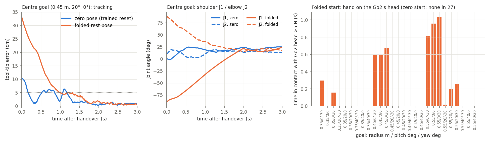
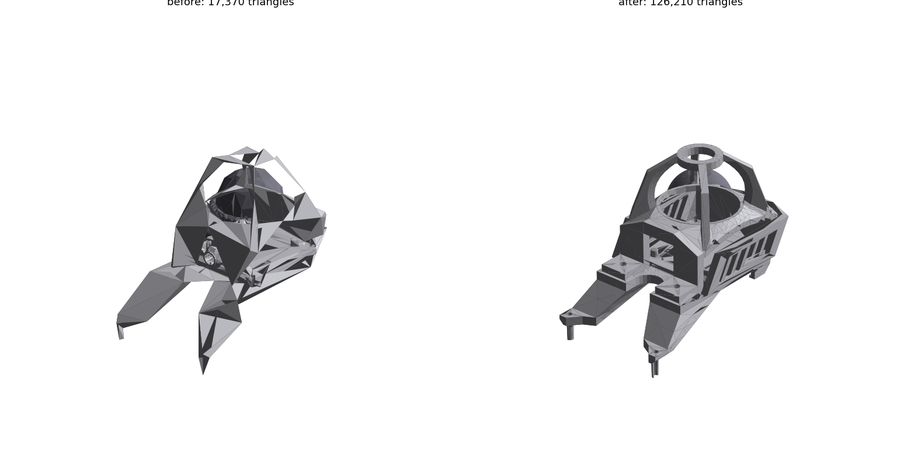

# Week 6 — 19–25 October 2026

**Status:** in progress
**Focus:** First complete AprilTag-guided box-opening sequence on the real Go2+D1

## Planned

From the [revised Thesis B plan](../../docs/thesis_b_plan.md#thesis-b-weekly-schedule),
16 September 2026. This replaces the original Appendix A timing; earlier dated logs remain historical evidence.

- **Reuse, simulation and learning:** Diagnose transfer failures and preserve matched training/configuration records; prioritise completing the core sequence.
- **Hardware and camera:** Run locate → approach → engage → actuate → open → withdraw → verify using a learned force-aware tool policy; record every attempt.
- **Evidence and deliverable:** A successful pilot establishes integration only. G7 needs repeated trials. If the sequence is incomplete, freeze new capabilities and use Weeks 7–9 for the recorded blocking phases.
- **Gate focus:** G6 entry; G7 pilot and integration decision.

## Checklist

- [ ] Complete sequence attempted after G6 and simulated-sequence validation
- [ ] Door/lid opening verified; lever angle alone is not counted as box completion
- [ ] Every attempt, intervention, force trace and phase failure recorded
- [ ] Pilot success distinguished from G7 repeatability and G3 comparison evidence
- [ ] Week 6 integration decision logged; optional work paused if core sequence is incomplete

## Log

<!-- Dated entries (### YYYY-MM-DD · topic). For each: the exact command or change, the outcome in numbers,
     and what it does and does not show. Record runs with ./dashboard.py record. -->

### 2026-10-19 · The combiner demo on Lukas's real box

Lukas now has the real combiner box and sent two photos: the box, and a close-up of its lock. **What they show.** A
light-grey Shoals "PV ARRAY d.c ISOLATOR" enclosure standing on the floor, portrait, its door hinged on the right
edge with two hinges. Near the top, slightly left of centre, is a black rotary isolator handle with a red grip marker;
its bar points right, toward the hinge, with ON and OFF labels beside it. A yellow WARNING label sits under the bar,
and a caution sticker on the right. The printed 100 mm AprilTag (tag36h11 id 0, from `dock_tag_id0_100mm_A4.pdf`, cut
to its 125 mm border) is centred below the handle. A round quarter-turn cam lock is midway up the left edge. The
close-up shows the lock as a black plastic bezel round a chrome insert with a slotted, pinned face: it needs a key or
tool to turn. Lukas's measurements: 83 × 63 × 30 cm; the handle's centre 16 cm below the top; the tag's top edge 15 cm
below that centre; the lock's centre 6.4 cm in from the left edge, which is the side that swings open.

**Changed.**
- `demos/combiner/geometry.py` now holds the real box: 830 mm tall (the body 5 mm off the floor so the door clears the
  ground plane), 630 wide, 300 deep with the door; the handle spindle 0.67 m up on the door's centreline; the tag's
  centre 0.4575 m up; the lock at y = −0.251 m, 0.4175 m up. `hinge_side = +1` mirrors the door: hinge on +Y (the right),
  lock and free edge on −Y, the lever pointing toward the hinge. The handle's and the tag's horizontal place is assumed
  (centreline); the lever's shape, the masses and the interior are still the proxy's.
- `asset.py` draws it: no stand or glands, the cam lock, a black-and-red lever, hinges on the right, decals under the
  handle, a wider interior. Joint frames flipped so positive still opens outward and lowers the lever.
- The planners (`press.Lever`, `pull.Handle`), `turn_run`, `demos/unifp/props.py` and `mech_env` take the side from
  the geometry. `props.side_stance` keeps "positive = latch side".
- **The dog stands** (Lukas's choice, asked today): `make_resting_cfg(posture="standing")`, the position-only task's
  zero-action stance. The lying dog reaches this handle at 2 of 12 default placements (F-143).
- Search stops and the close look re-aimed for the standing dog and the bigger tag (F-144); `--settle_s` 2 → 4 s;
  default placements kept at 0.62–0.70 m. UniFP demo: the post becomes a 10 mm plinth (the handle stays 0.68 m up)
  and the box range moves out to 0.70–0.74 m. The reach console's default tag size 60 → 100 mm.
- Tests: 688 pass (15 skipped). The asset tests, which need `pxr`, were run separately with Isaac Sim's bundled USD
  (recipe in `demos/combiner/README.md`): 25 pass, including a new one pinning the measured outline, handle, tag and
  lock.

**CPU model (base level), 30 seeded default placements.** Standing: tag seen, close look solved and grip-and-pull
planned at 30/30 (the door to 20–40° in the plan, static ceilings 0.82–0.96 N·m), push at 28. Lying: pull 2/12, push
0/12. UniFP goals: inside the trained sphere at every stance but a 45° latch-side one, where the door's pull reaches a
0.61 m radius (pinned in `test_unifp_demos`). F-143.

**Three live runs** (GPU idle beforehand), each
`./demos/combiner/run_combiner_demo.sh --turn --headless --capture --no_console --ui_feed_port 0 --handle_torque_nm 0.3 --episodes 3`,
seed 42, so the same three placements:

| run | change | tag found | close-look error (mm) | peak lever (°) | grip slip max (mm) | door |
|---|---|---|---|---|---|---|
| [smoke 1](#/week/6/run/20261019T012022_709892Z_combiner_seed42) | standing; search and close look raised for the tag's height | 2/3 | 9.6, 36.9 | 34.8, 40.8 | 155, 136 | shut |
| [smoke 2](#/week/6/run/20261019T013204_701444Z_combiner_seed42) | close look aimed off-centre | 2/3 | 2.9, 2.2 | 17.0, 34.0 | 157, 141 | shut |
| [smoke 3](#/week/6/run/20261019T013846_816348Z_combiner_seed42) | search stops aimed off-centre too; base-motion split logged | 3/3 | 2.8, 3.2, 3.5 | 13.6, 37.6, 26.5 | 157, 26, 143 | shut |

- **Smoke 1.** The close-look frames show a finger of the shut gripper over the tag's lower-right corner, and the
  third placement's tag was under a finger at every stop. Fix: aim the looks so the tag sits up and to the left
  (F-144).
- **Smoke 3.** At the grip, perception is 1–4.5 mm off, but the lever has moved 17–21 mm in the base frame since the
  close look: the base tilted 1.26° and 1.47° under the arm. In the one attempt with 0.32° (5 mm), the grip held
  (26 mm slip) but the lever still stalled at 37.6°, short of the 45° release (F-145).
- The base stayed standing in every attempt (0.273 m at the end).

**What this shows.** The scripted demo runs on the real box's geometry with the dog standing. It finds the tag,
locates the box to ~3 mm, and gets onto the handle. **What it does not show.** Any door opening: 0 of 9 attempts
released the latch. The grasp record (F-075) is from the proxy and the lying dog, and the one grasp it favours that
still solves (pitch 40 roll −1) failed in every attempt here. The real handle's torque, lever shape, the door's mass
and the cam lock's behaviour are all unmeasured. The fingers' place in the image is the simulator's, not checked on
the real camera.

**Next.** Correct the plan for the base's tilt (the IMU gravity vector the sequence already reads) at the align step
and through the arcs, or re-look at the tag from the standoff. Then re-run these three placements. Lukas could also
measure the isolator's turning torque, its lever shape, and the door's weight.

### 2026-10-19 · The door pull: grab the handle and walk the door 90° open

Lukas asked for a second combiner demo: the box unlocked, no handle rotation, just grip the handle and pull while
the robot moves until the door is 90° open. Built on the UniFP demo, which already walks: UniFP's policy takes base
velocity commands, and the demo env had pinned them to zero.

**Changed.**
- `demos/unifp/run_demo.py --task door`; `script.door_phases` and `DoorTiming` (the combiner's reach, then a 7 s
  pull, a 1.5 s hold, release, back to the ready pose in front of where the robot now stands).
- `props.BoxSite.base_pose_m`: the base carried round the hinge with the door, so the handle stays put in the robot's
  frame. On the real box the hinge is on the robot's right: the base steps right while turning left, ending 0.88 m
  right, 0.25 m forward and turned 90°, 0.65 m from the hinge throughout.
- `script.base_velocity_command`, called by `env._walk_base` each policy step: path rate fed forward, measured pose
  error fed back at 1.5/s, clipped to the trained ranges (vx 0.6, vy 0.4, yaw 0.6). The env's velocity resampler
  now writes the script's command, zero for every other demo.
- `LatchController(locked=False)` / `DoorLatch(locked=False)`: an unlocked box, the lever's spring still on.
- Phases can carry orientation paths (`approach_path`, `object_axis_path`) and a base pose path (`base`).
- Tests: `test_unifp_demos.DoorPull` (6): the base orbit, goals inside the trained sphere *of the moving base* for 40
  seeds, the walk command outside the dead zones and inside the ranges, the footprint ≥ 0.10 m from the door and the
  box at every 5° (measured minimum 0.19 m), the control law's frame and clipping, the phase clock. Plus the unlocked
  latch in `test_combiner_demo`.

**Runs** (GPU idle beforehand). All `./demos/unifp/run_demo.py --task door --wrist --headless`, 16 attempts
in 16 environments unless noted:

| run | change | swung ≥ 85° | falls | notes |
|---|---|---|---|---|
| [first, 4 envs](#/week/6/run/20261019T024810_door_unifp_wrist_seed1_door_first) | `--attempts 4` | 2/4 | 0 | 91.6, 91.9° |
| [seed 1](#/week/6/run/20261019T024909_door_unifp_wrist_seed1_door16) | seed 1 | 8/16 | 0 | arrive miss median 5.9 mm |
| [goal correction](#/week/6/run/20261019T024957_door_unifp_wrist_corr_seed1_door16) | `--goal_correction` | 8/16 | 0 | arrive 4.2 mm; failures part-way, not shut |
| [lip claw](#/week/6/run/20261019T025131_door_unifp_wrist_claw_seed1_door16) | `--claw` (lips) | 2/16 | 0 | arrive 79 mm |
| [wrist pitch servoed](#/week/6/run/20261019T025238_door_unifp_wrist_seed1_door16_wrist_joints56) | `--wrist_joints 56` | 3/16 | 0 | arrive 45 mm |
| [2 s grip, seed 1](#/week/6/run/20261019T025326_door_unifp_wrist_seed1_door16_grip_s2.0) | `--grip_s 2.0` | 10/16 | 0 | |
| [seed 2](#/week/6/run/20261019T025447_door_unifp_wrist_seed2_door16_s2) | seed 2 | 7/16 | 0 | |
| [2 s grip, seed 2](#/week/6/run/20261019T025535_door_unifp_wrist_seed2_door16_s2grip_s2.0) | seed 2, `--grip_s 2.0` | 7/16 | 0 | |

- **The walk works.** No falls in 116 attempts. The base's peak pose error is 3–11 cm (median 5.5) and up to 11° of
  yaw. It ends turned 87–95°. When the grip holds, the door is at 87–105° at the end of the hold.
- **The grip is the limit.** Over seeds 1 and 2 the grip held in 15 of 32. Of the 17 failures, 4 doors barely
  moved, 12 lost the handle at 15–39°, and 1 overshot to 108° and came back to 65°. The failures' median miss at
  arrive was 12 mm, against 5 mm for the successes. But attempt 1 of seed 1 arrived 3 mm off and still lost it:
  during the 0.8 s grip the hand pitched up 30° (approach elevation 7° → 36°) and backed 24 mm off the bar,
  dragging the door 8° open before the walk began.
- Of the setting changes, none moved the rate beyond noise: the 2 s grip was 10/16 then 7/16, and outcomes flip at
  the same placement (F-098's behaviour, now on the door).
- Several doors that lost the handle ended shut. Not explained; the upper arm has no contact sensor.

**What this shows.** UniFP, as trained, can walk a door open while its hand holds the handle, driven through its own
velocity command, without falling. **What it does not show.** A reliable grasp: half the attempts lose the handle.
Nor does it show UniFP alone (this is `--wrist`), a door with any closer or a realistic mass (0.6 kg), the real
isolator handle's shape, perception, or clearance off the planned path. F-146.

**Next.** A grasp that holds a pull along the jaws: a hook behind the bar, or the lip claw run with the goal correction
and roll it was tuned with (`--mech`'s settings on this script).

### 2026-10-19 · The wrist camera's bracket is on the real arm; every demo draws it

Lukas: the bracket (F-138's design, exported 2026-10-09) is printed and fitted to the real arm, the RealSense sitting on
top of the pincer. F-138 gained a "Followed by" line. Its seating on the arm is not measured, so the mount stays the
CAD's (`wrist_mount.json`) until a hand-eye check.

**Changed.** The scripted cup pick and combiner demos already drew the camera and bracket by default. Now the rest do:
- the UniFP demos (`demos/unifp/run_demo.py`: cup, combiner, `--mech`, door) draw both on Link6 in every run
  (`--camera_body`, default on; `run.json` `camera_body` records the mount);
- the insertion demo draws them headless too (it did only in the viewer).

All are visual only: no mass, no collider, no rendering. The policies were trained without the camera's weight
(D435i ~72 g plus the bracket, on 1.7 N·m wrist joints). Neither its mass nor a collider is modelled anywhere.

**Checked.**
- [The door pull, seed 1, with it drawn](#/week/6/run/20261019T072249_door_unifp_wrist_seed1_door16_cambody): 8/16, the
  same door angles as without it to the hundredth of a degree, as visual-only geometry should give.
- Because the simulator cannot show the camera hitting the box, a new test checks it on the CPU:
  `test_turn.WristCameraClearanceTests`, 12 grasps × 2 grip radii. The camera and bracket stay at least 29.6 mm off
  the door face, and 24.9 mm off the lever bar, spindle and rosette (the proxy lever's shape; the real isolator's is
  unmeasured). The closest is pitch 80°. At the door pull's level grasp, 100 mm off the face.
- Not checked: a rendered frame showing the parts in the UniFP scene; the camera against the cup's table or the
  insertion's door.

### 2026-10-19 · Switching the reach policy on with the arm folded

Lukas is preparing to run the UniFP reach policy on the real robot and asked what it does if the arm starts
folded. Every training episode resets the arm to its zero pose (`interface.DEFAULT_DOF_POS`); the real D1 rests
folded on its stop at J1/J2 −90.9/+91.7° (F-027). So a folded switch-on is outside anything it was reset into.

**New probe:** `demos/unifp/folded_start_probe.py`. It runs each held goal twice, from the zero pose and from the
folded rest pose, and changes nothing else: `cad333_model_58400`, fingertip tool point, standing, forces off. The
grid is 27 goals (radius 0.35/0.45/0.55 m × pitch 0/20/40° × yaw −30/0/30°). The arm's links have no contact
reporting in the weld, so a strike is read on the dog's trunk, head, hips and thighs.

```bash
./demos/unifp/folded_start_probe.py --headless          # default --hold_s 1.0
```

- First launch crashed before writing a run (the contact readout assumed `Link*` sensor bodies, which don't exist).
  A 2-step launch listed the sensor bodies and also wrote no run.
- [Spawn-drop reset](#/week/6/run/20261019T075656_probe_seed1_folded_start) and
  [the same with contact detail](#/week/6/run/20261019T075729_probe_seed1_folded_start): both starts include
  training's drop from the spawn height (zero start alone pitches 18°). The hand hit the Go2's head in 13 of 27
  folded envs and 0 of 27 zero-pose envs. At the peak contact, J1/J2 were still at −69…−82° / +54…+78°, and J3 had
  already turned 29–68°. **The wrist turns before the shoulder lifts, which swings the hand into the head.**
- [**Standing 1 s hold, then handover**](#/week/6/run/20261019T075835_probe_seed1_folded_start), the main result.
  The dog stands with the arm held at its start pose for 1 s, then the policy takes over with an empty history and
  no previous action. Folded handover pose: [2.1, −90.0, 88.9, −2.3, 4.9, 2.9]°.

| 27 goals, standing | zero pose (trained) | folded |
| --- | --- | --- |
| falls | 0 | 0 |
| reached and held 5 cm for 0.5 s | 27 | 27 |
| time to 5 cm, median / max | 0.46 / 1.18 s | **1.10 / 1.68 s** |
| final error (6–8 s), median / max | 1.16 / 5.34 cm | 1.07 / 6.36 cm |
| hand on the Go2's head (`Head_lower`) > 5 N | 0 | **11**, 0.20–0.66 s after handover, up to 1.04 s in contact, peak 19–1237 N |
| peak base pitch | 3–13° | **8–26°** (centre goal +22.5°, nose down, against −4°) |
| J1 at its 3.3 N·m limit in the first 2 s, median | 40 of 100 steps | 100 of 100 |
| peak arm joint speed, median / max | 1.78 / 1.87 rad/s | 1.87 / 2.25 rad/s |



- **Which goals hit the head:** every 0° pitch goal except 0.35 m straight ahead, and all three 0.55 m / 20° goals.
  None of the 40° goals hit it, and nor did the 20° goals at 0.35 and 0.45 m. Low and far goals make the policy
  turn the hand downward while the arm is still folded over the head.
- **How it unfolds (centre goal, no contact):** J1 climbs at a steady, torque-limited rate, −89° to 0° in about
  1.6 s. J2 comes down alongside it, and the tip is within 5 cm at about 1.1 s.
- **History dependence:** at a few goals the arm settles into a different configuration from the zero-start run.
  At 0.55/0/−30, J2 ends at −39° against +4° and the error at 6.4 cm against 0.4 cm. The zero start has outliers of
  its own (5.3 cm at 0.45/20/−30), so the medians are the same.

**What this does not show.** Simulation only, one seed, standing, no forces.
- J1/J2 start 1–3° short of the real rest pose, because the simulated joints cannot be placed past the URDF limits.
- The arm here is UniFP's PD with torque limits, not the D1's firmware position servo. Its 2.25 rad/s peak is
  above the D1's measured 1.21–1.29 rad/s (F-033) and ~0.8 rad/s when streamed (F-046), so the real unfold would
  be slower and **no timing transfers** (F-097).
- The contact forces are PhysX impact values, not a prediction of the real load. What counts is which goals make
  contact, and when.
- Whether the real head sits where the simulated `Head_lower` collider does is not checked. The dock and MID-360
  are drawn as visuals only, so anything they would add to the collision is missing.

Finding: [F-149](../findings.md) (written as F-147, renumbered the same day: another session's lidar finding took F-147 at the same time).

### 2026-10-19 · The lidar and the wrist camera, in every demo and every training setup

Lukas: "I have the go2 and go2_with_mid360 in my downloads. can you add the mi360 onto the robot in all the demos? also add
both the realsense, mount and mid360 into the training setups (but dont retrain yet, I will do so on another computer)",
and: "I would like the lidar mount included".

**The geometry.** `~/Downloads/Go2 v115.stl` and `Go2_with_mid360.stl` (Lukas's Fusion model, metres, one frame). The
second adds the MID-360 and a mount on the front of the trunk, and lacks the first's head D435i and its mount.
`description/mid360_from_cad.py`:
- diffs the triangles;
- registers the STL to `base_link` by ICP of the URDF's trunk mesh. It fits to 0.34 mm median, 0.87 p90, with 0.14 deg of
  rotation, so the frames differ by a translation, (−0.0445, 0.0003, 0.1787) m. The dock alone fitted only to 6.4 mm,
  so the CAD's dock is not Unitree's;
- splits the result:
  - the lidar: 65 mm square, x 0.143–0.208, z 0.096–0.153 m;
  - the mount: a plate on the trunk at x 0.084–0.240, z 0.055–0.094, and a cage over the lidar to z 0.166;
- decimates both to 10%, giving `meshes/go2/mid360.stl` (11,642 triangles) and `mid360_mount.stl` (5,728).

**Changed.**
- `payload.py`: the four parts, each with its mass and source, centre of mass, inertia and box colliders.
  - MID-360: 0.265 kg, published.
  - Mount: 0.155 kg, estimated (124.9 cm³ × PLA).
  - D435i: 0.072 kg, published.
  - Bracket: 0.027 kg, estimated.
- `weld.py`:
  - `payload_visual` (default on) draws the lidar and mount on every robot, so every demo shows them. The demos already
    draw the wrist camera.
  - `payload_physics` adds the colliders (guide purpose, not rendered) and folds the masses into `base`
    (6.921 → 7.341 kg) and `Link6` (0.168 → 0.267 kg).
- `run_position_only.py`, `run_unifp_train.py`: `--payload physical|visual`, default physical. `run.json` records it.
  UniFP training builds `generated/go2_d1_payload.usd`, so a demo rebuilding `go2_d1.usd` never swaps it.
- `position_only/workspace.py`:
  - `clear_of_body` also keeps the arm out of the mount's plate and the lidar's cage. This check is used by every CPU
    planner and by `d1_hardware.py`'s moves.
  - `simulated_masses` / `simulated_coms` take the wrist payload.
- `position_only/verify.py`: the G0 mass check knows the wrist payload when the robot carries it.
- `grasp.proxy_margin` measures to the new boxes too. `tests/test_payload.py` (7 tests).
- Nothing retrained.

**Runs.**
- G0 verify: [first, failed](#/week/6/run/20261019T075646_286594Z_verify_seed42) failed only `arm_link_masses_match_weld_model`. Link6 was 98.7 g heavier than the CPU model, which
  did not have the camera yet. After the fix, [physical](#/week/6/run/20261019T075759_109111Z_verify_seed42) and [visual](#/week/6/run/20261019T075818_960184Z_verify_seed42) pass.
- Reach `58400` on the frozen validation set: [payload physical](#/week/6/run/20261019T075856_eval_seed1_payload_physical) 1.69 / 2.33 cm, [payload visual](#/week/6/run/20261019T075915_eval_seed1_payload_visual) 1.50 / 1.96, [no lidar drawn](#/week/6/run/20261019T080030_eval_seed1_payload_none) 1.50 / 1.96. No falls (F-147).
- [capture](#/week/6/run/20261019T080359_526678Z_combiner_seed3): the scripted combiner scene, the lidar and cage on the trunk's front ahead of the arm, the camera on the
  gripper.

**A discrepancy found on the way (F-148).** The recorded score for `58400` is 1.40 / 1.93. The Week 4 runs used an arm
URDF hashing `1509b0bc…`, which is not the committed one and is not on this machine. Find it on Victor's machine
before retraining.

**Not done / open.**
- The head D435i in `Go2 v115.stl` (and `Go2 v115_d435i_mount_only.stl`) is not added: it is not on the
  `with_mid360` model, and Lukas asked for the wrist camera.
- Weigh the mount and the bracket.
- The demos run the payload visual-only.
- The CPU torque models (pull planner's ceilings, holdability) do not carry the camera's weight; only G0's check does.
- The lidar body's CAD provenance is not recorded.

### 2026-10-19 · The lidar and its mount, redrawn from a full-resolution export

Lukas, with a viewport screenshot of the trunk's front: "the quality of the mesh is very poor. I have provided
mount_and_mid360_only.stl in my downloads". In the screenshot the cage is a set of jagged flat facets, and the
lidar's dome is faceted.

**What was wrong.** The meshes above came from the diff of two whole-robot exports. That export is coarsely
tessellated, and the diff lost geometry outright:
- the cage's top ring and struts;
- the slotted side walls;
- the plate's holes.

They were not decimated either, since `fast_simplification` is not installed in `env_isaaclab` and the script skips
the step silently. So the 11,642 and 5,728 triangles were the coarse export as it came.

**The new source.** `~/Downloads/mount_and_mid360_only.stl`: 174,238 triangles, metres, the same frame as the
whole-robot export. With the existing translation (−0.0445, 0.0003, 0.1787) m it lands exactly on the mount's
recorded bounds (x 0.0843–0.2403, top 0.1662), and the lidar's housing lands on its own to 0.3 mm.

**Changed.** `description/mid360_from_cad.py`:
- takes this single STL; the two-file diff stays available;
- decimates per connected part, as far as the part stays within 0.3 mm, sampled both ways;
- keeps a part whole where nothing does. Quadric decimation rounds the plate's and cage's edges by 1–10 mm at a
  third of their triangles, so those stay whole, and the screws come down to about a third.

Result: `mid360.stl` 95,240 triangles (of 116,432), `mid360_mount.stl` 34,574 (of 57,824). They are drawn with
per-face normals, so the dome needs that density to look round.

```bash
pip install --target <dir> fast_simplification     # not in env_isaaclab; PYTHONPATH=<dir> for this one step
python description/mid360_from_cad.py ~/Downloads/mount_and_mid360_only.stl
```



**Found on the way, not changed.** The collider and clearance boxes in `payload.py` were measured on the broken
mesh, so they miss the side walls. The walls span x 0.135–0.240, y ±0.040, z 0.094–0.118 m, against the cage box's
y ±0.0327. `tests/test_payload.py` now fails on exactly this: 1149 mount vertices outside both boxes.

The mount's volume has the same problem. Its closed parts come to 141.9 cm³, against the recorded 124.9; that
includes the lidar's 1.9 cm³ connector, and the walls are an open shell, so they add an unknown amount.

Left for Lukas, because the boxes and mass feed `--payload physical` training and the arm-clearance check.

**Not checked:**
- a render in Isaac Sim; the comparison is a CPU render of the two meshes;
- the memory cost of 130k triangles per robot copy at thousands of environments.

### 2026-10-19 · Why the arm folds during the door pull's walk

Lukas sent two viewer screenshots of the door pull (environment index 1): the arm in a forward line at the grip, then
folded with the elbow up, late in the walk. His question: is that UniFP, or how we use it?

**Changed.** `demos/unifp/run_demo.py`: door traces now carry the goal as the policy receives it (`goal_radius_m`,
`goal_pitch_deg`, `goal_yaw_deg`) and the six arm joints (`arm_q0_deg`…`arm_q5_deg`).

**Runs.** Seed 1, the recorded F-146 command, 16 environments:

```bash
./demos/unifp/run_demo.py --task door --wrist --attempts 16 --headless --run_name door16_armtrace
./demos/unifp/run_demo.py --task door --attempts 16 --headless --run_name door16_nowrist_armtrace
```

- [With `--wrist`](#/week/6/run/20261019T085418_door_unifp_wrist_seed1_door16_armtrace): 8/16, the same as the
  recorded run.
  - **Successes:** none of the 8 fold. J1 stays 32–50° and J2 −22 to +3° through the 90° walk, tracking within
    0.2–2.1 cm.
  - **Goal:** radius 0.57–0.62 m at the grip, at or past the trained 0.58, and 0.50–0.58 during the walk. Pitch is
    20–26°, yaw −1 to −17°.
  - **Folding:** only in attempts that lost the handle (1, 3; 4 transiently). Attempt 1, the viewer's environment:
    - the fingers hold 2–13 N to 11.9 s, the door reaches 20° and then drifts shut, and the forearm touches at
      11.4–11.7 s;
    - the script, which never reads the door, keeps walking and commanding the handle's arc, and the tracking error
      jumps to 12–22 cm;
    - J3 swings from ~20° to ~110° and J2 from −10° to −65…−88°, and the wrist servo pins J5 at its −134.6° limit;
    - the arm stays folded to the end, 5–10 cm off a goal (r 0.56, p 22°, y −12°) that the successful attempts
      track to ~1 cm extended.
- [UniFP alone](#/week/6/run/20261019T085634_door_unifp_seed1_door16_nowrist_armtrace): 4/16.
  - The arm folds (J2 < −40°) during the walk in 13 of 16 attempts, including while still holding the handle.
  - It is folded at the end in 5, one of them a success: attempt 2, door at 90°, J2 −59°, J3 107°.
  - No arm joint is at a limit.

**Reading.** The folding is the policy's, and the wrist servo suppresses it while the grip holds.
- UniFP commands the tip position only. The orientation channels exist and are unused (`CMD_EE_ORN_*`), so the arm's
  other three degrees of freedom are whatever the policy does.
- That choice depends on history (F-149 found the same), and nothing in the reward prefers one configuration.
- Walking and the door's pull disturb it, and once it is in the folded branch it tracks within a few cm and stays.

Our use adds to it:
- the friction grip loses the handle (F-146), which is the trigger in every `--wrist` fold;
- the script carries on after the loss;
- the goal sits at the trained radius's edge;
- under `--wrist`, J5 is not the policy's, and in the folded branch the servo drives it to its limit.

What this does not show: one seed, 16 placements per condition, simulation. Which configuration a given attempt
falls into is not predictable from these numbers. The upper arm carries no contact sensor, so what the arm touches
while the door drifts shut is not known.

Finding: [F-150](../findings.md).

### 2026-10-19 · A non-UniFP baseline for the door pull: a walking policy and arm IK

Lukas: "Can you get a non-unifp method to open this door? Including moving the robot. I want to establish a baseline."

**What was built.** `--controller decoupled` for the door pull (`demos/unifp/decoupled.py`, `decoupled_arm.py`). The
controller is the only thing that changes. The scene, the 16 seed-1 placements, the script (`script.door_phases`), the
walk round the hinge (`base_velocity_command`, same gains and clips), the unlocked latch, the jaws' drive and
commands, the trace and the ≥ 85° success all come from `UniFPDemoEnv`.
- **Legs:** the walking checkpoint `sim.py` plays back, `logs/rsl_rl/unitree_go2_rough/2024-04-06_02-37-07/model_7850.pt`.
  - Provenance: dated 2024-04-06, it is the go2_omniverse rough-terrain policy, trained on a bare Go2 and converted
    from the 2024 rsl_rl format. It is not a Rescue arm-on run.
  - It gets its own 235-wide observation, rebuilt term for term (`flat_env_cfg.ObservationsCfg`), and its own
    DCMotor legs.
- **Arm:** IK on Link6 and the jaw centre (`d1_ik`, the scripted grip's convention), re-solved every 10 Hz command in
  the base's current frame. Commands go through the D1 firmware planner (F-045) into the stiff servo drive with its
  published limits.
  - The hand orientation is `pull.Handle`'s, matched to 1e-9 in `tests/test_decoupled.py`.
  - The grasp is chosen once per attempt, nearest-level first.
- **Jaws:** UniFP's drive, so the grip is the same.

**Getting the port right took four fixes; every run of the way is recorded.**
1. [Smoke, pitch-40 grasp](#/week/6/run/20261019T100636_door_decoupled_walk_ik_seed1_decoupled_smoke): 0/2, 1 fell.
   - The scripted grip's favourite grasp comes in 40° from above, but the door script enters along the level
     approach, so the fingers swept into the bar at 9–20 N before arriving.
   - That shoved the dog 7–10 cm back and left a 4.6 cm miss at arrival.
   - Fix: `GRASP_ORDER` nearest level first. Every placement now takes pitch 0.
2. [Smoke, level grasp](#/week/6/run/20261019T100907_door_decoupled_walk_ik_seed1_decoupled_smoke_level): 0/2, both
   fell.
   - The grasp was fine: arrival within 3 mm and 6–18 N on the handle, with the door at 55–82° when they fell.
   - [No box](#/week/6/run/20261019T101020_door_decoupled_walk_ik_no_object_seed1_decoupled_noobject),
     [no box, arm parked](#/week/6/run/20261019T101156_door_decoupled_walk_ik_no_object_seed1_decoupled_noobject_parked)
     and [no plinth either](#/week/6/run/20261019T101533_door_decoupled_walk_ik_no_object_free_seed1_decoupled_freespace_parked)
     all stagger the same way (1 of 2 fell in each; the last two identical to the digit).
   - So the walk itself failed, not the door.
3. [Native playback](#/week/6/run/20261019T101351_895806Z_playback_arm_-0.2_-0.3_+0.2) of the same checkpoint at the
   path's hardest command, (−0.2, −0.33, 0.2) for 6 s:
   - tracks (−0.181, −0.320, 0.234) with 7.6° tilt
     ([first try](#/week/6/run/20261019T101319_652041Z_playback_arm_-0.2_-0.3_+0.2) 7.0°; its console output was lost
     on the reach console's port, so the second was run with `--ui_feed_port 0`);
   - the port, given the same constant command (a scratchpad probe, not a run directory), tracked (−0.07, −0.12, 0.12)
     and tilted 32°.
   - Dumping the observations term by term showed identical layouts, and the height scan confirmed the sensor
     convention (−0.0855 = base 0.4145 − 0.5). Two physical differences remained:
     - **self-collision:** on (UniFP's), where the policy trained with it off. Off,
       [free space, arm parked](#/week/6/run/20261019T101630_door_decoupled_walk_ik_no_object_free_seed1_decoupled_freespace_parked_noselfcoll)
       had 0 of 2 fall, and the probe's tilt went 32° → 19°;
     - **foot friction:** UniFP's 1.0/1.0 against the trained 0.8/0.6. At 0.8/0.6 the probe tracked
       (−0.16, −0.24, 0.23).
4. Both fixed in `decoupled.py`:
   - self-collision off, with every arm command checked against the trunk proxy (none broke it in the runs below);
   - the feet alone at 0.6/0.2, which average with UniFP's 1.0 ground to the trained 0.8/0.6, so the fingers keep
     UniFP's friction.

   Probe after the fixes: (−0.166, −0.267, 0.234), 12.4° tilt. Native with the arm at zero (probe): (−0.184, −0.355,
   0.204), 10.4°. The remaining 25% of sideways speed is attributed, not tested, to the arm's drive: the force-driven
   D1 model here, the import's acceleration drives in playback (F-010). The robot configs otherwise differ only in
   spawn height.

**The baseline.** [16 placements, seed 1](#/week/6/run/20261019T102047_door_decoupled_walk_ik_seed1_door16_decoupled):

```bash
./demos/unifp/run_demo.py --task door --controller decoupled --attempts 16 --headless --run_name door16_decoupled
```

| seed 1, same 16 placements | doors ≥ 85° at end of hold | falls | arrive error | base path error (max, median) |
| --- | --- | --- | --- | --- |
| UniFP + wrist servo ([F-146](#/week/6/run/20261019T024909_door_unifp_wrist_seed1_door16), [re-run](#/week/6/run/20261019T085418_door_unifp_wrist_seed1_door16_armtrace)) | 8 | 0 | 5–6 mm | 3–11 cm |
| UniFP alone ([run](#/week/6/run/20261019T085634_door_unifp_seed1_door16_nowrist_armtrace)) | 4 | 0 | | |
| **decoupled: walking policy + arm IK** | **7** | **0** | **2.7–3.5 mm** | **0.27–0.72 m (0.39)** |

- The arm half is better than UniFP's: the jaw centre lands within 3 mm, and every attempt takes the level grasp.
- The leg half is much worse. The base trails its path by 0.39 m at worst (median attempt) and rolls up to 23°.
  [Walk-only control](#/week/6/run/20261019T103049_door_decoupled_walk_ik_no_object_free_seed1_door16_decoupled_walk_only)
  (free space, arm parked, same 16): median path error during the pull 0.146 m (0.19 m with the door), roll 26°,
  pitch 16°, no falls. So the poor walk is the walking policy's on this path, not the door's load.
- **How it fails:**
  - 14 of 16 doors pass 66°, and in 6 of the 9 failures the door was past 79° when the grip let go; it then swung
    back (to 0–58°).
  - The grip goes because the base lags out of the arm's reach: through the pull the IK finds no solution near the
    target 11–59% of the time and holds its last joints.
  - Neither half knows about the other; that is what makes it the decoupled baseline.
- Successes include doors pulled to their 110° stop. The criterion counts them (≥ 85° at the end of the hold), as it
  does for UniFP.

**What this does not show.** One seed, 16 placements, simulation, the box's pose given.
- **Not the same plant:** the legs run on DCMotor with self-collision off and the trained foot friction; the arm is
  the measured D1, which is slower than UniFP's PD (F-097). Each controller runs on the conditions it was built for.
  A same-plant comparison would need UniFP on these settings, which is not done.
- **Not a tuned decoupled stack:** a walking policy trained with the arm, or slowing the walk when the arm saturates,
  would likely do better. This is the naive baseline.
- The scratchpad probes (`port_const.py`, `native_const.py`, `cfg_diff.py`) are diagnostics with no run directory;
  their numbers are quoted above.

Finding: [F-151](../findings.md).

### 2026-10-19 · The door pull hitches: the baseline's IK search

Lukas: "the simulation hitches every half a second or so while pulling the door. my cpu is quite strong so I worry for
the jetson orin on the dog when I deploy this".

**Cause.** The decoupled baseline's arm IK (`decoupled_arm.ArmIK.solve`). On a miss, every 10 Hz command re-ran the
scripted grip's seeded search, which cost 486 ms; a warm start costs 0.2 ms, the failing warm solve 12 ms. The pull
misses 43–49% of its commands, because the walk lags the handle out of reach. The stall is in the simulator's single
loop, so the viewer froze.

**Fixed.** The loop now uses only a warm start capped at 30 iterations. A pose within 2 mm and 0.02 rad is accepted;
otherwise it solves the jaw centre alone. Worst case 7.3 ms a command, and a test pins it under 50 ms. `trace.csv` now
records each step's wall time (`step_wall_ms`).
- [One environment, final loop](#/week/6/run/20261019T113038_door_decoupled_walk_ik_seed1_timing_decoupled_final_1env):
  median 18 ms, p99 31, max 36, none over 50 ms.
- [UniFP + wrist, one environment](#/week/6/run/20261019T104640_door_unifp_wrist_seed1_timing_unifp_wrist_1env):
  median 15 ms, max 21. (An [earlier timing run](#/week/6/run/20261019T104548_door_decoupled_walk_ik_seed1_timing_decoupled_1env)
  of a bounded variant measured the same.)
- CPU cost of the controllers alone, one thread on this PC: UniFP 0.11 ms per 20 ms step, the walking policy 0.03 ms
  (a scratchpad timing, no run directory). Nothing was measured on the Orin.

**But the bound costs doors.** Every run below is 16 placements:

| arm IK loop | seed 1 | seed 2 |
| --- | --- | --- |
| [original](#/week/6/run/20261019T104918_door_decoupled_walk_ik_seed1_door16_decoupled_seededik_s1) / [s2](#/week/6/run/20261019T105837_door_decoupled_walk_ik_seed2_door16_decoupled_seededik_s2): seeded search on every miss (`--seeded_ik_loop`) | 7 (= F-151, attempt for attempt) | 8 |
| [30 its + standoff warm start](#/week/6/run/20261019T104734_door_decoupled_walk_ik_seed1_door16_decoupled_boundedik) / [s2](#/week/6/run/20261019T110930_door_decoupled_walk_ik_seed2_door16_decoupled_boundedik_s2) | 4 | 4 |
| [30 its](#/week/6/run/20261019T111059_door_decoupled_walk_ik_seed1_door16_decoupled_bounded_nostandoffseed_s1) / [s2](#/week/6/run/20261019T111204_door_decoupled_walk_ik_seed2_door16_decoupled_bounded_nostandoffseed_s2), **the final loop** ([reproduced](#/week/6/run/20261019T112933_door_decoupled_walk_ik_seed1_door16_decoupled_final_s1)) | **3** | **6** |
| [100 its](#/week/6/run/20261019T111329_door_decoupled_walk_ik_seed1_door16_decoupled_bounded100_nostandoffseed_s1) / [s2](#/week/6/run/20261019T111448_door_decoupled_walk_ik_seed2_door16_decoupled_bounded100_nostandoffseed_s2) | 3 | 7 |
| [one seed a command, 100 its](#/week/6/run/20261019T111651_door_decoupled_walk_ik_seed1_door16_decoupled_amortizedik_s1) / [s2](#/week/6/run/20261019T111809_door_decoupled_walk_ik_seed2_door16_decoupled_amortizedik_s2) | 3 | 7 |
| [full search once, at the first oriented command](#/week/6/run/20261019T112013_door_decoupled_walk_ik_seed1_door16_decoupled_plannedik_s1) / [s2](#/week/6/run/20261019T112131_door_decoupled_walk_ik_seed2_door16_decoupled_plannedik_s2) | 3 | 7 |
| [current q + one seed, 300 its](#/week/6/run/20261019T112336_door_decoupled_walk_ik_seed1_door16_decoupled_rescueik_s1) / [s2](#/week/6/run/20261019T112556_door_decoupled_walk_ik_seed2_door16_decoupled_rescueik_s2) | 3 | 7 |

- **Where they part:** the original rescues once an attempt, around 13.8 s as the walk starts to lag. Its search
  finds the pose on another branch, where the bounded loops fall back to the jaw centre; the first >1° divergence
  in joint angles is at that command.
- **The bounded variants:** none of them recovered it, and on seed 1 all gave the same attempts. Their code was
  removed, and two of the rows above were run through temporary environment-variable switches; the runs and their
  `run.json` arguments are the record.
- **What a robot would do:** run the search in a planner thread beside the 10 Hz loop. Not built.
- **Not explained:** which seed or branch does the rescuing.

Finding: [F-152](../findings.md), which supersedes F-151's headline. The baseline is now the bounded loop: 9 of 32
on two seeds, against UniFP + wrist's 15 of 32.

### 2026-10-19 · The UniFP demos' viewer: one scene, no goal markers

Lukas asked for the blue and pink spheres off the hand, and for one scene rather than 16, which ran slowly.
`run_demo.py` changes:
- with the viewer it now defaults to `--num_envs 1`, with further attempts run one after another;
- the goal overlay is off unless `--markers` is given.

Headless runs keep `--num_envs` = `--attempts`, so every recorded rate stays reproducible as it was measured. A
viewer run is a different configuration under F-098, so its outcomes are not those of the 16-environment runs. No
run was made for this change.

### 2026-10-20 · The combiner door demo: head camera, MID-360, P2Dingo's walking policy

Lukas asked for the non-UniFP door swing (grip the handle above the tag) with the RealSense on the dog's head, P2Dingo's
mount and offset, as a new demo, `combiner_door`. During the work he added:
- "the mid360 will also be involved - it can verify the angle of the door by analysing the points near the apriltag";
- that P2Dingo's docking "just uses the position of the apriltag and then the surrounding lidar points for
  orientation";
- "can you try using p2dingo's walking policy? I remember it being stable".

**Built.** `demos/combiner_door/` (README there), run through the door pull's runner (`run_demo.py --perception head`):
- **Head camera:** the RealSense on P2Dingo's head mount, the CAD-measured `base_link` (0.3392, 0.03215, 0.0927),
  straight ahead, with P2Dingo's bracket and Intel's case drawn. P2Dingo's committed mount is an older guess; the
  measured one and the bracket are in its working tree (`third_party/p2dingo/NOTICE.md`).
- **MID-360:** a `MultiMeshRayCaster` at the point-cloud origin of this robot's lidar mount, (0.1758, −0.0002, 0.1431).
- **The look:** the tag's centre for the position, the door's face in the lidar for the heading (P2Dingo's
  `dock_wall` fit, ported to numpy).
- **Door verification:** the same fit, run at 10 Hz while the door opens.
- **Walking policy:** P2Dingo's, copied in with its gait clock (`--walker`, now the decoupled default).
- **Tests:** 12 CPU tests (`demos/combiner_door/tests`), 8 for the arm (`demos/unifp/tests/test_decoupled.py`).

**What it took** (all runs recorded):
1. [First smoke](#/week/6/run/20261020T043321_door_combiner_door_seed1_combiner_door_smoke): look found the box to 4–10 mm,
   but the arm swung from its parked zero pose into the handle (21 N), shoving the dog 26 cm, and the lidar read the
   shut door at ~59°. Fixed:
   - the arm holds the home point relative to the base until the task;
   - the lidar estimate became P2Dingo's fit.
2. [Walking in](#/week/6/run/20261020T043554_door_combiner_door_seed1_combiner_door_smoke2) on the 2024 walking policy:
   - it pitched 22–33° nose-down and the stowed hand hit the handle.
   - After even a short walk, it turned in place ~5°/s and leaned 26°:
     [0.12 m](#/week/6/run/20261020T043919_door_combiner_door_seed1_cd_walk_lb12),
     [still after](#/week/6/run/20261020T044227_door_combiner_door_seed1_cd_walk_lb12_still),
     [heading held](#/week/6/run/20261020T044848_door_combiner_door_seed1_cd_lb12_heading),
     [one env](#/week/6/run/20261020T045302_door_combiner_door_seed1_cd_lb12_1env),
     [0.30 m slow](#/week/6/run/20261020T044016_door_combiner_door_seed1_cd_walk_lb30slow),
     [0.30 m heading held](#/week/6/run/20261020T044946_door_combiner_door_seed1_cd_lb30_heading).
   - Ablations ruled out the camera's visuals, the lidar and the camera:
     [no visuals](#/week/6/run/20261020T044630_door_combiner_door_seed1_cd_ablate_novis),
     [lidar on the box only](#/week/6/run/20261020T044718_door_combiner_door_seed1_cd_ablate_lidarbox),
     [no camera](#/week/6/run/20261020T045116_door_combiner_door_seed1_cd_ablate_nocam),
     [no lidar](#/week/6/run/20261020T045157_door_combiner_door_seed1_cd_ablate_nolidar).
   - [Not walking](#/week/6/run/20261020T044324_door_combiner_door_seed1_cd_walk_lb0) stood level.
   - Replaying the commands in a probe of the port (scratchpad): stopped from 0.06 m/s it stands; from 0.08, 0.10 or
     a ramp from 0.10 it turns and leans.
   - Native playback, [0.15 m/s forward](#/week/6/run/20261020T043834_835013Z_playback_arm_+0.1_+0.0_+0.0), tilted 20.6°, and
     leaned 9–14° after stopping from 0.06 (probe).
3. [The P2Dingo-style look](#/week/6/run/20261020T050047_door_combiner_door_seed1_cd_p2dingo_4): box to 1.2–1.7 mm and
   ≤ 0.31° (the tag alone, up to 10.3 mm and 1.1°). Still leaning.
   [A steady 0.06 m/s walk](#/week/6/run/20261020T050411_door_combiner_door_seed1_cd_steady_4) stood level but stopped 8–12 cm
   short, and the pull, catching up, flung the door off the hand. The lidar tracked it throughout (25.1/25.3,
   69.2/69.6, 110.0/110.3°).
4. P2Dingo's walking policy, probed: it stops from 0.15–0.30 m/s within 1.0–1.7° of level, and turns ~15° settling
   after the spawn drop, then holds. So:
   - the attempt is anchored where the robot stands after a 4 s settle;
   - it walks straight in at 0.15 m/s until odometry says it has arrived;
   - [4 attempts](#/week/6/run/20261020T051132_door_combiner_door_seed1_cd_p2dwalker_4): 4/4.

**The measurement**, the door pull's 16 placements, seeds 1 and 2:

```bash
./demos/combiner_door/run_combiner_door.py --attempts 16 --headless --seed 1      # and --seed 2
./demos/unifp/run_demo.py --task door --controller decoupled --walker p2dingo_gait --attempts 16 --headless --seed 1
```

| same placements | seed 1 | seed 2 | falls |
| --- | --- | --- | --- |
| **combiner door demo** ([s1](#/week/6/run/20261020T051305_door_combiner_door_seed1_combiner_door16_s1), [s2](#/week/6/run/20261020T051658_door_combiner_door_seed2_combiner_door16_s2)) | **15/16** | **16/16** | 0 |
| given pose, P2Dingo walker ([s1](#/week/6/run/20261020T051554_door_decoupled_walk_ik_seed1_door16_decoupled_p2dwalker_s1), [s2](#/week/6/run/20261020T051945_door_decoupled_walk_ik_seed2_door16_decoupled_p2dwalker_s2)) | 16/16 | 16/16 | 0 |
| given pose, 2024 walker (F-152) | 3/16 | 6/16 | 0 |
| UniFP + wrist (F-146) | 8/16 | 7/16 | 0 |

- **Look:** tag found 32/32. The box placed a median 2.2–2.4 mm off (max 7.4) and 0.14–0.20° off (max 0.34); the tag's
  own heading would have given max 0.50° and 8.8 mm.
- **Lidar on the door:** a reading on every grip/pull/hold frame, median error 0.46–0.49°, p90 ≤ 2.9°. Verified open
  agrees with the simulator 32/32. The one failure (door 74.5°) was read at 74.4° and not verified.
- **Arrival:** 5.9–6.0 mm.

**What this does not show.**
- **Sensors:** an ideal render, a grid lidar with 3 cm noise and no motion distortion, and the simulator's odometry.
- **The lidar's heading:** at 0.37 m in an ideal render the tag's own heading is already within 0.5°, so the gain is
  small here; P2Dingo's ~10° tag heading at a metre on the robot is where it counts.
- **Walking policy:** neither walking policy carried the arm in training.
- **Placements:** the door pull's.

The baseline's default walker is now P2Dingo's; `--walker rescue_2024` reproduces F-151 and F-152:
[re-run on seed 1 after the refactor](#/week/6/run/20261020T052129_door_decoupled_walk_ik_seed1_door16_decoupled_rescue_regression_s1), 3/16, the same attempts and door angles as F-152's.

Findings: [F-153](../findings.md), [F-154](../findings.md); F-152 superseded as the baseline's number.

Lukas asked for a script to run it as a program: `demos/combiner_door/run_combiner_door.sh`. It sets up the Isaac
environment, warns if something is already on the GPU, and forwards its arguments.
[Checked from another directory](#/week/6/run/20261020T053227_door_combiner_door_seed1_combiner_door_sh_check): one
attempt, door opened.

### 2026-10-20 · The arm starts folded, and the handle as measured

Lukas asked for the arm to begin folded in its resting position. He then measured the combiner box's handle: 14 cm
long, 4 cm tall and 1.7 cm wide, its front profile a slot with semicircular ends, and 2.7 cm clear of the door
("it looks a bit further out in simulation": it was 5.65 cm).

**Folded start** (`demos/combiner_door/env.py`, `DecoupledDoorEnv.joint_phases`).
- The arm is set to the real rest pose at every reset (`d1_hardware.REST_SERVO_DEG`, new: the F-023/F-027 pose,
  clamped inside the URDF's limits) and parked there through the landing and the look.
- After the look, an `unfold` phase moves it to the home point's IK solution: a straight line in joint space, each
  10 Hz command at most 4 deg from the measured pose, as `d1_hardware`'s approach steps the real arm. An attempt that
  finds no tag never unfolds.
- On the CPU model the rest → home path is clear of the body proxy throughout (`d1_ik.path_clearance`), as is rest →
  zero → home.
- [4-attempt smoke](#/week/6/run/20261020T060825_door_combiner_door_seed1_cd_folded_smoke): J1 from -89.7 to +8.2 deg
  in 3 s, the base tilting under 0.5 deg, no contact.

**The handle** (`demos/combiner/geometry.py`, `asset.py`).
- **The shape.** The lever is now the measured slot: a 17 mm thick plate, 40 mm tall, 140 mm long, drawn and collided
  as a box between two end cylinders, turning about its near end's centre (assumed).
- **The gap.** `handle_gap` 0.027 is measured; `handle_projection` (the centre plane, 35.5 mm) now follows from it.
- **The jaws.** They open to 63.2 mm onto it (`PullParams.jaw_open_m` 0.012 → 0.023; 11.6 mm clear above and below,
  as the bar had). They cannot close across its 17 mm thickness: shut, the CAD pads stand 17.2 mm apart.
- **The placements** move 29.5 mm closer, so the handle keeps the distance from the robot the demos were tuned at:
  - `props.BOX_DISTANCE_RANGE_M` now follows the handle (0.6705-0.7105 m, from `HANDLE_DISTANCE_RANGE_M` 0.477-0.517).
  - The turning demo's `DEFAULT_DISTANCE_M` likewise, except that its near end stays at the 0.60 m `validate_region`
    allows.
  - Without the move, UniFP's door and combiner goals left its trained sphere (`test_unifp_demos`).
- **The look** moves back as far (`LOOK_BACK_M` 0.15 → 0.18), so the head camera sees the box from where it did.
  Without it, 5 of 32 looks lost the tag.
- **The press** method's fingertips now run 15 mm past the lever's centreline, not 25 mm: 20.5 mm short of the door
  (it was 10.5).
- **Tests.**
  - The clearance checks use the slot, not the bar.
  - Two records of what changed: the wrist camera's clearance at the turning demo's 60-80 deg grasps (now 0.05-19 mm:
    F-157), and the close-look test skipping 2 of 40 nearer placements where no search stop sees the tag past the
    fingers.

**A stale box, found and fixed.** The door runner cached the box's USD by the handle's torque alone
(`generated/unifp_demos/combiner_0.400.usda`, built 2026-10-19), so it outlived every geometry change today.
- [This demo](#/week/6/run/20261020T061030_door_combiner_door_seed1_cd16_folded_slot_s1) (16/16 twice) and
  [the baseline](#/week/6/run/20261020T061656_door_decoupled_walk_ik_seed1_door16_decoupled_slot_s1) (16/16 twice)
  ran on the old bar: valid for the folded start only. Re-titled.
- With the measured gap, the scripts aimed at a lever 35.5 mm off the door while the simulated one stood at 65 mm.
  The hand stalled 10 mm short with 12-15 N on its wrist links, and the doors opened
  [6/16](#/week/6/run/20261020T070342_door_combiner_door_seed1_cd16_gap27_s1) and 7/16 (the baseline 14/16 twice;
  [the old placements](#/week/6/run/20261020T071448_door_decoupled_walk_ik_seed1_door16_decoupled_gap27_oldplace_s1),
  13/16). Recorded as INVALID.
- The cache is now keyed by the geometry's values and `asset.py`'s code (`run_demo.py`).
- The old cached box is byte-identical to one built from the committed geometry (81b9c4a): F-146 to F-154 ran on the
  box they describe.

**Results on the rebuilt box** (folded start, measured lever, moved placements, the look 0.18 m back):

```bash
./demos/combiner_door/run_combiner_door.sh --attempts 16 --num_envs 16 --headless --seed 1      # and --seed 2
./demos/unifp/run_demo.py --task door --controller decoupled --attempts 16 --num_envs 16 --headless --seed 1
```

| same placements | seed 1 | seed 2 | falls |
| --- | --- | --- | --- |
| **combiner door** ([s1](#/week/6/run/20261020T072044_door_combiner_door_seed1_cd16_gap27b_s1), [s2](#/week/6/run/20261020T072351_door_combiner_door_seed2_cd16_gap27b_s2)) | **16/16** | **16/16** | 0 |
| pose given ([s1](#/week/6/run/20261020T072654_door_decoupled_walk_ik_seed1_door16_decoupled_gap27b_s1), [s2](#/week/6/run/20261020T072754_door_decoupled_walk_ik_seed2_door16_decoupled_gap27b_s2)) | 16/16 | 16/16 | 0 |

- **Look:** tag found 32/32, the box placed a median 2.2-2.3 mm and 0.12 deg off (max 3.0 mm, 0.64 deg).
- **Lidar on the door:** a median 0.33-0.39 deg off (p90 at most 2.1); open/not open agrees 32/32.
- **The grip:**
  - the jaw centre arrives 6.2-6.5 mm from the grasp point (4.9-5.1 given the pose);
  - the fingers squeeze 14 N through the pull, about 10 N on the round bar;
  - the doors end their hold at a median 93 deg;
  - the level grasp every time.
- [4-attempt smoke](#/week/6/run/20261020T071912_door_combiner_door_seed1_cd_gap27b_smoke): 4/4.

**What this does not show.** Simulation as F-154. The lever's pivot, mass and friction are assumptions.

**Consequences elsewhere** (F-157):
- the L-lip claw's lips (20 mm) leave 37.2 mm between their tips fully open: the 40 mm lever cannot pass;
- the turning demo's 60-80 deg grasps put the wrist camera into the door.
- Neither design is changed here.
- `demos/unifp/README.md`'s claw rows describe the earlier 18 mm bar, as the runs they cite did.

Findings: [F-155](../findings.md), [F-157](../findings.md).

### 2026-10-20 · The combiner door on the real dog

Lukas asked to run the demo on the robot (reached with `sshuni`), with an RViz view through the dog's P2Dingo zenoh
bridge (like `p2dingo-dock-view-robot.sh`), the repo cloned on the dog and a bashrc helper to copy changes across.

**How it is put together** (`demos/combiner_door/robot/`, README there).
- **`plan.py`** is the simulated demo's sequence on the real robot's terms, numpy only:
  - the look's fix from the tag and the lidar (`perception`, `mid360`);
  - the stance set from the box, 0.69 m off;
  - the door script, the IK, the lidar's door reading;
  - stages that stop early, back off and fold;
  - sport mode's floors;
  - the aborts.
- **`node.py`** is the ROS 2 node, in P2Dingo's ROS image: the head camera, `/livox/lidar` and `/sportmodestate` in;
  with `--live` only, `/api/sport/request` and the arm out; RViz's topics under `/combiner_door/`.
- **`arm_link.py`** drives the D1 through `d1_hardware.D1Client`, in P2Dingo's arm image (CycloneDDS). It steps the
  arm at most 4 deg from its measured pose, holds on silence or disconnect, never releases, and refuses to start while
  P2Dingo's arm bridge is streaming.
- **Dry runs command nothing:** the plan's ghost walks and reaches in RViz.
- **Live runs wait for Enter** before each step that moves something, and `a` stops at once.
- **On the dog:**
  - `~/D1Training` is a shallow clone of main without results/checkpoints/logs; the repo is private and the dog has no
    GitHub key, so it was cloned here and copied across.
  - New `~/.bashrc` helpers: `d1update` (copy the working tree, as P2Dingo's `update`), `d1dog`, `d1view`,
    `d1fetch`.
- **In P2Dingo** (uncommitted there):
  - the `/combiner_door/` topics added to both zenoh allow-lists, the dog's copy deployed and its zenoh container
    restarted;
  - an `OPC_COMPOSE_EXTRA` hook in `p2dingo-rviz.sh`, so this view mounts this repo into rviz.

**Run on the dog** (all dry; the dog lying in front of P2Dingo's charging dock; `d1dog`, `d1view`):
- **Two start-up crashes:**
  - [a record written too early](#/week/6/run/20261020T063730_watch_dry);
  - [OpenCV without the NVIDIA runtime](#/week/6/run/20261020T063752_watch_dry). The ROS image's OpenCV needs
    `--runtime nvidia`, as P2Dingo's own service has.
- **[Watch](#/week/6/run/20261020T063824_watch_dry):**
  - the camera at 1280x720 (fx 907.1) and the lidar read;
  - the arm link read the folded arm, [-1.4, -89.7, 90.0, 2.7, 11.1, -4.0] deg, gripper 67.1 units;
  - P2Dingo's arm bridge disconnected.
- **[The tag found](#/week/6/run/20261020T063933_watch_dry), and a bug:** the walk was computed from the tag's own pose,
  tilted 5.2 deg, which moved the box's root 4 cm. It is now [computed from the levelled fix](#/week/6/run/20261020T064139_watch_dry).
  The lidar's face fits at 19 mm rms, its heading within 1.4 deg of the tag's.
- **It was the dock's tag.** RViz's camera showed the tag on the black stand of P2Dingo's charging dock (same 36h11 id
  0), not the box.
  - The face 2 cm behind the tag [did not tell them apart](#/week/6/run/20261020T064617_watch_dry).
  - The face carrying on past the door's edges [did](#/week/6/run/20261020T064744_watch_dry): 141% of its points round
    the tag, where the box gives 0.
- **RViz** drew everything; its text needed underscores (Humble draws a space four letters wide; P2Dingo found the
  same).
- **[Dry pull to 30 deg](#/week/6/run/20261020T065323_pull_dry)** against the dock's tag (`--ignore_range`):
  - all 14 phases in order;
  - the ghost walked in to within 8 mm (the gait's 75 mm carry modelled);
  - the IK held the hand's pose throughout, transit steps aside;
  - the base was commanded only at sport mode's floors;
  - the arm ended commanded to the fold;
  - the lidar refit moved the "box" 20 mm, the dock's wall being 2 cm behind its tag.

**What this does and does not show.**
- It shows the robot side plumbed end to end, safely, on the real sensors.
- **Nothing live yet:** no leg or arm command sent, and the box not in view.
- **The walking differs from the simulation.** The real dog walks on sport mode, not on the gait policy the simulated
  demo uses (that policy has only run in Isaac Sim), and the pull's base path is inside sport mode's dead zones, so it
  is walked in bursts. The pull is the step most likely to differ from simulation.

Finding: [F-156](../findings.md).

**First live runs** (Lukas, `d1dog --stage unfold --live`):
- [The first](#/week/6/run/20261020T081401_unfold_live) waited at its first Enter and was quit: nothing moved.
- A [look](#/week/6/run/20261020T081539_look_live) confirmed that Enter reaches the program through SSH and Docker. It
  also showed two bugs:
  - `q` + Enter was swallowed (KeyboardInterrupt raised in a timer callback);
  - a dropped SSH session left the program running on the dog.
- [The second unfold](#/week/6/run/20261020T081928_unfold_live) moved the arm, J1 -89.7 → -79.4 deg and J2 90.0 →
  83.3 deg in 1.3 s.
  - The arm's reports then stopped for 0.5 s while it was being commanded, and the arm link held it.
  - The arm link had streamed a command every 100 ms whatever the reports did; `d1_hardware` paces each command off a
    fresh report (~9 Hz).
  - Lukas's recovery then stalled: it planned a Cartesian back-out from the unfold, through the full grasp search.
- **Changed:**
  - the arm link commands once per fresh report and holds after 1 s without one;
  - the grasp is planned before anything moves;
  - recovery before the reach only folds;
  - the unfold and fold have 8 s;
  - one Enter starts the attempt, which then runs through and exits (`--step` restores the per-step pauses, at
    Lukas's request: "not a fan of all the enters");
  - `q` works, and a live run stops when its terminal closes.
- **Run again** ([unfold](#/week/6/run/20261020T082609_unfold_live), [unfold](#/week/6/run/20261020T082714_unfold_live)):
  the arm unfolded and folded with one Enter, and the program exited by itself.
  - **Too slow.** Each command was 4 deg past where the arm last reported itself, and the arm moves ~1 deg between
    reports, so it crept at ~8 deg/s.
  - **On the clock.** The phases ran on the clock: the unfold reached J1 -17 deg of its +8, and the fold ended at J1
    -67, J2 77 deg, short of -90/90 ("about 10 cm from fully folded", Lukas).
  - **[The walk](#/week/6/run/20261020T082827_walk_live):**
    - It refused the box 0.73 m off: a 4 cm walk is under sport mode's floor, so it asked for 0.16 m back.
    - It crashed on its way out: rclpy's own SIGINT handling had shut the context before the node's StopMove (the
      launcher's StopMove still went).
- **Changed:**
  - **The arm link** moves its command `ARM_STEP_DEG` a report from the last command (~36 deg/s), never more than 10
    deg ahead of the arm.
  - **The node sends goals.**
  - **Joint moves wait** for the arm to arrive within 2 deg (20 s, then abort).
  - **No walk is needed** when the box is 0.65-0.76 m off (the level grasp solves across it on the CPU model; wider
    than the simulated 0.67-0.71 m, which the record notes).
  - **rclpy is started without its signal handling**, so the node's own StopMove goes out on Ctrl-C.
- **With those:**
  - [the unfold](#/week/6/run/20261020T084728_unfold_live) reached home (J1 5.8 deg) and
    [folded](#/week/6/run/20261020T084154_unfold_live) right back to rest (J1 -89.8, J2 90.0 deg);
  - [the walk](#/week/6/run/20261020T084309_walk_live) walked 11 cm of its 18 in 1.7 s of commands at 0.2 m/s: the
    legs answer about a second late and stop dead.
    - It ended 8 cm short and 3.7 deg turned, and aborted on the stance check.
    - Standing to settle, the odometry slid back 1.7 cm.
- Lukas: the dog should walk in classic mode for the best accuracy.
- **Changed:**
  - **ClassicWalk once, as the attempt starts** (it was sent with a BalanceStand in front of the first Move).
  - **A zero Move between walks, StopMove only to stop for good.**
  - **The walk in is closed-loop:** it learns the carry, takes up to three corrective steps of at least 0.3 s, and
    holds its heading.
  - **Afterwards the attempt re-anchors where the dog stopped**, the lidar refit placing the box from there, and checks
    the arm can reach it (0.65-0.76 m), replacing the fixed 8 cm stance tolerance.
  - In a test with a base that answers 0.4 s late and stops dead, one corrective step finishes 1 cm past the stance.
- **[On the dog](#/week/6/run/20261020T085050_walk_live), in classic walk:**
  - The walk in stopped 6.9 cm short, having carried on nothing.
  - One corrective step ended 1.5 cm past the stance, 1.8 cm aside, 2.7 deg turned.
  - The look's lidar fit was the real box's door at 5.7 mm rms (19 mm on the dock's wall).
  - After the walk, the refit moved the box 34.5 mm along its normal.
  - **Bug: the look's tag guard ran again after the walk.** It took that correction for a tag 3 cm off its door and
    aborted. After the walk only the reach is checked now (`Fix.in_range(check_tag=False)`).
- **[The first live pull](#/week/6/run/20261020T090355_pull_live) (Lukas, 30 deg):**
  - **Walk and refit:** the walk in finished 3 mm from the stance after one corrective step; the refit moved the box
    36 mm; it re-anchored at 0.65 m and -9.6 deg (the edge of the accepted band).
  - **Reach and grip:** the arm arrived within 1.3 deg of its goal on every joint, and the jaws closed on the lever.
  - **The pull:**
    - the lidar saw the door go 0 → 16 → 24 → 36 → 40 deg in 3.5 s, and 51 deg in the hold;
    - the base moved in bursts at sport mode's floors, with stops between ("not continuous, spurts of movement",
      Lukas);
    - the arm's joints swung ±5-11 deg about their IK goals, and the door swung back and forth.
  - **The abort:**
    - in the hold, one joint 11 deg from its goal for 0.6 s, so the loaded-arm check fired;
    - Lukas quit, leaving the arm holding the lever.
- **Changed:**
  - **The pull is one continuous twist about the hinge.** It is the base and door turning as one body, constant in the
    base's frame, streamed at the gait's slowest usable speed for the whole pull. The door angle follows the measured
    turn, not the clock. In the dry model the arm's goals change at most 1.4 deg through a 30 deg pull, 4.1 through
    90. The base stands for the hold, the release and the step back.
  - **The arm link streams a smooth profile** at a steady 10 Hz: 60 deg/s^2 up to 30 deg/s, slowing into the goal,
    within 10 deg of the arm. Lukas found the arm jagged: each 4 deg step was run at the arm's top speed with a wait,
    and stalled on late reports.
  - **The unfold turns the hand to the grasp's orientation**, removing a 94 deg wrist turn at the stand.
  - **A missed pose holds the goal** instead of switching wrists. The largest step-to-step goal change through a dry
    pull is now 2.7 deg.
  - **`--release`** opens the jaws where they are and backs the hand straight out (orientation held), then goes home
    and folds; for an arm left holding the lever. Simulated from the pose the arm was left in: 97 mm straight back,
    0 mm sideways, 0 deg turned.
- None of this has run on the dog yet.
- **Lukas: faster to the grasp, less waiting between steps, and a careful ungrasp.** Letting go, the hand went home
  straight from the lever. On the way out the fingers hit the lever's 63 mm hub (the "rotating part", 63 mm across,
  photographed in the session) and pushed the door. The hub is now `GEOMETRY.handle_hub_diameter`, assumed centred on
  the spindle and filling the 27 mm gap behind the lever. The simulated box's asset is unchanged, still with its 24 mm
  spindle and 60 mm rosette. RViz draws the hub.
  - **Why it hit (CPU model):**
    - The fingertips stand 20 mm past the jaw centre, in the gap behind the lever.
    - After the pull, the door is turned 30 deg relative to the base, and the straight line home runs 11 cm along the
      door towards the hub for every 5 cm out from it.
    - In a dry pull with the lever and hub modelled, that path ran the fingers 8.2 mm into the lever and 0.7 mm into
      the hub.
  - **The ungrasp** (`plan.ungrasp_phases`, the same at the end of every stage, in a recovery and in `--release`):
    - The hand is held at the pose the arm measures itself at, the jaws open, and the hand waits for servo 6 to report
      them open.
    - It then backs straight off along its own approach by 12 cm at the enter's pace, orientation held, then goes home.
    - On the same model: 11.5 mm from the lever and 38 mm from the hub throughout, home starting 88 mm off the lever.
    - It aborts, the hand where it is, if the jaws are not reported open 2 s after the release's clock, or the IK cannot
      hold the hand's orientation for 0.5 s; it never falls back to another wrist round the lever.
  - **Bug found by its test:** a phase held past its clock froze one step short of its end. A release waiting for the
    jaws therefore never commanded them fully open; on the model they stalled at 25 units and passed as open. A held
    phase now holds at its end point.
  - **Faster.** In the live pull, from the start of the unfold to the start of the pull took 27 s; 7 s of that was the
    stand, the settle and the arrival waiting out their clocks with the arm already there.
    - **Phases that only wait for the arm end when it is there:** the stand, the settle and the arrival, the unfold and
      the fold. That is every joint within 1 deg of its goal (the fold 0.5) on a report under 0.25 s old, after at least
      0.3 s; otherwise the phase runs its clock as before. The arm's steady-state error is 0.2 deg (F-033).
    - **The other changes:**
      - the door script at the sim's own pace (`--speed_scale` 1.0, was 1.5);
      - the unfold and the fold at 40 deg/s in joint space (30);
      - the walk in ending when its steps do, not on a 5 s clock;
      - the settle after it 1 s (2 s; the walk in already ends with 1 s stood, and the refit's 10 lidar frames give
        thousands of points against the 40 it needs);
      - the unfold stage's pause and the grip stage's squeeze 1 s each (2 s).
    - **The grip waits for the jaws to stop closing** (up to 2 s) before the pull.
  - **The dry model.**
    - It runs the arm link's profile into a servo that follows as mode 0 does, ~70 deg/s and settling in about half a
      second (`arm_link.SimulatedArm`).
    - Its gripper moves at an assumed 70 units/s and stalls at 6.8 units on the lever.
    - On it, from Enter to the start of the pull takes 12.6 s, the look excluded: unfold 3.1, walk in 2.0, settle 1.0,
      stand 0.4, approach 2.0, settle 0.4, enter 2.5, arrival 0.4, grip 0.8.
    - The pull's end now takes 5 s, against 3.5 s before: release 1.0, ungrasp 2.5, home 1.5.
    - The node's dry run uses the same model.
  - `--step` now also waits before a phase that begins early.
  - Tests: `demos/combiner_door/tests/test_robot.py` 32 OK (5 new: the clearance against the old path, the dwells, an
    arm that does not get there, the jaws, `--release` straight back within 4 mm).
  - **Scope:** CPU model and one live observation (Lukas's). The gripper's speed is assumed; the ungrasp, the dwells
    and the new pace have not run on the dog. The sim's door script still goes home straight from the lever.
- **Lukas: the pull to 60 deg by default, with a shortcut.**
  - `--door_deg` now defaults to 60 (was 30). `d1dogdoor` in `~/.bashrc` is `d1dog --stage pull --door_deg 60`: still a
    dry run unless given `--live`.
  - **In the dry model at 60 deg:** the IK held the hand's pose at every step of the pull and the hold, and the twist
    turned the base 60 deg in 2.9 s. The dog ends about 0.7 m to the side, turned 60 deg. Letting go stayed 11.5 mm off
    the lever and 38 mm off the hub (90 deg the same).
  - **The hold follows the base's turn.** When the twist stops, the gait carries the base on, but the hold kept the
    door at the pull's angle. So the hand's goal swung away from the arm by 6.6 deg at 30 deg and 8.9 deg at 60 deg,
    near the loaded-arm check's 10. The hold's door now follows how far the base has actually turned (up to 10 deg
    past the pull; the door is free and the hand holds it): at most 1.3 deg at 30, 2.9 at 60, 4.5 at 90.
  - Tests: 33 OK (`test_the_arm_stays_on_its_goal_through_a_60_deg_pull_and_hold`). Not run on the dog.
### 2026-10-19/20 · The front-right foot as the end effector: a door handle at body height

Lukas's request (2026-10-19, evening): a simulation test of the Go2's front-right leg turning a lever door handle at
the Go2's body height, no door opening needed, trained position-only and force-aware as UniFP is, with a day of GPU.
Context he gave: the leg is far stronger than the D1, and the arm-mounted RealSense can be pointed at what the foot
is doing. **An exploratory side study, not a P0-P4 comparison on a declared task; nothing here touches G1-G7.**

**Built** (`unifp_train/README.md`, "The front-right-leg task"): `--task leg` in `run_unifp_train.py`. UniFP's
environment with the FR foot sphere's centre as the controlled point, a goal walk about the FR thigh joint in UniFP's
goal channels (`foot_goals.py`), 12 actions (the legs), the D1 driven to a held look pose, UniFP's two push channels on
the foot (+-35 N a side, 400 N/m virtual spring), the plan's P0/P1 split as `--leg_variant position|force`. A lever
handle plant (`handle.py`: a capsule on a sprung spindle with rest and end stops, a latch angle, the foot sphere's
penalty contact, the door's face, 8 sub-steps per physics step) and a task layer (a reference onto the bar and round
its arc past the estimated stop, hold 2 s, lift off; a PI force along the arc for the force-aware variant, capped at
1.8x the rated force). 144 frozen handles (`leg_eval.py`). `tests/test_handle.py`: 14 tests pass, CPU only. The
evaluation loader now takes the action count from the checkpoint (`unifp_train/eval.py`), so a 12-action policy loads.

**The arm's look pose.** A first pose from a CPU search that assumed a 0.30 m base put every handle above the top of
the image in Isaac Lab: the zero-action stance is 0.255-0.276 m. A second search against the handles this task draws
gave `(-0.30, -0.20, -0.60, 0, 1.30, 0)`: checked in Isaac Lab on 8 drawn handles after a 2 s settle, joints within
0.025 rad, Joint2 / Joint3 holding 0.66 / 0.95 N·m (20% / 29% of 3.33), the camera 0.89 m up and 0.6-0.77 m from the
handle, every handle point inside a 640 x 480 image (u 170-394, v 105-249). That is the CAD mount (F-138) on the
simulated arm; nothing was rendered, and the real bracket is not measured.

**Smoke** ([run](#/week/6/run/20261019T125232_smoke_seed1_leg_smoke)):
`./run_unifp_train.py smoke --task leg --leg_variant force --handle_fraction 0.5 --num_envs 16 --steps 300 --headless`:
shapes as expected (actor 32 x 76, critic 3 x 153, 12 estimates), every reward term finite, 6 resets in 300 steps (the
handle episodes truncating once their approach is missed, as zero actions must).

**Two runs that did not learn the task** (both the force-aware variant, seed 1, 4096 envs, 2.6 s an iteration):

| run | change | stopped at | what it learnt |
| --- | --- | --- | --- |
| [v1](#/week/6/run/20261019T125605_train_seed1_leg_force_s1) | as built, pushes from 300 | 328 | stands on three legs from iteration ~35 (episodes 799 of 800 steps); UniFP's foot term flat at ~1.0 of 2.0 from 80 to 328, foot ~0.2 m off its goal |
| [v2](#/week/6/run/20261019T131141_train_seed1_leg_force_v2_s1) | a 12 cm tracking term (weight 3) beside UniFP's (lowered to 1); goals' leftward yaw cut to +0.25; pushes from 800 | 290 | the same: the 12 cm term ~0.6 of 3 |

Why, from playing v2's `model_200` on 8 environments (a scratch diagnostic, not recorded): **the foot never left the
floor.** Its sphere's centre sat at 0.022 m, on the ground, with under 5 N on it while the base leant back ~15°. The
"lifted" half of `support_contact` was "under the 5 N contact threshold", so the policy was paid for unloading the
foot rather than lifting it. Separately, a kinematic sample of the FR leg with the base level puts 85% of the drawn
free-space goals within 3 cm of reach (median 4 mm); past +0.2 rad of yaw to the left, 39% are not, hence v2's cut.

**v3: the foot learns to track.** "Clear of the ground" became geometric (the sphere's centre above 5 cm and under
1 N), and a new term pays the foot's height toward its goal's (weight 1.5).
[v3](#/week/6/run/20261019T132551_train_seed1_leg_force_v3_s1), same command otherwise
(`--force_start_iteration 800`), stopped at 2014 to match the position-only run's budget; `model_2000` is the stage-1
checkpoint. Training-time medians over 40 iterations (sampled at reset, not a frozen evaluation):

| iterations | episode length (of 800) | 12 cm term (of 3) | 4 cm term (of 2) | foot error at reset |
| --- | --- | --- | --- | --- |
| 380-420 | 792 | 1.78 | 0.53 | 5.4 cm |
| 1180-1220 | 791 | 2.08 | 0.76 | 4.6 cm |
| 1580-1620 | 769 | 1.55 | 0.42 | 7.2 cm |
| 1960-2000 | 622 | 1.29 | 0.33 | 9.1 cm |

The decline from ~1500 is the pushes reaching full strength (ramped 800-1800): +-35 N a side can put ~60 N on the
raised foot, roughly 18 N·m about the edge of the three-foot support against ~14 N·m of gravity (18 kg, ~8 cm
margin). So `model_2000` falls more and tracks worse than `model_1200` did. The position-only run is trained on the
same schedule, so the two stage-1 checkpoints stay matched; the handle stage cuts the physical push to +-20 N for both
(`--foot_push_n 20`; the force-aware command channel stays +-35, being virtual).

**The handle, zero-shot and in two pilots.** None opened a latch:

| run | from | what changed | outcome |
| --- | --- | --- | --- |
| [zero-shot](#/week/6/run/20261019T141313_leg_eval_seed1_leg_eval_force_v3_1000_zeroshot), first frozen set | v3 `model_1000` | -- | 0/144: 79 missed (never settled above the bar), 42 past the 120 N damage force (p95 peak 319 N), 22 slipped; median door contact 21 N |
| [pilot 1](#/week/6/run/20261019T142125_train_seed1_leg_force_stage2_pilot) (150 it, 1024 envs) | `model_1000` | `--handle_fraction 0.5 --fixed_learning_rate 1e-4` | 92-97% of handle episodes missed, 45-69% of the rest damaged, none opened |
| [pilot 2](#/week/6/run/20261019T143608_train_seed1_leg_force_stage2_pilot2) (200 it) | `model_1200` | handles within reach (below) | 69-77% missed, engaged 39-44 mm off, 49-61% slipped, lever at most ~2° |

Each was diagnosed before the next change (scratch diagnostics, not recorded):

- **Out of reach.** The robot settles ~4 cm behind its spawn point. A kinematic sample of the FR leg with the base
  level put 48% of the first frozen set's pre-contact points more than 1 cm out of reach, and contact points at
  -0.08 m out by 4-7 cm: at hip height the foot cannot come inboard of y ~ -0.10, its leg plane being 9.55 cm outboard
  of the hip's ab/ad axis with the hip stopping at 60°. Doors 0.54-0.62 -> 0.46-0.54 m ahead, contacts -0.20..-0.06
  -> -0.22..-0.11 m; on the new frozen set nothing is more than 3 cm out of reach of a level base (worst 29 mm, at the
  end stop). **The frozen set was redefined** (2026-10-20 03:30): doors 0.47/0.50/0.53, contacts -0.20/-0.16/-0.12.
  Two pilot checkpoints had been scored on the first one; no final policy was.
- **A steady 5 cm miss.** Traced with pilot 2's checkpoint, the foot held its pre-contact goal 2.5 cm too far forward
  and 4 cm too high, the base pitched 22° nose-up, then descended ~4 cm toward the robot of the bar and passed in
  front of it without touching (0 N on the bar). It is F-118 again: the actor observes its joints, not its foot.
  Added the insertion's outer loop (`insertion.PoseCorrection`, F-120) to the handle's task layer, both variants: the
  measured miss integrated into the commanded goal, whole while approaching, only across the push direction while
  pressing.
- **The bias moves faster than the loop.** With the loop at 2/s the foot reached the pre-contact point within 1 cm,
  then drifted 2.6 cm toward the robot during a 0.5 s descent, touched the bar on its front shoulder (6 N, 1.4°) and
  was pushed off it. Loop 2 -> 4/s; descent 8-15 -> 4-7 cm/s; engage only within 1.5 cm (was 2.5), 3 s at the
  pre-contact point; the foot aimed 1.2 cm door-side of the bar's centreline rather than 0.8 cm robot-side, so an
  overshoot is caught by the door's face on the bar's door-side shoulder; a reward for the foot on the bar while
  pressing (a contact flag, so allowed to the position-only variant). Also: the door penalty is now per cm of overlap
  rather than per newton, so the position-only variant gets no force term (the plan's P0 rule).

**Matching.** Both stage-1 runs train on identical code paths: every change since v3 started touches only handle
episodes, evaluation or the viewer.

**Frames.** `leg_eval --leg_frames N --enable_cameras` saves the wrist RealSense's and a side camera's frames; the
door, rose and bar are drawn as markers, which both cameras render
([pipeline test](#/week/6/run/20261019T135610_leg_eval_seed1_leg_frames_pipeline_test), v3 `model_400`, 4 handles,
all missed). The wrist view at the look pose shows the door, the lever and the FR foot together; a white shape,
probably the D1's own closed fingers, fills the lower right of the image.

**Tests.** `tests/test_handle.py`, 14 pass. The full suite: 725 run, 1 failure, 7 skipped. The failure is
`tests/test_payload.py` `test_the_meshes_lie_inside_their_colliders` (1149 lidar-mount vertices outside both boxes):
pre-existing, from 81b9c4a's redrawn mount; nothing here touches the payload.

**Stage 2: four false starts** (force-aware, 2048 envs, each stopped within ~150 iterations, all recorded):

| start | from | change | what the training-time handle numbers showed |
| --- | --- | --- | --- |
| [a](#/week/6/run/20261019T151401_train_seed1_leg_force_stage2_s1) | `model_2000` | push +-35 N | stopped at once to cut the physical push to +-20 N |
| [b](#/week/6/run/20261019T151538_train_seed1_leg_force_stage2_s1b) | `model_2000` | +-20 N; loop 4/s; engage within 1.5 cm | ~99% of approaches never engaged |
| [c](#/week/6/run/20261019T153231_train_seed1_leg_force_stage2_s1c) | `model_2000` | loop back to 2/s; engage within 2 cm | still ~100% unengaged |
| [d](#/week/6/run/20261019T154414_train_seed1_leg_force_stage2_s1d) | `model_1200` | engage at the deadline wherever the foot is (training only) | engaged 75-77 mm off; 38-58% damaged; peak ~90-130 N |

`model_1200` replaced `model_2000` as the starting point for both variants: the full-strength pushes had cost it
tracking (above). Traced with `model_1200` after start d: on the lift the foot swung up to 11 cm ahead of its goal and
caught the bar from below (49 N, 35 N, then the damage force), and the loop wound up 3-4 cm while the goal was still
sliding. Fixed: the waypoint 12 cm back and 5 cm above the pre-contact point (was 4 and 5), the lift over 1.6 s
(was 1.2); the loop integrates only once the goal stands at the pre-contact point (and across the push while pressing),
and never while the door or the bar holds the foot; the aim back on the bar's centreline (the door-side aim put the
held foot into the door). Traced again: one of two lifts still kicked into the bar; the other engaged 1.2 cm off, came
down on the bar (22 N) and turned it 15° before sliding off -- the first lever turn by a policy that had never
trained on a handle.

**Stage 1, zero-shot on the frozen handles** (no handle in training; scored with the final task layer and the bounded
contact damping below):

| policy | latch held 1 s | engaged | opened at all | damaged (>120 N) | slipped | peak force median (p95) | door contact median |
| --- | --- | --- | --- | --- | --- | --- | --- |
| [force-aware](#/week/6/run/20261019T171804_leg_eval_seed1_leg_eval_force_stage1_1200_h) `model_1200` | 0/144 | 106 | 3 | 74 | 101 | 121 N (221) | 33 N |
| [position-only](#/week/6/run/20261019T171934_leg_eval_seed1_leg_eval_position_stage1_1200_h) `model_1200` | 0/144 | 57 | 2 | 116 | 56 | 144 N (424) | 27 N |

`python run_unifp_train.py leg_eval --task leg --leg_variant <v> --checkpoint <model_1200.pt> --headless --small_physx`.
Neither turns a handle. The force-aware policy engages twice as often and passes the damage force less often, with a
lower peak; on the earlier contact model (unbounded damping,
[force](#/week/6/run/20261019T165935_leg_eval_seed1_leg_eval_force_stage1_1200),
[position](#/week/6/run/20261019T170105_leg_eval_seed1_leg_eval_position_stage1_1200)) the numbers were nearly the
same (78 / 121 damaged). Where the damage happens, from the traces: the position-only policy's mostly on the lift (50:
the foot kicked into the bar or the door) and at the pre-contact point against the door (27); the force-aware
policy's spread across the approach (34), the press (20), the hold (10) and the release (12). One seed each, a
pilot's numbers.

**Stage 2 recipes** (both variants from their `model_1200`, 2048 envs, `--handle_fraction 0.6 --foot_push_n 20
--fixed_learning_rate 1e-4`; from f on also `--resume_leg_std 0.2 --entropy_coef 0.002`; each stopped when its
training-time handle numbers showed the next problem; all recorded):

| recipe | change | force-aware | position-only |
| --- | --- | --- | --- |
| [e](#/week/6/run/20261019T155848_train_seed1_leg_force_stage2_e) | the approach fixes above | engaged 56-69 mm off, 45% damaged | -- |
| f ([force](#/week/6/run/20261019T160947_train_seed1_leg_force_stage2_f), [position](#/week/6/run/20261019T165037_train_seed1_leg_position_stage2_f)) | leg exploration noise 0.45 -> 0.2 (0.11 -> 0.05 rad a joint; F-119's lesson) | engaged 15-26 mm off; damage 28-66%; 96% slip, lever at most ~5° | stopped early |
| g ([force](#/week/6/run/20261019T165614_train_seed1_leg_force_stage2_g), [position](#/week/6/run/20261019T165614_train_seed1_leg_position_stage2_g)) | touch, then turn: the reference waits 0.6 s at the bar's top, the force law capped at 4 N meanwhile; the cap 60 -> 40 N | 61-71% damaged, peak ~175 N | learnt to keep the foot 8-12 cm off |
| h ([force](#/week/6/run/20261019T171618_train_seed1_leg_force_stage2_h), [position](#/week/6/run/20261019T171618_train_seed1_leg_position_stage2_h)) | contact damping bounded by the spring | 43-56% damaged, 86-95% slip | the foot kept on the floor (28-40 cm off) |

Two diagnoses behind f-h, from traces of the force-aware policy: the foot arrived at the bar's top 2.5-4 cm late and,
pushed by the layer as it arrived, was carried 3-4 cm toward the robot onto the bar's front shoulder and off it (g);
and the physics-rate peak force was a median 1.5x (p90 2.2x) the step's mean contact, the worst 406 N against a 26 N
mean, because the lever, light and lightly damped, snapped back on its spring when the foot slipped and the contact's
damping on that closing speed was unbounded (h). After h the damage terminations were teaching avoidance, so:

**Recipe i** ([force](#/week/6/run/20261019T173407_train_seed1_leg_force_stage2_i),
[position](#/week/6/run/20261019T173407_train_seed1_leg_position_stage2_i), stopped ~1420): h, with the damage
force no longer ending a training episode (recorded, and still a failure in every frozen evaluation). Both jammed:
engaged 16-26 cm off, the force-aware run 64-86% damaged with peaks of 219-288 N -- the lifting foot caught under the
bar, which its rest stop will not let turn up. Traced with `model_1200` (scratch): to rise, the FR foot has to swing
forward, and a handle at body height 0.42-0.48 m ahead sits in that swing; a straight-line goal lets it cut under.

**Recipe j** (the last; both variants, the full 1500 iterations): i, plus the lift in two legs (straight up to 14 cm,
then to a waypoint 15 cm back and 6 cm above the pre-contact point, over 2 s); a penalty on overlap with the bar or
the door before the press begins (per cm: geometry, so allowed to the position-only variant); and the contact softened
to 8,000 N/m with a 20 mm cap. Traced first with `model_1200`: the foot now reached the bar on the way down, but the
16,000 N/m contact rang, on and off the bar every step or two, 135-229 N peaks against step means under 63 N.
Training-time handle numbers at 1500 iterations (300 into stage 2): engaged 14 / 21 mm off (force / position),
damage 30 / 44%, slip ~100% for both, the lever at most 7-11°. The position-only run spent its first ~200 stage-2
iterations with the foot held 9-21 cm off before coming back.

Recipe j ran to completion: [force](#/week/6/run/20261019T175803_train_seed1_leg_force_stage2_j),
[position](#/week/6/run/20261019T175803_train_seed1_leg_position_stage2_j), 1500 iterations each, 1 h 55 min side by
side. Training-time, last 100 iterations: engaged ~11 mm off (both), latch drawn back at some point in 21% / 16% of
handle episodes (force / position), damage 24% / 48%, slip ~100%.

**The frozen evaluation** (`leg_eval ... --checkpoint <run>/model_2699.pt --headless`; final checkpoints, no
selection):

| policy | latch held 1 s | opened | damaged | slipped (any) | held at 1 / 2 / 3 / 4 N·m | peak median (p95) | held force |
| --- | --- | --- | --- | --- | --- | --- | --- |
| [position-only](#/week/6/run/20261019T223051_leg_eval_seed1_leg_eval_position_stage2_j_2699) | **17/144** | 48 | 24 | 136 | 16 / 1 / 0 / 0 | 80 N (128) | 11 N |
| [force-aware](#/week/6/run/20261019T222952_leg_eval_seed1_leg_eval_force_stage2_j_2699) | **12/144** | 61 | 48 | 132 | 12 / 0 / 0 / 0 | 86 N (138) | 12 N |

Neither fell; both engaged every handle. The latch needs 9 / 17 / 25 / 32 N at the foot for the four springs, and
the levers almost never reached their end stops, so the force-aware layer's bound on force into a stop was never
exercised. On right-pointing levers the force-aware policy slipped (50 of 72) and on left-pointing ones it passed the
damage force (46 of 72). Figure: `figures/leg_handle_eval_stage2_seed1.png` (success and peak force by spring; one
handle, 64, traced under both).

**Diagnostic: every bar 20 mm in radius** (`--leg_bar_radius 0.02`; not the frozen set):
[position](#/week/6/run/20261019T223120_leg_eval_seed1_leg_eval_position_stage2_j_2699_bar20mm) 22 held, 108
damaged; [force](#/week/6/run/20261019T223022_leg_eval_seed1_leg_eval_force_stage2_j_2699_bar20mm) 14 held, 122
damaged. Slipping as the failure falls from 74 / 59 episodes to 2 / 3 and the peak rises to ~130 N for both: on a
thick bar the foot stays on and pushes past 120 N. Two limits, then: the 2 cm round bar (a 4.4 cm ball at μ 0.6
leaves it beyond ~1.6 cm off centre), and force once the foot is on.

**Holding** (the layer's hold with the latch mostly open; 14 force-aware, 23 position-only episodes): on the bar 0.68
/ 0.58 of the hold, contact force std/mean 0.88 / 1.10, lever std 1.4° / 2.6°, mean lever speed 28 / 34 °/s. On
handle 64 the force-aware policy held the lever at 45° on a steady ~6 N; the position-only one turned it too, its
contact bouncing 0-50 N and the lever between 30° and 42°. A small difference, one seed.

**What the wrist camera sees** ([force frames](#/week/6/run/20261019T223153_leg_eval_seed1_leg_frames_force_stage2_j),
[position frames](#/week/6/run/20261019T223252_leg_eval_seed1_leg_frames_position_stage2_j); handles 64, 66, 72, 74;
both opened handle 64 and held it). `figures/leg_handle_frames_force_handle64.png` and `..._position_handle64.png`
are contact sheets of handle 64: lift, over the bar, pressing, latch open, holding, lifting off, the wrist view beside
a side view. The side view shows the foot on the bar's top, the bar turning green once the latch draws back at 39°.
The wrist view shows the door and the rose throughout, and the FR foot at the image's lower left; but a white shape
fixed in the image -- on the camera's own link, so almost certainly the D1's closed fingers -- covers ~40% of it on
the right, and for this right-pointing lever hides the bar and most of the foot while it presses. F-138 had the
fingertips only entering the right edge; at this pose they block what the camera is there to watch.

**Second seed** (2026-10-20 09:40-11:30): recipe j stage 2 for both variants with `--seed 2`, from the same
`model_1200` ([force](#/week/6/run/20261019T223505_train_seed2_leg_force_stage2_j_s2),
[position](#/week/6/run/20261019T223505_train_seed2_leg_position_stage2_j_s2)), then the frozen set:

| policy | seed 1 held 1 s | seed 2 held 1 s | of 288 | seed 2 at 1 / 2 / 3 / 4 N·m | seed 2 damaged / slipped |
| --- | --- | --- | --- | --- | --- |
| position-only | 17 | [43](#/week/6/run/20261020T003041_leg_eval_seed1_leg_eval_position_stage2_j_s2_2699) | **60** | 28 / 11 / 4 / 0 | 59 / 31 |
| force-aware | 12 | [3](#/week/6/run/20261020T003011_leg_eval_seed1_leg_eval_force_stage2_j_s2_2699) | **15** | 3 / 0 / 0 / 0 | 6 / 126 |

Seed 2's position-only policy holds 57 latches with the foot on the bar throughout (contact std/mean 0.53, lever std
1.1°) at up to 60 N on the 4 N·m springs; its force-aware policy holds ~12 N whatever the spring and slips off in 126.
The seed-1 "steadier hold" for the force-aware policy does not reproduce. `figures/leg_handle_eval_stage2_seed2.png`.

[F-159](../findings.md), superseded by [F-160](../findings.md) the same morning. Nothing here is a P0-P4 result or
touches G1-G7.

**Watching it** (2026-10-20, Lukas asked for Isaac Sim rather than a recording): `play --task leg --leg_rows 64 66 68
107 --real_time` now loops chosen frozen handles, one per environment, the viewer fixed on environment 0 from the
front right with only the handle's markers; both seed-2 policies were left running in two windows
([position](#/week/6/run/20261020T030436_play_seed1_leg_viewer_position_s2),
[force](#/week/6/run/20261020T030544_play_seed1_leg_viewer_force_s2)). Frames of the same four handles were captured
first ([position](#/week/6/run/20261020T025831_leg_eval_seed1_leg_video_position_s2): 2 of 4 held;
[force](#/week/6/run/20261020T025938_leg_eval_seed1_leg_video_force_s2): 0 of 4). In the 144-environment evaluation the
position-only policy held all four: PhysX does not reproduce an episode across environment counts, so a handle in the
viewer is an example, not the frozen result. Both viewers were stopped at Lukas's request the same afternoon; their records still read
"running" because a stopped playback never writes its final status.

**Stage 1 zero-shot on the final plant** ([force](#/week/6/run/20261019T175951_leg_eval_seed1_leg_eval_force_stage1_1200_j),
[position](#/week/6/run/20261019T180115_leg_eval_seed1_leg_eval_position_stage1_1200_j)): both 0/144. Force-aware:
engaged 108, opened 5, damaged 48, slipped 104, peak 82 N median (p95 220). Position-only: engaged 124, opened 2,
damaged 54, slipped 111, peak 89 N (p95 290). With the lift in two legs both reach the bar; most then slip off it.

### 2026-10-21 · The key in the cam lock: inserted by the arm, turned by the front-right foot

Lukas's request of 2026-10-21 (10 h of GPU, 00:10-10:10): his lever key (`combinerbox_lever v3.stl`, a 10 mm shaft
with two wards on a bar, a flat 100 x 50 mm platform at its outer end) inserted into the box's cam lock with non-RL
methods, then turned with the front-right foot from 45 degrees up to 45 degrees down, the door unlocking past 30 down;
position-only against force-aware; the support feet kept near the Go2's normal stance; why the force-aware handle
policies never passed ~12 N; a staged demo like the combiner door's, with an option to start with the key in; the head
RealSense with its mount, and the MID-360. This entry is written as the work goes.

**Pulled first.** 9136aba (the combiner door demo, F-153 to F-158) came in under the uncommitted leg-handle work.
Its findings took F-153 to F-158, so the leg-handle findings written on 2026-10-20 as F-153 and F-154 are now
**F-159** (superseded) and **F-160**; their text is unchanged except the numbers, here, in `findings.md` and in
`unifp_train/README.md`.

**Why the handle policies' feet were out of place** (a scratch probe, `stance_probe.py`, not recorded: 64 robots, the
handle task's training mix, recipe j seed 1's final checkpoints, against zero actions). In the base's yaw frame, the
settled stance under zero actions puts the feet at FL (+0.23, +0.17), RL (-0.22, +0.17), RR (-0.22, -0.17) m. Under
both policies the right-rear foot stood 13-20 cm off that by **0.1 s** (5 policy steps), and the left-rear 12-13 cm:
the right-rear forward under the body (x -0.02 to -0.08), the left-rear back. The spawn is UniFP's 0.35 m, the
settled base 0.272 m: for the first ~0.08 s the feet are in the air, and the policies use it to place the right-rear
foot where a tripod over FL-RL-RR has room for the centre of mass (with the feet at their places the CoM sits on the
FL-RR diagonal). Once down, `support_slip` pays them to leave it there, and nothing asked for it back. So Lukas's
reading was right: it is the spawn, and the reward let it stand.

**Why the force-aware policy never passed ~12 N** (the recipe-j frozen traces, seeds 1 and 2). The command itself
rarely asked for more: the largest command in each episode had a median of 16.5 N (seed 1) and 9.1 N (seed 2), against
a cap of 19-40 N. The force law (`HandleTaskLayer`) raises the force only from the foot's lag behind its reference
along the arc, and on the 2 cm round bar the foot slid off (126 of 144 handles on seed 2) before it lagged: a slipping
foot follows its moving goal, so the lag, and the command, stay small. Where the command did reach 16-41 N, the force
delivered along the turn was 11-27 N (median), with the foot 17-50 mm (median) off its goal while pressing -- at the
400 N/m virtual spring, 7-20 N of force uncertainty. It was the bar and the law, not a limit of the leg: the
position-only policies, pushing on position error, reached ~60 N. The key's flat platform is the test of that.

**The key task** (`--task leg --leg_object key`; `unifp_train/leg_cfg.py`, "the combiner box's key"). The handle task
with:
- *the key's plant* (`handle.py`, generalised and tested: 23 tests): the key's bar and platform as two boxes the foot
  sphere touches, a start stop at -45 degrees, the end stop at +45, the unlock at +30, a lock friction that *sticks*
  below its level (0.3-2.5 N·m) plus a cam detent over the 20 degrees before the unlock (0-1 N·m), no return spring, the
  key's own weight; the task layer's path starting from -45 (onto the platform along its normal); the key on a lock
  adapter 17 mm off the door (below); the robot's head checked against the door's face as well as the foot and knee.
  The lock is at its place on the real box: 0.4175 m up, 64 mm in from the left edge, so the platform at the start
  puts the foot's centre ~0.48-0.51 m up, at the edge of what the leg reaches with the base level.
- *the stance*: every episode starts standing settled (base 0.272 m, the knees as gravity bends them, measured under
  zero actions) instead of dropping; a reward for each support foot's distance from its settled place
  (`support_stance`, exp(-(d / 6 cm)^2)); the front-right foot's footfall corrected to where it actually stands (the
  handle task's was 4.5 cm behind and 3 cm inboard of it); the D1 folded in its rest pose (the camera is on the head
  now), its jitter small.
- *after the turn* the foot goes back to the waypoint and down onto its footfall, and the episode ends a second after.
- a frozen set of 108 keys (`leg_eval.build_key_plan`: 3 distances x 3 sides x lock friction 0.5 / 1.5 / 2.5 N·m x
  detent 0 / 1 N·m x 2 heights), scored as the handles are, plus the unlock, the foot back down, and the stance.

**The key as drawn points the wrong way.** With its shaft in the lock and its platform up, the STL's lever points to the
robot's *left*, off the box past its edge; the turn Lukas described (front-right foot, clockwise, downward) needs it
pointing right, toward the box's middle, and no rotation of the part gives that with the platform up. Everything here
uses it mirrored left to right -- the same part printed handed the other way. Worth checking before printing.

**Runs so far** (each recorded): smokes of stage 1 and of key episodes, and a 3-row zero-action pass of the frozen
evaluation (all clean; the settled spawn holds the stance to 0.13 cm under zero actions). The first stage-1 pair
(4096 envs, stance weight 2) did not survive: the position-only run died of CUDA out-of-memory at startup beside the
force run (one 4096-env leg run takes 6.6 GB of the 11.6), and the force run was stopped at iteration 463 to restart the
pair matched. In its 437 iterations the median support foot stood 2.4 cm from its place, but in each robot one foot was
still ~15 cm off -- stepped there to make the tripod. The restart (`stage1b`, 2048 envs each, stance weight 4) had, at
iteration ~370, the worst support foot per robot 3.8 cm (force) and 3.1 cm (position) from its place (training-time,
sampled at reset).

    logs/unifp_train/launch_key.sh key_<v>_s1_stage1b train --task leg --leg_object key --leg_variant <v> \
        --num_envs 2048 --iterations 1300 --force_start_iteration 500 --foot_push_n 25 --headless \
        --run_name key_<v>_s1_stage1b --seed 1

**Stage 1 finished, and the position-only run came apart**
([force](#/week/6/run/20261020T140313_train_seed1_key_force_s1_stage1b),
[position](#/week/6/run/20261020T140352_train_seed1_key_position_s1_stage1b), 1300 iterations, 1 h 37 min side by
side). Training-time means per 100 iterations (sampled at reset): foot error / the worst support foot's distance from
its place / episode length of 900:

| iterations | force | position |
| --- | --- | --- |
| 400-500 | 6.9 cm / 3.6 cm / 897 | the same (identical runs until the pushes start) |
| 600-700 | 6.5 / 4.0 / 885 | 6.4 / **7.0** / 896 |
| 700-800 | 6.3 / 3.8 / 893 | 6.4 / **15.1** / 896 |
| 1000-1100 | 6.0 / 3.6 / 894 | **21.6** / 14.4 / 881 |
| 1200-1300 | 5.2 / 3.8 / 897 | **24.2** / 15.0 / 888 |

The two runs are the same seed and were identical (to the printed digit) until iteration 500, where the pushes on the
foot and the force channel begin. From ~600 the position-only policy went back to stepping a support foot out of
place, and from ~900 its foot stopped following its goals; the force-aware one held both. The pushes were still small
then (+-2.5 N at 600, +-7.5 N at 800 of the +-25 N ramp), so this is not simply strength; the position-only policy is
told nothing of a push it has to reject, and the force-aware one yields to it by design.

**Stage 2 starts from both `model_600`**: the last checkpoint before the collapse, matched, the two variants there
differing only by 100 iterations of the force channel. A first start from each run's `model_1299` (the position-only
one collapsed) was stopped at launch
([force](#/week/6/run/20261020T154059_train_seed1_key_force_s1_stage2),
[position](#/week/6/run/20261020T154159_train_seed1_key_position_s1_stage2)). This is a choice made on training-time
numbers, before any key evaluation (the frozen set, run on both `model_600`s later: 0 of 108 each).

A detached queue (`logs/unifp_train/key_queue2.sh`; it waits on process ids, never on a checkpoint's name, and takes
each run's highest-numbered checkpoint) runs stage 2 for both variants (1500 iterations asked, stopped at 1000 -- below; 60% key episodes, the
recipe-j settings: pushes +-20 N, leg noise 0.2, learning rate 1e-4), seed 1 then seed 2 from the same `model_600`s,
the frozen evaluation of every final checkpoint and of both `model_600`s zero-shot, with a window between the seeds
for the demo's camera runs (the head camera's renderer does not fit beside two training runs on the 12 GB GPU).

**Seed 2** (the same commands with `--seed 2`, stage 2 from the same `model_600`s, stopped at 1000 iterations;
[force](#/week/6/run/20261020T181513_train_seed2_key_force_s2_stage2b),
[position](#/week/6/run/20261020T181612_train_seed2_key_position_s2_stage2b); scored at `model_1605` / `model_1614`:
[force](#/week/6/run/20261020T201142_leg_eval_seed1_key_eval_force_s2_final),
[position](#/week/6/run/20261020T201252_leg_eval_seed1_key_eval_position_s2_final)):

| 108 frozen keys | force-aware | position-only |
| --- | --- | --- |
| **unlocked, foot back down, no damage, no fall** | **106** | **23** |
| by lock friction 0.5 / 1.5 / 2.5 N·m | 36 / 36 / 34 | 23 / 0 / 0 |
| past 120 N | 1 | 34 |
| peak force, median (p95) | 50 N (73) | 83 N (180) |
| time to unlock, median | 2.4 s | 2.0 s |
| worst support foot from its place, median (p90) | 8.4 cm (9.8) | 7.5 cm (9.1) |

Two seeds: **190 of 216 against 43** (F-166, superseding F-163). The seeds agree, unlike the handle's. Seed 2's
position-only run unlocked 68-78% of its training key episodes from stage-2 iteration 400 on (seed 1's: under 15%),
but most of them past 120 N, and in the frozen set it turns only the 0.5 N·m lock. `figures/key_eval_stage2_seed2.png`,
`figures/key_training_curves_seed2.png`.

**The staged demo** (`demos/combiner_key/`, README there; 9 CPU tests in `demos/combiner_key/tests`). The combiner
door demo's stack (P2Dingo's walking policy, the D1's arm IK at 10 Hz, the head RealSense and the MID-360 for the
look), with the key: look from the box's middle, unfold, walk to the insertion stance (0.17 m in, 0.33 m left), insert,
let go, back out, fold, walk 10 cm in, turn with the leg policy, stand; `--key_inserted` skips the arm. Pieces:
- the slot adjusted: a printed lock adapter over the cam lock (16 mm thick, 1 mm off the door), its keyway the key's
  outline plus 1.5 mm a side behind a 45-degree lead-in 5 mm wide, at the insertion angle (45 degrees up). The leg
  task's key geometry was moved out by the adapter's 17 mm before stage 2 read it.
- the key a free rigid body, held by a capped 6-axis spring from the jaw centre (600 N/m, 5 N·m/rad, at most 10 N and
  0.3 N·m), the arm feeling its reaction; let go, PhysX keeps it in the keyway.
- the turn run by `LegTurn`, which calls the leg environment's own approach, layer, outer loop and goal-hold methods on
  its own state, the trained plant at the key's true pose, the layer told the estimate; the box latched until the key
  passes 30 degrees.
- `--given_box` (no camera or lidar, the true placement given): for developing the rest while two training runs fill
  the GPU -- the renderer's memory does not fit beside them (two pipeline tests died of it, recorded).

**Developing the insertion** (`--given_box`, one attempt each, all recorded): the box's place known exactly, so these
test the arm, the grip and the keyway, not the perception.

| test | change | outcome |
| --- | --- | --- |
| 1 | as built: 800 N/m, 0.8 N·m/rad grip | the key twisted 48 deg in the hand on meeting the adapter; not seated |
| 2 | the IK seeded at the pre-insertion pose | the hand on the keyway's axis (1.7 deg), the key still pivoted 48 deg |
| 3 | the grip's error traced | < 1 mm and 1 deg through the walk and approach, until the shaft met the adapter |
| 4 | a stiff grip on a key made 0.15 kg (for the explicit spring's stability) | the D1 sagged 22 deg off its approach |
| 5 | the key at its real 53 g, the inertia raised instead | aligned to 1.5 deg, but the hand **16 mm low** at the pre-insertion point |
| 6 | an outer loop on the hand's measured position | saturated at its 30 mm cap; the arm could not follow |
| 7 | **the robot without the wrist payload** | **seated**: 0.16 mm out, 1.5 mm across, roll -0.8 deg, tilt 0.7 deg; still seated after letting go |

The cause of 5 and 6: the robot was the leg policy's training robot, whose payload physics puts the wrist RealSense and
its bracket (99 g) on Link6. The CPU model (`position_only.workspace.gravity_torques`, without the wrist payload) has
the chosen insertion poses at 78% of the worst joint's limit; the camera and the key on the hand, ~0.5 m out, add about
0.74 N·m at the shoulder, enough to saturate it. The camera is on the head in this task, so the demo now uses the
combiner door demo's robot (payload drawn, not simulated) -- one more way it differs from the leg policy's training
robot, which carried the lidar's and that camera's mass. With it, the scripted insertion (IK, the 10 Hz servo model,
the hand's outer loop from the arm's own encoders, the lead-in) seated the key from a perfectly known box at the
first try. That is one attempt with the true box; with the look's error, below, it did not seat.

**Seed 1: the frozen evaluation** (`leg_eval --task leg --leg_object key --leg_variant <v> --checkpoint <run>/<latest>
--headless`, run by the queue; 108 keys, one episode each). Stage 2 was stopped at 1000 iterations (the key's plant
runs at ~6.2 s an iteration, against ~4.6 for the handle's; 1500 for both seeds and the demo would not fit the day):
the queue's interrupt saved `model_1607` (force) and `model_1615` (position), and those were scored -- the last
checkpoints, no selection. [force](#/week/6/run/20261020T174654_leg_eval_seed1_key_eval_force_s1_final),
[position](#/week/6/run/20261020T174805_leg_eval_seed1_key_eval_position_s1_final); zero-shot from stage 1's `model_600`:
[force](#/week/6/run/20261020T174915_leg_eval_seed1_key_eval_force_stage1_600_zeroshot),
[position](#/week/6/run/20261020T174931_leg_eval_seed1_key_eval_position_stage1_600_zeroshot).

| 108 frozen keys | force-aware (P1) | position-only (P0) |
| --- | --- | --- |
| **unlocked, foot back down, no damage, no fall** | **84** | **20** |
| unlocked (past 30 deg down) | 87 | 27 |
| past the 120 N damage force | 14 | 79 |
| fell | 0 | 0 |
| by lock friction 0.5 / 1.5 / 2.5 N·m (36 each) | 36 / 35 / 13 | 18 / 2 / 0 |
| peak contact force, median (p95) | 82 N (136) | 142 N (218) |
| time from engaging to unlocked, median | 1.6 s | 2.5 s |
| the foot back on its footfall, median miss | 1.0 cm | 4.9 cm |
| worst support foot from its place over the episode, median (p90) | 8.9 cm (10.4) | 10.7 cm (12.5) |
| zero-shot from stage 1 | 0 (58 fell, 50 damaged) | 0 (96 damaged) |

The force law on the key's flat platform asks for more than it did on the handle's bar: the largest command in each
episode has a median of 21 N (p90 32 N; the handle: 9-16 N). The force the foot delivers along the turn is below what
it is asked for: a median 8.7 N for commands under 15 N, 15.7 N for 15-30 N, 20.4 N for 30-45 N. The impact peaks
(82 N median) are well above both: the foot meets the platform harder than the law asks. The detent costs the
force-aware policy little (44 / 40 of 54 without / with it); the lock's friction is what stops it (13 of 36 at
2.5 N·m, where the foot needs 26-37 N along the turn at the layer's 9.25 cm reach). Most episodes on both are also
flagged "slipped" (81 force, 101 position): off the platform for more than 0.1 s while the layer still pressed, most of
them after the key had reached its stop.

`figures/key_eval_stage2_seed1.png` (success by lock strength, peak force against what the lock needs, the worst
support foot over time, and key 54 traced under both); `figures/key_training_curves_seed1.png` (training-time: stage 1
dashed, stage 2 solid).

**The demo with the head camera and the MID-360**, seed 1's final leg policies, in the window between the seeds (four
robots a run, the same four box placements each run: the box 0.70 m ahead of the look +-2 cm, +-5 degrees; recorded;
the first try crashed at reset -- one robot's foot materials cannot be written alone -- and was rerun):

| run | look: the lock's estimate (depth, across), heading | insertion | turn |
| --- | --- | --- | --- |
| [insert and turn, force](#/week/6/run/20261020T175404_force_seed1_key_demo_force_s1) | 4/4 tags; -3.0 / +2.5 / +9.9 / +11.4 mm deep, < 0.6 mm across; 0.1-1.1 deg | **0/4 seated**: two on the keyway's axis (1.3-1.4 mm across) stalled 5-8 mm short, tilted 3-4 deg; two (10-11 mm deep errors) missed the lead-in | not started |
| [insert and turn, position](#/week/6/run/20261020T175841_position_seed1_key_demo_position_s1) | the same | **0/4**: 7.8 and 2.7 mm short (tilted 4.2, 2.1 deg); two missed | not started |
| [insert with the lidar's depth and 15 mm overdrive](#/week/6/run/20261020T180321_force_seed1_key_demo_force_s1_v2) | lidar's face a near-constant 1.8-2.6 mm in front of every estimate | **0/4**: the deeper target put the IK out of what it solves (it held), the hand drifted 4-14 deg | not started |
| [key in, settled handover, force](#/week/6/run/20261020T180759_force_inserted_settled_seed1_key_demo_force_s1_settled) | 1.8-9.5 mm | -- | **0/4 engaged**: the foot never settled at the pre-contact point; peaks 0-212 N |
| [key in, settled handover, position](#/week/6/run/20261020T181112_position_inserted_settled_seed1_key_demo_position_s1_settled) | 1.0-10.8 mm | -- | **4/4 unlocked**, foot back down 4/4, the foot's own measure of the turn past 30 deg 3/4; but peaks 69 / 141 / 187 / 154 N: **1/4 without passing 120 N** |

(The demo's own summary did not count the 120 N damage force when these ran; it does now.) What these show:
- The look is good across and in heading, and poor in depth: the tag's range is off by up to 11 mm along the door's
  normal. The arm, the outer loop and the lead-in put the key on the keyway's axis to 1.5 mm whenever the depth was
  within ~3 mm, and then the key stalled short: the grip's push depends on how far past the seat the IK aims, which
  the depth error changes (0.6-4 N here). The lidar's face fit does not measure that error (one trial), and aiming
  15 mm deeper broke the IK. So the non-RL insertion seats the key from a known box (the development runs) and not
  yet from the look; the missing piece is along the axis -- a push that is force-limited rather than position-aimed,
  or a depth the robot measures (the foot touching the door, the hand's own contact).
- The settled-handover diagnostic (a teleport into the leg policy's own stance, so not the demo) separates the turn
  from the handover: in this scene the **position-only policy turns the key and the force-aware one does not** -- the
  reverse of the frozen evaluation. The scene differs from training in its legs' actuator (Isaac Lab's Go2 DCMotor:
  23.5 N·m on every joint with a torque-speed curve, against UniFP's ideal PD with 45.43 N·m knees), self-collision
  (off) and the payload (drawn, not simulated); the feet's friction is set back to the robot's own for the turn, and
  the ground is UniFP's, as trained. A frozen evaluation with only the legs' actuator swapped says it is the actuator
  (`leg_eval ... --leg_actuator dcmotor`, seed 1's finals, the training environment otherwise unchanged):

  | 108 frozen keys | UniFP's ideal PD (trained) | Go2 DCMotor |
  | --- | --- | --- |
  | force-aware | 84 | **3** ([run](#/week/6/run/20261020T181728_leg_eval_seed1_key_eval_force_s1_final_dcmotor): engaged 2, 105 past 120 N) |
  | position-only | 20 | **20** ([run](#/week/6/run/20261020T182100_leg_eval_seed1_key_eval_position_s1_final_dcmotor): 28 unlocked, 83 past 120 N) |

  The force-aware policy's skill does not survive the change of actuator model; the position-only policy's does,
  such as it is. A plausible reason, not tested: the force-aware policy reads the external force off its own
  dynamics (its estimator is supervised on it), so a leg that answers torque differently looks like a push, and the
  target it tracks moves by it/400 N/m; the position-only policy has no such channel. The real Go2's knee is rated
  at 45 N·m, as UniFP's model has it, but its motors are neither model.
- The demo scene again, the settled handover with the box given (no camera), the legs on UniFP's ideal PD
  (`--legs unifp`) and nothing else changed:
  [force](#/week/6/run/20261020T182511_force_inserted_settled_unifplegs_seed1_key_demo_force_s1_settled_unifplegs_given)
  **4/4** (unlocked, its foot's measure past 30 deg, the foot back down, peaks 76-88 N);
  [position](#/week/6/run/20261020T183653_position_inserted_settled_unifplegs_seed1_key_demo_position_s1_settled_unifplegs_given)
  **0/4** turned, every one past 120 N (130-267 N). Matched actuators, the PhysX scene agrees with the frozen
  evaluation. One more thing it shows: the robot's own check -- the turn as the foot measured it at the end of the
  hold -- read "past 30 deg" on all four position-only attempts, whose keys never moved: the foot had slid down past
  the platform. The foot's position alone is not a verification of the unlock.
- And with the head camera and the MID-360 back in the loop (the look's estimate 1.1-10.3 mm off), ideal-PD legs, the
  settled handover:
  [force](#/week/6/run/20261020T201437_force_inserted_settled_unifplegs_seed1_key_demo_force_s1_settled_unifplegs_camera)
  **3/4** (peaks 70-87 N; the fourth past 120 N at 181 N, its key not turned),
  [position](#/week/6/run/20261020T201806_position_inserted_settled_unifplegs_seed1_key_demo_position_s1_settled_unifplegs_camera)
  0/4 (138-295 N). The look's depth error, which defeats the arm's insertion, is inside the +-1 cm the leg policy
  trained with.

**The handover to the leg policy** went wrong twice before the turn could be tested: switching straight from the
walking policy's stand (base 0.31 m) to the default targets dropped the robot to 0.24 m and lurched it 22 cm (now
eased over 1.5 s from the walking policy's last action, then 0.5 s held, then the policy with an empty history); and
P2Dingo's clocked gait stands inside 0.1 m/s on each axis, so a diagonal 0.15 m/s command whose forward share was
0.07 walked sideways only and stopped 19 cm short (now each axis driven at >= 0.15 m/s until within 12 mm, the walks
longer).

And with the legs matched (`--legs unifp`) the honest handover still fails
([run](#/week/6/run/20261020T184836_force_inserted_unifplegs_seed1_key_demo_force_s1_crouch_unifplegs_given), key in,
box given, force-aware, 4 attempts): P2Dingo walks on the ideal-PD legs as well (arriving within 1.2-1.7 cm), but
easing to the default targets moves the base back ~10 cm over feet that stay where it left them. The leg policy starts
with its worst support foot 15.6-15.9 cm from its place and the door 0.54-0.56 m ahead (trained: 0.40-0.47), and
engaged 0 of 4. The leg policy has only ever started from its own settled stance; taking over from another
controller's is a training problem (F-165), not one the demo can script round.

**A handover fine-tune, time-boxed** (07:30-08:30, the GPU's last hours; F-167). The stances P2Dingo leaves at the
turn's stance, recorded from [32 attempts](#/week/6/run/20261020T202942_force_inserted_unifplegs_seed3_walker_stances)
on ideal-PD legs (17 of which fell with the eased handover): the base 0.31 m up, rear thighs 0.60-0.67 rad against the
settled 0.99, nose 2.5 deg down (`demos/combiner_key/assets/walker_stances.json`). Seed 2's force-aware `model_1605`
fine-tuned 500 iterations with half its episodes starting from one of them
([run](#/week/6/run/20261020T203809_train_seed2_key_force_s2_stage3_walker), 24 min alone on the GPU):

    ./run_unifp_train.py train --task leg --leg_object key --leg_variant force --num_envs 2048 --iterations 500 \
        --handle_fraction 0.6 --foot_push_n 10 --force_start_iteration 0 --force_ramp_iterations 1 \
        --spawn_states demos/combiner_key/assets/walker_stances.json --resume_from <seed 2 model_1605.pt> \
        --resume_leg_std 0.2 --fixed_learning_rate 1e-4 --entropy_coef 0.002 --headless --seed 2

| | frozen keys, from its own stance | from the walker's stances, at rest (`--eval_spawn_states`) | the demo, direct handover |
| --- | --- | --- | --- |
| before (seed 2, stage 2) | 106 / 108 | [26 / 108](#/week/6/run/20261020T211611_leg_eval_seed1_key_eval_force_s2_stage2_walkerstarts) (45 never engaged) | -- |
| after the fine-tune | [102 / 108](#/week/6/run/20261020T210248_leg_eval_seed1_key_eval_force_s2_stage3_walker) | [**97 / 108**](#/week/6/run/20261020T211501_leg_eval_seed1_key_eval_force_s2_stage3_walkerstarts) | [0/8 box given](#/week/6/run/20261020T210357_force_inserted_unifplegs_seed1_key_demo_stage3_direct_given) (5 fell), [0/4 camera](#/week/6/run/20261020T210652_force_inserted_unifplegs_seed1_key_demo_stage3_direct_camera), [0/4 with insertion](#/week/6/run/20261020T211008_force_unifplegs_seed1_key_demo_stage3_full_camera) |

The stance was learnable; the demo still breaks it. Not by the motion at the switch: with the robot's velocities zeroed
there ([run](#/week/6/run/20261020T211833_force_inserted_unifplegs_seed1_key_demo_stage3_direct_still_given)) it is 0/8 as well, 4 fell, the foot never reaching the pre-contact point (peaks
99-390 N on the way) -- while from the settled stance the same scene turns 4/4. What in the scene breaks a start from the
walker's stances is not separated: the box's real colliders round the approach (the adapter's block is not in the
training plant), self-collision off, the payload unsimulated.

**Frames** (`leg_eval ... --enable_cameras --leg_frames 2 --leg_rows 54 30`, seed 1's finals;
[force](#/week/6/run/20261020T202459_leg_eval_seed1_key_frames_force_s1_v2),
[position](#/week/6/run/20261020T202628_leg_eval_seed1_key_frames_position_s1_v2); a first pair with the side view
behind the door's plane, unusable, recorded): `figures/key_frames_force_key54.png` -- the foot up to the key at 3 s, the
key past the unlock (green) at 5.4 s and held, lifted off at ~10 s, the foot back on its footfall by 12.6 s;
`figures/key_frames_position_key54.png` -- the key turned to about level, then the foot sliding off below it. The
analytic key is drawn as markers (the adapter dark, the key grey / orange / green). **The head RealSense sees only the
door at the turn's stance**: the key is ~10 cm ahead of the camera and ~48 degrees to its right, outside the D435's
+-34.5 degrees -- from where the robot turns the key, its head camera cannot watch the key or the foot.

**What today shows, and what it does not.**
- *Shows* (simulation): trained UniFP-style with a settled spawn and a stance reward, the front-right foot turns
  Lukas's key through 90 degrees in the training plant -- force-aware 190 of 216 frozen keys over two seeds,
  position-only 43 (F-166) -- the force-aware one at every lock friction tried and with less force; why the handle
  policies stood badly (the spawn's drop, F-162) and why the force-aware handle policies stopped at ~12 N (the bar and
  the force law, F-161); that the D1 can put the key on the keyway's axis and seat it without learning from a known
  box (F-164); and a staged demo in which every piece runs (`demos/combiner_key`).
- *Does not show*: the whole sequence. From the look's estimate the key did not seat (0/12; the tag's depth is 3-11 mm
  off and the push is position-aimed); the leg policy cannot take over from the walking policy's stance; and its
  ranking holds only on the leg actuator it trained on -- on the decoupled stack's DCMotor legs the force-aware
  policy falls from 84 to 3 of 108 (F-165). Nothing is on PhysX contact for the turn (the training's plant draws the
  key), the lock's numbers are invented, the key is simulated mirrored (the STL points the wrong way for the turn
  asked for), and nothing was run on the dog.
- *Next* (for Lukas to choose): train the leg policy on an actuator model checked against the Go2's motors and from
  the states (not only the stances, F-167) the sport mode leaves; a force-limited push (or a touch to measure depth) for the insertion; print the
  key mirrored.

### 2026-10-21 · Which leg motor model the key policies hold on, and starting from the sport mode's stand

Lukas, on F-165's "Isaac Lab's Go2 motor model (23.5 N·m knees instead of 45)": "I want to make sure the model we are
training on is as accurate as possible. Early in this thesis I cross checked with the rima repo which I know works";
then "Yes, run those tests. I want my sim to real to not fail so it would be good to know". During the runs, with a
photo of the dog in sport mode: "The classic mode gait always stands still with the feet almost directly under the
shoulders like so: 41x28cm spacings. Would it be able to transition into the policy", and "Is the force aware policy
ready to test on the real robot?"

**The leg models here** (all kp 25 / kd 0.5, action scale 0.25 -- rima's deploy node's defaults, which are Isaac Lab's
`UNITREE_GO2_CFG`):

| model | hip, thigh (N·m) | knee (N·m) | with speed | used by |
| --- | --- | --- | --- | --- |
| Isaac Lab's stock `DCMotor` | 23.5 | 23.5 | linear to 0 at 30 rad/s | rima's policies, P2Dingo's walking policy, the decoupled demos |
| unitree_rl_lab's GO2HV envelope (F-005) | 20.2 / 23.4 | the same | flat to 13.5 rad/s, 0 at 30 | the position-only task |
| UniFP's ideal PD (the URDF's limits) | 23.7 | 45.43 | none | the leg and key policies |

Unitree's URDF gives the calf 45.43 N·m at 15.70 rad/s and the hip and thigh 23.7 at 30.1, the same factor 1.917 in
torque and speed: the hip's motor behind a geared knee. Unitree's Go2 page gives ~45 N·m as the largest joint motor's
peak ([unitree.com/go2](https://unitree.com/go2)). The stock model and unitree_rl_lab give the knee the hip's limits.
rima validates the interface (gains, joint order, stance, action scale); a walking policy never asks a knee for more
than ~23 N·m, so it does not test the knee's ceiling.

**Added.** `unifp_train/leg_actuators.py` (`--leg_actuator` unifp, dcmotor, knee23, speedcurve, knee23curve,
dcmotor_armature, unitree, unitree_geared; `--leg_armature`, `--leg_knee_armature`; `--leg_delay_steps`, 0 to N
physics steps of 5 ms per environment); `motor_model.GO2_HV_KNEE` (labelled derived: GO2HV with the URDF's 1.917);
`leg_eval.TORQUE_FIELDS` (the legs' applied and demanded joint torques and speeds every policy step -- the last physics
substep, so a peak between samples can be missed -- scored as peaks, time past 23.5 N·m, time clipped); the run record's
`leg_joints_loaded` (armature, friction and limits as PhysX holds them); `demos/combiner_key/classic_stance.py`;
`sysid/go2_knee/` (below); `unifp_train/leg_actuator_plot.py`; `tests/test_leg_actuators.py` (the knee ratio read off
the URDF in torque and speed; 5 tests).

**Runs.** `run_unifp_train.py leg_eval --task leg --leg_object key --leg_variant <v> --checkpoint <model> --headless
--small_physx --leg_actuator <model> [--leg_delay_steps 2] [--leg_armature A --leg_knee_armature K] [--spawn_states
demos/combiner_key/assets/classic_stance_<h>cm.json --eval_spawn_states]`, three at a time from detached queues
(`logs/unifp_train/actuator_study/`), 09:40-11:27; seed 1's and seed 2's finals and the seed-2 walker fine-tune
(`model_2104`, F-167). 97 runs, all recorded ("Key eval, <policy>, legs: <model>", "Key eval from the classic stand at
<h> m, <policy>"); none failed. The trained model's re-runs reproduce F-166 and F-167 exactly (84, 106, 102, 20, 23).
`figures/key_leg_actuators.png`.

**Keys unlocked** (foot back down, no damage, no fall; of 108):

| legs | force s1 | force s2 | fine-tune | position s1 | position s2 |
| --- | --- | --- | --- | --- | --- |
| trained: ideal PD, armature 2e-4 | [84](#/week/6/run/20261020T225436_leg_eval_seed1_key_act_force_s1_unifp) | [106](#/week/6/run/20261020T230912_leg_eval_seed1_key_act_force_s2_unifp) | [102](#/week/6/run/20261020T232518_leg_eval_seed1_key_act_force_s2walker_unifp) | [20](#/week/6/run/20261020T230252_leg_eval_seed1_key_act_position_s1_unifp) | [23](#/week/6/run/20261020T231723_leg_eval_seed1_key_act_position_s2_unifp) |
| knee capped at 23.5 | [84](#/week/6/run/20261020T225718_leg_eval_seed1_key_act_force_s1_knee23) | 106 | | 20 | 23 |
| DCMotor speed curve, URDF peaks | [84](#/week/6/run/20261020T225723_leg_eval_seed1_key_act_force_s1_speedcurve) | 106 | | 20 | 23 |
| knee cap + speed curve | [84](#/week/6/run/20261020T232931_leg_eval_seed1_key_act_force_s1_knee23curve) | 106 | 103 | 20 | 23 |
| stock DCMotor (armature 0) | [**3**](#/week/6/run/20261020T233521_leg_eval_seed1_key_act_force_s1_dcmotor_rerun) | [104](#/week/6/run/20261020T231113_leg_eval_seed1_key_act_force_s2_dcmotor) | [94](#/week/6/run/20261020T232548_leg_eval_seed1_key_act_force_s2walker_dcmotor) | 20 | 20 |
| stock DCMotor, armature 2e-4 | [**84**](#/week/6/run/20261020T233521_leg_eval_seed1_key_act_force_s1_dcmotor_armature) | | | | |
| GO2HV envelope, knee as hip | [85](#/week/6/run/20261020T230001_leg_eval_seed1_key_act_force_s1_unitree) | 106 | 102 | 22 | 20 |
| GO2HV envelope, geared knee | [82](#/week/6/run/20261020T225436_leg_eval_seed1_key_act_force_s1_unitree_geared) | 106 | 104 | 21 | 20 |
| trained + 0-10 ms delay | [67](#/week/6/run/20261020T230012_leg_eval_seed1_key_act_force_s1_unifp_d2) | 107 | [61](#/week/6/run/20261021T002503_leg_eval_seed1_key_act_force_s2walker_unifp_d2) | 16 | 29 |
| geared + 0-10 ms delay | 66 | 107 | [80](#/week/6/run/20261021T002508_leg_eval_seed1_key_act_force_s2walker_unitree_geared_d2) | 24 | 27 |
| trained, armature 0.003 | 92 | 103 | 102 | 37 | 31 |
| trained, armature 0.01 | [96](#/week/6/run/20261020T235625_leg_eval_seed1_key_act_force_s1_unifp_arm010) | 102 | 105 | [60](#/week/6/run/20261021T001332_leg_eval_seed1_key_act_position_s1_unifp_arm010) | 60 |
| trained, armature 0.01, knees 0.037 | 81 | 88 | 106 | [69](#/week/6/run/20261021T001345_leg_eval_seed1_key_act_position_s1_unifp_arm010k037) | 67 |
| geared, armature 0.003 | 91 | 102 | 105 | 35 | 32 |
| geared, armature 0.01 | 92 | 101 | 107 | 65 | 58 |
| geared, armature 0.01, knees 0.037 | 83 | 88 | 107 | 68 | 66 |

- **F-165's 84 -> 3 was the armature.** The stock group sets no armature, so the legs keep the robot file's 0.0
  (`leg_joints_loaded`); every other model sets the trained 2e-4. The stock group with only that changed gives 84; its
  knee cap, its speed curve and both together give 84 each. PhysX's velocity limit is the URDF's (30.1 / 30.1 /
  15.70 rad/s) in every model. On the stock group seed 1's policy, which crouches the base to 0.21 m in its first
  0.4 s and then rears on three legs, sinks instead (0.197 to 0.170 m over 1.2-2.0 s, the support knees clipped at
  23.5 N·m with 24-32 demanded), and 103 of 108 end at ~2.0 s with the foot striking the key (median 184 N). Seed 2's,
  clipped 0.58 s an episode, unlocks 104. Why zero armature breaks one and not the other is not separated. F-165's
  reading (the estimator mistaking a different actuator for a push) was wrong; its status now says so.
- **Delay** (0-2 physics steps, `motor_model.GO2_LEG_DELAY_PHYSICS_STEPS`' estimate; the policies trained with none):
  seed 1 84 -> 67, the fine-tune 102 -> 61 (geared knee 104 -> 80), seed 2 none.
- **Armature.** UniFP's 2e-4 kg·m² is what they trained with. unitree_rl_lab gives the same GO2HV motor 0.01 where it
  drives the H1's joints (`UNITREE_H1_CFG`; it leaves the Go2's at the file's 0); 0.037 is 0.01 x 1.917² for a geared
  knee. Rising armature lifts position-only from 43 of 216 (both seeds) to 68, 120 and 136, while force-aware goes
  190, 195, 198, then 169; the fine-tune stays at 102-107. F-166's comparison rests on a parameter neither variant
  trained near; its status now says so.
- **What the legs carry** (the trained model; F-169): the pressing leg's joints at most 8-11 N·m (hip, thigh) and
  11-19 N·m (knee) for the force-aware policies -- with more than 40 N on the foot, seed 1's knee carries a median
  1.9 N·m, the leg pushing nearly straight. The standing legs do the work: the force-aware policies crouch to
  0.215-0.219 m, then rear 34-35° nose-up to ~0.28 m on three legs for ~11 s, the largest support knee at a median
  12-14 N·m, above 20 N·m for 6.7% (s1) and 11% (s2) of that time, peaking at 28-33 N·m. The fine-tune rears 26° to
  0.30 m (peak 23.9). The rear-up is the key's height: its platform is at ~0.42 m, above the front hips standing.

**From the classic stand** (F-170). `classic_stance.py` solves the legs for the feet's sphere centres at 41 x 28 cm,
level (its kinematics reproduce `NOMINAL_FEET_B` to 2.5 mm): the feet 4.3 cm (front) and 2.9 cm (rear) from the
trained places (44.8 x 34 cm under 0.272 m). The stand's base height is not measured here (the door demo's robot
program reports sport mode's `body_height_m`), so four; every episode starts there at rest, jittered 0.03 rad, on the
trained legs:

| policy | trained stance | 0.28 m | 0.30 m | 0.32 m | 0.34 m |
| --- | --- | --- | --- | --- | --- |
| force s1 | 84 | [73](#/week/6/run/20261020T233417_leg_eval_seed1_key_classic_force_s1_28cm) | 75 | 50 | [20](#/week/6/run/20261020T233751_leg_eval_seed1_key_classic_force_s1_34cm) |
| force s2 | 106 | 91 | 80 | 93 | 65 |
| fine-tune | 102 | [97](#/week/6/run/20261020T234136_leg_eval_seed1_key_classic_force_s2walker_28cm) | [99](#/week/6/run/20261020T234402_leg_eval_seed1_key_classic_force_s2walker_30cm) | [96](#/week/6/run/20261020T234409_leg_eval_seed1_key_classic_force_s2walker_32cm) | 74 |
| fine-tune, geared knee | 104 | | 98 | 97 | |
| position s1 | 20 | 24 | 24 | 22 | 21 |
| position s2 | 23 | 12 (50 fell) | 14 (27 fell) | 13 (20 fell) | 7 (58 fell) |

**The knee on the dog** (`sysid/go2_knee/run_on_dog.sh --mass_kg <weighed>`, not run): a read-only ROS 2 logger of
LowState in P2Dingo's image -- every joint's `tau_est`, `q`, `dq`, the IMU and foot forces to csv, the knees' peaks and
time past 23.5 N·m, and a unit check while standing still (the knee torque the weight needs from the joint angles,
pitch and an equal share per foot, against `tau_est`: ~1 if it is the joint's torque, ~0.52 if the motor's before the
knee's reduction). With the dog's weight it also checks the simulator's mass.

**Docs corrected:** `unifp_train/README.md`, `demos/combiner_key/README.md` and `run_combiner_key.py --legs` had the
DCMotor drop as the actuator's torque; they now give the armature (F-168).

**What this shows, and what it does not.**
- *Shows* (simulation): the key policies do not hinge on the knee's torque limit or the speed curve -- every torque
  model tried, at the trained armature, moves the force-aware results by at most 2 keys; they hinge on the legs'
  armature and the control loop's delay, neither of which is measured on the dog, and the force-aware lead over
  position-only shrinks at a realistic armature. The fine-tune can start from the sport mode's stand, at rest, up to a
  0.32 m base.
- *Does not show*: what the real Go2's knee, armature, delay or classic-stand height are (nothing measured); how
  policies trained on each model would rank (these are frozen policies off their training conditions); the switch
  out of sport mode (only a start at rest); anything beyond the analytic key plant.
- *Lukas's "ready for the real robot?"*: not yet. Nothing runs the leg policy on the dog (its observation from
  LowState, 50 Hz LowCmd, the task layer on the robot); it trained with no noise, a fixed mass and ground friction, no
  delay, and an armature far below the likely real one, and the delay costs the fine-tune 24-41 keys; the turn is the
  analytic plant with invented lock numbers; the rear-up on three legs with the arm on top is untested for falls; 6 of
  108 fine-tune episodes pass 120 N on the key. Proposed order: the knee logger and a weighing; the policy in shadow
  mode on the dog (real observations, nothing sent); a fine-tune with delay, noise and mass / friction / armature
  randomised on the geared model, from the classic stand; then free-space foot lifts on the dog, harnessed, with
  cut-offs; then a key on a test rig with a weak lock.

### 2026-10-21 · The leg policy's shadow mode for the dog

Lukas: "Can you build the shadow mode runner" (step 2 of the path proposed after "Is the force aware policy ready to
test on the real robot?": the policy on the dog's real observations while sport mode stands, sending nothing).

**What it is** (`demos/combiner_key/robot/`, its README has the procedure and what a good record looks like):
- `export_policy.py` (PC): a checkpoint to one `.npz` holding the encoder, actor and decoder weights and every constant
  of the interface (defaults, scales, joint names, the goal centre and footfall, the arm's rest pose, the leg
  kinematics), read from `interface`, `leg_cfg` and `observations`. It refuses to write unless numpy reproduces the
  checkpoint. Exported: the walker fine-tune (seed 2, `model_2104`, F-167) to
  `checkpoints/leg_key_force_s2walker_model_2104.npz` (6.2 MB, sha256 `783df72c…`, in `SHA256SUMS` and
  `checkpoints/README.md`); actions to 3.3e-6, estimates to 1.3e-6 on 64 random stacks.
- `leg_policy.py` (dog, numpy only): the 76-wide frame from Unitree-ordered joints, the IMU's quaternion and gyro and
  the D1's angles; the zero-started 32-frame history; the network; the targets in Unitree's order; the waiting
  stage's command (the foot on its footfall, no force); the estimates decoded to SI.
- `shadow.py` (dog, ROS 2 in P2Dingo's image): `/lowstate` in, and the arm link's feedback, listened to only. Every
  20 ms, on its own schedule rather than a ROS timer, it records the policy's action, its targets, the torque
  kp 25 / kd 0.5 would ask at the measured joints, its estimates and the timing; it prints a status each second. It
  publishes nothing.
- `run_shadow_on_dog.sh`: the arm link with `--observe` (feedback only) and the node, as the door demo's launcher.
- `check_shadow.py` (PC): `--sim` and `--dog`, below.
- `run_unifp_train.py leg_eval --leg_shadow_dump N` records the first N episodes' raw state, commands, frames,
  actions and actuator targets for `--sim`.

**Checks** (F-171):
- *A recorded Isaac rollout*: `run_unifp_train.py leg_eval --task leg --leg_object key --leg_variant force --checkpoint
  <model_2104.pt> --headless --small_physx --leg_shadow_dump 4`
  ([run](#/week/6/run/20261021T013654_leg_eval_seed1_key_shadow_dump_force_s2walker): 102 of 108, as F-168's), then
  `check_shadow.py --sim <run>/shadow_dump.npz` (its report in the run). The dump's joints are in Isaac's order,
  mapped to Unitree's by name. Over 4 episodes and 3,596 steps from each reset: frames 1.0e-7, actions 1.1e-6,
  joint targets 1.2e-7 rad, the waiting command 4.9e-7. The first check found one difference: the frame a reset
  returns has all-zero commands (the environment builds it before any step writes them), and from the second frame
  on the commands are the footfall. The node now sends zeros first, as the evaluation does.
- *The node under ROS 2* (a separate shell with `/opt/ros/humble` and `~/unitree_ros2`, not the Isaac environment;
  `ROS_LOCALHOST_ONLY=1`, domain 77) against a fake 500 Hz LowState: the classic stand at 0.30 m, a 0.01 rad sway
  and a 1° pitch sway. Two development runs in the scratchpad showed a threaded BLAS taking single steps to 30 ms
  (inference p99 29.8 ms, 555 of 600 steps); with one BLAS thread:
  [20 s run](#/week/6/run/20261021T014808_leg_shadow) -- 1001 steps, period median / p99 20.0 / 20.2 ms, state age p99
  2.2 ms, inference median / p99 0.52 / 1.11 ms. `check_shadow --dog` on it: frames against the training code's
  `interface.single_obs` (joint order by `interface.permutation_from`) 3.5e-18, actions against the checkpoint in torch
  1.2e-6, the stand from the joints 0.41 x 0.28 m under 0.30 m, the still-robot prediction within 0.012 rad RMS (the
  sway's size), the estimates as a still robot's. [With the foot asked up](#/week/6/run/20261021T014859_leg_shadow)
  (`--foot_goal 0.30 -0.17 0.12`, 10 s): 1.8e-6, 0.045 rad RMS. The FR knee's target moves 0.6 rad and ~15 N·m is asked
  at the knee. The FR foot at the targets sits 8 cm behind and ~1 cm below the held foot with either goal (a standing
  leg's targets carry its support torque), so the README no longer says the targets show the foot's direction.
- *Unit tests*: `tests/test_leg_shadow.py`, 10 tests (export of a random actor, frame against `single_obs`, target
  order, waiting command, estimates, foot kinematics, the node offline on a fake still robot through `check_shadow`,
  a source scan for anything that sends, no torch on the dog's side).
- The export's own check caught one bug while building: rsl-rl's MLP registers one ELU module between every pair of
  layers, so `module.modules()` listed it once and the layer walk refused. It now walks the Sequential in order.

**What the estimator says about a still classic stand** (the fake, which is the still-robot model): base velocity
(-0.12, -0.03, -0.16) m/s, the FR foot at (0.23, -0.18) m against the joints' (0.205, -0.14), forces under 2 N. Even
standing still, the estimator puts the base sinking and the foot near its trained footfall, as at the start of a
training episode, when the robot drops into its crouch (F-169). On the dog, the comparison is with this, not with zero.

**What this shows, and what it does not.**
- *Shows* (software): the dog-side runner is the training policy, step for step, and holds 50 Hz under ROS 2 on the
  PC without sending anything.
- *Does not show*: anything about the dog. The firmware's motor order, the IMU's frame and the quaternion's order are
  rima's node's, and nothing here has run on the robot. The dog's CPU is not timed. It is open loop: the policy's
  targets never act. The handover out of sport mode is not part of it.
- *For Lukas*: `run_shadow_on_dog.sh --policy checkpoints/leg_key_force_s2walker_model_2104.npz --seconds 90`, with
  the robot standing in sport mode and the arm's E-STOP pressed in the website (so the arm link can listen). Push the
  nose down once, press the FR shoulder once, then `d1fetch` and `check_shadow.py --dog`. The record also gives the
  classic stand's base height from the encoders.

### 2026-10-21 · The key turned from 45 to 90 degrees down

Lukas: "Is it possible to make the policy open the door assuming the key needs to turn from 45 to 90 degrees? Would
that require retraining?" -- then "I mean the key starts at 45 and goes to 90, not continues from the previous
threshold". Read as: the key starts 45 degrees below horizontal and is turned clockwise to 90 (straight down); the
door unlocks only at the end, taken as 85 degrees, 5 short of a 90-degree stop. The trained turn is 45 up to 45 down,
unlocking at 30 down.

**Added** to `run_unifp_train.py` (train and `leg_eval`, `--leg_object key`; all in the run record):
`--key_turn_deg START STOP UNLOCK` (sets `leg_cfg.KEY_THETA_*`, which the plant, the approach, the task layer and the
frozen plan read at run time), `--key_overdrive_deg` (the layer's path past the stop, `OVERDRIVE_RAD`, 6 as trained)
and `--key_hold_s` (the layer's hold at the end, `HOLD_S`, 2 s as trained).

**Runs** (`leg_eval --task leg --leg_object key --leg_variant <v> --checkpoint <final> --headless --small_physx
--key_turn_deg 45 90 85 [--key_overdrive_deg -3] [--key_hold_s 0.3]`; all 13 recorded as "Key eval, turn 45->90°
down ..."), keys unlocked, foot back down, no damage, no fall, of 108:

| policy | zero-shot | path ends 3° short of the stop | and a 0.3 s hold |
| --- | --- | --- | --- |
| force s1 | [16](#/week/6/run/20261021T021850_leg_eval_seed1_key_turn4590_force_s1) | [11](#/week/6/run/20261021T022428_leg_eval_seed1_key_turn4590_force_s1_od-3) | [9](#/week/6/run/20261021T023001_leg_eval_seed1_key_turn4590_force_s1_od-3_hold03) |
| force s2 | [1](#/week/6/run/20261021T021855_leg_eval_seed1_key_turn4590_force_s2) | [2](#/week/6/run/20261021T022433_leg_eval_seed1_key_turn4590_force_s2_od-3) | |
| walker fine-tune | [3](#/week/6/run/20261021T021900_leg_eval_seed1_key_turn4590_force_s2walker) | [17](#/week/6/run/20261021T022438_leg_eval_seed1_key_turn4590_force_s2walker_od-3) | [33](#/week/6/run/20261021T022958_leg_eval_seed1_key_turn4590_force_s2walker_od-3_hold03) |
| position s1 | [11](#/week/6/run/20261021T022132_leg_eval_seed1_key_turn4590_position_s1) | [6](#/week/6/run/20261021T022709_leg_eval_seed1_key_turn4590_position_s1_od-3) | |
| position s2 | [12](#/week/6/run/20261021T022137_leg_eval_seed1_key_turn4590_position_s2) | [10](#/week/6/run/20261021T022714_leg_eval_seed1_key_turn4590_position_s2_od-3) | [27](#/week/6/run/20261021T023004_leg_eval_seed1_key_turn4590_position_s2_od-3_hold03) |

- *The turn itself is reached*: zero-shot the walker fine-tune unlocks 100 of 108 and position s2 94. Seed 2's
  final never reaches the pad in 46 (the pre-contact point is lower and further right than any it trained at).
- *The force is what fails*: the walker fine-tune passes 120 N in 105 of 108. Every first contact past it is while
  engaged with the key at its stop (median 90.8 degrees), mostly in the layer's 2 s hold (79), with 15-20 N commanded
  and a median peak of 142 N. At 90 degrees the pad's face is vertical, and a foot trained to press down on it pushes
  it into a rigid stop (a reading, not a test). Ending the path short of the stop and shortening the hold bring it to
  33; 55 still pass 120 N and 16 stall short of 85.
- The base rears about as on the trained turn (24 degrees nose-up against 26) although the pad now starts at
  0.31-0.38 m instead of 0.45-0.52.

**Answer to Lukas (F-172):** possible, but it needs retraining: a fine-tune on the new turn from the current checkpoints
(`train ... --key_turn_deg 45 90 85 --key_hold_s 0.3 --resume_from <model.pt>`). F-167's fine-tune from the walker
stances took 500 iterations, about half an hour. Not started: it is the point to fold in F-168's delay and armature
randomisation, which is Lukas's call.

### 2026-10-21 · The key policy in shadow mode on the real dog

Lukas pulled `cbeb660` to try the combiner key on the real robot, then: "can you add the helpers and give me the
commands to run the shadow and see visualisation", and after the run: "the rviz2 window showed nothing but I pressed
on the nose and right shoulder anyway".

**Helpers** (in Lukas's `~/.bashrc`, not the repo): `d1update` now also copies `checkpoints/*.npz` (the dog's sparse
clone has no `checkpoints/`; the `.pt` files are not sent); `d1dogshadow [args]` runs
`demos/combiner_key/robot/run_shadow_on_dog.sh --policy checkpoints/leg_key_force_s2walker_model_2104.npz --seconds 90`
on the dog over SSH (later arguments override); `d1fetch` also copies `logs/leg_shadow/` back. Checked with SSH
stubbed and a dry-run `rsync` against the dog (at 192.168.1.213, its WiFi dongle; its checkout was `81b9c4a`, with no
`demos/combiner_key/` until `d1update`).

**Run** ([record](#/week/6/run/20261021T044358_leg_shadow)): `d1update`, then `d1dogshadow` with the robot standing in
sport mode, the arm folded, P2Dingo's arm bridge disconnected (the arm link's log: `"mode": "DISCONNECTED"`, the arm at
-1.0, -89.8, 89.9, 2.5, 11.2, -3.5 deg, listening only). Lukas pushed the nose down once (18.2-26.0 s) and pressed the
front-right shoulder three times (43.3-45.8, 46.8-48.3, 57.7-59.5 s). The `--foot_goal` run was not done. On the PC:
`d1fetch`; `check_shadow.py --policy checkpoints/leg_key_force_s2walker_model_2104.npz --dog
logs/leg_shadow/20261021T044358_leg_shadow --out <record>/check_shadow.json` (no `--checkpoint`: `model_2104.pt` is on
the machine that trained it, `/home/victor/D1Training/logs/...`, so the torch comparison is skipped; the export
matched numpy to torch at 3.3e-6); and a new `demos/combiner_key/robot/plot_shadow.py` for
[`figures/leg_shadow_dog_20261021.png`](figures/leg_shadow_dog_20261021.png).

RViz (`d1view`, a screenshot Lukas pasted in the chat, not in `screenshots/`) showed only the grid and "Global
Status: Error": its robot model reads `/combiner_door/robot_description`, which only the door program publishes, and
the shadow node publishes nothing. Nothing was wrong; the shadow run has no live view beyond its printed status.

**The pipeline on the dog** (F-173):
- 4,472 steps in 90.0 s, one reset (the start); period median / p99 20.0 / 20.7 ms, `/lowstate` age p99 1.6 ms,
  inference median / p99 3.1 / 4.6 ms on the dog's CPU (0.5 / 1.1 on the PC); the arm measured in every step.
  The dog's side of the leg delay, the state's age plus inference (the actor and the estimator's decoder together):
  median 3.4, p99 5.3, max 7.5 ms. `motor_model.GO2_LEG_DELAY_PHYSICS_STEPS` (0-10 ms, estimated) covers this and
  the LowCmd transport and motor driver, which are not measured; its 0 ms end is below what the dog's side alone takes.
- Frames against the training code's `interface.single_obs` from the recorded raw state: 1.4e-17. The dog's numpy
  actions against the PC's numpy on the same stacks: 2.7e-15.
- Against a still robot in the record's first-second pose: joint targets within 0.013-0.078 rad RMS (largest the
  front calves, which move with the pushes; max 0.28 rad, FR calf); the estimator as the still model's (base velocity
  (-0.11, -0.05, -0.31) against (-0.11, -0.05, -0.33) m/s, FR foot (0.216, -0.179) against (0.223, -0.181) m).

**The conventions taken from rima's node, checked by the pushes:**

| push | roll / pitch as the policy sees them | knee `tau_est`, N·m (FR, FL, RR, RL) | foot force sensors |
| --- | --- | --- | --- |
| nose down | pitch -1.7 → +3.9°, roll -2.0 → -2.9° | 4.0, 4.0, 6.3, 6.3 → 11.4, 9.1, 7.3, 10.8 | FR 36 → 64, FL 39 → 54 |
| FR shoulder (three) | roll -1.8..-2.4 → +1.6..+2.0°, pitch → +2.6..+3.5° | FR 6.3-7.1 → 12.4-13.2; the others at most 9.0, RL down to 4.9-5.6 | FR 38-45 → 77-84; RL 41-44 → 24-28 |

- Pitch is positive nose down and roll positive right side down, as UniFP's `euler_from_quat` gives them.
- FR is the first leg in both `motor_state` and `foot_force`: pressing the front-right shoulder raises the first
  knee's torque and the first foot's force most and unloads the diagonal leg (RL).
- The quaternion is w, x, y, z: the roll and pitch the policy computes from it equal the firmware's own `rpy` (0.000°
  apart in every step).
- The gyroscope is the body rate in the same frame: its x and y correlate with the rates of the policy's roll and
  pitch at 0.91 and 0.94.

**The sport mode's stand from the encoders** (the URDF's kinematics, `check_shadow`'s `stand_from_joints`, each quiet
window): feet 38.7 x 31.7 cm, unchanged by the pushes; the base 0.333 m above the feet before the first push, 0.319 m
after them. The rear-left foot sits 18.3-19.4 cm out from the centre line, the other three 13.7-16.0 cm. Lukas's tape gave
41 x 28 cm. The 2-4 cm disagreement is not resolved: the stand as sport mode left it, how the tape was laid, or a hip's
zero (the rear-left's offset would be ~0.1 rad). Level: roll -2.1°, pitch -1.7° at the start (the floor not checked).

**What the policy would ask** (open loop; the targets never act): from the stand the front-right foot's targets sit
3.7-5.5 cm behind and 0.6-1.5 cm below the held foot (the PC's fake gave 8 cm behind, ~1 cm below), but the other three
sit above their feet (FL 2.4-3.5 cm, RR 5.4-7.3 cm, RL 1.2-2.3 cm). The knee torques kp 25 / kd 0.5 would ask: FR +0.5, FL -3.0,
RR -8.5, RL -7.6 N·m at the end (-0.3, -4.3, -11.1, -7.6 at the start), where sport mode holds +6.4 to +7.7. With an
empty history the policy asks to fold three knees, which reads as the drop into its crouch at an episode's start
(F-169; the estimator also reads the base as sinking at 0.31 m/s). This is a reading of open-loop targets: what the legs
would do once the policy acts is not shown.

**What this shows, and what it does not.**
- *Shows* (on the dog): the runner holds 50 Hz on the dog's CPU beside P2Dingo's containers and builds the training
  code's observation from the real robot. The motor order, the IMU's frame, the quaternion's order and the gyroscope
  as the body rate, all of which F-171 took on trust, hold. The arm link observes the D1 without commanding it.
- *Does not show*: anything closed loop; the handover out of sport mode; the lifting regime on the real observation
  (the `--foot_goal` run is still to do); the foot sensors' units (raw); the stand's spacing against the tape.
- *Next*: the `--foot_goal 0.30 -0.17 0.12` run; tape the stand again (front-back, and each foot's distance from the
  centre line, the rear-left especially); simulate F-170's classic-stand start at the measured 0.32-0.33 m and spacing.

**The second run, the foot asked up** ([record](#/week/6/run/20261021T050842_leg_shadow);
[`figures/leg_shadow_dog_20261021_foot_goal.png`](figures/leg_shadow_dog_20261021_foot_goal.png)): `d1dogshadow
--foot_goal 0.30 -0.17 0.12`, 90 s, the robot not touched. Lukas: "this didn't move the arm". Nothing in shadow mode
moves anything: the arm link ran with `--observe` (its log: the bridge disconnected, the arm at -0.2, -89.9, 90.0 deg
throughout) and the leg policy has no arm output. The arm only takes targets from the door demo's robot program
(`run_on_dog.sh --live`); the key has no robot program yet, and its insertion by the arm is simulation only (F-164).
- 4,475 steps, one reset; period median / p99 20.0 / 20.6 ms; state age p99 0.9 ms; inference 3.1 / 4.5 ms. Frames
  against the training code 3.5e-18, numpy dog against PC 2.9e-15; against a still robot, targets 0.004-0.069 rad RMS
  and the estimates the same to the third decimal (F-174).
- The stand this time: 38.4 x 27.8 cm under 0.337 m, pitch -1.35°, roll -0.4°; the knees' `tau_est` 5.8, 8.0, 11.0,
  11.7 N·m (FR, FL, RR, RL) against 7.7, 7.1, 7.3, 6.4 at the end of the first run. The width matches the tape now,
  so the first run's 31.7 cm was mostly the stand sport mode took then. The rear-left foot is still 2.3-3.3 cm further
  out than the others (15.9 cm against 12.6-13.6); front-back is still 2.6 cm short of the tape.
- The lift goal, open loop: the FR knee's target cycles 0.42 rad peak to peak at 4.3 Hz (the would-be knee torque
  -3.5 to +6.5 N·m), growing over the first ~15 s; a still robot in the same pose cycles the same (0.40 rad), so it is
  the policy's response through its own action history to a foot that never lifts, not the dog's sensors. The PC's
  fake LowState (classic stand at 0.30 m) gave the FR knee target a median 0.22 rad off (max 0.79), 5.6 N·m. What
  the leg would do closed loop is not shown.
- *The loop stalls*: both runs have one 0.18 s gap at 30.2 s and one 0.36-0.40 s gap at 60.3-60.4 s after the first
  LowState (no other step over 30 ms). Tied to the node's start, not the clock (the runs started 25 min apart), and
  the second gap twice the first. Not diagnosed: the node's own Python (the record grows every step) or the LowState
  stream. Harmless here; a 0.4 s stall in a program that commands the legs would not be (Issues).

### 2026-10-21 · The shadow loop's stalls: the record saved inside the loop

Lukas: "can you investigate this" (the two stalls in both dog runs, F-174).

**Cause** (F-175): `shadow.py`'s loop called `shadow.save()` every 30 s, which writes the whole record so far
(`np.savez_compressed` of every step, then the summary, which runs the foot kinematics and the estimate decoding per
step in Python) before the loop can step again. Its cost grows with the record. Timed on the dog's CPU, in
`p2dingo-web` as the node runs, on the second run's real rows (`time_save.py`, kept in the
[before run's record](#/week/6/run/20261021T051927_leg_shadow)):

| steps | `np.array` | `savez_compressed` | summary | `save()` | the stall on the dog |
| --- | --- | --- | --- | --- | --- |
| 1,500 (30 s) | 9 ms | 104 ms | 39 ms | 150 ms | 178-185 ms |
| 3,000 (60 s) | 18 ms | 206 ms | 77 ms | 302 ms | 359-402 ms |
| 4,500 (90 s) | 25 ms | 307 ms | 114 ms | 449 ms | (the run ended) |

The stall is `save()` plus the wait for the next 20 ms step. On the PC `save()` takes 49 / 98 / 147 ms. With a fake
500 Hz LowState on the PC (ROS 2 Humble only, `ROS_LOCALHOST_ONLY=1`, domain 77; the 2026-10-21 fake with this PC's
paths), the unfixed node stalls 40 ms at 29.6 s and 83 ms at 59.7 s
([before](#/week/6/run/20261021T051927_leg_shadow)): it is the node, not the LowState stream.

**Fix** (`demos/combiner_key/robot/shadow.py`): nothing in the loop grows with the run. Each second, right after a
step, `flush()` writes only the steps since the last flush to `parts/<first step>.npz`, uncompressed; the final save is
unchanged (the compressed record and the summary, once, after the loop) and removes `parts/`. SIGTERM and SIGHUP now set
a stop flag (after `rclpy.init()`, which installs its own SIGTERM handler), so `docker stop` ends the loop and the final
save runs; `run_shadow_on_dog.sh` gives it 10 s instead of 2 before SIGKILL.
- On the PC, 65 s ([after](#/week/6/run/20261021T052125_leg_shadow)): 3,251 steps, period median / p99 / max
  20.0 / 20.2 / 20.4 ms, no gap; `parts/` removed.
- SIGTERM at 8 s ([run](#/week/6/run/20261021T052245_leg_shadow)): exit 0, the full record (377 steps). SIGKILL at
  5.5 s (not recorded: it leaves no `run.json`, by design): 5 parts, 252 contiguous steps to 5.02 s.
- The flush on the dog's CPU and disk (`time_flush.py`, the fixed `shadow.py` mounted over the dog's for that container
  only; the dog's checkout is unchanged): 89 flushes of 50 steps, median 2.4 ms, max 2.9 ms, the same at the end of the
  run as at the start. With inference at 3.1-4.6 ms, a step uses under 8 of its 20 ms.
- `tests/test_leg_shadow.py`: a new test that the parts are only the new steps and, concatenated, the saved record;
  29 tests pass with `test_evidence`.
- Not yet run on the dog: the fix reaches it with `d1update`; a shadow run over 60 s there is the check.

While timing on the dog, one copy failed (run from the wrong directory) and Docker created an empty root-owned
directory `/tmp/claude_time_flush.py` on the dog for the missing bind source; removed through a container straight
after. Nothing else was left on the dog.

### 2026-10-21 · The turn Lukas meant, and what his lever can take

Lukas, on the readiness of the trained turn: "lets keep the 0 to -45 degree turn from before"; "Does the policy still
need more training before I can test it on the real robot? I'm talking about the 0 to -45"; "Do we need to retrain with
the delay and armature before even the 45 to -45 is ready to deploy?"; "The key on the robot likely doesnt need that
amount of force, and I don't want to crack my 3d printed lever. Will it be safe?"; and "the lock turned when resting a
roughly half filled 1L water bottle on the lever's platform".

**The misreading.** Lukas's original sentence ("turn it 45 degrees from horixontal (pad facing up) to 45 degrees below
horizontal clockwise ... unlocks ... past the 30 degree mark") is a 45-degree turn from horizontal. It was read as
45 up to 45 down, and every key policy and evaluation since the morning (F-163 to F-172) used that longer turn. F-166's
status now says so. The code's default stays the trained turn; `--key_turn_deg 0 45 30` sets Lukas's.

**Runs** (all `leg_eval --task leg --leg_object key --leg_variant <v> --checkpoint <final> --headless --small_physx`
plus the options below; 49 recorded, titled "Key eval, turn horizontal->45° down ...", "Key eval, force-aware s2
walker fine-tune, legs: ...", "Key eval from the dog's measured stand ..."):
- Lukas's turn (`--key_turn_deg 0 45 30`) zero-shot, five policies, then the three best with `--leg_delay_steps 2`,
  `--leg_actuator unitree_geared --leg_armature 0.01 --leg_knee_armature 0.037`, both, from the classic stand
  (`--spawn_states demos/combiner_key/assets/classic_stance_30cm.json --eval_spawn_states`), and both of those together
  (F-176's table). Force s2: 108 as trained, 89 realistic, 52 from the stand with the realistic legs.
- The trained turn, the walker fine-tune: realistic legs 78, from the classic stand with them 49, a 0-5 ms delay alone
  101 (F-176). With 0-10 ms the extra damage is on the key -- 12 as the foot settles on it, 23 pressing, 7 lifting off --
  with no falls and the stance unchanged; peak median 67 -> 99 N.
- A light lock, new options `--key_eval_lock_nm 0.2 0.3 0.5 --key_eval_detent_nm 0 0.2` (the frozen set keeps its 108
  rows and estimate errors), the layer ending 5 degrees short of the stop with a 0.3 s hold (`--key_overdrive_deg -5
  --key_hold_s 0.3`) and a lower command cap (`--key_max_force_n 8 15`; new): F-177's table. Force s2 at most 37 N in
  the trained conditions; with the stand and the realistic legs 144 N p90, 342 N max. The cap changes nothing: the
  layer already asks only ~10-15 N of a light lock, and the peaks are impacts.
- The dog's measured stand (F-173: 38.7 x 31.7 cm, 0.32-0.33 m), solved symmetric into
  `demos/combiner_key/assets/dog_stand_20261021/` (F-178's table): the walker fine-tune 84-85 on the trained turn, the
  best 52 on Lukas's, 15-24 with 8-17 falls with the realistic legs.

**The lever** (Lukas's STL, measured in mm): a 15 x 20 mm bar on a 10 mm shaft; the platform a **2.5 mm** plate,
35 mm wide and 100 mm long, beside the bar (`geometry.py` and the demo's README said 2 mm: corrected). The layer aims at
~18 mm from the plate's root. Printed-PLA estimates, not a test: the plate ~70-160 N there, less at its edge; the shaft
~3-6 N·m in torsion, which a foot pressing ~0.09 m out on the end stop reaches at 35-65 N. Lukas's lock turned under a
half-full 1 L bottle on the platform: ~5 N at ~0.1 m, so its breakaway is at most ~0.5 N·m.

**Answers given.**
- *More training before the real robot?* Yes, for either turn. On the realistic legs from the sport mode's stand no
  policy is better than 49 of 108 (the trained turn) or 52 (Lukas's turn, at 0.30 m; 15-24 at the measured 0.33 m).
  The dog's measured latency (3.4 ms median before a command leaves) rules out the 0 ms the policies trained with.
  Shadow mode needed none.
- *Safe for the lever?* Not with these policies on the dog. In the trained conditions with a soft end yes (<= 37 N);
  on the dog's conditions the impacts reach 140-340 N. A stronger test print (a 4-5 mm platform is ~3x stronger, a metal
  pin through the shaft) helps whatever the policy.

**What this shows, and what it does not.** *Shows* (simulation): how far the trained policies are from Lukas's turn
on the dog's conditions, and where the force comes from. *Does not show*: the real lever's strength or the real foot's
impacts (the plant's contact stiffness sets the peaks), the motors' part of the delay, or the asymmetric real stand.

### 2026-10-21 · The fine-tune on Lukas's turn

Lukas: "the lock turned when resting a roughly half filled 1L water bottle on the lever's platform. with this
knowledge, continue the training with your proposed fine tune" (the proposal: F-176 to F-178). The bottle: ~5 N at
~0.1 m from the shaft, so the lock breaks away at most at ~0.5 N·m.

**Added** (`run_unifp_train.py`, all in the run record): `--key_lock_range_nm` / `--key_detent_range_nm` (the lock drawn
in training), `--key_damage_n` (`leg_cfg.DAMAGE_N`), `--key_press_limit_n` / `--key_press_weight` (`leg_rewards.press_excess`:
the peak contact past the limit as overlap through the plant's stiffness, cm, so the position variant gets it as it
gets `door_push`), `--leg_delay_min_steps`, `--leg_armature_range` / `--leg_knee_armature_factor` (each environment's
leg armature drawn once at start-up, `Go2D1LegEnv._draw_leg_armature`), `--spawn_states_fraction`.
`demos/combiner_key/sport_stands.py` writes `assets/sport_stands_20261021.json`: 20 sport stands (0.30-0.34 m; the
tape's and the encoders' spacings; the rear-left foot as the others or 3.5 cm out) listed twice, and the walker's 32
stops. A 2-iteration smoke ([run](#/week/6/run/20261021T053524_train_seed2_key_finetune_smoke)) checked every setting
reached the simulator (env 0's armature 0.0052 hip and thigh, 0.0191 knee; the delay 1-3 steps).

**Training** (16:36-18:31, both in parallel, 9.8 GB, ~6.5 s an iteration):

    ./run_unifp_train.py train --task leg --leg_object key --leg_variant <v> --resume_from <seed 2 final> \
        --num_envs 2048 --iterations 1000 --handle_fraction 0.6 --foot_push_n 10 --force_start_iteration 0 \
        --force_ramp_iterations 1 --spawn_states demos/combiner_key/assets/sport_stands_20261021.json \
        --spawn_states_fraction 0.8 --resume_leg_std 0.2 --fixed_learning_rate 1e-4 --entropy_coef 0.002 --headless \
        --seed 2 --key_turn_deg 0 45 30 --key_overdrive_deg -5 --key_hold_s 0.3 --key_lock_range_nm 0.15 0.6 \
        --key_detent_range_nm 0 0.2 --key_max_force_n 6 20 --key_press_limit_n 30 --key_press_weight -4 \
        --leg_actuator unitree_geared --leg_delay_min_steps 1 --leg_delay_steps 3 --leg_armature_range 0.003 0.02

[force](#/week/6/run/20261021T053626_train_seed2_key_ft045_force_s2) from `model_1605`,
[position](#/week/6/run/20261021T053727_train_seed2_key_ft045_position_s2) from `model_1614`. The penalty is small
in the episode sums (-0.006 against +0.15 for the key's progress and unlock, averaged over all episodes), yet the
force-aware run's training-time peak fell from 65-96 N to 40-44 N; the position-only run's fell to ~60 N by ~2000,
then rose to 85-98 N.

**The frozen evaluations** (18:31-18:49, the queue; then the sweep 20:17-20:41): F-179's two tables. The fine-tuned
force-aware policy: 101 / 100 from the dog's stand on the realistic legs, nothing past 60 N, max 35 N; 95-105 across
the sweep's changes within the training ranges; 65 at 20 ms; 2 with UniFP's 2e-4 armature (the whole of its 0 in
"nominal"). The position-only final 30 / 27 (its checkpoint at 2000: 86 / 94).

**Viewers** (Lukas: "can you spin up visualisation so I can see it"): the fine-tuned force-aware policy on Lukas's
turn from the dog's stand on the realistic legs. A first launch with four robots ended after `play`'s default 100 steps
([run](#/week/6/run/20261021T092014_play_seed1_key_ft045_play_force)) -- it read to Lukas as a crash ("can we only show
one at a time"); an interrupted relaunch with four robots ([run](#/week/6/run/20261021T092246_play_seed1_key_ft045_play_force))
was closed, and one robot (row 53) ran until he asked to close it ([run](#/week/6/run/20261021T092301_play_seed1_key_ft045_play_force)).

**Exported** for the dog's shadow runner: `checkpoints/leg_key_force_ft045_model_2604.npz` (numpy against the checkpoint:
actions 4.9e-6; `checkpoints/README.md`, `SHA256SUMS`). `export_policy.py` now writes the training run's own settings into
`meta.trained_on` (it had a fixed description of F-166's legs, right only for the first export).

**What this shows, and what it does not.** *Shows* (simulation): a fine-tune on the dog's conditions turns Lukas's key
gently from the dog's stand and is robust within the ranges it trained on; the force-aware variant holds its lead.
*Does not show*: the real dog -- no commanding program exists; the motors' delay; a real foot on a real PLA lever (the
plant's contact sets the peaks); the switch out of sport mode. One seed per variant.

### 2026-10-21/22 · A general foot-press policy: plates anywhere the front-right foot reaches

Lukas: "I see potential in developing this force aware foot pushing into a policy trained to go in many positions and
directions just like uniFP so it can also be used for pressing etc. You have a day of gpu to train and iterate on
this." UniFP's arm policy is general (any goal in its sphere, any force command); the key policy (F-179) has one
contact at one place. Findings: F-180 (the policy), F-181 (what its task layer needs), F-182 (a limit and a regression).

**Built** (`--task leg --leg_object press`, `unifp_train/README.md`, "Plates anywhere the foot reaches"):
`foot_press_cfg.py`, `foot_press.py` (the FR leg's kinematics, checked against `classic_stance.foot`; `PlateTable`;
`PlateSet`; `PressLayer`), `foot_press_env.py` (`Go2D1FootPressEnv`, a subclass of the leg environment: the key's stance,
robot and return), `foot_press_eval.py` (288 frozen presses), `leg_vis.PlateMarkers`; hooks in `leg_env.py`
(`_start_layer`, `_object_state`, `_draw_objects` / `_place_objects`, a per-environment lift height) with the handle and
key paths unchanged; `tests/test_foot_press.py` (18). In 70% of episodes a flat plate -- rigid (8,000 N/m) or sprung
(400-8,000 N/m over 5-30 mm, then rigid), sticking friction, the knee and head checked against it -- that the layer
approaches, finds by the foot stalling, presses with 1-3 levels of 3-35 N (some with a tangential part, some sliding
2-6 cm), releases, and the foot goes back to its footfall; in the rest UniFP's free-space goal walk with pushes. The
force-aware variant is rewarded for the applied force against the command (`press_force`, its only extra term); both
get the key's contact, slip, knee-and-head and approach terms, and a 45 N press limit.

**Recipe** (all rounds; `logs/unifp_train/press/train_one.sh`): both variants in parallel from the F-179 fine-tune's
finals (force `model_2604`, position `model_2613`), 2048 environments each, ~6.6 s an iteration:

    ./run_unifp_train.py train --task leg --leg_object press --leg_variant <v> --resume_from <checkpoint> \
        --num_envs 2048 --iterations <n> --handle_fraction 0.7 --foot_push_n 15 --force_start_iteration 0 \
        --force_ramp_iterations 1 --spawn_states demos/combiner_key/assets/sport_stands_20261021.json \
        --spawn_states_fraction 0.8 --resume_leg_std 0.2 --fixed_learning_rate 1e-4 --entropy_coef 0.002 --headless \
        --seed 3 --leg_actuator unitree_geared --leg_delay_min_steps 1 --leg_delay_steps 3 --leg_armature_range 0.003 0.02

The frozen evaluation (`logs/unifp_train/press/eval_one.sh <v> <ckpt> <name> real`): the 288 plates on the realistic
legs (geared knee, armature 0.01 / 0.037, 5-15 ms delay) from the dog's measured stand at 0.33 m, damage at 120 N.

**What went wrong first, and what changed** (each run recorded; stopped runs are titled as such):

- Smokes: [crashed](#/week/6/run/20261021T110103_smoke_seed1_press_smoke) (a mask not broadcast in the layer; a batched
  test now covers it), [then ran](#/week/6/run/20261021T110137_smoke_seed1_press_smoke); a 2-iteration
  [training smoke](#/week/6/run/20261021T110230_train_seed3_press_train_smoke).
- Round 1 ([force](#/week/6/run/20261021T110441_train_seed3_press_r1_force_s3),
  [position](#/week/6/run/20261021T110557_train_seed3_press_r1_position_s3), stopped at ~50 iterations): the layer
  called contact in the air -- training engages at the deadline wherever the foot is (12 cm off at first), and a foot
  off its line lags the reference without touching anything. A stall now counts only with the reference within 2 cm
  of the expected face and the foot within 2.5 cm of its line.
- Round 1b ([force](#/week/6/run/20261021T110920_train_seed3_press_r1b_force_s3),
  [position](#/week/6/run/20261021T111035_train_seed3_press_r1b_position_s3), stopped at ~50): held where contact was
  called, the goal makes UniFP's target `goal + (external + command) / 400 N/m` a spring, and a plate of stiffness k_s
  then settles at k_s / (k_s + 400) of the command (71% at 1,000 N/m) -- against the `press_force` term. The
  force-aware layer's goal now follows the foot along the normal while it presses (0.1 s, at most 4 cm in).
- Round 1c ([force](#/week/6/run/20261021T111219_train_seed3_press_r1c_force_s3),
  [position](#/week/6/run/20261021T111335_train_seed3_press_r1c_position_s3), stopped at ~470): its `model_3000`
  [held 1 of 288 and missed 237 approaches](#/week/6/run/20261021T114505_leg_eval_seed1_press_r1c_force_3000_real), the foot
  ~20 cm short of its pre-contact point. The plate table had been drawn from the leg's kinematic sample, uniform in joint
  space: its contact points sat at the reach's outer shell (median 0.31 m from the thigh joint, p90 0.37; the leg is
  0.426 m at full stretch). The table is now drawn uniformly in space (half of it in a box ahead of the foot), 0.13-0.30 m
  from the thigh joint (median 0.26), the waypoint checked too; the free-space goals' yaw widened to -1.2 rad for this
  task, as far round to the right as the plates go. **The frozen set was rebuilt from it (v2, 23:00)**; the runs on v1
  are titled as such and superseded.
- Round 2 ([force](#/week/6/run/20261021T115106_train_seed3_press_r2_force_s3),
  [position](#/week/6/run/20261021T115222_train_seed3_press_r2_position_s3), stopped at ~470): at `model_3000`
  [force 44](#/week/6/run/20261021T122353_leg_eval_seed1_press_r2_force_3000_real) and
  [position 40](#/week/6/run/20261021T122723_leg_eval_seed1_press_r2_position_3000_real) of 288, 55 damaged each. The
  force-aware policy applied ~63% of the command on rigid and sprung plates alike (8 / 16 / 28 N -> 5 / 10.5 / 17.5: the
  goal following works, the shortfall is the policy's); of its 83 peaks past 60 N, 22 were on the return to the footfall
  (the key's path, waypoint then straight down, cut through plates between) and 22 on the approach (the key's 14 cm
  first lift, then on a slant, met low plates); the base reared 32-40 degrees through every stage. Now: the lift goes
  straight up to the waypoint's height, the return goes out to the waypoint, across at its height and straight down, and
  the orientation weight is -4 in this task (-1 in UniFP's).

Zero-shot, the F-179 key policy holds [0 of 288 on v2](#/week/6/run/20261021T115222_leg_eval_seed1_press_r2_keyft_force_real)
(208 approaches missed; it rears ~30 degrees and drops from 0.34 to 0.22 m while it waits: the key's posture); on v1
[1](#/week/6/run/20261021T110321_leg_eval_seed1_press_eval_keyft_force_real) and
[4](#/week/6/run/20261021T111335_leg_eval_seed1_press_r1c_keyft_force_real) with the two layers.

**Round 3** ([force](#/week/6/run/20261021T123300_train_seed3_press_r3_force_s3),
[position](#/week/6/run/20261021T123415_train_seed3_press_r3_position_s3); both from their round-2 `model_3000`, 1600
iterations, 23:40 to ~02:45):

| checkpoint | held | within tolerance | missed | damaged | past 60 N | force bias / MAE (median) | tilt (median max) |
| --- | --- | --- | --- | --- | --- | --- | --- |
| force-aware `model_3400` | [120](#/week/6/run/20261021T130547_leg_eval_seed1_press_r3_force_3400_real) | 134 | 13 | 20 | 26 | -2.3 / 3.9 N | 37 deg |
| position-only `model_3400` | [73](#/week/6/run/20261021T130912_leg_eval_seed1_press_r3_position_3400_real) | 74 | 0 | 25 | 40 | -4.2 / 5.6 N | 34 deg |
| force-aware `model_4000` | [97](#/week/6/run/20261021T135838_leg_eval_seed1_press_r3_force_4000_real) | 139 | 0 | 22 | 26 | -3.4 / 3.6 N | 36 deg |
| position-only `model_4000` | [84](#/week/6/run/20261021T140202_leg_eval_seed1_press_r3_position_4000_real) | 84 | 0 | 0 | 0 (max 38 N) | -5.9 / 6.6 N | 25 deg |

At `model_3400` the force-aware policy applies 7.5 / 15.3 / 22.5 N for 8 / 16 / 28 N (rigid and sprung within 0.5 N
of each other); the return path's peaks fell from 22 to 4. What is left: plates facing down (pushing up), where the foot
loses the plate and comes back onto it at up to 230 N (14 of the 20 damaged); brief contact losses at the start of the
ramp on plates facing up (17 of 33 slips); and the tilt. At `model_4000` the force-aware policy holds more presses
within tolerance (139) but fewer successes, because slips rose from 46 to 116 (42 of them within tolerance). That was the
layer's doing: when contact was called, the force-aware goal jumped from the reference back to the stalled foot,
pulling the target back by the foot's lag (at least 1.2 cm, ~5 N), so the foot let go. The first ramp now starts at the force the
target already asked for (the touch force plus 400 N/m times the lag), which leaves both variants' targets continuous
(`test_target_continuous_when_contact_is_called`). The position-only policy at 4000 is gentle -- nothing past 38 N, the
base at 25 degrees -- and under-presses by 6 N.

**Round 4** ([force](#/week/6/run/20261021T140237_train_seed3_press_r4_force_s3),
[position](#/week/6/run/20261021T140352_train_seed3_press_r4_position_s3); 01:05 to ~04:50; both from round 3's
`model_4000`, 2000 iterations, the ramp fix):

| checkpoint | held | within tolerance | missed | damaged | past 60 N | force bias / MAE (median) | tilt (median max) |
| --- | --- | --- | --- | --- | --- | --- | --- |
| force-aware `model_4400` | [168](#/week/6/run/20261021T143624_leg_eval_seed1_press_r4_force_4400_real) | 168 | 0 | 4 | 5 (p95 33 N) | -2.1 / 3.0 N | 37 deg |
| position-only `model_4400` | [86](#/week/6/run/20261021T143845_leg_eval_seed1_press_r4_position_4400_real) | 87 | 0 | 7 | 12 | -1.8 / 6.5 N | 23 deg |
| force-aware `model_5000` | [208](#/week/6/run/20261021T152810_leg_eval_seed1_press_r4_force_5000_real) | 209 | 2 | 7 | 10 (p95 35 N) | -1.0 / 1.8 N | 30 deg |
| position-only `model_5000` | [67](#/week/6/run/20261021T153131_leg_eval_seed1_press_r4_position_5000_real) | 67 | 3 | 25 | 33 | +2.3 / 8.0 N | 20 deg |
| force-aware `model_5600` | [188](#/week/6/run/20261021T161957_leg_eval_seed1_press_r4_force_5600_real) | 188 | 0 | 0 | 0 (max 55 N) | -0.8 / 2.4 N | 34 deg |
| position-only `model_5600` | [106](#/week/6/run/20261021T162316_leg_eval_seed1_press_r4_position_5600_real) | 106 | 0 | 3 | 3 (max 311 N) | -2.9 / 5.1 N | 20 deg |

The ramp fix took the force-aware slips from 116 to 3 (`model_4400`). Over the hold's last 2 s its force does not
drift on sprung plates (median slope +0.05 to +0.33 N/s, as on rigid ones): the goal following does not ratchet.
At 5000 the plates facing down are the weak kind (28 of 72; the others 57-65). Between checkpoints 600 iterations
apart the counts move by 20-40 for both variants (force-aware 168 / 208 / 188, position-only 86 / 67 / 106): the
position-only policy pressed harder at 5000 (bias +2.3 N, 25 damaged) and softer again at 5600. At 5600 the force-aware
policy put nothing past 55 N on any plate.

**Round 4's finals** (`model_5999`, 03:56; in 1700 s fewer than estimated, ~5.7 s an iteration):

| final | set v2, dog's stand | set v2, settled stance | force bias / MAE | past 60 N (max) | key zero-shot, 0.33 / 0.32 m |
| --- | --- | --- | --- | --- | --- |
| force-aware | [197](#/week/6/run/20261021T165637_leg_eval_seed1_press_r4_force_5999_real) | [207](#/week/6/run/20261021T165640_leg_eval_seed1_press_r4_force_5999_real_settled) | -0.9 / 2.3 N | 5 (153 N), p95 39 N | **107 / 107** of 108, peak median 7 N, p95 12 N |
| position-only | [100](#/week/6/run/20261021T165752_leg_eval_seed1_press_r4_position_5999_real) | [86](#/week/6/run/20261021T165757_leg_eval_seed1_press_r4_position_5999_real_settled) | 0.0 / 5.6 N | 11 (153 N), p95 49 N | 72 / 69 (peak p95 39-40 N) |

Around "set v2, dog's stand", one thing changed at a time (04:25-05:02, beside the replication; the in-press outer
loop kept on, as round 4 trained):

| change | force-aware final (197) | position-only final (100) |
| --- | --- | --- |
| 0-5 ms delay | [229](#/week/6/run/20261021T172538_leg_eval_seed1_press_sweep_r4_force_5999_delay0to5) (0 past 60 N; MAE 2.0 N) | [95](#/week/6/run/20261021T174357_leg_eval_seed1_press_sweep_r4_position_5999_delay0to5) (12 past 60 N; MAE 5.5 N) |
| 15 ms delay | [166](#/week/6/run/20261021T172811_leg_eval_seed1_press_sweep_r4_force_5999_delay15) (16 past 60 N; MAE 2.9 N) | [84](#/week/6/run/20261021T174616_leg_eval_seed1_press_sweep_r4_position_5999_delay15) (1 fell, 7 past 60 N; MAE 6.4 N) |
| 20 ms delay | [143](#/week/6/run/20261021T173035_leg_eval_seed1_press_sweep_r4_force_5999_delay20) (27 missed, 4 fell, 20 past 60 N; MAE 2.8 N) | [43](#/week/6/run/20261021T174836_leg_eval_seed1_press_sweep_r4_position_5999_delay20) (33 missed, 16 fell, 11 past 60 N; MAE 8.0 N) |
| armature 0.003 / knees 0.011 | [147](#/week/6/run/20261021T173255_leg_eval_seed1_press_sweep_r4_force_5999_armlow) (20 missed, 12 past 60 N; MAE 3.0 N) | [74](#/week/6/run/20261021T175100_leg_eval_seed1_press_sweep_r4_position_5999_armlow) (4 missed, 5 fell, 14 past 60 N; MAE 6.7 N) |
| armature 0.02 / knees 0.073 | [205](#/week/6/run/20261021T173516_leg_eval_seed1_press_sweep_r4_force_5999_armhigh) (5 past 60 N; MAE 2.0 N) | [81](#/week/6/run/20261021T175324_leg_eval_seed1_press_sweep_r4_position_5999_armhigh) (7 past 60 N; MAE 6.3 N) |
| UniFP's ideal-PD legs (armature and delay kept) | [196](#/week/6/run/20261021T173734_leg_eval_seed1_press_sweep_r4_force_5999_idealpd) (4 past 60 N; MAE 2.2 N) | [84](#/week/6/run/20261021T175545_leg_eval_seed1_press_sweep_r4_position_5999_idealpd) (8 past 60 N; MAE 6.5 N) |
| GO2HV with the knee as the hip | [205](#/week/6/run/20261021T173935_leg_eval_seed1_press_sweep_r4_force_5999_unitreeknee) (11 past 60 N; MAE 2.2 N) | [46](#/week/6/run/20261021T175747_leg_eval_seed1_press_sweep_r4_position_5999_unitreeknee) (26 missed, 9 fell, 81 past 60 N; MAE 8.0 N) |
| the taped stand, 41 x 28 cm at 0.30 m | [188](#/week/6/run/20261021T174138_leg_eval_seed1_press_sweep_r4_force_5999_tape30) (6 past 60 N; MAE 2.4 N) | [84](#/week/6/run/20261021T180000_leg_eval_seed1_press_sweep_r4_position_5999_tape30) (10 past 60 N; MAE 6.7 N) |

The force-aware final holds 143-229 of 288 in every condition, the position-only one 43-95. As for the key (F-179),
the loop's total delay and a low armature are what it rests on: 15 ms costs 31 presses, 20 ms 54; the lowest trained
armature 50, mostly approaches that never settled.

`figures/foot_press_eval_r4.png`: held by plate kind; the force held against the command, rigid and sprung (the
position-only policy over-presses at 8 N and under-presses at 28 N, as an impedance does; the force-aware one is on the
line); the peak force's distribution; two plates' force traces. The key evaluation is F-179's (Lukas's turn, the light
lock, damage at 60 N, the same legs and the dog's stand): the general policy, never trained on the key, unlocks 107 of
108 with the foot back down in all 108, more gently than the fine-tuned key specialist (101, peak median 15 N, F-179).
Exported for the shadow runner: `checkpoints/leg_press_force_r4_model_5999.npz` (numpy against the checkpoint: actions
8.6e-6).

**The slide set** (`--plate_set slide`, frozen 02:45 before any policy was scored on it): the same 48 plates, rigid,
16 N, once with a tangential part (0.25 of the level, one way along the plate) and once sliding up to 4 cm toward the
plate's centre while the level is held. The rows of set v2 are unchanged by the code that added it (checked against
`model_5000`'s recorded rows). Round 4's force-aware final
[holds 56 of 96](#/week/6/run/20261021T170129_leg_eval_seed1_press_r4_force_5999_slide) (tangential rows 30, slides 26),
the normal force's error 2.5 N; the slides go their full 4 cm (median; p10 1.9 cm). But of a 4 N tangential command it
held 0.43 N. The layer did that: its outer loop kept integrating the foot's in-plane miss while the plate was pressed,
which is exactly the displacement a tangential command asks for, so it moved the goal until the push was gone. Since
04:05 the loop stops once contact is called; `--press_hold_correction` keeps the old behaviour, and round 4's plate
evaluations use it (it trained with it). The position-only final's slide-set run was cut when its queue was stopped
(an empty run directory, not recorded); re-run, it [holds 30 of 96](#/week/6/run/20261021T180258_leg_eval_seed1_press_r4_position_5999_slide_b)
(MAE 5.0 N), its tangential push 7.4 N where the force-aware layer asked 4 -- not control: its goal is displaced along
the plate and the same outer loop drives the stuck foot after it.

**The in-press loop, both ways.** Round 4's force-aware final on the slide set with the loop off once contact is called
([run](#/week/6/run/20261021T181441_leg_eval_seed1_press_r4_force_5999_slide_nohold), a diagnostic: it trained with the
loop on) holds 3.0 N of the 4 N tangential command but slides 3 mm of 4 cm: friction holds the foot, and UniFP's target
only asks for the slide less friction over 400 N/m. The loop made the slides and cancelled the tangential push. The
layer now splits the plate's directions (`--press_hold_loop hybrid`, the default since 05:25): the miss is integrated
across the normal and across a commanded tangential force, so where no force is commanded along the plate the foot is
held in position. On the same final ([run](#/week/6/run/20261021T181955_leg_eval_seed1_press_r4_force_5999_slide_hybrid)):
3.05 N of the 4, the slides their full 4 cm, 55 of 96. `--press_hold_loop full` (alias `--press_hold_correction`) is
round 4's.

**The replication.** The final recipe in one go from the F-179 finals with seed 4, 3400 iterations (round 4's lineage
had ~3400 with the layer changed three times on the way). Two starts were stopped: with the loop still fully on
([force](#/week/6/run/20261021T165913_train_seed4_press_rep_force_s4),
[position](#/week/6/run/20261021T170028_train_seed4_press_rep_position_s4), ~60 iterations), and with it off
([force](#/week/6/run/20261021T170612_train_seed4_press_rep_force_s4),
[position](#/week/6/run/20261021T170728_train_seed4_press_rep_position_s4), ~690 iterations; at `model_3200`
[force 41](#/week/6/run/20261021T180923_leg_eval_seed1_press_rep_force_3200_real),
[position 86](#/week/6/run/20261021T181147_leg_eval_seed1_press_rep_position_3200_real)); smokes with the loop
[off](#/week/6/run/20261021T170528_smoke_seed1_press_smoke_nohold) and
[hybrid](#/week/6/run/20261021T181811_smoke_seed1_press_smoke_hybrid) ran clean. The third start, with the hybrid loop
(05:26 to 10:17, `logs/unifp_train/press/queue5d.sh`; [force](#/week/6/run/20261021T182350_train_seed4_press_rep2_force_s4),
[position](#/week/6/run/20261021T182506_train_seed4_press_rep2_position_s4)), is the one reported:

| checkpoint | force-aware held (damaged, past 60 N) | position-only held (damaged, past 60 N) |
| --- | --- | --- |
| `model_3200` | [68](#/week/6/run/20261021T191308_leg_eval_seed1_press_rep2_force_3200_real) (27, 37) | [54](#/week/6/run/20261021T191536_leg_eval_seed1_press_rep2_position_3200_real) (116, 144) |
| `model_4000` | [120](#/week/6/run/20261021T202323_leg_eval_seed1_press_rep2_force_4000_real) (30, 52) | [86](#/week/6/run/20261021T202549_leg_eval_seed1_press_rep2_position_4000_real) (10, 10) |
| `model_4800` | [170](#/week/6/run/20261021T213213_leg_eval_seed1_press_rep2_force_4800_real) (2, 4) | [63](#/week/6/run/20261021T213437_leg_eval_seed1_press_rep2_position_4800_real) (62, 78) |
| `model_5600` | [194](#/week/6/run/20261021T224342_leg_eval_seed1_press_rep2_force_5600_real) (16, 18) | [77](#/week/6/run/20261021T224011_leg_eval_seed1_press_rep2_position_5600_real) (49, 65) |
| **finals** (6003 / 6012), dog's stand | [**186**](#/week/6/run/20261021T231704_leg_eval_seed1_press_rep2_force_6003_real) (20, 23), MAE 2.5 N | [**58**](#/week/6/run/20261021T231849_leg_eval_seed1_press_rep2_position_6012_real) (47, 63), MAE 6.5 N |
| finals, settled stance | [203](#/week/6/run/20261021T231707_leg_eval_seed1_press_rep2_force_6003_real_settled) (11, 12) | [63](#/week/6/run/20261021T231855_leg_eval_seed1_press_rep2_position_6012_real_settled) (34, 43) |
| finals, slide set | [50 of 96](#/week/6/run/20261021T231713_leg_eval_seed1_press_rep2_force_6003_slide): 3.1 N of a 4 N tangential command, slides 3.6 cm of 4 | [24](#/week/6/run/20261021T231900_leg_eval_seed1_press_rep2_position_6012_slide) (25 damaged) |
| finals, key zero-shot 0.33 / 0.32 m | [104](#/week/6/run/20261021T232049_leg_eval_seed1_press_rep2_force_6003_key_dog33) / [103](#/week/6/run/20261021T232257_leg_eval_seed1_press_rep2_force_6003_key_dog32) of 108, peak median 9 N | [0](#/week/6/run/20261021T232052_leg_eval_seed1_press_rep2_position_6012_key_dog33) / [1](#/week/6/run/20261021T232304_leg_eval_seed1_press_rep2_position_6012_key_dog32) (into the door's face: 51 approaches missed, 57 damaged) |

Its finals' sweep (force-aware / position-only, released from the press point as they trained): 0-5 ms delay
[218](#/week/6/run/20261021T232517_leg_eval_seed1_press_sweep_rep2_force_6003_delay0to5) / [78](#/week/6/run/20261021T232946_leg_eval_seed1_press_sweep_rep2_position_6012_delay0to5); 15 ms [179](#/week/6/run/20261021T232522_leg_eval_seed1_press_sweep_rep2_force_6003_delay15) / [63](#/week/6/run/20261021T232955_leg_eval_seed1_press_sweep_rep2_position_6012_delay15); 20 ms [126](#/week/6/run/20261021T232626_leg_eval_seed1_press_sweep_rep2_force_6003_delay20) / [19](#/week/6/run/20261021T233056_leg_eval_seed1_press_sweep_rep2_position_6012_delay20); armature 0.003 [149](#/week/6/run/20261021T232631_leg_eval_seed1_press_sweep_rep2_force_6003_armlow) / [58](#/week/6/run/20261021T233104_leg_eval_seed1_press_sweep_rep2_position_6012_armlow); armature 0.02 [194](#/week/6/run/20261021T232734_leg_eval_seed1_press_sweep_rep2_force_6003_armhigh) / [66](#/week/6/run/20261021T233205_leg_eval_seed1_press_sweep_rep2_position_6012_armhigh); ideal-PD legs [188](#/week/6/run/20261021T232741_leg_eval_seed1_press_sweep_rep2_force_6003_idealpd) / [68](#/week/6/run/20261021T233213_leg_eval_seed1_press_sweep_rep2_position_6012_idealpd); knee as the hip [186](#/week/6/run/20261021T232843_leg_eval_seed1_press_sweep_rep2_force_6003_unitreeknee) / [63](#/week/6/run/20261021T233315_leg_eval_seed1_press_sweep_rep2_position_6012_unitreeknee); taped stand 0.30 m [188](#/week/6/run/20261021T232848_leg_eval_seed1_press_sweep_rep2_force_6003_tape30) / [62](#/week/6/run/20261021T233319_leg_eval_seed1_press_sweep_rep2_position_6012_tape30).
The recipe reproduces: the second seed's force-aware final is round 4's within ~10 presses everywhere, and on the key;
its position-only final is worse than round 4's (58 against 100), so the gap between the variants is wider, not
narrower. The second seed presses harder, though: 20 of its finals' presses damaged against 5.

**Where its hard presses came from** (both seeds' finals: 17 of the replication's 23 peaks past 60 N on plates facing
down). Traced: on a strip 6.5 cm wide facing down, the foot pushing up at 28 N slid off its edge, hung beside it for the
rest of the hold, and on the way back to its footfall moved in at the slab's height. The plate had a face and nothing
else, so the foot met no edge until its centre crossed it, and then the whole of its radius at once (145 N in one
physics step) -- a contact the plant made up. Two changes, both defaults since 10:55:

- the release starts from wherever the foot is and backs straight out, never drawing it back to the press point
  (`PressLayer.release_from_foot`; `--press_release_from_press_point` is the old one): alone, on the finals, it changes
  almost nothing ([replication](#/week/6/run/20261021T233701_leg_eval_seed1_press_rep2_force_6003_real_release2) 187 with
  21 damaged; [round 4](#/week/6/run/20261021T233709_leg_eval_seed1_press_r4_force_5999_real_release2) 197 with 4). A first
  version, along the normal only, changed nothing at all (recorded, superseded the same hour);
- the plate is the slab it is drawn as, 2 cm thick: the sphere meets its nearest point, face, edge or back, as the key's
  platform does (`PlateSet.edges`; `--press_plate_face_only` is the old one), the sprung travel on the face only. With
  both: [replication](#/week/6/run/20261021T234040_leg_eval_seed1_press_rep2_force_6003_real_edges) 186 with 12 damaged
  (p95 peak 149 -> 93 N), [round 4](#/week/6/run/20261021T234043_leg_eval_seed1_press_r4_force_5999_real_edges) 196 with 2.

Neither policy trained on either. **Round 5** (10:43-12:28, `logs/unifp_train/press/queue8.sh`;
[force](#/week/6/run/20261021T234224_train_seed3_press_r5_force_s3),
[position](#/week/6/run/20261021T234340_train_seed3_press_r5_position_s3)): both variants from round 4's finals, 1200
iterations on the final layer and plant (hybrid loop, release from the foot, the slab), then every evaluation of its
finals (26, recorded). It made the force-aware policy worse and less safe:
[167](#/week/6/run/20261022T012835_leg_eval_seed1_press_r5_force_7198_real) from the dog's stand (5 fell, 17 damaged),
[190](#/week/6/run/20261022T012838_leg_eval_seed1_press_r5_force_7198_real_settled) settled (11 fell), plates facing down 7
and 9 of 72, falls in 2-86 episodes across the sweep. Every fall is on a plate facing down at 28 N, rolling ~45 degrees to
the right at 33-42 N of contact: pushing up on a plate above it, the foot is pushed down at the corner the robot is not
standing on. Round 4's policy under-presses those plates by ~6 N and stands; round 5 learned to press them fully and
tips (F-182). Its key zero-shot held (105 / 107), and the position-only twin became gentler and better on the key (98
plates, 95 / 92 keys).

**The candidate, on the final layer and plant** (round 4's finals, not retrained; 12:47-12:50):

| round 4 final | set v2, dog's stand | set v2, settled | slide set (96) |
| --- | --- | --- | --- |
| force-aware | [196](#/week/6/run/20261021T234043_leg_eval_seed1_press_r4_force_5999_real_edges) (2 damaged, 5 past 60 N) | [207](#/week/6/run/20261022T014725_leg_eval_seed1_press_r4_force_5999_final_layer_settled) (0 damaged, 3 past 60 N, max 110 N) | [56](#/week/6/run/20261022T014728_leg_eval_seed1_press_r4_force_5999_final_layer_slide): 3.05 N of 4 tangential, slides 4 cm, nothing past 34 N |
| position-only | [100](#/week/6/run/20261022T014841_leg_eval_seed1_press_r4_position_5999_final_layer_real) (4 damaged) | [86](#/week/6/run/20261022T014846_leg_eval_seed1_press_r4_position_5999_final_layer_settled) | [30](#/week/6/run/20261022T014959_leg_eval_seed1_press_r4_position_5999_final_layer_slide): 1.2 N of 4 |

(On set v2 the split loop is the full one -- no tangential commands -- so the dog's-stand row is the edges run.)

**Viewers** (Lukas: "Can I see visualisation", then "can you open it again"): round 4's force-aware final on row 86 of
set v2 (a wall ahead-right at 0.36 m, rigid, 28 N), one robot, real time, the realistic legs from the dog's stand, the
plate orange while pressed and green while the force is within tolerance:
[first](#/week/6/run/20261022T074454_play_seed1_press_play_r4_row86) (closed from the window),
[reopened](#/week/6/run/20261022T141024_play_seed1_press_play_r4_row86_b) on 2026-10-23.

**Tests:** `tests/test_foot_press.py` 23; the full suite 827, the known `test_payload` failure only (a first run during
training also failed `test_decoupled`'s 50 ms wall-clock bound at 55.7 ms under the load; it passes alone and in the second
run).

**What this shows, and what it does not.** *Shows* (simulation): one force-aware foot policy presses flat plates across
the front-right leg's reach and facing, rigid and sprung, holding the commanded force to ~2 N; the force-aware
formulation is ~2x the position-only one on plates and on the key, over two seeds and eight changes to the legs; trained
only on plates, it turns the key as well as the key specialist, more gently. What its layer has to do (F-181), and that
upward pushes past ~30 N at the lifted corner tip the robot (F-182). *Does not show*: the dog -- no task layer runs on it,
no plate or key estimate comes from a camera; real contact (the plates are penalty models on three spheres, edges only
since 10:55); anything outside the reach the table samples; tangential force beyond a 4 N test; more than one fine-tune
of the lineage.

### 2026-10-21 · The key turned by the arm (simulation)

Lukas: "I am curious if the arm itself can turn the lever. assume the turn is for 45 degrees to -45 degrees and create
a scripted unlock with visualisation. you can re-use the door detection and apriltag stuff already used for the door
opening", then "the real lever takes about 5N to rotate in the lock". Asked, he chose simulation first and the foot's
turn: 45 degrees up to 45 down, clockwise as the robot sees it.

**Built** (`demos/combiner_key/`, its README's "The arm turning the key instead"):
- `arm_turn.py` (numpy): the push. The hand comes in pitched 60 degrees down onto the platform about the key's
  direction, jaws shut, the fingers side by side along the key, their tips' lower edge on the platform 0.13 m out from
  the shaft and 35 mm off the door; the turn is that hand pose rotated rigidly about the shaft (after the isolator
  handle's push, `demos/combiner/press.py`), the edge 4 mm inside the platform. The stance: the door 0.44 m ahead, the
  lock 8 cm left of the base (the leg turn's mirrored). And the CPU scan below.
- `arm_env.py`: `ArmTurnEnv`, the key demo's environment with the key in the lock and the leg turn's slot filled by
  the arm's: the leg turn's lock plant (`LeverHandle(pad=True)`, the key's sticking friction, stops and weight) against
  a 5 mm sphere at the fingertips' edge, its force on Link6. The look is the door demo's (head-camera AprilTag, MID-360
  face fit); the walking policy keeps the legs; an overview camera takes the pictures.
- `run_arm_turn.py` (`run_arm_turn.sh`), `plot_arm_turn.py`; `env.py` gains a `_make_turn` hook (the leg turn
  unchanged). `tests/test_arm_turn.py`: 11 tests (the hand's frame, the contact sphere, the targets, the stance, the IK
  and push over the turn at 0.28-0.33 m); with the key demo's 9, 20 pass.

**On the CPU first** (`python -m demos.combiner_key.arm_turn`; the scan is kept in the
[first run's record](#/week/6/run/20261021T060043_lock0.65nm_seed1_first)): the hand held level, as the isolator push
was, does not solve at the key at any stance (the lock is ~0.11 m above the base, the wrist and fingers 0.2 m long);
pitched 40 degrees it solves at a 0.28 m base but not from 0.31; pitched 60 it solves every 5 degrees of the turn at
all 72 combinations of door 0.42-0.48 m, lock 6-10 cm left, base 0.28-0.33 m, with and without the wrist camera's 99 g,
clear of the trunk proxy. The push's quasi-static ceiling (`press.press_capacity`: the arm's weight plus J^T F within
the published limits) at its worst angle is 1.31-1.50 N·m over that spread, 1.43 at the stance (at +-45 degrees, where
the push runs sideways and Joint1 binds; Joint2 binds in between, 1.64-1.92), 10-11.5 N at the push point. The arm's
own weight takes up to 90% of one joint's limit in a corner of the grid (with the camera).

**Runs** (`run_arm_turn.sh --headless [--attempts N --no_overview] [--lock_n N]`; the head camera and lidar look,
the box spread as in the key demo; lock = the plant's friction, `--lock_n` x 0.13 m):

| lock, N at 0.13 m (N·m) | run | unlocked | furthest key angle | hand's lag in the turn | contact, median | joint at its limit |
| --- | --- | --- | --- | --- | --- | --- |
| 5 (0.65), first | [run](#/week/6/run/20261021T060043_lock0.65nm_seed1_first) | 1/1 | 45.25 | 9 mm | 4.8 N | 6.4% of push steps |
| 5, demo (frames) | [run](#/week/6/run/20261021T060916_lock0.65nm_seed1_demo_k8000) | 1/1 | 45.18 | 9 | 4.8 | |
| 5, 8 placements | [run](#/week/6/run/20261021T061331_lock0.65nm_seed1_placements) | **8/8** | 45.17-45.20 | 8-10 | 4.8 | 4-6% |
| 5, check | [run](#/week/6/run/20261021T063342_lock0.65nm_seed1_lagcheck) | 1/1 | 45.18 | 10 | 4.8 | |
| 8 (1.04) | [run](#/week/6/run/20261021T061751_lock1.04nm_seed1_sweep) | 4/4 | 44.6-44.9 | 13-14 | 7.8-7.9 | 7-11% |
| 11 (1.43) | [run](#/week/6/run/20261021T062130_lock1.43nm_seed1_sweep) | 4/4 | 42.2-42.8 | 17-20 | 10.1-11.2 | 21-35% |
| 14 (1.82) | [run](#/week/6/run/20261021T062509_lock1.82nm_seed1_sweep) | 1/4 | 40.2; 6.4, -40.6, -43.4 | 41; 96-147 | | 34-41% |
| 17 (2.21) | [run](#/week/6/run/20261021T062849_lock2.21nm_seed1_sweep) | 0/4 | -38 to -45 | 122-160 | | 30-67% |

One more ([run](#/week/6/run/20261021T060635_lock0.65nm_seed1_demo)) was stopped by me ~100 s in, before its push, to
change the contact model; no result. Figures: [`figures/arm_turn_demo_5n.png`](figures/arm_turn_demo_5n.png) (four
overview frames, the key's angle, the push, each joint against its limit) and
[`figures/arm_turn_lock_sweep.png`](figures/arm_turn_lock_sweep.png). The push as an animation:
`logs/combiner_key_arm/20261021T060916_lock0.65nm_seed1_demo_k8000/push.gif` (not committed, 3.6 MB).

- *The look and the stance*: the tag in 27 of 27; the lock's estimate 0.9-10.7 mm off (the tag's depth, as in the
  key demo). The walk ends within 5 mm of its target, then P2Dingo's gait, stepping in place, drifts the base 2-4 cm in
  the 1.5 s settle: the push started with the door 0.45-0.48 m ahead (0.44 asked) and the lock 1-6 cm left (8 asked).
  It turned the key from there; the CPU scan's spread is +-2 cm sideways.
- *The key follows the command* to a median 0.2-0.3 degrees at 5 N; the push at 5 N is 4.8 N along the key's arc.
- *The ripple*: the contact force swings 3-6 N about its mean from step to step, and the joints' torques with it. Not
  the contact: halving its stiffness (16,000 to 8,000 N/m) and damping it harder changed nothing (step-to-step change
  median 0.38 against 0.39 N). It is the D1's 10 Hz streaming as `motor_model` has it (the firmware's plan restarting
  from rest at each setpoint, F-045/F-046): with the hand held still above the key the shoulder's torque ripples at
  10.0 Hz while the base is still (roll 0.04 degrees RMS).
- *The hold*: in the first run the edge was held 4 mm inside the platform at the stop, and the arm pushed the key into
  its stop at 11 N with Joint1 at 100%. It now rests on the platform for the hold: 0 N, the shoulder at 52%.
- *Joint forces past their limits* (to 2.4x, Joint5) appear only in `arm_out`, the swing from home to the first push
  pose while the IK is still in position-only: constraint forces (a joint at its limit, or the arm against the body), not
  the drives. None in the push at 5-11 N.
- *The robot's own check*: its fingertips' edge on the estimated key reads 45 degrees at the hold on keys that never
  moved (14 and 17 N): the fingers had slid off the platform and followed the command in the air. Every key that turned
  had the hand at most 20 mm behind its command through the turn; every stalled one 96-160 mm. The runner now requires
  both (the edge past 30 degrees and the lag under `TRACK_LIMIT_MM` = 30); applied to these traces it is right on all 26
  attempts but the 14 N one that stopped at 40 degrees (41 mm), which it rejects. The table's runs predate it (their
  `verified_unlocked` is the edge alone); the check run has it.

**What this shows, and what it does not.**
- *Shows* (simulation): from the door demo's look and a walked stance, the D1 alone turns the key from 45 degrees up to
  45 down against a constant 5 N (0.65 N·m) in 11 of 11 attempts, and up to 11 N in 4 of 4; the simulated limit,
  11-14 N, is where the CPU's quasi-static ceiling (10-11.5 N) puts it. Lukas's 5 N has about twice that margin.
- *Does not show*: the real arm (the published 3.3 / 3.33 / 1.7 N·m limits; what the firmware lets the servos give is
  not measured, F-142); the hand in contact (a 5 mm sphere at the fingertips touches the plant; the rest of the hand
  passes through the key); the real cam's feel (a constant friction from one number; the unlock at 30 degrees is the
  leg model's); the wrist camera's mass (the robot here draws it; the CPU scan has it, and its weight helps a downward
  push); where the 5 N was felt (taken at 0.13 m: felt at the key's end, 0.16 m, it is 0.8 N·m, 6.2 N at the push
  point). One seed.
- *Next*, if Lukas wants it on the dog: a stage in the combiner door's robot program (dry run with the RViz ghost first),
  a cleaner swing from home to the first push pose, and the check above.

**Then: close enough is enough.** Lukas, watching it in the viewer: "it gets stuck in a loop for a minute trying to line
up perfectly in sim, but in reality it will also not line up perfectly so we should just accept a position close enough
just like in the real door pull". The walk drove each axis at 0.15 m/s until within 12 mm of the stance (P2Dingo's gait
stands inside 0.1 m/s), so it hunted round the point for the rest of its 12 s. It now stops, and its phase ends, the
first time the look's estimate puts the door 0.42-0.45 m ahead and the lock 4-12 cm left of the base, facing the door
to 3 degrees (`arm_turn.ACCEPT_*`): the near part of where the push works on the CPU (`PUSH_*`, door 0.42-0.48 m, lock
2-12 cm left, every corner solving the whole turn at 0.28-0.33 m with at least 1.31 N·m; two new tests).
- [First window](#/week/6/run/20261021T064727_lock0.65nm_seed1_window) (0.42-0.48 m): 8/8 unlocked to the stop, the walk
  over after 1.4-1.8 s; but it stopped at the far edge (0.478 m) and the gait drifted the base 1.5-4 cm back and up to
  6 cm sideways in the settle, to 0.48-0.52 m: two of those stances do not solve the whole turn on the CPU, though the
  push worked from them.
- [Near window](#/week/6/run/20261021T065244_lock0.65nm_seed1_window_near) (0.42-0.45 m, lock 4-12 cm): 8/8 unlocked to
  the stop (45.16-45.20 degrees), verified by the robot's own check (lag 7.7-9.8 mm), the walk over after 1.6-2.1 s,
  pushed from 0.46-0.49 m with the lock 1.4-8.7 cm left.

### 2026-10-21 · The key turned by the arm: ready for the dog (not yet run there)

Lukas: "can we make this ready to run on the real arm, just like the door opening did with visualisation".

**Built**: the push as a task of the combiner door's robot program, `node.py --task key` (`d1dogkey`; dry unless
`--live`), with the door's look, straight walk in, refit, arm link, aborts, keys, record and RViz view. The key's parts are
`demos/combiner_key/robot/key_plan.py` (`KeyFix`, `KeyAttempt`, `key_phases`) and `key_viz.py` (the key at the angle the
fingers measure, the push point's arc with the unlock, the walk's and the push's stance areas on the floor); the door's
`plan.py` gained hooks for them (`make_fix(walk_for, fix_class)`, the phase sets as `Attempt` attributes, `_make_phases`,
`_prepare`, `_recovery_phases`, `_solve_joint_goal`; refit and reanchor keep the fix's class), `viz.scene_markers` an
`extra` and `door_task`, `run_on_dog.sh` the run's name (`<stamp>_key_<stage>_...`). The door's 33 robot tests pass
unchanged. Stages: look, unfold, walk, reach, touch, turn. The stance: the dog in front of the lock, walking straight in
until the door is 0.435 m ahead; checked after the refit against where the push works (`arm_turn.PUSH_*`).

**What the dry runs on the CPU model found** (`demos/combiner_key/tests/test_key_robot.py`, the arm link's profile
driving a model servo, the gait's carry):
- *A wrist flip mid-turn*: the 10 Hz IK, warm-started from its own last solution, jumped Joint4 +84, Joint5 +60 and Joint6
  -94 degrees in one step halfway through the turn (and the lag abort fired, the arm 52 degrees off). The push's hand
  passes near the D1's wrist singularity there. The simulation (F-183) did not flip: its IK was seeded differently.
  Now the turn is planned before anything moves (`_plan_push`, at the attempt's first step, before the arm link has a
  command): every first pose the seeded search finds, the turn traced every 2.5 degrees with jumps subdivided, the
  branch whose Joint5 stays furthest from 0 kept (6-12 degrees on the placements tried), and the 10 Hz IK seeded from it.
- *Too fast for the arm link*: on that branch Joints 4 and 6 swing ~90 degrees each way over 20 degrees of key near 0;
  at the simulation's 15 degrees/s of key that asked 66 degrees/s, past the arm link's 30, and the arm fell 39 degrees
  behind. The turn is now retimed from the plan (the key at 10 degrees/s or the fastest joint at 15, eased: at most 22.5):
  12.7-15.5 s instead of 9; the worst joint lag in the turn 7.2-7.6 degrees (the abort is at 10).
- *Planning time*: 0.5-1.1 s on the PC at the first step; the full plan again at `key_out` cost 34-78 ms, too close to
  the arm link's 0.5 s watchdog on the dog's CPU while it streams, so `key_out` only solves its first pose again.
- Five placements dry: four turned to the stop and verified (lag 7.7-8.6 mm, the fingers' measure 45.2-45.3 degrees),
  one (the lock 12 cm left, the box 3.5 degrees off square) stopped after the walk with "move the dog left 0.05 m".
- 12 tests: the fix and range check, every stage to the fold, the walk ending where the push works, the turn verified,
  a far box off square planned without a flip, every joint under the arm link's speed, a stalled key aborting and the
  hand lifting off, RViz's key where the fingers put it. The node imports and parses under ROS Humble's Python.

**Not done**: anything on the dog -- not even a dry run with its camera and lidar. Not checked: the real key's place and
handedness against `geometry.py` (the simulation's key is the STL mirrored, pointing right; the dry run draws it to
compare), the real D1's push at its limits, the arm's swing to `key_out` on the robot. The procedure is in
`demos/combiner_key/robot/README.md`: `d1update`, `d1view`, `d1dogkey` (dry), then live `reach`, `touch`, and the turn
with `--step`.

**Then on the dog, and a walk up** (2026-10-21 evening). Lukas ran `d1dogkey` before `d1update`: the dog's old node
refused `--task` (no record but an empty run folder). After `d1update` (by me) his live `--stage reach` looked and
refused: "lock 0.44 m ahead, +0.17 m left of the stance, door -1.4 deg off square, walk in 0.38 m; move the dog left
0.09 m"; nothing moved. Lukas: "it needs a walk up stage. I don't want to position it myself". The key's `walk` stage
is now a walk up (`key_plan.KeyAttempt._walk_up`): the look sets the script frame at the push's stance (`stance_for`:
facing the door, its face 0.45 m ahead at the lock, the lock 7 cm left -- the middle of `arm_turn.PUSH_*`; `plan.make_fix`
takes a `stance_for` (x, y, yaw) now), and the walk closes on the odometry on all three axes at once, each lifted out of
sport mode's dead zone, the sideways floor raised when the dog does not move sideways (P2Dingo's docking: no side-step
at 0.25 m/s from a standstill), stopped early by the gait's carry, stepped again until it stands where the push works
with 1 cm to spare. The look accepts a stance up to 0.7 m ahead (0.2 m back), 0.4 m across and 25 degrees turned.
The first version hunted across the stance at +-0.18 m/s (every small error lifted to the floor) and stopped only on its
timeout, 5 cm off: each axis is now left alone within 2 cm / 2 degrees, and the stop is the carry's distance. Dry, on the CPU
model with the gait's carry: Lukas's look walks up in 2.6 s with one stop (the lock 0.455 m ahead, 8.4 cm left, 1.4
degrees off); from the box's middle and from 0.10 m right and 8 degrees off, one stop each; 13 key robot tests and the
door's 33 pass. Not yet walked on the dog. [Lukas's live look](#/week/6/run/20261021T073004_key_reach_live) (recorded).

**The first live walk up** ([run](#/week/6/run/20261021T073606_key_walk_live), `d1dogkey --stage walk --live`): the
stance 0.38 m away, 0.10 m across, 3 degrees turned. Lukas: "it walked up to the door fine, but the extended d1 arm kept
hitting the door, causing it to retry a few times". The first stop was 5 cm short (lock 0.508 m ahead); each of six
corrective steps moved the base ~3 cm forward and back again (base x -0.05 to -0.01 m and back): the hand, held at the
door pull's home point with its fingertips 0.42 m ahead of the base, met the door 0.42-0.48 m ahead and pushed the dog
back. It ended 0.48 m off by its odometry; the refit put the door 43 mm closer (lock 0.44 m ahead, 12 cm left, 1.9
degrees off), in range, and the arm folded. The key's phases now hold the hand at `KEY_HOME_POINT`: the fingertips 0.24
m ahead of the base (the arm's furthest point 0.20). Dry, through the walk up the fingers stay 21-22 cm off the door, the
joint move out to the first push pose 9.4 cm, the push itself 12-22 mm (the platform is 35 mm out); a test checks the
walk's clearance (>10 cm). 47 robot tests pass. Not yet walked again.

**The second live walk up** ([run](#/week/6/run/20261021T074021_key_walk_live), the arm held back): no contact, but
Lukas: "the dog still kept moving back and forth at the door. I think we need to accept a wider distance threshold".
Again six corrective steps: the first stop 5 cm short (lock 0.513 m ahead by the look's fix; the gait carried on 2-3 cm,
not the `CARRY_S` x 0.25 m/s = 9 cm the stop allowed, and settles back 1-3 cm standing), then steps at sport mode's
0.18 m/s floor that overshoot a 2-4 cm gap and settle back. And again the refit put the door 42 mm nearer than the
look's fix (43 mm the first time): the stances it was correcting were already 0.43-0.47 m off, where the push works. The
walk up now ends once the look's fix has the lock 0.42-0.52 m ahead, 2-12 cm left, the base facing to 4 degrees
(`WALK_UP_ACCEPT_*`), with at most two corrective steps; the refit's box must then be in `arm_turn.PUSH_*` (door
0.42-0.48 m), as before. Both live walks' first stops (0.508 and 0.513 m, 7-8 cm left, ~2 degrees) would have ended it
there; the refit then put them at ~0.47 m. Whether the look's 4 cm is a bias of the fix's depth (the tag's range, as in
the simulated key demo's 3-11 mm) or of the odometry over the walk is not separated.

**Two more live runs**: a walk up ([run](#/week/6/run/20261021T074548_key_walk_live)) in one stop (lock 0.518 m by the look's
fix), refit 58 mm nearer, in range; and a reach ([run](#/week/6/run/20261021T074633_key_reach_live)) that walked up in one
stop (0.489 m by the fix) and aborted at the refit: "the lidar puts the door 63 mm and 0.7 deg from where the look did",
past the door pull's 6 cm limit (RViz screenshot from Lukas, in the chat). By the refit it stood ~0.43 m off, where the
push works. Across the four walks up the refit's correction, 42, 43, 58 and 63 mm, is 12-15% of the 0.34-0.47 m walked:
an odometry scale error (the look's lidar face agreed with the tag to under 3 cm each time, the look's guard). Now the
walk up is sent 13% short on the odometry (`ODOM_WALK_SCALE` 0.87, estimated from these four) towards a stance 0.44 m
from the door, ends within 4 cm of where it was sent (a corrective step only past 9 cm: smaller ones overshoot), the refit
may move the box 10 cm, and the push is planned at the stance for the box as the look has it. Dry, with the odometry
84-90% of the walk, three placements each land in one stop at 0.443-0.478 m by the refit (in `PUSH_*`); at 92% one of
three stops 0.04 m too far and says so. The dry runs now model the odometry's error and give the refit the lidar from
where the base really is. 47 robot tests pass.

**Then** ([run](#/week/6/run/20261021T075232_key_reach_live), live reach): the 13% held -- the refit moved the box 51.6 mm
over a 0.40 m walk -- but the walk up stopped 6.9 cm short of where it was sent (under the 9 cm a corrective step then
needed) and the refit had the door 0.52 m off: "move the dog forward 0.08 m". The stop came early by `plan.CARRY_S`
(0.36 s, P2Dingo's measure in sport mode's default gait); in classic walk, which this program walks in, the dog carried on
2-3 cm from 0.18-0.25 m/s and settled back 1-1.5 cm in every live walk up. Now the walk up starts from a 0.12 s carry
(`WALK_UP_CARRY_S`) and learns it from each stop, and takes a corrective step whenever the gap is over 70% of the shortest
step the gait makes (the door pull's rule; ~6 cm). And the turn now waits for the arm: while a joint is more than 5
degrees behind its goal the turn's clock holds (3 s held in all aborts, a key not turning) -- with the box 6 degrees off
square a dry turn lagged 11 degrees, the plan being for the stance the look predicts. Dry, with the classic walk's carry
and the odometry 84-90% of the walk: four placements land in one stop at 0.443-0.468 m by the refit; turns hold 0-1.1 s
and verify. 47 robot tests pass.

**Then** ([run](#/week/6/run/20261021T080001_key_reach_live), live reach): the walk up worked -- one stop, 3.1 cm from
where it was sent, the carry 1.6 cm (0.09 s), the refit 58 mm (13% again), the lock 0.48 m ahead and 9 cm left, in range --
and `key_out` refused: "the move to the key's first pose crosses the trunk proxy". The waiting hand itself was inside it:
sent to "0.24 m above the base" by a script-frame height (`KEY_HOME_POINT`, which assumed the box's root 0.358 m below
the base), it went to 0.207, the base standing 0.391 m over the box's root by the look. The waiting point is now in the
base's own frame from its measured height (`KEY_HOME_IN_BASE`, 0.20 m ahead, 0.30 up), clear of the trunk proxy from
every IK start tried.

Checking that found two more things. *The dry tests had the box 0.65 m below the base* -- I had misread `plan.base_pose`,
which puts the base 0.32 m up in the odometry -- now fixed (the box on a floor 0.30-0.37 m below). And *at the dog's
height the planned pitch is close to the wrist's singularity*: F-183's CPU scan covered 0.28-0.33 m; at 0.353 m the
push pitched 60 degrees turned from 5 of 9 stances, Joint5 down to 0.6 degrees of 0 (the dog's plan this run had it at
5.8), and pitched 50 from 9 of 9; at 0.32 m the reverse. The pitch is now planned per attempt (`key_plan.PITCHES_DEG`,
50-70 degrees: the one whose turn keeps Joint5 furthest from 0); on the dry geometries it picks 70 (Joint5 >= 19.5
degrees at 0.32-0.37 m). Planning takes 1.4-2.3 s on the PC, several times that on the dog, after Enter and before the
unfold. The simulation (F-183) ran the push at 60 degrees on a 0.31 m walker: 70 degrees at 0.353 m is checked on the
CPU model only (IK, continuity, joint speeds), not its push force or contact. 48 robot tests pass.

**The first live turn** ([run](#/week/6/run/20261021T081629_key_turn_live), `d1dogkey --live --yes`). The plan chose
70 degrees (Joint5 >= 23.9 from 0; 60 would have been 5.5), the walk up stopped in range (refit 44.7 mm, the lock 0.48 m
ahead, 9 cm left), the hand went out, touched the platform and turned the key: the fingers' own measure followed the
command to 1-2 degrees from -45 to +14 degrees (the hand 12 mm off its path at most). Then it aborted, "the key is not
turning: the arm held 5 deg behind for 3.0 s of the turn": Joint4, the wrist joint the singularity makes fast, ran 5-7
degrees behind the arm link's command, and the turn's clock-hold (past 5 degrees) had used up its 3 s. Lukas, watching it:
"I can see its clearly turning the handle, so we should tolerate the lag". The recovery lifted the hand off and folded.
Now the clock holds only past 8 degrees of lag, and the turn aborts only when the fingers' measure of the key has not
advanced 2 degrees in 3 s; the arm-lag (10 degrees for 0.6 s) and hand-lag (30 mm) aborts stay. A dry test of an arm
running behind (every other step) turns to the stop and verifies. **The arm pushed the real key from -45 to +14
degrees**: the first contact turn on the robot, not yet past the unlock (30) or to the stop.

*Correction (same evening, recording the runs in between)*: four live runs between the reach at 08:00 and this one had
not been recorded; they are now. Two reaches, [08:08](#/week/6/run/20261021T080820_key_reach_live) and
[08:11](#/week/6/run/20261021T081113_key_reach_live), walked up in one stop, refit 44.3 and 47.1 mm, the lock 0.47 m ahead and
8-10 cm left, to above the key and back, finished. A turn at [08:09](#/week/6/run/20261021T080928_key_turn_live) was stopped
by Lukas during the walk up. And a turn at [08:12](#/week/6/run/20261021T081246_key_turn_live) was the first on the key: the
refit 57.4 mm, the fingers' measure to **+25 degrees**, then the same abort ("the arm held 6 deg behind for 3.0 s of the
turn"), the recovery lifting off and folding. So the run above was the second live turn, not the first, and the clock-hold
budget stopped both.

### 2026-10-21 · The key turned to its stop on the dog, the way home past the head camera, and on to the door pull

**The turn, live** ([run](#/week/6/run/20261021T082236_key_turn_live), `d1dogkey --live --yes`, after the lag change
above). Planned at 70 degrees (Joint5 >= 24.0 from 0); the walk up 0.34 m in one stop (1.9 cm from
where it was sent), the refit 50.0 mm and 1.2 degrees, the lock 0.46 m ahead and 8 cm left; key_out solved
there and clear of the trunk proxy. The third live turn. The turn took 12.1 s; the fingers' measure of the key went -44 -> -35 -> -15 -> +1 ->
+18 -> +35 -> **+45.6 degrees**, the hand at most 17.7 mm off its path (the limit 30), the clock held 1.3 s in all, the
worst joint 9.8 degrees behind the arm link's command (the loaded abort is 10 for 0.6 s). The robot's check: verified.
Then key_lift, key_back, home, fold, and the run finished. **The D1 turned Lukas's real key from 45 up to its stop**
(F-184).

**The camera.** Lukas: "the arm collides with the realsense camera on its way back to its resting position after a
successful open - we need to have a retract stage before which clears the camera". The head D435i and its bracket stand
4 cm past the trunk proxy's front (x 0.288-0.3435 m, z 0.066-0.105 m in `base_link`), where the arm's clearance check
does not look. The record's measured joints through forward kinematics, against that box (the proxy's 3 cm link radius):
the turn kept 28 mm, the hold 30, the lift 31; `key_back` -- 8 cm back along the hand's approach -- ended at -1, because
at +45 degrees the approach points right and down ([0.34, 0.64, -0.69] in the base), so backing off took the wrist toward
the camera; `home`, a straight line from there to the waiting point, then passed in front of the case at its height:
-30 mm, the fingertips at x 0.341-0.348, z 0.07-0.11 at t = 47.9 s (in the case). The fold stayed 142 mm off.
Now (`key_plan.key_phases`): `key_back` is gone; after `key_lift` comes **`key_clear`**, straight up from above the
platform with the hand's orientation held until the jaw centre is 0.20 m above the base (`KEY_CLEAR_ABOVE_BASE_M`), then
home. The recovery's `key_away` (back along the approach) is the same `key_clear`. Replayed from that run's measured
lift-off: 31 mm on the way up, 80 home. Dry, over four boxes and base heights 0.30-0.37 m: `key_clear` >= 45 mm, home >=
79, fold 167; the turn itself 29-45. The box is `head_camera.CLEARANCE_BOX_BASE_M`; the key attempt records its smallest
margin per phase (`camera_gap` events) from the measured joints. Not added to the arm's clearance proxy everywhere
(`position_only.workspace`), which the policies' training and the door pull also read: the door pull's own phases are
not checked against the camera.

**On to the door pull** (Lukas: "I would like an run option that chains this lever open into the door pull. ideally this
involves moving the dog from its end position from the lever task to the desired position without having to backup and
walk back in forwards"). `node.py --task key --stage turn --then_door pull` (`d1dogkeydoor`, with `--door_deg 60`): once
the robot's own check says the key turned (else the run ends there), `key_plan.DoorAfterKey` takes over with no new look.
Its fix is the key's after its refit, the script frame moved to the door pull's stance (`door_fix`: square to the door,
the box's root 0.69 m straight ahead, the middle of the simulated placements) -- ~0.07 m back and ~0.18 m right of where
the key leaves the dog. With the arm folded (the door pull's unfold puts the hand 0.40 m ahead, in the door at the key's
stance), it walks over with the key's walk up (back, sideways and turning at once), settles, refits and range-checks as the
door pull does after its walk in, unfolds, and goes on through the door pull's phases. `--then_door walk|reach|grip`
stops it short. Dry on the CPU model (the odometry 87% of the walk, the classic walk's carry): one stop 1.4 cm from the
stance, the refit 11.5 mm, the box 0.70 m off at -1.1 degrees, then unfold, reach, grip, a 30-degree pull, release and
fold; the base never more than 0.12 m behind the stance. The walk-up code is now a mixin both attempts use
(`key_plan.WalkUp`). 20 key robot tests (new: the way off the key clear of the camera for every stage, the chained pull,
no pull after an unverified turn, the door's stance from the key's), 14 arm-turn and 33 door robot tests pass. **Not run on
the dog**: neither `key_clear` nor the chain; nor is the door pull's stance after the walk over checked against a real look.

### 2026-10-21 · The key inserted by the arm on the dog: ready, not yet run there

Lukas: "can we now do the same but with the insertion? the handle will need to put the key in at a 45 degree angle".
His answers when asked: the key is handed to the gripper; the keyway is the bare cam lock's, under 0.5 mm of play (no
printed adapter, no lead-in); the robot program first; insertion only, no chaining yet.

**The reach at the dog's height.** The simulation inserts with the hand level, rolled so the key goes in at 45 degrees
up, the jaws across the bar 25 mm out from the shaft, from a walker standing 0.27-0.31 m over the box. On the CPU arm
model at the dog's 0.33-0.39 m (its looks put the base 0.353-0.391 m over the box's root), that hand solves from no
stance at all: 0.40-0.70 m from the door, 0.10 m left to 0.20 m right of the lock, approaches 25 and 60 mm out and
seated, trunk clear and holdable. The lock is only 3-6 cm above the base there. Two ways out were offered: grip the bar
160 mm out (17 stances at 0.353 m, but a 1-degree wrist twist moves the shaft ~2.8 mm), or lower the body. Lukas: "Make
the dog sit, and then insert while it is sitting down". Taken as sport mode's StandDown, which P2Dingo's "sit" sends
(the trunk lowered level over its planted feet, `P2Dingo/Isaac/go2_omniverse/posture.py`), not Unitree's `Sit` trick,
which tips the chest up. At 0.13-0.25 m over the box (lying, ~0.20 m lower) the grip at 25 mm solves from 16-46 stances,
the shoulder at 34-89% of its torque. The insertion's stance is the seated key 0.50 m ahead and the lock 0.10 m right,
where it solves from 0.13 to 0.22 m at 64-69%.

**Built** (`node.py --task insert`, `d1doginsert`; `demos/combiner_key/robot/insert_plan.py`, `insert_viz.py`):
- stages load, walk, lie, reach, touch, insert. The key is handed in at the carry pose in front of the dog: the jaws
  open, the hand already rolled as it inserts. The program always waits for Enter there and before it opens the jaws to
  hand the key back (`MUST_CONFIRM`, even with `--yes`). Jaws that close on nothing abort.
- the key turn's look and walk up (`key_plan.WalkUp`) to the insertion's stance, the refit, then StandDown. Held until
  sport mode's `body_height` is 10 cm or more down and still, then the lidar refits the door from the lowered base and
  the insertion is planned there: 60 and 25 mm out, at the touch, seated, and 4 mm off across either way, trunk and
  head camera clear and holdable. The odometry's pose keeps its standing height, so the attempt lowers its own base by
  the measured drop (`InsertAttempt.base_script`).
- **by touch, not by position** (the bare keyway's half-millimetre is past anything the robot measures). In along the
  axis at 2 mm/s until the key's encoder depth falls 3 mm further behind its command than in the first second (the sag).
  Where it stopped says where it is. Near the shaft's 10 mm out, the shaft is on the face, and an Archimedean spiral
  (0.4 mm pitch, 1.5 mm/s, out to 4 mm) searches across, pressed 2 mm into the face, until the key drops 1.2 mm. Near
  seated, it went straight in. Then in to seated, by touch again: stopped at least 8 mm past the face. The jaws open
  (the door pull's check that they did), the hand backs 6 cm straight out, home, StandUp and BalanceStand, fold. The
  hand's outer loop is the simulation's (1.5/s, 30 mm), along the axis only before the key goes in.
- the recovery after an abort: the key straight back out along the axis from where the encoders put it, home, stand
  up if lying, then the key handed back (Enter) and the fold.
- the door program: `plan.Command.posture` (sent once a change: StandDown 1005, StandUp 1004, BalanceStand 1002),
  `plan.Observation.body_height_m`, a hook on each phase change (`Attempt._on_phase_change`); a dry run lowers its own
  body height as StandDown would (0.20 m, P2Dingo's model, not measured with the D1 on). RViz draws the keyway at 45
  degrees, the key where the encoders put it, the search's spiral, and the stance window.

**Dry on the CPU model** (`demos/combiner_key/tests/test_insert_robot.py`, 10 tests). The keyway is a model: a rigid
face, no friction, 0.4 mm of play; the held key's shaft cannot pass the face anywhere else, nor its back face past
seated. The arm is put back where the key stops. The keyway is put 0.2-3.8 mm off the box's model. Results:
- one went straight in; three were found by the search at 1.6-3.6 mm out, in 13-67 s. All seated, 52-109 s from the
  look; the worst joint lag pressing was 1.3 degrees.
- a keyway 6 mm off aborts with "no keyway within 4 mm", the key backs out, the dog stands, and the key is handed back.
- every stage short of the insertion hands the key back and folds.
- jaws closing on nothing abort before the walk; a dog that does not lie down aborts.
- the plan solves lying for a dog standing 0.33-0.39 m over the box, the shoulder under 0.9.
- the arm stays off the head camera throughout.

The insertion's 10 and the key turn's 20 robot tests, the key demo's 9, the arm turn's 14 and the door's 45 pass.

**Not run on the dog, and not shown by any of it**:
- StandDown with the D1 on its back and the key in the hand; the real drop.
- whether the lidar's refit from the lying base finds the door's face.
- the real keyway's place: the seated key 17 mm off the door is the printed adapter's model, which the turn's fingers
  found good only to the platform's ~1 cm. The touch measures the depth.
- what the D1's position servos push with at 3 mm of lag.
- whether a printed key goes into a cam lock from a spiral at all, with friction, a round shaft, and the wards' 45
  degrees set by the hand to the wrist's accuracy (a degree or two at best: the wards have no play to spare either).
The keyway is a frictionless model, so the dry search's success says the logic works, not that the key will go in.

### 2026-10-21 · The insertion's first live runs: stale odometry after the hand-in; the lock measured

**Two live runs** ([1](#/week/6/run/20261021T095354_insert_insert_live),
[2](#/week/6/run/20261021T095539_insert_insert_live), `d1doginsert --live --yes`). Both looked (the stance 0.44 m
away, 0.31 m left, which the walk up accepts), unfolded, and waited for the key: 43 s each. Then the jaws closed on it,
and about a second later, at the walk's first step, both aborted: "odometry 1.41 s old", "1.80 s old". Nothing walked;
the second was quit at the prompt. The arm link's log shows the arm streamed at 10 Hz the whole time, so the node's loop
was not stuck. Its trace was lost after the pause, written buffered and never flushed on the quit.

*Cause (most likely; not seen directly)*: the insertion's hand-in phase is named `grip`, as the door pull's is. The node
starts the lidar's door-angle reading (`mid360.door_angle`) on every frame through a `grip` phase. The insertion paused
inside `grip`: the wait for the key began after its first step, since the unfold ends early on arrival. So the reading
ran back to back for 43 s. It costs 15 ms a frame on the PC over the door's points, several times that on the dog's CPU,
in a Python thread contending for the interpreter lock with the sport-mode state callback. That callback was already
held off 0.3-0.5 s once in these runs, while the look's fix was computed. The door pull's own grip lasts about a second.
Now the reading is the door pull's only (`plan.Attempt.reads_door`, False for the key and the insertion), the trace is
flushed every step, and odometry over 0.5 s old is logged once in any phase, not only aborted on in a walk.

**The lock, measured** (Lukas, callipers; his photo kept as
[`screenshots/2026-10-21_cam_lock_calipers.jpg`](screenshots/2026-10-21_cam_lock_calipers.jpg)). The photo: the
lock's chrome cylinder in a black bezel on the box's white door, the calliper's jaws across the bezel reading 27.5 mm.
Lukas: the keyway is 8.7 mm deep and the lock's face 4.5 mm proud of the door, "that puts some of it in the door". The
keyway is "exactly the same as the printed adapter" (its outline: the shaft and the two wards, at 45 degrees); it is
hard to see in the photo. I first misread it as a C-shaped ring. The insertion now seats the key's back face 5.8 mm
off the door: the key's 10 mm shaft bottoms out in the 8.7 mm keyway (`insert_plan.LOCK_FACE_OFF_DOOR_M`,
`KEYWAY_DEPTH_M`). The touch-to-seated travel is 8.7 mm, and seated by touch is 6.7 mm past the face. The model before
had the printed adapter's 17 mm and the shaft's 10. The key turn's model still has the adapter's 17 mm. Its push landed
on the platform anyway (the platform 35 mm deep), but that geometry is now known to be 11 mm off. Dry, the insertion
tests pass with it (the touch at 9.6 mm by the attempt's own model, the keyway found 0.2-3.8 mm off and seated, 41-109 s).
The play stays at Lukas's earlier "under 0.5 mm": a looser keyway only makes the search shorter.

### 2026-10-21 · The key turned and the door pulled open in one run; the insertion's third live run, and a hand-in without Enter

**Runs found unrecorded** when fetching the dog's records, now recorded:
- [the door pull alone](#/week/6/run/20261021T084730_pull_live): Lukas's "only the door swing". It aborted after a
  0.44 m walk in: "the lidar puts the door 63 mm and 0.4 deg from where the look did". Across every door pull the
  refit's correction is 12-14% of the walk in (13 mm over 0.11 m up to 63 mm over 0.44 m), the same odometry
  under-count as the key's walk up. This walk was the longest, past the door pull's 60 mm refit limit. Nothing in the
  door pull's code had changed (Lukas asked); standing the dog 15-20 cm nearer avoids it. The door pull's walk in is not
  yet sent short as the key's is.
- **[The key turned, then the door pulled open](#/week/6/run/20261021T085022_key_turn_door_pull_live)** (`d1dogkeydoor
  --live`). The key: walk up and refit 58.4 mm, turned to the stop, the fingers' measure 46.1 degrees, verified.
  `key_clear` kept the arm 29.3 mm (the proxy's margin) from the head camera on the way up and 77.6 mm home, with no
  contact. Then the door pull with no new look:
  - the walk over in one stop, 1.8 cm from the door pull's stance;
  - the refit 15.0 mm, the box 0.72 m off at -2.0 degrees;
  - unfold, reach, grip, a 3.0 s pull (commanded 64 degrees at its end), hold, release, ungrasp, home, fold.
  The lidar's door reading went past 100 degrees at its maximum, not a believable angle, so it is not evidence of how far
  the door opened. Lukas watched the run; his account of the door is not in this log.
- [The same, before it](#/week/6/run/20261021T084501_key_turn_door_pull_live): the key turned and verified (45.4 degrees),
  the walk over in one stop, the refit 16.7 mm. In the pull, the run aborted: "the arm is 22 deg from where the IK wants
  it: loaded". The lidar read the door at under 2 degrees: the door did not open, and the hand stayed on the handle.
  Why it was held is not separated: the latch, the grip or the stance (the box 0.73 m off, outside the simulated
  0.67-0.71).
- [A dry insertion on the dog](#/week/6/run/20261021T095142_insert_insert_dry): it ended at `key_in`, "the key went 5 mm
  past where it should seat without touching anything: no lock there?". A dry run has no lock to touch. A dry run now
  takes a key that goes all the way in untouched as seated (`InsertAttempt.dry`); a live run still aborts.

**The insertion's third live run** ([run](#/week/6/run/20261021T100605_insert_insert_live), after the door-reading fix
above). The grip wait now came in 5 s. The odometry during the hand-in was fresh (median 3 ms, against 0.8 s through the
second run's grip), which supports the door-reading cause. Two new failures:
- *The key*: the jaws stalled closing at -1.8 units and the grip check passed (empty was then within 3 units of shut,
  -19.8). As the walk began, servo 6 read -19.4: the jaws were shut on nothing. The key had slipped out or fallen, or
  the -1.8 stall was on Lukas's fingers holding it. This is not separated.
- *The odometry in the walk*: 0.12 s old at the median, 0.375 s at the abort ("odometry 0.37 s old"). The key and door
  walks had 3 ms. The tick kept its 10 Hz. Every callback of the node shared its one default callback group, so the
  sport-mode state waited behind the camera's tag detection and the lidar. Why this walk and not the key's is not
  known.

**Changes:**
- the odometry and the leg states, the camera and the lidar each have their own callback group (five executor
  threads). Odometry over 0.5 s old is logged in any phase.
- **the hand-in without Enter** (Lukas: "can you make it automatically grasp so I dont have to press enter while holding
  the tool in place", then "3 second countdown is plenty"):
  - `load`: the jaws open and still for 3 s, a countdown in the log, then `grip` closes them.
  - empty (within 6 units of shut) after closing, they open and count down again, three tries.
  - a key that leaves the jaws (empty for 0.5 s) before they are meant to let it go aborts "the key is no longer
    between the jaws". The recovery then folds without handing back.
  - the hand-back has a 3 s countdown before the jaws open. No Enter anywhere in the insertion now.
- dry runs' key reads -1.8 units, the dog's one stall, which may not be a hold of the bar.

Insertion tests: 13 (new: a key taken at the second grip, a key that slips out, a lock that is not there live and dry).
The key turn's 20, the door's 45 pass.

### 2026-10-21 · The insertion's fourth live run: the key held, the dog lay down, and sat back

[Run](#/week/6/run/20261021T101715_insert_insert_live), `d1doginsert --live --yes`, with the countdown hand-in and
the callback groups:
- *the hand-in*: the jaws closed on the key at 5.3 units and held it (-1.0 to -1.1 through the walk and lying), the
  first try.
- *the odometry*: through the walk 2 ms old at the median, 10 ms at worst (0.12 and 0.375 s in the run before). The
  separate callback groups fixed it.
- *the walk up*: 0.42 m in one stop, 1.5 cm from where it was sent; the refit 46.3 mm and 1.7 degrees (11% of the walk).
  The seated key 0.49 m ahead and 7 cm right, in the window.
- *StandDown*: sport mode's body height went from 0.315 to 0.067 m, **0.249 m down** (the dry runs assumed 0.20). The
  odometry saw the base turn 5.4 degrees and move 1 cm. The lidar's refit lying moved the box 26.6 mm and turned it 1.1
  degrees. After it, the seated key was 0.53 m ahead and 3 cm right, the door +2.0 degrees off square (-2.3 standing):
  the dog sat ~4 cm back and turned ~4 degrees. Lukas: "sitting down usually moves the robot abit backwards as it sits".
- *the abort*: the lying window (5-15 cm right) refused 3 cm. On the CPU model at the dog's lying height (0.09-0.13 m
  over the box's root) the insertion solves over all of 0.40-0.60 m ahead and 0.10 m left to 0.20 m right, the shoulder
  at 40-87%. The window was stricter than the arm.

Now: lying, no window; the insertion's plan from where the dog lies decides, and its refusal says where the dog is. The
walk up stops 4 cm nearer (`LIE_BACK_M`) for the dog to lie with the seated key ~0.48 m ahead, where the shoulder is
under ~60%. The turn is not allowed for, one run giving only its sign. The window after the walk is widened to
0.38-0.56 m and 0-20 cm. Dry runs drop 0.25 m, and their dog sits 4 cm back and turns 4.5 degrees (the odometry seeing
only the turn). The 13 insertion tests pass with it: keyways 0.2-3.8 mm off found and seated, 46-114 s from the look.

### 2026-10-21 · The camera on the wrist: the look from the arm, and the keyhole found by the bezel

Lukas moved the D435i from the head to the D1's wrist bracket ("do you think we could segment the keyhole reliably
(choose the most robust method) so that we can direct the arm better"). His screenshot (in the chat) is the wrist
camera's view of the box's door: the tag outlined green by the detector, the lock's black bezel left of it, the
warning label above.

**The mount.** It is the 30-degree version: `demos/cup/pick_demo/assets/mounts/wrist_mount.json` is the bracket's CAD
(2026-10-09, `bracket.py`: the camera's front 30.00 degrees below the approach axis). It is not measured; the
horizontal placement it replaced (2026-09-17) was aligned by eye. A horizontal camera, about 5 cm above the key's axis,
would have the lock below the image at every insertion distance (rows 800-1270 of 720). The 30-degree one keeps it in
view: row ~300 at 85 mm out, ~500 at 25 mm.

**The look through the wrist** (all three tasks; `node.py --camera wrist`, the default):
- each tag frame is placed with the camera's pose from the arm's measured joints (`plan.wrist_camera_base`); frames
  while the arm moves are dropped. `plan.make_fix` takes (base, detections, camera) frames, and the head's two-tuples
  still work.
- live, the arm first goes to a look pose (`plan.look_pose_servo_deg`, nearly in the arm's plane: Joint1 -3, Joint4
  -4, Joint6 +3 degrees). The tag is in view with the box's root 0.7-1.4 m ahead. A centred camera needed Joint1 +45.
  The one Enter (none with `--yes`) now comes before this move.
- a dry run looks from wherever the real arm is.
- the odometry, leg-state, camera and lidar callbacks run in their own groups (above).
- tests: the look pose solves, is clear of the trunk, and has the tag in view; a look through the wrist camera gives
  the head camera's fix for the same box.

**The keyhole** (`demos/combiner_key/keyhole.py`; the insertion's new `key_view`):
- *the method*: model-based. The lock's bezel (a 27.5 mm black disc, the keyway concentric with it) is the known circle
  on the known plane. Candidate centres within 12 mm of the model are each projected as that circle and scored by the
  image's contrast across the rim (dark inside, light outside), on a coarse grid then finer, the rim step narrowing
  2 to 1 to 0.4 mm.
- *why this, not thresholding or a learned segmenter*:
  - no thresholds to tune to the light, and no training data;
  - the circle is projected, so the camera's 30-degree view needs no special handling;
  - the key and fingers in front of the rim only take points out of the score.
- *acceptance*: at least 40% of the rim seen, and the best centre 1.5 times the score of the best one 4 mm away.
- *depth*: not searched. Seen 30 degrees off, depth and place trade off: on rendered frames a 3 mm depth error became a
  1.5 mm sideways one while the depth was searched. The touch gives the face's depth, and the camera's centre is
  carried along its ray to it (miss 0.03-0.06 mm on rendered frames).
- *self-calibration* (`logs/combiner_key_calibration/keyhole.json` on the dog; `d1fetch` brings it back): the residual
  between where the key seated and where the camera put the keyway, a running mean capped at 6 mm. It mixes the mount's
  error with how each hand-in put the key in the jaws.
- *on the CPU model*: rendered frames, from where the arm truly is with the dog sat back and turned. Keyways 3.5-9 mm
  off the model were seated with no search: the camera's offsets were within 0.3 mm of the truth in the attempt's own
  frame, and the residual kept was 0.01 mm.

**A fix found on the way.** The hand's outer loop had integrated along the key's axis while `key_pre` moved the hand
in. It wound up, and the key ran 6 mm past its command into the keyway. It now integrates only in `key_view` once the
arm settles (all axes) and across the axis while the key goes in. The dry keyway now holds a key inside it against its
sides, instead of pushing it back out onto the face.

Tests: the keyhole's 4, the insertion's 14, the door's 35 (the wrist camera's 2 new) and the key turn's 20 pass.

**Not run on the dog. Not tested by any of it:**
- the real image: the bezel's black rubber sheen, the chrome, the wrist's light, blur at 17 cm from a fixed-focus lens;
- the mount's real error;
- the look pose on the dog;
- whether the tag still resolves well from the wrist.
The keyhole's render is a flat ray-cast, with no lighting and no lens distortion.

### 2026-10-21 · The first look through the wrist camera: a finger across the tag

[Run](#/week/6/run/20261021T113412_look_live), `d1dog --stage look --live`: the arm aimed (reached the look pose,
-3.0/-6.1/59.0/-3.7/-52.5/2.5 degrees) and looked for 2 s: 26 frames, **no tag in any**. Lukas's screenshot of the
camera's view at the pose (in the chat): the door, the tag a little above the image's middle, and a dark finger rising
from the bottom of the image to the tag's centre, the jaws open. Lukas: "the gripper blocks the view: we should have the
gripper fully closed while looking". The aim had sent the jaws open (the door pull's opening).

Now the jaws are shut through the aim and the look. And the look is aimed lower, at (0.80, 0.04, 0.05) m from the base
instead of (0.80, 0.04, 0.10), so the tag is in the image's upper half: rows 50-370 of 720 with the box's root 0.9-1.3
m ahead. By the bracket's CAD mount the fingers are in the lower right of the wrist camera's view whatever the arm does.
A test checks the shut fingers stay off the tag for boxes 0.9-1.3 m ahead and 0.12 m either side.

*Mount check, rough*: by the CAD mount the open +y finger should be at columns ~420-670 of 1280; in the screenshot it is
at ~600-920 (its half-scale image doubled). Either the mount is ~3 cm or ~10 degrees off there, or the jaws were not as
far open as modelled. It is one picture, not a measurement. The keyhole's self-calibration exists for this.

Also recorded: [a dry insertion on the dog](#/week/6/run/20261021T102422_insert_insert_dry) before the camera moved,
refused at the look: "no door face round the tag in the lidar", the box 0.74 m off at -26 degrees.

### 2026-10-21 · The insertion with the wrist camera: the bezel not where the camera looked, and no touch felt

[Run](#/week/6/run/20261021T114128_insert_insert_live), `d1doginsert --live --yes` (the jaws shut through the look).
The look found the tag through the wrist camera (the stance 0.37 m ahead, 0.25 m left).
- *the hand-in*: the first grip closed on nothing (-19.4 units, opened and counted down again); the second held
  (0.8 units).
- *the walk and lie-down*: the walk up stopped in one step 1.9 cm off; refit 54.6 mm standing and 21.8 mm lying; the
  drop 0.248 m. Lying, the seated key was 0.46 m ahead and 5 cm right, the door 3.0 degrees off square. The plan
  solved, the shoulder at 48-62%.
- *`key_view`*: 6 frames, **the bezel found in none**: 0-1% of the rim seen dark inside, wherever the search put it.
- *`key_in`*: the key went in by the encoders from 26 mm out to 3.65 mm *past* seated, at 2 mm/s. The joints stayed
  0.6-1.3 degrees behind their commands the whole way, never loaded. Then the overrun abort: "the key went 5 mm past
  where it should seat without touching anything".

Lukas's RViz screenshot at the abort: the wrist camera's frame shows the lock's bezel at the image's *top* edge, cut
off, a finger from the bottom, and a white block (the key's bar, it seems) beside it. By the bracket's CAD mount the
bezel should be in the lower half at that pose (row ~600 of 720), so the camera sees it ~25-30 degrees higher than the
mount says. With the earlier look's finger ~200 px right of where the mount puts it, **the CAD mount is several
degrees and/or centimetres off**: the keyhole search's 12 mm window cannot reach a bezel that far from where the mount
projects it.

And *no touch*: by the encoders the key went 8 mm past the lock's face and 4 mm past the door's, with the arm never
loaded. So the key did not follow the hand: it slid back between the jaws (PLA pinched top and bottom, pushed along
the shaft, the palm ~4 cm behind the bar), or it missed the box. Every depth the insertion measures assumes the key
fixed in the hand. The arm's lag cannot see a key that slips.

RViz: the camera's field (the purple frustum) was still drawn from the head's mount; it is now drawn from the wrist
(the arm's feedback), and the image panel is renamed "Camera (wrist)" (the PC's RViz needs relaunching for the name).

### 2026-10-21 · The door pull through the wrist camera, and its walk in sent short

[Run](#/week/6/run/20261021T115745_pull_live), `d1dogdoor --live --yes`. The arm aimed and looked with the jaws shut:
the tag was found, the box 0.69 m from the stance at -1.2 degrees, the door -4.6 off square, a walk in of 0.36 m. That
is the first look through the wrist camera to find the box. After the walk in, the refit and re-anchor put the box
**0.63 m** off (the door -6.2 degrees off square), under the door pull's 0.65 m: "move the dog back 0.06 m". `r`
folded the arm.

That is the odometry's under-count, not the camera. Across the door pulls and key walks up the refit has put the door
12-14% of the walk nearer than the look did, and 13% of 0.36 m is 4.7 cm, plus the gait's carry. The head camera's
door pulls had walked at most 0.29 m. The door pull's walk in is now sent short as the key's is
(`plan.ODOM_WALK_SCALE` = 0.87, which `key_plan` now takes from it). The fix's stance is placed at 87% of the walk in,
so a look's "box ... from the stance" now reads 13% of the walk long; the dog walks the rest. 36 door robot tests pass
(the look's stance test now expects it).

**Then** ([run](#/week/6/run/20261021T120314_pull_live), the walk in sent short; and
[one before the change](#/week/6/run/20261021T115613_pull_live), which also walked 5 cm too far, 0.64 m). With the
walk in sent short the walk landed right: the box 0.70 m off after the refit, which moved it 43.2 mm, the 13% of the
0.33 m walk the fix now leaves for it. The refit's limit is raised to 8 cm for that. But the hand went in **too low and
missed the handle**: the pull began, the lidar saw the door stay shut ("the lidar has the door at 3 deg, the script at
50") and the run aborted. The jaw centre at `arrive` was 0.287 m above the base by the commanded joints. In the head
camera's nine door pulls it was 0.319-0.341, the same handle. So the wrist camera's look puts the box **3-5 cm low**.
About 3 degrees of pitch at the tag's 0.7-0.9 m, or centimetres of position, in the mount or the arm's pose at the
look. The lidar's refit corrects the door's depth and heading, not its height. The same error explains the
insertion's camera seeing the lock at the top of its image: the hand ~4 cm below the lock is ~20 degrees at 10 cm.

### 2026-10-22 · The look moved to the Go2's front camera; its lens fitted on one stand; Isaac's small-focal bug

Lukas: "for the insertion task, we had troubles with misalignment of the realsense. can we instead use the go2 front
camera to locate the box (the simulation tests then need to be updated with the higher fov lens etc) and then we use the
realsense on the arm just for the key insertion part?" On the lens: "use a nominal model for now; calibrate properly
later". The keyhole search was to stay as it is (no tag-based correction of the wrist mount).

**Why.** The wrist camera's look places the tag through the bracket's CAD mount and the arm's joints. The last door pull
went in 3-5 cm low and the insertion saw the bezel ~25-30 degrees off where the mount put it (above). The Go2's front
camera is in the trunk: no arm move to aim it, nothing between tag and base but a fixed mount.

**The camera on ROS.** It had no topic: the head sends H.264 over RTP multicast (230.1.1.1:1720) on the Go2 wire.
P2Dingo now runs a `p2dingo-front-camera` container that decodes it and publishes `/go2_front_camera/image_full/compressed`
(1280x720 q90, local to the dog) beside the 960 px topic for the zenoh link. On the way it was found that the dog's new
USB WiFi dongle, as its default route, had taken the multicast join off the wire: no packet reached FFmpeg, and the
website's front camera showed "No frames yet". Both now join on the wire through a relay (P2Dingo,
`maps/server/go2_rtp_relay.py`).

**What changed here.**
- `demos/combiner_door/front_camera.py`: the URDF's mount ((0.330, 0, 0.040) in `base_link`, looking ahead), the lens
  as OpenCV's fisheye model, the simulator's render.
- `apriltag.TagDetector(fisheye_distortion=...)`: corners undistorted onto a pinhole image before IPPE.
- `perception.box_in_spawn` defaults to the front camera; `plan.FRONT_CAMERA_POSE_BASE`.
- `node.py --camera front` (the new default; `wrist` and `head` kept): the look reads the front camera's JPEGs, the arm
  stays folded for it. The RealSense callback now serves only the insertion's keyhole view (wrist pose by the encoders,
  as before) and the look under `--camera wrist|head`. RViz's camera panel (renamed "Camera") shows the front camera,
  and the wrist frames through the insertion's key phases. `run_on_dog.sh` refuses if the front camera's container is
  not running.
- **Two tags at once.** The front camera's ~100 degree field held the box's tag and P2Dingo's charging dock's (both 36h11
  id 0, 100 mm) in one frame on the dog. `make_fix` averaged every detection, which would put the box between them. It
  now groups detections by where they put the box (`TAG_GROUP_M` 0.25 m), makes a fix per group and keeps the one whose
  lidar face is the box's door (`Fix.on_a_door`, the dock guard's own test); `Fix.other_tags` counts the rest.
- **Where to stand.** The front camera's field is only +-27 degrees tall, and the tag (0.46 m up the box) leaves its top
  closer in. Standing 0.30-0.34 m up and pitched +-2 degrees, the whole tag is in view from the box's root 0.95 m ahead
  (`plan.FRONT_LOOK_MIN_ROOT_M`), the door ~0.8 m off. The door pull's look band becomes 0.95-1.14 m; its no-walk band
  (0.65-0.76 m) and the key's "0.6 m from the door" cannot be looked from. A watch that sees no tag says to step back.

**The lens, fitted on one stand** (not a full calibration). A first guess, f 830 px from a rough door-width check
against the MID-360 (`front_camera.NOMINAL`), was replaced when Lukas stood the dog with the camera taped 0.61 m from the
box's front. Over 20 frames (the tag's corners scattered 0.07 px), f and k1 were searched so that the tag's plane comes
out 0.61 m off and the box's 0.63 m width, its side edges carried onto that plane, comes out 0.63 m:
**f 790 px, k1 -0.09** (`ONE_STAND`): plane 0.609 m, width 0.629 m, edges straight to 1.7 mm. f is pinned by the distance
(15 px is 1 cm of it), k1 by the width (0.03 is 7 mm). Not fitted to and agreeing: the lidar's door plane, 0.603 m from
the camera's URDF position, and its face tilt, 4.72 degrees where the camera saw the tag 4.7 off square (the dog was
lying, sport mode 0, trunk pitched 5.6 degrees). Principal point assumed at the centre, k2-k4 zero. `NOMINAL` read the
same stand 0.629 m and the door 0.605 m. The field is ~100 x 53 degrees. Two real frames are now test fixtures
(`demos/combiner_door/tests/data/`).

**In simulation** the front camera is rendered as a wide pinhole (1714 x 966) and remapped through the lens
(`front_camera.distort_render`), so the detector sees the 1280 x 720 fisheye the dog streams. The runs:
- [first run](#/week/6/run/20261022T102427_door_combiner_door_seed1_combiner_door), look 0.18 m back as for the head
  camera: the tag in none of 4 attempts, off the top of the image
  ([frame dump](#/week/6/run/20261022T102639_door_combiner_door_seed1_combiner_door)). P2Dingo's walking policy stands
  the base at 0.314 m (the trace), not the 0.40 the head camera's look-back test assumed. `perception.LOOK_BACK_M` is now
  0.40: the tag whole at all 200 placements, base 0.30-0.33 m and +-2 degrees (39 px to spare).
- [look 0.40 m back](#/week/6/run/20261022T103047_door_combiner_door_seed1_combiner_door): found 4 of 4, but the box
  **175 mm too near**, no door opened. The remap was consistent (the tag 0.433 m off in the pinhole render and the
  fisheye alike) and the frame showed the box that near; Isaac reported the intrinsics asked for
  ([dump](#/week/6/run/20261022T103414_door_combiner_door_seed1_combiner_door)). Not resolution
  ([1280 x 722 render](#/week/6/run/20261022T103637_door_combiner_door_seed1_combiner_door), 173 mm) and not aspect
  ([4:3](#/week/6/run/20261022T103925_door_combiner_door_seed1_combiner_door)). The head RealSense in the same scene put
  the box 8-15 mm off ([side by side](#/week/6/run/20261022T103755_door_combiner_door_seed1_combiner_door)), the prims
  were where configured ([transforms](#/week/6/run/20261022T104056_door_combiner_door_seed1_combiner_door)). What
  differed: Isaac Lab's `from_intrinsic_matrix` sets the horizontal aperture to 1.0, which made this wide camera's focal
  length 0.35 (the head's 0.95). **With focal 1.8 (aperture 5.2) the two agree to 5 mm**
  ([run](#/week/6/run/20261022T104222_door_combiner_door_seed1_combiner_door): look 6 mm, the door opened).
  `front_camera.USD_FOCAL_LENGTH`. Any wide simulated camera given Isaac Lab's default aperture is suspect.
- **[the door pull's 16 placements](#/week/6/run/20261022T104403_door_combiner_door_seed1_combiner_door), seed 1: 16 of 16 doors opened** and verified open by the lidar,
  no falls; the tag found in all 16 looks, the box placed 6.1 mm off (median, 7.8 max) and 0.13 degrees; the jaws at
  the lever 6.0 mm from the plan; the door 93 degrees at the end of the hold. The head RealSense's F-155: 16 of 16.

**Tests.** The door's 62 (front camera: mount, lens against `cv2.fisheye`, the render's coverage, a rendered tag measured
through the lens within 8 mm where a pinhole reading is 3-15 cm out, the look-back, the real frame, the taped stand to 1
cm; robot: the look through the front camera, the stand distance, the default; the box and the dock in one look), the
combiner's 56, the key's 63 (23 of them in the Isaac environment) pass.

**On the dog.** The look's path ran live in a throwaway container (the new code copied to `/tmp`, not the dog's
checkout): 30 frames decoded from the full-resolution topic, 61 lidar scans, but no tag. The room's lights had gone off
(the frame is black). **Not yet run there with light, not yet through `run_on_dog.sh`.**

**Not done.** A real calibration (`cv2.fisheye.calibrate` on a chessboard); the keyhole search's 12 mm window against the
wrist mount's error, which this does not touch (Lukas: leave it); the front camera's view with the arm unfolded in front
of it (the look happens folded; nothing after it needs the camera).

### 2026-10-22 · The insertion through the front camera on the dog: the first frame waited for; walk first, hand in at the stance, no lidar lying

Three live or dry insertion runs with the front camera's look, and what each changed:
- [live](#/week/6/run/20261022T115135_insert_insert_live): "no tag in the look", **0 frames**. P2Dingo's front camera node
  decodes only while subscribed and its first frame comes 3-5 s after the request (the stream joined, a keyframe
  awaited); the look began 0.2 s after this node subscribed and was over in 2 s. The look now waits for the first frame
  (`FRONT_FIRST_FRAME_TIMEOUT_S`, 20 s, then a message naming the container).
  [Dry look after it](#/week/6/run/20261022T115318_insert_look_dry): the tag in 21 of 21 frames, the dock's tag (also in
  view) set aside (21 detections, not 42), the lidar's face 4.9 mm rms, the tag's heading 0.3 deg from it; out of range by
  0.08 m. The startup line said "NOMINAL lens model" for the fitted one; it now prints the model's own label.
- [live](#/week/6/run/20261022T115429_insert_insert_live): the key handed in, the walk up 0.33 m, then **"the lidar puts the
  door 23 mm and 6.9 deg from where the look did"**: the abort is the STANDING refit after the walk (its message; the
  lying refit's says "from where the walk did"), logged the same millisecond as the lie-down's posture request. Carried
  at `KEY_CARRY_IN_BASE` (0.28 m ahead, 0.25 up: ~10 cm ahead of and above the MID-360) the hand and key shadow the door
  the fit looks at, and the leftover points tip the line. Lukas: "we cant trust the lidar after sitting down, as the tool
  obscures it"; the same holds standing with the key out in front. His choice of the fixes offered: **walk first, then
  hand in**.
- Now (`insert_plan.stage_phases`): `walk_in` and `walk_settle` (the refit, a clear view) come first, the arm held at the
  fold (`_folded_walk`, as `DoorAfterKey` walks); then `unfold`, `load`, `grip` at the stance, the key handed in beside
  the box. Lying, **no lidar refit** (`_replan_lying`): the fix rides the odometry, plus whatever part of the measured
  sit-back (`LIE_BACK_M`, 4 cm straight back, the first lie-down; its 4.5 deg of turn the odometry saw) the odometry did
  not report, applied as drift in the odometry's frame. The record's `refit_lying` event says so, with
  `odometry_back_mm` and `sit_back_added_mm`. What the prior misses of a sit-back is the keyhole view's and the touch's
  to take up.
- Tests: the insertion's 16 (two rewritten for the order: a slip now in `lie_down`, an empty grip aborting before
  `lie_down`; two new: the arm folded through the walk and its refit, and lying with the sit-back added and the key
  seated), the key's 42 on the system Python, the door's 62.
- [Dry, the new order](#/week/6/run/20261022T120615_insert_insert_dry): the dog, left facing P2Dingo's charging dock by
  the run before, saw only the dock's tag, and the look refused it ("not on a door the box's size... carries on past the
  door's edges (120%)"): the dock guard, working as meant. The new order is not yet run on the dog.

### 2026-10-23 · The keyhole found in the wrist image first, scored on two hand-held clips

Lukas moved the arm's RealSense round the box by hand with the website's arm panel and recorded two clips through
P2Dingo's website (`realsense_1792672631585.mp4`, 58 s, daylight; `realsense_1792672717000.mp4`, 40 s, dim red room
light; 1280x720 at 15 fps, the gripper's jaw always lower right, heavy motion blur in places). Asked for "a reliable
keyhole finder".
- `keyhole.find_bezel` cannot run on them (no arm pose), and on the dog it only looks 12 mm round the model's place. So:
  `demos/combiner_key/bezel_image.py` finds the bezel from the image alone: a dark disc with light all round (8 sectors
  each side of the rim, one of each allowed lost, on an image pyramid), an ellipse through its rim, five tests (rim
  support, contrast, light round it, seen, fit).
- Ground truth: the bezel tracked through each clip from seeds and every frame of the track looked at; 772 + 566 frames,
  and 66 + 25 with the lock out of view (`results/week_06/keyhole_clips/ground_truth.json`). Two of the tracker's own
  mistakes caught that way: it followed the "o" of the box's "shoals" for the first 4 s of the second clip, and a clutter
  blob through 768-868 of the first.
- What failed on the way, and what fixed it: a mean round the rim let clutter and the logo outrank a small bezel (the
  sector test); the blurred bezel's ellipse residual over the first gate (a RANSAC ellipse and a median residual); the
  gripper's rounded jaw against the door, a big dark disc, beat the bezel, and beside the bezel spoiled the light-round
  test (a fixed mask of the region dark in >85% of both clips' frames); ellipses mostly off the image won (the seen
  test); the "o" of the logo, the bezel's shape and size (the light-round test at 1.6-2.2 radii, where its letters are).
  Gates set from the labelled candidates (each about the bezel's own 5th percentile), not from looking at frames.
- Image alone, no prior (`python3 -m demos.combiner_key.robot.eval_keyhole_clips`): right 754/772 and 565/566, wrong 3/0,
  missed 15/1, found in 1/66 and 3/25 frames with the lock out of view; 85 ms a frame (PC, every size).
- `find_bezel(wide_m=0.045)`: the image's find inside the projection of 45 mm round the model's place (its size within
  0.6-1.6x the model's), its ray onto the door's plane, the rim search centred there; falls back to the model's place when
  the image finds nothing. Against a model pushed E mm off (a pose made up per frame from the truth's ellipse): at 20 mm
  the old search is right in 2/152 and 3/114 frames, the new in 146/152 and 102/114; at 40 mm 0 against 144 and 102.
  40 ms a frame on the PC, 144 ms on the dog's CPU (71 ms without; every size with no window 0.6-0.9 s there).
- `node.py` uses it on both keyhole paths (`--keyhole_wide_mm`, default 45), the gripper masked; the keyhole stage
  searches while the model's bezel is within the window of the image (it needed it inside the image).
- Tests: `demos/combiner_key/tests/test_bezel_image.py` (7 clip frames: daylight, blur, beside the gripper, far, dim; the
  logo frame refused; a prior choosing between two; the wide search on renders 25-30 mm off, agreeing with the old
  search near the model, a disc beyond the window ignored), with the keyhole, insertion and door-robot suites: 70 pass.
- Not yet on the dog. The clips are hand-held and moving; the dog's `key_view` holds still at ~17 cm, which these gates
  have a margin for (the misses are blur, far and off the image's edge). The mask is fitted to how the jaw sits now.
- Then on the dog, Lukas's live insertion (20261022T132904, the new finder synced): at `key_view` the RViz frame showed
  the held key and the jaws where the model put the bezel, the bezel nowhere; 1 frame searched in the 2.5 s (the
  image's search: "none passed", then "more than 45 mm from the model's"); the key went 5 mm past seated touching
  nothing: "no lock there?". The topic arrives at 15 Hz (measured on the dog); the node searched ~1 a second.
- Lukas: "it needs a stage where the wrist pans around", then "the search stage should happen right after the robot sits
  down while the arm is folded - tilt the wrist up and pan left and right using the base. then continue with the
  extension and receiving of the tool". Now (`insert_plan`): walk, refit, `lie_down`, `lie_settle`, all folded;
  **`lock_look`**: servo 5 (the wrist's pitch) up and servo 1 (the arm's base) round to aim the folded wrist camera at the
  model's bezel (`aim_folded`), then servo 1 +-15 and +-30 degrees; each place held until 3 frames found nothing or 5 s;
  the first with 3 finds moves the box model across the door onto the bezel and the insertion is planned again; the
  image's search 80 mm round the model; back to the fold; then `unfold`, `load`, `grip` lying, `key_go`, `key_view` (one
  place, held for 3 searched frames, not a 2.5 s clock), `key_pre` ... The node records each search's phase and time.
- Simulation (the harness's renders): the camera 0.48 m from the bezel, 25 px radius, found from the aim; 20/-15 mm off
  the model moved it 20.2/-15.3 and the key seated with `key_view` seeing nothing. Tests: the order, the aim (only servos
  1 and 5 move, the pans), the look correcting a hidden-close-up case, neither look finding it; the insertion's 22 and the
  key, keyhole, bezel and door-robot suites, 72 more, pass. Not on the dog yet; from 0.48 m a degree of the mount's
  error is 8 mm on the door.
- [Live, `lock_look`'s first run](#/week/6/run/20261022T135352_insert_insert_live): it found a bezel-sized disc from
  the aim and the +15 degree pan (the same disc 250 px apart, 72-74 mm across the door from the model); from the aim the
  rim fit refused it as "not distinct" (4 mm is a fifth of its radius at 0.48 m); the look took ~20 s (each search
  1.1-1.4 s inside the node, 0.14 s alone on the dog); the key again went 5 mm past seated touching nothing; RViz's
  camera panel flickered (front and wrist frames on one topic). Lukas: he has been handing the key with its shaft on the
  gripper's roll axis, and it "always tried inserting to the top right": the robot assumed the simulation's grip, the
  bar 25 mm out from the shaft. Changes: the robot's key on the roll axis (`KEY_IN_JAWS_LINK6`, the load prompt); a
  bezel the image found skips the rim's distinctness test; the image search cropped to its window; the find placed at the
  depth its size gives (the circle projected on the model's door orientation, used past 6% of the range) and the box
  moved along the normal by it in both looks; `key_in` up to 40 mm past seated until it touches (`IN_SLACK_M`), a touch
  past half the keyway's depth beyond seated taken as the face; the wrist frame shown through `lock_look`; each search's
  frame kept in the run's `keyhole/`. Simulation: door 40 mm further than modelled measured 39 mm and seated; 30 mm
  further with no camera found by the touch and seated. 119 tests pass.
- [Live, the next run](#/week/6/run/20261022T142556_insert_insert_live) (ended at the hand-in: the jaws closed on
  nothing): `lock_look` saw the bezel from the aim, ~140 px right of the model's place, and refused it in all 23 searches
  as "more than 80 mm from the model's" (now 0.3-0.6 s a search with the crop). Lukas: "the search needs to be widened".
  Measured in its saved frames against the tag (homography of the 100 mm square): the bezel 247-251 mm left of the tag's
  centre and 35-36 mm below; the box model has 251 and 40. The offset (~66-77 mm right, 35-39 mm down, both runs) is in
  the box's placement against the wrist camera, not the box. `LOOK_WINDOW_M` 0.08 -> 0.15; `key_view` as wide when the
  look found nothing. 120 tests pass.

### 2026-10-23 · The foot-press commit pulled; this PC's findings renumbered; the press policy on the dog

- `git pull --ff-only` brought 880f0df (the turn Lukas meant, the key fine-tune, the general foot-press policy:
  F-176 to F-182), committed elsewhere while this PC held its own uncommitted F-176 to F-179 (the arm's turn in
  simulation and on the dog, the bezel in the wrist image, the front camera). Those four are renumbered, text unchanged:
  arm turn in simulation F-176 -> **F-183**, on the dog F-177 -> **F-184**, front camera F-178 -> **F-185**, bezel
  F-179 -> **F-186**, everywhere they were cited (`findings.md`, this log, `demos/combiner_key/README.md`,
  `demos/combiner_key/robot/README.md` and `key_plan.py`, `demos/combiner_door/README.md`). Any F-176 to F-179 above
  this entry now means 880f0df's. The pre-pull files are in `git stash` ("pre-pull local edits ...").
- `d1update` put `checkpoints/leg_press_force_r4_model_5999.npz` (F-180's round-4 final) on the dog, SHA-256 matching
  `checkpoints/SHA256SUMS`. Nothing has run with it there. The dog has only the shadow runner, which commands nothing;
  no program on it drives the legs, and the press task layer (`unifp_train/foot_press.py`) is torch, not on the dog.

### 2026-10-23 · The foot-press policy driving the legs: the program, not yet run live

Lukas: "I want to prepare to deploy and test it on the dog ... I will test by using my hand as the platform wherever
the dog puts its hand out"; then "build the live runner and press logic, starting at that 5 N cap". The first program
here that commands the legs (F-187; `demos/combiner_key/robot/README.md`, "The foot-press policy driving the legs").

- `press_layer.py`: `foot_press.PressLayer` and the leg environment's press episode (`_advance_approach`,
  `_run_layer`, the hybrid `_correct_foot`, `_hold_goals`, the press return) for one robot in numpy; the force the frame
  carries one step behind the layer, as `_step_forces` writes it; the reset's frame all zeros. The dog's rules: the
  press waits for Enter at the pre-contact point (15 s, then home); no stall by the end of the travel backs out unpressed
  (the trained layer presses the air there); levels and the first ramp's start capped at 5 N; a plate facing down
  refused (F-182). Two hand plates, each a row of the trained table: `palm_up` (contact 0.331, -0.202, 0.112 m, row
  14027) and `palm_facing` (0.422, -0.198, 0.221, row 10851).
- `lowlevel.py`: LowCmd and its CRC, the remote's keys, the motion switcher (1001/1002/1003), unitree_rl_lab's FixStand
  and Passive gains. `press_live.py`: the node (see the README's table); `run_press_on_dog.sh` (refuses to start beside
  any `d1t-*` container: the door program's arm link has the same name); `fake_go2.py`, a kinematic stand-in on ROS 2.
  `~/.bashrc`: `d1dogpress`, and `d1fetch` now copies `logs/leg_press/`.
- `tests/test_press_live.py`, 29 tests, OK. The layers on closed-loop kinematic foot paths agree to 1e-9 in float64; in
  float32, torch's timer sums 75 steps of 0.02 s short of 1.5 s and ends a hold one step later. The CRC is pinned to
  Unitree's `crc32_core` compiled with gcc (279564839, 1264208000; a whole LowCmd 736096623). The program on a fake
  clock: live whole run, dry rehearsal, the confirmation word, the stops (B, tilt, `a`), sport mode already released.
- Over ROS 2 on the PC (`/opt/ros/humble`, `~/unitree_ros2/install`, `ROS_LOCALHOST_ONLY=1`, domain 77):
  `python3 demos/combiner_key/robot/fake_go2.py --hand &` then
  `python3 demos/combiner_key/robot/press_live.py --policy checkpoints/leg_press_force_r4_model_5999.npz --live
  --arm_link_port 0 --hold_s 2` with `live` and Enters piped in.
  [First](#/week/6/run/20261023T012947_leg_press_live): stopped at the lie-down, the calves held at -1.8 by the fake's
  "hand" (its bug; the program stopped as it should, nothing released, no LowCmd).
  [Second](#/week/6/run/20261023T013017_leg_press_live): the whole sequence, 12,510 LowCmd at 500 Hz, 0 failing the
  fake's CRC check, 0 while sport mode held the legs, sport mode back at the end; the press "missed" (the kinematic legs
  follow the policy's targets into the floor: no dynamics, so no meaning).
  [Third](#/week/6/run/20261023T013325_leg_press_live), the stand-in lying where the dog lies (below): the same, 12,520.
- On the dog, dry (`run_press_on_dog.sh --policy checkpoints/leg_press_force_r4_model_5999.npz --rehearse --hold_s 2`,
  Enters piped over SSH; the dog lying in sport mode, nothing sent).
  [First](#/week/6/run/20261023T013144_leg_press_rehearse): stopped at once, "FR_calf_joint past its limit". One LowState
  read: the lying calves are -2.79, -2.78, -2.805, -2.847 rad, past the URDF's -2.7227 (the quaternion's w -0.998). Live,
  that stop would have put the first stand-up into damping: it now applies only while the policy drives, and the dry
  run never stops on the pose. [Second](#/week/6/run/20261023T013422_leg_press_rehearse): the pretend foot stood on an
  endless plane at the palm's height (the footfall 9 cm up), and the decoder's force estimate (19 N lying still, 46-59 N
  as the pretend sequence ran) released the press. The rehearsal's hand is now 10 cm across and met from in front, and
  the estimate is not used in rehearsals (it is the real robot's, not the pretend foot's).
  [Third](#/week/6/run/20261023T013526_leg_press_rehearse): every stage, the stall at the palm (z 0.112), 5.0 N held,
  home onto the footfall; inference 3.0-3.7 ms; the arm link's angles read ("arm measured").
- What this does not show: anything about the policy on the real legs, the handover's ramps on the dog, this firmware's
  motion switcher, or the remote's B bit (Unitree's documented layout; a `--rehearse` with B pressed should print
  `remote: ['B']`). The decoder's foot-force estimate reads 19 N on a dog at rest: its 25 N release is a backstop, not a
  sensor. Full suite after: 943 tests, the same 1 failure (`test_payload`), 15 skipped.

### 2026-10-23 · The first live run: the dog sat back; the handover made to end where training starts

Lukas ran `d1dogpress --rehearse` (dog lying, 66 s, no Enter; the remote's keys read 0 throughout, so B is still not
seen: [run](#/week/6/run/20261023T014219_leg_press_rehearse)), then `d1dogpress --live`: "after standing up, the dog
just collapsed". [The run](#/week/6/run/20261023T014425_leg_press_live) (F-188):

- Preflight: sport mode `mcf`, its stand 0.333 m (calves -1.48 to -1.54). StandDown to calves -2.50 to -2.55,
  ReleaseMode answered, `/lowcmd` quiet. The stand-up (kp 60/80/80 to that stand) reached 0.298 m, rear calves 0.18 rad
  short, 4.5° nose up; the blend to kp 25 / kd 0.5 with the stand as target sank it to 0.273 m, 6° nose up, sinking.
- The policy: 11 steps (0.24 s). First step FL hip +0.37, RR thigh +0.75, RL thigh +0.55 rad off the joints (from
  the same pose level and still: 0.54; from the trained settled stance: 0.25). The rear knees folded -1.86 -> -2.43
  against targets ~0.9 rad more extended, base 0.273 -> 0.212 m, pitch -6 -> -20.3°: the tilt stop (20°) put every
  motor in damping and the dog sank down. `tau_est` against kp (target - q) - kd dq: slopes 0.89-1.07 (the motors do
  what is asked). Loop period median 20.8 ms, max 25.8.
- A Ctrl-C at the damping prompt killed the LowCmd writer: rclpy's SIGINT handler shuts its context (`RCLError:
  publisher's context is invalid`). Harmless there (already damping); mid-policy it would have left the last stiff
  command on the motors.

Changes (`press_live.py`): the stand-up goes to the policy's default targets, the gains are blended with them kept, and
the policy starts once every joint is under 0.05 rad/s for 0.3 s, only if within 0.2 rad and 5° of the trained settled
stance (else it lies down on the stand-up gains); the lie-down ramps from those targets. `--presses 0 --stand_s 10`:
the policy only holds the stand. Tilt stop 20 -> 15°. `rclpy.init(signal_handler_options=SignalHandlerOptions.NO)`:
Ctrl-C is a KeyboardInterrupt; a writer that cannot publish says so; SIGTERM in damping exits leaving damping. The
test stand-ins sag as gravity against kp would (the trained settled offset x 25 / kp). 31 tests OK.
Against `fake_go2.py` over ROS 2: [stand only](#/week/6/run/20261023T015053_leg_press_live) (settled to 0.000 rad of
the trained stance, 5 s held, 9,505 LowCmd, 0 bad, sport mode back); [Ctrl-C 2 s into the policy](#/week/6/run/20261023T015445_leg_press_live)
-> damping, Enter -> handback, 11,519 LowCmd, 0 bad. A first Ctrl-C test (`20261023T015134_leg_press_live`, not
recordable: killed, `parts/` only) never delivered SIGINT -- a background job in a non-interactive shell ignores it.

Not shown: that the policy holds the real dog from the trained settled stance, or that the real dog settles within
0.2 rad of it under kp 25 (the first run's numbers suggest so for the rear calves, ~-1.8 rad). Next:
`d1dogpress --live --presses 0`.

Afterwards the dog did not answer its remote: the Ctrl-C at the damping prompt had exited before the handback, so sport
mode stayed released (CheckMode `{"name": ""}`, no LowCmd, the dog lying). SelectMode `mcf` sent at Lukas's word
(answered, CheckMode `mcf` after). `press_live.py` now says on exit when it leaves sport mode released
(`left_released` in the summary), and `sport_mode.py` (`d1dogsport`, `d1dogsport mcf`) checks or selects it.

### 2026-10-23 · The key holster beside the D1's base: registered, re-angled 6° steeper, the key drawn out in simulation

Lukas: "there are 3 new d1 stl files describing a holster next to the d1 arm base for the arm to aquire the lever in the
insertion task on the combiner box. can you add it to the sim and verify that the arm can slide out the lever from the
holster". Part-way, after the first numbers: "is it possible for it to grasp the key in its usual spot using this
holster or should I redesign the angle of the holster?"; then he re-exported the holster 6° steeper.

**Where it is** (`demos/combiner_key/holster.py`; `python -m demos.combiner_key.holster <the three STLs> --write`
writes `demos/combiner_key/assets/holster/`). The exports are in the D1-550 CAD's frame, as the wrist bracket's were.
CAD to `base_link`: x = y_cad, y = -x_cad, z = z_cad + 5 mm. The base flange's holes are 58.0 x 130.0 mm, centred
within 0.05 mm, as `base_link`'s are (58 across, 130 along x); its underside is at CAD z -5.0 mm; the folded arm spans
CAD y -0.283 to 0.141 m against `d1.urdf` at rest, x -0.285 to 0.142. So the holster is on the robot's right, beside
the base. The key in it is **v3 mirrored**, the hand the simulation's insertion and turn use: its bar fits by a rotation
to 0.026 mm median (0.071 p95; 2.7 max where the export's bodies differ), and v3 as drawn fits only as a reflection.
*Correction:* earlier in the session I told Lukas the key was v3 as drawn and the holster would not take the mirrored
one. That came from a fit that was a reflection (determinant -1), and it is wrong. The same reflection is what failed
the first simulation run (below). The holster is a sleeve round the bar's far 78 mm: a cup round its rounded end, two
rails behind its back face, and near the open end a C-section (back wall, lips over and under, a hook round the front
lower edge). Its inner faces stand 0.06-0.34 mm off the bar. The key can only slide out toward its shaft, and the
simulation models the holster as nine boxes (`HOLSTER_BOXES`).

**The first export: 35° above level** (CPU arm model). The dog's grip is the jaws round the bar's root at the shaft
(`robot/insert_plan.KEY_IN_JAWS_LINK6`). Gripping there needs the elbow at 92% of its range, past the IK's 90%, and the
draw then reaches 70-75 mm before Joint1 hits its limit; the bar's far end is 75 mm inside the holster's open end.
Gripped 20-30 mm along the bar, it draws 90-105 mm. The cause: the folded grip puts the wrist pitch beside Joint1's
axis, so drawing the hand out swings Joint1 (-0.56 to -2.17 rad over 90 mm). Tilting the holster about its cup traded
the elbow for the shoulder: 4-8° steeper drew 95-115 mm from the root with every joint at 88-92% of its range; 12° or
more and Joint2 is at its limit and the grip does not solve; turning it about the vertical did not help consistently.
Recommended: about 6° steeper.

**The second export: 40.8° above level.** The holster's shape round the key is unchanged (the same bounds in the key's
frame); the shaft end is 14 mm higher and 10 mm further back. `--check`: from the root, 100 mm drawn with every joint
within 0.895 of its range, the shoulder at most 32% of its torque, ≥ 46 mm off the trunk proxy, the open fingers
≥ 11.5 mm off the bar, the key ≥ 11.6 mm off the D1's base and ≥ 15.7 mm off its links. The unfold goes Joint1 first
with the arm still folded, then the rest. Straight from rest it dips 7 mm into the trunk proxy's 3 cm margin; this way
it keeps 36 mm and ≥ 7.9 mm off the holster and key. The draw solves with `hand_rotation` roll +1; **roll -1, the
insertion's own grip (`geometry.GRASP_ROLL`), does not slide onto the bar**. So the key comes out of the holster turned
180° about its shaft from how the insertion holds it.

**In simulation** (`demos/combiner_key/holster_env.py`, `run_holster.py`). The key demo's robot stands on P2Dingo's
walking policy. The holster is kinematic, carried with the base every physics step, and its contacts with the robot
are filtered out. The key is a free body (bar, platform, shaft and wards as colliders), held in the holster's pose
until `pre`, then left to PhysX. The arm runs the IK at 10 Hz through the D1's planner and servo model. Its sequence:
`turn` and `reach` in joint space, then `pre` (jaws open 45 mm out along the axis), `on`, `close`, `draw` (100 mm),
`hold`. Once the jaws close, the key demo's spring grip holds the key where they closed on it. The fingers collide with
it. `./demos/combiner_key/run_holster.py --headless [--attempts 8 --no_overview] [--holster_error_mm N]`; the last puts
each attempt's holster and key off from where the draw is planned, uniformly within N mm per axis of the base's frame.
- [First run](#/week/6/run/20261023T014641_seed1_first): **not drawn**. The key came 50 mm out with the grip's error
  reaching 55 mm. The IK fell back to position only from its first command (55 of 56 steps), because of the reflected
  registration. With the key frame left-handed, the hand the control loop built (`hand_rotation`) was the one the CPU
  check had solved turned 180° about the approach. Fixed by fitting the mirrored key by a rotation; `grip_rotation` is
  now `hand_rotation` itself, and a test checks it.
- [One attempt, with frames](#/week/6/run/20261023T015209_seed1_roll_fixed): **drawn 99.5 mm**. The jaws closed
  0.32 mm and 0.14° from the planned grip, the grip's error peaked at 2.1 mm (0.8 mm at the end), arm torque at 60%
  (Joint3), the hand at most 6.0 mm behind its command, fingers on the key at most 1.7 N. The base tilted at most 0.9°
  and stayed 0.309 m up. The IK held the full pose throughout.
- [8 attempts, holster as planned](#/week/6/run/20261023T015351_seed1_batch8_err0mm): 8/8 drawn, alike within
  0.02 mm (the scene is deterministic; this is repeatability, not spread).
- [8 attempts, holster up to 3 mm off](#/week/6/run/20261023T015450_seed1_batch8_err3mm): 8/8. The jaws closed up to
  3.2 mm from the planned grip, the grip's error peaked at 3.65 mm, torque at most 89%.
- [8 attempts, holster up to 6 mm off](#/week/6/run/20261023T015549_seed1_batch8_err6mm): 8/8. The jaws closed up to
  4.7 mm off across the bar (their opening leaves 10.6 mm a side) and 6.5 mm along the approach; the grip's error peaked
  at 5.6 mm, the fingers pushed at most 5.9 N. In one attempt Joint3 hit its torque limit for 0.9% of the draw (~0.6 s)
  and the key still came out.

`figures/holster_draw_frames.png` (the one-attempt run's overview camera, front right of the robot and above). 4.1 s
`turn`: the arm folded, the orange key in the dark holster beside the arm's base on the robot's right. 9.8 s `reach`:
the forearm raised, the hand above the key's root, jaws open. 11.5 s `on` and 15.4 s `close`: the jaws round the bar's
root. 18.0 s `draw`: the key 45 mm out, up and forward along the holster's line. 22.3 s `hold`: the key 99.5 mm out,
clear of the holster beside the base, the arm swung round to the right and back.

What it does and does not show:
- With the holster where the CAD puts it, or up to 6 mm off, the D1 can take the key by the bar's root and slide it out
  in PhysX on boxes, on the CPU arm model's kinematics.
- Not shown: the real arm reaching the holster. Its joint zeros are unvalidated (F-023), and the grip needs 89% of
  Joint2's and 83-89% of Joint3's range.
- The grip is a spring (600 N/m, capped at 10 N). It hides misalignment that a rigid real grip would push into the
  holster with the arm's stiffness. At 4-6 mm off, the real key may bind where the simulated one slid.
- Not modelled: the cup's curved inside, the holster's mounting and flex, friction beyond 0.3, and the wrist RealSense's
  99 g (this robot has no wrist mass; with it the elbow and shoulder are nearer their limits).
- Not checked: getting from the drawn pose to the insertion's start (`insert_plan.KEY_CARRY_IN_BASE`), and the
  insertion with the hand rolled 180° (the insertion program assumes roll -1).
- Tests: `demos/combiner_key/tests/test_holster.py` (9: the registration, the boxes against the key, the draw on the
  CPU model, the insertion's roll failing). The key demo's tests, 81 in all, pass.

### 2026-10-23 · The second live run: the stand only, refused before the policy

`d1dogpress --live --presses 0` ([run](#/week/6/run/20261023T020839_leg_press_live), F-191). Lukas: "It held for a
bit, but then collapsed momentarily before resuming a stance - then sat down". The policy never ran:

- Stand-up to the default targets on kp 80: 0.303 m, 4.6° nose up, the calves ~0.2 rad more extended than the trained
  settled stance. Blend to kp 25 / kd 0.5: 0.303 -> 0.287 m in its last 0.2 s (the momentary collapse), then down to
  rest at 0.261 m, 8.1° nose up, rear thighs 0.16-0.20 rad below the trained stance; still (0.01 rad) from 12.4 s.
- The gate: "not still after 3.0 s" (velocities at rest read 0.04-0.10 rad/s; the check now uses positions: on this
  record it calls the dog still at 12.48 s) and 8.1° past its 5°: the dog lay down on the stand-up gains -- the "sat
  down". Sport mode given back on Enter (SelectMode unanswered, CheckMode `mcf` after).
- Knee torques at rest front 5.6 / 4.6, rear 11.0 / 9.1 N·m (trained stance: 7.5 / 8.3). Foot loads through the
  Jacobians: 138 N at the kp-25 rest, 242 N at the kp-80 hold, 171 N in the trained stance; not one weight's, so
  something besides gravity -- joint friction, likeliest -- holds the dog where it stops.
- The policy's first step, open loop, from each start: 0.51 rad (kp-25 rest), 0.46 (kp-80 hold), 0.62 (F-188's start),
  0.25 (trained settled). Not started from this handover again.

### 2026-10-23 · The holster draw made faster: paced by the joints, not eased along the line

Lukas, watching [the draw in the viewer](#/week/6/run/20261023T020215_seed1_viewer) (3/3 drawn): "are we able to make the
movements faster? I notice in general on the d1 arm that slow movements are choppy and fast movements are clean and
smooth". The arm model reproduces what he sees. The D1's firmware plans each 10 Hz setpoint from rest (`motor_model`:
`D1_REPLAN_VELOCITY_RETENTION` 0, fitted to the F-035 streaming sweep, F-045). A joint asked for under ~2.5° a command
reaches it inside the 100 ms and waits for the next. At the first timing (18.5 s for the whole sequence), the draw moved
its fastest joint ~2° a command, and that joint sat under a fifth of its mean speed in 28% of 20 ms samples (its
speed's spread over its mean 0.99).

`run_holster.py --speed S` scales the moves' lengths, and the joint-space unfold's step per command up to 6.5°
(1.13 rad/s, under the measured 1.21-1.29). `--joint_speed V` paces the slide onto the bar and the draw so the fastest
joint turns at V rad/s throughout (`holster.joint_paced`, planned on the CPU model), instead of a smoothstep along the
line, which peaks at 1.5x its mean. The wrist roll turns 1.8 rad through the draw and Joint1 1.6.
Each attempt now records a `smoothness` per move. 8 attempts each, holster up to 3 mm off:

| moves | sequence | drawn | draw: fastest joint near-stopped | ripple | hand's worst lag | grip's worst error | torque at limit |
| --- | --- | --- | --- | --- | --- | --- | --- |
| [1x even](#/week/6/run/20261023T020550_seed1_speed1_err3mm) | 18.5 s | 8/8 | 28% | 0.99 | 6.2 mm | 3.6 mm | never |
| [2x even](#/week/6/run/20261023T020648_seed1_speed2_err3mm) | 11.5 s | 8/8 | 17% | 0.66 | 37 mm | 17 mm | 8.9% of steps |
| [3x even](#/week/6/run/20261023T020729_seed1_speed3_err3mm) | 9.2 s | **2/8** | 17% | 0.64 | 53 mm | 45 mm | 26% |
| [2x, paced 0.6 rad/s](#/week/6/run/20261023T020935_seed1_paced0.6_err3mm) | 12.3 s | 8/8 | 8% | 0.52 | 7.9 mm | 3.2 mm | 0.2% |
| [2x, paced 0.8](#/week/6/run/20261023T021020_seed1_paced0.8_err3mm) | 11.1 s | 8/8 | 6% | 0.52 | 9.9 mm | 3.7 mm | 0.5% |
| [2x, paced 1.0](#/week/6/run/20261023T021101_seed1_paced1.0_err3mm) | 10.4 s | 8/8 | 5% | 0.49 | 14 mm | 9.5 mm | 2.3% |

Evenly faster lags: the wrist roll and Joint1 reach their ~1.25 rad/s, the hand falls behind the line, and in
simulation the spring grip takes up what a rigid real grip would push into the holster (17 mm at 2x). Paced, the same
speed-up keeps the tracking. The default is now 2x with the moves paced at 0.6 rad/s; [shown to Lukas in the viewer](#/week/6/run/20261023T021243_seed1_viewer_paced) (3/3 drawn, 99.4 mm, near-stopped 7.7%). The unfold at 2x still sits
near-stopped in 19% of samples (49% at 1x): its joint-space moves finish before their phase ends.

What it does and does not show:
- In the model, a move fast enough per command (above ~2.5° a command on its fastest joint) and paced to stay under
  the joints' ceiling is both smoother and as accurate as the slow one.
- The stop-start is the model's fitted replanning (retention 0, provisional in `motor_model`). Lukas's observation on
  the real arm agrees with it but does not measure it.
- Not on the real arm. The other joints in a Cartesian move still step a little at a time.

### 2026-10-23 · Next: the foot-press policy fine-tuned for the real stand (to resume on the training PC)

Lukas chose to fine-tune (F-191's second way). Not started here: round 4's `model_5999.pt` (with its critic) is on the
machine that trained it, `logs/unifp_train/20261021T140237_train_seed3_press_r4_force_s3/`; this PC has only its numpy
export. Its recorded arguments are in [the run](#/week/6/run/20261021T140237_train_seed3_press_r4_force_s3)
(`run.json`: `--leg_object press --leg_variant force --leg_actuator unitree_geared --leg_delay_steps 3
--leg_delay_min_steps 1 --leg_armature_range 0.003 0.02 --handle_fraction 0.7 --num_envs 2048`, resumed from round 3).
The plan:
1. Check in Isaac whether round 4's final holds the dog from the real starts (a frozen evaluation with
   `--spawn_states` built from F-191's record: the kp-25 rest at 0.261 m, 8.1° nose up, and the kp-80 hold at 0.303 m,
   4.6°; `logs/leg_press/20261023T020839_leg_press_live/press.npz`, joints in Unitree's order, roll/pitch by
   `leg_policy.roll_pitch`). If it holds there, the gap is the legs' dynamics; if not, the starts too.
2. Fine-tune from `model_5999.pt` with those starts in the spawn library (jittered), joint friction drawn per
   environment (the training's leg model has 0.01 N·m; the dog's rising and sinking loads differ by ~100 N, F-191:
   a few N·m at the knees is the guess to bracket), and the stand-up's handover as the dog does it.
3. The frozen press set and the key set against round 4, then the export (`export_policy.py`) for the dog and
   `d1dogpress --live --presses 0` again.

## Results

<!-- Tables of metrics and links to figures. Recorded runs are listed by the dashboard automatically. -->

- The holster draw made faster (F-190, simulation, 8 attempts each): paced at 0.6 rad/s on the fastest joint and the
  unfold doubled, 12.3 s instead of 18.5, the draw's stop-start 8% instead of 28%, tracking unchanged (lag 7.9 mm, grip
  3.2 mm); evenly doubled it lagged 37 mm, tripled it drew 2 of 8.
- Lukas's key holster beside the D1's base, re-angled to 41° (F-189, simulation): the key drawn out by its root in
  25 of 25 attempts after a registration fix (holster as planned, and up to 3 and 6 mm off per axis); at the first
  export's 35° the CPU model draws it only 70-75 mm of the 75 needed. `figures/holster_draw_frames.png`.

- A general force-aware foot-press policy (F-180-F-182, simulation): on 288 frozen presses (48 plates across the
  front-right foot's reach x rigid / sprung x 8-28 N) from the dog's stand on the realistic legs, force-aware 197 (seed 3)
  and 186 (seed 4), the force's median error 2.3-2.5 N, against position-only 100 and 58; zero-shot on F-179's key
  evaluation 107 and 104 of 108 (the key specialist 101). Across eight changes to the legs and stance 126-229 against
  19-95. The candidate, round 4's force-aware final, on the final layer and plant: 196 / 207, on the slide set 56 of 96
  with nothing past 34 N. `figures/foot_press_eval_r4.png`; exported `checkpoints/leg_press_force_r4_model_5999.npz`.

- The fine-tune on Lukas's turn (F-179, simulation): from the dog's measured stand on the realistic legs, force-aware
  101 / 100 of 108 with no contact past 60 N (max 35 N); 95-105 over 0-15 ms delay and armature 0.003-0.02; the
  matched position-only final 30 / 27. Exported for shadow mode: `checkpoints/leg_key_force_ft045_model_2604.npz`.
- The key turned by the arm (F-183, simulation, 43 attempts): against Lukas's 5 N (0.65 N·m) 27/27 unlocked to the
  stop from the head camera and lidar look (16 of them with the walk stopping in a window, not on a point); 4/4 at 8 and 11 N, 1/4 at 14, 0/4 at 17; the arm's quasi-static ceiling
  10-11.5 N. `figures/arm_turn_demo_5n.png`, `figures/arm_turn_lock_sweep.png`.

- The key policy in shadow mode on the real dog (F-173, one 90 s run, open loop): 50 Hz held (period p99 20.7 ms,
  inference 3.1 ms on the dog), frames as the training code's to 1e-17, targets within 0.013-0.078 rad RMS of a still
  model's. Pushes confirm pitch + nose down, roll + right side down, FR first, the quaternion as w, x, y, z. The sport
  stand from the encoders is 38.7 x 31.7 cm under 0.32-0.33 m. `figures/leg_shadow_dog_20261021.png`. A second run with
  the foot asked up (F-174): the same agreement; 38.4 x 27.8 cm under 0.337 m; the loop stalls at 30 and 60 s.
  `figures/leg_shadow_dog_20261021_foot_goal.png`.

- The key policies on other leg models (F-168, simulation, 97 frozen-set runs): at the trained armature every torque
  model tried (Isaac Lab's DCMotor curve and 23.5 N·m knee, unitree_rl_lab's envelope, the geared knee) moves the
  force-aware results by at most 2 keys (82-85, 106, 102-104); the stock group's zero armature takes seed 1 to 3; a
  0-10 ms delay costs seed 1 17 and the fine-tune 24-41; at armature 0.01 (knees 0.037) force-aware 169 and
  position-only 136 of 216, against 190 and 43. From the sport mode's classic stand at rest (F-170), the fine-tune
  unlocks 96-99 of 108 at 0.28-0.32 m. `figures/key_leg_actuators.png`.

- The combiner key turned by the front-right foot (F-166, side study, simulation): 108 frozen keys a seed, unlocked
  with no damage and the foot back down -- force-aware 84 and 106 (190 of 216), position-only 20 and 23 (43); zero-shot
  0 each. On the decoupled demos' DCMotor legs, seed 1: 3 and 20 (F-165), from the stock group's zero leg armature,
  not its torque limits (F-168). `figures/key_eval_stage2_seed{1,2}.png`,
  `figures/key_training_curves_seed{1,2}.png`.
- The key inserted without learning (F-164): seated from a given box; 0/12 from the head camera's and lidar's look
  (3-11 mm off in depth).

- The front-right foot on a door handle (F-160, side study, simulation): after a handle stage, 60 of 288 frozen
  handles held 1 s by the position-only policy (seeds 17 and 43) against 15 by the force-aware one (12 and 3); zero-shot
  from free-space training, 0/144 each. `figures/leg_handle_eval_stage2_seed{1,2}.png`,
  `figures/leg_handle_frames_*_handle64.png`.

## Findings this week

- [F-190](../findings.md): the D1's slow moves go stop-start in the model as Lukas sees on the arm (each 10 Hz setpoint
  planned from rest); pacing the holster draw by its fastest joint at 0.6 rad/s cuts the stop-start from 28% to 8% and
  the sequence from 18.5 to 12.3 s with no loss of tracking, where an even speed-up lags (provisional, simulation).
- [F-189](../findings.md): the arm draws the key out of Lukas's holster by the bar's root in 25 of 25 simulated
  attempts once the holster is 41° above level (it was 35°: 70-75 mm of 75 needed), up to 6 mm misplaced; the key
  in it is v3 mirrored; it comes out turned 180° about its shaft from the insertion's grip (provisional, simulation).
- [F-191](../findings.md): under the policy's default targets at kp 25 the real dog rests 8° nose up with the rear thighs
  0.16-0.20 rad below the trained stance, and the policy's first step from there is twice its trained one (one run).
- [F-188](../findings.md): the first live run sat back within 0.24 s of the policy taking over a robot
  sinking through a crouch outside its training starts; the motors delivered the asked PD torque; the handover now
  settles into the trained stance first (one run).
- [F-187](../findings.md): the program that drives the dog's legs with the foot-press policy onto a hand (at most
  5 N): its numpy layer matches training's to 1e-9, its CRC Unitree's, its live sequence runs against a kinematic
  stand-in with no bad command; dry on the dog it walks the sequence (confirmed as software; not run live).
- [F-180](../findings.md): a general force-aware foot-press policy holds 197 / 186 of 288 frozen presses (two seeds) with
  the force's error ~2.3 N, against 100 / 58 position-only, and unlocks 104-107 of 108 keys zero-shot, more than the key
  specialist (provisional, simulation).
- [F-181](../findings.md): what a UniFP-style policy's task layer needs to press -- a goal that follows the foot along the
  normal, a first ramp from the implied force, stall detection near the face, an outer loop split by direction along the
  plate (provisional, simulation).
- [F-182](../findings.md): pushing up at 28 N on a plate above the lifted front-right foot tips the robot; a fine-tune that
  learned to do it falls 5-11 times in 288; the force a layer commands needs a cap by direction (provisional, simulation).

- [F-179](../findings.md): fine-tuned on Lukas's turn, his light lock, a 30 N press limit, realistic legs and sport-mode
  starts, the force-aware key policy unlocks 100-101 of 108 from the dog's stand with nothing past 60 N (max 35 N),
  95-105 across 0-15 ms delay, armature and motor models; fails at 20 ms (65) and 2e-4 armature (2); position-only final
  27-30 (provisional, simulation).

- [F-178](../findings.md): from the dog's measured stand the trained key policies do worse; on Lukas's turn with the
  realistic legs 15-24 of 108, with falls (provisional, simulation).
- [F-177](../findings.md): on a light lock with a soft end the force-aware policy peaks at most 37 N in the trained
  conditions, but 144 N p90 / 342 N on the dog's; a force cap changes nothing (provisional, simulation).
- [F-176](../findings.md): Lukas's turn is horizontal to 45 down (unlock 30); all key policies trained on 45 up to 45
  down; on his turn force s2 unlocks 108 as trained, 52 on the dog's conditions; a fine-tune is needed (provisional).
- [F-186](../findings.md): the keyhole found in the wrist image first: on two hand-held clips (daylight, dim red light) the image alone is right in 1319 of 1338 frames with the lock in view, wrong in 3; with the model's place 20-40 mm off, `find_bezel` image-first is right in 95% of frames where the old 12 mm search is right in 0-2% (provisional, two clips, no arm pose, not on the dog).
- [F-185](../findings.md): through the Go2's front camera (a fisheye fitted on one stand) the door demo's look places the box within 6 mm and opens 16 of 16 in simulation, as the head RealSense did; Isaac renders a USD camera with a 0.35 focal length ~1.35x too large; on the dog the lens fit puts the tag 0.609 m off against a taped 0.61 (provisional, simulation + one stand).
- [F-184](../findings.md): on the real dog the D1 turned Lukas's lever key from 45 degrees up to its stop (+45.6 by its
  fingers' measure, verified by the robot's own check) after a walk up and a lidar refit, in one of three live turns;
  going home it hit the head camera, now cleared by `key_clear` (provisional, one success, dog).

- [F-183](../findings.md): in simulation the D1 alone turns the key 45 degrees up to 45 down against a 5 N lock (11/11
  from the look), up to 11 N (4/4); 1/4 at 14 N, 0/4 at 17; its fingertip measure needs a lag check (provisional,
  simulation).

- [F-175](../findings.md): the shadow loop's stalls were its own 30 s save of the whole record (150 ms per 1,500 steps
  on the dog); a per-second flush of only the new steps costs 2.9 ms at most there and the loop holds 20.4 ms max
  on the PC (confirmed on the PC and by timing on the dog's CPU; the fixed node not yet run on the dog).

- [F-174](../findings.md): the second shadow run on the dog (foot asked up): the observation again as the training
  code's and a still model's; the FR knee's target cycles at 4.3 Hz open loop, as a still model's does; the stand
  changes between sport mode stands (27.8 cm wide this time); the loop stalls 0.18 s at 30 s and 0.4 s at 60 s
  (confirmed on the dog, open loop; the stall's cause not found).

- [F-173](../findings.md): on the real dog the key policy's shadow runner holds 50 Hz and builds the training code's
  observation; pushes confirm the motor order, the IMU's frame and the quaternion's order; the sport stand from the
  encoders is 38.7 x 31.7 cm under 0.32-0.33 m, 2-4 cm off the tape (confirmed, one run on the dog, open loop).

- [F-172](../findings.md): with the key starting 45 degrees down and turned to 90, the key policies fail zero-shot
  (1-16 of 108; the walker fine-tune unlocks 100 but passes 120 N at the vertical stop in 105); layer changes reach 33;
  the new turn needs a fine-tune (provisional, simulation).

- [F-171](../findings.md): the key policy's runner for the dog (numpy) reproduces the training environment to 1e-6
  over 3,596 recorded steps and, as a ROS 2 shadow node, holds 50 Hz and publishes nothing; not run on the dog
  (confirmed, software).

- [F-170](../findings.md): from the sport mode's classic stand at rest (feet 41 x 28 cm), the walker fine-tune unlocks
  96-99 of 108 keys at 0.28-0.32 m and 74 at 0.34 m; the other policies lose more (provisional, simulation).
- [F-169](../findings.md): the force-aware key policies crouch, then rear ~35° nose-up on three legs; the standing knees
  carry 12-14 N·m median, peaks 28-33; the pressing leg at most 19 N·m; the real knee's margin turns on its unmeasured
  reduction (provisional, simulation).
- [F-168](../findings.md): F-165's DCMotor collapse was the stock group's zero leg armature, not its torque limits; the
  torque models move the force-aware results by at most 2 keys, delay and armature by far more, and a realistic
  armature narrows F-166's lead to 169 against 136 of 216 (provisional, simulation).

- [F-167](../findings.md): fine-tuned from the walking policy's recorded stances, the force-aware policy starts from
  them at rest (97 of 108, from 26) but still fails the demo's live handover (0 of 12) (provisional, simulation).
- [F-166](../findings.md): over two seeds the force-aware foot policy unlocks the key in 190 of 216 frozen keys, the
  position-only one in 43; the force-aware one at every lock friction, pushing less hard (provisional, simulation).
- [F-165](../findings.md): in the staged PhysX demo the key policies keep their ranking only on the actuator they
  trained on (DCMotor legs: force-aware 84 -> 3 of 108); neither takes over from the walking policy's stance (a support
  foot ~16 cm off) (provisional, simulation).
- [F-164](../findings.md): the D1 inserts the key without learning from a known box (on the keyway's axis to 1.5 mm,
  seated); 0/12 from the look, its depth 3-11 mm off; the STL is handed the wrong way for the turn; the D1 has no
  torque to spare at the lock's reach (provisional, simulation).
- [F-163](../findings.md): superseded by F-166. The key turned by the front-right foot, seed 1: force-aware 84,
  position-only 20 of 108 frozen keys.
- [F-162](../findings.md): the handle policies' feet were out of place because of the spawn's drop and no stance term;
  a settled spawn and a stance reward keep the worst support foot to 3-4 cm in free space; the position-only stage 1
  came apart from ~600 (provisional, simulation).
- [F-161](../findings.md): the force-aware handle policies held ~12 N because their force law asked for little more
  (corrects F-160's scope) (confirmed, a re-reading of the traces).

- [F-158](../findings.md): letting go, the door script's straight line home runs the fingers into the lever and its 63 mm hub (CPU model, as seen live); backing straight off along the hand's approach clears them (provisional, not run on the dog).
- [F-157](../findings.md): the measured lever does not fit two earlier designs: the L-lip claw's 37.2 mm entry, and the turning demo's 60-80° grasps with the wrist camera (confirmed, geometry).
- [F-156](../findings.md): the combiner door's robot program runs on the dog (sensors, arm feedback, a dry pull, RViz over zenoh); the real dog walks on sport mode, not the simulated walking policy; the dock carries the box's tag, caught by the lidar face's extent (provisional, dry runs only).
- [F-155](../findings.md): folded start and the measured handle (a slot 27 mm off the door): the combiner door demo and the given-pose baseline open 32 of 32 each; the unfold tilts the base under 0.5° (provisional, simulation).
- [F-160](../findings.md): over two seeds of the handle stage the position-only foot policy holds 60 of 288 frozen
  handles' latches against the force-aware one's 15; the force-aware policies push ~12 N and slip, the position-only
  ones push to ~60 N and pass 120 N more often; seeds spread threefold (provisional, simulation).
- [F-159](../findings.md): superseded by F-160. The Go2's FR foot, trained UniFP-style, stands on three legs and tracks
  goals at body height; seed 1 of the handle stage held 17 / 12 of 144; a 2 cm round bar and force once on it are the
  limits; the wrist camera's view of the press is blocked by the D1's own fingers.
- [F-143](../findings.md): the real box's handle is out of the lying dog's reach; standing, everything plans on the CPU model (provisional).
- [F-144](../findings.md): the shut fingers hid the bigger tag; aimed looks fixed it (provisional, simulation).
- [F-145](../findings.md): the standing base tilts 1.3–1.5° under the arm and the jaws miss the bar by ~20 mm; no door opened in 9 attempts (provisional, simulation).
- [F-146](../findings.md): UniFP walks the unlocked door 90° open round the hinge, no falls in 116 attempts; the friction grip holds in 15 of 32 (provisional, simulation).
- [F-147](../findings.md): the lidar and wrist camera, folded into the training robot, cost the reach policy 1.9 mm median, 3.7 mm p90, no falls (provisional).
- [F-148](../findings.md): the CAD-length checkpoints were scored on an arm URDF not in the repository; 58400 gives 1.50 cm on the committed one, not 1.40 (confirmed).
- [F-154](../findings.md): the combiner door demo (head RealSense + MID-360, P2Dingo's docking method and walking policy) opens 31 of 32; box to 7.4 mm and 0.34°, door read to 0.5° median, verified open agreeing 32/32 (provisional, simulation).
- [F-153](../findings.md): on P2Dingo's walking policy the decoupled door pull opens 32 of 32, against 9 on the 2024 policy (which leans after stopping) and UniFP + wrist's 15 (provisional, simulation).
- [F-152](../findings.md): superseded by F-153 as the baseline's number. The decoupled baseline with its arm IK bounded for 10 Hz opens 9 of 32 on two seeds, against 15 with an unbounded search (which caused the viewer's hitches) and UniFP + wrist's 15 (provisional, simulation).
- [F-151](../findings.md): superseded by F-152. A decoupled baseline (walking policy + arm IK) opens 7 of the door pull's 16 against UniFP's 8 (with the wrist servo) and 4 (alone); its arm is better, its walk much worse.
- [F-150](../findings.md): the door pull's arm folds because UniFP commands only the tip's position; alone it folds in 13 of 16 walks, with the wrist servo only after the handle is lost (provisional, simulation).
- [F-149](../findings.md): switched on folded, the reach policy unfolds and reaches every goal without a fall, but at low or far goals it swings the hand into the Go2's head first (11 of 27) and pitches the base up to 26° (provisional, simulation).

## Issues and risks

- `tests/test_payload.py::TrunkParts::test_the_meshes_lie_inside_their_colliders` fails on HEAD (1149 lidar-mount
  vertices outside both collider boxes) since 81b9c4a's redrawn mount; found running the full suite on 2026-10-20,
  not caused by the leg task. The other 724 tests pass (7 skipped). Still the only failure on 2026-10-21 after 9136aba
  and the key work: 788 tests, 1 failure, 7 skipped; and after the leg-model study: 793, the same 1 failure, 7 skipped. After the shadow runner: 803, the same 1 failure, 7 skipped. After the fine-tune's code (2026-10-21 evening): 804, the same 1 failure, 7 skipped. After the foot-press task
  (2026-10-22): 827, the same 1 failure, 7 skipped. After the foot-press program (2026-10-23): 943, the same 1
  failure, 15 skipped.
- The shadow runner on the dog stalls once at ~30 s (0.18 s) and once at ~60 s (0.36-0.40 s) after its first LowState,
  in both runs of 2026-10-21 (F-174). Not diagnosed. Any program that commands the legs needs this found first, and a
  watchdog for a missed step either way. **Found and fixed the same day (F-175):** the node saved its whole record
  inside the loop every 30 s; it now flushes one second's steps (2.9 ms max on the dog). To confirm on the dog with
  `d1update` and a run over 60 s. A watchdog for a missed step is still needed in any program that commands the legs.
- The leg-task side study used ~10 h of the shared GPU on 2026-10-19/20 (Lukas's allocation of a day).
- The key work used the GPU 00:47-10:10 on 2026-10-21 (Lukas's 10 h). The key's stage 2 runs at ~6.2 s an iteration
  (8 sub-steps of the two-box contact; ~10 s with a demo beside it), so both seeds' stage 2 were cut to 1000 iterations.
- The head camera's renderer does not fit beside two 2048-environment training runs on the 12 GB GPU (two demo runs
  died of it); `--given_box` develops the rest without it. One 4096-environment leg run takes 6.6 GB.
- `pgrep -f <script>` matches the shell that runs it: killing by pattern killed my own shell twice (2026-10-20 and
  -21). The queue and its helpers now write and use pid files.
- The foot-press work used the GPU 22:03 on 2026-10-21 to 12:50 on 2026-10-22 (Lukas's day): seven training starts, four
  of them stopped within an hour on a design flaw each, and ~150 frozen evaluations. Its queues ran detached on pid
  files with a watcher reporting at most every 55 min; one `pkill -f` (04:05) matched the calling shell again and cut that
  command short, without losing a run.
- **The foot-press plant (F-180-F-182):** the plates are penalty contacts on the foot sphere, the knee and the head; the
  thighs and calves pass through them. A sprung plate pressed past its travel and the 2 cm overlap cap leaves the foot's
  centre behind the slab, where its back pushes it on through (the face-only plant lost contact there instead).
- The leg-model study used the GPU 09:40-11:27 on 2026-10-21 (eval only, three at a time, ~2.4 GB). Its first queue
  read its job list on the same stdin its jobs inherited; it was replaced after three jobs by one that reads on its own
  descriptor and gives every job /dev/null (no job was lost).
- **Sim-to-real (F-168-F-170):** the leg policies trained with UniFP's leg armature (2e-4 kg·m²), no command delay, no
  observation noise and a fixed mass and ground friction; the real Go2's armature, delay and knee reduction are not
  measured. The decoupled demos' legs (and P2Dingo's walking policy in them) run the stock group's zero armature; what
  armature the walking policy trained with (Isaac Lab's own Go2 asset) was not checked.

## Next week
