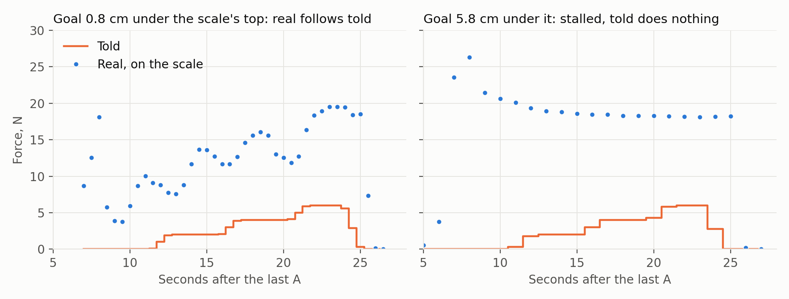
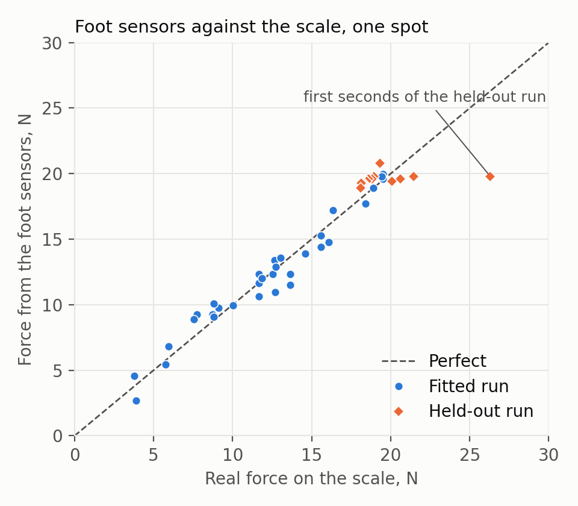
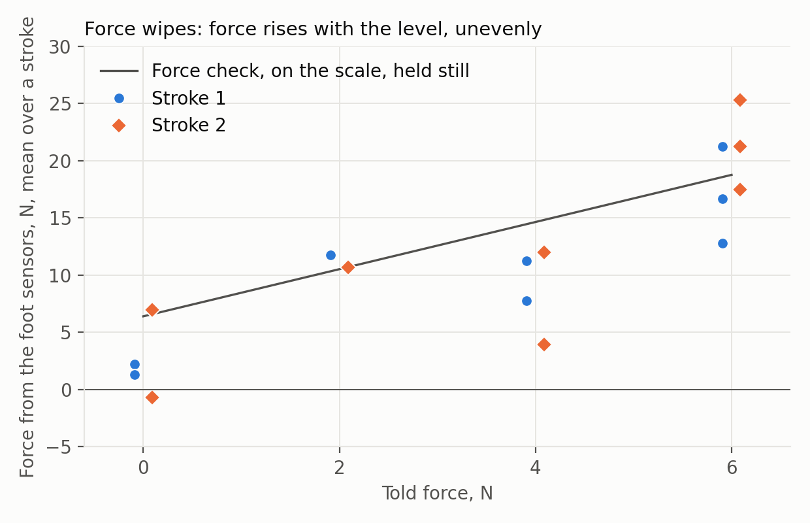
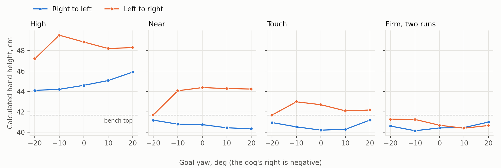

# Week 8 — 2–8 November 2026

**Status:** in progress
**Focus:** Freeze policies and demo setup; run untouched simulation and physical test manifests

## Planned

From the [revised Thesis B plan](../../docs/thesis_b_plan.md#thesis-b-weekly-schedule),
16 September 2026. This replaces the original Appendix A timing; earlier dated logs remain historical evidence.

- **Reuse, simulation and learning:** Select checkpoints from validation, freeze configurations and complete G3 before comparative claims.
- **Hardware and camera:** Freeze the tagged demonstration setup and execute the physical final-test manifest; collect synchronised sensor, force and phase traces.
- **Evidence and deliverable:** Assess G7: at least 16/20 successes across four placements × five repeats, no falls or force-limit violations, no intervention during successful sequences. Report all attempts.
- **Gate focus:** G3; G7 final evaluation.

## Checklist

- [ ] Checkpoints selected on validation and hashes/configurations frozen
- [ ] Matched budgets and at least three independent training seeds verified (G3)
- [ ] Untouched final simulation and physical manifests executed
- [ ] G7 repeated-trial criterion evaluated without changing thresholds
- [ ] Calibration, RGB-D/tags, joint states, forces, commands and phase events archived
- [ ] Post-freeze change/rerun rules recorded

## Log

<!-- Dated entries (### YYYY-MM-DD · topic). For each: the exact command or change, the outcome in numbers,
     and what it does and does not show. Record runs with ./dashboard.py record. -->

### 2026-11-06 · Report-locked commands made the standard

Lukas: "can we make lock_reports the default everywhere in this repo and the standard from now on". No run launched.

- `arm_link.py` is locked by default, so every program through it is too: the door, key and insertion programs and the holster draw. `--no_lock_reports` goes back to the clock, and `run_holster_on_dog.sh --no_lock` passes it.
- `D1Client._pace` holds every motion command out of the stall window (`stall_wait_s`: 15-88 ms after a report, at most ~38 ms held), because the `d1_ui` console, the pick demo, the `d1_hardware` CLI and its controllers, and `d1_ik_controller` send on their own timing. Release is not paced. `report_gate = False` is for measuring the stall, and `arm_command_rate_test` starts with it off.
- `--blocks gate` is built to test that gate on the arm: a 10 Hz clock through it, held and swinging. **The gate has not run on the arm.** Its 15 ms lower edge is the closest offset the records cover; 20 ms is the closest tested on purpose.
- `CLAUDE.md` carries the rule. `docs/thesis_b_plan.md` notes the measured rate. `motor_model.D1_COMMAND_HZ` is left at 10: the UniFP training session is changing it, and the position-only task and UniFP still hold 5 steps until it does.
- **Tests:** full suite 1,139, 23 failures and 2 errors, the same 25 with this work's files at `b485493d`, so none come from it. 21 are `test_key_robot` ("no arm pose in front of the key from which the whole turn solves..." and others), the rest `test_insert_robot`, `test_bezel_image`, `test_payload` and `test_remote_buttons`. Not investigated. `test_arm_timing.py` (37) passes.
- **Not covered:** P2Dingo's `arm_bridge.py` (the website's arm panel) is another repo and streams at 10 Hz on its own client. A full `d1dogdemo` has not run locked: the follow-driven phases (door, key insertion) are untested on it. The dry runs' `SimulatedLink` still steps at 10 Hz.

### 2026-11-06 · The demo's draw, all joints, with the key

Lukas: "can we test more complex motion with all the joints? it is safe to run the unholstering stage of the d1dogdemo".

The demo has no stage for the draw alone, and `holster_dog.plan` is not its motion: up to 5 degrees off at the grip, 3.4 through the draw, the
jaws shutting less, which could bind a real key in its sleeve. So `extract_demo_draw.py` took the demo's own commands from
the 29 October chain (`logs/combiner_door_robot/20261029T034118_insert_insert_door_pull_close_fast_live`) into `demos/combiner_key/robot/demo_draw_20261029.json`, and `holster_dog.py --demo_draw`
plays them with its stops and recovery. The trace holds only goals for joint moves, and streamed points peak at 80 deg/s where the link once clipped them,
so joint moves are planned to those goals and fast stretches retimed to 44 deg/s. `arm_link.py --lock_reports` puts the link on `ReportClock`; `run_holster_on_dog.sh --lock` passes it.

    demos/combiner_key/robot/run_holster_on_dog.sh --demo_draw --lock --timing          # dry
    demos/combiner_key/robot/run_holster_on_dog.sh --live --demo_draw --timing          # 10 Hz
    demos/combiner_key/robot/run_holster_on_dog.sh --live --demo_draw --timing --lock

- [Dry](#/week/8/run/20261106T023302_dry_lock): all 18 moves on the simulated arm. The ROS process aborted at exit, after the record was written ("terminate called without an active exception").
- [10 Hz](#/week/8/run/20261106T023519_live): finished. 46 skips in 390 cycles, 16.2 of 54.4 s lost, to 0.71 s; worst error 45.8 degrees; `turn` 4.22 s for 3.0. Lukas: "It worked. I did notice the stalling was happening in this run".
- [Locked](#/week/8/run/20261106T023651_live_lock): finished. 2 skips in 449 cycles, 0.42 of 50.1 s lost, 0.21 s at most; worst error 10.2 degrees; `turn` 3.01 s for 3.0. Lukas: "ok that run was perfect, no stalls. this confirms it".
- The jaws stopped at -3.5 to -4.8 units in both: the key was in them, drawn and put back.
- The two locked skips are one event at the end of `back`, as the key reached its seat, no command near the window. Not explained.
- [The error through both](figures/d1_demo_draw_10hz_vs_locked.png).

The arm ended folded (Joint1 -0.5). `test_arm_timing.py` (30) covers the replay, the link's lock and recovery on the demo's moves. `tests/test_remote_buttons.py` has one error, in the door node
(`CombinerDoorNode` has no `odom`, `node.py` line 1562), a file not changed here; not fixed.

- **Shows:** the cure on all six joints under a real load, by the record and by eye.
- **Does not show:** repeatability (one run each), walking or standing, how the key seated, or any policy. The demos are unchanged.

### 2026-11-06 · Report-locked commands on the arm

Lukas: "you can go ahead with the hardware testing. I am watching and there is nothing near the robot which is sat down with the
d1 arm on top". `d1update` (six files, no deletions), then on the dog:

    demos/combiner_door/robot/run_command_rate_test_on_dog.sh --blocks phase
    demos/combiner_door/robot/run_command_rate_test_on_dog.sh --blocks swing

- [Held](#/week/8/run/20261106T020724): 10 Hz 15 skips in 20 s; locked at 20, 50, 80 and 20 ms none (716 cycles); aimed at the window, 103 ms,
  53 of 56 cycles skipped. The arm moved 0.1 degrees. The first commanded block moved the jaws from 57.1 to the arm's limit, 50.3: the test
  commanded the reported 57.1, outside the arm's own window (F-063). Harmless, unplanned.
- [Stray start](#/week/8/run/20261106T021040): my mistake. A status check carried `--blocks swing --help`, and the wrapper only takes `--help` first, so it
  started: the test's argparse exited before any command. 2.2 s of capture, no `rate_test.json`, the echoes level with the reports (20, 21), the pose unchanged.
- [Swing, stopped](#/week/8/run/20261106T021112): 10 Hz 12 skips, 2.90 degrees rms; locked 0, 0.47. Then the test's guard stopped it: my bug, the between-blocks
  check saw the arm 3.5 degrees out, still returning. Fixed.
- [Swing, four blocks](#/week/8/run/20261106T021303): 10 Hz 17 and 14 skips, 3.35 and 3.40 degrees rms; locked 0, 0.47, then 1 skip (0.21 s), 0.98. That skip had no
  command near the window; `ReportClock` then dropped a slot on the 100 ms floor. Fixed.
- [Swing, final clock](#/week/8/run/20261106T021615): 10 Hz 15 and 15 skips, 2.89 and 3.44 degrees rms; locked 0 and 0, 0.45 and 0.44, command period at most 114 ms.
  [The motion](figures/d1_swing_10hz_vs_locked.png): flats and lurches at 10 Hz, none locked.

The arm ended at -2.4 degrees, folded, holding, jaws at 50.3. Two tests added for the two bugs; each fails without its fix (`test_arm_timing.py`, 18).
The first version of the guard test passed without the fix, so it was rewritten.

- **Shows:** the cause (F-238) by the control, and the cure on one joint (F-239).
- **Does not show:** multi-joint motion, load, a walking dog or any policy. The arm link and demos are unchanged and still pause.

### 2026-11-06 · The D1's pauses traced to command phase

Lukas asked for more solutions to the arm's 0.3-0.7 s drops, which UniFP cannot run through. Offline only: no run launched, the
arm not touched. `arm_gap_phase.py` lines each command of the 23 October records up with the arm's report cycle, which
F-200 to F-203 never did:

    python demos/combiner_door/robot/arm_gap_phase.py logs/arm_command_rate/20261023T050700 logs/arm_command_rate/20261023T051030 logs/holster_dog/<the 13 live runs>

- **What it shows:** the pauses begin when a command lands 98-106 ms after a report, 5-13 ms before the next is due
  ([figure](figures/d1_stall_vs_command_phase.png)). At 10 Hz held: 36 of 42 such cycles skip. Held, all 52 skips of 590 cycles had
  a command in 88-110 ms. Moving, 267 of 283 of 2,806 cycles, and 16 of 2,301 skipped outside it. 28% of the time is lost at 10 Hz.
- **Why 10 Hz is so bad:** 100 ms against 111 ms drifts a command into the window about once a second, and once stalled the
  next command, 100 ms on, is in the window again. At 5 Hz the same hit costs one report (0.21 s).
- **F-202 re-read:** the plain 2 Hz block never put a command in 98-106 ms, so "none at 2 Hz" is a miss, not a safe rate.
- **Does not show:** cause. It is a correlation in old records; nothing locked has been sent. The "every 5th" blocks' 8 commands in
  the window with no skip are unexplained.
- **Elsewhere:** Zeng's report ([PDF](https://eloisezeng.people.caltech.edu/documents/32338/2025_SURF_Final_Report.pdf)) edited the mode 0 execution
  time over SSH (0.04 to 0.1 s, then 0.01 s at 100 Hz) and the arm stayed shaky, then failed; it gives no user, path or file. Web
  searches found nothing else on this. The SSH route stays a last resort.

Built, not run on the arm: `d1_hardware.ReportClock` and `D1Client.servo_report_s`; `--blocks phase` and `--blocks swing` in
`arm_command_rate_test.py`, with a 103 ms block as the control; `arm_feedback_timing.py` records angles. `test_arm_timing.py`
(16 tests, a pretend arm that stalls in the window) passes, with the door suite (111) and `tests/test_d1*` (82).

### 2026-11-06 · The retrained reach policy on the dog's legs: the path, an offline check, and a first dry run

**Goal (Lukas):** the whole-body reach policy on the real dog, arm folded and sent nothing: a dry run, then a live stand.
The policy is the corner retrain `unifp_go2d1_isaaclab_corner_delay_model_59600.pt` (F-232's candidate), with
`..._corner_rate_model_59600.pt` as the alternative; both committed from the other PC (`e879afc0` on `main`).

**The change.** `press_live.py --presses 0` already stands the dog on a policy, so the reach runs through it with its stops
and handover unchanged. `export_policy.py` writes 18-output exports (`checkpoints/reach_force_corner_{delay,rate}_model_59600.npz`,
numpy against torch to 2.3e-5 / 3.4e-5); `leg_policy.py` keeps all 18 actions for the next frame and adds `reach_command` and
`VirtualArm`; `press_live.py` takes `--reach_goal` and `--reach_arm_obs`, and refuses a press with a reach export. The six
arm outputs are recorded and go nowhere: the program has no arm sender and the arm link runs `--observe`. 48 tests pass
(`tests.test_press_live`, `tests.test_leg_shadow`), two of them new.

**Offline, before the dog** (the real `59600` networks on a static settled stand, level, no closed loop; scratch script,
not kept; the leg target offset from default, max / rms, after the history fills):

| `corner_delay` sees | goal | legs, rad | arm output, max rad |
| --- | --- | --- | --- |
| the folded arm | the folded hand | 0.41 / 0.21 | 11.8 |
| the folded arm | `EE_GOAL_INIT_END` | 1.03 / 0.37 | 15.9 |
| a virtual arm following its outputs | `EE_GOAL_INIT_START` | 0.24 / 0.10 | 1.2 |

- `corner_rate` was worse under the virtual arm (0.56 / 0.17, arm 11.6 rad), and `58400` worse again (1.73 / 0.28).
- Shown the folded arm, the policy asks 12-16 rad of it for as long as it runs: a state it never trained in, ~91 degrees
  off its default on Joint2 and Joint3. A static arm inflates this in every row where the arm cannot arrive, so these rows
  rank the options and do not predict the dog.
- On the states of [the 23 Oct stand](#/week/6/run/20261023T133506_leg_press_live) (base 0.206 m, 8 degrees nose up: round 4's sit-back) every combination read 0.5-2.2 rad, so the start stance matters.

**The first dry run: [the dog was lying down](#/week/8/run/20261106T012149_reach_stand).**
`demos/combiner_key/robot/run_press_on_dog.sh --policy checkpoints/reach_force_corner_delay_model_59600.npz --presses 0 --stand_s 20 --print_s 4`
(defaults: goal `init_start`, arm `virtual`.)
- **Shows:** the path works on the dog. 1001 steps, period median 0.020 / p99 0.0205 s, inference 1.76 / 2.11 ms, 0 LowCmd
  sent. The arm link connected (99.9% measured) and read the arm within 7.2 degrees of `ARM_REST_POSE` on every joint.
- **Does not show:** anything about the policy on a stand. The base read 0.070 m with FR's calf past its limit, so the leg
  numbers (0.42 rms, 0.78 max) are a lying dog's. It has not driven the legs, in closed loop or at all.

**Dry on the standing dog** (Lukas stood it; base 0.333 m, roll -1.8, pitch -1.3 degrees; nothing sent in any run, 0 LowCmd;
the leg target's offset from default, the steady state after the first 2 s):

| run | policy sees | legs max / rms, rad | a step, rad | arm output, rad |
| --- | --- | --- | --- | --- |
| [`corner_delay`, 15 s](#/week/8/run/20261106T012425_reach_stand) | virtual arm, `init_start` | 0.35 / 0.19 | 0.002 | 1.4, reached exactly |
| [`corner_delay`, 60 s](#/week/8/run/20261106T012647_reach_stand) | virtual arm, `init_start` | 0.36 / 0.195 | | 1.4, no drift in any 20 s |
| [`corner_delay`, 15 s](#/week/8/run/20261106T012444_reach_stand) | **real folded arm**, folded goal | **25 / 19.5** | | **25** |
| [`corner_rate`, 15 s](#/week/8/run/20261106T012503_reach_stand) | virtual arm, `init_start` | 0.53 / 0.21 | 0.007 | ~18 |

- **The runaway:** past 1 rad at step 46 (0.9 s), most leg targets at the 25 rad clip after that. Live, the legs would have
  gone to their clamped limits. So F-237: `--reach_arm_obs measured` is refused with `--live`, and a new stop
  (`--reach_max_leg_off_rad`, 0.9) goes to damping without sending the target. 50 tests pass, two more new.
- **The first step:** the empty history gives 0.76 rad at step 0 on the standing dog, 0.50 by step 10. Training resets the
  same way, so it is kept.
- **The real arm** moved 0.2 degrees at most in each run (the sensor's noise).
- **The live start, offline:** the 23 Oct handover states ([one](#/week/6/run/20261023T133506_leg_press_live); base 0.29 m, pitch -4.9 to
  -5.8 degrees) held static under the virtual arm: 0.62-0.65 at the first step, 0.61-0.63 at most after, rear calves asked
  0.5-0.8 rad straighter (15-20 N·m at kp 25). Static, so overstated; it stays under the stop.
- **Does not show:** closed-loop behaviour, a rattle (F-196's shows only with the legs driven), or the handover stance on this
  policy. The dry runs held sport mode's taller stand.

Before it: `d1update` (previewed: 0 deletions, nothing newer on the dog) took the dog from its 27 Oct copy to `b485493d` plus
this work, and the 29 Oct `d1t-arm-link` container, exited 7 days, was removed with its log kept in
`logs/leg_press/20261029T034118_leftover_arm_link.log`.

**The test console and the E-stop (Lukas: a GUI "to assist in testing from now on", with a policy list and an emergency stop
"which can be triggered by pressing b on the controller too... immediately hand back to sportsmode if possible").**
[demos/robot_console/](../../demos/robot_console/README.md), started by `demos/robot_console/run_on_pc.sh`.
- **The stop:** B, the button and Esc now go damping -> LowCmd stopped -> SelectMode with no Enter. B used to wait in damping,
  so `press_live.py`'s B changed for terminal runs too. Other stops still wait. SelectMode goes again at 3.5 s.
- **Tested on the dog, dry, sending nothing** (the dog lying, base 0.071 m; `lowcmd_sent` 0 in each):
  - [the button through `docker run -i`](#/week/8/run/20261106T015341_leg_press): 25 ms HTTP, the program's `E-STOP` logged;
  - [the tunnel killed mid-run](#/week/8/run/20261106T015416_leg_press): E-stopped, the server and containers gone;
  - [`kill -9` on the server mid-run](#/week/8/run/20261106T015514_leg_press): stdin closed, E-stopped, containers gone;
  - headless Chrome's worker heartbeat at 5.0 polls a second, the status 0.12 s old at worst; `run_sport_on_dog.sh` read `mcf`.
  - [A reach dry run on the lying dog](#/week/8/run/20261106T015244_reach_stand) stopped on its first step at the new 0.9 rad bound (0.92), as it should.
- **Found by those tests:** the page was blank until its first worker tick (fixed: it draws on load); a false SIGTERM after a
  dry stop (fixed: the program's own `E-STOP` line counts); a lying dog's dry run could unlock live (fixed: 3 s standing needed).
- **Not validated:** an E-stop from a live stand; B stopping any run (its bit is confirmed, F-207); sport mode taking a sinking
  dog; a mouse click on the button in a real browser (the same POST ran from a script). 72 tests pass (`tests.test_press_live`,
  `tests.test_leg_shadow`, `demos.robot_console.tests.test_console`).
- `~/.bashrc` was not changed: adding a `d1console` helper was blocked, so the launcher is a script in the repo.

**Known gap (Lukas asked why):** the UniFP task never modelled the D1's 10 Hz commands, 9 Hz feedback or firmware planner,
which the position-only task does; the corner retrain changed the legs only. It does not limit a folded stand. It would
limit any run where the policy drives the arm, and F-097's experiment (UniFP on the measured arm) has not been run. This
PC's NVIDIA driver is down today, so nothing here was checked in simulation.

**The locked-stream reach fine-tune (reported by the UniFP session, other PC, 2026-11-06; not run or checked here).** That session
reports `62800` tracking at 4.92 / 5.73 cm in sim on the frozen validation set (light legs, its fitted locked arm model), 0 falls,
2.71 of 3.42 N, standing chatter 0.026 rad, 6% of commands clamped, against 19.86 / 22.09 cm and 89% clamped for `corner_delay` 59600
on the same condition. That replaces the 12.4 cm it first gave, which F-045's planner flattered. From a folded start, 27 closed-loop
goals had no falls and no contact on the dog; `corner_delay` struck the dog in 11 of 27. It says this does not show the F-237 runaway
is gone, only that closed-loop sim does not repeat it. It takes F-241 to F-243, so the next finding here is F-244. `62800` is uncommitted
on that PC, works only on the locked interface (15.37 / 22.63 cm on UniFP's 50 Hz soft arm), has no export yet and has not run on the arm (that session said `export_policy.py` and `leg_policy.py` do not handle 18 outputs, which is wrong for this tree, see "What exists for a reach runner" below). Its arm model rests on the Joint1 swing summary, so it asked for the
raw series: the five locked blocks went to it by message, and all ten are now in each swing run's `swing_series.json` (reports from
`feedback_timing/samples.jsonl`, which `logs/` keeps and `results/` did not). Steps under ~2.5 degrees may stop between commands, which
its model does not do: not tested on the arm.

**The UniFP session's correction (same day, later).** It withdrew the "lag 80, dead 20, age 40" arm profile after the raw series showed its fit ran about 60 ms slow. It now fits a first-order lag of 77 ms, 5 ms delay, speed-limited, and reports `62800` at 4.02 / 4.90 cm with 0 falls and `corner_delay` at 16.63 / 18.78 cm on that profile, which replaces the 4.92 / 5.73 and 19.86 / 22.09 above. Its robustness range, free-running score, folded starts and 50 Hz score came from the slow profile and are to be rerun, so the folded-start result above is not to be relied on yet. `armft3_s1` is training from `62800` and replaces it only if it beats it. It takes F-250. Reported by that session, not checked here.

**The arm model replayed on the all-joint draw.** At its request, offline, no arm motion: `python3 results/week_08/runs/20261106T023651_live_lock/replay_models.py` replays the [locked draw](#/week/8/run/20261106T023651_live_lock) (453 commands, 462 reports) through models fitted on the J1 swing, output in `replay_models.txt` beside it. Moving over 5 deg/s, bias removed, lag 63 ms, delay 20, cap 45 gives 0.26-0.30 degrees on J1-3 and 0.51-0.54 on J4-6; a cap of 36 gives 3.2 on J1 and 3.8 on J6, because the reports reach 41-45.5 deg/s. Shows the lag carries to all six joints with the key at these speeds. Does not show a final model: none tried wins on both swing and draw, and my replay of its 77/5 model gives 0.37-0.72 on the swing against its 0.23, which is unexplained until it sends its speed limit and sim step ([F-244](../findings.md#f-244)). The series went to it by message and is in `draw_series.json`.

**F-244 corrected.** The UniFP session could not match my replay and sent its code: its speed limit is the URDF's 72 deg/s, applied as a slew before the lag, where mine capped the lag's output rate. That difference in structure is about 25 ms of time and the whole mismatch; neither replay had a bug. Run its way here, `20261106T021615 swing_lock_20ms` matches its reference values to 0.01 degrees, the four clean swing blocks give 0.229 degrees with the median bias removed (it gets 0.233 and 0.231; `replay_models.txt` prints 0.239, which leaves the bias in and uses one cap for all joints), and the draw 0.23-0.57 at lag 77, delay 5 with each joint's URDF cap. Its point that the lag differs by joint also holds here, which overturns my "no sign": best lag J1-3 65-70 ms, J4-6 50-55 ms, moving error on the wrist 0.71-0.79 down to 0.29-0.43 degrees, each joint's best lag within 10 ms across the run's two halves. `replay_models.py` now has both structures. F-244 is marked superseded by [F-245](../findings.md#f-245). It also reports that steps of 0.05-0.5 degrees keep 0.90 of commanded speed under the lock (n 599), so F-199's small-step stop-start does not appear as lost speed; reported, not checked here, and 9 Hz reports cannot show stops inside a cycle.

**What exists for a reach runner (same day, later).** I told Lukas no policy runner exists and passed on that the export could not do 18 outputs. Both were wrong for this uncommitted tree. `export_policy.py` exports reach policies: rerun on CPU to a scratch file, `corner_delay` 59600 reproduces to 2.3e-5 on actions (up to 44.1) and 5.9e-6 on estimates, 64 random stacks, gate 1e-4. `press_live.py --presses 0` is a legs-only runner, dry on the dog so far. What does not exist is the arm half: nothing sends the policy's arm outputs, `ReportClock` is not used there, the measured arm's speed is passed as zeros, goals are fixed, and the start is the training pose, not the fold. The UniFP session was told this and that pushing is Lukas's call.

**Reach policies jitter (reported by the UniFP session, same day; not checked here).** It asks that no reach policy, `62800` and `armft3` included, go to the arm yet. In sim `armft3` 63800 tracks at 3.58 / 4.28 cm with no falls, but per joint its commands move 10-14 degrees rms a cycle, 42-66% of steps reverse the last and 35-59% are over 10 degrees ahead of the arm, where the goals need about 3-4 degrees. Averaging the actions between commands made tracking worse (4.73 / 5.89 cm), so it reads this as a closed-loop oscillation to fix in training. `armft4_s1` is training with a penalty on command change, with a gate fixed in advance: worst joint at most 6 degrees rms and 30% reversals, else nothing is chosen. Lukas told it to build the arm half; it has `reach_arm.py` and tests on its PC, sending nothing, waiting for this tree. Noted for it here: the arm link's feedback carries no report stamp (`age_s` is refreshed by echoes), and the fold sits on or past the training's joint limits (J2 -90.9, J3 91.7 against 89.95 degrees).

### 2026-11-06 · The reach's two `59600`s into `checkpoints/`, for a whole-body test on the dog

Lukas asked for the UniFP retrain's whole-body policies on `main`, for the agent on the other PC to test them on the
real robot. Week 7 left them gitignored under `logs/` ("That is for Lukas"). No run was launched for this.

    cp -p logs/unifp_train/20261026T005349_train_seed1_reach_r2delay_s1/model_59600.pt \
          checkpoints/unifp_go2d1_isaaclab_corner_delay_model_59600.pt
    cp -p logs/unifp_train/20261026T022733_train_seed1_reach_r2rate_s1/model_59600.pt \
          checkpoints/unifp_go2d1_isaaclab_corner_rate_model_59600.pt

- **The files:** [the delay arm's run](#/week/7/run/20261026T005349_train_seed1_reach_r2delay_s1) (`6d363be2...`) and
  [the `action_rate` arm's](#/week/7/run/20261026T022733_train_seed1_reach_r2rate_s1) (`cb6fb060...`), each sha256-equal
  to its source. `checkpoints/SHA256SUMS` has both, and all 25 of its entries verify.
- **The load check (CPU, no simulator):** through `EvaluablePolicy` each reads iteration 59600, 18 actions, and gives
  finite actions on a random 2432-wide stack.
- **What this shows:** the files are intact and load. Their scores are Week 7's (F-232, `checkpoints/README.md`), all in
  simulation, and were not re-run.
- **What this does not show:** that either can run on the dog. See "Issues and risks". The demos' default stays `58400`.
- **The key and press exports** (`leg_key_force_corner_model_4000.npz`, `leg_press_force_chain_s4_model_11200.npz`) were
  already on `main` from 2026-10-30. They are leg-only: the arm is held.

### 2026-11-06 · The reach on the real arm's interface: what 9-10 Hz costs, and what the rest does

Lukas: "the real arm takes commands at 9-10 hz, and it seems the policy expects 50hz", then "the arm also drops commands
for 0.3-0.7 seconds on occassion in real life". UniFP's task drives the arm like the legs: a 50 Hz target into an ideal
PD (kp 60 / 40), exact angles and velocities back. So the question is wider than the rate.

**New code:** `unifp_train/arm_link.py` puts the real arm between the policy and the joints, each part behind its own
flag on `run_unifp_train.py`, all of them with `--arm_real`:
- `--arm_command_hz`: one command a period, drawn 9-10 Hz per environment, at a random phase, held between. Clamped to
  the joint limits as `d1_hardware` clamps them.
- `--arm_feedback_hz`: the actor reads the arm at 9 Hz, to 0.1 deg (F-020), and its speed as the difference of reports,
  since the arm reports none. The critic and rewards keep the true state.
- `--arm_servo`: the stiff drive of `--arm_actuator d1_servo` (4000 / 400, implicit), the published torques, the measured
  speed ceilings. `run.json` reads them back from PhysX (`arm_joints_loaded`).
- `--arm_planner`: the firmware's fitted trapezoid (`core.TrapezoidTracker`, F-045).
- `--arm_stalls`: for 0.3-0.7 s no command is taken and no report comes. The arm finishes the move it has: it moved ~5
  deg through a gap asked for 15-20 (F-200), about one 4 deg command. Every 1.0-2.8 s by default, F-200's capture.

All off by default. Its draws use their own generator, so the goal schedule does not move: every run below has 0
schedule mismatches, so the rows are paired. `tests/test_arm_link.py`, 17 tests on the CPU.

The command, delay arm's `59600`, 30 s each, recorded by `logs/unifp_train/armlink/ladder.sh`:

    ./run_unifp_train.py eval --headless --small_physx --manifest results/manifests/unifp_isaaclab_validation.json \
        --tool_point fingertip --leg_actuator unitree_geared --leg_armature 0.0002 --leg_knee_armature 0.0007 \
        --leg_delay_min_steps 3 --leg_delay_steps 4 \
        --checkpoint checkpoints/unifp_go2d1_isaaclab_corner_delay_model_59600.pt <arm flags>

Light legs, quiet goal error, median / p90 cm:

| arm | flags | cm | fell | standing chatter, rad |
| --- | --- | --- | --- | --- |
| [as trained](#/week/8/run/20261106T012220_eval_seed1_al_d_base) | none | 1.93 / 2.57 | 0 | 0.022 |
| [10 Hz commands](#/week/8/run/20261106T012422_eval_seed1_al_d_cmd10) | `--arm_command_hz 10` | 3.04 / 3.67 | 0 | 0.024 |
| [9 Hz commands](#/week/8/run/20261106T012451_eval_seed1_al_d_cmd9) | `--arm_command_hz 9` | 3.31 / 4.18 | 0 | 0.023 |
| [9 Hz reports](#/week/8/run/20261106T012520_eval_seed1_al_d_fb9) | `--arm_feedback_hz 9` | 4.03 / 4.63 | 0 | 0.030 |
| [both, soft arm](#/week/8/run/20261106T012551_eval_seed1_al_d_cmdfb) | `--arm_command_hz 9 10 --arm_feedback_hz 9` | 6.36 / 7.19 | 0 | 0.031 |
| [9-10 Hz, dropped commands, soft arm](#/week/8/run/20261106T012621_eval_seed1_al_d_drop) | `--arm_command_hz 9 10 --arm_stalls` | 4.26 / 6.07 | 1 | 0.025 |
| [stiff servo](#/week/8/run/20261106T012651_eval_seed1_al_d_servo) | `--arm_servo` | 4.78 / 9.52 | 0 | 0.024 |
| [servo, planner, 50 Hz commands](#/week/8/run/20261106T012721_eval_seed1_al_d_splan) | `--arm_servo --arm_planner` | 3.50 / 11.57 | 1 | 0.023 |
| [servo, 9-10 Hz](#/week/8/run/20261106T012753_eval_seed1_al_d_scmd) | `--arm_servo --arm_command_hz 9 10` | 9.24 / 10.74 | 0 | 0.027 |
| [all, nothing dropped](#/week/8/run/20261106T012824_eval_seed1_al_d_nostall) | the four, no `--arm_stalls` | 12.03 / 14.14 | 2 | 0.031 |
| [all, dropped every 5-7 s](#/week/8/run/20261106T012857_eval_seed1_al_d_rare) | `--arm_real --arm_stall_interval_s 5 7` | 12.53 / 14.83 | 0 | 0.032 |
| [**the real arm**](#/week/8/run/20261106T012249_eval_seed1_al_d_real) | `--arm_real` | **15.13 / 21.02** | 1 | 0.035 |
| [`action_rate` arm, the real arm](#/week/8/run/20261106T012929_eval_seed1_al_r_real) | `--arm_real` | 14.83 / 23.06 | 0 | 0.032 |
| [`action_rate` arm, nothing dropped](#/week/8/run/20261106T013001_eval_seed1_al_r_nostall) | the four | 11.87 / 13.87 | 1 | 0.029 |
| [`58400`, the real arm](#/week/8/run/20261106T013033_eval_seed1_al_o_real) | `--arm_real` | 14.81 / 19.39 | 1 | 0.062 |

- **The link off reproduces Week 7 exactly:** 1.93 / 2.57 cm, the same as the run it repeats.
- **The rate alone is not the problem:** 1.1-1.4 cm. The reports alone cost more (2.1 cm).
- **They stack.** The real arm is 8 times the error, and every reach policy is the same (F-241).
- **Force goes with it:** realised along the command 0.28 N of 3.37 (as trained 3.17 of 3.42); the estimator's error 3.56 N
  (0.86); base velocity error 0.083 m/s (0.039).
- **Why the servo costs so much:** the policy uses the target as a torque. On the real arm 87% of its commands are past a
  joint limit, the first three joints' targets a median 116 / 52 / 81 deg from the arm, 96% of commands more than 10 deg
  ahead on the worst joint. On UniFP's spring that is a push; on the firmware it is a place to go at 1.25 rad/s.
- **What this shows:** in simulation, on the fitted model of the arm, the current reach policies do not track on it.
- **What this does not show:** nothing here ran on the arm. The planner is a fit (F-045, retention provisional), the
  stalls' frequency one capture, the 9-10 Hz stated, and the stiff drive stands in for a servo whose real stiffness is
  not measured. No walking comparison beyond the frozen set.
- **Also seen:** without `--arm_servo`, `velocity_limit_sim` loads as the URDF's old 1.05 / 1.73 rad/s (`arm_joints_loaded`),
  the values F-033 showed wrong both ways, so every policy so far trained with them.

### 2026-11-06 · The reach fine-tuned on the real arm: stated before any checkpoint is scored

Fine-tuning is needed. Job `armft1_s1`: job `080`'s recipe (the corner, the delay 5-20 ms, 4096 environments, seed 1) from
the delay arm's `59600`, with `--arm_real --arm_stall_interval_s 1 8` (F-200's frequent end to "on occasion"), 3000
iterations. One change to what the rewards read: with `--arm_servo` the arm's torques are left out of `torque_limits`,
because Isaac Lab estimates an implicit drive's torque as stiffness x error, which reads as the limit on any lag.

**Selection, stated now.** On the frozen validation set, light legs, `--arm_real` (stalls every 1-2.8 s, the harder end,
which the run did not train at alone): no falls, then the lowest p90 of quiet goal error. The chosen checkpoint is then
scored, not selected on, at stalls every 5-7 s, with nothing dropped, at 9 Hz and 10 Hz fixed, on zero-armature legs and
on the 50 Hz interface. **Its replacement test:** better than the delay arm's 15.13 / 21.02 on the real arm, with no more
standing chatter than its 0.035 rad.

### 2026-11-06 · The spec changes: commands locked to reports stop the drops, and the model is refitted to that stream

Lukas, relaying the session on the dog's PC: "set d1 command hz to the measured ... train against a steady 111ms stream
... about 150ms from command to report. no stall model should be needed ... locking commands to the arms reports stops the
drops." I asked that session for the evidence. Its numbers, written up there as F-238 to F-240, uncommitted on
`mechanism-demo` at the time of writing:
- **Joint1, moving:** free-running at 10 Hz 73 skipped reports in 710 cycles, 28.4 of 99.4 s lost; locked 20 ms after each
  report 1 in 894. **The causal control:** a command aimed at the bad window (98-106 ms after a report) skips 36 of 42 cycles.
- **All six joints, the holster draw with the real key:** 46 skips in 390 cycles, 29.7% of the time lost, worst joint error
  45.8 deg; locked 2 in 449, 0.8%, 10.2 deg.
- **Residual, not zero:** 3 skips in 2,059 locked cycles, each ~0.21 s, cause unknown.
- **The 150 ms is a tracking lag over ramps** (best time shift, commanded against reported), not a dead time: the first
  report of motion comes 88-90 ms after a command, so a delay of 150 ms would contradict it.
- **"6 steps" would be 120 ms.** `round(50 / 9)` is `interface_timing`'s, the position-only task's. The sender is a true
  111 ms stream; this link is on real time, so it runs one, as 100 / 120 ms on the 20 ms grid, mean 111.2.

**The first model did not match the arm.** `unifp_train/arm_link_check.py` pushes the same triangle through the link and
reads it as the dog's run was read. F-045's planner gave a 54 ms lag against 150, and report age cannot clip a peak. A fit
over servo lag, dead time and report age, refitting acceleration on the F-033 steps at each point (96 points), gave:

| | lag ms | half range deg | speed p50 deg/s | peak | first motion ms | F-033 step RMS deg |
| --- | --- | --- | --- | --- | --- | --- |
| the arm | 150 | 7.9 | 30-32 | 37-40 | 88-90 | |
| F-045, no servo lag, best report age | 106 | 8.6 | 35.5 | 38.3 | 90 | 1.05 (0.34 at its own fit) |
| **locked profile**: lag 80, dead 20, age 40 ms | 152 | 8.2 | 32.2 | 37.3 | 90 | 2.58 |
| the same on training's 20 ms grid | 134 | 8.3 | 30.0 | 40.8 | 100 | |

- **No one set fits both.** The arm answers one 30 deg step and a stream of 4 deg steps differently. F-045's note on
  streaming said so in September (4.3 deg a cycle modelled, 2.5 measured). So the locked profile is a second profile in
  `motor_model`, for streams; F-045 stays for big steps and the position-only task.
- **Dead time and report age do not separate** (only their sum shows, as that session found), and the top fits span lag
  80-100, sum 40-60. Training draws each environment's lag 60-100 and age 20-60 ms.
- **Skips** go in at 0.15% of cycles, each taking its command with it: light noise, not a fitted rate.
- `tests/test_arm_link.py` pins the profile to the measured triangle.

**On the locked stream before any retrain** (F-045's planner, the fine-tune `armft1`'s `60600`, which trained with drops):
- Locking alone does not save the old policy: the delay arm's `59600` is 12.44 / 14.21 cm, 1 fall.
- The fine-tune carries over: 5.27 / 6.51 cm, no falls, 2.01 N of 3.42.
- **Report age has no cliff:** 0, 40, 80, 120 ms give 5.27 / 6.51, 6.09 / 7.03, 7.03 / 8.26, 7.72 / 9.56 cm.
- **The command's place in the window barely matters:** 60 ms after the report 5.49 / 6.47 cm, force 1.63 N.

`armft1_s1` was stopped at `61088` as superseded: its stalls and 9-10 Hz are not what a locked runner will see. Its rule
above is withdrawn with it.

### 2026-11-06 · The reach fine-tuned on the locked stream: stated before any checkpoint is scored

Job `armft2_s1`: job `080`'s recipe from `armft1`'s `61088` (which has already learnt targets as positions), with
`--arm_locked --arm_locked_range`, 2000 iterations.

**Selection, stated now.** On the frozen validation set, light legs, `--arm_locked` at the fit's centre, skips on: no falls,
then the lowest p90 of quiet goal error. The chosen checkpoint is then scored, not selected on: at the fit's two corners
(lag 60, age 20; lag 100, age 60), on F-045's planner, with the command 60 and 80 ms after its report, on zero-armature
legs, free-running with drops (`--arm_real`, what a runner that is not locked would get), and on the 50 Hz interface.
**Its replacement test:** better than `armft1`'s `61088` on the same condition, with no more standing chatter than 0.035
rad, and force reported beside it.

### 2026-11-06 · The reach on the locked stream: `62800`

[The run](#/week/8/run/20261106T025555_train_seed1_armft2_s1) (job `armft2_s1`, 1.8 h, from [`armft1`](#/week/8/run/20261106T013202_train_seed1_armft1_s1)'s `61088`), every 200 iterations scored
beside it. By the rule stated above, **`62800`**: no falls, the lowest p90.

| checkpoint | cm | fell | force realised of 3.42 N |
| --- | --- | --- | --- |
| [delay arm `59600`](#/week/8/run/20261106T025555_eval_seed1_l2_d) | 19.86 / 22.09 | 0 | -0.16 |
| [`action_rate` arm `59600`](#/week/8/run/20261106T025802_eval_seed1_l2_r) | 19.01 / 21.48 | 2 | -0.68 |
| [`58400`](#/week/8/run/20261106T030022_eval_seed1_l2_o) | 18.73 / 22.35 | 1 | 2.35 |
| [`armft1` `61088`, the start](#/week/8/run/20261106T030234_eval_seed1_l2_f61088) | 7.26 / 8.90 | 0 | 1.42 |
| [`61400`](#/week/8/run/20261106T031658_eval_seed1_ft2_61400) | 5.27 / 6.33 | 0 | 2.41 |
| [`62400`](#/week/8/run/20261106T040924_eval_seed1_ft2_62400) | 5.09 / 6.05 | 0 | 2.44 |
| **[`62800`](#/week/8/run/20261106T043047_eval_seed1_ft2_62800)** | **4.92 / 5.73** | 0 | 2.71 |
| [`63087`, the last](#/week/8/run/20261106T044611_eval_seed1_ft2_63087) | 4.90 / 5.78 | 0 | |

- **The replacement test passes:** 4.92 / 5.73 against `61088`'s 7.26 / 8.90, standing chatter 0.026 rad against the
  0.035 allowed, 6% of commands clamped (`59600`: 89%). The delay arm's 59600 on the same condition is 19.86 / 22.09:
  F-045's planner flattered it at 12.44 / 14.21.
- **Scored, not selected on:**

| condition | cm | fell | force, N |
| --- | --- | --- | --- |
| [no skips](#/week/8/run/20261106T044648_eval_seed1_fin_noskip) | 4.85 / 5.56 | 0 | 2.63 |
| [fast corner, lag 60, age 20 ms](#/week/8/run/20261106T044721_eval_seed1_fin_fast) | 4.97 / 5.40 | 0 | 1.95 |
| [slow corner, lag 100, age 60 ms](#/week/8/run/20261106T044753_eval_seed1_fin_slow) | 4.91 / 5.95 | 0 | 2.59 |
| [F-045's planner](#/week/8/run/20261106T044826_eval_seed1_fin_f045) | 4.54 / 5.68 | 0 | 2.18 |
| [command 60 ms after its report](#/week/8/run/20261106T044858_eval_seed1_fin_off60) | 5.30 / 6.14 | 0 | 2.24 |
| [command 80 ms after its report](#/week/8/run/20261106T044931_eval_seed1_fin_off80) | 5.14 / 6.36 | 0 | 2.17 |
| [skips at 1%](#/week/8/run/20261106T045003_eval_seed1_fin_skip1) | 4.97 / 5.75 | 0 | 2.84 |
| [zero-armature legs](#/week/8/run/20261106T045036_eval_seed1_fin_zero) | 5.18 / 6.16 | 0 | 2.76 |
| [free-running, with drops](#/week/8/run/20261106T045109_eval_seed1_fin_drops) | 5.80 / 7.42 | 0 | 1.66 |
| [the 50 Hz soft-arm interface](#/week/8/run/20261106T045141_eval_seed1_fin_ideal) | 15.37 / 22.63 | 0 | 6.22 |

- **It is the real arm's policy now.** It tracks the same on everything fitted, and it no longer works on the interface it
  left, so the demos that build UniFP's soft arm cannot use it as it stands.
- **Unmodelled drops do not break it:** 5.80 / 7.42 cm and no falls free-running, though it never trained on them in this run.
- **What 5 cm is:** a hand following each goal perfectly 150 ms late scores 1.9 cm on this metric (goal speed median 0.20
  m/s, moving 64% of the time; per-episode median, pooled, 512 episodes of the task's own goal schedule). So about 3 cm is
  not the lag, and I do not know yet what it is. It was still falling at the end of the run.

**Folded starts** (`demos/unifp/folded_start_probe.py --real_arm`, 27 goals, standing, forces off, the locked model at the
fit's centre, no skips): the session on the dog's PC saw `corner_delay`, shown the true folded arm on the standing dog, run
away open loop (its F-237). Every episode trained from the zero pose, so I tested it:

| | from | within 5 cm | final error, median / max cm | contact on the dog | peak base pitch |
| --- | --- | --- | --- | --- | --- |
| [armft2 `62800`](#/week/8/run/20261106T045225_probe_seed1_fold_armft2_62800) | zero | 16 of 27 | 4.57 / 7.44 | none | 16 deg |
| | folded | 19 of 27 (median 3.0 s, slowest 7.1) | 4.52 / 6.02 | none | 28 deg |
| [delay `59600`](#/week/8/run/20261106T045243_probe_seed1_fold_delay59600) | zero | 0 | 19.8 / 24.6 | 7 of 27, to 114 N | 23 deg |
| | folded | 0 | 19.4 / 24.0 | 11 of 27, to 696 N | 30 deg |

The goal is a fixed held one, so 5 cm is close to the policy's own error here: read "within 5 cm" with the final error.
Contact is read from the dog's side, because the arm's links report none. This is closed loop in simulation, which is
not the open-loop runaway the dog showed; it says the fine-tune does not repeat that here, not that the dog would not.

- **What this shows:** on a model fitted to the arm, in simulation, a 50 Hz reach policy tracks at about 5 cm through a
  111 ms arm stream, with no falls and no strikes from the fold.
- **What this does not show:** nothing here ran on the arm or the dog. One seed. The frozen set chose the checkpoint. The
  profile rests on one Joint1 triangle and one all-joint lag, with the dog lying down; steps under ~2.5 deg (F-199) may
  still stop between commands, which the model does not do. Walking and contact on the arm are not validated, and no
  runner exists.

### 2026-11-06 · Correction: the locked profile above was fitted to the wrong number, and is replaced

**What was wrong.** I fitted `arm_link_check`'s shift to the 150 ms that session reported. That shift is against the command
*held* from each send; the 150 is against the sends as points, which adds the ~55 ms hold. Read my way the arm is 96-100 ms.
So the profile in the two entries above (lag 80, dead 20, age 40 ms) ran about 60 ms slow, and "matched" was wrong. `armft2`
trained on it, its draws (lag 60-100, age 20-60 ms) all slower than the arm.

**How it surfaced.** That session sent the raw reports of the five locked blocks (crc32 checked; `tests/data/d1_locked_swing.json`).
Replaying the commands as sent and comparing every report:

| model, driven by the commands sent | RMS deg, ~700 reports | shift ms | half range deg | speed p50 | peak |
| --- | --- | --- | --- | --- | --- |
| the arm | | 98 | 7.96 | 31.2 | 37.5 |
| **lag 77, dead 5 ms, speed-limited: the new locked profile** | **0.233** | 96 | 7.56 | 31.1 | 36.2 |
| F-045's planner with 19 ms of report age | 0.366 | 97 | 8.22 | 34.8 | 36.7 |
| the profile `armft2` trained on | 1.93 | 161 | 7.95 | 32.0 | 36.2 |

- **Held out:** fit on four blocks, score the fifth: 0.19-0.32 deg, and 0.85 on the block with the skip, which no arm model
  should fit. Acceleration, deceleration and velocity retention add nothing.
- **Also wrong above:** "F-045's planner alone cannot give it" and "40-60 ms" of dead time and age. With 19 ms of age F-045 is
  close behind, and the data wants almost no delay: 0-20 ms, lag 63-82. F-242 is superseded by F-250.
- **The check itself was the second fault.** Its synthetic triangle landed at arbitrary phases, where the real one is 10
  commands a period, locked to the stream; so it now replays the real commands, through the link on 5 ms and on 20 ms steps
  (94 ms, +-8.04, 31.9, 39.0 on training's). A test now holds the mistaken profile failing.
- **A clock bug, found on the way:** `ArmLink.command` moved its clock on before the command acted, so commands ran one step
  early: 20 ms on training's grid. Fixed, with the lock offset now the mean on any grid. All runs above carry it.

**What it did to the results.** On the corrected profile (F-250):

| checkpoint | cm | fell | clamped |
| --- | --- | --- | --- |
| [`armft2` `62800`](#/week/8/run/20261106T050701_eval_seed1_c3_62800) | 4.02 / 4.90 | 0 | 5% |
| [`armft1` `61088`](#/week/8/run/20261106T050734_eval_seed1_c3_61088) | 5.15 / 6.00 | 0 | 11% |
| [delay arm `59600`](#/week/8/run/20261106T050806_eval_seed1_c3_delay) | 16.63 / 18.78 | 0 | 86% |
| [`action_rate` arm `59600`](#/week/8/run/20261106T050839_eval_seed1_c3_rate) | 15.85 / 17.95 | 1 | 93% |
| [`58400`](#/week/8/run/20261106T050913_eval_seed1_c3_orig) | 15.75 / 18.14 | 0 | 91% |

So every conclusion stands and `62800` does better than reported: the arm is faster than the one it trained on. The numbers
in the two entries above are right for the profile they ran on, which is not the arm. Their battery and folded starts are to
be run again on the final checkpoint.

### 2026-11-06 · The corrected profile held out on the six-joint draw

That session sent the locked holster draw: all six joints, the real key in the jaws, 453 commands and 462 reports over 50.2 s, crc32
checked, `tests/data/d1_locked_draw.json`. Nothing in the profile was fitted to it. `python -m unifp_train.arm_link_check`; RMS deg,
each joint's median bias removed, the skip left out:

| model | swing | draw J1-6, all | draw J1-6, moving over 5 deg/s |
| --- | --- | --- | --- |
| **lag 77, delay 5, measured caps** | 0.233 | .35 .26 .23 .55 .51 .57 | .28 .28 .34 .84 .75 .78 |
| lag 63, delay 20, cap 72 | 0.26 | .36 .26 .23 .54 .51 .57 | .28 .31 .34 .82 .76 .78 |
| lag 77, delay 5, cap 36 | 1.09 | 2.60 .54 .60 1.08 1.70 3.06 | 3.91 1.45 1.53 1.92 2.82 4.71 |
| the profile `armft2` trained on | 1.93 | 1.30 .57 .72 1.29 1.34 1.75 | 1.93 1.56 1.90 2.34 2.23 2.68 |

- **It holds:** 0.23-0.57 deg on a task it never saw, with a load it never saw.
- **The cap:** the draw commands 40-44 deg/s and reports reach 45.5, so a cap near the swing's 36 deg/s is wrong, as that session
  found. This profile's is each joint's measured 69-74 deg/s.
- **The joints differ, which one lag hid.** Each joint's best lag at 5 ms delay: J1-3 65-70 ms, J4-6 50-55 ms; moving error .23 .25 .24
  .43 .38 .29 against .25 .26 .31 .80 .71 .72 at 75 ms. Training draws 60-90 ms, all joints alike; the wrist is at or past its fast edge.
- **Small steps do not show as lost speed under the lock.** Steady ramps in the draw by command step: 0.05-0.5 deg (599 joint-cycles)
  0.90 of commanded speed, 0.5-1 0.98, 1-2.5 1.00, 2.5-5.5 0.98. F-199's stop-start was on the free-running 10 Hz stream, so some of it
  may have been the drops. 9 Hz reports cannot show a stop inside a cycle, so this eases F-199 and does not close it.
- **A disagreement, settled the same day.** That session's replay of the swing first gave 0.72 deg for this model, against my 0.233 and a
  separate from-scratch 1 ms replay's 0.231. I sent it the replay and ten rows. The gap was its model's structure: it capped the lag's own
  output rate, where this one slews at the cap and then lags, and for a 4 deg step that slew is the ~25 ms. Run this way in its own code it
  gets 0.229 deg, the ten rows to 0.01 deg, and the draw's row to 0.01 (its F-245, which replaces its F-244). It also found each joint's lag
  stable across the run's two halves: J1 70/70, J2 75/65, J3 70/65, J4 50/50, J5 50/55, J6 55/55 ms. The halves are not independent runs,
  and neither of us knows why the wrist is quicker. It has not checked the small-step binning.
- **A note on `armft3`'s first sweep point:** its `model_62800` scored 6.36 / 7.52 cm against the installed `62800`'s 4.02 / 4.90. They are
  different weights (all 23 tensors, largest change 0.011): rsl-rl saves after the first update, and a resume's first update spikes.

### 2026-11-06 · A last stage on the corrected profile: stated before any checkpoint is scored

Job `armft3_s1`: `armft2`'s recipe from `62800`, on the corrected profile (`--arm_locked --arm_locked_range`, lag 60-90, report
age 0-20 ms), 2000 iterations. **Selection, stated now:** on `--arm_locked` (lag 77, dead 5, age 0, skips on): no falls, then the
lowest p90. **Its replacement test:** better than `62800`'s 4.02 / 4.90 on that condition, no more standing chatter than 0.035
rad. If nothing passes, `62800` stays. The chosen one gets the battery and the folded starts again.

### 2026-11-06 · The policy shakes the arm: the tracking score had been hiding it

Choosing thresholds for a runner, I read what the best checkpoint actually sends. `arm_link.json` now counts it (`command_step_rms_deg`,
`reversals`, `arm_step_rms_deg`). [`armft3` `63800`](#/week/8/run/20261106T061308_eval_seed1_j_latest), 3.58 / 4.28 cm, no falls:

| joint | command step RMS, deg | steps reversing the last | arm's own move per command, RMS deg | commands over 10 deg ahead |
| --- | --- | --- | --- | --- |
| J1 | 12.3 | 66% | 3.6 | 39% |
| J2 | 14.2 | 50% | 4.4 | 59% |
| J3 | 13.2 | 58% | 3.6 | 43% |
| J4 | 10.2 | 49% | 4.4 | 40% |
| J5 | 10.0 | 51% | 4.1 | 35% |
| J6 | 11.1 | 42% | 5.1 | 46% |

The goals need about 3-4 deg a command at their peak. So the arm is sent back and forth, and even through the simulated lag moves 3.6-5.1 deg
a command, ~35-45 deg/s, all the time. On the real arm that is a shaking arm. The frozen set's tracking does not see it, and neither do the
falls or leg chatter. `action_rate_arm` cannot either: it reads the 50 Hz output, most of which the arm never receives. **Every reach figure
above, `62800` and `armft3` included, comes from a policy doing this, so none is ready for the arm.** It may also be the unexplained error.

**It is not noise a runner can filter.** Sending the mean of the actions since the last command ([run](#/week/8/run/20261106T061855_eval_seed1_j_mean2)): 4.73 / 5.89 cm, worse,
with command steps still 9.7-14.6 deg RMS and reversals 35-46%. So it is a slow oscillation of the closed loop at the command cycle's scale.
([An earlier run of this](#/week/8/run/20261106T061519_eval_seed1_j_mean) is void: the limit clamp read the raw target and threw the mean away, so it reproduced the run above to
every digit. Its title says otherwise. No test had limits on; one does now.)

`armft3_s1` was stopped at `64109`: its tracking had plateaued (3.6-3.9 / 4.3-4.8 cm), and this is the problem now. The rule picks `63800`.

### 2026-11-06 · `armft3` `63800` on the corrected profile: the battery, for the record

Scored, not selected on; the policy jitters (above), so these are not a candidate's figures. Quiet goal error, cm; force of 3.42 N; no falls in any:

| condition | cm | force |
| --- | --- | --- |
| [locked](#/week/8/run/20261106T060527_eval_seed1_ft3_63800) | 3.58 / 4.28 | 2.41 |
| [no skips](#/week/8/run/20261106T062443_eval_seed1_f3_noskip) | 3.63 / 4.42 | 2.51 |
| [the draw's lags, 68 and wrist 52 ms](#/week/8/run/20261106T062607_eval_seed1_f3_joints) | 3.70 / 4.28 | 2.52 |
| [lag 60, age 0](#/week/8/run/20261106T062814_eval_seed1_f3_fast) | 3.85 / 4.57 | 2.31 |
| [lag 90, age 20 ms](#/week/8/run/20261106T063021_eval_seed1_f3_slow) | 3.93 / 4.57 | 2.34 |
| [every joint 50 ms](#/week/8/run/20261106T063230_eval_seed1_f3_wrist50) | 3.98 / 4.62 | 2.76 |
| [F-045's planner, age 20 ms](#/week/8/run/20261106T063440_eval_seed1_f3_f045) | 4.10 / 5.02 | 2.55 |
| [command 60 ms after its report](#/week/8/run/20261106T063649_eval_seed1_f3_off60) | 4.19 / 4.85 | 2.46 |
| [command 80 ms after its report](#/week/8/run/20261106T063858_eval_seed1_f3_off80) | 4.69 / 5.26 | 2.60 |
| [skips at 1%](#/week/8/run/20261106T064109_eval_seed1_f3_skip1) | 3.58 / 4.30 | 2.25 |
| [zero-armature legs](#/week/8/run/20261106T064351_eval_seed1_f3_zero) | 3.74 / 4.67 | 2.75 |
| [free-running, with drops](#/week/8/run/20261106T064559_eval_seed1_f3_drops) | 5.22 / 6.33 | 2.56 |
| [the 50 Hz soft arm](#/week/8/run/20261106T064809_eval_seed1_f3_ideal) | 12.44 / 17.63 | -1.64 |

Folded starts on the corrected profile, 27 goals, standing, no forces, no falls in any:

| | from | within 5 cm | final error, median / max cm | contact on the dog | peak pitch |
| --- | --- | --- | --- | --- | --- |
| [`armft3` `63800`](#/week/8/run/20261106T065058_probe_seed1_fold_armft3_63800) | zero | 26 | 3.27 / 6.41 | none | 13 deg |
| | folded | 26, median 1.5 s | 2.98 / 4.61 | none | 22 deg |
| [`armft2` `62800`](#/week/8/run/20261106T065203_probe_seed1_fold_armft2_62800c) | zero | 22 | 3.54 / 7.14 | none | 15 deg |
| | folded | 26, median 2.5 s | 3.35 / 6.56 | **1 of 27, 45 N** | 28 deg |
| [delay arm `59600`](#/week/8/run/20261106T065314_probe_seed1_fold_delay59600c) | zero | 0 | 15.7 / 20.8 | 5 of 27, to 22 N | 21 deg |
| | folded | 0 | 16.1 / 21.1 | 10 of 27, to 534 N | 29 deg |

**Correction:** "no contact from the fold" for `62800` (F-243) was on the slow profile. On the corrected one it strikes once, at 45 N.

### 2026-11-06 · The reach with a penalty on what the arm receives: stated before any checkpoint is scored

Job `armft4_s1`: `armft3`'s recipe from `63800`, adding `--arm_step_weight -10`, a reward on the squared change in each command the arm receives,
2000 iterations. Quadratic, so 12 deg on six joints costs ~20 times a real 4 deg step on two: about -0.47/s against -0.02/s, beside tracking's
+1.6/s.

**Selection, stated now.** On `--arm_locked`: no falls; then a **jitter gate**, the worst joint's command step RMS at most 6 deg and its
reversals at most 30%; then the lowest p90. Tracking may get worse; that is the trade. If nothing passes the gate, nothing is chosen, and the
closest is reported as that.

### 2026-11-06 · The penalty works, and fixing the shake fixed the tracking; no checkpoint passes the gate

[`armft4`](#/week/8/run/20261106T062448_train_seed1_armft4_s1), weight -10, from `63800`. On `--arm_locked`:

| checkpoint | cm | fell | worst command step RMS, deg | worst reversals | arm's move per command | force, N |
| --- | --- | --- | --- | --- | --- | --- |
| [`armft3` `63800`, the start](#/week/8/run/20261106T061308_eval_seed1_j_latest) | 3.58 / 4.28 | 0 | 14.2 | 66% | 5.1 | 2.41 |
| [`64000`](#/week/8/run/20261106T064100_eval_seed1_ft4_64000) | 3.76 / 4.99 | 0 | 5.3 | 44% | 3.9 | 1.80 |
| [`64400`](#/week/8/run/20261106T070553_eval_seed1_ft4_64400) | 2.41 / 3.15 | 0 | 4.6 | 48% | 3.9 | 2.49 |
| [`65000`](#/week/8/run/20261106T073721_eval_seed1_ft4_65000) | 2.13 / 2.77 | 0 | 4.1 | 41% | 3.4 | 2.23 |
| [`65400`](#/week/8/run/20261106T075810_eval_seed1_ft4_65400) | 1.86 / 2.55 | 0 | 3.9 | 39% | 3.3 | 1.68 |
| [`65799`, the last](#/week/8/run/20261106T081930_eval_seed1_ft4_65799) | 2.15 / 2.67 | 0 | 3.7 | 35% | 3.2 | 2.30 |

- **The jitter was the unexplained error.** Tracking fell from 3.58 / 4.28 to about 2.1 / 2.7 cm as it went, near the 1.9 cm a perfect follower 150 ms
  late would score and the 1.93 / 2.57 of the 50 Hz soft arm. 0% of commands now reach a limit, and leg chatter fell from 0.025 to 0.021 rad.
- **By the rule, nothing is chosen.** Every checkpoint passes on step size; none on reversals, 35-48% against 30%. The closest is `65799`.
- **What the reversals are is not yet known.** The measure counts any step of 0.5 deg or more, so dither about a held goal counts the same as shaking.

Merged `mechanism-demo`'s push (`46fcbf69`, the export, the legs' runner, the locked arm link) into this tree: only the record files conflicted.

### 2026-11-06 · A stronger penalty: stated before any checkpoint is scored

Job `armft5_s1`: `armft4`'s recipe from `65799`, `--arm_step_weight -30`, 1500 iterations. **The same rule and gate as `armft4`'s:** no falls, worst joint's command step
RMS at most 6 deg, its reversals at most 30%, then the lowest p90. If nothing passes, nothing is chosen.

### 2026-11-06 · What decides the runner: the Follower is required, and the legs have to answer

All on `armft4` `65799`, the closest to the gate, standing, no forces, on the corrected profile. (Its [folded starts](#/week/8/run/20261106T082912_probe_seed1_fold_armft4_65799): all 27 within 5 cm, and **4 strike the dog, to 347 N**, where `armft3` struck none.)

**The shake on a held goal, in degrees** (last 3 s, per joint, the probe's centre goal). `armft3` `63800`: 5-17 deg peak to peak, 23-38 deg/s rms. `65799`: 0.2-3.6 deg, 0.4-3 deg/s. So what is left of the reversals is mostly dither.

**The arm link's `Follower` costs little and filters the rest.** It is emulated in the link (`--arm_follower`), tested step for step against the real class. [Through it](#/week/8/run/20261106T082331_eval_seed1_k_follow): 2.17 / 3.34 cm against 2.15 / 2.67, no falls, 2.4 deg command step RMS, 25% reversals, 13% of commands held. That would pass the gate, which was set without it: not claimed as a pass.

**The Follower is required, not optional.** The policy starts on an empty history, as every episode does. In the first second from the default pose, [sent directly](#/week/8/run/20261106T084312_probe_seed1_fold_hand_65799), it asks for up to 64 deg in one command; [through the Follower](#/week/8/run/20261106T084414_probe_seed1_fold_hand_65799_f), 5 deg, and 7 deg of lead. Found because the chain, run end to end, stopped itself on its second tick. `ArmWatch` waits 1 s on lead and step for this, which is only safe through `follow`.

**The stops' thresholds, from [the policy's own targets](#/week/8/run/20261106T084628_probe_seed1_fold_asked_65799_f):** past the first second, through the Follower, at most 19 deg ahead of the arm (p99 11) and 8 deg a cycle, against the 25 and 20 stops. The 84-120 deg gaps at p99 in the frozen evaluation are its 8 N pushes back-driving the arm past its torque, not a jam: without them they are gone.

**With the legs dry the policy runs away.** My plan was the arm live and the legs dry first, one new thing at a time, and the code allowed only that. The fake robot's legs ignore the policy, and that chain drifted to -40 deg, so I simulated it (`--legs_held`: the legs hold their stance, the policy still reads its own leg outputs, as `press_live` keeps them). From the default pose, through the Follower:

| | within 5 cm | final error, median / max cm | contact on the dog | target ahead of the arm, max |
| --- | --- | --- | --- | --- |
| [legs on the policy](#/week/8/run/20261106T084628_probe_seed1_fold_asked_65799_f) | 27 of 27 | 1.57 / 2.81 | none | 19 deg |
| [legs held](#/week/8/run/20261106T084835_probe_seed1_fold_held_65799_f) | 10 of 27 | 27.4 / 77.2 | 8 of 27, to 79 N | 1,476 deg, the clip |

So that stage is not a safe first step, and it is the dry run's pattern on the dog (F-237). `reach_arm.SEND_CLEARED` is False and `press_live.py` refuses `--reach_arm_send`, with or without `--live`; a test holds that. Reading the arm (`--reach_arm_obs reports`) still works and writes nothing. How to go on is Lukas's call.

**Built and tested, not cleared:** `reach_arm.py` (reports, targets, the window, `ArmWatch`, `ArmSender`), its wiring in `press_live.py`, `report_s` on the arm link's feedback, `run_press_on_dog.sh` dropping `--observe` for the flag, `tests/test_reach_arm.py`, `tests/test_reach_live.py`. The other session's `export_policy.py` writes `65799` to numpy to 2.4e-5. Nothing has run on the arm.

**What these do not show:** all simulation or fakes; one seed; standing; `--legs_held` stands for sport mode's stand, which is not modelled.

### 2026-11-06 · `66200` chosen, and the whole-body run built

Lukas, on the choice of a first test: "I am on a strict timeframe so I would prefer to go straight to the whole body test". So legs and arm live together; the arm alone stays refused.

**[`armft5`](#/week/8/run/20261106T082312_train_seed1_armft5_s1), weight -30, on `--arm_locked`:** seven checkpoints pass the gate. By the rule, the lowest p90 of those:

| checkpoint | cm | fell | worst step RMS, deg | worst reversals | force, N |
| --- | --- | --- | --- | --- | --- |
| **[`66200`, chosen](#/week/8/run/20261106T085115_eval_seed1_ft5_66200)** | **2.15 / 2.83** | 0 | 3.13 | 29.9% | 2.55 |
| [`66600`](#/week/8/run/20261106T091404_eval_seed1_ft5_66600) | 2.23 / 2.96 | 0 | 2.97 | 27.5% | 2.78 |
| [`67000`](#/week/8/run/20261106T094134_eval_seed1_ft5_67000) | 2.28 / 3.07 | 0 | 3.09 | 24.5% | 2.76 |
| [`67298`, the last](#/week/8/run/20261106T095726_eval_seed1_ft5_67298) | 1.95 / 3.27 | 0 | | 24.5% | |

**Through the Follower, as the dog would run it** ([centre](#/week/8/run/20261106T091401_eval_seed1_p566200_base)): 2.24 / 3.93 cm; [the draw's lags](#/week/8/run/20261106T091647_eval_seed1_p566200_joints) 2.22 / 3.84; [lag 60](#/week/8/run/20261106T091857_eval_seed1_p566200_fast) 2.23 / 3.75; [lag 90, age 20](#/week/8/run/20261106T092108_eval_seed1_p566200_slow) 2.27 / 4.00; [F-045's planner](#/week/8/run/20261106T092318_eval_seed1_p566200_f045) 2.26 / 3.93; [skips at 1%](#/week/8/run/20261106T092529_eval_seed1_p566200_skip1) 2.24 / 3.93; [command at 60 ms](#/week/8/run/20261106T092739_eval_seed1_p566200_off60) 2.23 / 4.04; [zero-armature legs](#/week/8/run/20261106T093013_eval_seed1_p566200_zero) 2.25 / 3.12. No falls in any; command step RMS 2.3 deg, reversals 21-24%, force 2.6-3.2 of 3.42 N.

**Held goals through the Follower, from the default pose ([run](#/week/8/run/20261106T093328_probe_seed1_fold_p5_66200follower)):** 27 of 27 within 5 cm, final 1.7 / 4.1 cm, no contact, policy target at most 13 deg ahead of the arm, 5 deg a command in the first second. **With the legs held ([run](#/week/8/run/20261106T093436_probe_seed1_fold_p5_66200followerlegs_held)):** 13 of 27, 7.5 / 16.8 cm, no contact, 36 deg ahead: poor, no longer a runaway. F-252's numbers were `65799`'s.

**Stops, set from this policy.** Its legs ask 0.95 rad in the first second and 0.68 after, so `--reach_max_leg_off_rad`'s 0.9 would have ended the run the tick the legs took over: 1.2 for that second, 0.9 after. The arm's lead stop is 25 deg held 0.5 s or 60 deg at once, since a tick past 25 is no harm through the Follower and a stop puts the dog in damping with the arm out.

**The run, in `press_live.py`, tested against fakes on the deployed export with its real stops:** lie down and stand up with the arm folded; on the stand-up gains, out by `HOME_SERVO_DEG` to zero; blend; the policy, `follow` goals; hold; back by home, `tuck`, `fold`; only then lie down. A stop holds and does not fold. The fake link runs the real `check_path`, `PathPlayer` and `Follower`. The routes are the other session's: straight to the fold stalled on the lidar cage on 24 Oct, which simulation cannot see (only the dog's body reports contact), so my 0 N on that line says nothing about it.

    demos/combiner_key/robot/run_press_on_dog.sh --policy checkpoints/reach_force_locked_model_66200.npz --presses 0 --stand_s 20 \
        --reach_arm_obs reports --reach_arm_send --live --start_on_blend

**First-ever on the real arm, all at once in that run:** the arm at zero (nearest logged 25 deg off); `follow` on a locked stream; the policy on the legs with the arm out; a stop from there, on a dog going to damping with the arm held out, whose effect on balance is not known; a fold-back from a policy pose (proven only from home). The other session's `run_holster_on_dog.sh --live --zero_test --step --timing` covers the first, the second and the fold-back, with no policy.

**What this does not show:** nothing has run on the arm or the dog. All simulation or fakes, one seed, the frozen set chose the checkpoint. The goal is fixed at `init_start`. The start gate's bounds on the real stand are not known; refused, the run folds and lies down.

### 2026-11-06 · Before the whole-body run: the legs-dry warning, what is first-time, and the zero test

Written before `66200` was chosen and the runner pushed (`7db7ac43`); the figures below are the ones reported then.

**Reach with the legs dry (reported by the UniFP session, same day; not checked here).** In sim `armft4` 65799 through `Follower`, from the default pose, with the legs holding their stance and ignoring the policy: 10 of 27 goals within 5 cm, final error 27 cm median and 77 max, contact on the dog in 8 of 27 up to 79 N, targets running to the clip. With the legs on the policy: 27 of 27, 1.6 cm, no contact. From the fold, 65799 strikes the dog in 4 of 27, up to 347 N direct and 485 N through `Follower`. On a held goal the shake is down from 5-17 degrees peak-to-peak to 0.2-3.6, but reversals miss its gate (35% against 30%), so `armft5` is running. It reports arm sending locked off in code on its PC (`reach_arm.SEND_CLEARED = False`), a start refused more than 10 degrees from the default pose, and goals sent as `follow`; that is uncommitted there, and it also edits `arm_link.py` (`report_s`) and `shadow.py`. It takes F-251 and F-252; numbering here carries on from F-246.

**What the whole-body test would be doing for the first time (same day; offline, from the logs).** Lukas told the UniFP session to go straight to legs and arm live together, and it asked what is proven. Across 218 `arm_link.jsonl` runs the arm has never been within 25 degrees of the policy's all-zero start: the nearest is the unfold's end, servo [2.8, 3.9, 24.5, -2.4, -25.2, 2.8] ([run](#/week/6/run/20261020T084728_unfold_live)). Those logs do not cover direct `d1_hardware` moves. CPU proxy only, not validated: 115 mm margin from there to zero, holdable at zero. Never run: the arm at zero, locked `follow`, a stop or a fold-back from an extended policy pose, a dog going to damping with the arm out. Fold-back is proven from home only, by `tuck` then `fold`; straight to the fold hit the lidar cage (24 Oct).

**The zero test, written, not run on the arm (same day).** At the UniFP session's request, for when Lukas says go: `holster_dog.py --zero_test`, through `run_holster_on_dog.sh`, moves the arm by the demo's unfold to its logged home, a path to all-zero, 5 s held, 20 s of `follow` around zero (every joint +/-8 degrees, about 3 degrees a command), a hold, then home, tuck and fold, at 30 deg/s, the legs untouched. A stop holds; `r` then goes forward through home, tuck and fold, not back the way it came, because a retraced unfold is the fold that hits the lidar's cage.

    demos/combiner_key/robot/run_holster_on_dog.sh --live --zero_test --step --timing     # not yet run

[Dry on the simulated arm](#/week/8/run/20261106T092120_dry) (`python demos/combiner_key/robot/holster_dog.py --zero_test` on this PC, no arm link): finished, all seven moves, the arm ended folded. Shows the plan plays through the real `check_path`, `PathPlayer` and `Follower`, at the simulation's 10 Hz. Does not show anything about the real arm: `SimArm` is not the D1, has no lidar cage and no load. Seven tests added to `test_arm_timing.py`, including the CPU proxy keeping the whole way over 40 mm off the body.

### 2026-11-06 · `7db7ac43` pulled, a feedback bug fixed, and the arm runs put on the console

This tree fast-forwarded to the UniFP session's `7db7ac43`, the zero test on top. Nothing below has run on the arm.

**A bug in the new `report_s`, fixed.** `Link.report` rounded `servo_report_s`, which is None until the first
`current_servo_angle`, while `arm_Feedback/1` can fill the angles first. With a fake client: `TypeError`, the feedback thread
dead, the link still up, no feedback again. Narrow (a client connected before the first report) and never seen on the arm.
`Link.report` now reads the stamp, the angles, the stamp again, and skips if it is None or moved, as the UniFP session asked,
so the pairing `reach_arm.read_report` described is on the live path; that helper and its two tests are gone. The new test
fails with the check removed.

**The console runs the arm (Lukas: use the GUI, the zero test on it, the whole body on it).** `arm_zero` and `reach_66200` added,
with a typed `arm` for both live modes. An arm run's stop holds the arm, leaves sport mode alone and keeps the program up,
**Finish** or A folds it, its `q` is refused, its stdin closing is a stop (`holster_dog.py --console`). Live on it is locked until
B is seen and the last dry run shows the real arm folded. See `demos/robot_console/README.md`. Tests are against a fake
program: 31 console tests. **Not validated on the dog.** `press_live.py`'s `arm` prompt read through the launcher's pipe has
not run; if it fails it refuses, nothing moves.

Full suite on the finished tree: 1,281 tests, 23 failures and 2 errors, the exact list of the merge's baseline (`comm`
both ways empty). Those 25 are still not investigated. A first pass during the edits showed 3 more, each reading a file edited
while it ran; they are gone here.

### 2026-11-06 · The zero test's dry runs on the console: a dry run too fast to stop, then fixed

All on the dog, dog up, the real arm not moved, the simulated arm moved, through `demos/robot_console/run_on_pc.sh`. **Arm zero test, Dry run**, which runs `run_holster_on_dog.sh --zero_test --console`.

- [First dry](#/week/8/run/20261106T114356_dry), started by Lukas (the screenshot of the page shows it): **failed its purpose.** All seven moves in under 1 s, because the simulated arm had no pacing, so nobody could press B in it and Live stayed locked (I had told Lukas ~40 s). `exit 133`: `terminate called without an active exception` after the record was written, `Remote`'s ROS spin left running at exit. The arm check through the console did work: `the real arm (not moved): ok: folded, its report fresh`.
- Fixed in `holster_dog.py`: under `--console` the simulated arm runs at the real pace; `Remote.close` takes ROS down before exit.
- [Paced dry](#/week/8/run/20261106T114602_dry): 39.5 s, finished, exit 0.
- [Stopped dry](#/week/8/run/20261106T114642_dry): the console's stop 8 s in, from the API rather than the button: `stopped: operator: a` within 1 s (log timestamps), program gone 1.6 s after the stop, no SIGTERM, sport mode not touched, exit 1 as a stop is.

- [Dry by Lukas](#/week/8/run/20261106T114947_dry): 38 s, finished, exit 0, arm check ok, no remote press in its log, so the console has still not seen B and Live stays locked.

**Shows** the launcher, Docker stdin and the stop path reach the program on the dog, on a simulated arm. **Does not show** B (not yet seen by the console), Finish after a stop, or anything about the real arm moving.

### 2026-11-06 · The zero test, live: the arm at zero for the first time

Lukas ran it from the console, dog sitting, nobody near it: [B first, in a dry run](#/week/8/run/20261106T115125_dry) (`the remote's B`, stopped 2 s in, B confirmed on the page), then [live](#/week/8/run/20261106T115147_live), `run_holster_on_dog.sh --live --zero_test --step --timing --console`, typed `arm`, A on the remote for all seven moves. Lukas: "the live zero test worked". Exit 0, `finished`, `F-254`.

- **Moves:** end errors 0.5-1.8 deg, wall times at plan, except the fold at 1.41 of 1.1 s, where a skip added to the lag (11.6 deg, the path's lead allowing it).
- **Hold:** J2 and J3 at 0.39 and 0.50 deg, no drift (0.02 at most). The servo's report, not the link.
- **Circle:** 181 commands, 0 repeated, reports ranging -8.0 to +8.4 deg of the +-8 goal; furthest behind the goal 5.6-9.2 deg by joint.
- **Skips:** 4 of 527, 0.21 s each, none in the stall window. Not the old 0.3-0.7 s stalls: the arm kept moving (0 of 143 circle reports without movement).
- **Model:** F-245's lag fits at 0.60 deg RMS on the circle, and the per-joint best lags repeat its split.
- **Oddity, this test's:** 14 steps of 4.9 deg, every ~1.05 s, from 10 Hz goals beating against 9 Hz commands. They did not line up with the skips.

Numbers in the run's `zero_analysis.txt`; `zero_replay.py` and `zero_skips.py` beside it read `logs/`, and `zero_series.json` holds the same commands and reports.

**Does not show:** anything with the legs, a standing dog, a real stop on the moving arm or Finish after one, `report_s` at 9 Hz on real feedback, or anything measured on the arm.

### 2026-11-06 · `report_s` on real feedback, and the two containers' clocks

Asked by the UniFP session before the whole-body run; nothing moved. [The arm link with `--observe`](#/week/8/run/20261106T115727_observe) in `p2dingo-arm:latest`, and a read-only client in `p2dingo-web:latest`, `press_live.py`'s image, for 10 s, arm folded.

- `report_s`: 91 distinct stamps in 105 feedback messages, about 9 Hz; differences 112.8 ms median, 101.6-116.4.
- `time.monotonic()` in the client minus `report_s` from the link: 0.6 to 94 ms, 27.9 median, always positive. The two containers share the clock, so `ArmWatch`'s age is sound.

**Does not show** `report_s` under command: `--observe` sends nothing, so the echoes that refresh `feedback_age_s` were absent. That it ignores them is from the code (stamped only in the `current_servo_angle` branch), not measured.

### 2026-11-06 · `66200` dry on the standing dog: steady, and its arm goes far from zero

[Lukas's dry run on the console](#/week/8/run/20261106T115838_reach_stand): `--presses 0 --stand_s 20`, the default `--reach_arm_obs virtual`, sport-mode stand, nothing sent (`lowcmd_sent` 0), the real arm folded throughout. 1,001 policy steps, exit 0, infer 1.76 ms, base 0.341 m, roll 0.9, pitch -2.4 deg. It unlocks Live.

The virtual arm follows the policy's outputs and the legs do not answer. Its targets pass 25 deg from zero at 0.40 s and settle by 3 s at J1-J6 -10, +50, -31, -77, -25, -5 deg (std under 0.15), peak target speed 381 deg/s. Leg targets 0.36 rad off default settled, 0.68 at most. Finite throughout, no runaway to the clip.

**What this does and does not show:** open loop on a stand the live run does not start from. It looks like F-252's legs-dry failure and cannot show what the legs-live run does; simulation has that at 27 of 27 with no contact. If the real run did the same, `ArmWatch`'s 25 deg lead for 0.5 s should stop it, after its 1 s grace, with the arm out and the dog going to damping: the untried stop. The log's "real arm measured" is only the link's flag: the policy saw the virtual arm.

**Start gate:** the export has none of its own, so the default holds, 0.20 rad and +-5 deg pitch. `press_live.py`'s comment gives the dog's kp-25 rest as 8.1 deg nose up, so a refusal is likely on the first try (the arm folds, the dog lies down).

**The UniFP session's answer (reported, simulation or offline, not checked here; its records `goal_init_*`).** The `.npz` offline with static legs at this tilt reproduces it: past 25 deg at 0.40 s, at 3 s -10, +51, -26, -81, -30, -24. The pose moves a lot with leg stance, so it predicts little for legs-live. J4 near -70 is wrist null-space (`roll_objective` off) and the legs-on simulation drifts there too with the hand on goal. Legs-on, through `Follower`, worst lead 47 deg in the first 0.5 s (inside the grace), then 8.5, 3.8, 3.2, 3.7 deg: no stop expected. Its estimate for the dry target appearing at once: about 0.25 s over 25 deg, under the 0.5 s hold. A stop in that pose has the hand forward and lower, away from the dog, on a boxes-only trunk proxy. Simulated pitch at handover with the arm out is -4.8, so it advises `--start_pitch_deg -10 5` on `live_whole`, as `reach_delay`'s `live_stand`, and warns simulated tilt peaks at 11.9 deg at 0.12 s (13.25 over 27 goals) against the 15 deg stop.

Lukas chose to widen it: `live_whole` now has `--start_pitch_deg -10 5`; `--start_tol_rad` and the 15 deg tilt stop stay at their defaults.

After the console's restart, [the dry run again](#/week/8/run/20261106T120720_reach_stand): 20 s, exit 0, base 0.341 m, roll 0.9, pitch -2.4, the same arm output. No B in it, so Live stays locked.

Lukas then pressed B in two more: [9 s in](#/week/8/run/20261106T120901_reach_stand) and [16 s in](#/week/8/run/20261106T120954_reach_stand), each `E-STOP (the remote's B)` and stopped, 227 and 583 policy steps, dry. B reached `press_live.py` both times, the first time it has stopped this program. Live stayed locked by a bug in the console: B ended the run before any status carried it, and `b_seen` came only from status. Now read from the log too, with a test; the console restarted, so B is asked for again.

Lukas: the Dry run button "sometimes takes 5 presses". The page rebuilt its buttons 5 times a second, and a rebuild between press and release loses the click, Continue and Finish included. The E-stop button sits outside the redraw and was not affected. Now rebuilt only when they change: built once in 20 redraws against a fake DOM, still updating when a run starts. Not tried in a browser by me.

### 2026-11-06 · The whole-body run: 1.54 s on the policy, then the lead guard, and the dog on the floor

[Dry again after the console fixes](#/week/8/run/20261106T121144_reach_stand), [dry stopped by B](#/week/8/run/20261106T121255_reach_stand), which unlocked Live, then [live](#/week/8/run/20261106T121312_reach_stand_live), from the console, Lukas typing `arm` and `live`:

    run_press_on_dog.sh --policy checkpoints/reach_force_locked_model_66200.npz --presses 0 --stand_s 20 --reach_arm_obs reports --reach_arm_send --live --start_on_blend --start_pitch_deg -10 5 --status_port 8098

Lukas: "it fell to the floor on the whole body live run I did, but the dog seemed to be standing fine after the handover". The record agrees. `arm` went through the console's pipe and worked; the arm unfolded to zero in 4.1 s during the stand-up; the gate passed at pitch -4.3 (the old +-5 would have too). Then F-255: legs good (pitch at most 6.6), J4's target ran at 92 deg/s against the 45 cap, lead over 25 deg from about 0.6 s, the stop at 1.54 s, damping, the dog on the floor by 2.3 s after handover, upright, the arm held out. B at 46.8 s gave sport mode back.

**Predictions against the run:** mine, a stop at ~1.5 s, held. The UniFP session's legs-on table (lead 3.8 deg at 1-1.5 s, no stop) and its worst case (0.25 s over 25 deg, no trip) did not: J4's target did not settle at -77 but kept going past -89. My note that the page's dry "predicts little" was its view too; the dry's J4 was the better guide.

**The arm was left at J4 54.9 deg, held, the dog on the floor.** `holster_dog.py --fold_back` written to fold it by home, `tuck`, `fold` from there. Lukas: "you may fold the arm. everything is fine on the dog, the arm didnt hit anything". [Dry on the dog](#/week/8/run/20261106T121952_dry), then [live](#/week/8/run/20261106T122011_live): `run_holster_on_dog.sh --live --fold_back --step --timing`, from this PC rather than the console (its lock needs a folded arm), A on the remote for each move, finished.

For the UniFP session, over the 77 policy steps (kp 25, kd 0.5): leg actions 0.119 rad mean, 0.557 at most after scale. Leg targets moved 0.10-0.46 rad per joint, the joints 0.02-0.14; summed movement of the joints is 0.165 of the targets'. Calf error 0.24-0.42 rad RMS. All in the run's `policy_rows.npz`. That the real legs answered much less than simulation's is the UniFP session's leading guess, not yet tested.

### 2026-11-06 · What drives J4: the recorded frames replayed through the export

Asked by the UniFP session, CPU only. The 77 policy frames of [the whole-body run](#/week/8/run/20261106T121312_reach_stand_live) through `66200` reproduce `arm_target` to 5e-14 deg (`j4_replay.py`, `j4_replay.txt`). Open loop: each edit changes one input group and leaves the rest as recorded, so it shows what J4's target is sensitive to, not a new run.

| edit | J4 at 1.54 s, deg |
|---|---|
| none | -89 |
| leg q settled | -67 |
| leg q, dq, previous action as simulation | -65 |
| gyro, leg dq, arm dq, level roll and pitch, each alone | -87 to -89 |
| arm previous action 0 | -63 |
| arm q 0 | -74 |
| both | -42 |
| commands as the reset frame | -68 |
| commands and both arm inputs | -11 |

No single leg or body input starts it: the goal command and the arm's own state together do. The goal is cols 64 and 65, 0.25 and 0.628, constant from the second frame. This does not explain why the legs-on simulation differed. The UniFP session has a retrain running (leg friction, weak leg response, varied stance, a wrist penalty, `Follower` in the loop) and a split of the stops built on its side, not yet here: lead and step stops hold the arm, go to the stand-up gains, fold and lie down. Lukas agreed to that split; this session did not build a second one.

Full suite before the push: 1,289 tests, 23 failures and 2 errors, the exact list of the merge's baseline. Those 25 are still not investigated.

[The first `66200` dry run](#/week/8/run/20261106T115838_reach_stand) now has its 1,001 policy frames in `policy_rows.npz`, for the UniFP session's replay test: a second real stance (sport mode's) and a full 20 s, not a second handover.

### 2026-11-07 · The whole-body run again: the same stop, a harder fall

Lukas ran `live_whole` twice more from the console, unchanged since F-255 (no stop change on the dog), after the console was left open overnight here. Run stamps are the dog's UTC.

- [First attempt](#/week/8/run/20261106T133506_reach_stand_live): `no heartbeat from the browser for 2.1 s` during preflight, so the deadman stopped it: 0 LowCmd sent, the dog not touched. The deadman's first real firing. Why the page went quiet is not known.
- [Second](#/week/8/run/20261106T133525_reach_stand_live): handover at pitch -3.8, base 0.297 m. 77 policy steps, as before, legs well: pitch -3.5 to -5.7, roll at most 1.8, base to 0.308 m; legs' movement 0.175 of their targets'. J4 target / report at 0.58, 0.98, 1.38, 1.5 s: -26 / -10, -62 / -28, -78 / -43, -81 / -48. Lead 33.3 deg, stopped at 1.53 s, damping. B 4.8 s later, sport mode back at 3.2 s.
- The fall was harder than the first: pitch to +12.8 deg nose down (first +3.2), roll to 6.7, calves to -2.9. `press_live.py` notes sport mode's lying folds them past -2.72 too, so that alone is not a fault. No check of the dog here.
- [Dry](#/week/8/run/20261106T133735_dry) and [live](#/week/8/run/20261106T133748_live) `--fold_back` from [-8.7, 3.4, 0.8, 52.8, 17.4, -17.5]: finished, 0 skips in 62 cycles, ended [2.3, -89.7, 89.2, -2.8, 3.9, 2.9].

Frames in the run's `policy_rows.npz` for the UniFP session's replay test, which Lukas asked to be pushed.

### 2026-11-06 · The dog's dry run of `66200`, read before going live

The session on the dog's PC held the live run on a dry result: `20261106T115838_reach_stand` (`--reach_arm_obs virtual`, sport-mode stand, nothing sent) took the arm targets past 25 deg from zero at 0.40 s and settled at -10, +50, -31, -77, -25, -5 deg.

- **It is reproduced offline.** The real export with static legs at the default stance, the dog's tilt and `VirtualArm`: past 25 deg at 0.40 s, -10, +51, -26, -81, -30 at 3 s (J6 -24 against -5), peak 315 deg/s against 381. So it is the policy with legs that do not answer, F-252's family, not a mismatch. The gait phase, commands and arm order match training at zero velocity.
- **It says little about legs live.** The same run at the settled stance gives J2 +25, J3 +5: the pose rests on the stance.
- **J4 near -70 is not a fault.** Nothing fixes the hand's orientation (`roll_objective` is off), so the wrist wanders in the null space: [with its legs](#/week/8/run/20261106T120206_probe_seed1_goal_init_follower) the arm reaches J4 -70, J5 -49 by 16 s with the hand 1.3 cm on goal. Also [legs held, through the Follower](#/week/8/run/20261106T120230_probe_seed1_goal_init_held_f), [direct](#/week/8/run/20261106T120253_probe_seed1_goal_init_held_d).
- **Lead in that run, legs on, through the Follower:** 47 deg in the first 0.5 s (the grace), 8.5 to 1 s, 3.8 to 1.5 s, under 4 after. If the dry target appeared at once, at the Follower's 45 deg/s it stays past 25 deg for about 0.25 s after the grace, under the stop's 0.5 s: an estimate.
- **Start gate:** simulated pitch at handover with the arm out is -4.8, on the default -5; the real rest is further nose up. `--start_pitch_deg -10 5`, as `reach_delay`'s `live_stand`. The policy passes -11.9 at 0.12 s by itself.
- **Tilt stop:** simulated peaks 11.9 deg on this goal, 13.25 over 27 goals, against 15, in the first moments. Plausible on the dog, and then it is the untried stop with the arm near zero. Left at 15 for the first run; Lukas's call.
- **If it stops in the dry pose:** the hand is forward and lower, away from the dog, tool (0.587, -0.026, 0.331) against zero's (0.392, -0.013, 0.526), clear and holdable on the proxy, which is boxes only. Balance under damping stays unknown.

### 2026-11-06 · The first whole-body run stopped at 1.54 s: my lead table was wrong

The session on the dog's PC ran `live_whole` (`20261106T121312_reach_stand_live`, its F-255). The legs were good: roll at most 1.1, pitch -4.1 to -6.6. J4's target ran to -89 deg at up to 92 deg/s while the Follower took the arm at 45 deg/s, and `ArmWatch` stopped on 33.7 deg of lead at the first moment it could. Legs to damping: the dog went to the floor, not tipped; the arm held.

**I had said about 3.8 deg of lead at 1-1.5 s, and no stop. The real lead was 33-43.** My worst case also assumed the target stopped growing. Those figures came from legs that answer the policy at once.

**What reproduces it: friction in the legs.** The same goal through the Follower (`--leg_friction`, knees x1.917), J4's target at 0.56 and 1.54 s and the pitch range:

| legs | J4 target | pitch |
| --- | --- | --- |
| no friction, as every reach policy trained | -22, -15 | -11.9 to -1.7 |
| 1 N·m | -21, -69 | -7.4 to -1.3 |
| 2 N·m | -28, -66 | -8.3 to -3.2 |
| the dog | -29, -89 | -6.6 to -4.1 |

So the policy's legs do not answer on the dog as they did in training, and it behaves as it does with its legs held (F-252). F-191 said the real legs stick at kp 25 in October; the reach chain never trained with it. This is the larger part, not all: the dog's target is faster than any of these. The real frames are asked for, to find the rest.

**Stated before any checkpoint is scored.** Two runs from `66200`, 2048 environments each, on `--arm_locked --arm_locked_range --arm_follower --leg_friction_range 0 2 --arm_step_weight -30`: `armft6a_s1` as that, `armft6b_s1` with `--arm_wrist_weight -0.3` as well. 1500 iterations.

**Selection:** on the frozen set through the Follower, light legs with 1 N·m of friction, no falls, the worst joint's command step RMS at most 6 deg, reversals at most 30%. **Then a new gate, the test that should have existed:** on the dog's goal through the Follower, at 0, 1, 2 and 4 N·m, the target's lead on the arm at most 15 deg from 1 s to the end. Then the lowest p90. If the real frames arrive, each candidate is also replayed on them. If nothing passes, nothing is chosen.

### 2026-11-06 · Friction is part of it, not all; and the fake chain had called this

**The dog's legs moved 0.165 of what their targets did over the run** (the other session's numbers: joints 0.02-0.14 rad against targets 0.10-0.46). The same measure in simulation: 0.51 with no friction, 0.28-0.32 at 0.5-2 N·m. Friction 0.5-1 N·m matches the dog's target-minus-joint RMS (calves 0.24-0.42), but nothing reaches 0.165. Scaling each leg action reaches the ratio at about 0.45, and J4's target is still 60% of the dog's. A chain of the export, the real Follower and legs that do not answer gives J4 -33 from the default stance and -49 from the settled one, leads to 37 deg: the result swings with the stance, which I do not have. The cause is not pinned; the real frames are being replayed on the other PC.

**My error, for the record.** Before the run, the end-to-end chain on the fake robot stopped on "joint 4 27.5 deg ahead of its report" just past the grace. I put that down to the fake's unphysical base, trusted the simulator's 4 deg, and loosened the stop to 25 deg held 0.5 s. The real run failed on the same joint at about the same moment. A fake whose legs barely move was nearer the dog than simulated legs that answer at once.

**Stops, changed:** a lead or step stop, with the arm answering, now holds the arm, takes the legs to the stand-up gains, folds and lies down (`ArmWatch.soft`). A dead feed, a bad target, tilt, a leg bound and the E-stop stay damping.

**`armft6a` is stopped** as too narrow. In its place `armft6c_s1`, from `66200`: friction 0-2 N·m, `--leg_answer_range 0.1 1`, `--leg_start_noise 0.15`, `--arm_wrist_weight -0.3`, with `armft6b`'s rest. The wrist penalty limits J4 whatever the cause. **The rule stated for `armft6` stands, for both**, and adds the chain: from both stances, the target's lead at most 15 deg from 1 s on, and the real frames' replay if they come.

### 2026-11-06 · A test that reproduces the dog: its real frames, the arm closed on the policy

With the run's frames (`policy_rows.npz`, the other session's), a replay: the dog's own legs, body and goal as recorded, and the arm closed on the policy through the real `Follower`, 9 Hz reports and the 77 ms lag. Over 1.5 s that is fair, because the real legs barely moved. Run on `66200`:

| | J4 target at .56 .76 .96 1.16 1.36 1.54 s | J4 report | lead past 1 s |
| --- | --- | --- | --- |
| the dog | -30 -58 -69 -78 -85 -89 | -13 -21 -26 -35 -45 -55 | 33-43 |
| the replay | -33 -58 -72 -80 -86 -88 | -14 -19 -29 -39 -48 -54 | 44 |

So this predicts the robot, where the simulator did not: `armft6b` `66400` holds J4 at 0 deg with 2.4 deg of lead on simulated sticky legs, and in this replay reaches -47 with 32 deg of lead. With the last frame held for 3 s more `66200`'s J4 goes to -113.

**It is now the first gate, stated before any later checkpoint is scored:** in this replay, lead at most 15 deg from 1 s on, for the 1.5 s of frames and for 3 s more with the last frame held. Then the rest of the `armft6` rule. What it cannot see is how the legs would answer a different policy: it holds them as they were.

**A second stance, 2026-11-06.** The sport-mode stand's dry run (`20261106T115838_reach_stand/policy_rows.npz`, 20 s, its legs and body real, the arm columns replaced by the closed arm) reproduces the dog too: `66200` ends at -10, +50, -32, -77, -24, -5 against the dog's -10, +50, -31, -77, -25, -5. It is a second stance, not a second handover, and it runs a whole run. **The gate now reads, before any further checkpoint is scored:** lead at most 15 deg from 1 s on, on the handover's frames with 3 s more held, and on the stand's 20 s.

### 2026-11-07 · The replay predicted a run it had never seen; the floor is not the cause

Lukas ran `live_whole` again on a wooden floor (`20261106T133525_reach_stand_live`, on `main`): the same stop at 1.53 s, lead 33.3 deg, a harder fall (pitch +12.8 against +3.2). The leg ratio was 0.175 on wood against 0.165 on the rug, so the floor is not what holds the legs back.

**The replay, untouched since the first run, on these frames:** J4 target -27 -63 -79 -82 against the real -26 -62 -78 -81, report -10 -25 -45 -50 against -10 -28 -43 -48, 1.4 deg RMS on J4 and 1.8 on all joints over the run (F-256). A blind check: nothing was fitted to this run. It joins the gate as a third real set: lead at most 15 deg from 1 s on, in all three, with 3 s held on the two handovers.

### 2026-11-07 · Scoring on real frames: a pass on the arm is not a pass, and what to try next

`armft6c` `67000` passed the arm gate on all three real sets (6 / 10, 6 / 9, 8 deg) and is ruled out: with the arm closed on it, its leg target reaches 2.0 rad on the FR calf at 1.0 s on both handovers, past the 0.9 rad bound, a hard stop and more than the legs should be asked. `66800` the same. **The legs' bound is a second replay gate:** at most 1.2 rad in the first second, 0.9 after.

`armft6b` `66600` is the closest to passing both: arm 17 / 7, 17 / 8 and 21 deg, legs 0.56 / 0.26 rad, J4 coming back to -14 by itself. It misses the 15 deg gate by 2-6 deg, and its reversals are 35% against 30%, so by the rule nothing is chosen. The runner's stop is 25 deg, which the replay stays under. Lukas asked to test a checkpoint before sleeping, for the data: the replay holds the legs as they were, so only a run shows how they answer a different policy. Exported as `reach_force_sticky_model_66600.npz`, console entry `reach_66600`, 10 s stand, with the stop split.

### 2026-11-07 · The first complete whole-body run

From the UniFP session's `1d04f12e` (`reach_force_sticky_model_66600`, the stop split), the code read and 108 tests passed here first. The console restarted, `d1update` by it. [Dry, stopped by B](#/week/8/run/20261106T140624_reach_stand), then [live](#/week/8/run/20261106T140642_reach_stand_live) from a sport-mode stand: **Reach sticky 66600, Live whole body**, typed `arm`, `live`:

    run_press_on_dog.sh --policy checkpoints/reach_force_sticky_model_66600.npz --presses 0 --stand_s 10 --reach_arm_obs reports --reach_arm_send --live --start_on_blend --start_pitch_deg -10 5 --status_port 8098

Lukas: "this run succeeded!". Handover at pitch -3.9, base 0.289 m. No stop. J4 target and report: -6 / +1 at 0.58 s, -20 / -12 at 0.98, -13 / -16 at 1.5, then a slow settle to -23 / -23 by 8 s. Lead at most 20.3 deg in the first second, 6.9 after. Then folded in 6.1 s, lay down, and A gave sport mode back. See F-257.

**Does not show:** the hand on goal (not measured), any force, the soft stop (it never fired), or repeatability.

[A second complete run](#/week/8/run/20261106T141120_reach_stand_live), the same command. Lukas: "there was more leg movement this time". The record agrees: joints' summed movement 4.2 rad against 1.5, thighs ranging 0.21-0.31 rad after 3 s against 0.00-0.01. It started within 0.01 rad of the first run's leg pose and was quiet to 3.5 s, then the legs moved in steps: all four thighs down ~0.12 rad around 4.3 s with roll +2.5 to -1.7, then up ~0.25 rad over 6-7 s. Feet stayed loaded (at least 24 N). Body within pitch -3.4 to -6.1, roll 2.5, base 0.285-0.296 m. The arm answered: at 6.1 s J4's target went from 0 to -27 at up to 157 deg/s, lead 19.5 deg, over 15 for 0.4 s, under the guard's 25. Ended without a stop, folded, lay down, sport mode back. Steps with the legs quiet between look like stick-slip, the UniFP session's sticky legs; that is a reading, not shown.

**Where the hand ended, all four runs.** The UniFP session's script (`handgoal.py`, `handgoal.txt` in each run): the CAD tip by forward kinematics from the arm's reports, on the base from leg kinematics and roll and pitch, against the `init_start` goal at (0.405, 0, 0.784) m. Calculated, not a measured point, and yaw taken as zero.

| run | at handover, cm | last 3 s, mean cm | closest, cm |
|---|---|---|---|
| [1](#/week/8/run/20261106T140642_reach_stand_live) | 6.6 | 5.0 | 3.1 |
| [2](#/week/8/run/20261106T141120_reach_stand_live) | 6.2 | 4.6 | 0.8 |
| [3](#/week/8/run/20261106T141455_reach_stand_live) | 6.4 | 5.2 | 2.6 |
| [4](#/week/8/run/20261106T141945_reach_stand_live) | 6.2 | 4.9 | 2.7 |

The end is about 4 cm back, 2.5-3 cm left, height on goal. The simulator's J4 test for this policy ended at 3.8 and 7.8 cm (the UniFP session's figures), so the dog is inside that range; simulation's frozen set was 2-4 cm for earlier policies.

**A correction, in case the wrong figure was seen.** The first table from this script said 11.1 and 10.4 cm, and I told Lukas neither run reached. The script added `ARM_MOUNT_POS_M` to `d1_ik.tool_pose`, which is already in the Go2 base frame (`forward` starts at `MOUNT_B`): 8.5 cm too high. The UniFP session found it before the push, and I confirmed it in the code. Nothing with 11 cm went out.

**Runs 3 and 4**, the same command, Lukas's: both complete. Lead after the first second at most 4.6 and 4.4 deg, legs quiet (ratio 0.09, 1.5-1.6 rad of movement), pitch within 5.2, roll within 2.8, folded in about 6 s. So three of four runs were quiet and run 2 alone stepped.

**The replay on these runs' own frames (`ownframes.py`, `ownframes_switch.py`; offline, open in the legs).** It does not give back the dog: 10-11 deg RMS on the targets, settling at J2 about +21 and the hand 9-10 cm off in all four, where the dog sat at J2 +4 and 5 cm. It parts by 3 deg at 0.6-0.74 s. Run on the recorded frames to a switch time, then closed, it lands on the dog's pose from 2 s on in run 1 and from about 5 s in run 2, and on the J2 +21 pose from earlier. That reads as two stable arm poses chosen in the first seconds, the dog in the better one each time. A reading, not yet a finding; the UniFP session has it. It means the replay's hand figure is not to be trusted for this policy.

### 2026-11-07 · `armft6` scored: none passes, and what the replay can be used for

Both runs ended: [`armft6b`](#/week/8/run/20261106T122207_train_seed1_armft6b_s1) and [`armft6c`](#/week/8/run/20261106T123325_train_seed1_armft6c_s1), 1500 iterations each from `66200`. Commands:

    run_unifp_train.py train --headless --run_name armft6b_s1 --task unifp --tool_point fingertip --num_envs 2048 --iterations 1500 --seed 1 \
      --resume_from checkpoints/unifp_go2d1_isaaclab_locked_model_66200.pt --leg_actuator unitree_geared --leg_armature_range 0 0.002 \
      --leg_delay_min_steps 1 --leg_delay_steps 4 --leg_friction_range 0 2 --arm_locked --arm_locked_range --arm_follower --arm_step_weight -30 --arm_wrist_weight -0.3

`armft6c` the same with `--leg_answer_range 0.1 1 --leg_start_noise 0.15`. All 16 exports (multiples of 200 from `66400`, then `67699`) went through the replay gates by themselves when training ended. Then, offline and on the CPU, each on the four real `66600` runs (`gate4.py`). Tables and scripts are in `armft6c`'s run directory.

**None passes.** On `66200`'s frames and the dry stand, `6c` `67000` and `67400` clear the arm's gate, and their leg targets reach 2.0-3.0 rad against 0.9. On the four `66600` runs only `66600` passes (lead 12.3 deg, legs 0.57 / 0.34 rad), and those are its own legs, so that is no surprise. `6b` got worse with more steps: lead 63-90 deg from `67200` on. `6c`'s lead is lower, and its legs run away. Details in [F-258](../findings.md#f-258).

**The replay on `66600`'s own frames, from the dog's PC:** it does not give the dog back. J2 +19 to +22 against +4 to +5, hand 8.5-9.8 cm against 4.5-5.3. The dog sat in the better pose all four times. Leg targets are right in the first second (0.57 against 0.56-0.57) and read high after (0.34 against 0.24-0.29). Closing the loop from 2 s or later on run 1 lands on the dog's pose within about 2 deg. So the arm model is good inside a pose and does not know which pose. 48 replays over lag, report phase and start pose changed nothing, though on `66200`'s frames: `basin.py`.

**My mistake on the way:** `handgoal.py`, written for this, added the arm's mount to `tool_pose`, which has it already, and I told Lukas the hand ended 11 cm off and that J2 had to reach +21. I had checked the script's base height against the record and not the hand itself. It came to light because the simulator's first-step 2.7 cm did not fit, and the sum then gave 2.7 against 9.0 for the old one. Fixed before F-257 went out; the first table is noted as wrong above. The J2 claim is withdrawn.

**The leg steps, `lurch.py`:** synthetic steps at 3.5 s on the carpet frames held to 10 s. -0.13 rad on the thighs swings J4 by about 23 deg against the dog's 27, at 5-9 deg of lead against 19.5 and 54-81 deg/s against 157. So it under-reads and is no bound. 3 of 90 passed 25 deg, 2 for 0.5 s, all -0.30 rad on all four thighs. Whether a step can reach the stop on the dog stays open. J4 is very sensitive to leg pose.

**What this does not show:** anything about a far goal, walking, force, or why the dog takes the pose it does. The hand is the CAD tip, calculated, not measured. Walking under `66600` has not been scored on any held command.

**What I would change, not the pass mark:** keep `66600`. Use the replay for leg targets and runaways only. Next evidence is a goal further from the start, which needs a new option in `press_live.py` and its own scoring first; not built, and Lukas's call.

### 2026-11-07 · Far goals and walking, prepared

Lukas: "I will come back in 8 hours to continue testing. the aim is to test far goals and the robot walking, so you have this time to prepare with access to the gpu". No commit or push asked for, so all of this is in the working tree.

**The runner, against fakes only.** `--reach_via` slides the hand's goal out and back as training does (`reach_arm.GoalPath`); it refuses a goal outside training's ranges, a slide under 2 s and a run too short to get back, and ends on the start goal so the fold starts where it has on the dog. `--reach_walk` reads the sticks (`lowlevel.remote_sticks`, `reach_arm.WalkSticks`) and runs the gait clock (`leg_policy.gait_step`, held to `interface.gait_step`; the frame's phase was pinned at 0 until now). The sticks count only after 3 s, stop a second before the end, and End gently waits a second standing. A dry run and `--walk_read_only` read them and show the policy nothing. Two stops changed on the whole body: a tilt past 12 deg, and a leg target past its bound, now hold the arm, take the legs to the stand-up gains, fold and lie down, where both were damping. A tilt past 15 is still damping. `press_live.make_parser` is new so a test can read every console mode through the real parser. The console has seven new modes on `reach_66600`.

201 tests pass in the Isaac environment (`tests.test_leg_shadow`, `test_reach_live`, `test_reach_arm`, `test_press_live`, the console). I broke ten behaviours on purpose to check the tests bite: all caught in the end. Two needed work: one was caught by the End gently test and not the one I expected, and the last-tick test below did not catch its own bug until its trigger fired on the right tick.

**An independent review of the runner, before anything else was built on it.** It found no mismatch with training (gait step before the frame, dead zones, command slots, stick signs, the goal's slide). It did find:
- **My runbook's stick check could walk the dog.** I had it in the dry run, saying the dog would not move. Sport mode is in charge in a dry run and walks on those sticks. Now a **Stick check** mode: a live stand, sport mode released, `--walk_read_only`. Dry does not read them at all, and the runbook says not to touch them there. Stock sport-mode behaviour, assumed, not tried on this dog.
- **A hard stop could be undone,** already in the code: an abort on the very tick `--stand_s` ran out went on to `_end_policy`, which put the legs back on stand-up gains. Guarded on the mode, with a test.
- **No hysteresis at the stick's dead zone:** a thumb resting at 0.2 flipped the command and reset the gait clock over 100 times in 10 s, on its noise model. Now two edges, 0.2 and 0.12.
- **Garbage read as a full push** (-9 clamped to -1), with a test named for the opposite. Out of range now reads 0.
- Stale text at the `live` prompt, in `policies.json` and in `reach_arm.py`; a test that could not fail (`[:5]` of per-tick modes); `--walk_max` with no ceiling and goals with no keep-out check. All fixed: `WALK_MOST`, and `goal_is_clear` is training's own `_collides`, with a test over every goal the console offers.

**The plan probe** (`demos/unifp/run_plan_probe.py`), one schedule per environment, from the dog's stance, scored against the dog's stops. Commands:

    ./demos/unifp/run_plan_probe.py --headless --plan far --leg_friction {1,2,3} --real_stance --run_name far2_66600_f{1,2,3}
    ./demos/unifp/run_plan_probe.py --headless --plan {walk,tour} --leg_friction {1,2,3} [--floor_grip {0.4,0.6}] --real_stance --run_name ...
    ./demos/unifp/run_plan_probe.py --headless --plan far ... --stop_at_s 9 --stop_kind {soft,damping}
    logs/unifp_train/armlink/ev.sh <name> <title> checkpoints/unifp_go2d1_isaaclab_sticky_model_66600.pt --arm_locked --arm_follower --leg_friction_range F F --hold_command VX VY WZ

Numbers in [F-259](../findings.md#f-259): 60 of 60 far goals clear at every friction, hand 3.0 / 3.6 / 8.9 cm median; walking 18 of 19 plans clear at 1 and 2 N·m and 13 of 19 at 3; no fall in any stop simulated.

**Three mistakes of mine in the probe's first versions.** Its step was the change over a 111 ms cycle, when `ArmWatch.check` runs every 20 ms tick, so it flagged stops that would not fire: `walk2_*` and `walk3_*` overcount "step", and `walk4_*` replace them. The first far runs scored the hand against the start goal: `env._goals.step` fed the policy the sliding goal, and `_goal_world` reads `current`, which I had not updated. Their stop columns are right and their hand column is wrong, so the records titled "far on 66600" (`far_66600_f1` to `f3`) should be read for stops only; `far2_66600_*` replace them. It showed as 28 cm at a goal the arm had plainly gone to, and forward kinematics on three goals then agreed with the fixed sum (2.0-3.2 against 2.4-3.7 cm). The same night's hand script had the mount twice (above). `hand_error.py` is now in the repo, with a test holding it to the simulator's recorded 2.7 cm and to the first run's 5.0.

**Walking: what I told Lukas was too strong.** I said walking depends on legs answering, and quoted 0.09-0.20. That ratio is from small standing moves against stiction, and at walking torques the legs have far more to overcome it with. In simulation `66600` walks at every friction tried up to 2 N·m. On the dog it is untested.

**Friction from the real runs.** A stuck joint's swing in commanded torque, half of it, as a floor on stiction: hips up to 1.2 N·m, thighs 1.6, calves 1.9-4.4 (one 4.4, the stepped run's RL calf). With planted feet taking part of it, this is a floor and not a measure.

**Where the replay parts** is a note on [F-258](../findings.md#f-258). The short version: not the policy, not much the arm model; the first 2 s improve from 5.8 to 1.7 deg RMS with the real report ticks; a play band, which the arm's command log suggested, was tried and changed nothing.

### 2026-11-07 · The full suite: 25 failures, all there before tonight

`python -m unittest discover -s . -p "test_*.py"` in the Isaac environment, with tonight's work in the tree: 1331 tests in 40 minutes, 23 failures, 2 errors, 7 skipped. The same five modules on a clean checkout of `55b0f40a`: 105 tests, the same 23 and 2, test for test, so nothing here caused them.

They are in `demos/combiner_key/tests/test_key_robot.py` (most: "no arm pose in front of the key from which the whole turn solves"), `test_insert_robot`, `test_bezel_image`, `tests/test_remote_buttons` (`CombinerDoorNode` has no `odom`) and `tests/test_payload`. Not looked into, beyond seeing that the key program's plans stop solving and the stance reads 0.35 m against 0.31. **They say the door and key programs are not in a tested state on `main`.** None touches the reach. A guess at the cause, not checked: the arm mount's change (F-117, F-125).

### 2026-11-07 · Three more fine-tunes, and a fallback

The GPU was free and walking at 3 N·m is rough, so three runs from `66600`, each with one purpose. [`armft7`](#/week/8/run/20261106T144313_train_seed1_armft7_s1): 1000 iterations, friction widened to 0-4 and nothing else. `armft8_1e5` and `armft8_3e6`: 600 iterations, friction 0-3, `--fixed_learning_rate 1e-5` and `3e-6`, `--entropy_coef 0`. Otherwise the `armft6b` command above. All exported and scored on the four real runs' frames (`gate4.py`), then the two nearest to `66600` by the plan probe.

None clears the 15 deg screen ([F-260](../findings.md#f-260)). `armft7` read 26-138 deg with one leg target at the clip, which is the second run in a row to lose what `66600` has. I first guessed a learning rate of 1e-3 and then read the record: 1e-5 to 7.6e-5, with KL far over its target. I also told Lukas the run's start was the dog falling, from an episode length of 228; the gentle runs start the same way, so that is how the first episodes are averaged, not falls.

`armft8_3e6` `67199` does better on sticky legs in simulation and clears the jitter gate, and reads 18 deg on the screen, 30-32 on `66200`'s handovers and 11 on the stand. Its neighbours read 52-53, so the screen is noisy. It is on the console as **Reach gentle 67199**, a fallback for `66600` proving rough, with a stand first. It stays out of the far tour and the left goal, which read 29-32 deg on the stepped run's frames.

Exports: `checkpoints/reach_force_gentle_model_67199.npz` and `unifp_go2d1_isaaclab_gentle_model_67199.pt`.

### 2026-11-07 · The console from the Precision: `run_on_pc.sh --dog`, nothing on the dog yet

Lukas: "I would like to run the tests from the web ui on this computer rather than the other pc". This PC (`victor-precision-7680`, on `Icnet24G`) has none of the `d1*` helpers, so `run_on_pc.sh` could not find the dog. The prepared far-goal and walking work is uncommitted here, so sending this tree needs no push.

- **Which dog:** the host at 192.168.1.213 (Week 6's dongle address) had no key on record here. The console PC's session reports its `p2dingo-go2` key as ED25519 `SHA256:UlFIZBvBVXpt1i8alEWY480gcMBX3brEfDcqDpFa88M`, the same as this PC reads at .213. Its `rsync -ani --delete` from `55b0f40a` listed one file (`policies.json`) and no deletions, and it found nothing running.
- **One refused login, before that check:** I tried `unitree@192.168.1.213` read-only with this PC's keys, on a host key not yet verified: `Permission denied (publickey,password)`. No password was sent and nothing ran. It offered this PC's public keys to that host and left a failed login in the dog's log. The key it saved went in a scratch file, since deleted; `~/.ssh` is unchanged.
- **`run_on_pc.sh --dog user@address [--preview]`:** does `d1update`'s copy itself (the console PC session's filters, plus `--checksum`), and `--preview` sends nothing. `StrictHostKeyChecking=yes` on both the copy and the tunnel: checked against the dog, a key not in `known_hosts` stops at `Host key verification failed`, before any login. 6 new tests with fake `ssh` and `rsync`, 39 console tests pass. The `d1*` path is unchanged.

**Not done or shown:** the copy and the tunnel have not run for real: this PC's key is not on the dog. Nothing was sent to the dog and nothing moved. Whether a console run from this PC behaves the same is untried, including a lost link over this PC's WiFi.

### 2026-11-07 · The first far goals on the dog

Lukas ran these from the Precision's console (`run_on_pc.sh --dog unitree@192.168.1.213`, started 10:41, the dog's files then identical to this tree: `--preview` listed nothing). `--stand_s 16 --reach_via ...`, `reach_force_sticky_model_66600.npz`. [Dry](#/week/8/run/20261106T235206_reach_stand), [dry again](#/week/8/run/20261106T235221_reach_stand), both ended on B, then:

- [Far: low](#/week/8/run/20261106T235244_reach_stand_live): complete, held 3.5 cm off, back at the start goal 0.8 cm, tilt 5.6 deg, worst lead after the first second 9.4 deg (J2). Fold 5.4 s, lay down, sport mode back.
- [Far: left](#/week/8/run/20261106T235343_reach_stand_live): complete, held 2.8 cm, back 5.6 cm, tilt 5.4 deg, lead 14.6 deg (J4). Fold 6.0 s.
- [Far: right](#/week/8/run/20261106T235436_reach_stand_live): the policy's 16 s complete, held 4.0 cm, back 0.9 cm, tilt 5.9 deg, lead 23.1 deg (J4, at 11.0 s, 0.12 s above 20). Then the deadman: next entry.

By `hand_error.py`: calculated from the reports, not measured. `policy_rows.npz` here is `press.npz`'s rows with `mode == 1`: the record has no such file of its own, as the runbook implied. `summary.json`'s `max_tilt_deg` of 11.5-12.5 is the stand-up, not the policy. F-261.

**Not shown:** Far: forward and the tour, walking, the sticks, the soft stop. Anything measured on the hand.

### 2026-11-07 · The link deadman stopped two runs

[Far: right](#/week/8/run/20261106T235436_reach_stand_live) at 23:55:06 UTC, 0.3 s into `stand_end`: `no heartbeat from the browser for 2.1 s`, E-stop, damping with the arm held at [-3.2, 6.9, -7.3, -6.5, 10.3, -16.2]. [Far: forward](#/week/8/run/20261106T235819_reach_stand_live) at 23:58:31, in `stand_up`, the arm just at the policy's start: `2.0 s`, the same stop, the arm held at about zero, and the policy never started. Sport mode was back 3.1 s after each. The arm was folded by `--fold_back` both times (`logs/holster_dog/20261106T235652_live`, `20261107T000033_live`, last report J2 -89.7): not launched from this session, so not recorded here.

Looked for the gap: no dongle drop on the dog, no stall in its loop (21 ms a tick at most), nothing in this PC's logs. Nothing of mine was on the network at either stop (session timestamps; only local reads at the second). One sample of the tunnel just after the second stop was mid-retransmit, 0.7 s with nothing from the dog, with 385 ms pings around it, and 20 s later all three paths were clean (0 of 300 over 25 ms). The Precision's WiFi power saving is on. **The cause is not found.** F-262.

`server.py` changed in this tree, not yet on the dog: see F-262. 47 console tests pass, and `tests.test_reach_live.FarAndWalking`. Six deliberate breaks of the new logic: five caught at first, and the sixth (a run without the arm going gentle) showed a missing test, now added and catching it.

Other PC: its session had gone offline when I went to warn it, so it does not know the dog holds this tree. A plain `d1update` from there would remove the far-goal work from the dog.

### 2026-11-07 · The console restarted with the deadman's fix

Lukas restarted it at 11:15 (`run_on_pc.sh --dog unitree@192.168.1.213`). `--preview` lists nothing and `server.py` and `policies.json` have the same md5 on the dog as here, `DEADMAN_S` 3.5. [Dry](#/week/8/run/20261107T001540_reach_stand), ended on B: Live open for `reach_66600`. The fix has not yet met a real link gap. This PC's WiFi power saving is still on, and a 10 s ping to the dog just before had 1 of 50 lost and a worst of 392 ms, so the gaps are still there.

### 2026-11-07 · Forward, the tour and the walk

Lukas, from the restarted console: [Far: forward](#/week/8/run/20261107T001643_reach_stand_live), [Far: tour](#/week/8/run/20261107T001746_reach_stand_live), [Walk](#/week/8/run/20261107T001905_reach_stand_live) (`--stand_s 30 --reach_walk --walk_max 0.3 0.2 0.5`): "all the remaining tests worked with no issues, including the walk". All three ended on `--stand_s`, folded and lay down.

- Forward: held 2.6 cm off, tilt 6.0 deg. Tour: low 3.4, left 1.5, right 2.9 cm, tilt 6.3 deg. Walk: 3.1 cm median, 6.9 worst, tilt 7.6 deg.
- J4's lead reached 28.3 deg on forward (0.24 s past 25, at 12.5 s) and on the tour (0.18 s), against 0.5 s for the stop. The replay's 13 deg understates it further than F-261 said.
- Walked: forward 6.7 s, back 3.9 s, turning 13.1 s, 3.6 s of those together, **sideways 1.0 s, right only**. The Stick check and Walk, slow were skipped; the log shows the sticks mapped as the runbook says for those directions.

Calculated from the reports; speed and distance are not in the record. No heartbeat gap in the log kept, from 00:18:23 UTC, so F-262's fix has not been exercised. F-263.

### 2026-11-07 · Could `66600` swing the door?

Lukas: "can we use this to open the combiner box? specifically the stage where it is swinging the door open". Analysis only: the live pull's trace put into UniFP's goal coordinates (base taken at 0.285 and 0.33 m), against Far: forward's hold and the Walk. The position and the motion fit: the hand sits within about 3 cm of Far: forward's goal and hardly moves in the base frame. The wrist does not: 99 deg from the grip. Nor do the jaws, the stops, the handover, base pose or sideways walking. F-264 has the numbers. Nothing was run on the door and no code changed.

### 2026-11-07 · How the grip could work: the hand's error split, and a proposal

Lukas: "how do we make the gripping work?" Analysis only, nothing run, no code changed.

The hand's error from today's records, by `hand_error.offsets`, split into a steady offset and wander about it. Calculated, so some of the wander may be the base-height sum rather than the hand.

| | steady offset, cm | wander, median, cm | wander, p95, cm |
|---|---|---|---|
| holding, five far goals | 1.9-3.9 | 0.4-1.9 | 0.8-3.2 |
| walking, 3-27 s | 0.9 | 2.8 | 6.6 |

So at a stand most of the error is a steady offset that a look could trim, and walking is mostly wander that it cannot. The existing grip is a pinch on the lever's 40 mm height with the fingers along the pull, which is F-146's failure (held 15 of 32). The D1 reports angles only, so the hand's force is not measured.

**Proposed, untested:** a hook that may move, not a clamp (F-146's implication, F-111's result on the older bar). Lips under F-157's 18.6 mm limit; 12 mm would leave 53 mm between the tips for the 40 mm lever, so the scripted arm has to make the entry. J6 set apart from the policy (F-146's roll servo; servoing pitch there did worse, 3 of 16), with the grasp planned at the policy's own pitch of about 18 deg. Every stop opens the jaws first. The sport mode to low-level switch from a stand tried alone, arm folded, with the stand heights matched (0.33 against 0.285 m). GLIM for base pose. A door fine-tune once the tool is fixed.

### 2026-11-07 · A wiping test for the bench

Lukas: a long bench 40 cm tall across the dog's front, a cloth on the arm, the door left for next week. Then: "before the policy runs, the jaws are open and I will hand it the cloth - when I press A it will close the jaws and commence", the dog placed by hand, reach and wipe standing still.

Week 3-4's wipe task was a vertical panel with a rigid pad, on policies that never met the real arm's interface, so none of it carries over except the plan's measure. A stroke here is a sweep of the goal's yaw at a fixed radius and pitch, which holds the hand's height and plays through `--reach_via` as it is.

- `run_plan_probe.py --plan wipe [--bench]`: a real box in the scene with compliant contact, the pad's 2000 N/m invented. A first run printed tip x wrong (I subtracted the env origin twice); heights were right, and it is fixed.
- `--reach_cloth` in `press_live.py`: the jaws wait open with the arm out at about 0.82 m, A shuts them over 2 s, 2 s to step back, then the policy. `q`, the link lost, or 90 s with no A end the run with the jaws open. They open before any fold, because the fold passes the lidar's cage by 45 mm (F-211). The wait is after the unfold, so a loose cloth never goes near the cage.
- Found reading the link: a stream with no gripper means "where the jaws measure", which would have let the cloth go silently as the policy started.
- Five console modes, Wipe: high to hard, `--stand_s 30`. The runbook is in the robot README, "Wiping a bench". The unfold's route stays at least 0.70 m up past x 0.40, clear of the bench.

Results in F-265. 15 new tests pass and eight deliberate breaks were all caught. **Not shown:** anything on the dog. The jaws on a real cloth, how hard they squeeze, whether a cloth stays put, and any contact at all.

### 2026-11-07 · Walking in before the wipe

Lukas: "after I give it the cloth, I use the policy's walking to position the robot, and then press A to start wiping". The runner refused `--reach_walk` with `--reach_via` as never scored, so that came first. A first blind run walked into the bench, which said nothing about wiping, so the dog was started back to end in place. Numbers in F-266.

`--reach_walk_first 120` on all five Wipe modes, on the slow sticks (0.2, 0.15, 0.4). First A shuts the jaws, second A takes the sticks away and starts the wipe 3 s later. With no second A in 120 s the run folds. The runbook is rewritten for it. A first mutation pass was void, because a test with too short a `--stand_s` failed every time and hid that one break was not separately caught; fixed and rerun. **Not shown:** anything on the dog.

### 2026-11-07 · A force wipe, and what cannot be measured yet

Lukas: "I would like to test the force aware version of wiping on the real dog." Results in F-267.

**Wipe runs on the dog, not yet recorded.** At 13:28 the dog's `logs/leg_press/` held `20261107T020258_reach_stand` and live runs `020316`, `020619`, `021229`, `021520`, `021951`, `022220`, `022328` (UTC), with a console and two run containers up. They are Lukas's position-only wipes, seven live. The dog stopped answering about 20 s later, and was still off the network at the end of this work, so they are neither fetched nor read. To fetch when it returns.

Built: `--reach_force_n` and four console modes, **Force check** and **Force wipe: 2, 4, 6 N**, at Wipe: touch's height, with the cloth and the walk in. Runbook: robot README, "Wiping with the force input". Open loop by design, because the two candidate sensors do not hold a baseline between holds.

Errors along the way, all fixed: the probe's force window ignored the walk, so two runs told the force during the walk and are marked VOID; a first draft of the runbook said a softer pad would bring the told and real forces together, which the pad runs contradicted. A first mutation pass was void, and another break exposed a vacuous test.

**Not shown:** anything on the dog. The force input has never been sent to it.

### 2026-11-07 · The position-only wipes, read

Lukas's runs of 13:03-13:23, fetched at 14:04 when the dog came back: [dry](#/week/8/run/20261107T020258_reach_stand), then Wipe: [high](#/week/8/run/20261107T020316_reach_stand_live), [near](#/week/8/run/20261107T020619_reach_stand_live), [touch](#/week/8/run/20261107T021229_reach_stand_live), firm [once](#/week/8/run/20261107T021520_reach_stand_live) and [again](#/week/8/run/20261107T021951_reach_stand_live), a [third firm](#/week/8/run/20261107T022220_reach_stand_live) stopped at the handover (`the stand is not the trained one`, joints up to 0.21 rad), and `20261107T022328`, which has only its `parts/`: the dog went off at 13:28 and rebooted at about 14:02. Its arm's last report was folded. Five strokes ran to the end with no stop: tilt at most 7.8 deg, lead at most 22 deg.

The tip over the bench along the strokes, by calculation, mean (5th to 95th percentile), against the goal: +6 gave 6.6 (4.0 to 9.7), +2 gave 2.2 (0.3 to 4.8), 0 gave 1.5 (0.2 to 3.1), -2 gave 0.5 (-0.3 to 1.2) and 0.9 (0.1 to 1.6). **The real hand follows its goal to within about 0.5 cm in free air, where the simulator rode 2-4 cm high, and stops descending at about 1 cm over the bench.** So contact comes between touch and firm, about 2 cm sooner than F-265's table.

That made Force check too deep: at the bench's height with a scale under it, it would have started about 3 cm past contact. It now starts at the scale's top (+3 cm, and a second mode for +5). `--policy_s` 90 s, the program's default, ended the near run and would always beat the walk's 120 s: every wipe and force mode now carries `--policy_s 200`. Whether the cloth touched along the whole stroke is Lukas's to say: the heights alone do not show it.

### 2026-11-07 · The Force check on the scale

Lukas ran it from the console begun at 14:03: [dry](#/week/8/run/20261107T031738_reach_stand), after removing a leftover `d1t-arm-link` (exited, from the run the dog's shutdown cut off), then [attempt 1](#/week/8/run/20261107T031804_reach_stand_live), a J5 lead stop at A + 9 s, [attempt 2](#/week/8/run/20261107T032003_reach_stand_live), ended with End gently, and `20261107T032158_reach_stand_live`, the complete one, filmed from the last A.

**All three ran at the old height.** The raised Force check was made at 14:05 and needed a restart, and the tunnel and server still date from 14:03: the dog's `policies.json` md5 differs from this tree's. I told Lukas to restart but did not check it had happened before the runs, and could have, with one md5. Nothing was damaged as far as the record shows: tilt under 8 deg, no stop in the complete run. Results in F-268.

The complete run was still open at 14:29, the dog in damping waiting for A, so it is read from `parts/` and not yet recorded.

### 2026-11-07 · The Force check at the raised height

Lukas restarted the console at 14:39 (the dog's `policies.json` now matches this tree), [dry](#/week/8/run/20261107T033931_reach_stand), then [Force check: tall scale](#/week/8/run/20261107T033949_reach_stand_live), goal +5 cm, told 0, 2, 4, 6 N, filmed from the last A: "it looks promising". It was: real force 6.4, 10.9, 14.2, 19.0 N. The [earlier complete run](#/week/8/run/20261107T032158_reach_stand_live) is now closed and recorded. Results in F-269.

The display was read every 0.5 s by eye, on crops that track the scale's logo, since the camera drifted. A few digits are ambiguous between 3, 8 and 9, and the means do not depend on them. A first pass at 1 s sampled too coarsely for the swing in the force.

F-268's "not a force reading" was too strong, which is why F-268 and F-267 now carry a "Followed by".

### 2026-11-07 · One-way force wipes

Lukas measured the table at 41.7 cm with the whiteboard on it and the scale at 4.1 cm, and asked to go on to wiping, with a force hold first only if needed. Re-reading the five real strokes by yaw found the 3 cm difference between the two ways across, and a foot sum that moves ±9 N with nothing pressing. So: no closed loop along a stroke yet, and no need for the force hold before open-loop wipes. Results in F-270.

`live_force_0, 2, 4, 6` replace the old modes, labelled by F-269's force at the centre. Probe: `--wipe_one_way`, `--bench_top_m 0.417`. The first two probe attempts crashed on a zero-length hold window in the report, and left no record. **Not shown:** anything on the dog.

### 2026-11-07 · No typing to start 66600

Lukas: "can you make it so that I dont have to type in arm and live to confirm". `"quick_start": true` on `reach_66600` only: the page asks one OK/Cancel, `arm` goes to the program as before, and the console sends `live` when the program's status says it is asking, because `press_live` clears anything sent earlier. The Live lock, the program's check that the dog is standing, and every stop are unchanged. `reach_gentle_67199` (never run), `reach_66200` (not to be rerun) and the arm zero test keep their words. Against the fake program only, until the next console start.

### 2026-11-07 · The force wipes on the dog

Lukas ran them from the console begun at 15:16, on the whiteboard on the 41.7 cm bench: [dry, stopped](#/week/8/run/20261107T041727_reach_stand) on a leg target of 0.91 rad, [dry](#/week/8/run/20261107T041742_reach_stand) ended on B, then eight live runs, `--stand_s 40 --reach_force_n <told> --reach_cloth --reach_walk --reach_walk_first 120`, two right-to-left strokes each: told 0 twice, 2 once, 4 twice, 6 three times. All eight ended on `--stand_s` with no stop. Results in F-271, table and figures under Results below.

He filmed what each run erased and will add the videos, so the wiped result is not in this entry. The console's `quick_start` was not on the dog for these runs: it started at 15:16, before that change, so they were typed.

`policy_rows.npz` was added to these runs, the two Force check runs and the five position-only wipes, so `figures/force_wipe_figures.py` rebuilds everything from `results/`.

**Not shown:** erasure, a measured force on any stroke, a regulated force. Told 2 N is one run.

### 2026-11-07 · Force-aware, in the plan's sense

Lukas asked whether the force wipes were force-aware, if not force control. By the plan they were: UniFP is its force-aware controller, and "position-only" means no force-control inputs or objective, so a policy told a force through its trained input is not position-only. It is not force control: nothing compared the hand's force with a target. Say force-aware and open loop.

Two consequences. The Wipe: ladder ran the same force-trained policy with its force input at zero, so it is position-commanded, not the plan's position-only reference P0, which needs a policy trained without force inputs or objective. And on training: every run from `cad333_model_58400` to `66600` was under 8,000 iterations (the longest 3,000), and the force schedule opens at iteration 8,000 of a run, so none of those fine-tunes pushed the tool. That settles F-264's open point: the 5 mm a newton came through about 8,000 iterations without force training. It rests on the environment's step counter restarting with each run, read from the code, not logged.

**Correction, 2026-11-07 (later):** the last paragraph's second consequence is wrong; the first stands. The step counter does not restart on a resume: `run_unifp_train.py` restores it from the checkpoint's iteration (`env.common_step_counter = done * NUM_STEPS_PER_ENV`, the F-082 fix, in since 2026-09-25). So the fine-tunes from `58400` to `66600` trained under the tool pushes throughout, and it is logged: `armft5_s1.out` line 122 reads `resumed at iteration 65799; force curriculum ACTIVE`, and `forces_active_at_resume` is true in `armft5`'s and `armft6b`'s `run.json`. The 5 mm a newton was trained through, not carried across a gap. That also closes F-264's "Training's tool pushes reach 8 N, not confirmed through the fine-tunes": they ran, at the schedule's +/-8 N.

### 2026-11-07 · Commanding the hand's whole pose: the question, and the bars set before any score

Lukas: UniFP struggles pulling doors and turning levers; find a way to command yaw, pitch and roll and keep it force-aware, with several days of GPU. This entry is written before any pose policy has been scored, so the bars below cannot move to fit a result.

**What the record already said.** Roll works (F-100). The door and lever successes are the decoupled IK arm's (F-153, F-219), not UniFP's: UniFP with the wrist servo opens 15 of 32 doors in simulation, and on the measured robot the lever stalls at 32.5 degrees (F-129). F-150 traced the fold to the same gap, three numbers commanded on a six-joint arm. F-099 closed off the full pose with 8.2% of goals admitting a freely chosen orientation, and said itself that was a lower bound on a harsh sample.

**Three things read today that change that reading**, numbers to follow from `pose_reach.py`:

- The D1's wrist is spherical: Joint4's and Joint5's axes meet, and Joint6's passes 1.1 mm from that point (`arm_kin.py`, checked against the numpy chain to 1e-12). So a hand's orientation is Joint4-6's and the wrist centre Joint1-3's, and a pose can be solved exactly, with no iteration on the wrist.
- `pose_feasibility.py` hands `d1_ik.solve` a goal built about the arm's mount, in a frame that has the mount in it already, 8.6 cm off. It moves the total from 9.4% to 11.5%, so F-099's ordering stands; the sample is the larger issue. Uniform SO(3) counts hands pointing back at the robot, which need the wrist 18.6 cm further out than the goal.
- A first map on the arm alone: a level hand takes every roll at any heading within +/-60 degrees at goal pitch +10 to +40 and radius 0.40-0.60 m. The real door pull's hand is inside that (radius 0.54-0.58, pitch 12-18, F-264).

**The design under test.** No width changes, so `66600` loads and the dog's runner keeps its shape. `CMD_EE_ORN_R/P/Y`, zero in every policy so far, carry the hand as a rotation vector from the all-zero attitude, in the yaw frame the position is in. Goals are drawn as joint angles and taken through forward kinematics (`pose_goals.py`), one wrist branch, slid in joint space under the Follower's speed, so every commanded pose is reachable by construction. Drawing goals from arm joint sweeps has precedent (Portela, Cramariuc et al. 2024, arXiv 2409.16048); the force half, unchanged, is what is added here. Training is `66600`'s recipe on the fitted arm through the Follower, the wrist penalty off, the jaw-centre tool point, the pushes on.

**The control.** Same budget, same recipe, with F-099's objective: UniFP's sphere and orientations uniform over SO(3). Scored on the same frozen goals. Without it nothing separates the draw from the extra reward.

**Bars, frozen now.** Sets `unifp_pose_development` (seed 101, chooses checkpoints) and `unifp_pose_validation` (seed 202, reported once per candidate), 64 episodes each, through the Follower, legs at 1 N·m.

| what | bar |
|---|---|
| hand, settled and unforced | position at most 3 cm and orientation at most 10 deg, median over episodes |
| falls | 0 of 64 |
| force kept: realised over commanded on the frozen set | within 20% of `66600`'s on the same set |
| force kept: press against told force at a bench spot, as F-269 | slope within 30% of `66600`'s, in the same probe |
| would the dog stop it (`run_plan_probe`: lead, step, legs, tilt) | no worse than `66600` at matched goals |
| door pull, same placements, same arm interface | more than the position-only policy with the wrist servo; 24 of 32 to call it working |
| lever and door, same | latch released and door past 30 deg in more attempts than the position-only policy with the wrist servo |

**What these will not show.** All simulation. The arm model is the fitted one, the door free or with the model closer, the grip PhysX friction. Passing them says a pose policy is worth a dry run, no more (F-258).

### 2026-11-07 · The evaluator's settled window, fixed before any pose policy was scored

The first baseline runs on the frozen pose goals gave [zero actions](#/week/8/run/20261107T071818_eval_seed1_pb_zero) 6.2 deg of settled orientation error, which cannot be right. The settled window counted each episode's opening hold on the all-zero pose, and unforced steps come mostly before the first push, so that hold dominated. Fixed in `eval.py` (a goal must have been drawn); the bar is unchanged and no pose policy had been scored. The two first runs stand as the record of the fault.

Also added: the hand's displacement regressed on told and felt force, once a goal is held, because `force_realised` picks up any tracking bias along the command.

Frozen development set, through the Follower, legs at 1 N·m:

| | position, settled, cm (median / p90) | orientation, settled, deg (median / p90) | told, mm/N | felt, mm/N | falls |
|---|---|---|---|---|---|
| [`66600`, channels at zero](#/week/8/run/20261107T072250_eval_seed1_pb2_66600) | 3.31 / 5.92 | 72.9 / 128.8 | 5.19 | 15.58 | 0 |
| [zero actions](#/week/8/run/20261107T072626_eval_seed1_pb2_zero) | 30.49 / 50.00 | 79.0 / 130.7 | noise | 27.25 | 0 |

**What this shows.** `66600`'s hand is uncontrolled, as F-095 found for an older policy: 73 deg against 79 for standing still. The told figure reproduces F-267's 5 mm a newton from a different measurement, which is the check on the regression. **What is new:** felt compliance is three times the law's, 15.6 mm/N. UniFP's reward asks 5 mm/N of a push, and against a real push `66600` gives three times that, on the stiff arm model with its torque limits. So the force the policy is told and the force it feels are not the same spring, and a held handle meets the second. `66600` is fingertip-controlled and these goals are the jaw centre's, 2.4 cm apart, so its position column is slightly unfair to it (conditions flagged in the run). Zero actions' told column is chance correlation with a hand 30 cm from its goal.

### 2026-11-07 · How much pose the robot has

    python unifp_train/pose_reach.py --orientations 200 --run_name reach_map --threads 6

[The map](#/week/8/run/20261107T082407_ik_seed1_reach_map): 147 goals, 200 orientations each, every elbow seed and both wrist branches through `arm_kin`, then 135 base poses with the feet fixed. [The same in F-099's frame](#/week/8/run/20261107T082622_ik_seed1_reach_map_legacy). A [first pass](#/week/8/run/20261107T065902_ik_seed1_reach_probe) on 64 orientations read 9.4% and 11.5%; these replace the two figures in the entry above, 9.1% and 11.3%.

Uniform SO(3) goes 11.3% arm alone, 28.6% with the body. By itself that would still argue against a full pose. The tables by approach and by band are the result: F-272, which supersedes F-099 as a limit. `docs/thesis_b_plan.md` is corrected (the 2026-09-24 note there is kept, with the new one under it).

**Does not show:** that a policy can hold any of this. No arm-on-body check, and the lidar cage is not in it.

### 2026-11-07 · The first pose policy: the hand follows, and force-awareness survives

Both runs: `66600`'s recipe at 2,048 environments, `--pose_objective`, `--tool_point jaw_centre`, the wrist penalty off, the arm through the Follower, pushes on (the commands are in `logs/unifp_train/tool/`). The control is the same with `--pose_naive`. I stopped the control at 1,000 iterations, not 3,000: its orientation had been flat since about 100 and the GPU was better used. Frozen development set, deterministic:

| | iterations | position, settled, cm (median / p90) | orientation, settled, deg (median / p90) | orientation, unforced | orientation, held under force | told, mm/N | felt, mm/N | falls |
|---|---|---|---|---|---|---|---|---|
| [`66600`](#/week/8/run/20261107T072250_eval_seed1_pb2_66600) | | 3.31 / 5.92 | 72.9 / 128.8 | 39.8 | 50.7 | 5.19 | 15.58 | 0 |
| [control, uniform SO(3)](#/week/8/run/20261107T084536_eval_seed1_pe_n_67600) | 1,000 | 2.63 / 5.86 | 68.7 / 144.9 | 41.3 | 58.3 | 3.91 | 19.16 | 0 |
| [A, goals from joint angles](#/week/8/run/20261107T084214_eval_seed1_pe_a_67400) | 800 | 3.38 / 6.01 | **16.2 / 42.9** | 11.2 | 22.6 | 4.59 | 15.26 | 0 |

**What this shows.** On the fitted arm through the Follower, a hand orientation is learnable alongside position from `66600` in about 3 hours, and what decides it is the goals. With F-099's draw the same recipe learns nothing: 69 deg against `66600`'s 73 with no orientation command at all, and its training error stayed at 110-118 deg, near the mean of a random rotation. Told compliance holds at 4.59 mm/N against 5.19 (12% down, inside the 20% bar), felt compliance is unchanged, no falls.

**What it does not show.** The bars are not met: 16 deg against 10, 3.4 cm against 3, and the p90 of 43 deg is a poor tail. Training-time orientation stopped improving near 28-30 deg at about iteration 400 while the action noise rose from 0.53 to 0.68, so the noise may be what limits it. One seed. No contact yet: compliance here is free-air against scheduled pushes. Nothing here has been near the dog.

### 2026-11-07 · Door and lever on the real-arm model: the pose policy against a fair baseline

All on the fitted arm through the Follower, the dog's legs at 1 N·m, the physical payload, the same placements by seed, 16 attempts a run, `demos/unifp/run_demo.py --real_arm`. A door counts at 85 deg or more at the end of the hold. Only seed 1 of the corrected baseline and pose runs below; pose A at 67400, then 67800.

| controller | doors, seeds 1 + 2 | lever: latch released | notes |
|---|---|---|---|
| [`66600` alone](#/week/8/run/20261107T073905_b_door_alone_s1) | 0 of 32 | 0 of 32 | hand stops 5 cm short, fingers never touch |
| [`66600` + wrist](#/week/8/run/20261107T074832_b_door_wrist_s1) | 0 of 32 | 0 of 32 | 7.5 cm short |
| [`66600` + wrist + goal correction](#/week/8/run/20261107T092652_b_door_wristcorr_s1) | **13 of 16** (seed 1) | see below | lateral 0.8 cm at arrival |
| [pose A 67400](#/week/8/run/20261107T085235_a_door_s1) | 14 of 32 | 17 of 32, lever 47-51 deg | lateral 4.4 cm |
| [pose A 67800](#/week/8/run/20261107T095316_a2_door_s1) | 6 of 16 (seed 1) | | lateral 3.0 cm |
| [pose A 67800, pose outer loop](#/week/8/run/20261107T094415_a2_door_corr_s1) | 2 of 16 (seed 1) | [13 of 16](#/week/8/run/20261107T100205_a2_combiner_corr_s1), lever 54 deg | 12 of 16 keep the grip, doors stop at 78-86 |

**I told Lukas `66600` opened 0 of 32, flagged as possibly unfair. It was unfair.** The goal is at radius 0.60, past the 0.58 it trained on, and it stops short. With the existing goal correction the position-only policy and the wrist servo open 13 of 16, more than the pose policy so far. F-146's 15 of 32 was on the old arm and is not this comparison. That is the bar: the pose policy has to beat this controller, not `66600` alone. [F-129's lever recipe](#/week/8/run/20261107T093552_b_combiner_recipe_s1) reads 5 of 16 with 7 latches released, seed 1.

**Why the pose policy trails, from the traces.** During `enter`, a straight 12 cm slide at a fixed attitude, its hand swings up to 34 deg and 7 cm and comes back. In training position and orientation only ever change together, along joint lines, so it has never met a pure translation, and that is what reaching a handle is. Success follows arrival: attempts in within about 2 cm and 12 deg mostly open the door.

**The outer loop, my error.** It slides the commanded pose by the hand's steady miss in the holds. Held through the pull it left the goal 9-11 cm off the handle, so doors stopped short of 85, which is why it scored 2 where it kept more grips. Now it fades over 1 s after the grip; not yet re-run.

**The IK teacher**, reward on the goal's joint angles as well as its pose, [at 800 iterations](#/week/8/run/20261107T101209_eval_seed1_pe_t_67400): position 2.77 cm, orientation 14.1 / 31.6 deg, against A's 3.38 and 16.2 / 42.9, but told compliance 3.32 mm/N, 36% under `66600` and outside the bar. A term pinning the joints also pulls against the force offset. Stopped: the accuracy is not worth the force-awareness. Worth knowing as a way to lose it.

**The next step.** `pose_goals.TASK_MIX` adds the primitives: translations, half along the hand's own approach, turns in place, and arcs about a pivot 6-40 cm off the hand, each checked with the analytic IK at three points. Run `pose_p` continues from A's 67800, so A's own continuation to 69600 is its control.

**Training-time metrics are noisy.** `Metrics/pose_*` averages only the environments that reset that iteration; single readings run 15-87 deg with no change in the policy. Use windows, or the frozen set.

### 2026-11-07 · The pose policy passes the position-only controller on the lever, and edges it on the door

The outer loop, fading after the grip, on pose A `68200` (still no primitives), against the fair baseline. Real-arm model, seeds 1 and 2, 16 attempts each, same placements:

| | doors at 85 deg or more at the end of the hold | lever: latch released | lever then door past 30 deg |
|---|---|---|---|
| `66600` + servo + goal correction ([door](#/week/8/run/20261107T092652_b_door_wristcorr_s1), [2](#/week/8/run/20261107T101030_b_door_wristcorr_s2); [lever](#/week/8/run/20261107T093552_b_combiner_recipe_s1), [2](#/week/8/run/20261107T102043_b_combiner_recipe_s2)) | 13 + 5 = **18 of 32** | 7 + 6 = **13 of 32** | 5 + 1 = 6 |
| pose A + outer loop ([door](#/week/8/run/20261107T102923_a3_door_corr_s1), [2](#/week/8/run/20261107T104359_a3_door_corr_s2); [lever](#/week/8/run/20261107T103703_a3_combiner_corr_s1), [2](#/week/8/run/20261107T105125_a3_combiner_corr_s2)) | 10 + 11 = **21 of 32** | 13 + 15 = **28 of 32** | 5 + 6 = 11 |

No falls in any. Lateral arrival 1.5-1.9 cm against the baseline's 0.6-0.8, so the baseline still arrives better; the pose hand then holds better. 30 of 32 pose doors peak past 85 deg (seed 2: all 16 at 87 or more); some drift back in the hold, which is what the count reads. **21 of 32 is short of the 24 set for "working"**, and 21 against 18 is inside the noise of two seeds, as F-098 warns. 28 against 13 on the lever is not. The lever's turn used 52 deg for pose and 55 for the baseline's recipe, its ease differing too: a small mismatch to remove in the final comparison.

**The standing pull was the wrong test for a pose.** I checked the script's commanded hand against the analytic IK. Everything through `ease`, and the whole walking door pull, solves 100%. The standing `pull` of `combiner_phases` solves 9.9% on the arm and 41% with the body: it swings the hand with the door by the arm alone, to poses that do not exist. The position-only baseline never meets this because it does not command that axis. So the 40-75 deg of error there was the script, not the policy. `script.lever_door_phases` (`--walk_pull`) turns the lever, then walks the door open, as the dog does (F-219); all of it solves 100%.

### 2026-11-07 · The pose hand shakes on a held goal, and the jitter gate did not see it

The bench probe, told force against real force at one spot, as F-269 ([`66600`](#/week/8/run/20261107T111757_probe_seed1_bench_66600), [pose A `68200`, hand 60 deg down](#/week/8/run/20261107T112017_probe_seed1_bench_pose)), through the Follower, legs at 1 N·m, the dog's stance:

| holding a goal | tip height band | lead over reports | command step per cycle | leg target off default | tilt |
|---|---|---|---|---|---|
| `66600` | **0.14 cm** | 5-9 deg | 3-7 deg | 0.22 rad | 5.5 deg |
| pose A `68200` | **4-5 cm** | 24-31 deg | 23-31 deg | 0.55 rad | 9 deg |

**This would stop on the dog**, or close to it: the lead stop is 25 deg held 0.5 s. Door and lever counts hid it, and so did the frozen set, where command steps and reversals read like `66600`'s (J1-6 2.1-3.5 deg RMS against 2.1-3.0), because they pool moving steps with still ones. In the door demo the hand's spread on a hold is 0.85 cm against the baseline's 0.34. The 50 Hz `action_rate_arm` term grew six-fold through training, and action noise from 0.53 to 0.77, so `arm_command_step` was largely charging noise and not the mean. **Pose A must not go on the dog as it stands.**

`66600` on the bench: the tip drops 5.4 mm a newton told, and presses only once it reaches the bench, at told 6 and 8 N from 1 cm. Pose A's numbers there are swamped by the shake and say nothing yet about force in contact.

**Done about it:** `eval` now reports the shake on held goals (`hold_shake_cm`, `hold_turn_shake_deg`), and `pose_still` rewards a hand at rest on a held goal, F-104's fix for a tool. `pose_q` tests it with the step penalty doubled and action noise cut to 0.5.

[The lever then walked door baseline](#/week/8/run/20261107T105821_b_leverwalk_s1), [seed 2](#/week/8/run/20261107T110654_b_leverwalk_s2): 16 of 32 latches released, 8 doors past 30 deg, 4 of them at 85 or more.

### 2026-11-07 · How much the pose hand shakes, and a bar for it

Standing, unforced, on held goals of the frozen set ([`66600`](#/week/8/run/20261107T113252_eval_seed1_pe4_66600), [pose A `68200`](#/week/8/run/20261107T113609_eval_seed1_pe4_a_68200)): 0.21 cm and 0.45 deg against **1.20 cm and 1.85 deg**, six times. A [first version of the measure](#/week/8/run/20261107T112804_eval_seed1_pe3_a_68200) pooled in the walking steps and read 1.59 against 1.58, a tie that was only the gait. So the entry above is right that the hand shakes and too strong in size: the bench's 4-5 cm is that hand, 60 deg down near the bench, and the median hold is 1.2 cm.

The same set, pose A `68200`: position 2.95 cm, orientation 11.05 deg settled, 8.33 unforced, told 4.33 mm/N (17% under `66600`), felt 15.20, no falls. A's own training is still improving it: 16.2 deg at 800 iterations, 11.05 at 1,600.

**New bars, set before `pose_q` is scored:** standing, on held goals, shake at most 0.5 cm and 1 deg median, and on the bench no plan past the 25 deg lead for 0.5 s. `66600` passes both.

**A run lost.** `pose_p`, the first primitives run, did 120 iterations in an hour: its reachability checks launched thousands of small kernels a step, 32 s an iteration. Stopped, solves batched (`pose_goals._resample_cartesian`), goals drawn every 5 steps, restarted as `pose_p2` at 5 s. The first primitives set was rebuilt for the new draw order; nothing had been scored on it.

### 2026-11-08 · Pose A's end: every task bar met, and the dog's stops failed

`pose_a` at 69599, 3,000 iterations from `66600`, through `suite.sh`: the same tests in the same order, for every candidate from here on. Real-arm model, seeds 1 and 2, outer loop on.

| | pose A `69599` | bar | fair baseline |
|---|---|---|---|
| [hand, settled](##/week/8/run/20261107T121205_eval_seed1_s_afin_dev) | 2.68 / 5.58 cm, 8.38 / 29.45 deg | at most 3 cm and 10 deg: **met** | `66600` 3.31 cm, 72.9 deg |
| on [primitive goals](##/week/8/run/20261107T121500_eval_seed1_s_afin_prim), never trained on | 2.45 cm, 9.47 deg | | |
| told, felt | 5.74, 14.10 mm/N | within 20% of 5.19: **met** | 5.19, 15.58 |
| falls | 0 of 64 | 0: **met** | 0 |
| [doors](##/week/8/run/20261107T121807_s_afin_door_s1) | **25 of 32** | at least 24, and more than the baseline: **met** | 18 of 32 |
| [lever then walked door](##/week/8/run/20261107T122708_s_afin_lever_s1) | 25 latches, 24 doors past 30 deg, **22 past 85** | more than the baseline: **met** | 16 latches, 8 past 30, 4 past 85 |
| [would the dog stop it, far goals](##/week/8/run/20261107T130154_probe_seed1_s_afin_far) | 52 of 60 plans stopped, lead to 237 deg, tilt 22 deg | no worse than `66600`: **failed** | |
| [bench](##/week/8/run/20261107T125957_probe_seed1_s_afin_bench) | 14 of 15 stopped, lead to 150 deg | **failed** | none stopped |
| shake, standing | 1.68 cm, 2.10 deg | at most 0.5 cm and 1 deg: **failed** | 0.21 cm, 0.45 deg |

**What this shows.** In simulation, on the fitted arm, one policy now takes the whole hand and keeps the force input, and with a task-layer outer loop it opens more doors than the best position-only controller and does the lever then door sequence about five times as often at the 85 deg mark. The task result rests on one seed of training, two seeds of placements, a friction grip and a free door.

**What this does not show, and it matters more.** It is not deployable. Hard lead (past 60 deg) stops 47 of the 60 far plans, though the hand arrives (2.5-5.7 cm off): it asks far more of the arm than the arm can do and gets there anyway, targets used as torques, F-255's failure. Training further improved the task scores and worsened this. `66600` passed the same kind of screen only because its lead was selected for.

**Next.** `arm_lead_weight` prices exactly what `ArmWatch` stops on, past 10 deg, which nothing in training did. To be judged with `pose_q` (still hand, doubled step penalty, less noise) on the same suite.

### 2026-11-08 · Primitives track better and open fewer doors; arrival is what decides

`pose_p2`, from pose A `67800` with the task primitives, against A's own continuation to `69599`, the matched control. Same suite.

| | A `69599` | [primitives `69599`](#/week/8/run/20261107T141657_eval_seed1_s_p2_dev) |
|---|---|---|
| hand on joint-line goals, cm, deg (median / p90) | 2.68 / 5.58, 8.38 / 29.45 | 2.75 / 4.89, **7.77 / 16.25** |
| hand on primitive goals | 2.45 / 5.54, 9.47 / 21.19 | 2.64 / 4.57, 7.50 / 17.71 |
| told on primitive goals, mm/N | 3.23 | 1.57 |
| [doors](#/week/8/run/20261107T142053_s_p2_door_s1) | **25 of 32** | 10 of 32 |
| latches | 25 | 26 |
| [lever then door past 85](#/week/8/run/20261107T142620_s_p2_lever_s1) | **22 of 32** | 12 of 32 |

Primitives cut the orientation tail nearly in half, as designed, and doors fell. I expected the opposite and my guess from the compliance figure, a hand too stiff for the hinge, was wrong: the grip is rarely lost in the pull. Half the failed attempts end at arrival, 14-30 N on the fingers before the grip and 20-34 deg of hand error. The time series shows why: the hand's orientation swings 3-20 deg with a period of 1-1.5 s through the hold, in A as well, and an attempt that lands 3-6 cm off puts a finger on a bar it clears by 11.5 mm a side, which knocks it 30-40 deg out. Median lateral arrival is 2.4 cm here, 1.8 for A, 0.8 for the position-only baseline. One seed each, so the 25 against 10 may be partly chance (F-098), but the mechanism is in the traces.

**Correction, same day, after `pose_q`:** arrival is not what decides, see the next entry. **What it means.** Free-space tracking on the frozen goals does not predict the door; arrival precision does, and that is set by the hold's oscillation. The likely cause ties it to the blocker: a policy demanding 50 deg of lead keeps the Follower at its speed cap, overshoots and reverses. If so the lead penalty should improve arrival as well as the stops. `pose_r10` and `pose_r40` test that.

The far screen's hand changed between these runs: A's far numbers used a straight-ahead hand at every goal, `p2`'s a hand along the goal's bearing, so 52 and 39 of 60 are not comparable.

### 2026-11-08 · The quiet policy passes the dog's far goals and loses the door; a hand too rigid for the hinge

`pose_q`, from A's end: primitives, `pose_still`, the step penalty doubled, action noise cut to 0.5, 1,500 iterations. Suite, against `p2`:

| | [`pose_q` `71098`](#/week/8/run/20261107T150103_eval_seed1_s_q_dev) | `p2` | A |
|---|---|---|---|
| hand, cm, deg | **2.36, 7.01** | 2.75, 7.77 | 2.68, 8.38 |
| told, felt, mm/N | 4.94, 14.42 | 4.93, 14.10 | 5.74, 14.10 |
| [far plans stopped, hand along the goal](#/week/8/run/20261107T155116_probe_seed1_s_q_far) | **1 of 60**, lead to 57 deg | 39 of 60 | not run that way |
| [bench plans stopped](#/week/8/run/20261107T154918_probe_seed1_s_q_bench) | 7 of 15, lead to 79 deg | 10 of 15 | 14 of 15 |
| shake, standing | 1.24 cm, 2.01 deg | 1.35, 2.25 | 1.68, 2.10 |
| doors | 10 of 32 | 10 of 32 | **25 of 32** |
| lever then door past 85 | 16 of 32 | 12 of 32 | **22 of 32** |

The screen improved from 39 stopped to 1, the shake bar is still far off (1.24 cm against 0.5), and doors did not recover. [`66600` on the same far goals](##/week/8/run/20261107T130449_probe_seed1_ref_66600_far): 0 of 60, lead 3 to 4 deg.

**I had the door wrong twice.** First I put it down to a stiff hand, then in the entry above to arrival precision. Arrival is not it: `pose_q` arrives better than A (lateral 1.20 cm against 1.58, hand 6.5 deg against 8.4) and touches the bar as often (23 of 32 each), yet 6 of those 23 open against A's 16. The [door traces](##/week/8/run/20261107T155226_c_q_door_s1) settle it. On seed 1 `pose_q` grips well in most attempts, 12-14 N at 0.7-1.0 cm, the door starts, and then the grip goes at a door angle of 20-25 deg, in nearly every attempt, and 0 of 16 open. [A on the same placements](##/week/8/run/20261107T160132_c_a_door_s1) holds 14-15 N to 90 deg and past.

**The working idea.** The door moves on its hinge, not on the script's arc, and a hand holding the commanded orientation to a few degrees is twisted out of a friction pinch. UniFP gives position a spring and pushes only at the tool point, so training never creates a moment about it: every twist at the hand is an error to reject, and the better the pose tracking, the harder it rejects. That fits this table but is not shown. `--pose_wrench` tests it: pushes land off the tool point and the orientation target gives way by `Exp(tau / K_r)`, SoftMimic's law (Margolis et al. 2025) on UniFP's task, K_r 1.5 N·m/rad; `eval` measures degrees given per N·m. Both factors are run: with primitives (`pose_wp`) and without (`pose_wa`), because primitives are also a suspect, both primitive-trained policies having opened 10.

**Wide jaws** (`--jaw_wide`, 18.5 mm of clearance a side, not 11.5): [A 15 of 16](##/week/8/run/20261107T162853_c_a_wide_s1) against 12 of 16 on seed 1; `pose_q` [9](##/week/8/run/20261107T161041_c_q_wide_s1) + [12](##/week/8/run/20261107T161947_c_q_wide_s2) of 32 against 10. A free choice on the real gripper, and worth taking in the script.

### 2026-11-08 · What the door actually turns on: the hand keeping up when the walk starts

**The rotational idea, measured: not supported.** Pushes off the tool point, degrees the hand gives per N·m ([A](), [quiet](), [primitives]()): 17.5, 18.3, 18.8. About the same, A if anything the stiffest, so A's doors do not come from a softer wrist, at least against a slow push. The entry above calls that "the working idea", and it was wrong as an explanation of the difference. `pose_wa` and `pose_wp` still run: a measured law for rotation is worth having, but they no longer rest on this story.

**What the traces show instead.** In the first second of the pull the door does not move for `pose_q` and the hand climbs to 4.8 cm ahead of its target, pressing the door it should be drawing back. Then the base lurches (pitch +5 to -5.5 deg), the door jerks 15 deg and the bar slips out upward. For A the door opens from 0.3 s and the hand stays within 1-2.5 cm. Over 67 attempts on five runs in which the grip held through the first 1.5 s, by the peak of that lag:

| hand ahead of target, first 1.5 s | attempts | opened |
|---|---|---|
| under 5 cm | 41 | 37 (90%) |
| over 5 cm | 26 | 11 (42%) |

A's median is 3.3 cm, `pose_q`'s 5.5. So the door turns on tracking bandwidth at the walk's start, and the likely cost of the quiet recipe is arm response: the still-hand term and the doubled step penalty make small corrections expensive, and those keep the hand on the bar. Correlation over one seed of training each; the dependence on the recipe is not separated.

**The trade this exposes.** The recipe that passes the dog's stops slows the arm that opens the door. On the stops themselves, lead is what the policy asks, not what the arm gets: the Follower already caps what is sent. So whether a 25 deg lead stop should read the raw target or the Follower's output is a real question, and it is Lukas's: that stop is a safety device, and F-255's target running away is what it exists to catch.

**A free fix tried.** The script starts the walk on a step of velocity. `--ease_pull` starts it smoothly, for any controller; queued for pose A, `pose_q` and the baseline, wide jaws, both seeds.

### 2026-11-08 · Pricing the lead: 32 of 32 doors, 31 of 32 lever then door, and nothing the dog would stop

`pose_r10`, from `pose_q`'s end, 1,500 iterations: its recipe plus `--arm_lead_weight -10` (the arm targets' lead over the arm's reports past 10 deg, rad² summed) and `--base_tilt_weight -20` (past 8 deg). Suite, real-arm model, seeds 1 and 2, outer loop on:

| | [`pose_r10`](#/week/8/run/20261107T170122_eval_seed1_s_r10_dev) | `pose_q` | fair baseline | bar |
|---|---|---|---|---|
| [doors](#/week/8/run/20261107T171020_s_r10_door_s1) | **32 of 32** | 10 | 18 | 24: **met** |
| [lever then walked door](#/week/8/run/20261107T171920_s_r10_lever_s1) | 31 latches, **31 of 32 past 85** | 16 | 16 latches, 4 past 85 | more than baseline: **met** |
| [far plans stopped](#/week/8/run/20261107T175359_probe_seed1_s_r10_far) | **0 of 60**, lead 6 median, 8 worst | 1, 57 worst | 0 of 60, 3-4 deg | **met** |
| [bench plans stopped](#/week/8/run/20261107T175203_probe_seed1_s_r10_bench) | **0 of 15**, lead to 18 deg | 7, 79 worst | 0 | **met** |
| tilt, legs on the far goals | 10.8 deg, 0.49 rad | 14.3, 0.65 | 7.8, 0.30 | under the dog's 15 and 0.9 |
| falls | 0 of 64 | 0 | 0 | **met** |
| shake, standing | 0.81 cm, 0.77 deg | 1.24, 2.01 | 0.21, 0.45 | 0.5 cm: not met, 1 deg: **met** |
| hand, frozen set | 3.18 cm, 10.32 deg | 2.36, 7.01 | 3.31, 72.9 | 3 cm, 10 deg: just missed |
| told in free air | 2.90 mm/N | 4.94 | 5.19 | within 20%: **not met** |

**What this shows.** The lead was the door's problem as well as the dog's. I said in the entry above that the quiet recipe was slowing the arm, and that an arm slow enough for the stops would lose the door. Wrong: pricing the lead took doors from 10 to 32. A policy asking 50 deg past the arm holds the Follower at its cap, and that, not a cautious arm, is the most likely source of the lag and lurch; not separately tested.

**Force in contact, hand held.** Bench, the hand commanded 60 deg down and held to 9-11 deg, compliant pad, one spot. From 1 cm above: 5.2, 7.7, 10.9, 13.8, 13.9 N for told 0, 2, 4, 6, 8 N. From 3 cm: 0.6, 2.7, 4.8, 6.8, 10.8 N. So a slope of about 1.2-1.5 N a newton, stalling near 14 N, with no stop. On the dog F-269 had 6 to 19 N for 0 to 6 N, stalling near 18, for a hand left to fall where it would. The free-air 2.90 mm/N misses its bar, but the contact slope, which is the bar that is about force, wants its matched `66600` run (queued; `66600` only touched at told 6 and 8 N on this bench).

**What it does not show.** One training seed, reached through a chain of four recipes chosen on the development set and on these same door placements, so these counts flatter it. Not yet scored on `unifp_pose_validation`. Simulation throughout: a friction grip, a free door, the fitted arm. Nothing has been replayed against the dog's own frames, the gate F-256 and F-258 say a simulator cannot replace; the leg and tilt margins here are not forecasts of the dog. The told bar and the shake bar are not met.

**Next.** Validation; stiffer levers and door closers with told force on and off, against the baseline; and two fresh seeds of the final recipe straight from `66600`, so the result does not rest on this lineage.

### 2026-11-08 · The pose candidate fails the replay on the dog's own frames

`pose_r10` exported with `demos/combiner_key/robot/export_policy.py` (numpy against torch 3.1e-5 on actions), then `logs/unifp_train/armlink/gate4.py` with `GATE_GLOB='reach_pose_r10_*.npz'`: the four real `66600` stands' legs and body, the arm closed through the real Follower, the gate F-256 made the one for a policy on the dog.

| | lead from 1 s | leg target, first s / after | hand, last 3 s | gate |
|---|---|---|---|---|
| `66600` | 12.3 deg | 0.57 / 0.34 rad | 7.5-9.7 cm | pass |
| `pose_r10` | **43.8 deg** | 0.61 / **1.43 rad** | **68-73 cm** | **fail** |

The trace says why. With the dog's legs as they were, J1 swings to -82 to -96 deg by 4 s, the arm turned to the side, and the legs are asked 1.3 rad. F-256 measured the dog's legs answering 0.17 of what they are asked; this policy reaches with its whole body and needs them to answer as simulated, and when they do not it runs away, F-252's failure. My recipe was `armft6b`'s, without `armft6c`'s `--leg_answer_range` and `--leg_start_noise`, and every simulated screen above, the dog's stops included, had legs that answer. So those screens could not see this.

**So: `pose_r10` must not run on the dog.** Its door and lever counts stand as simulation results and say nothing about the dog. The export also records neither the controlled point (this policy's is the jaw centre) nor what channels 6:9 mean, so a runner reading it would take it for a fingertip policy with the hand uncommanded; told to the dog's session, no dog-side file changed.

**Next.** `pose_s`: r10's recipe with `--leg_answer_range 0.1 1 --leg_start_noise 0.15`, from r10's end, gated by this replay. F-258 and F-260 found that hard for `66600`'s fine-tunes, and it may be harder for a policy that leans on its legs. One fresh seed of the final recipe (`pose_f_s2`) keeps running for the simulation result's reproducibility; the other was stopped for `pose_s`.

**Force tests so far** (seed 1, 16 attempts each, lever then walked door; [r10 0.8 N·m told 0](#/week/8/run/20261107T185403_f_r10_lever0.8_t0), [told 6](#/week/8/run/20261107T201152_f_r10_lever0.8_t6)): with no told force both controllers stall stiffer levers short of the 45 deg latch (0.8 N·m: 36.8 and 33.9 deg; 1.2: 30.8 and 29.5), and a 4 N·m door closer stops both (0 of 16; door to 38 and 36 deg). Told 6 N moves the lever 3 deg (39.7 and 37.4). Force is used, and is not enough to change these outcomes at the trained range. The real lever is about 0.65 N·m (F-183), between the 0.4 both pass and the 0.8 both do not: worth a run there.

### 2026-11-08 · Is the force useful with the pose? Within the trained 8 N, barely

Seed 1, 16 attempts each, `--told_force_n` along the script's path in turn, crack and pull, for `pose_r10` and the position-only baseline (`66600` + servo + goal correction). Lever cases are the lever then walked door; door cases the walked door with a closer.

| mechanism | told | `pose_r10` | baseline |
|---|---|---|---|
| lever 0.8 N·m | 0 / 6 N | lever to 36.8 / [39.7 deg](#/week/8/run/20261107T201152_f_r10_lever0.8_t6), 0 / 1 opened | 33.9 / 37.4 deg, 0 / 0 |
| lever 1.2 N·m | 0 / 6 N | 30.8 / 32.1 deg, none | 29.5 / 36.2 deg, none |
| door closer 4 N·m | 0 / 6 N | door to 37.7 / [37.0 deg](#/week/8/run/20261107T205320_f_r10_door4_t6), none | 35.9 / 36.7 deg, none |
| door closer 8 N·m | 0 / 6 N | 21.1 / 20.9 deg, none | 23.4 / 21.8 deg, none |

The latch needs 45 deg. **So within the trained range the told force barely changes these outcomes**: a few degrees on levers, nothing against a closer, the same for both controllers. It is used (the bench showed it in contact force, hand held), but 6 N told is small against what these need, and the arm stalls near 14 N in simulation (bench) and 18 N on the dog (F-269). The mechanism policy's 80 N (F-108) came from an arm without the D1's servo, link and limits. What the pose buys is not force capacity; it is getting there and holding on.

What this leaves for the thesis's force-awareness claim on these tasks: the light door and the 0.4 N·m lever do not need force, and the stiffer ones are past the arm with or without it. The real lever's 0.65 N·m (F-183) is the case where it might matter; not yet run.

### 2026-11-08 · Two of my readings, measured: the told figure is too noisy to judge, and the lead does not bound the force

**The told compliance, with its 95% interval over episodes** (a bootstrap of the 64 episodes, now in `eval.py`):

| | told, mm/N | felt, mm/N |
|---|---|---|
| [`66600`, validation](#/week/8/run/20261107T212930_eval_seed1_v_66600) | 7.26 [4.02, 11.13] | 17.02 [12.47, 22.55] |
| [`pose_r10`, validation](#/week/8/run/20261107T213224_eval_seed1_v2_r10) | 4.95 [1.98, 8.42] | 15.81 [11.99, 20.17] |
| [`pose_r10`, development](#/week/8/run/20261107T213519_eval_seed1_d2_r10) | 2.90 [1.02, 4.99] | 13.58 [9.88, 17.16] |

So the "within 20%" bar on told compliance cannot be judged with 64 episodes on this measure, and I should not have called it met or missed for any policy, nor said r10 lost 44%. The bench's contact slope, told against real force at a spot, is the better evidence that force is kept (entry above, and its matched `66600` run is queued). The bar stands as written; the measure it named does not resolve it.

**The lead and the force.** I suggested a priced lead turns the stiff servo into a softer arm, since on a position servo the lead is what pushes. The solver's own joint force through the door says no (`get_dof_projected_joint_forces`, now logged by `run_demo.py`): the arm's most-loaded joint is at its 3.33 N·m limit through the pull and hold for [pose A](#/week/8/run/20261107T213810_t_a_door_s1) and [`pose_r10`](#/week/8/run/20261107T214713_t_r10_door_s1) alike. What differs is the lead itself: A's median 29-42 deg (p90 to 91), r10's 1.6-5.8 (p90 under 8.1). So r10 opens the door with the arm as loaded as A's, through a calm command stream rather than a Follower held at its cap. Why that keeps the grip is not shown.

Validation for the bars: `pose_r10` 3.82 cm and 10.70 deg settled against `66600`'s 3.45 cm and 59.5 deg; shake 0.77 cm and 0.66 deg against 0.21 and 0.84. The position, orientation and position-shake bars are missed by small margins, the turn-shake bar met.

### 2026-11-08 · Sticky legs halve the replay's lead and the legs then ask more

`pose_s`: `pose_r10`'s recipe with `--leg_answer_range 0.1 1 --leg_start_noise 0.15`, from r10's end, 1,500 iterations. Replay on the four real `66600` stands (`gate4.py`):

| | lead from 1 s | leg target, first s / after | hand, last 3 s | J2 at 10 s |
|---|---|---|---|---|
| `66600` | 12.3 deg | 0.57 / 0.34 rad | 7.5-9.7 cm | 19-22 |
| `pose_r10` | 43.8 | 0.61 / 1.43 | 68-73 | 12-24 |
| `pose_s` | **23.2** | 1.01 / **1.54** | **21-32** | 45-52 |
| gate | 15 | 1.2 / 0.9 | | |

Better on the arm and the hand, worse on the legs, and still failing. On legs that may not answer, it learned to ask them for more: `armft6c`'s pattern (F-258). Nothing in training prices how far the legs are asked to go, and the dog stops at 0.9 rad. `pose_s2` adds `--leg_target_weight -20`, the leg targets past 0.4 rad, from `pose_s`'s end.

**Real lever stiffness**, 0.65 N·m (F-183), lever then walked door, seed 1: `pose_r10` releases the latch in 1 of 16 told nothing and **4 of 16 told 6 N** (lever 41.4 and 43.6 deg); the baseline 0 and 1 (38.0, 39.1). Every latch released went on to open the door past 85 deg. The first case here where the told force changes the outcome, and the lever at the box's real stiffness is what limits both controllers. Lever commanded past its stop, with the told force at the trained 8 N, is queued.

### 2026-11-08 · The real lever, opened by commanding it past its stop

`pose_r10`, lever at the box's real 0.65 N·m (F-183), lever then walked door, seed 1, 16 attempts: the lever commanded to `--turn_deg` against its 60 deg stop.

| commanded | told 0 N | told 8 N |
|---|---|---|
| 55 deg | 1 latch | (6 N: 4) |
| [62 deg](#/week/8/run/20261108T001625_ov_r10_62_t0) | 9, lever 45.6 deg | 9 |
| [70 deg](#/week/8/run/20261108T003731_ov_r10_70_t0) | **16 of 16**, lever 52.5 | 16 |

Every latch released went on to open the door past 85. **So the real lever is a task-layer choice, not a force one.** A goal past where the mechanism can go is a push through the policy's compliance, UniFP's own idea, and the stop limits it; the told force adds nothing once the goal is past the stop. The real lever also turns to a stop (F-184). The position-only baseline with the same 70 deg and a second seed for both are queued, since one seed of placements is what F-098 warns against quoting.

### 2026-11-08 · Pricing the leg targets passes the legs and the hand on the dog's frames, and costs the tasks

`pose_s2`: `pose_s`'s recipe plus `--leg_target_weight -20` (leg targets past 0.4 rad), from `pose_s`'s end, 1,500 iterations.

| | `66600` | `pose_r10` | `pose_s` | [`pose_s2`](#/week/8/run/20261108T014846_eval_seed1_s_s2_dev) |
|---|---|---|---|---|
| replay: lead from 1 s (gate 15) | 12.3 | 43.8 | 23.2 | **21.9** |
| replay: leg target first s / after (1.2 / 0.9) | 0.57 / 0.34 | 0.61 / 1.43 | 1.01 / 1.54 | **0.48 / 0.48** |
| replay: hand, last 3 s, cm | 7.5-9.7 | 68-73 | 21-32 | **7.4-10.0** |
| [far goals on legs answering 0.17](#/week/8/run/20261108T024331_probe_seed1_s_s2_sticky) | | | 60 of 60 stopped (legs) | **0 of 60**, legs 0.41 |
| doors | | 32 of 32 | 31 | **20** |
| lever then door past 85 | | 31 of 32 | 12 | **10** |
| hand, frozen set | 3.31 cm, 72.9 deg | 3.18, 10.32 | 4.08, 10.09 | 4.20, 11.20 |
| falls, frozen set | 0 | 0 | 0 | **2 of 64** |

**What this shows.** On the dog's own frames the legs and the hand are now where `66600`'s are, and only the replay's lead (21.9 against its 15 gate; the console's stop is 25 for 0.5 s) is past. The sticky-leg far screen in simulation agreed with the replay both times (`pose_s` stopped on legs, `pose_s2` clear), so it is a usable screen before export. But the price is the tasks: doors 32 to 20, lever then door 31 to 10, and two falls where there were none. A pose policy that reaches with its whole body is what opened the doors in simulation, and the dog's legs do not answer like that.

**Not shown:** that any of these would behave on the dog as the replay says; the replay holds `66600`'s legs (F-258).

### 2026-11-08 · A pose policy passes the replay on the dog's frames; and at the real lever only the pose turns it

**`pose_s3`**, `pose_s2`'s recipe with the lead priced at -30 (from -10), from `pose_s2`'s end, 1,000 iterations. `gate4.py` on the four real `66600` stands:

| | lead from 1 s | leg target first s / after | hand, last 3 s | J2 at 10 s | gate |
|---|---|---|---|---|---|
| `66600` | 12.3 deg | 0.57 / 0.34 rad | 7.5-9.7 cm | 19-22 | pass |
| `pose_s3` | **12.3** | **0.52 / 0.53** | **6.2-11.8** | 23-28 | **pass** |

The first policy here that commands the hand's orientation and clears the gate F-256 made the one for the dog. Its suite (the tasks, the stops, the bars) is running; until then this says it would not be stopped on the replay, not that it does the tasks.

**The real lever, commanded past its stop, both controllers, two seeds:** `pose_r10` [16 of 16](#/week/8/run/20261108T003731_ov_r10_70_t0) and [16 of 16](#/week/8/run/20261108T030434_ov_r10_70_s2), the latch and the door every time; the position-only baseline with the same 70 deg, [0](#/week/8/run/20261108T024339_ov_b_70_s1) and [0 of 16](#/week/8/run/20261108T025404_ov_b_70_s2), its lever at 41-42 deg. So at the box's real stiffness the whole-hand command separates the two completely. Commanding past a stop only works if the hand keeps its attitude on the bar while it pushes, which is what the orientation command adds and the wrist servo, with the pitch free, does not.

**Fresh seeds of the deployable recipe** (`pose_g_s2`, `pose_g_s3`), straight from `66600`, 4,000 iterations each, both lanes: the final recipe in one step, so that what passes does not depend on the chain of seven recipes that found it.

### 2026-11-08 · RSS 2027 Stage 1: what the 4 December deadline asks, and where the work stands

**Why.** Lukas's supervisor asked whether he is on track to submit an extended abstract to RSS by 4 December. No run. This entry reads the call for papers and checks the record against it.

**The call** ([roboticsconference.org/information/cfp](https://roboticsconference.org/information/cfp/), read 2026-11-08). RSS 2027 (Athens, 6-11 July 2027) reviews in two stages:
- **4 Dec 2026, 11:59 pm AoE:** a 6-page extended abstract (5 pages of content, 1 of references). RSS LaTeX or Word template, anonymised, no links, no supplementary material or video, through OpenReview. The call asks for "a semi-complete paper": the problem, hypotheses and method fully written, and experiments "missing or preliminary".
- **5 Feb 2027:** reject, or an invitation to rebut (5-12 Feb).
- **26 Feb:** reject, or an "Extension Charter" listing the evaluations the reviewers require.
- **16 Apr:** the full paper, 8 pages, carrying out the charter. Decision 30 Apr.

Negative results are not a reason to reject. Every author needs an OpenReview account; a profile without an institutional email can take up to two weeks to clear moderation. The author list is "generally considered final" at submission. The page does not say outright that the abstract is required for the April paper, but it describes Stage 2 only for papers that come through Stage 1. It says nothing about simulation-only results. Week 3's dates (4 Dec, 16 Apr) were right.

**Where the work stands against it.**
- **No question is chosen and no draft exists.** The RSS decision was carried as not done in Updates 3, 4 and 5 and has been on no plan since Week 6.
- **The Week 3 idea has not moved, and its premise changed.** That idea was the body amplifying a weak arm's force (series against parallel load paths). It rested on 3.3 / 1.7 N·m joints. The shoulder and elbow motor is rated 3.14 N·m, with 4.90 continuous and 9.80 at stall (F-142). The bench torque measurement it needed was never done, and its scoop check (CTCS, Brace Yourself, FORTE) dates from 1 October.
- **The freshest clean contrast is the whole-hand pose command.** At the real lever stiffness, commanded past its stop, `pose_r10` opens 16 of 16 on each of two seeds and the position-only baseline 0 of 16 on each (simulation). `pose_s3` passes the replay gate on the dog's frames. Two days old, and not yet on the dog.
- **On the dog:** whole-body reaching, far goals and a 30 s walk (F-257, F-261, F-263), with the hand's error calculated, not measured. Real force follows the told force, 6 to 19 N, at one spot on a scale (F-269). Eight force wipes ran open loop (F-271).
- **The gates a paper's claims would lean on are open:** G3 not started (three seeds, matched budgets), G6 in progress, G7 not started.

**Does not show.** Whether a pose-and-force result is new: no literature search on it has been done. Whether the supervisor means the main track, and who the authors are.

### 2026-11-08 · A fresh seed of the final recipe does not reproduce the 32 of 32

[`pose_f_s2`](#/week/8/run/20261108T041004_eval_seed1_s_f2_dev): `pose_r10`'s recipe in one run from `66600`, seed 2, 4,000 iterations (no sticky legs). Doors 9 of 32 held at 85 deg, 24 of 32 peaking past it; lever then door 16 of 32, 24 latches; far and bench plans 0 stopped; hand 3.17 cm, 12.66 deg; [replay](#/week/8/run/20261108T041004_eval_seed1_s_f2_dev) fails (lead 21.7, legs 0.89 / 0.97, hand 30-37 cm), as a policy not trained on sticky legs should.

So `pose_r10`'s 32 of 32 rests on the chain (A 3,000 + q 1,500 + r10 1,500 iterations), the budget or the seed; one more seed cannot say which. Noted on F-274, whose title now says "opened". `pose_g_s2` and `pose_g_s3`, the deployable recipe from `66600`, are extended to 6,000 iterations and scored at both points.

### 2026-11-08 · Literature re-check: the whole body giving a weak arm the force human objects need

**Why.** Lukas wants to steer the thesis from tools to the whole body: how a weak robot's body gives it the force objects designed for people need. His proposed show pieces are a freezer pulled open with a foot braced on the wall beside it, and a lever pulled with the body helping the arm. Is this already done? No run. Seven web searches on top of the [Week 3 report](../../reports/Body%20force%20amplification%20for%20weak%20arms.md) (1 October, about 40 papers), and two papers read in full.

**New since Week 3:**
- **[arXiv 2507.22042](https://arxiv.org/html/2507.22042)**, a Go2 with a 4.4 kg Kinova arm: "the fridge door requires substantial force to open, which causes noticeable displacement of the quadrupedal robot. To counteract this, the robot uses the fridge surface as frontal support." Teleoperated. The paper does not say which part of the robot touches the fridge. It gives no door force, no measurement, no trial count and no comparison without the support.
- **[arXiv 2511.19709](https://arxiv.org/html/2511.19709v1)**, ETH, B2 with a Z1: pulls 10 kg on hardware, and 14 kg in simulation. "Overheating of the third arm joint prevents achieving higher loads." The arm sets the ceiling, with no way around it tried.
- **[arXiv 2610.23548](https://arxiv.org/html/2610.23548)** (October 2026): whole-body RL for a quadruped manipulator under payload load. Not about bracing.
- Nothing after CTCS and Brace Yourself (both September 2026) turned up on bracing or on the body raising a weak arm's force.

**How the show pieces map onto the Week 3 framing.** A force path in series with the arm is capped by the arm; a parallel path is not.
- **The freezer.** A foot on the wall is a path in parallel with the legs, not with the arm. The whole pull still runs through the arm and the jaws. What the foot relieves is the dog being dragged and tipped toward the door.
  - *A rough static estimate, mine, not measured:* the 18.2 kg dog (F-079) pulled forward at a 0.5 m handle tips over its front feet at about W·d/h = 178 N × 0.15-0.19 m / 0.5 m ≈ 55-70 N. A fridge patent ([US11072960B2](https://patents.google.com/patent/US11072960)) gives 6 kgf (≈ 60 N) for a person to open a door.
  - The arm holds about 9 N bent and 40-60 N drawn straight along the pull (F-101, F-103, simulation). The jaws' hold is unmeasured and slipped first on the lever (F-073).
  - So the freezer needs three things at once: the arm straight along the pull, a grip that holds (likely a hook), and the foot or a lean against tipping.
- **The lever.** If the body helps only by posture, with the arm rigid, it lands near the 1.3× already measured (RoLoMa; F-077 by static model). Going past the arm's own ceiling needs the body to take load directly: the arm locked straight while the body moves, or the body or a foot on the lever. The real combiner lever (0.65 N·m, F-183) is within what the arm turns alone, so it cannot show this.

**Does not show.** Seven web searches are not an arXiv sweep. Wolfslag et al. (IROS 2020) and Natarajan et al. (ICRA 2023) are still not read in full. The tipping figure is a hand calculation that ignores the arm's forward shift of the centre of mass and any lean. Lukas's freezer is unmeasured.

## Results

<!-- Tables of metrics and links to figures. Recorded runs are listed by the dashboard automatically. -->

### Force on the dog (F-268 to F-271)

**Force check on a scale, one spot, held still.** Real force follows told once the hand is not stalled. Scale read by eye from video.

| told, N | real, N | foot sensor sum, raw |
| --- | --- | --- |
| 0 | 6.4 | 149.8 |
| 2 | 10.9 | 147.3 |
| 4 | 14.2 | 145.3 |
| 6 | 19.0 | 142.0 |

**The foot sensors read it at that spot,** to about 1 N on a run they were not fitted to, except its first seconds.

**Force wipes, eight runs, 16 strokes.** Estimated from the foot sensors, open loop, each stroke's figure good to perhaps ±9 N. What they erased is on Lukas's videos, to be added to `screenshots/`.

| told, N | runs | mean estimate, stroke 1 / 2, N |
| --- | --- | --- |
| 0 | 2 | 1.8 / 3.1 |
| 2 | 1 | 11.7 / 10.7 |
| 4 | 2 | 9.5 / 8.0 |
| 6 | 3 | 16.9 / 21.3 |

**The hand runs lower right to left,** in the position-only wipes, and F-271's second stroke shows that is direction, not order.

## Findings this week

- [F-237](../findings.md#f-237): the reach retrain runs away shown the true folded arm, and holds under a virtual arm (dry).
- [F-238](../findings.md#f-238): the D1's pauses start when a command lands just before an angle report is due (confirmed on the arm by F-239).
- [F-239](../findings.md#f-239): one command per report ends the pauses: held 0 skips in 716 cycles, moving 1 in 894, tracking 2.9-3.4 down to ~0.45 degrees rms.
- [F-240](../findings.md#f-240): the same on the demo's draw, all joints with the key: 0.8% of the time lost against 29.7%, and Lukas saw no stalls.
- [F-244](../findings.md#f-244): superseded by F-245 (my replay used a different model structure).
- [F-245](../findings.md#f-245): a slew at the URDF limit then a lag fits swing and draw; the lag is 65-70 ms on J1-3, 50-55 ms on J4-6 (offline replay).
- [F-241](../findings.md#f-241): the reach policies do not track on the real arm's interface: they use arm targets as torques.
- [F-242](../findings.md#f-242): superseded by F-250 (fitted to a lag read on a different measure).
- [F-243](../findings.md#f-243): the first fine-tunes on it; they track, and shake the arm.
- [F-250](../findings.md#f-250): the D1 in a stream is a 77 ms lag behind a speed-limited target, 0.23 deg RMS on the swing and held out on the draw.
- [F-251](../findings.md#f-251): the first fine-tunes shook the arm, and a penalty on what the arm receives fixed that and the tracking together.
- [F-252](../findings.md#f-252): a whole-body policy needs its legs: held still, the reach fails, so the arm cannot be tested alone on it.
- [F-253](../findings.md#f-253): `66200` passes the jitter gate in simulation; stopped on the dog (F-255, F-256).
- [F-254](../findings.md#f-254): the D1 at the all-zero pose, held, followed and folded back with no stall.
- [F-255](../findings.md#f-255): the first whole-body run, `66200`, stopped at 1.54 s on J4's lead, and damping dropped the dog.
- [F-256](../findings.md#f-256): a replay of the dog's frames gave back `66200`'s run; the floor is not why the legs barely answer. Narrowed by F-258.
- [F-257](../findings.md#f-257): `66600` finished four of four on the dog, the hand about 5 cm off by calculation.
- [F-258](../findings.md#f-258): nothing in `armft6` beats `66600`; the replay reads leg targets, not the settled pose or the hand.
- [F-259](../findings.md#f-259): in simulation `66600` reaches far goals and walks, and its stops keep the dog up; the runner carries both, against fakes only.
- [F-261](../findings.md#f-261): `66600` reached three far goals on the dog, 2.8-4.0 cm off by calculation, where simulation put it.
- [F-262](../findings.md#f-262): the console's link deadman dropped a healthy dog twice with the arm out; the fix is in the tree, the cause of the gaps is not found.
- [F-263](../findings.md#f-263): Far: forward, the tour and a 30 s walk finished on the dog; J4's lead passed 25 deg twice, and sideways walking is barely tested.
- [F-264](../findings.md#f-264): the door swing fits `66600` in position and motion, not with a closed hand: analysis, nothing run.
- [F-265](../findings.md#f-265): a standing wipe is prepared; in simulation position goals alone press 2-15 N, and a hard stop on the bench loads the arm. Never on the dog.
- [F-266](../findings.md#f-266): walking in first keeps the hand's height to about 1 cm and clears the stops when the dog ends in place, with less even contact. Never on the dog.
- [F-267](../findings.md#f-267): `66600` answers its force input at 5 mm a newton, so the force wipe is open loop; neither sensor can yet read the hand's force on the dog.
- [F-268](../findings.md#f-268): at too deep a height the hand stalled on a scale at 18-26 N and told force changed nothing; contact shows plainly, the force does not.
- [F-269](../findings.md#f-269): at the raised height real force follows told, 6 to 19 N, and at that spot the foot sensors read it to about 1 N on a held-out run.
- [F-270](../findings.md#f-270): the bench is 41.7 cm, the hand runs 3 cm lower one way across, and the foot sum's zero moves ±9 N along a stroke: one-way force wipes, open loop.
- [F-271](../findings.md#f-271): the force wipes ran eight of eight with no stop, estimated force rising with the level from about 2 to 21 N; the low side is direction, not order. Erasure is on the videos, not yet read.
- [F-260](../findings.md#f-260): three more fine-tunes, none clears the screen; a gentle one is better on sticky legs in simulation and kept as a fallback, never on the dog.

## Issues and risks

- **The hand's force is readable at one spot only** (F-269, 2026-11-07, replacing F-267's "no measurement"): the foot sum's zero moves with the pose, so it needs a reading in the air at that pose. Along a stroke it is untried.
- **The hand's height differs by about 3 cm between the two ways across** (F-270), cause not known. The calculated tip also reads 1-2 cm or more low against measured surfaces.
- **A hard stop with the hand on the bench forces the arm** (F-265, simulated): the base drops 21 cm with the hand held on the bench.
- **The link between the page and the dog has gaps over 2 s** (F-262, 2026-11-07), cause not found. Two of four live runs stopped by it. The fix stops them dropping the dog; it does not stop the gaps.
- **Every reach policy before the penalty shakes the arm** (F-251): `62800` and `armft3` move it 3.6-5.1 deg a command. None should go on it. (2026-11-07: `66200` stopped on the dog twice; `66600` is the candidate, F-257.)
- **The two `59600`s do not track on the real arm's interface** (F-241): 16-17 cm on the locked model. They should not go on it.
- **J4's lead is the whole-body run's thin margin** (F-263, 2026-11-07): 28.3 deg in free air, past the 25 deg line for up to 0.24 s of the stop's 0.5 s.
- **Sideways walking and the soft stop are still unproven on the dog** (F-263): 1.0 s of sideways, none with a turn; the soft stop has not fired.
- (Superseded 2026-11-07 by F-261 and F-263: far goals and walking have now run.) **The whole-body run has been on the dog for one goal only** (F-257, 2026-11-07), about 6.5 cm from the hand's start. A far goal, the soft stop and a stop with the arm out on this policy are not shown. A tilt stop is still damping with the arm held out.
- **Whether a leg step can reach the 25 deg stop is open** (F-258): one of four runs stepped, to 19.5 deg.
- **The door and key programs' tests fail on `main`**: 25 of them, before tonight's work (log above). Not looked into.
- **Far goals and walking have not run on the dog** (F-259). The sticks' bytes are unread there, the soft stop has never fired, and the real leg friction is unknown.
- **Lukas's call:** `D1_COMMAND_HZ` stays 10. At 9, `round(50 / 9)` is a hold of 6, against the 5 pinned in the three position-only manifests and
  `tests/test_sim2real.py`.
- **The other arm policies** (rope, mechanism, lever, insertion) use the same soft interface and are not scored on this one.
- The D1's pauses (F-240): the arm link is locked by default, `D1Client` gates every other sender. The gate and a full `d1dogdemo` are not yet run on the arm. P2Dingo's arm bridge still streams at 10 Hz.
- `nvidia-smi` cannot reach the driver on this PC (2026-11-06): no Isaac runs here until that is fixed.
- (2026-11-07: closed, `press_live.py --reach_arm_send --live` runs it, F-257. Kept as written.) **No program on the dog runs a whole-body policy.** The reach has 18 outputs, and the dog's image has numpy and no
  torch. `export_policy.py` and `leg_policy.py` serve the 12-output leg policies that hold the arm, and the door and key
  demos walk on sport mode with a scripted arm. A whole-body test needs an 18-output export, a runner that sends the
  arm's targets to the D1, and a source for the goal commands. None of these exists on `main` or `mechanism-demo` as
  of 2026-11-06.
  (2026-11-06, later: on `mechanism-demo` the 18-output export and a legs-only runner did exist, see "What exists for a reach runner". The arm sender and a live goal source still do not, and no reach policy goes to the arm yet: they jitter in sim.)

## Next week
