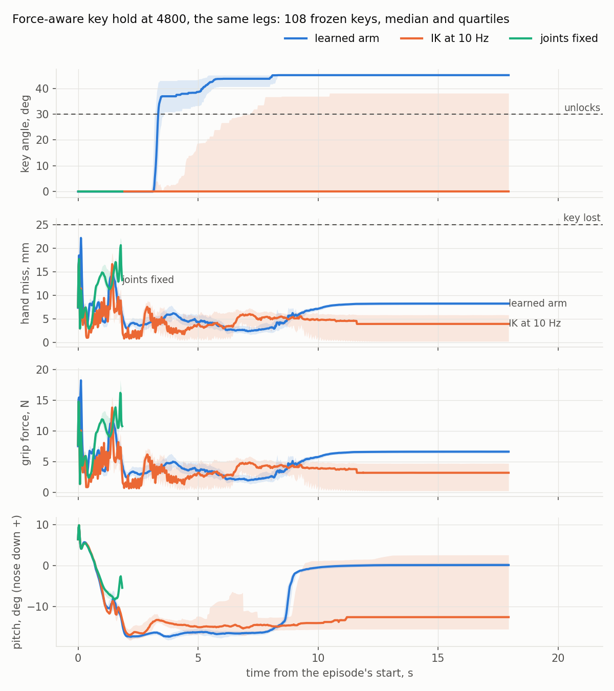
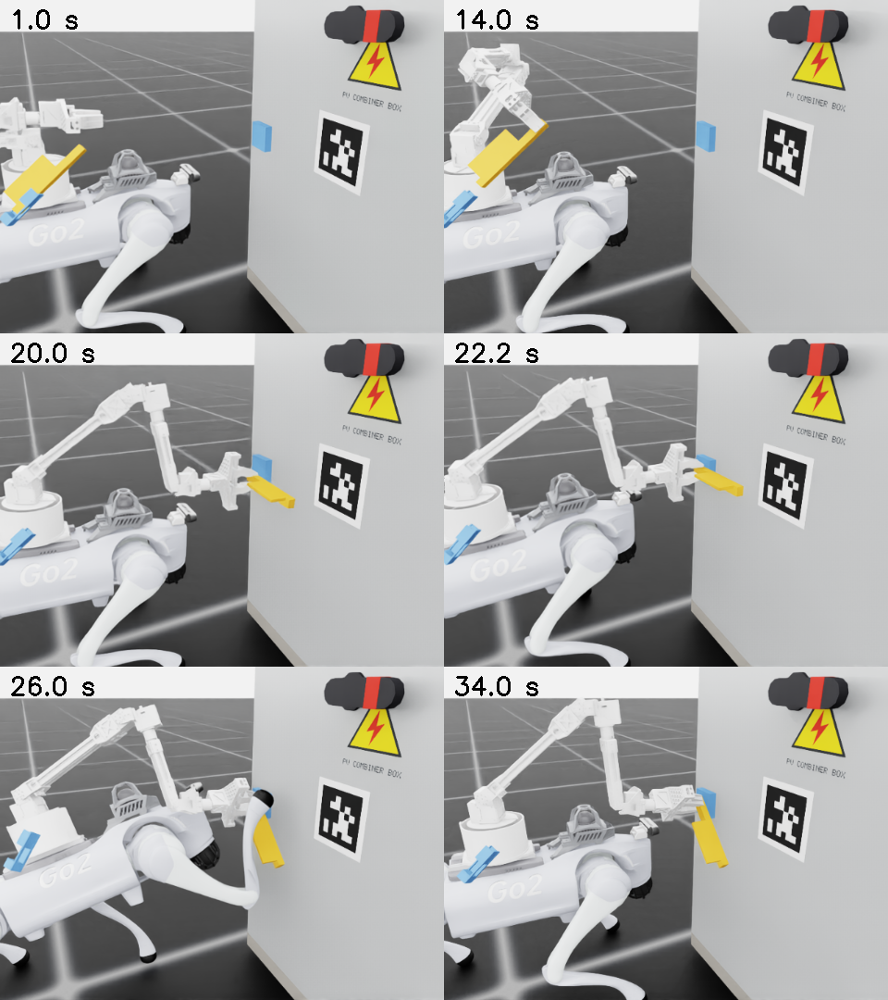
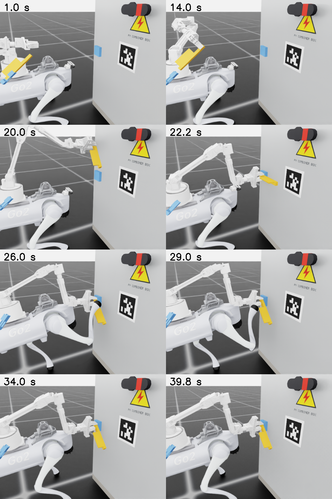

# Week 9 — 9–15 November 2026

**Status:** in progress
**Focus:** Integration buffer, repeatability evidence and final analysis

## Planned

From the [revised Thesis B plan](../../docs/thesis_b_plan.md#thesis-b-weekly-schedule),
16 September 2026. This replaces the original Appendix A timing; earlier dated logs remain historical evidence.

- **Reuse, simulation and learning:** Analyse final tests and seed uncertainty; allow only documented fault-driven reruns with affected comparisons repeated.
- **Hardware and camera:** Resolve remaining core integration faults and repeat declared physical trials; retain tagged perception and the frozen task interface.
- **Evidence and deliverable:** Report sim-to-real performance reduction, failed phases, interventions and limitations. Classify unmet B deliverables explicitly rather than as C polish.
- **Gate focus:** G3/G7 evidence review; outstanding failures remain recorded.

## Checklist

- [ ] Final P0–P4 results and uncertainty summarised per seed
- [ ] Tagged physical trial outcomes and sim-to-real gap analysed
- [ ] All reruns linked to the fault, versioned fix and affected comparisons
- [ ] Failure examples and limitations included in the results draft
- [ ] Unmet core outcomes distinguished from optional C refinements

## Log

<!-- Dated entries (### YYYY-MM-DD · topic). For each: the exact command or change, the outcome in numbers,
     and what it does and does not show. Record runs with ./dashboard.py record. -->

### 2026-11-09 · The deployable recipe on two fresh seeds, at 4,000 and 6,000 iterations

`pose_g_s2` and `pose_g_s3` ([seed 2](#/week/8/run/20261108T031915_train_seed2_pose_g_s2), [seed 3](#/week/8/run/20261108T031905_train_seed3_pose_g_s3); continued: [seed 2](#/week/8/run/20261108T095529_train_seed2_pose_g_s2_more), [seed 3](#/week/8/run/20261108T095402_train_seed3_pose_g_s3_more)): `pose_s3`'s final recipe in one run from `66600` (primitives, still hand, lead -30, tilt and leg targets priced, legs answering 0.1-1, `--arm_step_weight -60`). Each was scored by `logs/unifp_train/tool/suite.sh` and `gate.sh` at 4,000 and 6,000 iterations, and the counts are read with `score.py g2 g3 g26k g36k`.

| | replay: lead from 1 s | legs first s / after | hand, frozen set | doors held at 85 / peaking past | lever then door (latches) | falls, joint-line set |
|---|---|---|---|---|---|---|
| `pose_s3` (the chain, for reference) | 12.3 deg | 0.52 / 0.53 rad | 4.10 cm, 10.3 deg | 17 / 31 | 31 (32) | 0 |
| [seed 2, 4,000](#/week/8/run/20261108T095556_eval_seed1_s_g2_dev) | 8.3 pass | 0.51 / 0.47 | 4.20, 21.6 | [10 / 11](#/week/8/run/20261108T100503_s_g2_door_s1) | [7 (25)](#/week/8/run/20261108T101413_s_g2_lever_s1) | 6 |
| [seed 3, 4,000](#/week/8/run/20261108T105154_eval_seed1_s_g3_dev) | 11.8 pass | 0.47 / 0.57 | 4.30, 29.0 | [0 / 0](#/week/8/run/20261108T110101_s_g3_door_s1) | [0 (0)](#/week/8/run/20261108T111010_s_g3_lever_s1) | 2 |
| [seed 2, 6,000](#/week/9/run/20261108T130530_eval_seed1_s_g26k_dev) | **17.5 fail** | 0.48 / 0.43 | 5.06, 19.5 | [10 / 10](#/week/9/run/20261108T130727_s_g26k_door_s1) | [0 (16)](#/week/9/run/20261108T130846_s_g26k_lever_s1) | 1 |
| [seed 3, 6,000](#/week/9/run/20261108T131446_eval_seed1_s_g36k_dev) | 12.7 pass | 0.43 / 0.51 | 3.75, 19.2 | [24 / 24](#/week/9/run/20261108T131642_s_g36k_door_s1) | [18 (18)](#/week/9/run/20261108T131801_s_g36k_lever_s1) | 6 |
| gate | 15 | 1.2 / 0.9 | | | | |

No far or bench plan stopped in any of the four (0 of 60, 0 of 15), and the worst bench lead was 15-25 deg.

**What it shows.** The replay pass reproduces on fresh seeds in three of four checkpoints, so the recipe makes policies the replay would not stop. The precision does not reproduce: orientation is 19-29 deg against `pose_s3`'s 10.3, and doors range 0-24. `pose_s3`'s orientation came from its chain, which started at `pose_a`, a policy that learned the pose with free legs and an unpriced lead. Seed 2 lost the pass between 4,000 and 6,000 iterations (lead 8.3 to 17.5), so the pass is not stable along training either.

**Does not show.** Whether a curriculum on fresh seeds, the pose learned first and the constraints after, recovers `pose_s3`'s precision. Budgets are not matched to the chain's (about 7,500 iterations).

### 2026-11-09 · Rotational compliance was not learned, and the turn evaluation's crash

**The fault.** Every suite's turn evaluation since 2026-11-07 (`ev.sh s_<tag>_turn ... --pose_wrench`) crashed at its last print: `NameError: name 'task_cfg' is not defined` in `run_unifp_train.py` `evaluate()`, which used a module that `main()` imports locally. The crash came after `eval.json` was written and before `run.json`, so `dashboard.py record` refused all twelve and the status line still read exit 0. Fixed with a local import. All twelve re-ran with the same flags (`logs/unifp_train/tool/rerun_turn.sh`), and the values match the crashed runs' `eval.json` exactly: [r10](#/week/9/run/20261108T235432_eval_seed1_s_r10_turn), [s](#/week/9/run/20261108T235512_eval_seed1_s_s_turn), [s2](#/week/9/run/20261108T235551_eval_seed1_s_s2_turn), [s3](#/week/9/run/20261108T235632_eval_seed1_s_s3_turn), [f2](#/week/9/run/20261108T235713_eval_seed1_s_f2_turn), [r40](#/week/9/run/20261109T000008_eval_seed1_s_r40_turn), [wa](#/week/9/run/20261109T000309_eval_seed1_s_wa_turn), [wp](#/week/9/run/20261109T000609_eval_seed1_s_wp_turn), [g2](#/week/9/run/20261109T000908_eval_seed1_s_g2_turn), [g3](#/week/9/run/20261109T001208_eval_seed1_s_g3_turn), [g26k](#/week/9/run/20261109T001507_eval_seed1_s_g26k_turn), [g36k](#/week/9/run/20261109T001806_eval_seed1_s_g36k_turn).

**The result** (degrees the hand gives per N·m of push off the tool point; the law at K_r 1.5 N·m/rad is 38.2):

| | `r10` | `wp` (law, from `r10`) | `wa` (law, from `a`) | `r40` | `f2` | `s` | `s2` | `s3` | `g` seeds, 4,000 and 6,000 |
|---|---|---|---|---|---|---|---|---|---|
| deg/N·m | 28.9 | **15.0** | **13.6** | 19.3 | 18.9 | 13.1 | 3.6 | 31.3 | 40.9-53.2 |

The two policies trained on the law are among the stiffest. `pose_wp` gives half of what `pose_r10`, its starting point, does. The softest hands are the `g` seeds, whose orientation is also the worst (19-29 deg), so their give reads as a weak hold. **F-276.**

**Their tasks** ([`pose_wa` dev](#/week/8/run/20261108T060158_eval_seed1_s_wa_dev), [`pose_wp` dev](#/week/8/run/20261108T065807_eval_seed1_s_wp_dev), [`pose_r40` dev](#/week/8/run/20261108T050554_eval_seed1_s_r40_dev)):

| | doors held / peaking past 85 | lever then door (latches) | hand, frozen set | told / felt mm/N | replay lead |
|---|---|---|---|---|---|
| `pose_wa` | [31 / 32](#/week/8/run/20261108T061109_s_wa_door_s1) | [31 (31)](#/week/8/run/20261108T062022_s_wa_lever_s1) | 3.20 cm, 9.4 deg | 5.16 / 14.1 | 46.3, fail |
| `pose_wp` | [30 / 30](#/week/8/run/20261108T070717_s_wp_door_s1) | [25 (27)](#/week/8/run/20261108T071630_s_wp_lever_s1) | **2.72, 7.8** | 4.89 / 13.8 | 59.7, fail |
| `pose_r40` | [12 / 31](#/week/8/run/20261108T051508_s_r40_door_s1) | [29 (29)](#/week/8/run/20261108T052421_s_r40_lever_s1) | 4.82, 12.2 | 3.94 / 12.2 | 43.2, fail |

`pose_wp` has the best orientation of any policy so far. `pose_wa` is a second chain from `pose_a` with the lead priced (-10) that nearly matches `pose_r10`'s door count (31 against 32). Neither was trained on sticky legs, and both fail the replay as expected. Lead -40 (`pose_r40`) holds fewer doors than -10 did.

**Does not show.** Whether the law fails to take because the moments are small (a typical 0.4 N·m is worth 15 deg, beside 8-12 deg of held error), because K_r is fixed, or because of the recipe. One seed each.

### 2026-11-09 · Literature: has a legged arm's whole hand been commanded with force awareness, on doors or levers?

**Why.** Lukas asked whether other papers have produced this result, especially on the D1. The RSS entry above noted that no search on it had been done. No run. Five web searches. Ten papers were read in their method and experiment sections (arXiv HTML), and the four claims below that carry a recommendation were checked against the text.

**Not found:** a learned whole-body policy on a legged robot that takes a commanded whole-hand pose and stays force-aware without a sensor, tested on pulling doors or turning levers. The pieces exist separately:

| paper | robot, arm | hand orientation | force | doors, levers on hardware |
|---|---|---|---|---|
| [Zeng et al. 2026](https://arxiv.org/html/2609.13779v1) | wheeled-legged, 6-DoF arm | commanded (quaternion), with an axis-wise position/force selector | estimated (momentum observer + TCN), an observation; force only | spring door and valve, "one representative trial" each |
| [Schperberg et al. 2026](https://arxiv.org/html/2603.02443v1) (MERL) | **Go2 + D1**, BOTA wrist F/T | admittance on SE(3); "the gripper is only allowed to rotate along the gripper base normal axis" | sensed 6-DoF wrench; model-based arm, RL legs | none (a plank carried with a person) |
| [Zhou et al. 2026](https://arxiv.org/html/2604.27224v3) | **Go2 + D1**, tactile gripper | 6-DoF waypoints, position-only reward | tactile pattern tracked, no force | valve 17 of 20 with touch, 7 of 20 without |
| [Portela, Cramariuc et al. 2024](https://arxiv.org/html/2409.16048v2) | ANYmal + DynaArm | commanded (three keypoints) | none | none; 2.03 cm / 2.86 deg on hardware |
| [Portela, Margolis et al. 2024](https://arxiv.org/html/2405.01402v1) | B1 + Z1 | not commanded (roll by joystick) | estimated, commanded ±70 N | handle turned in force mode, qualitative |
| [Ha et al. 2024, UMI on Legs](https://arxiv.org/html/2407.10353) | Go2 + ARX5 | commanded (6D rotation, ±60 ms and 1 s preview) | none | none |
| [Zhang et al. 2024](https://arxiv.org/html/2409.04882v1) | ANYmal + arm, hook | in the reward only | none; a torque-based target clip | spring door, pull 20 of 20, push 18 of 20 |
| [Lim et al. 2026, OpenHEART](https://arxiv.org/html/2603.05830) | Go2 + ViperX 300, hook | commanded by a planner | none | simulation; real cabinet and drawer, no rate |
| [Margolis et al. 2025, SoftMimic](https://arxiv.org/html/2510.17792) | G1 humanoid | a reference motion | rotational and translational compliance, stiffness commanded | none |

The D1's rate is reported three ways. Schperberg et al. give "D1 arm motor send/receive frequency is limited at 40 Hz", while Zhou et al. say it "only accepts joint-position commands at 10 Hz". F-238 to F-240 measured 9 Hz reports, with a stall window. Not reconciled: Schperberg's command interface is not stated.

**What carries over, and where each lesson stands here:**
1. **Separate position and orientation terms collapse onto one.** Portela et al. §IV-A1: "often, the training would collapse, prioritizing either position or orientation tracking but rarely both". UMI on Legs §3.2: separate terms make "the policy achieve high precision in only either position or orientation". Every pose run here used separate terms; `--pose_reward keypoints` and `--pose_reward joint` were written on 2026-11-07 and never run. The fresh `g` seeds look like it: 3.75-5.06 cm with 19-29 deg. **Queued:** `pose_gk_s2` (keypoints) and `pose_gj_s2` (joint kernel), `pose_g_s2`'s flags with only the reward form changed, 4,000 iterations, each scored by the gate and the suite. Seed 2 at 4,000 is the control.
2. **A hook, with no friction at the handle.** Zhang et al. §3.0.3: "With non-zero handle contact friction, the policy tended to learn more aggressive behaviours that relied on the end-effector momentum to turn the handle". OpenHEART gives "the limited grasping force and friction of the finger" as its reason. Both legged door papers grip with a hook. A hook does not need the hand's attitude held against the door's arc, which is where the friction pinch fails here (2026-11-07). It is a tool in the thesis's sense. Not tried.
3. **A torque-proportional clip on the arm's targets around its current angle, in training and on the robot.** Zhang et al. Eq. 1, σ = 0.7: a hard bound on lead, where this work prices it. On the D1 the centre would be the last report, which `ArmLink` has. Not tried. It bears on the open question of what the dog's lead stop should read.
4. **Stiffness as a command, on chosen axes.** SoftMimic §III-D: rotational 0.1-10 N·m/rad and linear 40-1,000 N/m, log-uniform, and the policy "directly observes neither the wrench nor displacement". Schperberg et al. allow rotation about one axis. [Minimalist Compliance Control](https://arxiv.org/html/2603.00913) Eq. 13 uses K = k_low I + (k_high - k_low) vvᵀ/‖v‖². For a door this would be compliance about the hinge-parallel axis alone. The fixed-K_r law was not learned (entry above, F-276).
5. **The handle's turn is not observable to the policy**, which made Zhang et al.'s policy oscillate (§5.2). Commanding past the stop sidesteps it here (F-274).

**Does not show.** Coverage: five searches and ten papers. 2026 preprints may be missed, since arXiv is indexed unevenly. "Not found" is not "does not exist".

### 2026-11-10 · The reward's form on the deployable recipe: keypoints and the joint kernel against separate terms

**Why.** Lesson 1 of the literature entry above: separate position and orientation terms collapse onto one. Two runs with `pose_g_s2`'s flags (the deployable recipe, seed 2, 4,000 iterations from `sticky_model_66600`), only `--pose_reward` changed. Run by `logs/unifp_train/tool/done/81_pose_gk_s2.sh` and `81_pose_gj_s2.sh`, then scored by `spool_c/99_suite_gk.sh` / `99_suite_gj.sh` (`gate.sh`, `suite.sh`), `python3 logs/unifp_train/tool/score.py gk gj g2`. Runs: [pose_gk_s2](#/week/9/run/20261108T235713_train_seed2_pose_gk_s2) (keypoints: Portela et al., three points 0.10 m off the hand, σ 0.06, weight 3.5), [pose_gj_s2](#/week/9/run/20261108T235705_train_seed2_pose_gj_s2) (the UMI kernel exp(-(e_p/0.06 + e_o/0.25)), weight 3.5); control `pose_g_s2` (separate terms 1.5 + 1.0 + 1.0, entry of 2026-11-09 above).

| | separate (`g2`, control) | keypoints (`gk`) | joint kernel (`gj`) |
|---|---|---|---|
| frozen joint-line goals: position / orientation, median | 4.20 cm / 21.6 deg | **3.06 / 24.5** | 3.66 / **58.3** |
| frozen primitive goals | 3.67 / 18.7 | 2.39 / 24.8 | 2.83 / 38.9 |
| told force compliance, mm/N (law 5.0) | 3.02 | 4.33 | 4.46 |
| door pull held past 85 deg, of 32 | 11 | **32** | 2 |
| lever turned then door, of 32 | 7 | **20** | 0 |
| hand given per N·m off the tool point (law 38.2) | 43.0 | 64.1 | 56.0 |
| replay on the dog's four 66600 runs: lead from 1 s, deg (gate 15) | 8.3, pass | **15.8, fail** | 10.8, pass |
| replay: legs in the first second / after, rad (gates 1.2 / 0.9) | 0.51 / 0.47 | 0.50 / 0.47 | 0.55 / 0.50 |
| falls on the frozen goals (joint-line + primitives) | 6 + 3 | 3 + 0 | 2 + 0 |

Suite runs: `gk` [dev](#/week/9/run/20261109T055133_eval_seed1_s_gk_dev), [primitives](#/week/9/run/20261109T055212_eval_seed1_s_gk_prim), [turn](#/week/9/run/20261109T055254_eval_seed1_s_gk_turn), [door s1](#/week/9/run/20261109T055330_s_gk_door_s1), [lever s1](#/week/9/run/20261109T055448_s_gk_lever_s1), [door s2](#/week/9/run/20261109T055619_s_gk_door_s2), [lever s2](#/week/9/run/20261109T055738_s_gk_lever_s2), probes [bench](#/week/9/run/20261109T055942_probe_seed1_s_gk_bench), [far](#/week/9/run/20261109T060011_probe_seed1_s_gk_far), [sticky](#/week/9/run/20261109T060039_probe_seed1_s_gk_sticky); `gj` [dev](#/week/9/run/20261109T054220_eval_seed1_s_gj_dev), [primitives](#/week/9/run/20261109T054259_eval_seed1_s_gj_prim), [turn](#/week/9/run/20261109T054341_eval_seed1_s_gj_turn), [door s1](#/week/9/run/20261109T054418_s_gj_door_s1), [lever s1](#/week/9/run/20261109T054535_s_gj_lever_s1), [door s2](#/week/9/run/20261109T054703_s_gj_door_s2), [lever s2](#/week/9/run/20261109T054821_s_gj_lever_s2), probes [bench](#/week/9/run/20261109T055024_probe_seed1_s_gj_bench), [far](#/week/9/run/20261109T055052_probe_seed1_s_gj_far), [sticky](#/week/9/run/20261109T055120_probe_seed1_s_gj_sticky).

**What it shows.** The keypoint form turns the deployable recipe's door count from 11 to 32 of 32 and its lever-then-door from 7 to 20 of 32, with position 1.1 cm tighter. It does **not** do this by tracking orientation better: on the frozen set its orientation is 3-6 deg worse than the control's. The joint kernel collapses the other way, onto position: orientation 58 deg, and the tasks fail. So lesson 1 holds for the joint kernel, which is the form UMI on Legs warns about, and not as stated for separate terms. Separate terms did not collapse here: the control tracks orientation best of the three.

**Does not show.** One seed each, scored on the sets the suites always use, and no second seed of `gk` yet. `gk` misses the replay gate by 0.8 deg of lead, so it is not a candidate for the dog as it stands. Why keypoints help the door, without better orientation on the frozen goals, is not established: it could be the tighter position, or the keypoints' weighting of orientation at the hand's 10 cm scale. F-277.

### 2026-11-10 · The key held by the arm while the front-right foot turns it: the task, the geometry, the baselines

**Lukas's request** (2026-11-10, a day of GPU): the key is drawn from its holster and inserted by the classical arm. Then, with the arm still holding the key in place, the front-right foot turns the lever: position-only first, force-aware if that works. The policy takes over from standing with the arm out. The box is raised so the lever is slightly above head height. "A hard task that requires the arm to track the same position while the body moves so it holds the key firmly in place. A baseline could be established using position-only to hold the arm there."

**Choices made, each a scope limit:**
- **The grip is the dog's**: jaws on the shaft's axis (`holster.GRIP_ALONG_M` 0, roll +1). So the key's turn is Joint6 alone. **Joint6 follows the lock's angle by script, not by the policy.** On the robot that would be the foot's measured turn, or a compliant wrist. Not validated.
- **The hand is tied to the key** by the key demo's spring, 800 N/m and 8 N·s/m, with no rotational part, from the jaw centre to the grip point. Its force acts on Link6. **The key is lost past 2.5 cm (20 N)**, which ends the episode. The lock's turn is the trained analytic plant (`handle.LeverHandle`, v3's bar and platform); the grip adds nothing to its friction.
- **One policy for 18 joints.** The arm's six actions are a residual on the start pose that put the jaws on the key: target = q_ref + 0.25a. The policy sees the hand's miss (grip point minus jaw centre, base frame, x20) in the orientation command channels, which were zero in every earlier policy. Lukas's position-only baseline is `--hold_arm fixed` (q_ref held, the residual unused). The classical baseline is `--hold_arm ik` (re-solved at 10 Hz from the base's *true* pose).
- **The arm is UniFP's 50 Hz PD in training**, not the D1's 9 Hz report-locked link (F-238 to F-240). The real D1's command rate is not in these results.
- **The box is raised 5.25 cm**: the lock's axis at 0.47 ± 0.01 m. The head RealSense's top is about 0.38 m at the settled stance and about 0.43 m at sport mode's 0.32-0.33 m stand. The turn is Lukas's v4 turn: level, 45 degrees clockwise, unlocking past 30. The foot's key keeps v3/v4's platform; **the holster's v5 key has none.**
- Code: `unifp_train/keyhold_env.py`, `keyhold.py` (geometry and a torch arm gravity model, equal to `workspace.gravity_torques` to 2e-16), `leg_cfg.KEYHOLD_*`. `run_unifp_train.py --key_hold --hold_arm {policy,fixed,ik}` pads a 12-action leg checkpoint to 18 with zero arm rows. `leg_eval` adds the hold's numbers. Tests: `tests/test_keyhold.py` (4 pass).

**Where the arm can hold the key** (CPU, `arm_kin`, soft limits, hand level along the shaft, roll +1, at 0 and 45 degrees of turn; scratchpad scans, not committed):
- At the settled stance (base 0.272 m) the hold solves with the lock's face 0.46-0.52 m ahead and 0.12-0.20 m to the right, for a lock 0.47-0.50 m up. Joint5 sits at -1.23 to -1.40 against its -1.41 soft limit.
- Lower or nearer, it does not solve: at 0.42 m only 0.50 m ahead.
- The turn is Joint6 alone, -0.79 rad for 45 degrees.
- The shoulder's static load is 0.56-0.74 of its limit, without the wrist camera.
- The foot's reach pulls the other way: the trained key policies reared ~35 degrees to reach the platform at 0.51 m (F-169). Here the pad's middle puts the foot's centre at ~0.50 m.
- With the key fixed in the world (lock 0.47 m up, face 0.50 m ahead, 0.14 m right), the hold survives:
  - the body rearing -5 to +10 degrees about its rear feet;
  - sinking 6 cm or rising 6 cm;
  - rolling 10 degrees;
  - moving 6 cm back or 4 cm forward.

  It fails past 15 degrees of rear. At 0.46 m ahead it tolerates no rise and no forward move at all.

Training and frozen ranges: face 0.47-0.52 m ahead (frozen 0.48 / 0.50 / 0.52), side 0.12-0.18 m right (0.13 / 0.15 / 0.17), height 0.47 ± 0.01 (0.465 / 0.475), door yaw ±0.06 rad (frozen ±0.05), lock 0.15-0.6 N·m (frozen 0.2 / 0.4 / 0.6), detent 0-0.2. All 108 frozen keys solve from the settled stance through the whole turn (`tests/test_keyhold.py`).

**Getting the start right** (zero actions, the arm fixed; `logs/unifp_train/keyhold/lev.sh`):
1. [Zero actions, raw](#/week/9/run/20261109T132620_leg_eval_seed1_kh_zero_fixed): nothing lost, but the miss is 6.3 mm standing and 22 mm at 0.16 s, with an 18 N grip peak. Two causes. First, the stance: with the arm out the robot settles to 0.259 m and 3.6 degrees nose-down, not the arm-folded 0.272. Second, before that fix the arm's PD sag pulled the key 12-14 mm ([run](#/week/9/run/20261109T132440_leg_eval_seed1_kh_b0_force_fixed2)). **Fix:** the commands carry the gravity sag (`ArmGravity`), as the insertion's outer loop leaves the command above the key on the dog (F-222: 8.5-15 mm).
2. [The settled stance with the arm out](#/week/9/run/20261109T132815_leg_eval_seed1_kh_zero_settle), measured: legs and base at 8 s, the median of 108, now `demos/combiner_key/assets/keyhold_settled_arm_out.json`. Spawned there ([run](#/week/9/run/20261109T132947_leg_eval_seed1_kh_zero_fixed_s)) the standing miss is 2-3 mm, but the spawn still bounces (base up 1.5 cm and 10 degrees nose-down in 40 ms). That lost 28 of 108 keys with zero actions.
3. **A 0.4 s grace** after each reset (`KEYHOLD_GRACE_STEPS`): no loss and no hold statistics inside it. [Zero actions with it](#/week/9/run/20261109T133150_leg_eval_seed1_kh_zero_fixed_s2): **0 of 108 lost, miss median 2.1 mm (max median 5.5), grip peak 4.4 N.** The bounce is a property of the reset, not the task. The grace hides it rather than removing it.

**Baselines, zero-shot** (the frozen 108, light legs as F-229's evaluation, the arm-out stance, the grace; the corner key policies of F-229/F-235):

| legs | arm | lost, of 108 | engaged | miss median / max median, mm | grip peak median, N | support foot off its place, median |
|---|---|---|---|---|---|---|
| [force-aware s2 `4000`](#/week/9/run/20261109T133515_leg_eval_seed1_kh_b0_force_fixed_s) | joints fixed | **108** | 0 | 9.6 / 22.6 | 19.8 | 10.4 cm |
| [force-aware s2 `4000`](#/week/9/run/20261109T133556_leg_eval_seed1_kh_b0_force_ik_s) | IK at 10 Hz, true base pose | **106** (2 damaged) | 0 | 3.8 / 20.3 | 19.5 | 9.2 |
| [position-only s3 `3600`](#/week/9/run/20261109T133639_leg_eval_seed1_kh_b0_pos_fixed_s) | joints fixed | **108** | 0 | lost inside the grace | | 11.6 |
| [position-only s3 `3600`](#/week/9/run/20261109T133654_leg_eval_seed1_kh_b0_pos_ik_s) | IK at 10 Hz | **108** | 0 | 15.2 / 24.2 | 20.2 | 12.3 |

The key was lost in every case before the foot reached it. The old leg policies, given an arm out in front and inputs they never saw (the arm's joints, the miss channel), shuffle their support feet 9-12 cm and drop or rear. The earlier attempt at the force-aware fixed baseline, spawned from the arm-folded stance with no sag model, also lost all 108 ([run](#/week/9/run/20261109T132213_leg_eval_seed1_kh_b0_force_fixed)). The first attempt of all crashed at its first reset (the base pose of every robot taken for the IK's subset, a size mismatch); its directory is empty and cannot be recorded. **What this does not show:** that a classical hold fails against a body that moves for the foot on purpose. These legs were never trained with the arm out. That comparison is the trained legs with `--hold_arm ik`, after training.

**Training, round 1** (2026-11-10 00:38, both on the GPU together; `logs/unifp_train/keyhold/recipe.sh`, the corner recipe of F-229 with the hold). Spawned at the arm-out stance (`--spawn_states keyhold_settled_arm_out.json --spawn_states_fraction 1.0`, joints jittered 0.03 rad), every episode a key, arm noise std 0.08, 2,000 iterations, 2,048 environments:
- `kh_force_s2`: `--leg_variant force`, from the corner force-aware `4000` (seed 2).
- `kh_position_s3`: `--leg_variant position`, from the corner position-only `3600` (seed 3).

A first launch of each at 00:34 ran 21 s an iteration: the reset's IK (six seeds on the GPU, 775 ms a call beside two trainings) ran on every step that reset an environment. Both were stopped at about iteration 12 and are recorded: [force](#/week/9/run/20261109T133346_train_seed2_kh_force_s2), [position](#/week/9/run/20261109T133446_train_seed3_kh_position_s3). The IK and the gravity model now run on the CPU with one nominal seed first (7 ms; six seeds only on a miss), at 6.7 s an iteration. A [3-iteration smoke](#/week/9/run/20261109T132536_train_seed2_kh_smoke) checked the padded resume first.

**Round 1's outcome, stopped at iteration 193 (force) and 186 (position).** Recorded: [force](#/week/9/run/20261109T133811_train_seed2_kh_force_s2), [position](#/week/9/run/20261109T133856_train_seed3_kh_position_s3). Both learned to hold the key: none lost in the last iterations, a mean miss of 6.2 / 5.5 mm, grip peaks of 12.8 / 11.8 N. **Neither turned it** (largest angle 0). The position-only policy kept the foot down: the layer started on its training deadline with the foot 52 cm from the pre-contact point. The force-aware one had begun to lift (14.5 cm short, a 245 N strike). The cause is the geometry, not the reward alone.

A second CPU scan (scratchpad `both_scan.py`) puts the Go2 leg's joint limits against the same rear about the rear feet. The thigh cannot rise above level, so the pad's pre-contact point at 0.47 m needs 10-12.5 deg of rear with the face 0.50 m ahead and the lock 0.12 m right, and is not reached at all up to 30 deg at 0.15-0.18 m right. The arm's hold ends at about 10 deg. **Round 1's band was nearly infeasible for the two together.** The band where both work is narrow: the lock 0.445-0.455 m up, its face 0.50-0.52 m ahead (from the arm-out stance the hold fails at 0.49), 0.09-0.125 m right, the pad pressed 7.5-9.5 cm out. There the foot needs 2.5-7.5 deg of rear (0-5 with the base 2 cm up) and the arm holds to 8-10. The frozen set moved with it: face 0.50 / 0.51 / 0.52, side 0.10 / 0.11 / 0.12 m right, height 0.445 / 0.455, yaw ±0.04. `tests/test_keyhold.py` now solves from the arm-out stance: 4 pass. On this band, [zero actions](#/week/9/run/20261109T140506_leg_eval_seed1_kh2_zero_fixed) lose nothing (miss 1.9 mm, grip 4.4 N). The zero-shot baselines lose the key as before: force-aware with the arm [fixed](#/week/9/run/20261109T140846_leg_eval_seed1_kh2_b0_force_fixed) 108 of 108, with [IK](#/week/9/run/20261109T140923_leg_eval_seed1_kh2_b0_force_ik) 98 (12 damaged); position-only [fixed](#/week/9/run/20261109T141002_leg_eval_seed1_kh2_b0_pos_fixed) 108, [IK](#/week/9/run/20261109T141018_leg_eval_seed1_kh2_b0_pos_ik) 108.

**Round 2** (01:04): the same recipe on the new band, plus `--hold_loss_start_iteration 300`. For its first 300 iterations the key is lost only past 6 cm, and the grip spring is capped at 30 N (the jaws slip past it) throughout, so that the resumed foot keeps lifting while the arm learns to follow. `kh2_force_s2` and `kh2_position_s3`, 2,000 iterations each; `logs/unifp_train/keyhold/after_train.sh` scores the final checkpoints when they end.

At iteration 200 the two had split (training logs, sampled at reset):
- **Force-aware:** learning the approach while holding. The foot's miss at the layer's start fell from 28 to 8 cm, the key turned to 15 deg in some iterations (a third of one iteration's episodes opened the lock), contact peaks fell from about 300 to 60-90 N, and the hold was a mean miss of 6.3 mm with no loss.
- **Position-only:** [stopped at iteration 188](#/week/9/run/20261109T140452_train_seed3_kh2_position_s3). It never lifted the foot: 51 cm short at the deadline, the lift reward at 0.02 of its 1.5.

In its place, `kh2p_child_s3` is the same parent as the force run (its `model_4200`, which lifts and holds), fine-tuned position-only for 1,800 iterations (seed 3; the lenient loss for its first 100). It ends with the force run, so the two variants finish as a matched pair from one parent. This is not the earlier lineage's pure position-only policy; its parent trained force-aware.

**Mid-training: force-aware `model_4400`** (400 iterations into round 2), on the frozen 108, the arm by the policy's residual:

| run | stop at | unlocked, held and foot back | key lost | damaged | missed | miss median / max median | grip peak median | peak median (p95) |
|---|---|---|---|---|---|---|---|---|
| [standard](#/week/9/run/20261109T145259_leg_eval_seed1_r2F4400_policy) | 60 N | 24 | **0** | 65 | 19 | 3.9 / 16.3 mm | 13.4 N | 73 (207) N |
| [damage stop lifted](#/week/9/run/20261109T150246_leg_eval_seed1_r2F4400_nodmg) | 1000 N | **75** | **0** | (65 past 60 N, 42 past 120) | 32 | 5.9 / 16.5 mm | 13.7 N | 88 (207) N |
| [waypoint 10 cm back, 2 cm up](#/week/9/run/20261109T145815_leg_eval_seed1_r2F4400_wp) | 60 N | 11 | 0 | 89 | 8 | 3.4 / 16.9 mm | 14.2 N | 134 (240) N |

**What stops it** is impact, not the hold: no key was lost in any of the three. 59 of the standard run's 65 damage stops come during the foot's lift, about 1.9 s in. At that step the foot is 25 cm short of its goal and pressing about 20 N, while the knee is on the door's face in 36 of the 65. The plant's peak counts the knee against the door as well as the foot on the key, so these are mostly **the knee striking the box**, not the key overloaded. The 60 N limit was set for the printed key under the foot (F-177), and a knee strike on the steel door is a different failure. Both are reported. Success rises with distance: 3 / 8 / 13 of 36 at the face 0.50 / 0.51 / 0.52 m ahead. The waypoint change, tried zero-shot, was worse, so the approach's path is not the fix on its own. The support feet sit 12-17 cm from the arm-folded stance's places. These are measured in the base's frame, so part of it may be the body leaning back over its feet rather than stepping. Not separated.

**Mid-training at `model_4800`** (force-aware, 800 iterations into round 2; the position-only child, 600 into its fine-tune). The frozen 108, the 60 N stop:

| policy | arm | unlocked, held and foot back | key lost | damaged | missed | miss median / max median | grip peak median | contact peak median (p95) |
|---|---|---|---|---|---|---|---|---|
| [force-aware `4800`](#/week/9/run/20261109T154629_leg_eval_seed1_r2F4800_policy) | its residual | **104** | 0 | 3 | 1 | 7.6 / 18.8 mm | 15.0 N | 33 (41) N |
| [position-only child `4800`](#/week/9/run/20261109T155027_leg_eval_seed1_r2P4800_policy) | its residual | **106** | 0 | 2 | 0 | 3.8 / 12.7 mm | 10.7 N | 47 (57) N |
| [force-aware `4800`'s legs](#/week/9/run/20261109T155104_leg_eval_seed1_r2F4800_ik) | IK at 10 Hz, true base pose | 22 (18 with the foot back) | 0 | 29 | 55 | 4.0 / 19.8 mm | 15.9 N | |
| [force-aware `4800`'s legs](#/week/9/run/20261109T155553_leg_eval_seed1_r2F4800_fixed) | joints fixed | 0 | 1 | 107 | 0 | 13.1 / 22.6 mm | 18.6 N | |



*Figure: the median over the frozen keys still going, quartiles shaded (`demos/combiner_key/plot_keyhold.py`). With its learned arm the policy has the key past 30 degrees at about 3.3 s and rears about 17 degrees until the foot comes down at about 9 s. With the IK arm the median key never turns and the body stays reared. With fixed joints every episode ends at the damage stop by 2 s. After the foot is down, the learned arm leaves the hand about 8 mm off the key at about 6.6 N: it does not re-centre.*

**How it turns the key.** Not as the task layer means it. Of the force-aware policy's 104, 79 move the key first while the foot slides over onto the platform (the `OVER` stage), and the key passes 30 degrees there or at the pre-contact point in 80. Only 24 pass it in the layer's press. The position-only child passes 30 degrees during `OVER` in 105 of its 107. The foot comes over a little low and pushes the light lock down (0.2-0.6 N·m, 2-7 N at the pad) on its way to the pre-contact point. The latch is then open before the layer starts, which is why the median "time to unlock" reads -0.36 / -0.82 s and every success also counts as "slipped". The body works hard for it. In episode 0 the force-aware policy rears 17 degrees nose-up and leans 17-24 degrees to its left. Across the child's episodes the extremes are a median 19 degrees nose-up and 24 degrees of roll. This is beyond the 10 degrees of pure rear the CPU scan allowed the arm, yet the hold survives: the scan rotated the base about the rear feet alone, while the policy also leans, shifts and moves the arm.

**What it shows:**
- One policy for legs and arm keeps the key in the lock (no loss in 216 frozen episodes) while the foot unlocks it, with the hand a median 3.8-7.6 mm off the key.
- **The learned arm matters, not just the trained legs.** The same legs with the classical 10 Hz IK hold keep the key (none lost) but the foot's approach falls apart (55 missed, 29 damaged). With the arm's joints fixed, nothing unlocks and 107 of 108 strike past 60 N. The legs were trained with their own arm commands in the loop, so this is not a clean "classical arm against learned arm" test either. It says the coordination is in the policy.
- Force-aware and position-only end alike here (104 and 106), because neither uses the press. With a lock this light, force awareness has nothing to do.

**What it does not show:**
- A force-controlled turn: the key goes down under a foot passing over it.
- A stiffer lock: the training and the frozen set stop at 0.6 N·m, against Lukas's "about 5 N" at the arm's 0.13 m (0.65 N·m).
- The real D1: these arms are UniFP's 50 Hz PD, not its 9 Hz link (round 3).
- Whether the dog survives rearing nearly 20 degrees and leaning about 24 on three legs with the arm out.
- One seed of each, mid-training checkpoints, the training's own band.

**Stiffer locks than trained** (0.8 / 1.2 / 1.6 N·m against the training's 0.15-0.6; the same 108 placements, `--key_eval_lock_nm 0.8 1.2 1.6`):

| policy | 0.8 | 1.2 | 1.6 | all, of 108 | key lost | damaged | slipped / stalled | median time to unlock |
|---|---|---|---|---|---|---|---|---|
| [force-aware `4800`](#/week/9/run/20261109T155806_leg_eval_seed1_r2F4800_stiff) | 33 / 36 | 27 / 36 | 19 / 36 | **79** | 0 | 23 | 0 | +1.32 s after engaging |
| [position-only child `4800`](#/week/9/run/20261109T160155_leg_eval_seed1_r2P4800_stiff) | 33 / 36 | 12 / 36 | 0 / 36 | **45** | 0 | 37 | 24 / 1 | -0.77 s (before) |

Here the two variants part. On the stiffer locks the force-aware policy falls back on the task layer's press with its force command: it unlocks after engaging, not before. The position-only policy keeps sweeping and slips off or overloads, with nothing at 1.6 N·m. This is the earlier key result again (F-229, F-235: the force-aware lead is robustness across locks), now with the arm holding the key. The hold survives on both: none lost.

**The force-aware run collapsed at about iteration 5160** and was [stopped at 5364](#/week/9/run/20261109T140414_train_seed2_kh2_force_s2). Between 5140 and 5180 its mean reward fell from 148 to 19 and its episodes from 500 to 95 steps, after a KL spike (0.16) and a value-loss blow-up (7.6). From then on it lost the key in 67-100% of episodes and did not recover in 180 iterations. Its [`model_5000`](#/week/9/run/20261109T170012_leg_eval_seed1_r2F5000_policy) was already worse than `4800`: 80 of 108, 28 damaged, contact p95 85 N. **`model_4800` is the force-aware result** and round 3's parent. The position-only child shows no such collapse: its training reward rose to 151, with a mean miss of 4.2 mm and the worst 9 mm at 5363.

**The staged sequence, rendered** with `4800` ([run](#/week/9/run/20261109T170303_leg_eval_seed1_render_r2F4800), frozen key 13, the side camera every 0.1 s; `logs/unifp_train/keyhold/render_staged.sh`). First sheet `figures/keyhold_staged_r2F4800_side.png`:
- 1 s: the arm folded, the key in the holster.
- 6-14 s: the unfold, the jaws onto the bar's root, the key drawn out.
- 20 s: the key going in level at the adapter.
- 22.2 s: the handover.
- 26-29 s: the foot up on the platform, the body reared, the key turned to its stop with the hand on it.
- 34-40 s: the foot down, the key turned, the arm still holding it.

Success, no loss; the miss median 6.4 mm and max 19.2 mm, the grip peak 14.5 N. In that first render the box was a plain block of its outline. It now draws the d1dogdemo's combiner box model: `demos/combiner/asset.build_combiner_usd`, with its physics stripped (`keyhold_staged.visual_box_usd`) and placed each episode on the lock the plant turns. The re-render is [here](#/week/9/run/20261109T191821_leg_eval_seed1_render_r2F4800box) (same policy and key), as `figures/keyhold_staged_r2F4800_box.png` and `figures/keyhold_staged_r2F4800_box.mp4`. The isolator handle, the label, the AprilTag and the adapter on the door's free edge stand where the key goes in. The box takes no part in the physics: the key's turn is the plant's, and the door stays shut.



**Round 2's end: both runs got worse after 4800.** The [position-only child](#/week/9/run/20261109T142919_train_seed3_kh2p_child_s3) ran its full 1,800 iterations and its training samples stayed healthy: reward about 151, success 1.0, mean miss 4 mm. On the frozen 108 it declined steadily:

| child checkpoint | unlocked, held and foot back | key lost | damaged (60 N) | notes |
|---|---|---|---|---|
| [4800](#/week/9/run/20261109T155027_leg_eval_seed1_r2P4800_policy) | **106** | 0 | 2 | |
| [5200](#/week/9/run/20261109T182736_leg_eval_seed1_r2P5200_policy) | 67 | 8 | 37 | |
| [5600](#/week/9/run/20261109T183130_leg_eval_seed1_r2P5600_policy) | 10 | 2 | 96 | |
| [5999, final](#/week/9/run/20261109T181540_leg_eval_seed1_r2P_policy) | 10 | 27 | 71 | contact peak median 70 N; support feet 21 cm off their places (3 cm at 4800) |

At the final checkpoint, the same legs with the [IK arm](#/week/9/run/20261109T181827_leg_eval_seed1_r2P_ik) get 44 (23 lost, 8 falls) and with [fixed joints](#/week/9/run/20261109T182119_leg_eval_seed1_r2P_fixed) 3 (47 lost); on [stiffer locks](#/week/9/run/20261109T182427_leg_eval_seed1_r2P_stiff) it gets 7.

Training counts damage only past 120 N and prices contact past 30 N lightly (`press_excess` -4 per cm of overlap). The evaluation stops at 60 N. The likely reading is that the policy drifted into harder contact (and a different stance) that training tolerates and the evaluation does not. Not tested. **The round-2 results are therefore the `4800` checkpoints of both runs, chosen on the same frozen set they are scored on (as F-229's was): an optimistic choice.** Round 3 prices contact five times harder. Its checkpoints are scored as they are saved (`logs/unifp_train/keyhold/eval_r3.sh`), so the choice there is made the same way and said so.

**Round 3, revised** (04:09): both fine-tunes start from `4800`, with locks drawn 0.15-1.6 N·m (round 2: 0.15-0.6, where both variants learned to sweep the key down) and harder prices on the knee's door strikes (`door_push` -10) and the press past 30 N (`press_excess` -20). `kh3_wide` keeps round 2's arm. `kh3_link` puts the D1 as on the dog between policy and joints. It started at 05:27, after a first launch at 05:15 crashed in its first seconds: the queue started it in the same second as an evaluation, both rebuilt the robot's USD, and one opened the other's half-written `Link2.tmp.usd` (no run directory). 1,000 iterations each.

**Round 3's first checkpoints** (both from `4800`; frozen 108 at the standard locks, then at 0.8 / 1.2 / 1.6 N·m; `eval_r3.sh`, `eval_r3b.sh`):

| policy | arm | standard: unlocked, held and foot back | key lost | damaged | stiffer locks: 0.8 / 1.2 / 1.6 | all | miss median / max median | grip peak |
|---|---|---|---|---|---|---|---|---|
| r2 force-aware `4800` (parent) | UniFP 50 Hz PD | 104 | 0 | 3 | 33 / 27 / 19 | 79 | 7.6 / 18.8 mm | 15.0 N |
| `kh3_wide` [5000](#/week/9/run/20261109T183557_leg_eval_seed1_kh3_wide_5000) ([stiff](#/week/9/run/20261109T183945_leg_eval_seed1_kh3_wide_5000_stiff)) | UniFP 50 Hz PD | 85 (all 108 unlocked and held) | 0 | 23 | 32 / 34 / 21 | **87** | 2.9 / 19.2 mm | 16.3 N |
| `kh3_link` [5000](#/week/9/run/20261109T185929_leg_eval_seed1_kh3_link_5000) ([stiff](#/week/9/run/20261109T190344_leg_eval_seed1_kh3_link_5000_stiff)) | **the D1 as on the dog** | **103** | 0 | 3 | 33 / 27 / 17 | 77 | **3.2 / 13.5 mm** | **11.2 N** |

**With the D1's own link the hold is no worse, and tighter.** The arm's commands go out one per report at 9 Hz through the dog's Follower, ~~with the lead and step priced~~ (correction, 2026-11-11: the lead and step penalties were named but never applied in any key-hold training; see that day's entry). After 200 iterations of fine-tuning from the 50 Hz parent, the policy keeps every key (miss median 3.2 mm, worst median 13.5) and unlocks as many as its parent did.

`kh3_wide` then **collapsed** as round 2's force run had, and at nearly the same iteration: mean reward 152 to 24 between 5150 and 5200, with a value-loss spike to 10. On the frozen set it scored [0 at 5200](#/week/9/run/20261109T184335_leg_eval_seed1_kh3_wide_5200) (60 damaged, 48 lost) and [0 at 5400](#/week/9/run/20261109T184456_leg_eval_seed1_kh3_wide_5400) (94 missed, 9 falls), although its training reward was back to about 147 by 5400. The training's success count engages on the deadline wherever the foot is; the evaluation requires it within 4 cm. Nothing in the environment changes with the iteration count. The action noise is not collapsing (legs 0.09-0.22, arm 0.08-0.32; Joint6's grows, its action unused). Why both force-aware runs broke near iteration 5160 is not known. **Every result here is a checkpoint chosen on the frozen set.**

**The D1-link run broke at the same place.** Its KL spiked to 0.18 at exactly iteration 5160, and its [5200](#/week/9/run/20261109T192538_leg_eval_seed1_kh3_link_5200) scores 1 of 108: 106 missed approaches, no key lost. So the three runs that carry round 2's `4800` policy all break about 360 iterations after it, under different seeds of the environment, different reward weights and different arm models. The cause sits with that policy's trajectory, not with a setting. One candidate fits all three: **the arm's exploration noise grows under the entropy bonus.** In the link run, from 4800 to 5200, the six arm stds went 0.077 to 0.105, 0.17 to 0.23, 0.088 to 0.144, 0.13 to 0.18, 0.15 to 0.22 and 0.22 to 0.33 (Joint6's action is not used at all). The other two runs grew the same way. At the action scale of 0.25, Joint2's 0.23 is about 2.6 cm of hand jitter at 50 Hz, against a key lost at 2.5 cm. The link run was [stopped at about 5200](#/week/9/run/20261109T182720_train_seed2_kh3_link). Its `5000` (103 of 108) stands.

**Round 4 and round 5** (06:26, 06:31):
- `kh4_force_s3` repeats the round-2 force-aware recipe from a different parent: the corner force-aware policy of seed 3 (`model_3600`), seed 3, 1,000 iterations. Does the result reproduce?
- `kh5_link_stable` is `kh3_link`'s recipe from `4800` with the arm's noise reset to 0.08 (`--resume_arm_std`) and a quarter of the entropy bonus (0.0005). If the noise is the cause, it should pass 5160 intact.

Both are scored every 200 iterations (`eval_r45.sh`, after `eval_r4.sh` and `eval_r5.sh` waited forever on a `pgrep -f` that matched the shell that had launched them; evaluations are now serialised by a lock file).

**Round 5: the best checkpoint, and the same break.** On the frozen 108:

| checkpoint | standard | stiffer locks | keys lost |
|---|---|---|---|
| [5000](#/week/9/run/20261109T201015_leg_eval_seed1_kh5_5000) ([stiff](#/week/9/run/20261109T201426_leg_eval_seed1_kh5_5000_stiff)) | **108** | **101** | 0 / 0 |
| [5200](#/week/9/run/20261109T203356_leg_eval_seed1_kh5_5200) | 18 (90 damaged, all unlocked and held) | 28 | 0 |
| [5400](#/week/9/run/20261109T210322_leg_eval_seed1_kh5_5400) | 69 | | 32 |
| [5600](#/week/9/run/20261109T213327_leg_eval_seed1_kh5_5600) | 10 | | 98 |
| [5799](#/week/9/run/20261109T215929_leg_eval_seed1_kh5_5799) ([stiff](#/week/9/run/20261109T220114_leg_eval_seed1_kh5_5799_stiff)) | 1 | 0 | 107 |

At 5000 it is the strongest policy of the day: with the D1's 9 Hz link, every key unlocked, held and the foot back down, and 101 on locks up to 1.6 N·m, the hand a median 3.9 mm off the key (worst median 13.6), grip peak 11.4 N, no damage. At iteration 5160 it took the same hit: a KL of 13 and a value loss of 11 in one update, every key lost in that iteration's episodes. It looked recovered in training ten iterations later, yet on the frozen set it slid to 1 of 108. **Holding the arm's noise down did not stop the break; the noise explanation above is wrong.** Every run that broke had taken 23,200 optimizer steps at 5160: round 2 from a fresh optimizer at 4000, the later runs loading round 2's optimizer at 4800 and adding 360 iterations of 20 steps. Round 6 tests that.

**Round 4 did not reproduce round 2** in 1,000 iterations from the other parent (corner force-aware seed 3, `model_3600`). Its scores at 3800, 4000, 4200, 4400 and [4599](#/week/9/run/20261109T215257_leg_eval_seed1_kh4_4599): 0 of 108 every time, 108 missed approaches (25 keys lost at 3800, none after). In training it lifted the foot partway (lift reward about 0.4) and held the key (mean miss about 3 mm), but its foot stayed about 30 cm from the pre-contact point to the end. Round 2's parent reached it within 200 iterations. The result so far rests on one parent.

**Rounds 6 and 7** (09:00):
- `kh6_fresh`: round 5's recipe from `4800` with a **fresh optimizer** (`--resume_fresh_optimizer`).
- `kh7_r2_s3`: round 2's force-aware recipe from **round 2's own parent** (corner force-aware seed 2, `model_4000`) with seed 3: does round 2 reproduce with another seed?

`eval_r67.sh` scores them.

**Round 6: the fresh optimizer did not stop it.** At [5000](#/week/9/run/20261109T222653_leg_eval_seed1_kh6_5000) it repeats round 5: 108 of 108 unlocked, held and foot back, miss median 3.2 mm; [stiffer locks](#/week/9/run/20261109T223111_leg_eval_seed1_kh6_5000_stiff) 86 of 108 (2 keys lost). Then it broke earlier, at 5032-5044, 232 iterations after its start. The KL climbed over a dozen updates (0.6, 2.7, 2.9, 7.2, 26.9, 117) as the value loss rose to 74 and every key was lost. It was [stopped at about 5180](#/week/9/run/20261109T220030_train_seed2_kh6_fresh). **The optimizer-count explanation is wrong too.**

What the five breaks share: the same parent (`4800`, or round 2 on its way to it), and a learning rate **fixed at 1e-4**, which the corner key recipe set (`--fixed_learning_rate`, F-229's run). Fixing it switches off the adaptive schedule that would have cut the step once the KL ran past its target. Each break built over several updates of rising KL before the collapse.

**Round 8** (09:57) tests that: round 5's recipe with the fixed rate cut to 3e-5, 800 iterations from `4800`, scored every 200 (`eval_r8.sh`). A slower rate may also learn less, so its own checkpoints are compared, not only its survival.

**Round 8: the lower learning rate held.** Its KL stayed at or below 0.026 after the first 20 iterations; the 1e-4 runs routinely reached 0.1-0.6 before they broke. It passed 5032 and 5160 with nothing happening. On the frozen set:

| checkpoint | standard | keys lost | stiffer locks | keys lost | miss median / max median |
|---|---|---|---|---|---|
| [5000](#/week/9/run/20261109T232453_leg_eval_seed1_kh8_5000) ([stiff](#/week/9/run/20261109T232915_leg_eval_seed1_kh8_5000_stiff)) | 94 (8 damaged, 2 falls) | 2 | 72 | 7 | 5.2 / 16.6 mm |
| [5200](#/week/9/run/20261109T235447_leg_eval_seed1_kh8_5200) ([stiff](#/week/9/run/20261109T235907_leg_eval_seed1_kh8_5200_stiff)) | **108** | 0 | **95** | 1 | **2.1** / 17.4 mm |

At 5200 this is the day's best on the D1's link: every frozen key unlocked, held and the foot back, 95 of 108 on locks up to 1.6 N·m, the hand a median 2.1 mm off the key. It adapts more slowly (94 at 5000, where the 1e-4 runs had 103-108) and then does better. The fixed rate of 1e-4 is the likely cause of the five breaks. This is one run; its 5400 and 5599 are still to come.

**Round 7 is not reproducing round 2** from the same parent with seed 3: [4200](#/week/9/run/20261109T223539_leg_eval_seed1_kh7_4200), [4400](#/week/9/run/20261109T225439_leg_eval_seed1_kh7_4400), [4600](#/week/9/run/20261109T231933_leg_eval_seed1_kh7_4600) and [4800](#/week/9/run/20261109T234738_leg_eval_seed1_kh7_4800) unlock nothing: 108 missed, then 63 missed and 45 lost, then 70 missed and 38 damaged. In training its foot stays about 22 cm short of the pre-contact point. **Learning the approach from the corner key policies has worked once in three tries** (round 2 seed 2: yes; round 4, another parent: no; round 7, seed 3: no, so far). Every fine-tune from round 2's `4800` reached 108 of 108 (rounds 5, 6 and 8). Round 7's [final 4999](#/week/9/run/20261110T001547_leg_eval_seed1_kh7_4999): 0 of 108, 98 damaged; the [run](#/week/9/run/20261109T220201_train_seed3_kh7_r2_s3).

**The staged sequence on the D1's link**, rendered with round 8's `5200` ([run](#/week/9/run/20261110T001805_leg_eval_seed1_render_r8link5200); `figures/keyhold_staged_r8link5200_box.png` and `.mp4`). The classical stages now go through the link as well. Through the Follower (45 deg/s) the moves lag the timings planned for the PD arm: at 20 s the hand is still swinging toward the lock. It arrives and seats the key before the handover at 22.2 s (hold miss median 2.7 mm afterwards). The foot unlocks the key by about 26-29 s, and at 40 s the arm still holds it with the foot back down. The insertion's timing on the real arm was its own program's (`d1doginsert`); this one's 10 mm/s is not that.



**Round 9 and the robustness checks** (11:26, `round9.sh`):
- `kh9_lr3e5_s3`: round 8's recipe with seed 3, 600 iterations from `4800`. Is the lower rate's stability a seed's luck?
- Round 8's `5200` on the frozen 108:
  - with zero leg armature, and with heavy legs (0.002 / 0.0073);
  - with the legs' command delay at 0 and at 20-25 ms;
  - started from the dog's measured sport-mode stand (0.33 m, F-173);
  - with UniFP's 50 Hz arm in place of the link it trained with.

**Robustness of round 8's `5200`** (the frozen 108; the reference is the light legs it is scored on, 108 of 108):

| condition | unlocked, held and foot back | keys lost | notes |
|---|---|---|---|
| [zero leg armature](#/week/9/run/20261110T002944_leg_eval_seed1_rob_zero_arm) | ~~44~~ 21 (corrected 2026-11-10 late: 44 unlocked) | 75 (23 after unlocking) | the training range's low end |
| [heavy legs, 0.002 / 0.0073](#/week/9/run/20261110T003835_leg_eval_seed1_rob_heavy) | 38 | 60 | its high end |
| [no leg delay](#/week/9/run/20261110T004259_leg_eval_seed1_rob_delay0) | 108 | 0 | |
| [leg delay 20-25 ms](#/week/9/run/20261110T004717_leg_eval_seed1_rob_delay5) | 77 | 31 | |
| [from the dog's sport-mode stand, 0.33 m](#/week/9/run/20261110T005135_leg_eval_seed1_rob_sport33) | 0 | 42 | 37 falls; the arm could hold only 44 placements at the start |
| [UniFP's 50 Hz arm, not the link](#/week/9/run/20261110T005851_leg_eval_seed1_rob_no_link) | ~~83~~ 81 | 2 | 25 damaged |
| round 2's `4800` (50 Hz arm), [zero armature](#/week/9/run/20261110T010136_leg_eval_seed1_rob2_zero_arm) | ~~51~~ 47 | 4 | 53 damaged |
| round 2's `4800`, [heavy legs](#/week/9/run/20261110T011024_leg_eval_seed1_rob2_heavy) | 1 | 104 | |

**The hold is the fragile part.** On legs lighter or heavier than the middle of its training range the body moves differently and the keys are lost, not left unturned. The fragility is the lineage's, not the link's: round 2's 50 Hz policy is worse on heavy legs. F-280.

**Rounds 8 and 9 to their ends:** round 8 [5599](#/week/9/run/20261110T005555_leg_eval_seed1_kh8_5599) scores 100 ([stiff](#/week/9/run/20261110T010727_leg_eval_seed1_kh8_5599_stiff) 89). Round 9 scores [105 at 5000](#/week/9/run/20261110T010429_leg_eval_seed1_kh9_5000) ([stiff](#/week/9/run/20261110T011309_leg_eval_seed1_kh9_5000_stiff) 95) and [107 at 5200](#/week/9/run/20261110T011909_leg_eval_seed1_kh9_5200) ([stiff](#/week/9/run/20261110T012203_leg_eval_seed1_kh9_5200_stiff) 80), with KL at most 0.044. Two seeds at 3e-5 have passed where all five 1e-4 runs broke: F-279.

**Rounds 10 and 11** (queued for when round 9 ends, `round10.sh`), 600 iterations each at 3e-5 on the link:
- `kh10_armature`: round 8's `5200` fine-tuned on leg armature 0-0.004, scored on the light, zero and heavy legs.
- `kh11_pos_link`: the position-only variant from `4800` with round 8's recipe: the matched force-aware against position-only comparison on the D1's link.

**Rounds 10 and 11, results** (both stable in training; the frozen 108):

| policy | checkpoint | light legs | stiffer locks | zero armature | heavy legs | 20-25 ms delay |
|---|---|---|---|---|---|---|
| round 8 force-aware (reference) | 5200 | 108 | ~~95~~ 94 | ~~44~~ 21 | 38 | 77 |
| **round 11 position-only**, link, locks 0.15-1.6 | [5000](#/week/9/run/20261110T020514_leg_eval_seed1_kh11_5000) | 108 | [76](#/week/9/run/20261110T020937_leg_eval_seed1_kh11_5000_stiff) | | | |
| | [5200](#/week/9/run/20261110T023847_leg_eval_seed1_kh11_5200) | 106 | [102](#/week/9/run/20261110T024308_leg_eval_seed1_kh11_5200_stiff) | | | |
| | [5399](#/week/9/run/20261110T031059_leg_eval_seed1_kh11_5399) | 106 | [**104**](#/week/9/run/20261110T031229_leg_eval_seed1_kh11_5399_stiff) | [~~26~~ 22](#/week/9/run/20261110T031900_leg_eval_seed1_rob11_zero_arm) | [17](#/week/9/run/20261110T032030_leg_eval_seed1_rob11_heavy) | [51](#/week/9/run/20261110T032202_leg_eval_seed1_rob11_delay5) |
| round 10 force-aware, armature 0-0.004 | [5400](#/week/9/run/20261110T021414_leg_eval_seed1_kh10_5400) | 100 | [93](#/week/9/run/20261110T021840_leg_eval_seed1_kh10_5400_stiff) | [~~45~~ 38](#/week/9/run/20261110T022307_leg_eval_seed1_kh10_5400_zero) | [27](#/week/9/run/20261110T022746_leg_eval_seed1_kh10_5400_heavy) | |
| | [5600](#/week/9/run/20261110T024740_leg_eval_seed1_kh10_5600) | 78 | [70](#/week/9/run/20261110T025211_leg_eval_seed1_kh10_5600_stiff) | [~~3~~ 2](#/week/9/run/20261110T025645_leg_eval_seed1_kh10_5600_zero) | [8](#/week/9/run/20261110T030124_leg_eval_seed1_kh10_5600_heavy) | |
| | [5799](#/week/9/run/20261110T031402_leg_eval_seed1_kh10_5799) | 26 | [37](#/week/9/run/20261110T031532_leg_eval_seed1_kh10_5799_stiff) | [0](#/week/9/run/20261110T031704_leg_eval_seed1_kh10_5799_zero) | [0](#/week/9/run/20261110T031836_leg_eval_seed1_kh10_5799_heavy) | |

Training runs: [round 10](#/week/9/run/20261110T013506_train_seed4_kh10_armature), [round 11](#/week/9/run/20261110T013637_train_seed2_kh11_pos_link).

**What it shows:**
- **On the D1's link, with stiff locks in training, position-only does as well as force-aware or better.** Round 11 gets 104 of 108 on 0.8-1.6 N·m; round 8 gets ~~95~~ 94. On the 50 Hz arm, force-aware had led 79 to 45, but both of those policies trained on light locks only (0.15-0.6). F-278's force-aware lead on stiff locks was training coverage, not the force channel. Round 11's parent is force-aware (round 2's `4800`), so it is not an independent position-only lineage: no position-only run learned the approach on its own today.
- **Wider armature in training did not cure the legs' fragility.** It made every condition worse within 600 iterations, ending at 0 on both extremes. The fragility is the lineage's: round 11's position-only policy is as fragile as round 8's (~~26~~ 22 / 17 / 51 against ~~44~~ 21 / 38 / 77).
- F-280 and F-278 carry notes. F-278's title is corrected: its stiffer locks (0.8-1.6) were inside `kh5`'s training range, not 2.7 times past it.

**Housekeeping.** Stopping the first round-3 scoring queue at 05:52 left one evaluation process running: `kh3_wide_5600`, launched as the queue died, its directory `20261109T185230_leg_eval_seed1_kh3_wide_5600` empty. It ran for 8.5 hours on about 660 MiB of GPU beside everything else, and was killed at 14:30. It has nothing to record. The real `kh3_wide_5600` evaluation ran at 06:33. The GPU has been idle since 14:30; the key-hold day's runs are done.

**Day's summary (2026-11-10, the key hold).** One policy for the legs and the D1 holds Lukas's key in a raised lock while the front-right foot unlocks it, in simulation:
- 108 of 108 frozen keys with the D1's own 9 Hz link (round 8, `5200`), and 104 of 108 on locks up to 1.6 N·m (round 11, `5399`).
- The same legs with a classical IK arm reach ~~22~~ 18 (all four; 22 unlocked).
- (Later the same night: on `66600`'s sticky legs at 2 N·m both best policies get 0, and from the dog's own arm-out stance 48 and 25. See the next entry and F-281.)
- It took a narrow box placement, a curriculum on losing the key, and a learning rate of 3e-5 to train stably. Five runs at 1e-4 broke.
- **Not ready for the dog:**
  - learning the approach reproduced once in three tries;
  - the hold fails on leg models at the ends of the training range, on a 20-25 ms delay, and from the dog's sport-mode stand;
  - the wrist's follow of the turn is scripted;
  - the key's turn is the analytic plant's, with the box and the classical draw and insertion drawn, not simulated.

F-278, F-279, F-280. Round 7 at [4200](#/week/9/run/20261109T223539_leg_eval_seed1_kh7_4200) (200 iterations) misses all 108 approaches, as round 2 did at that stage.

**Also added:** the D1's arm link for the hold (`--arm_locked --arm_follower`, the actor reading the arm's reports, the sag model off with the servo's stiff drive). A [2-iteration smoke](#/week/9/run/20261109T141141_train_seed2_kh_link_smoke) ran, after one attempt at full PhysX buffers ran out of GPU memory beside the two trainings at start-up (no run directory).

**The staged sequence** (`demos/combiner_key/keyhold_staged.py`, `--key_hold_staged`). The arm unfolds to the holster's waiting point (`holster.draw_plan`'s joint goals, paced as the dog program's joint moves). The IK slides the jaws onto the key's root, the jaws close, and the key is drawn along the holster's axis, out through the mouth, and lifted clear. A joint move takes the hand to 25 mm out on the keyway's axis, and the IK inserts the key at 10 mm/s, all at 10 Hz with the sag compensated. The legs stand at their default targets throughout. At the seat the hold starts as a training episode does. The key, holster, adapter and box (outline from `demos/combiner/geometry`, on a plinth) are drawn as markers. **The draw's and the insertion's contacts are not simulated here.** They are the earlier demos' (F-189, F-208, F-164). [Headless check, two frozen keys, zero actions after the handover](#/week/9/run/20261109T134622_leg_eval_seed1_kh_staged_zero): the handover came at 22.2 s with the hand 1.5 mm from the key and the stance at 0.256 m and 4.3 degrees nose-down (training starts at 0.259 and 3.6). The hold then stayed within 0.3 mm. Not yet looked at rendered: the GPU has no room for a renderer beside two trainings.

### 2026-11-10 · Had the UniFP demos not fixed the legs already? The key hold on `66600`'s sticky legs and from the dog's own stance

Lukas, after the day's summary: "I thought we fixed the leg dynamics with the successful demos we did of uniFP standing, moving and wiping".

**What those demos fixed, and what the key hold took from them.** The two trainings' `env.yaml` side by side:

| | `66600` ([`armft6b`](#/week/8/run/20261106T122207_train_seed1_armft6b_s1); stood, reached, walked and wiped on the dog) | the key hold, every round |
|---|---|---|
| leg actuator | Unitree, knee geared, kp 25 / kd 0.5 | the same |
| leg armature | 0-0.002 kg·m², knees 3.67 times | the same |
| **leg joint friction** | **0-2 N·m, knees 1.917 times** (the sticky legs) | **none** (`leg_friction_range: null`) |
| leg command delay | 1-4 physics steps (5-20 ms) | 2-4 (10-20 ms) |
| the stance at handover | the dog's own, arm out (F-257: 0.285-0.295 m) | the simulator's settled, 0.259 m, 3.6 deg nose-down |
| the replay on the dog's frames (F-256) | passed | never run |

He is right. A leg model the dog is known to work with already exists: the one `66600` trained on. The key hold came from the corner key lineage, whose recipe has no joint friction, and I kept that recipe. F-280's first implication, "the leg corner measured", is superseded. The armature ends where F-280 found the key hold fragile (0 and 0.002) lie inside both trainings' range, and `66600` copes with them, so that fragility belongs to the key-hold policy. F-280's stance test also used the wrong stance: 0.33 m is the sport-mode stand with the arm folded, and the dog stood at 0.288 m with the arm out.

**What was run.** Evaluation only, 23:35-23:46. The GPU was otherwise idle. This ran about ten minutes past the key-hold day's GPU. `logs/unifp_train/keyhold/sticky.sh`, then `stance.sh`, each step one `lev.sh` call. The first, in full:

    python run_unifp_train.py leg_eval --headless --run_name sticky8_f1 --small_physx --num_envs 108 --task leg \
      --leg_object key --key_hold --key_turn_deg 0 45 30 --key_overdrive_deg -5 --key_hold_s 0.3 --key_max_force_n 6 20 \
      --key_damage_n 60 --leg_actuator unitree_geared --leg_armature 0.0002 --leg_knee_armature 0.0007 \
      --leg_delay_min_steps 3 --leg_delay_steps 4 --checkpoint logs/unifp_train/keyhold/kh8_5200_best.pt --leg_variant force \
      --hold_arm policy --spawn_states demos/combiner_key/assets/keyhold_settled_arm_out.json --eval_spawn_states \
      --arm_locked --arm_locked_range --arm_follower --leg_friction_range 1 1

The variations:
- `--leg_friction_range 2 2`.
- Round 11: `kh11_5399_final.pt --leg_variant position`.
- For the stance: the spawn file `demos/combiner_key/assets/keyhold_dog_arm_out_66600.json`, with no friction. It is the dog's arm-out stand from `66600`'s four runs: `run_plan_probe.py`'s `REAL_LEG_OFFSETS` on `interface.DEFAULT_DOF_POS`, base 0.288 m, pitch -3.7 deg, roll 0.4 deg.

Everything else is the frozen 108 on the light legs the policies are scored on.

| policy | condition | all four | unlocked | keys lost | damaged | hand miss median / max median | foot from its goal at the approach's end |
|---|---|---|---|---|---|---|---|
| round 8 force-aware `5200` | reference: no friction, trained stance | [108](#/week/9/run/20261109T235447_leg_eval_seed1_kh8_5200) | 108 | 0 | 0 | 2.1 / 17.4 mm | 2.2 cm |
| | friction 1 N·m | [**88**](#/week/9/run/20261110T123538_leg_eval_seed1_sticky8_f1) | 104 | 16 | 4 | 6.2 / 13.5 mm | 6.6 cm |
| | friction 2 N·m | [**0**](#/week/9/run/20261110T123855_leg_eval_seed1_sticky8_f2) | 0 | 4 | 0 | 4.0 / 20.1 mm | 21.6 cm |
| | the dog's stance, 0.288 m | [**48**](#/week/9/run/20261110T124228_leg_eval_seed1_stance8_dog) | 55 | 44 | 9 (1 fall) | 8.5 / 22.0 mm | 5.6 cm |
| round 11 position-only `5399` | reference | [106](#/week/9/run/20261110T031059_leg_eval_seed1_kh11_5399) | 106 | 0 | 2 | 2.0 / 17.8 mm | 1.4 cm |
| | friction 1 N·m | [**50**](#/week/9/run/20261110T123716_leg_eval_seed1_sticky11_f1) | 63 | 0 | 39 | 4.6 / 13.3 mm | 6.4 cm |
| | friction 2 N·m | [**0**](#/week/9/run/20261110T124034_leg_eval_seed1_sticky11_f2) | 0 | 0 | 0 | 14.8 / 18.1 mm | 29.9 cm |
| | the dog's stance | [**25**](#/week/9/run/20261110T124410_leg_eval_seed1_stance11_dog) | 34 | 64 | 8 | 10.1 / 22.8 mm | 7.4 cm |

Column definitions:
- "All four" is the evaluator's `hold.all_four`: unlocked and held open 0.3 s, the key kept, and the foot back down.
- "Unlocked" is its `success`: unlocked and held open, with no fall or damage.
- "Foot from its goal" is the trace's `foot_err`, the foot against the policy's current foot goal, on the last step of the wait at the pre-contact point (median over keys). It is not the engage rule's own distance.

**What it shows:**
- **On the stickiest legs `66600` trained on, the key hold does nothing.**
  - At 2 N·m both policies lift the foot and bring it over the bar. It never comes within the 4 cm of the pre-contact point that the frozen evaluation allows, so every key is missed (104 and 108).
  - The arm still holds the key: round 8 loses 4.
  - At the same frictions `66600` clears 60 of 60 far goals at 1-3 N·m and 18 of 19 walking plans at 1 and 2 ([F-259](../findings.md#f-259)).
- **At 1 N·m:**
  - round 8 unlocks 104 but loses the key after unlocking in 16 (88 all four);
  - round 11 presses past the 60 N damage limit in 39 (50).
- **From the dog's own arm-out stance**, legs otherwise as trained: 48 and 25. Most of the failures are keys lost (44 and 64), and the body tilts more (median of the largest tilt 19 deg, against 14-16).
- **Where the dog's legs fall in this range is bracketed, not known** (week 8 log, 2026-11-06):
  - The dog's target-minus-joint RMS matches 0.5-1 N·m.
  - Its legs move 0.165 of their targets, which is past anything simulated (0.28-0.32 at 0.5-2 N·m).
  - So the dog sits somewhere between 1 N·m and the far side of 2: between 88 / 50 and 0 for these policies.

**What it does not show:**
- Simulation only, one checkpoint each, friction fixed per run.
- Sticky legs and the dog's stance were not combined.
- Whether a key hold trained on `66600`'s legs and stance gets its score back is untested.
- The stance is `66600`'s, under another policy. The dog's stance after the classical draw and insertion has not been measured.

**Counting correction (found while reading these).** Some of today's tables and findings counted the evaluator's `success` under the heading "unlocked, held and foot back". That count includes keys lost after unlocking and feet not back down. Where the two differ, "all four" is lower:
- zero leg armature, round 8: 44 → **21** (23 lost the key after unlocking);
- UniFP's 50 Hz arm, round 8: 83 → 81;
- zero armature, round 2: 51 → 47;
- zero armature, round 11: 26 → 22;
- zero armature, round 10: `5400` 45 → 38, `5600` 3 → 2;
- the IK arm on round 2's legs: 22 → **18** (none lost; 4 feet not back down, as the baselines table already said);
- stiffer locks: round 8 `5000` 72 → 70, `5200` 95 → 94, `5400` 96 → 94, `5599` 89 → 88; round 9 `5000` 95 → 94; round 6 `5000` 86 → 84;
- round 5 `5400`: 69 → 67;
- `kh3_link` `5200`: 1 → 0.

Every headline is unchanged: 108 (rounds 5, 6 and 8), 106 / 104 (round 11) and 101 (round 5, stiffer locks) are all-four counts. The cells above that claim all four are struck through and corrected. The tables headed "standard" give `success` beside a separate keys-lost column and are left as they are.

**Records:**
- [F-281](../findings.md#f-281) is new.
- [F-280](../findings.md#f-280) carries a note (its first implication superseded) and a correction (the counts, the title).
- [F-278](../findings.md#f-278): a correction (IK 18, round 8 on stiffer locks 94, the title).
- [F-279](../findings.md#f-279): a correction (94-108, not 100-108).

**For the dog, next (not started):** fine-tune the key hold on `66600`'s leg model (friction 0-2 N·m, delay 1-4 steps) from the dog's arm-out stance. Score it at 1 and 2 N·m and from that stance, and run its arm through the replay of the dog's frames before anything else.

### 2026-11-11 · The key hold fine-tuned on `66600`'s legs from the dog's stance

Lukas, to the step above: "yes, do that. you have a day of gpu".

**The day in short** ([F-282](../findings.md#f-282)):
- **`66600`'s leg model was what the key hold lacked.** It alone took 2 N·m from the dog's stance from 0 to 72 in 400 iterations.
- **Inside the runner's bounds it took more.** The arm's lead, the tilt, the lift's crouch below the start and the presses all had to be priced. With all of that, 400 iterations score 54-78 of 108 at 1 N·m and 97-100 at 2 N·m (force-aware, three seeds), and 36-65 / 78-96 position-only, most of them inside the runner's bounds other than the lifting leg's. Trained on past 400, three of four runs fell at 1 N·m.
- **The learned arm is what holds the key:** the arm held still or by IK gets 0.
- **Heavy legs (1-5) and a later delay (4-22) undo it.**
- **Found and fixed:** the arm's lead and step penalties had never reached any key-hold training, nor `--leg_answer_range`, `--base_tilt_weight` or `--leg_target_weight` the leg tasks (F-278's note).
- **New in the evaluation:** the runner's stops, read in simulation (`leg_eval.STOP_FIELDS`), because the replay of the dog's frames cannot take a key-hold policy.

**What changes.** Against `66600`'s run ([`armft6b`](#/week/8/run/20261106T122207_train_seed1_armft6b_s1), its `run.json` `legs`):

| | `66600` | key hold, rounds 8-11 | rounds 12-13 (today) |
|---|---|---|---|
| actuator | Unitree geared, kp 25 / kd 0.5 | same | same |
| armature | 0-0.002 (knees ×3.67) | same | same |
| joint friction | **0-2 N·m** (knees ×1.917) | none | **0-2 N·m** (knees ×1.917) |
| delay | **1-4** physics steps | 2-4 | **1-4** |
| `--leg_answer_range` | none (`armft6c` had it and failed the leg gate, F-258) | none | none |
| handover stance | the dog's, 0.288 m, 3.7 deg nose-up, in its own evaluations (F-259) | the simulator's zero-action rest, 0.259 m, 3.6 deg nose-down | the dog's in 3 episodes of 4, the simulator's rest in the 4th |

The stance library is `demos/combiner_key/assets/keyhold_stances_dog3_settled1.json`: the dog's stance three times and the settled one once, each jittered 0.03 rad per leg joint as before. Everything else is rounds 10-11's recipe: the D1 link, the fixed rate 3e-5 (F-279), the impact weights.

**Commands** (`logs/unifp_train/keyhold/round12.sh`, launched 06:15; the two differ in variant, seed, parent and `--resume_arm_std`):

```
python run_unifp_train.py train --headless --run_name kh12_sticky --task leg --leg_object key --key_hold --hold_arm policy --hold_arm_std 0.08 --key_turn_deg 0 45 30 --key_overdrive_deg -5 --key_hold_s 0.3 --key_lock_range_nm 0.15 0.6 --key_detent_range_nm 0 0.2 --key_max_force_n 6 20 --key_press_limit_n 30 --key_press_weight -4 --leg_actuator unitree_geared --leg_armature_range 0 0.002 --leg_delay_min_steps 2 --leg_delay_steps 4 --leg_knee_armature_factor 3.67 --leg_knee_friction_factor 1.917 --obs_noise --action_rate_weight -0.1 --torques_weight -0.0002 --foot_push_n 10 --force_ramp_iterations 1 --fixed_learning_rate 1e-4 --entropy_coef 0.002 --resume_leg_std 0.2 --spawn_states demos/combiner_key/assets/keyhold_settled_arm_out.json --spawn_states_fraction 1.0 --num_envs 2048 --leg_variant force --seed 5 --iterations 2000 --key_door_push_weight -10 --key_press_weight -20 --key_lock_range_nm 0.15 1.6 --resume_from logs/unifp_train/keyhold/kh8_5200_best.pt --arm_locked --arm_locked_range --arm_follower --arm_step_weight -60 --arm_lead_weight -30 --entropy_coef 0.0005 --fixed_learning_rate 3e-5 --leg_friction_range 0 2 --leg_delay_min_steps 1 --leg_delay_steps 4 --spawn_states demos/combiner_key/assets/keyhold_stances_dog3_settled1.json --spawn_states_fraction 1.0

python run_unifp_train.py train --headless --run_name kh13_sticky <the same> --leg_variant position --seed 6 --iterations 2000 <the same> --resume_from logs/unifp_train/keyhold/kh11_5399_final.pt <the same> --resume_arm_std 0.08 <the same>
```

The later flags win; the saved `env.yaml` confirms friction 0-2, delay 1-4 and the library. Round 12 is force-aware, from round 8's `5200`; round 13 is position-only, from round 11's `5399`. Each is scored every 400 iterations on the frozen 108 (`lev.sh`'s light legs) from the dog's stance at 1 N·m and at 2 N·m, and from the settled stance with no friction, to see what the fine-tune costs on the old conditions. The parents are scored the same way first (`parents12.sh`), since the dog's stance at 1 and 2 N·m together is a condition not run before.

**Found while setting it up: the arm link's penalties never reached a key-hold training.** `Go2D1LegEnv.__init__` rebuilds the reward table (`unifp_train/leg_env.py:232`, and again in `set_evaluation`) after `env.py` has added `arm_command_step` and `arm_lead`. The key-hold environment added back only its own terms. So `--arm_step_weight -60 --arm_lead_weight -30`, in every D1-link round from round 3 on, were recorded in each run's arguments and did nothing:
- no `Episode_Reward/arm_command_step` or `Episode_Reward/arm_lead` appears in any key-hold training log (checked `kh8_lr3e5`, `kh11_pos_link`, `kh12_sticky`);
- the entry of 2026-11-10 says "with the lead and step priced"; that is struck through and corrected there.

The D1-link results stand as what they are: the arm went through the link's model (one command per report at 9 Hz, the Follower) in training and in evaluation. It was not priced for its lead or its steps. The fix (`env._arm_link_terms`, `keyhold_env._add_hold_terms`) applies to runs started from now. Rounds 12 and 13 were already running, so they change the leg model and stance alone, from parents trained the same way.

**The replay of the dog's frames cannot take a key-hold policy as built.** `gate4.py` feeds a policy the dog's recorded frames from four `66600` stands, with only the arm closed through the Follower:
- those frames carry reach commands; the key hold reads the hand's miss in channels 6:9 and a foot goal, which they do not have;
- no key-hold export or runner exists (`export_policy.py` takes the reach policies);
- its leg bound (0.9 rad after the first second) is a standing reach's: the key hold has to ask the front-right leg for more to lift the foot.

So `leg_eval` now reports the runner's own stops in simulation (`leg_eval.STOP_FIELDS`, tested in `tests/test_leg_eval_stops.py`): the arm's lead from 1 s on (J1-J5, with J4 and J6 apart, J6 following the key's turn by script), the legs' targets in the first second and after (the front-right leg and the support legs apart), and the tilt (15 deg). These are on the simulated legs and the link's model, not on the dog's frames: **passing them is not passing the replay.** The 2026-11-10 runs already show one problem here, the body's tilt (the larger of roll and pitch):
- [round 8 from the dog's stance](#/week/9/run/20261110T124228_leg_eval_seed1_stance8_dog): past 15 deg in 94 of 108 episodes and in **all 48** of its successes (median peak 19.2 deg);
- [round 11 from the dog's stance](#/week/9/run/20261110T124410_leg_eval_seed1_stance11_dog): 61 of 108, and all 25 successes;
- [round 8 from the settled stance at 1 N·m](#/week/9/run/20261110T123538_leg_eval_seed1_sticky8_f1): 17 of 108, and 1 of its 88 successes.

The runner would stop every successful turn from the dog's stance. That runner's 15 deg bound was set for standing reach; whether a foot lift needs a different bound is Lukas's call. Either way, the training has no price on tilt past it.

**The parents under round 12's scoring** (`parents12.sh`, then `parents12b.sh`): `lev.sh`'s light legs, `--spawn_states demos/combiner_key/assets/keyhold_dog_arm_out_66600.json --eval_spawn_states --arm_locked --arm_locked_range --arm_follower --leg_friction_range F F`. The first set ([r8 f1](#/week/9/run/20261110T192446_leg_eval_seed1_par_kh8_dog_f1), [r8 f2](#/week/9/run/20261110T192921_leg_eval_seed1_par_kh8_dog_f2), [r11 f1](#/week/9/run/20261110T193350_leg_eval_seed1_par_kh11_dog_f1), [r11 f2](#/week/9/run/20261110T193815_leg_eval_seed1_par_kh11_dog_f2)) lost the stop fields: the evaluation loop keeps only the trace fields it names, and I had not named them. That is fixed (`run_unifp_train.py`, the leg evaluation's `fields`), and the re-run reproduces every count and failure reason exactly:

| parent, from the dog's stance | all four, 1 N·m | all four, 2 N·m | arm lead past 15 deg after 1 s | FR leg asked past 0.9 rad | support legs past 0.9 rad | tilt past 15 deg | inside every runner bound |
|---|---|---|---|---|---|---|---|
| round 8 `5200`, force-aware | [**50**](#/week/9/run/20261110T194330_leg_eval_seed1_par2_kh8_dog_f1) (36 damaged, 18 keys lost) | [**0**](#/week/9/run/20261110T194759_leg_eval_seed1_par2_kh8_dog_f2) (59 lost, 45 missed) | 91 / 103 | 106 / 106 | 37 / 56 | 108 / 24 | 0 / 0 |
| round 11 `5399`, position-only | [**35**](#/week/9/run/20261110T195231_leg_eval_seed1_par2_kh11_dog_f1) (64 missed) | [**0**](#/week/9/run/20261110T195655_leg_eval_seed1_par2_kh11_dog_f2) (105 missed) | 96 / 105 | 108 / 108 | 47 / 48 | 108 / 69 | 0 / 0 |

Pairs are 1 N·m / 2 N·m, counts of 108. For comparison, from the dog's stance with no friction (2026-11-10): 48 and 25.

What the stops show (simulation, the link's model):
- **The lead is the body moving under a held hand.** At rest it is 5-8 deg (the median at steps 5-24, before the foot moves). Its peaks come with the lift (median of the episodes' peaks 17.0 deg for round 8, 16.7 for round 11), with the foot on the key (15.3 / 13.2) and on the way back (17.5 / 17.1). The body rolls about 19 deg to lift the foot, and the arm has to turn back under it faster than one command per 9 Hz report follows.
- **Joint 6 leads by 40-46 deg in a turn** (round 8's median peak 39.5 deg): the wrist follows the key's 45 deg turn by script, at once, and the reports trail it. On the dog that alone would trip the lead stop. How the wrist follows the key on the robot is still open (2026-11-10: "not validated either way").
- **The front-right leg is asked for about 2.1 rad**, which is the lift itself. The runner's 0.9 rad bound is a standing reach's. The support legs are past it too, in a third to a half of the episodes.

So neither parent would get through the runner as it stands. The tilt and the lead are trainable: the lead and step penalties now work, on J1-J5 only (`keyhold_env._add_hold_terms`: J6 is the script's, and pricing it would price turning the key; `arm_link.sent_step_joints` is new for that), and `--base_tilt_weight` now reaches the key hold. The leg bound and J6 are the runner's and the grip's design, not the policy's.

**Rounds 12 and 13 at their first scoring, then stopped.** [Round 12](#/week/9/run/20261110T191611_train_seed5_kh12_sticky) at `5600` (400 iterations) and [round 13](#/week/9/run/20261110T191741_train_seed6_kh13_sticky) at `5800` (401):

| | dog's stance, 1 N·m | dog's stance, 2 N·m | settled, no friction | lead past 15 deg (1 / 2 N·m / settled) | tilt past 15 deg (1 / 2 N·m / settled) |
|---|---|---|---|---|---|
| round 8 `5200` (parent) | 50 | 0 | 108 | 91 / 103 / | 108 / 24 / |
| **round 12 `5600`** | [31](#/week/9/run/20261110T201318_leg_eval_seed1_kh12_5600_dog_f1) (55 keys lost, 19 damaged) | [**72**](#/week/9/run/20261110T201730_leg_eval_seed1_kh12_5600_dog_f2) (33 damaged) | [101](#/week/9/run/20261110T202141_leg_eval_seed1_kh12_5600_old) (7 damaged) | 65 / 107 / 108 | 38 / 7 / 0 |
| round 11 `5399` (parent) | 35 | 0 | 106 | 96 / 105 / | 108 / 69 / |
| **round 13 `5800`** | [22](#/week/9/run/20261110T202552_leg_eval_seed1_kh13_5800_dog_f1) (77 keys lost) | [**47**](#/week/9/run/20261110T203021_leg_eval_seed1_kh13_5800_dog_f2) (35 damaged, 26 lost) | [97](#/week/9/run/20261110T203446_leg_eval_seed1_kh13_5800_old) | 49 / 82 / 108 | 20 / 22 / 97 |

All-four counts of 108; inside every runner bound: 0 everywhere.

- **The leg model was the missing piece at 2 N·m:** 0 → 72 and 0 → 47 in 400 iterations. At 1 N·m both lost keys they had kept (55 and 77 lost), mid-adaptation; they had trained 400 iterations on friction drawn over 0-2.
- **The tilt fell from the dog's stance** (round 12's median peak 13.8 deg at 1 N·m, 12.2 at 2 N·m, against the parent's 17.7 and 13.9).
- **The lead got worse at rest.** From the settled stance round 12 holds a lead of 20-29 deg through the whole episode (medians at steps 100-700), not only in the lift: it commands the arm past where it is, against the key's tie, with J4 under 8 deg, so in another of J1-J5. From the dog's stance the lead is 5-17 deg between the lift's peaks (about 21 deg). The runner stops at 25 deg held 0.5 s.
- Training-time counts (`Handle/success_fraction` 0.84-1.0 by then) are sampled at resets, and engage on the deadline wherever the foot is; they are not these.

Both were stopped at 07:40 (SIGINT; they saved `5770` and `5944`), rather than run on unpriced for five more hours. What 400 iterations showed is the answer to Lukas's question. Training on unpriced would give policies the runner stops.

**Rounds 14 and 15** (`round14.sh`, 07:41): from round 12's `5600` (force-aware, seed 7) and round 13's `5800` (position-only, seed 8, `--resume_arm_std 0.08` as round 13 had). Round 12's flags (the same `LINKT`, now effective: `--arm_step_weight -60 --arm_lead_weight -30`, J1-J5) plus `--base_tilt_weight -50` (past 8 deg), 1600 iterations each, scored every 400 as round 12. At these weights a lead held at 20 deg costs about 0.9 a second, against the hold's reward of 1.4; a 17 deg peak in the lift, 0.45 a second while it lasts; a 15 deg tilt, 0.75 a second.

**Rounds 14 and 15 after 400 priced iterations: the stops improve, the task gets worse.**

| | dog's stance, 1 N·m | dog's stance, 2 N·m | settled, no friction | lead past 15 deg (1 / 2 N·m / settled) | tilt past 15 deg (1 / 2 N·m / settled) |
|---|---|---|---|---|---|
| round 12 `5600` (unpriced) | 31 | 72 | 101 | 65 / 107 / 108 | 38 / 7 / 0 |
| **round 14 `6000`** | [**1**](#/week/9/run/20261110T212839_leg_eval_seed1_kh14_6000_dog_f1) (65 lost, 42 damaged) | [**18**](#/week/9/run/20261110T213256_leg_eval_seed1_kh14_6000_dog_f2) (75 damaged) | [92](#/week/9/run/20261110T213712_leg_eval_seed1_kh14_6000_old) (16 damaged) | 6 / 44 / 108 | 6 / 0 / 0 |
| round 13 `5800` (unpriced) | 22 | 47 | 97 | 49 / 82 / 108 | 20 / 22 / 97 |
| **round 15 `6200`** | [20](#/week/9/run/20261110T214126_leg_eval_seed1_kh15_6200_dog_f1) (69 lost, 19 damaged) | [30](#/week/9/run/20261110T214959_leg_eval_seed1_kh15_6200_dog_f2) (49 damaged, 29 lost) | [88](#/week/9/run/20261110T215842_leg_eval_seed1_kh15_6200_old) (20 damaged) | 38 / 100 / 108 | 13 / 11 / 0 |

Training-time counts do not see this: round 14's `Handle/success_fraction` is 0.96-1.0 and `Hold/lost_fraction` 0.00 at 5650-6064, with no key-loss leniency (`hold_loss_start_step` 0). So I looked for what the frozen evaluation does that training does not. The diagnosis runs are round 14's `6000`, each one condition changed:

| condition | all four | keys lost | damaged |
|---|---|---|---|
| dog's stance, 1 N·m (as scored) | 1 | 65 | 42 |
| the same, [stochastic actions](#/week/9/run/20261110T214542_leg_eval_seed1_dg14_dog_f1_stoch) (training samples them) | 15 | 64 | 29 |
| [settled stance, 1 N·m](#/week/9/run/20261110T215430_leg_eval_seed1_dg14_set_f1) | 50 | **0** | 58 |
| dog's stance, 1 N·m, [delay 1-4 steps](#/week/9/run/20261110T220719_leg_eval_seed1_dg14_dog_f1_d14) (training's) instead of 3-4 | 11 | **12** | 85 |
| dog's stance, [training's legs](#/week/9/run/20261110T220244_leg_eval_seed1_dg14_dog_trainlegs) (friction 0-2, armature 0-0.002, delay 1-4) | 15 | 28 | 65 |

- **The keys are lost from the dog's stance, in the first second, at the slow end of the delay.** They go at a median step of 44 (round 12: 20), in the wait or the lift (stages 0-1), at all three lock depths and both heights. The body pops from 0.288 m to 0.294-0.304 in the first steps, then sinks to 0.257-0.268 by step 20, at 1 N·m and 2 alike, under the parent too. The hand rides it: the hold miss peaks at about 20 mm inside the 0.4 s grace and crosses 25 mm just after. From the settled stance the opening is as violent (pitch 3.6 → 8.7 → -0.1 deg in five steps), but it is over by the grace's end. At 15-20 ms of delay the policy cannot hold the hand through the dog-stance sink; at 5-20 ms it mostly can, which is why training does not lose them.
- The spawn is not the cause: its feet are 0.5-3.3 mm in the ground and 4-5 mm above it (`foot_press.leg_points_base`), against a pop of 6-16 mm. Nor is the reward: `base_height` wants 0.29 m. The sink is the policy's own posture with the arm out. On the dog `66600` held 0.29-0.31 m after this handover (week 8).
- **The 15-20 ms delay stays the scoring condition.** It is `lev.sh`'s, and also what `66600`'s own simulated probes used (`run_plan_probe.py`: `swap_legs(cfg.robot, "unitree_geared", 4, 0.0002, 0.0007, 3)`), so these scores are on the same legs as the record that went with the dog-validated policy.
- **Damage is the other failure, and it rises with friction.** Median peak contact on the key at 2 N·m: parent 0 (it never reached the key), round 12 54 N, round 14 63 N, round 15 59 N; settled at 1 N·m 61 N. The evaluation counts 60 N as damage. Training prices pressing past 30 N (`press_excess`, -20) but does not end an episode on damage (deliberately, since 2026-10-20), and its `DAMAGE_N` is 120. On sticky legs the policy asks for more to move the foot, and meets the key harder.

**How the body moves in a turn** (round 12's `5600`, base height by stage, medians over the episodes): it waits at the stance it starts from, crouches to about 0.24-0.25 m as the lift begins (stage 1), rises to 0.32-0.34 m while the foot is over and on the key (stages 2-6), and stands at 0.30 m once the foot is down. The crouch reaches about the same height from either start: 1.5 cm below the settled 0.259 m, about 5 cm below the dog's 0.288. The 8-9 cm rise is how a foot reaches a key above head height. It also means the arm folds 8-9 cm under a hand held still, which is where the lead comes from in stages 2-6.

**Round 14 recovered by `6400`** (800 priced iterations):

| round 14 | dog's stance, 1 N·m | dog's stance, 2 N·m | settled, no friction |
|---|---|---|---|
| `6000` | 1 | 18 | 92 |
| **`6400`** | [**46**](#/week/9/run/20261110T222850_leg_eval_seed1_kh14_6400_dog_f1) (48 keys lost, 13 damaged) | [**75**](#/week/9/run/20261110T223307_leg_eval_seed1_kh14_6400_dog_f2) (28 damaged) | [23](#/week/9/run/20261110T223715_leg_eval_seed1_kh14_6400_old) (**85 damaged**) |

Runner's stops at `6400`, dog's stance, 1 / 2 N·m:
- lead past 15 deg: 1 / 5 (round 12's `5600`: 65 / 107);
- tilt past 15 deg: 1 / 0;
- support legs past 0.9 rad: 1 / 1.

The front-right leg's lift (about 2.2 rad) stays past the 0.9 bound, as by design. What remains is the crouch's key losses at 1 N·m and the presses. Without friction the presses now fail 85 of 108: the foot is driven as if the legs were sticky and lands hard.

**Round 16** (`round16.sh logs/unifp_train/keyhold/kh14_6400.pt none`, 09:43): from round 14's `6400`, force-aware, seed 9, round 14's flags with `--key_press_weight -80` (was -20) and the new `--key_stance_sink_weight -1000`. That term prices the base sinking more than 2 cm below its height at the episode's start (`leg_cfg.KEYHOLD_SINK_FREE_M`, squared, per second); rising is free, because the turn needs it. It is the only change in `keyhold_env` beyond the reward table's repair, and inert unless asked. Round 14 continues unchanged as its control. Round 15 was stopped after `6600` (09:42, SIGINT) to free the GPU. The position-only line resumes with whichever recipe wins.

**Round 14's peak did not hold, and round 15 ended on presses:**

| | dog's stance, 1 N·m | dog's stance, 2 N·m | settled, no friction |
|---|---|---|---|
| round 14 `6400` | 46 | 75 | 23 |
| round 14 `6800` | [**8**](#/week/9/run/20261110T232405_leg_eval_seed1_kh14_6800_dog_f1) (88 keys lost) | [53](#/week/9/run/20261110T232832_leg_eval_seed1_kh14_6800_dog_f2) (39 damaged) | [29](#/week/9/run/20261110T233250_leg_eval_seed1_kh14_6800_old) (78 damaged) |
| round 15 `6600` (its last) | [14](#/week/9/run/20261110T224137_leg_eval_seed1_kh15_6600_dog_f1) (56 damaged, 38 lost) | [13](#/week/9/run/20261110T224535_leg_eval_seed1_kh15_6600_dog_f2) (91 damaged) | [84](#/week/9/run/20261110T224952_leg_eval_seed1_kh15_6600_old) |

At 1 N·m from the dog's stance round 14 went 1, 46, 8 over three checkpoints 400 iterations apart. That is a policy on a knife-edge in that condition, not one learning it, and the stops went back up with it (lead past 15 deg 16 / 55, tilt 44 / 32). The damage counts are no mystery: training's mean peak on the key is 50-59 N (`Handle/peak_n`), so about half its episodes pass the evaluation's 60 N, and training counts damage only at 120 N. The key losses are still unexplained; the frozen placements are all inside training's ranges. One more condition differs: `lev.sh` always runs `--small_physx`, which no training does. The first attempt to test it (`diag14c.sh`, 10:38) failed at start-up beside two trainings, out of GPU memory: full PhysX asks for 671 MB for contact pairs alone. It left no run directory to record, and the trainings were unharmed. It waits for a free training slot.

**Round 16 at `6800`: pricing the crouch and the presses fixed most of both.** Same parent (round 14's `6400`), same number of iterations as the control:

| from round 14's `6400`, +400 iterations | dog's stance, 1 N·m | dog's stance, 2 N·m | settled, no friction |
|---|---|---|---|
| round 14 `6800` (control: stops priced only) | 8 (88 lost) | 53 (39 damaged) | 29 (78 damaged) |
| **round 16 `6800`** (+ crouch below the start, presses ×4) | [**78**](#/week/9/run/20261110T233850_leg_eval_seed1_kh16_6800_dog_f1) (28 lost, 1 damaged) | [**99**](#/week/9/run/20261110T234254_leg_eval_seed1_kh16_6800_dog_f2) (1 lost, 2 damaged, 6 lost after unlocking) | [**106**](#/week/9/run/20261110T234659_leg_eval_seed1_kh16_6800_old) (2 damaged) |

Runner's stops, dog's stance at 1 / 2 N·m:
- lead past 15 deg after 1 s: 1 / 0;
- tilt past 15 deg: 44 / 4 (median peak 14.5 / 11.2 deg, so at 1 N·m it sits on the bound);
- support legs past 0.9 rad: 1 / 0.

The front-right leg's lift is past 0.9 rad in 80 / 107, by design. From the settled stance a static lead of about 21 deg remains (106 past 15), as in every policy since round 12. One seed, a checkpoint scored on the frozen set, and the previous round swung 1-46-8 over three checkpoints. Whether this holds is round 16's next checkpoints' to say.

Round 14 was stopped at 10:51 (SIGINT): its control comparison is made. `chain17.sh` then runs the full-PhysX diagnosis in the freed memory and starts **round 17**, position-only with round 16's recipe from round 15's `6600`. That parent also had 800 priced iterations, so rounds 16 and 17 stay a matched pair.

**`--small_physx` is not the cause.** Round 14's `6400` from the dog's stance at 1 N·m [without it](#/week/9/run/20261110T235227_leg_eval_seed1_dg14_6400_dog_f1_fullphysx) (10:55, one training running) reproduces the scored run exactly: 46 all four, 49 lost, 13 damaged, and the same stop counts. So the evaluation's shrunk buffers change nothing, and every key-hold score stands. Why training loses fewer keys from the dog's stance than the frozen evaluation does is still not explained. Ruled out: determinism, the PhysX buffers, the placements, key-loss leniency, the delay being drawn per step (it is drawn per episode). Round 16's crouch term took most of those losses away regardless.

Round 17 started at 10:55 (`round17.sh logs/unifp_train/keyhold/kh15_6600.pt`, seed 10, 6600 → 8199).

**The candidate suite** (`final.sh <tag> <checkpoint> <variant>`): all from the dog's stance at 1 N·m, one condition changed at a time. The conditions are legs answering 0.17, zero and heavy armature, 20-25 ms of delay, stiffer locks, and Lukas's baselines (the arm held at its start, and the 10 Hz IK, on the trained legs). Started on round 16's `6800` at 10:59.

**The replay's stand-in on round 16's `6800`:** [legs answering 0.17](#/week/9/run/20261110T235927_leg_eval_seed1_r16_6800_ans17). This is the screen F-275 found to agree with the replay of the dog's frames every time, on the condition `run_plan_probe.py` ran (`--leg_friction 1 --leg_answer 0.17 --real_stance`).
- The foot never reaches the key: 108 missed, no key lost, no fall, tilt median 4.9 deg.
- **The support legs are asked past 0.9 rad in 81 of 108** (worst 1.07). On legs that do not answer, it asks them for more: F-258's and F-275's pattern. The runner would stop it on the leg bound.
- **The arm's lead passes 15 deg in all 108** (p90 21.9 deg, J4 under 6). It is a held lead, not a spike: the median is 13-14 deg from step 100 to the end, with the body sunk to 0.25 m and the hand 16-17 mm off the key. The same kind of lead, 15-17 deg, builds from the settled stance once the foot is down and the body stays at 0.33 m. Either way, the body stands far from where the arm's reference was solved, and the arm is held short of what it is told.

For the first, a price on the support legs' targets past 0.6 rad now exists (`--key_support_target_weight`, `leg_cfg.KEYHOLD_SUPPORT_FREE_RAD`). The front-right leg's lift stays unpriced. It is not in any run yet.

**The rest of round 16's `6800` suite** (dog's stance, 1 N·m; scored as is, 78):

| condition | all four | keys lost | other | tilt past 15 deg |
|---|---|---|---|---|
| [zero leg armature](#/week/9/run/20261111T000350_leg_eval_seed1_r16_6800_zero) | 86 | 21 | | 2 |
| [heavy legs 0.002 / 0.0073](#/week/9/run/20261111T000816_leg_eval_seed1_r16_6800_heavy) (the training range's top) | **5** | 103 | | 99 |
| [20-25 ms of delay](#/week/9/run/20261111T001245_leg_eval_seed1_r16_6800_delay5) (training's top is 20) | **15** | 93 | | 93 |
| [stiffer locks 0.8 / 1.2 / 1.6 N·m](#/week/9/run/20261111T001710_leg_eval_seed1_r16_6800_stiff) | 60 | 29 | 17 damaged | 44 |
| [the arm held at its start](#/week/9/run/20261111T002138_leg_eval_seed1_r16_6800_fixed) (Lukas's position-only hold), the trained legs | **0** | 105 | | 108 |
| [the arm by IK at 10 Hz](#/week/9/run/20261111T002619_leg_eval_seed1_r16_6800_ik), the trained legs | **0** | 97 | 7 falls | 99 |

- **The learned arm is what holds the key.** On the same legs, both classical holds lose nearly every key, and tilt the body past 15 deg in every episode or nearly so.
- **It is fragile at the slow, heavy end of the leg model.** Heavy armature is inside the training range (0-0.002), at its top, and gives 5. A delay just past the range gives 15. Both lose the key, and both tilt past 15 deg in nearly every episode. On the dog, how heavy and how late its legs are, inside that model, decides which of these numbers applies; that has not been measured.

**Round 16 at `7200`:** [86](#/week/9/run/20261111T003708_leg_eval_seed1_kh16_7200_dog_f1) from the dog's stance at 1 N·m (16 lost, 6 falls), [87](#/week/9/run/20261111T004113_leg_eval_seed1_kh16_7200_dog_f2) at 2 N·m (17 keys lost after unlocking), [89](#/week/9/run/20261111T004523_leg_eval_seed1_kh16_7200_old) settled (15 damaged). The lead past 15 deg: 10 / 1. **The tilt got worse:** past 15 deg in 87 / 34 (median 16.7 deg at 1 N·m, against 6800's 14.5).

**Round 18** (11:51, `round18.sh logs/unifp_train/keyhold/kh16_7200.pt none`, seed 11): round 16 stopped after `7200` and continued from it with `--key_support_target_weight -20` (the support legs past 0.6 rad) and `--base_tilt_weight -100` (was -50). Round 17, position-only on round 16's recipe, keeps running.

**Round 17 at `7000` (position-only, +400 on round 16's recipe):** [65](#/week/9/run/20261111T005529_leg_eval_seed1_kh17_7000_dog_f1) from the dog's stance at 1 N·m (22 lost, 11 damaged, 5 falls), [96](#/week/9/run/20261111T005936_leg_eval_seed1_kh17_7000_dog_f2) at 2 N·m, [105](#/week/9/run/20261111T010345_leg_eval_seed1_kh17_7000_old) settled. Round 16 at the same point had 78 / 99 / 106. So the recipe carries over to position-only. Lead past 15 deg 15 / 1, tilt past 15 deg 27 / 1. `chain19.sh` stops it after its `7400` is scored (800 iterations, round 18's parent's count). It then starts **round 19** from that checkpoint with round 18's two additions (`round19.sh`, seed 12), so rounds 18 and 19 stay a pair.

**Round 18 at `7600` and round 17 at `7400`:**

| | dog's stance, 1 N·m | dog's stance, 2 N·m | settled, no friction | tilt past 15 deg (1 / 2 N·m) |
|---|---|---|---|---|
| round 16 `7200` (round 18's parent) | 86 | 87 | 89 | 87 / 34 |
| round 18 `7600` (+ support legs, tilt ×2) | [81](#/week/9/run/20261111T014423_leg_eval_seed1_kh18_7600_dog_f1) (13 lost, **11 falls**) | [99](#/week/9/run/20261111T014827_leg_eval_seed1_kh18_7600_dog_f2) | [92](#/week/9/run/20261111T015641_leg_eval_seed1_kh18_7600_old) (12 damaged) | 60 / 14 |
| round 17 `7400` (position-only) | [57](#/week/9/run/20261111T015232_leg_eval_seed1_kh17_7400_dog_f1) (43 lost) | [89](#/week/9/run/20261111T020046_leg_eval_seed1_kh17_7400_dog_f2) | | 45 / 13 |

**The support-leg price did not do its job.** On [legs answering 0.17](#/week/9/run/20261111T020453_leg_eval_seed1_r18_7600_ans17), round 18's `7600` asks them past 0.9 rad in **107** of 108 (round 16's `6800`: 81), worst 1.20. The screen tests legs that barely move, which training never has, so pricing the ask there teaches nothing about that case. F-275's pose policies passed it only with training on legs answering 0.1-1 as well (`--leg_answer_range`, `armft6c`'s). The key hold cannot work on such legs at all: the foot has to lift. What the screen does show is how it fails when its legs do not answer:
- the foot never arrives (108 missed);
- nothing falls and no key is lost;
- the arm holds a lead of about 22 deg and does not run away (worst 24);
- the runner would stop it on the support legs' bound.

That is a stop, not a pass. Whether the dog's legs answer a foot lift as they answered a standing reach (0.17, F-256) is a question for the dog.

**Round 18 at `8000`:** [90](#/week/9/run/20261111T024021_leg_eval_seed1_kh18_8000_dog_f1) from the dog's stance at 1 N·m (6 lost, **12 falls**), [103](#/week/9/run/20261111T024426_leg_eval_seed1_kh18_8000_dog_f2) at 2 N·m (4 falls), [73](#/week/9/run/20261111T024831_leg_eval_seed1_kh18_8000_old) settled (29 damaged). **Every fall is in the lift**, 1.3-2.1 s in: the body rolls past 45 deg (the fall limit) to the side away from the lifting foot, at a base height of 0.25 m. It is the same in round 18's `7600` (11) and round 16's `7200` (6). Doubling the tilt price did not make the lift safer.

**Successes inside the runner** (`runner_ok.py`): episodes that are all four and also inside every runner bound except the front-right leg's, which the lift needs past 0.9 rad. That means lead at most 15 deg after 1 s, tilt at most 15 deg, support legs at most 1.2 rad in the first second and 0.9 after, and no fall:

| | 1 N·m: all four / inside / falls | 2 N·m: all four / inside / falls |
|---|---|---|
| round 8 `5200` (parent) | 50 / 0 / 1 | 0 / 0 / 0 |
| round 16 `6800` (force-aware) | 78 / **62** / 0 | 99 / **99** / 0 |
| round 16 `7200` | 86 / 21 / 6 | 87 / 68 / 0 |
| round 18 `7600` | 81 / 47 / 11 | 99 / 90 / 0 |
| round 18 `8000` | 90 / 53 / 12 | 103 / 83 / 4 |
| round 17 `7000` (position-only) | 65 / **65** / 5 | 96 / **96** / 0 |
| round 17 `7400` | 57 / 57 / 4 | 89 / 89 / 2 |

All from the dog's stance, of 108. More training on each recipe raised the raw count and the tilt and falls with it. The two cleanest checkpoints both came 400 iterations into round 16's recipe. That is a choice made on the set they are scored on, so it flatters them.

**A stop with the key in the lock is itself a hazard.** The runner's tilt stop puts the legs into damping (F-257's design for the reach). With the jaws closed on a key in the lock, a dog going down in damping would hang on the arm and the lock. A key-hold runner would need its stop to open the jaws first, or to hold the stance while it does. Lukas's call; nothing of it exists.

**Round 17's `7000` suite** (position-only; dog's stance, 1 N·m; 65 as scored):

| condition | all four | keys lost | note |
|---|---|---|---|
| [legs answering 0.17](#/week/9/run/20261111T025344_leg_eval_seed1_r17_7000_ans17) | 0 | 0 | 108 missed. Support legs past 0.9 rad in **1** (round 16's `6800`: 81), worst 0.91. Lead past 15 deg in all 108, worst 20.7 |
| [zero leg armature](#/week/9/run/20261111T025806_leg_eval_seed1_r17_7000_zero) | **99** | 5 | all 99 inside the runner |
| [heavy legs](#/week/9/run/20261111T030232_leg_eval_seed1_r17_7000_heavy) | **1** | 104 | 6 falls |
| [20-25 ms of delay](#/week/9/run/20261111T030704_leg_eval_seed1_r17_7000_delay5) | 22 | 76 | |
| [stiffer locks](#/week/9/run/20261111T031525_leg_eval_seed1_r17_7000_stiff) | 63 | 27 | |
| [the arm held at its start](#/week/9/run/20261111T032348_leg_eval_seed1_r17_7000_fixed) | 0 | 108 | |
| [the arm by IK at 10 Hz](#/week/9/run/20261111T032820_leg_eval_seed1_r17_7000_ik) | 0 | 108 | |

The position-only policy nearly passes the stand-in's leg bound with no price on it, where the force-aware one asks far more. Its fragilities are the same: heavy legs and a later delay.

**Round 19 at `7800`** (position-only with round 18's additions, +400): [38](#/week/9/run/20261111T031116_leg_eval_seed1_kh19_7800_dog_f1) / [45](#/week/9/run/20261111T031936_leg_eval_seed1_kh19_7800_dog_f2) / [96](#/week/9/run/20261111T032415_leg_eval_seed1_kh19_7800_old), with the median tilt at 1 N·m up to **21 deg**, against its parent's 57 / 89 / 105. A likely reading: the support-leg price takes away the legs' weight shift, and the body rolls instead. Together with round 18's falls, round 18's two additions are not worth keeping. [Round 18](#/week/9/run/20261111T005116_train_seed11_kh18_supp) and [round 19](#/week/9/run/20261111T021357_train_seed12_kh19_supp) were stopped at 14:30 (SIGINT).

**The held lead is J2's.** [Round 16's `6800` from the settled stance](#/week/9/run/20261111T033455_leg_eval_seed1_r16_6800_leadj), with each arm joint's lead traced (`leg_eval.LEAD_JOINT_FIELDS`, new). Medians at steps 25 / 100 / 300 / 500 / 800, deg:

| joint | 25 | 100 | 300 | 500 | 800 | peak after 1 s, median |
|---|---|---|---|---|---|---|
| J1 | 1.9 | 0.3 | 0.7 | 1.0 | 1.0 | 3.0 |
| **J2** | **7.0** | **11.4** | **14.8** | **16.6** | **16.8** | **19.9** |
| J3 | 2.5 | 1.2 | 1.6 | 3.7 | 3.1 | 13.2 |
| J4 | 0.8 | 0.2 | 0.5 | 4.3 | 4.4 | 4.6 |
| J5 | 1.6 | 1.4 | 0.6 | 3.2 | 2.9 | 10.0 |
| J6 | 0.0 | 0.0 | 0.2 | 0.0 | 0.0 | 43.2 (the key's turn, by script) |

J2 is the shoulder's pitch, the joint that carries the arm's weight. The commands are sag-compensated against UniFP's arm gains (kp 60 at J2, `interface.P_GAINS`; `keyhold_env._sag`). So at rest J2 is commanded about 7 deg above where gravity holds it, about 7 N·m. The gap grows as the body rises under the held hand. That is how the simulated arm sags, so the lead the runner would read on the dog depends on how much the D1's J2 sags in this pose. F-222 measured 8.5-15 mm at the hand during the insertion, roughly 1-2 deg of joint, which suggests the simulated arm overstates it. **Not validated:** the D1's sag with the arm reaching up to a raised key has not been measured.

**Rounds 20 and 21: is round 16's result a seed's?** `round20.sh logs/unifp_train/keyhold/kh14_6400.pt logs/unifp_train/keyhold/kh15_6600.pt`, 14:31. This is round 16's recipe exactly, from the same parents as rounds 16 and 17, on new seeds (13 force-aware, 14 position-only). It runs 800 iterations, scored at +400 (the point where rounds 16 and 17 were cleanest) and at the end.

**At +400 the second seeds land near the first, but not on them:**

| round 16's recipe, +400 | dog's stance, 1 N·m: all four (inside the runner) | dog's stance, 2 N·m | settled, no friction | falls (1 / 2 N·m) |
|---|---|---|---|---|
| force-aware, seed 9 (round 16 `6800`) | 78 (62) | 99 (99) | 106 | 0 / 0 |
| force-aware, seed 13 (round 20 `6800`) | [54](#/week/9/run/20261111T042054_leg_eval_seed1_kh20_6800_dog_f1) (52), 45 keys lost | [100](#/week/9/run/20261111T042506_leg_eval_seed1_kh20_6800_dog_f2) (97) | [85](#/week/9/run/20261111T042916_leg_eval_seed1_kh20_6800_old) (11 lost, 12 damaged) | 2 / 1 |
| position-only, seed 10 (round 17 `7000`) | 65 (65) | 96 (96) | 105 | 5 / 0 |
| position-only, seed 14 (round 21 `7000`) | [63](#/week/9/run/20261111T043330_leg_eval_seed1_kh21_7000_dog_f1) (63) | [78](#/week/9/run/20261111T043751_leg_eval_seed1_kh21_7000_dog_f2) (78), 27 damaged | [96](#/week/9/run/20261111T044206_leg_eval_seed1_kh21_7000_old) | 0 / 0 |

- At 2 N·m the force-aware result reproduces (99, 100). At 1 N·m it does not: 78 and 54, and the second seed's losses are the dog-stance crouch again.
- Position-only is steadier at 1 N·m (65, 63) and less so at 2 N·m (96, 78, the second losing 27 to presses).
- Every position-only success is inside the runner's other bounds; the force-aware ones mostly are.
- Neither variant is ahead on both. That fits F-280's retraction of a force-aware advantage on this task.

Two seeds give a range, not an uncertainty. **Round 22** (`round22.sh`, chained by `chain22.sh` after rounds 20-21 end) adds a third pair: seeds 15 and 16, the same recipe and parents, 400 iterations, scored at their end.

**Rounds 20 and 21 at their end (+800): the two variants part.**

| +800 on round 16's recipe | dog's stance, 1 N·m: all four (inside) | dog's stance, 2 N·m | settled, no friction |
|---|---|---|---|
| force-aware, seed 13 ([round 20](#/week/9/run/20261111T033117_train_seed13_kh20_rep) `7199`) | [**3**](#/week/9/run/20261111T051651_leg_eval_seed1_kh20_7199_dog_f1) (1), 105 keys lost | [60](#/week/9/run/20261111T051905_leg_eval_seed1_kh20_7199_dog_f2) (60) | [84](#/week/9/run/20261111T052025_leg_eval_seed1_kh20_7199_old) |
| position-only, seed 14 ([round 21](#/week/9/run/20261111T033245_train_seed14_kh21_rep) `7399`) | [66](#/week/9/run/20261111T052150_leg_eval_seed1_kh21_7399_dog_f1) (66), 37 lost | [**105**](#/week/9/run/20261111T052309_leg_eval_seed1_kh21_7399_dog_f2) (105) | [**108**](#/week/9/run/20261111T052426_leg_eval_seed1_kh21_7399_old) |

- The force-aware run collapsed at 1 N·m, as round 16 had begun to (its `7200`: tilt past 15 deg in 87 of 108).
- The position-only run kept improving. Round 21's `7399` is the best position-only checkpoint today: every success inside the runner's other bounds, lead past 15 deg in 5 / 0 episodes, tilt past 15 deg in 7 / 0, the hold's miss 4.0-4.6 mm.

So +400 is not the stopping point for both. Round 22 had just launched as 400 iterations; it was stopped within seconds (16:26, no run directory made) and relaunched as **round 22b** (`round22b.sh`, 16:27): seeds 15 and 16, 800 iterations, scored at +400 and +800. The candidate suite (`final.sh`) runs on round 21's `7399` beside it.

**The candidate suite across the three checkpoints** (dog's stance, 1 N·m; all four of 108):

| condition | round 16 `6800` (force) | round 17 `7000` (position) | round 21 `7399` (position) |
|---|---|---|---|
| as scored | 78 | 65 | 66 |
| zero leg armature | 86 | 99 | [88](#/week/9/run/20261111T053202_leg_eval_seed1_r21_7399_zero) |
| heavy legs 0.002 / 0.0073 | 5 | 1 | [2](#/week/9/run/20261111T053627_leg_eval_seed1_r21_7399_heavy) (19 falls) |
| 20-25 ms of delay | 15 | 22 | [4](#/week/9/run/20261111T054101_leg_eval_seed1_r21_7399_delay5) |
| stiffer locks | 60 | 63 | [44](#/week/9/run/20261111T054529_leg_eval_seed1_r21_7399_stiff) (19 slipped) |
| the arm held at its start | 0 | 0 | [0](#/week/9/run/20261111T054958_leg_eval_seed1_r21_7399_fixed) |
| the arm by IK at 10 Hz | 0 | 0 | [0](#/week/9/run/20261111T055049_leg_eval_seed1_r21_7399_ik) |
| legs answering 0.17: support legs past 0.9 rad | 81 | 1 | [83](#/week/9/run/20261111T052753_leg_eval_seed1_r21_7399_ans17) |

Round 17's 1 on the stand-in was one checkpoint's, not the position-only variant's: round 21's asks as much as round 16's. The same conclusions hold for all three:
- the learned arm is what keeps the key;
- heavy legs and a later delay break it;
- on legs that do not answer, it gets stopped on the support legs' bound.

**Round 22b at +400 (third seeds):** force-aware seed 15 `6800`: [64](#/week/9/run/20261111T062123_leg_eval_seed1_kh22_6800_dog_f1) (63 inside, 43 lost) / [97](#/week/9/run/20261111T062534_leg_eval_seed1_kh22_6800_dog_f2) (97) / [82](#/week/9/run/20261111T062941_leg_eval_seed1_kh22_6800_old) (25 damaged), no falls, worst lead 13 deg. Position-only seed 16 `7000`: [36](#/week/9/run/20261111T063356_leg_eval_seed1_kh23_7000_dog_f1) (35, 55 lost) / [88](#/week/9/run/20261111T063809_leg_eval_seed1_kh23_7000_dog_f2) (88) / [107](#/week/9/run/20261111T064220_leg_eval_seed1_kh23_7000_old).

Three seeds at +400, dog's stance, all four of 108 (inside the runner's other bounds):

| | 1 N·m | 2 N·m | settled, no friction |
|---|---|---|---|
| force-aware (seeds 9, 13, 15) | 78, 54, 64 (62, 52, 63); mean 65 | 99, 100, 97 (99, 97, 97); mean 99 | 106, 85, 82 |
| position-only (seeds 10, 14, 16) | 65, 63, 36 (65, 63, 35); mean 55 | 96, 78, 88 (96, 78, 88); mean 87 | 105, 96, 107 |

**Round 22b at +800:** force-aware seed 15 `7199` 32 / 92 / 30 (69 damaged settled), position-only seed 16 `7399` 6 / 71 / 104. Of the four runs trained to +800, three fell at 1 N·m. Only round 21 (position-only, seed 14) kept improving. F-282 is written on the +400 point.

**Round 24: two fixes for the slow-legs fragility, neither works** (`round24.sh`, 18:28; force-aware from round 14's `6400`, 400 iterations, round 16's recipe otherwise). The baseline's robustness runs on seeds 13 and 15 were run beside it ([13 heavy](#/week/9/run/20261111T073209_leg_eval_seed1_r20_6800_heavy), [13 late](#/week/9/run/20261111T073626_leg_eval_seed1_r20_6800_delay5), [15 heavy](#/week/9/run/20261111T073705_leg_eval_seed1_r22_6800_heavy), [15 late](#/week/9/run/20261111T074120_leg_eval_seed1_r22_6800_delay5)).

| force-aware, +400, dog's stance | 1 N·m | 2 N·m | settled | heavy legs, 1 N·m | 20-25 ms, 1 N·m |
|---|---|---|---|---|---|
| round 16's recipe, seeds 9 / 13 / 15 | 78 / 54 / 64 | 99 / 100 / 97 | 106 / 85 / 82 | 5 / 3 / 10 | 15 / 0 / 2 |
| [crouch ×3](#/week/9/run/20261111T072838_train_seed17_kh24_sink3) (`--key_stance_sink_weight -3000`, seed 17) | [59](#/week/9/run/20261111T082034_leg_eval_seed1_kh24_sink3_6799_dog_f1) (49 lost; tilt past 15 in 84) | [103](#/week/9/run/20261111T082243_leg_eval_seed1_kh24_sink3_6799_dog_f2) | [81](#/week/9/run/20261111T082402_leg_eval_seed1_kh24_sink3_6799_old) | [5](#/week/9/run/20261111T082520_leg_eval_seed1_kh24_sink3_6799_heavy) | [2](#/week/9/run/20261111T082637_leg_eval_seed1_kh24_sink3_6799_delay5) |
| [the heavy half of the armature range](#/week/9/run/20261111T073007_train_seed18_kh25_heavy) (0.001-0.002, seed 18) | [65](#/week/9/run/20261111T082801_leg_eval_seed1_kh25_heavy_6799_dog_f1) (43 lost) | [104](#/week/9/run/20261111T082918_leg_eval_seed1_kh25_heavy_6799_dog_f2) | [80](#/week/9/run/20261111T083035_leg_eval_seed1_kh25_heavy_6799_old) | [**0**](#/week/9/run/20261111T083154_leg_eval_seed1_kh25_heavy_6799_heavy) (99 lost, 9 falls) | [2](#/week/9/run/20261111T083213_leg_eval_seed1_kh25_heavy_6799_delay5) |

Training mostly on heavy legs did not make heavy legs work in 400 iterations, even at the corner of its own range. I checked that the two set the same thing: training draws each environment's armature through `write_joint_armature_to_sim` after the actuators have written theirs, and the test sets the actuator's. On heavy legs the body tilts to a median 21 deg and the hand loses the key, as at the later delay.

**Round 26** (`round26.sh`, 19:35) asks whether more training does it: 1,200 more iterations on the heavy half, force-aware from round 24's `kh25_heavy` `6799` (seed 19) and position-only from round 17's `7000` (seed 20). It is scored every 400 on light and heavy legs.

**Round 26's results (22:28): 1,200 more iterations on the heavy half do not make heavy legs work.**
- Training:
  - [force-aware, seed 19](#/week/9/run/20261111T083500_train_seed19_kh26_heavyF), from `kh25_heavy` `6799`, which already had 400 iterations on the heavy half;
  - [position-only, seed 20](#/week/9/run/20261111T083628_train_seed20_kh27_heavyP), from round 17's `7000`, which had none.
- Command: `logs/unifp_train/keyhold/round26.sh`. It is round 16's recipe with `--leg_armature_range 0.001 0.002 --iterations 1200`, and every checkpoint is scored with `lev.sh` from the dog's stance.
- The scores are all four of 108; those also inside the runner's other bounds are in brackets.

| checkpoint | iterations on the heavy half | dog's stance, 1 N·m | 2 N·m | heavy legs (0.002 / 0.0073), 1 N·m | settled, no friction |
|---|---|---|---|---|---|
| force `7200` | 800 | [71](#/week/9/run/20261111T092335_leg_eval_seed1_kh26_7200_dog_f1) (53) | [94](#/week/9/run/20261111T092744_leg_eval_seed1_kh26_7200_dog_f2) (94) | [5](#/week/9/run/20261111T093153_leg_eval_seed1_kh26_7200_heavy) (0); 102 lost, 1 fall | [91](#/week/9/run/20261111T093608_leg_eval_seed1_kh26_7200_old) (0) |
| force `7600` | 1200 | [72](#/week/9/run/20261111T102139_leg_eval_seed1_kh26_7600_dog_f1) (12) | [102](#/week/9/run/20261111T102547_leg_eval_seed1_kh26_7600_dog_f2) (66) | [10](#/week/9/run/20261111T102953_leg_eval_seed1_kh26_7600_heavy) (0); 87 lost, 16 falls | [90](#/week/9/run/20261111T103401_leg_eval_seed1_kh26_7600_old) (0) |
| force `7998` | 1600 | [91](#/week/9/run/20261111T111757_leg_eval_seed1_kh26_7998_dog_f1) (18) | [102](#/week/9/run/20261111T112005_leg_eval_seed1_kh26_7998_dog_f2) (25) | [7](#/week/9/run/20261111T112124_leg_eval_seed1_kh26_7998_heavy) (0); 75 lost, 34 falls | [93](#/week/9/run/20261111T112242_leg_eval_seed1_kh26_7998_old) (0) |
| position `7400` | 400 | [74](#/week/9/run/20261111T094021_leg_eval_seed1_kh27_7400_dog_f1) (74) | [99](#/week/9/run/20261111T094434_leg_eval_seed1_kh27_7400_dog_f2) (99) | [13](#/week/9/run/20261111T094843_leg_eval_seed1_kh27_7400_heavy) (12); 90 lost, 4 falls | [106](#/week/9/run/20261111T095257_leg_eval_seed1_kh27_7400_old) (41) |
| position `7800` | 800 | [32](#/week/9/run/20261111T103811_leg_eval_seed1_kh27_7800_dog_f1) (30) | [43](#/week/9/run/20261111T104220_leg_eval_seed1_kh27_7800_dog_f2) (42) | [0](#/week/9/run/20261111T104634_leg_eval_seed1_kh27_7800_heavy) (0); 101 lost, 14 falls | [74](#/week/9/run/20261111T104718_leg_eval_seed1_kh27_7800_old) (57) |
| position `8199` | 1200 | [29](#/week/9/run/20261111T112404_leg_eval_seed1_kh27_8199_dog_f1) (29) | [52](#/week/9/run/20261111T112523_leg_eval_seed1_kh27_8199_dog_f2) (51) | [0](#/week/9/run/20261111T112642_leg_eval_seed1_kh27_8199_heavy) (0); 103 lost, 7 falls | [94](#/week/9/run/20261111T112700_leg_eval_seed1_kh27_8199_old) (36) |

- **Heavy legs stay at 0-13 of 108,** with 75-103 keys lost. For comparison, `kh25_heavy` at 400 iterations scored 0 and round 16's seeds 3-10. The longer the force-aware run trains, the more it falls on heavy legs (1, 16, 34) and the more it tilts (a median of 38 deg at `7998`).
- **On the light legs the force-aware run's raw count rose while its count inside the runner fell.** At 1 N·m it went 71 → 91 with 53 → 18 inside; at 2 N·m, 94 → 102 with 94 → 25 inside. At `7998` the arm leads past 15 deg after 1 s in 78-81 episodes. Training past +400 again trades the runner's bounds for the raw count, as in round 22b.
- **The position-only run at its first +400 (`7400`) is the best position-only result from the dog's stance:** 74 and 99, all of them inside the runner's other bounds, and 106 from the settled stance. But it scores 13 on heavy legs, and by +800 it had collapsed to 32 / 43. This is one scoring point on one seed, as with round 16.
- **From the settled stance no force-aware success is inside the runner's bounds.** The held lead after 1 s is past 15 deg in 92-101 episodes (median 18.5-18.7 deg). This is J2's sag, as in round 16's `6800` (106).
- **Training-time metrics disagree with the frozen test.** `Hold/lost_fraction` is 0.00-0.03 per 200 iterations through both runs, and `Handle/success_fraction` 0.91-0.99. Those are sampled at reset over training's mix of stances and legs, which is not the frozen evaluation; on heavy legs the two disagree by far (the check below).
- **What this does not show:**
  - It is one seed per variant.
  - The heavy corner was scored only at `lev.sh`'s 15-20 ms delay.
  - How heavy the dog's legs are inside `66600`'s range is not measured.

**Heavy legs fail only with the slow half of the delay** (`gap26.sh` 22:31, `gap16.sh` 22:37; 1 min 20 s each with the GPU free).
- The question: is it the armature that fails, or the armature together with `lev.sh`'s 15-20 ms? Each checkpoint was scored from the dog's stance on the frozen 108, with the delay and the armature changed one at a time.
- The flags were added after `lev.sh`'s own, so they win:
  - training's delay: `--leg_delay_min_steps 1 --leg_delay_steps 4`;
  - the heavy corner: `--leg_armature 0.002 --leg_knee_armature 0.0073`;
  - a range drawn per environment: `--leg_armature_range`, drawn after the actuators write theirs.
- The scores are all four of 108; those also inside the runner's other bounds are in brackets.

| checkpoint | heavy legs, 1 N·m, 15-20 ms (`lev.sh`) | heavy legs, 1 N·m, **5-20 ms** | heavy half drawn, 1 N·m, 15-20 ms | its training legs (friction 0-2, 5-20 ms) |
|---|---|---|---|---|
| round 16 `6800` (force-aware, F-282; trained on armature 0-0.002) | [5](#/week/9/run/20261111T000816_leg_eval_seed1_r16_6800_heavy) (0); 103 lost | [**69**](#/week/9/run/20261111T113736_leg_eval_seed1_gap16_F_heavy_d14) (57); 35 lost, 0 falls | | [78](#/week/9/run/20261111T114013_leg_eval_seed1_gap16_F_trainlegs) (63); 25 lost |
| round 17 `7000` (position-only, F-282; 0-0.002) | [1](#/week/9/run/20261111T030232_leg_eval_seed1_r17_7000_heavy) (1); 104 lost | [**50**](#/week/9/run/20261111T113854_leg_eval_seed1_gap16_P_heavy_d14) (45); 46 lost, 4 falls | | [76](#/week/9/run/20261111T114130_leg_eval_seed1_gap16_P_trainlegs) (70); 26 lost |
| round 26 `7998` (force-aware, 1,600 iterations on 0.001-0.002) | [7](#/week/9/run/20261111T112124_leg_eval_seed1_kh26_7998_heavy) (0); 75 lost | [**72**](#/week/9/run/20261111T113246_leg_eval_seed1_gap26_F_heavy_d14) (27); 28 lost, 10 falls | [41](#/week/9/run/20261111T113402_leg_eval_seed1_gap26_F_half_d34) (9); 53 lost, 17 falls | [85](#/week/9/run/20261111T113128_leg_eval_seed1_gap26_F_trainlegs) (33); 19 lost |
| round 27 `7400` (position-only, 400 on 0.001-0.002) | [13](#/week/9/run/20261111T094843_leg_eval_seed1_kh27_7400_heavy) (12); 90 lost | | | [77](#/week/9/run/20261111T113520_leg_eval_seed1_gap26_P_trainlegs) (75); 26 lost |

- **Heavy armature alone does not undo the key hold. Heavy armature at 15-20 ms does.**
  - At training's 5-20 ms, F-282's own checkpoints keep 69 and 50 of 108 on the heaviest legs of `66600`'s range. At 15-20 ms they keep 5 and 1.
  - This is the dog-stance key loss already found in round 14's diagnosis above (the `dg14_*` runs): at 15-20 ms the held hand cannot ride the lift's crouch, and heavy legs make the crouch harder to hold.
  - So F-282's "heavy legs (1-5)" is a heavy-and-slow corner, not heavy legs.
- **Training on the heavy half bought nothing.** At 5-20 ms round 26's `7998` scores 72, against round 16's 69, but fewer of its successes are inside the runner's bounds (27 against 57: the lead and the tilt). Round 26 was a fix for a fault that was mostly the delay.
- **On their own training legs the policies still lose 19-26 keys of 108.**
  - The frozen counts are 76-85.
  - Training's `Hold/lost_fraction` is 0.00-0.04. That is sampled at reset, and over 3 dog stances to 1 settled.
  - The frozen evaluation from the dog's stance is still harder than training, for a reason not known. Already ruled out above, in "`--small_physx` is not the cause": determinism, the PhysX buffers, the placements, key-loss leniency and a per-step delay draw.
- **What it does not show:**
  - The dog's leg command delay is not measured (F-230's scope: its command leaves about 4 ms into the step after the latency cut). Whether the dog sits at 5-20 ms or at 15-20 ms is what decides this, and no run here tells which.
  - The nearest evidence is F-196: the dog's rattle was reproduced by light legs (0.0002) at 15-20 ms, `lev.sh`'s condition. If that match holds, the dog is slow but light, where these policies score 54-78 at 1 N·m. It is a match, not a measurement.
  - Each condition is one run of 108 from one checkpoint per variant.

### 2026-11-12 · The key hold in the viewer

Lukas: "can you spin up visualisation of the result of this training so I can see the robot doing it". The viewer shows the whole staged sequence: the holster draw, the classical insertion, the handover and the turn, with the combiner box model. It runs round 16's force-aware `6800` (F-282) on `66600`'s legs at 1 N·m, through the D1's link.

**The staged sequence on the frozen 108, to pick a key it succeeds on** ([run](#/week/9/run/20261112T125252_leg_eval_seed1_staged16_f1), 23:52).
- Command: `logs/unifp_train/keyhold/lev.sh staged16_f1 "<title>" logs/unifp_train/keyhold/kh16_6800.pt --leg_variant force --hold_arm policy --arm_locked --arm_locked_range --arm_follower --key_hold_staged --leg_friction_range 1 1`.
- **56 of 108 all four.** 40 keys were lost: 18 before unlocking and 22 after it. 11 keys were damaged and 1 episode fell. The same checkpoint scores [78](#/week/9/run/20261110T233850_leg_eval_seed1_kh16_6800_dog_f1) from the dog's stance at 1 N·m and [106](#/week/9/run/20261110T234659_leg_eval_seed1_kh16_6800_old) from the settled stance with no friction.
- **What it does not show:**
  - The handover here is at the stance the classical part leaves (the simulator's settled stance, zero actions with the arm out). That is not the dog's 0.288 m; it is the stance of one in four of training's starts.
  - The runner's stops are counted from the episode's start, which here is the classical part, so they do not apply: the 81 deg lead is the Follower's lag through the classical moves.
  - The draw and the insertion are drawn, not simulated.
  - It is one run.

**The viewer** (23:57 to 00:00:40 on 2026-11-13, [run](#/week/9/run/20261112T125717_play_seed1_view16_staged_row12); it ended on a kill, exit 137, so its `run.json` still says "running").
- Command: `logs/unifp_train/keyhold/view.sh view16_staged_row12 "<title>" logs/unifp_train/keyhold/kh16_6800.pt --leg_variant force --hold_arm policy --arm_locked --arm_locked_range --arm_follower --key_hold_staged --leg_friction_range 1 1 --leg_rows 12`.
- `view.sh` is new: `play --real_time --steps 60000` on `lev.sh`'s legs, recorded when the window closes.
- It shows frozen key 12, one of the 56 clean successes above. One environment is not the 108-environment run, so the viewer's episode need not repeat that one exactly.

### 2026-11-13 · The foot jolts the key open, then traces the arc in the air (F-283)

Lukas, watching the viewer: "at the start of the leg turning the key, it jolts downwards super quickly turning the key, but then i see it goes back up and does the slow arc path, which makes me think that initial quick downward motion is not intended". It is not intended. Everything below is read from the traces the evaluations already recorded (`leg_trace.npz`), on the CPU; nothing was run on the GPU, which is d1training-58's from 00:30.

**Key 12 of the staged run** ([run](#/week/9/run/20261112T125252_leg_eval_seed1_staged16_f1)), the episode in the viewer:
- At 24.70 s the foot settles at the pre-contact point and the task layer starts. Its reference comes down onto the key's platform from 17 deg above the key's start, at about 37 deg/s.
- From 24.84 s the foot runs ahead of it, downward: 10 mm off at 24.88 s and 22 mm at 25.04 s, before any contact.
- **At 25.08-25.16 s the foot hits the platform and the key goes from 0 to 45.7 deg in 0.1 s,** the latch opening at 25.16 s. Contact is 6, 3, then 27 N. The reference is still at -0.7 deg, and the foot is 98 mm from it.
- **The foot then leaves the key: contact is 0 N for the rest of the turn.**
  - It comes back to the reference (17 mm off by 25.7 s).
  - From 25.80 to 26.60 s it follows the layer's arc from 0 to 40 deg (about 50 deg/s) in the air above the already turned key. That is "the slow arc path".
  - It holds at 40 deg, then lifts back (26.84-27.92 s).

**Every key-hold policy does it** (`logs/unifp_train/keyhold/turn_speed.py`; "unlocked" here is the key past 30 deg, not all four):

| run | unlocked | key past 30 deg before the arc passed 10 deg | first contact to 30 deg (median) | peak key speed (median) | foot on the key while the arc runs past 10 deg |
|---|---|---|---|---|---|
| round 16 `6800`, [staged](#/week/9/run/20261112T125252_leg_eval_seed1_staged16_f1), 1 N·m | 98 | **98** | 0.12 s | 521 deg/s | 9 |
| round 16 `6800`, [dog's stance](#/week/9/run/20261110T233850_leg_eval_seed1_kh16_6800_dog_f1), 1 N·m | 80 | **79** | 0.10 s | 514 deg/s | 11 |
| round 16 `6800`, [settled](#/week/9/run/20261110T234659_leg_eval_seed1_kh16_6800_old), no friction | 108 | **108** | 0.10 s | 500 deg/s | 2 |
| round 17 `7000` (position-only), [dog's stance](#/week/9/run/20261111T005529_leg_eval_seed1_kh17_7000_dog_f1), 1 N·m | 79 | **79** | 0.08 s | 598 deg/s | 0 |
| round 17 `7000`, [settled](#/week/9/run/20261111T010345_leg_eval_seed1_kh17_7000_old) | 108 | **108** | 0.08 s | 519 deg/s | 0 |
| round 26 `7998`, [dog's stance](#/week/9/run/20261111T111757_leg_eval_seed1_kh26_7998_dog_f1), 1 N·m | 92 | **85** | 0.10 s | 468 deg/s | 37 |
| parent round 8 `5200`, [dog's stance](#/week/9/run/20261110T194330_leg_eval_seed1_par2_kh8_dog_f1), 1 N·m | 92 | **90** | 0.14 s | 459 deg/s | 30 |
| parent round 11 `5399` (position-only), [dog's stance](#/week/9/run/20261110T195231_leg_eval_seed1_par2_kh11_dog_f1), 1 N·m | 39 | **38** | 1.16 s | 292 deg/s | 12 |
| F-229's foot-only key `4000` (arm folded), [light legs](#/week/7/run/20261025T180142_leg_eval_seed1_r_keyF_4000_L) | 107 | 73 | 0.20 s | 269 deg/s | 52 |
| F-229's position-only `3600`, [light legs](#/week/7/run/20261025T184849_leg_eval_seed1_r_keyP_3600_L) | 57 | 19 | 0.84 s | 408 deg/s | 52 |

- **Why: the reward pays the key's angle, not the arc.** While the layer presses or holds, `leg_rewards.handle_progress` (weight 1.5) pays the key's fraction of the way to the latch every step, and `handle_open` (2.0) pays the latch being open (`leg_cfg.HANDLE_WEIGHTS`). Neither looks at the layer's reference angle. A key turned in one stroke at first contact collects both for the whole phase, so a slow turn along the arc earns less.
  - The foot-only key policies of week 7 already ran ahead in 19-73 episodes. The key hold's lineage turns ahead in nearly all, and faster: 460-600 deg/s against 270-410.
- **It is the wrist's 40-46 deg lead.** `lead_j6` peaks at 0.80 rad (46 deg) within 0.5 s of the key passing 30 deg in these runs. Joint6 follows the key's angle by script, and the key turns 45 deg in 0.1 s. F-282's "Joint6 leads its reports by 40-46 deg in a turn" is this jolt, not a property of the wrist's following.
- **The force at the jolt is low.** The contact peak around it is a median 13-15 N (max 38-56 N). The lock (0.15-1.6 N·m) gives way at first touch, so the policy needs speed, not force. The force-aware variant's force law runs along an arc the foot is no longer on. In rounds 16 and 17 the force-aware and position-only turns are the same stroke (0.10 and 0.08 s).
- **In the staged run, 28 of the 31 keys lost after unlocking go 0.5-2 s after the jolt.** That is while the wrist catches up. The timing is consistent with the jolt causing them, but nothing here tests that.
- **What it does not show:**
  - The real key, lock or wrist at 500 deg/s. Here the lock is the analytic plant and the hand is tied to the key by a spring.
  - Whether a policy made to follow the arc keeps its success rate. The fix to try is in F-283's implication, and it needs GPU time.

**F-283's fix, written and queued** (00:05-00:22). Lukas: "you have permission to fit the training in after the other agent is done".
- **The change, opt-in: `--key_turn_follow_weight W`** (`keyhold_env.Go2D1KeyHoldEnvCfg.turn_follow_weight`, default 0, the turn rewarded as before).
  - `keyhold.turn_ahead` prices the key running ahead of the layer's reference by more than `leg_cfg.KEYHOLD_TURN_AHEAD_FREE_RAD` (10 deg). It is squared, at W, while the layer presses or holds. While the reference is still descending, a key at its start is not counted as ahead.
  - `keyhold.follow_turn` pays the progress only up to the reference, and the open latch only once the reference reaches it (`Go2D1KeyHoldEnv._object_state`).
  - The 10 deg band is for the price only. A first version also gave the cap and the latch 10 deg of slack, and its own test showed the jolt then still earned more than following, so the slack was removed before any training.
  - `run_unifp_train.py` refuses the flag without `--key_hold`.
  - The band comes from the traces: a foot that follows keeps the key -8 to +3 deg off the reference (10th-90th percentile).
  - The weight -15 makes the traces' jolts (0.13-0.50 rad² s of lead) cost 2-7 reward units, about what the whole turn pays.
- **Tests:** `tests/test_keyhold_turn.py` (new, 6 tests) runs on a synthetic turn shaped like key 12's.
  - Before the change, the jolt earns 6.8 of turn reward against 2.8 for following the arc.
  - After it, the jolt earns -1.5 and following 2.8.
  - With the key-hold, handle, stops, starts, shadow, press, roll and evidence modules, 119 tests pass.
- **Round 28** (`logs/unifp_train/keyhold/round28.sh`, queued 00:22; started 10:08, ten minutes after d1training-58 handed the GPU back at 09:58 and touched `keyinsert_gpu_done`):
  - Started: at 10:11 the term check found `Episode_Reward/key_turn_ahead` in both training logs (43 and 15 lines). Early values per episode: about -0.004 force-aware, -0.3 to -0.4 position-only. Iterations take 9-10 s beside the staged control's evaluation. The runs are recorded when they exit; links follow with the results.
  - Training: 400 iterations of round 16's recipe plus `--key_turn_follow_weight -15`, force-aware from round 16's `6800` (seed 23) and position-only from round 17's `7000` (seed 24).
  - When: after d1training-58's GPU work. It waits for that session's `keyinsert_gpu_done` file or 12:45, then for 10 minutes with no compute process on the GPU.
  - It checks that the new term appears in the training log (the silent-flags check).
  - Each run is scored at +200 and at its end: from the dog's stance at 1 and 2 N·m, from the settled stance with no friction, and through the staged sequence at 1 N·m, with `turn_speed.py` on each.
  - Round 17 `7000`'s staged run is made as the control; round 16 `6800`'s exists (`staged16_f1`).

### 2026-11-13 · Round 28: the turn made to follow the arc (F-283's fix)

**Commands** (`logs/unifp_train/keyhold/round28.sh`, from 10:08):
- Training: `train.sh kh28_followF $KH --leg_variant force --seed 23 --iterations 400 $IMPACT --resume_from logs/unifp_train/keyhold/kh16_6800.pt $LINKT $LEGS66600 $STANCES $STOPS --key_turn_follow_weight -15`. Round 29 is the same, position-only (`--leg_variant position --seed 24 --resume_from .../kh17_7000.pt`). The variables are in the script: round 16's recipe. Both ran their 400 iterations and exited 0 (11:06 and 11:09): [round 28](#/week/9/run/20261112T230824_train_seed23_kh28_followF), [round 29](#/week/9/run/20261112T230954_train_seed24_kh29_followP).
- Each score: `lev.sh <tag> "<title>" <checkpoint> --leg_variant <v> --hold_arm policy --arm_locked --arm_locked_range --arm_follower`, plus one of:
  - the dog's stance (`--spawn_states demos/combiner_key/assets/keyhold_dog_arm_out_66600.json --eval_spawn_states`) at `--leg_friction_range 1 1` or `2 2`;
  - the settled stance (`keyhold_settled_arm_out.json`) with no friction;
  - `--key_hold_staged --leg_friction_range 1 1`.
- `lev.sh`'s legs: armature 2e-4 / 7e-4, delay 15-20 ms. Frozen 108.
- Read by `summ.py`, `runner_ok.py`, `turn_speed.py` and `lead6.py` (new, run from the repo root).
  - `lead6.py` gives Joint6's peak lead from the lift on, and the layer's phase and leg_env's stage at the unlock.
  - Its first version took the lead over the layer's pressing and holding phases only. It read round 17's runs as about 0, because they unlock while the layer is idle (below). It was corrected before any number was written here.

**The control, round 17 `7000` staged:** [84 of 108](#/week/9/run/20261112T231155_leg_eval_seed1_staged17_f1) all four. 11 keys lost, 9 damaged, 4 missed, no fall. Round 16 `6800`'s staged run got 56 (40 lost). Through the full sequence the position-only parent is the better policy.

**Round 28 at +200 (`kh28_7000`, force-aware): the turn follows the arc, and the scores hold.**

| from round 16 `6800` | dog's stance, 1 N·m | dog's stance, 2 N·m | settled, no friction | staged, 1 N·m |
|---|---|---|---|---|
| all four, parent → +200 with the fix | 78 → [**85**](#/week/9/run/20261112T233429_leg_eval_seed1_kh28_7000_dog_f1) | 99 → [**94**](#/week/9/run/20261112T233835_leg_eval_seed1_kh28_7000_dog_f2) | 106 → [**106**](#/week/9/run/20261112T234245_leg_eval_seed1_kh28_7000_old) | 56 → [**55**](#/week/9/run/20261112T234652_leg_eval_seed1_kh28_7000_staged) |
| of them inside the runner's bounds (FR bound lifted) | 62 → 58 | 99 → 87 | 0 → 0 | (not counted: from the episode's start) |
| key past 30 deg before the arc passed 10 deg | 79 of 80 → **0 of 85** | 106 of 107 → **0 of 94** | 108 of 108 → **0 of 106** | 98 of 98 → 11 of 95 |
| first contact to 30 deg, median | 0.10 → 1.14 s | 0.14 → 1.14 s | 0.10 → 1.16 s | 0.12 → 1.16 s |
| peak key speed, median | 514 → 188 deg/s | 517 → 167 deg/s | 500 → 129 deg/s | 521 → 145 deg/s |
| the foot on the key during the arc | 11 → 85 | 30 → 94 | 2 → 106 | 9 → 87 |
| Joint6's peak lead, median (past 30 deg) | 43.4 (79) → **18.7** (2) | 42.4 (106) → **18.0** (1) | 43.2 (108) → 33.3 (59) | 43.4 (98) → 15.7 (9) |
| keys lost / of them after the unlock | 29 / 1 → 22 / 0 | 7 / 6 → 1 / 0 | 0 → 0 | 40 / 31 → 43 / 34 |
| tilt past 15 deg | 44 → 50 | 4 → 7 | 0 → 0 | 22 → 44 |

- **The jolt is gone.** From the dog's and the settled stance no key passes 30 deg before the reference passes 10 deg (0 of 285, against 293 of 295). The key takes 1.1 s from contact to 30 deg and the foot stays on it through the arc.
- **Joint6's lead roughly halves from the dog's stance:** median 18-19 deg, past 30 deg in 3 of 179 episodes. Settled it is 33 deg. It is still past the runner's 15 deg lead bound, which is J1-J5's and does not apply to Joint6. Joint6 follows a key turning at 130-190 deg/s, while the D1 reports at 9 Hz.
- **Successes hold at +200:** +7 at 1 N·m, -5 at 2 N·m, the same settled and staged. Inside the runner's bounds they fall: -4 at 1 N·m and -12 at 2 N·m, nearly all from the tilt (past 15 deg in 50 and 7). That is the pattern F-282 saw past +400 and F-284 saw in the insertion.
- **New at 2 N·m:** 8 stalled and 5 slipped. A slow turn against 2 N·m of leg friction sometimes stops short. The jolt never did.
- **The staged losses are not the jolt's.** With no jolt, the staged run still loses 34 keys after unlocking (against 31), a median 1.45 s after the unlock (against 1.14 s). F-283 had left open whether the jolt causes them. At +200 the losses do not need it. What does cause them is not found yet: the staged sequence's handover stance and the classical insertion before it are the candidates.

**F-283 needs a correction for round 17 (and the parents).** Round 17's position-only `7000` unlocks the key during the foot's lift: stage 1 (lifting) and the layer's phase 0 (idle) in all 79 / 107 / 108 unlocks from the dog's and the settled stance, about 1.2 s before the layer starts pressing. Its continuation `7400` does the same. Round 16's force-aware `6800` unlocks at stage 4 (engaged) in phase 1, at the layer's first contact, as F-283 says. The parents unlock during the approach, at stages 2-3 (over, at the pre-contact pose), in 74 of 92 and 31 of 39 unlocks. The stroke's speed and Joint6's 44-46 deg lead are the same in all. The fix reaches the early stroke too: the progress and latch are paid only while the layer presses or holds (`leg_rewards.handle_progress`, `handle_open`), so a key turned at the lift earns nothing until then. From then on it is capped at the reference and priced at about 35 deg ahead. A dated note is added to F-283.

**Round 29 at +200 (`kh29_7200`, position-only): it follows the arc too, and loses successes, mostly to turns that stall.**

| from round 17 `7000` | dog's stance, 1 N·m | dog's stance, 2 N·m | settled, no friction | staged, 1 N·m |
|---|---|---|---|---|
| all four, parent → +200 with the fix | 65 → [**67**](#/week/9/run/20261112T235846_leg_eval_seed1_kh29_7200_dog_f1) | 96 → [**64**](#/week/9/run/20261113T000259_leg_eval_seed1_kh29_7200_dog_f2) | 105 → [**77**](#/week/9/run/20261113T000652_leg_eval_seed1_kh29_7200_old) | 84 → [**50**](#/week/9/run/20261113T000917_leg_eval_seed1_kh29_7200_staged) |
| of them inside the runner's bounds | 65 → 67 | 96 → 64 | 0 → 4 | (not counted) |
| key past 30 deg before the arc passed 10 deg | 79 of 79 → **0 of 67** | 107 of 107 → **0 of 65** | 108 of 108 → **0 of 77** | 94 of 94 → 3 of 53 |
| first contact to 30 deg / peak key speed, medians | 0.08 s / 598 → 1.28 s / 152 deg/s | 0.06 s / 653 → 1.46 s / 118 | 0.08 s / 519 → 1.38 s / 136 | 0.12 s / 552 → 1.04 s / 151 |
| unlock at stage 4 (engaged) | 0 of 79 → 67 of 67 | 0 → 65 of 65 | 0 → 77 of 77 | 2 of 94 → 50 of 53 |
| Joint6's peak lead, median (past 30 deg) | 45.2 (79) → 23.4 (5) | 45.5 (107) → 15.7 (1) | 44.4 (108) → 22.1 (1) | 44.3 (92) → 24.6 (8) |
| stalled / slipped | 0 / 0 → 3 / 1 | 0 / 0 → **32** / 8 | 0 / 0 → 12 / 19 | 0 / 0 → 18 / 6 |
| keys lost | 29 → 37 | 1 → 4 | 0 → 0 | 11 → 29 |

- **The jolt and the strike at the lift are gone.** Every unlock is now at the layer's contact (stage 4) or nearly. The key takes 1.0-1.5 s to 30 deg, and the foot stays on it.
- **The cost is in the turn itself.** Position-only had to move its stroke from the lift to the layer's contact, a larger change than round 28's. At 2 N·m, 32 of 108 turns stall short of the latch, and settled, 19 slip. Success falls 32 at 2 N·m, 28 settled and 34 staged. Everything it keeps from the dog's stance is inside the runner's bounds (67 and 64): unlike round 28, position-only does not lean.
- 200 iterations is not long for that change; the end checkpoint (`7400`) follows.

**What +200 does not show:** whether the end checkpoints keep these scores (round 16's continuation to `7200` without the fix fell inside the runner to 21 / 68 from 62 / 99). Simulation only: the analytic lock, the hand tied to the key by a spring, Joint6 following the key by script. The real wrist's ability to follow 130-190 deg/s is not validated.

**The end checkpoints, +400 (11:13-11:28; the resumed runs save their last as `7199` and `7399`).** The controls are the same parents trained the same 400 iterations without the fix, round 16's `7200` and round 17's `7400` (F-282). Their staged runs were not made.

| all four of 108 (inside the runner's bounds) | dog's stance, 1 N·m | dog's stance, 2 N·m | settled | staged |
|---|---|---|---|---|
| round 16 `7200`, no fix | [86](#/week/9/run/20261111T003708_leg_eval_seed1_kh16_7200_dog_f1) (21) | [87](#/week/9/run/20261111T004113_leg_eval_seed1_kh16_7200_dog_f2) (68) | [89](#/week/9/run/20261111T004523_leg_eval_seed1_kh16_7200_old) | - |
| round 28 `7199`, the fix | [**85**](#/week/9/run/20261113T001301_leg_eval_seed1_kh28_7199_dog_f1) (18) | [**81**](#/week/9/run/20261113T001420_leg_eval_seed1_kh28_7199_dog_f2) (72) | [**107**](#/week/9/run/20261113T001540_leg_eval_seed1_kh28_7199_old) | [**40**](#/week/9/run/20261113T001658_leg_eval_seed1_kh28_7199_staged) |
| round 17 `7400`, no fix | [57](#/week/9/run/20261111T015232_leg_eval_seed1_kh17_7400_dog_f1) (57) | [89](#/week/9/run/20261111T020046_leg_eval_seed1_kh17_7400_dog_f2) (89) | [105](#/week/9/run/20261111T020859_leg_eval_seed1_kh17_7400_old) | - |
| round 29 `7399`, the fix | [**29**](#/week/9/run/20261113T002038_leg_eval_seed1_kh29_7399_dog_f1) (28) | [**33**](#/week/9/run/20261113T002157_leg_eval_seed1_kh29_7399_dog_f2) (33) | [**68**](#/week/9/run/20261113T002316_leg_eval_seed1_kh29_7399_old) | [**31**](#/week/9/run/20261113T002433_leg_eval_seed1_kh29_7399_staged) |

| how the key turned, the fix at +400 | round 28 `7199` force-aware | round 29 `7399` position-only |
|---|---|---|
| key past 30 deg before the arc passed 10 deg (dog's and settled stance) | 0 of 287 | 0 of 130 |
| first contact to 30 deg, median | 1.20-1.28 s | 1.26-1.51 s |
| peak key speed, median | 107-123 deg/s | 74-82 deg/s |
| Joint6's peak lead from the dog's stance, median (past 30 deg) | 14.4-15.7 deg (0 of 180) | 12.9-14.6 deg (0 of 62) |
| stalled: 1 N·m / 2 N·m / settled / staged | 1 / 8 / 0 / 0 | **41 / 60 / 27 / 39** |

- **The force-aware run keeps its successes with the fix,** about as the no-fix continuation does: 85 / 81 / 107 against 86 / 87 / 89. **Its tilt grows with training as before:**
  - past 15 deg in 90 of 108 at 1 N·m (the no-fix `7200`: 87), so only 18 of the 85 are inside the runner's bounds;
  - 8 falls (no fix: 6);
  - the staged run falls to 40 (21 missed, 18 damaged). This is F-282's and F-284's pattern, and the fix does not change it.
- **The position-only run collapses with the fix,** to 29 / 33 / 68 / 31 at +400. Those it keeps are inside the runner's bounds.
- **Its failures are stalls:**
  - a stall is the foot on the bar and the lock never opened (`leg_eval`'s classes);
  - its stalled keys reach a median 25.6-26.9 deg (p90 28.7-29.0; the latch is at 30 deg), and the foot presses a median 2.6-4.2 N while the layer presses or holds (peak 7-8.5 N);
  - while the layer holds, the key stays about 13-15 deg behind the reference (the median of each episode's mean), which has reached 40 deg;
  - round 28's 8 stalls at 2 N·m look the same (27.2 deg, 13 deg behind).
  - The fix prices running ahead and leaves running behind costing only the progress and latch not earned. The likeliest reading: position-only, with no force sense, keeps a margin behind the arc. The lock gives way past its detent, which could throw the key ahead into the price. Not tested.
- **The best checkpoint that follows the arc is round 28's `7000` (+200):** 85 / 94 / 106 / 55, with 58 / 87 inside the runner's bounds, no jolt and Joint6's lead at 18-19 deg. Round 16 `6800` with the jolt: 78 / 99 / 106 / 56 (62 / 99 inside).
- **Force-aware against position-only, now that the turn follows the arc:**
  - at +200, 85 / 94 / 106 / 55 against 67 / 64 / 77 / 50;
  - at +400, 85 / 81 / 107 / 40 against 29 / 33 / 68 / 31;
  - with the jolt the two were within 13 of each other at 1 and 2 N·m and settled (F-282), with position-only ahead staged (84 against 56).
  - One seed each. Position-only also had the larger change to make (its stroke was at the lift).
  - So this is not yet evidence that force awareness is what a following turn needs.

**What round 28 shows and does not show:**
- **Shows:** the reward was the jolt's cause. Paying the turn only up to the reference and pricing the run ahead removes it in both variants (0 of 911 unlocking episodes from the dog's and the settled stance ran ahead, both variants, both checkpoints). Joint6's median peak lead from the dog's stance falls from 42-46 deg to 13-23 deg . A force-aware policy can follow the arc at its old success rate.
- **Does not show:**
  - whether the slower turn holds the key better on the real arm: the staged losses after the unlock were not the jolt's;
  - why position-only stalls (a hypothesis above);
  - more than one seed per variant.
  - Simulation only: the analytic lock plant, the hand tied to the key by a spring, Joint6 following the key by script, `lev.sh`'s legs (15-20 ms).
  - The real wrist at 75-190 deg/s, the real lock's give and the dog's leg delay (F-230) are not validated.
- **Next, if wanted:**
  - price the key behind the reference as well (a band both ways), so a stall costs more than a margin;
  - stop an episode on tilt past 15 deg in training, as the insertion's round 6 did (F-284);
  - three seeds of whichever recipe is kept.

**The viewer** (from 12:13; Lukas: "can you open visualisation of this").
- Command: `logs/unifp_train/keyhold/view.sh view28_staged_row12 "<title>" logs/unifp_train/keyhold/kh28_7000.pt --leg_variant force --hold_arm policy --arm_locked --arm_locked_range --arm_follower --key_hold_staged --leg_friction_range 1 1 --leg_rows 12`.
- It shows round 28's `7000` through the staged sequence on key 12, the same key and flags as 2026-11-12's viewer of round 16's `6800`, where Lukas saw the jolt.
- One robot, real time, on the GPU alone (about 4.7 GB).
- It ran 12:13-12:16:04 and ended on exit 137, a kill, as the 2026-11-12 viewer did, so its `run.json` still says "running" ([run](#/week/9/run/20261113T011311_play_seed1_view28_staged_row12)). No out-of-memory kill was logged. Isaac Sim's window closing ends it this way, which is the likeliest cause; not confirmed.

### 2026-11-13 · A force-aware key insertion into the cam lock: the task, the lock model, the first smokes

**The night in short** ([F-284](../findings.md#f-284)):
- A whole-body key insertion into Lukas's cam lock, modelled as measured (a PLA key, a metal keyway, 0.1-0.25 mm of play). The lock is known only to 3.5 mm across, 8 mm along and 4 deg in roll. The policy runs with a task layer that feels the face by the arm's reported lag and probes sideways for the keyway.
- **Best inside the dog runner's 15 deg tilt stop:** force-aware 69-71 of 96 over three runs, position-only 81 once its training stops it at 15 deg as well (32-37 without). The classical arm on the same legs gets 11-25. Before training: 0.
- **Neither variant dominates.** Position-only is better on the lock's variations; force-aware survives heavy legs at 15-20 ms (61 against 4) and the settled stance (58 against 44).
- **For a dog test, round 6's force-aware `8200`** (`logs/unifp_train/keyinsert/ki6_force_8200.pt`). No runner, export or replay gate exists for it yet. Simulation only.

Lukas: "I would like you to train the key insertion to be force aware so it can help by feeling where the lock is. model the lock off the lever's specific lock shape and assume the lever is plastic and the lock is metal. use the model for the legs that we recently discovered doesnt cause rattle. you have 12 hours of gpu". Before this, nothing force-aware inserted a key on the dog: `d1doginsert` is classical (contact felt by the servo lag), and the UniFP slot policy (F-116 to F-122) is simulation only on a generic slot.

**What was built** (all new files; nothing of the key hold's behaviour changes):
- `unifp_train/keylock.py`: the lock and the task layer, plain torch. `tests/test_keylock.py` has 10 tests.
  - **The lock:** the box's cam lock as Lukas measured it (`insert_plan.py`, 2026-10-21). Its face is 4.5 mm proud of the door and the keyway 8.7 mm deep: the 10 mm shaft's hole and the v4 wards' slot (15 x 3.5 mm, 45 deg off the bar). The play is drawn 0.1-0.25 mm a side ("under 0.5 mm"), plus a 0.2-0.8 mm break on the keyway's edge (not measured). It is not the key hold's printed adapter, 17 mm proud.
  - **The key:** PLA, rigid in the dog's grip (the shaft on the jaws' axis, roll +1), its tip's edges broken by a drawn 0.3-1.0 mm. It slides back in the jaws past a drawn 20-35 N.
  - **The contact:** a penalty contact at 119 points on the key, against the metal's face, its edge break, the keyway's walls and its floor. Each point keeps the surface it first touched (a nearest-surface rule pulled a key pressed beside the keyway sideways into it). PLA on chromed metal is drawn at mu 0.2-0.45. Damage is counted at 50 N, an estimate for the wards across PLA's layers. The stiffness is the 5 ms physics step's, about 21,000 N/m for the whole tip, far softer than the real materials.
  - **The task layer:** `d1doginsert`'s insertion, run on the arm's reported joints (their forward kinematics) through the D1's link. It goes in along the estimated axis until the hand lags 3 mm more than over the approach's first 0.6 s. It then runs a spiral across the face (1.2 mm pitch, 4 mm/s, out to 4.5 mm) with the wrist rolling +-8 deg. The key is in once it advances 1.2 mm, or once the keyway holds it 2 mm sideways. It then goes on to seated and holds 1 s.
  - **The force-aware press:** a commanded force along the axis, 5-10 N in training and 8 N frozen. The goal is set back by that force over the reward's compliance (1/800 m/N along the axis, 1/3000 across). Position-only presses the reference 2 mm into the face.
  - **The classical outer loop** (the dog program's, gain 1.5/s, at most 15 mm) integrates the measured miss across the axis, and, position-only, along it over the approach's first 0.6 s.
- `unifp_train/keyinsert_env.py` (`run_unifp_train.py --key_hold --key_insert`): the key hold's environment with the key in the hand. The foot's turn never starts. The lock is known only from an estimate: off by up to 3.5 mm across the axis, 8 mm along it, 4 deg in roll and 0.8 deg in tilt.
  - The arm's reference is re-solved by IK from the layer's goal at 10 Hz, its sag compensated, the policy's residual on top. The wrist's roll is the layer's.
  - The actor sees only what the dog can: the goal less the jaw centre from the reported joints' kinematics, in the base's frame, and the press.
  - The reward: the key hold's terms on the variant's target, a 2 mm kernel, the depth in the keyway, seated, the press past 20 N (as overlap), and the key lost.
- `unifp_train/keyinsert_eval.py`: 96 frozen locks. The estimate is off by 0.5, 1.5, 2.5 or 3.5 mm in four directions, by -6, 0 or +6 mm along the axis, and +-3 deg in roll. Success is truly seated when the layer finishes its hold, with nothing damaged, the key in the jaws and the robot standing. `false_seat` counts the layer finishing with the key not in. `python -m unifp_train.keyinsert_eval <run>` rescores a recorded trace.
- **The legs are `66600`'s** (memory: dog-validated): the round-16 key-hold recipe (`logs/unifp_train/keyinsert/recipe.sh`), with friction 0-2 N·m, delay 1-4 steps and the dog's stance in 3 starts of 4. Scoring uses `lev.sh`'s probe legs at 1 and 2 N·m from the dog's arm-out stance.

**Smokes** (`logs/unifp_train/keyinsert/iev.sh`, 96 locks, friction 1 N·m). Every one is 0 of 96. Each found a fault, fixed before the next:
1. `smoke_zero_pos`, zero actions: it crashed before its run directory was made (the plan's repeat dropped the insertion's part). Not recorded.
2. [Zero actions, position layer](#/week/9/run/20261112T131809_leg_eval_seed1_smoke_zero_pos2): the legs at zero actions sink 4 cm. The hand sat ~4 mm off its goal, which the layer read as "held sideways". The seat's target ratcheted deeper each step. The scorer counted the layer's pre-start phase as a touch. Its numbers are not usable.
3. With the outer loop (`logs/unifp_train/20261112T132049_leg_eval_seed1_smoke_zero_pos3`; its scorer crashed before `run.json` was written, so it cannot be recorded; rescored offline from its trace): 95 touches, every one in free space. The spawn's swing had corrupted the lag's baseline, which is now clamped to 0-5 mm, with the layer starting at 0.8 s.
4. [Kinematics check](#/week/9/run/20261112T132233_leg_eval_seed1_smoke_zero_pos4): the forward kinematics of the true joints put the tip within 0.02 mm of the simulator's. The reported joints lag it by up to 3 mm while moving (9 Hz reports and their age), as on the dog.
5. [Round 16's legs, the arm by IK alone, the miss x50](#/week/9/run/20261112T132353_leg_eval_seed1_smoke_cls_r16): a median 45 deg of tilt. At 2.5 times the key hold's scale, the spawn's 5-8 cm swing was far outside anything the legs had seen, and they chased it. Back to the key hold's x20.
6. [Round 16 zero-shot, force-aware](#/week/9/run/20261112T132534_leg_eval_seed1_smoke_r16_force): 55 of 96 past 50 N (peak median 51 N), 13 false seats, 49 touched.
7. [Round 16's legs, the arm by IK alone, x20](#/week/9/run/20261112T132625_leg_eval_seed1_smoke_cls_r16b): 55 false seats and a median peak of 0 N. The body sways (tilt 3-10 deg, height +-2 cm) and the hand swings by tens of mm. Without the key hold's 800 N/m tie to a seated key, its legs do not stand still under a free hand. So the key hold's legs are not a classical baseline here, and the policies have to learn to stand still under the hand.
8. [Training smoke](#/week/9/run/20261112T132745_train_seed1_ki_smoke): 3 iterations at 64 environments, every insertion term logged.

**What it does not show:** nothing here has inserted a key yet. The lock's geometry is the measured one, but its edge break, the friction, the grip's slip and the damage line are drawn or estimated, not measured. The contact is much softer than PLA on steel. The estimate's errors are drawn, not taken from the wrist camera's finds.

**Round 1** (`logs/unifp_train/keyinsert/round1.sh`, 00:28-00:52, stopped by hand): force-aware from `kh16_6800` (seed 31), [run](#/week/9/run/20261112T132832_train_seed31_ki1_force); position-only from `kh17_7000` (seed 32), [run](#/week/9/run/20261112T133003_train_seed32_ki1_pos). Both at lr 3e-5, 2.8 s an iteration each.
- **At +200 (force-aware), 0 of 96** ([1 N·m](#/week/9/run/20261112T134810_leg_eval_seed1_ki1_force_7000_f1)): 80 false seats, the median touch felt 24 mm short of the true face, and 61 past 20 N.
- **Why:**
  - The IK reference was frozen in 53-80% of its calls (`Insert/ik_fail_fraction`). Joint5 sits at -1.34 rad at the insertion's start against the key hold's soft limit of -1.41; the body 3 cm forward or pitched 8 deg takes it past (CPU scan).
  - The IK itself misses its goal by ~1.5 mm: `ArmKinematics.track` treats the wrist as spherical.
  - The force-aware press, commanded from the start, set the goal 10 mm behind a hand that had not yet learned to lead it. That lag read as contact.
  - The position-only run's contact was unbounded: training logged peaks of 19 kN when the swaying hand hit the face fast.
- **Fixed for round 2:**
  - The limits are 0.97 of the D1's hard range (Joint5 to -1.52), for both the IK and the targets.
  - The IK is polished by two damped least-squares steps on the jaw's whole pose: a median error of 0.0001 mm, 395 of 400 swayed poses solved against 357 before, 40 ms for 400 poses on the CPU.
  - No contact point pushes past 2 N (the key's total about 240 N).
  - The force-aware press starts at the touch; the approach is by position for both variants.
- **And the arm's residual starts at zero.** Round 16 zero-shot, after those fixes, still drove the hand 20-175 mm off ([run](#/week/9/run/20261112T135415_leg_eval_seed1_smoke_r16_force2): 56 damaged, 27 false seats). Its arm learned to pull against the key's spring. Rounds 16 and 17 were cut to their 12 leg outputs and padded back with zero arm rows (`pad_leg_checkpoint`, noise std 0.04), so the arm starts as the classical insertion.
- **That classical arm on round 16's legs** ([run](#/week/9/run/20261112T135613_leg_eval_seed1_smoke_cls_r16c)): 0 of 96, 54 false seats, every touch felt in free space, a median tilt of 11.8 deg. The legs' sway alone takes the hand off its reference by more than the 3 mm the layer reads as contact. The real dog stands under sport mode, so this is not the dog program's baseline. A classical baseline needs legs that stand still under a free hand, which the trained policies' own legs with the arm held to IK will give (`--hold_arm fixed`).

**Round 2** (`round2.sh`, 00:57-02:00, stopped by hand): force-aware from `kh16_6800_legs12` (seed 33, [run](#/week/9/run/20261112T135725_train_seed33_ki2_force)) and position-only from `kh17_7000_legs12` (seed 34, [run](#/week/9/run/20261112T135856_train_seed34_ki2_pos)), otherwise as round 1.
- **Force-aware at +200** (`7000`): [1 N·m](#/week/9/run/20261112T145402_leg_eval_seed1_ki2_force_7000_f1) 0 of 96 (16 seated at some point, 6 at the end) and [2 N·m](#/week/9/run/20261112T145650_leg_eval_seed1_ki2_force_7000_f2) **1 of 96** (34 seated at some point, 15 at the end).
  - The layer now feels the face where it is: the median touch is 1.1-2.0 mm from the true face, against 24 mm short in round 1.
  - The median peak is 9-14 N, and none past 50 N.
  - There were 55-68 false seats.
- **Why the false seats:**
  - 68 of the 96 entries at 1 N·m came by "held sideways", and 64 of those were keys truly in the keyway, 3-8 mm deep and 0.2-0.7 mm off its axis. The layer then held them where they were, partly in.
  - The scorer's "in" (within the play plus 0.1 mm) refused keys the penalty contact lets sit 0.3-0.7 mm off.
- **Reworked** (`keylock.py`), so every evaluation from 02:00 on is on the new layer and not comparable with the two above:
  - After either cue, the layer goes on to the floor the touch implies (the touch plus 8.7 mm). It counts the key seated there once still, or once still 1.5 s anywhere (a key that went straight in touched the floor).
  - The advance cue is 1.5 mm, clear of the soft face's sink.
  - In the keyway now means within the play plus 0.5 mm and deeper than 2 mm; seated, within 0.8 mm of the floor.
- **It ran at 10 s an iteration.** The IK runs on the CPU in small batches: at torch's default thread count beside another training, one call took 244 ms, against 15 ms on 1-4 threads. The insertion env now caps torch at 4 CPU threads.
- Two evaluations were killed and are not recorded: round 1's `7000` at 2 N·m, which hung in Isaac's start-up for an hour holding the evaluation lock (`iev.sh` now has a 20-minute timeout), and round 2's position-only `7200` at 1 N·m. Their run directories are empty.

**Round 3** (`round3.sh`, from 02:01): round 2 continued from where it stopped (force `7169`, seed 35; position `7343`, seed 36) on the new layer and the thread cap, 1000 iterations, scored every 200. Its parents are scored on the new layer too (`parents3.sh`).
- **Force-aware `7200`** (31 iterations into round 3, [1 N·m](#/week/9/run/20261112T150520_leg_eval_seed1_ki3_force_7200_f1)): **16 of 96**, the first keys the policy seats. By lateral error: 8 of 24 at 0.5 mm, 7 at 1.5, 1 at 2.5 and 0 at 3.5. The median touch was 0.6 mm from the face, the median peak 24 N (60 past 20 N), 1 damaged, 79 false seats.
  - **Judged at the wrong moment.** The scorer read "seated" at the episode's 20 s end, after the layer had finished its hold and the hand had moved on. Judged where the layer finishes its hold (`keyinsert_eval.score_episode`, from 02:15), the same trace scores **21 of 96**. Frozen episodes now end 0.4 s after the layer is done, as training's do; `seated_at_20s` keeps the old reading.
  - **Partly in and stuck.** The false seats were held at a median 3.9 mm into the keyway: keys jammed short of the floor, which the layer held there after 1.5 s still. Some were false "held sideways" cues on the face, 5 mm out on the spiral.
  - **Layer, from 02:15:**
    - A key stopped short of the floor is jiggled: the wrist rolled +-3 deg about where it went in, the press up by half (position-only: 1 mm deeper), for at most 4 s, before the layer holds it.
    - "Held sideways" now needs 3 mm.
    - Round 3's trainings run on the layer they loaded at 02:01; its evaluations from 02:15 on use this one.
- **On that layer** (1 N·m):
  - Round 3's parents: force-aware `7169` [23 of 96](#/week/9/run/20261112T150801_leg_eval_seed1_ki2_force_7169_f1) (73 false seats) and position-only `7343` [24 of 96](#/week/9/run/20261112T151340_leg_eval_seed1_ki2_pos_7343_f1) (43 seated when judged, 19 seated but the hold not finished by 20 s).
  - Position-only `7400`: [28 of 96](#/week/9/run/20261112T151633_leg_eval_seed1_ki3_pos_7400_f1) (46 seated when judged, 39 false seats, a median peak of 21 N, none damaged). Position-only finds the larger offsets better: 6 of 24 at 3.5 mm, against 1 of 24 for force-aware.
  - Force-aware `7200` at 2 N·m on the layer before the jiggle: [13 of 96](#/week/9/run/20261112T151041_leg_eval_seed1_ki3_force_7200_f2).
  - Position-only `7400` at 2 N·m: [22 of 96](#/week/9/run/20261112T151926_leg_eval_seed1_ki3_pos_7400_f2), 50 seated when judged, 28 seated but the hold not finished by 20 s, 2 damaged.
- **What was left:**
  - Keys that went straight in touched the floor, not the face. The spiral then took ~5 s to feel them held at 3 mm, and the hold did not finish before 20 s.
  - In the false seats, keys were partly in (2-7 mm) or still on the face.
- **Layer, from 02:30 (final for round 4), plus longer episodes (20 s training, 25 s frozen):**
  - **A feel after the touch:** the reference is moved 3 mm across for 0.6 s. If the hand follows less than 0.8 mm, the keyway's walls hold it: it is in, and is jiggled 1.5 s before being taken as seated once still. Otherwise the spiral runs.
  - The slow approach is 4 mm/s and the spiral 5 mm/s. `tests/test_keylock.py` gains the straight-in case (11 tests).

**Round 4** (`round4.sh`, from 02:35): from round 3's stops (force [`7356`](#/week/9/run/20261112T150143_train_seed35_ki3_force), seed 37; position [`7495`](#/week/9/run/20261112T150313_train_seed36_ki3_pos), seed 38), 1500 iterations on the final layer, scored at 1 N·m every 300 and at 2 N·m at the end. Its parents are scored on the final layer (`parents4.sh`), at 1 N·m from the dog's stance:

| | success | seated when judged (ever) | false seats | peak N, median (p90) | past 20 N | damaged | tilt, median |
|---|---|---|---|---|---|---|---|
| force-aware `7356` ([run](#/week/9/run/20261112T152614_leg_eval_seed1_ki3_force_7356_f1)) | **58 / 96** | 58 (69) | 36 | 23.8 (36.1) | 47 | 2 | 8.9 deg |
| position-only `7495` ([run](#/week/9/run/20261112T152953_leg_eval_seed1_ki3_pos_7495_f1)) | **33 / 96** | 33 (42) | 63 | 18.3 (23.6) | 27 | 0 | 14.8 deg |

- By lateral error, force-aware / position-only: 0.5 mm 20 / 13, 1.5 mm 17 / 7, 2.5 mm 13 / 7, 3.5 mm 8 / 6 (of 24 each).
- The final layer alone took force-aware `7169` from 23 to these numbers (`7356` is 187 iterations on), so most of the jump is the layer's feel after the touch.
- Force-aware's 36 false seats: 30 are keys jammed 2-7.8 mm in, which the 4 s jiggle did not free (24 at -3 deg roll, 12 at +3), and 5 are on the face. Wedging in this contact model; whether a real PLA key wedges in the cylinder the same way is not known.
- **The classical baseline** (`classical4.sh`): the same layer, the arm by IK alone (`--hold_arm fixed`, no residual), on legs that learned to stand under a free hand. On position-only `7495`'s legs [11 of 96](#/week/9/run/20261112T153336_leg_eval_seed1_cls_pos7495_f1) (81 false seats, tilt 15 deg); on force-aware `7356`'s [6 of 96](#/week/9/run/20261112T153719_leg_eval_seed1_cls_force7356_f1) (54 false seats, 36 still searching). So the learned arm is most of it: 58 and 33 with it, 6 and 11 without.
- Not shown: these are one checkpoint each, trained different lengths on different layers. Round 4's checkpoints, both on the final layer throughout, are the comparison.

**Round 4's scores** (1 N·m unless marked, the dog's stance; trainings [force-aware](#/week/9/run/20261112T152254_train_seed37_ki4_force), [position-only](#/week/9/run/20261112T152423_train_seed38_ki4_pos), 02:22-04:58):
- **Force-aware `7600`** (244 iterations on the final layer), [run](#/week/9/run/20261112T154829_leg_eval_seed1_ki4_force_7600_f1): **70 of 96**, 0 damaged, 26 false seats. By lateral error: 18, 20, 17 and 15 of 24 at 0.5, 1.5, 2.5 and 3.5 mm. The median peak was 23.5 N (53 past 20 N), seated at a median 5.9 s.
- **Position-only `7600`** (105 iterations), [run](#/week/9/run/20261112T155221_leg_eval_seed1_ki4_pos_7600_f1): **31 of 96**, 0 damaged, 64 false seats, a median peak of 18.8 N, tilt 14.2 deg.
- **Force-aware `7800`** (+444), [run](#/week/9/run/20261112T160940_leg_eval_seed1_ki4_force_7800_f1): 59 of 96, 1 damaged, 36 false seats, tilt 12.6 deg (a dip from 70: one evaluation of 96 spreads about +-4.5).
- **Position-only `8000`** (+505), [run](#/week/9/run/20261112T162002_leg_eval_seed1_ki4_pos_8000_f1): **60 of 96**, 0 damaged, 36 false seats, but it presses harder: 87 of 96 past 20 N (force-aware 49-53), a median press of 16.8 N against 10.8-12.9, and a median peak of 24.9 N.
- **Force-aware `8200`** (+844), [run](#/week/9/run/20261112T165013_leg_eval_seed1_ki4_force_8200_f1): **39 of 96**, 55 false seats, 2 damaged.
  - The frozen score falls (70, 59, 39) while training's own seated fraction rises from 0.80 to 0.92-0.96. That is F-121's and F-282's pattern: training's `Insert/seated_fraction` is sampled at reset, over 66600's legs at 5-20 ms of delay with 3 dog stances to 1 settled. The frozen set uses the probe legs at 15-20 ms from the dog's stance.
  - So the final suite takes each variant's **best** checkpoint by its 1 N·m score (`best.sh`), and it includes the 5-20 ms delay (`suite.sh`). Round 5 (the second seeds) is scored every 200-300 iterations (`round5b.sh`).
- **Inside the dog runner's tilt stop.** The runner stops a whole-body run past 15 deg of tilt, so the scorer now also counts successes inside it (`success_tilt15`). Every evaluation above was rescored from its trace and re-recorded. Position-only's later gains are the body leaning past what the dog allows:

| checkpoint (1 N·m, dog's stance) | success | within 15 deg | false seats | damaged | peak N, median | press N, median | tilt deg, median |
|---|---|---|---|---|---|---|---|
| force-aware `7600` (+244) | [70](#/week/9/run/20261112T154829_leg_eval_seed1_ki4_force_7600_f1) | 70 | 26 | 0 | 23.5 | 10.82 | 9.4 |
| force-aware `7800` (+444) | [59](#/week/9/run/20261112T160940_leg_eval_seed1_ki4_force_7800_f1) | 53 | 36 | 1 | 23.2 | 12.85 | 12.6 |
| force-aware `8200` (+844) | [39](#/week/9/run/20261112T165013_leg_eval_seed1_ki4_force_8200_f1) | 39 | 55 | 2 | 21.04 | 11.57 | 12.6 |
| force-aware `8400` (+1044) | [53](#/week/9/run/20261112T171120_leg_eval_seed1_ki4_force_8400_f1) | 42 | 43 | 0 | 21.7 | 12.59 | 13.15 |
| position-only `7600` (+105) | [31](#/week/9/run/20261112T155221_leg_eval_seed1_ki4_pos_7600_f1) | 23 | 64 | 0 | 18.76 | 12.2 | 14.2 |
| position-only `8000` (+505) | [60](#/week/9/run/20261112T162002_leg_eval_seed1_ki4_pos_8000_f1) | 37 | 36 | 0 | 24.93 | 16.76 | 14.4 |
| position-only `8200` (+705) | [59](#/week/9/run/20261112T165405_leg_eval_seed1_ki4_pos_8200_f1) | 3 | 35 | 2 | 27.02 | 19.8 | 16.9 |
| position-only `8600` (+1105) | [69](#/week/9/run/20261112T172100_leg_eval_seed1_ki4_pos_8600_f1) | 0 | 20 | 7 | 28.58 | 18.7 | 19.3 |
| force-aware `8855` (+1499) | [62](#/week/9/run/20261112T175616_leg_eval_seed1_ki4_force_8855_f1) | 19 | 31 | 3 | 25.57 | 15.93 | 15.6 |
| force-aware `8855`, **2 N·m** | [71](#/week/9/run/20261112T175818_leg_eval_seed1_ki4_force_8855_f2) | 50 | 22 | 3 | 25.64 | 14.96 | 13.5 |
| position-only `8994` (+1499) | [67](#/week/9/run/20261112T175927_leg_eval_seed1_ki4_pos_8994_f1) | 0 | 29 | 0 | 24.07 | 12.13 | 20.4 |
| position-only `8994`, **2 N·m** | [56](#/week/9/run/20261112T180037_leg_eval_seed1_ki4_pos_8994_f2) | 0 | 39 | 1 | 26.95 | 14.12 | 20.4 |

  - Position-only `8600` seats keys straight from the approach. The touch was felt a median 8 mm past the face, so at the floor, and the key was seated at a median 2.8 s. With the wrist's roll the layer's, its arm residual seems to have found its own search through Joint4 and Joint5 while pressing harder; that is not yet checked in a trace.
  - The best checkpoint for the final suite is now picked by successes within the tilt stop (`best.sh`): force-aware `7600` (70) and position-only `8000` (37). That selection is on these evaluations, so the suite's conditions, not these numbers, are the held-out ones.
- **Late in training both variants lean the body and press keys in from the approach.** Force-aware's last checkpoint seats 62 at 1 N·m but 19 within the stop. Position-only's last seats 67 and 56, with 0 within. The recipe's tilt price (-50 past 8 deg, about -2.2 a second at 20 deg) is cheaper than a seated key (+4 a second).

**Queued (05:00 on):**
- **The final suite** (`suite.sh`, `final4c.sh`) on force-aware `7600` and position-only `8000`, at 1 N·m from the dog's stance unless varied:
  - the simulator's settled stance;
  - leg delay of 5-20 ms;
  - heavy legs;
  - a sticky lock (mu 0.45), a tight lock (0.1 mm a side), no edge breaks (lock 0, key 0.3 mm);
  - errors x1.3 across (to 4.55 mm) and x1.5 along (9 mm);
  - force-aware's press at 5 and 10 N;
  - the classical arm on the same legs.
- **Round 5** (`round5b.sh`, 05:00): the second seed of round 4, the same parents and recipe (seeds 39, 40), 1500 iterations, scored every 200-300.
- **Round 6** (`round6.sh`, once round 5 ends): round 4's two selected checkpoints fine-tuned with the runner's stop in training (`--insert_tilt_stop_deg 15`: past 15 deg the episode ends) and the tilt priced x4 (-200), 800 iterations, seeds 41 and 42.

**The final suite on force-aware `7600`** (70 of 96 at its selection; 1 N·m, the dog's stance unless varied):

| condition | success | within 15 deg | false seats | damaged | peak N, median | tilt deg, median |
|---|---|---|---|---|---|---|
| the simulator's settled stance | [58](#/week/9/run/20261112T180406_leg_eval_seed1_s4F_set) | 58 | 38 | 0 | 21.21 | 9.7 |
| leg delay 5-20 ms (training's), probe legs | [50](#/week/9/run/20261112T181136_leg_eval_seed1_s4F_d14) | 47 | 45 | 1 | 22.48 | 12.45 |
| **heavy legs** (armature 0.002, knees 0.0073) at 15-20 ms | [4](#/week/9/run/20261112T181508_leg_eval_seed1_s4F_heavy) | 4 | 90 | 0 | 23.27 | 12.45 |
| sticky lock, mu 0.45 | [65](#/week/9/run/20261112T182157_leg_eval_seed1_s4F_mu45) | 65 | 24 | 7 | 24.28 | 9.3 |
| tight lock, 0.1 mm a side | [61](#/week/9/run/20261112T182537_leg_eval_seed1_s4F_tight) | 61 | 32 | 3 | 22.68 | 9.4 |
| no edge breaks (lock 0, key 0.3 mm) | [47](#/week/9/run/20261112T182919_leg_eval_seed1_s4F_sharp) | 47 | 47 | 2 | 21.62 | 9.25 |
| errors x1.3 across (4.55 mm), x1.5 along (9 mm) | [49](#/week/9/run/20261112T183658_leg_eval_seed1_s4F_far) | 49 | 43 | 4 | 22.39 | 9.4 |
| press 5 N | [70](#/week/9/run/20261112T184045_leg_eval_seed1_s4F_p5) | 70 | 26 | 0 | 23.58 | 9.4 |
| press 10 N | [73](#/week/9/run/20261112T184819_leg_eval_seed1_s4F_p10) | 73 | 23 | 0 | 23.64 | 9.4 |
| the classical arm on its legs | [16](#/week/9/run/20261112T185209_leg_eval_seed1_s4F_cls) | 16 | 70 | 1 | 20.23 | 13.25 |

- **Robust to the lock:** a sticky lock (65), a tight one (61), the press at 5 or 10 N (70, 73) and the simulator's settled stance (58) hold within about 12 of the selection's 70.
- **Weaker** without edge breaks (47) and with errors 1.3-1.5 times larger (49).
- **Fragile to heavy legs** at the probe's 15-20 ms (4 of 96): the key hold's fragility (F-282's 22:50 note, which found it is the delay, not the armature). At training's 5-20 ms on light legs it keeps 50.
- **The classical arm** on the same legs gets 16.

**The suite side by side** (success, and within the 15 deg tilt stop in brackets; force-aware `7600` selected at 70 (70), position-only `8000` at 60 (37)):

| condition | force-aware `7600` | position-only `8000` |
|---|---|---|
| the simulator's settled stance | [58](#/week/9/run/20261112T180406_leg_eval_seed1_s4F_set) (58) | [6](#/week/9/run/20261112T185553_leg_eval_seed1_s4P_set) (0) |
| leg delay 5-20 ms | [50](#/week/9/run/20261112T181136_leg_eval_seed1_s4F_d14) (47) | [46](#/week/9/run/20261112T190311_leg_eval_seed1_s4P_d14) (23) |
| heavy legs at 15-20 ms | [4](#/week/9/run/20261112T181508_leg_eval_seed1_s4F_heavy) (4) | [11](#/week/9/run/20261112T191028_leg_eval_seed1_s4P_heavy) (2) |
| sticky lock, mu 0.45 | [65](#/week/9/run/20261112T182157_leg_eval_seed1_s4F_mu45) (65) | [70](#/week/9/run/20261112T191421_leg_eval_seed1_s4P_mu45) (43) |
| tight lock, 0.1 mm | [61](#/week/9/run/20261112T182537_leg_eval_seed1_s4F_tight) (61) | [56](#/week/9/run/20261112T191743_leg_eval_seed1_s4P_tight) (33) |
| no edge breaks | [47](#/week/9/run/20261112T182919_leg_eval_seed1_s4F_sharp) (47) | [46](#/week/9/run/20261112T192116_leg_eval_seed1_s4P_sharp) (29) |
| errors x1.3 / x1.5 | [49](#/week/9/run/20261112T183658_leg_eval_seed1_s4F_far) (49) | [52](#/week/9/run/20261112T192448_leg_eval_seed1_s4P_far) (27) |
| the classical arm on its legs | [16](#/week/9/run/20261112T185209_leg_eval_seed1_s4F_cls) (16) | [15](#/week/9/run/20261112T192815_leg_eval_seed1_s4P_cls) (5) |

- **Inside the dog runner's tilt stop, force-aware leads in every condition but heavy legs**, where both fail (4 and 2). By how much: 58 against 0 from the settled stance, 47-65 against 23-43 elsewhere.
- **Ignoring the stop**, the two are close on the lock's variations (46-70 against 46-65), and position-only collapses from the settled stance (6 against 58).
- **The classical arm gains nothing from either policy's legs** (15-16).

**Round 5 so far** (the second seed, 1 N·m, the dog's stance):

| checkpoint | success | within 15 deg | false seats | damaged | peak N, median | tilt deg, median |
|---|---|---|---|---|---|---|
| force-aware `7400` (+44) | [58](#/week/9/run/20261112T180755_leg_eval_seed1_ki5_force_7400_f1) | 58 | 37 | 1 | 24.17 | 10.8 |
| force-aware `7600` (+244) | [50](#/week/9/run/20261112T183308_leg_eval_seed1_ki5_force_7600_f1) | 50 | 45 | 0 | 22.71 | 10.05 |
| position-only `7600` (+105) | [43](#/week/9/run/20261112T181857_leg_eval_seed1_ki5_pos_7600_f1) | 36 | 53 | 0 | 17.32 | 12.7 |
| position-only `7800` (+305) | [2](#/week/9/run/20261112T184433_leg_eval_seed1_ki5_pos_7800_f1) | 1 | 94 | 0 | 25.48 | 16.8 |

- Position-only `7800` collapsed (2 of 96) while its training ran calm (seated fraction 0.80-0.87). Its false seats went to the seat phase a median 0.6 s after the touch: the layer's 3 mm probe found the hand not following.
  - It was pressing hard (median peak 25 N), and friction on the face held the hand against the probe. The layer read that as the keyway holding it, and took a key on the face for one that was in.
  - The feel after the touch is only as good as the press is gentle. Force-aware commands its press; position-only presses by position, and harder as training goes on.
  - An opt-in light probe (`--insert_light_probe`: position-only's reference back to the touch through the probe, force-aware's press halved) does not recover it: [1](#/week/9/run/20261112T193829_leg_eval_seed1_lp_ki5_pos_7800) (0) of 96. On round 4's selections it gives force-aware `7600` [65](#/week/9/run/20261112T193204_leg_eval_seed1_lp_ki4_force_7600) (65) and position-only `8000` [63](#/week/9/run/20261112T193541_leg_eval_seed1_lp_ki4_pos_8000) (38), within noise of the plain probe's 70 (70) and 60 (37).
  - **So friction against a hard press is not the cause, and the collapse is unexplained.** The IK did not fail either (0 in every episode). The trace keeps the tip's distance from the true keyway, not the measured lateral the probe reads, so what the probe saw is not recoverable from it. Every number in this entry is on the plain probe.
- Force-aware `7800` (+444): [71](#/week/9/run/20261112T185921_leg_eval_seed1_ki5_force_7800_f1) (71) of 96. Position-only `8000` (+505): [62](#/week/9/run/20261112T190700_leg_eval_seed1_ki5_pos_8000_f1) (32). The second seed's best so far against round 4's is 71 (71) against 70 (70) force-aware, and 62 (32) against 60 (37) position-only.
- **Round 5 in full** (success (within 15 deg), 1 N·m unless marked; trainings [force-aware](#/week/9/run/20261112T180004_train_seed39_ki5_force), [position-only](#/week/9/run/20261112T180136_train_seed40_ki5_pos), 05:00-07:53):
  - force-aware: `7400` [58](#/week/9/run/20261112T180755_leg_eval_seed1_ki5_force_7400_f1) (58), `7600` [50](#/week/9/run/20261112T183308_leg_eval_seed1_ki5_force_7600_f1) (50), `7800` [71](#/week/9/run/20261112T185921_leg_eval_seed1_ki5_force_7800_f1) (71), `8200` [54](#/week/9/run/20261112T194603_leg_eval_seed1_ki5_force_8200_f1) (35), `8400` [52](#/week/9/run/20261112T200714_leg_eval_seed1_ki5_force_8400_f1) (40), `8855` [57](#/week/9/run/20261112T205235_leg_eval_seed1_ki5_force_8855_f1) (45), `8855` at 2 N·m [72](#/week/9/run/20261112T205357_leg_eval_seed1_ki5_force_8855_f2) (72);
  - position-only: `7600` [43](#/week/9/run/20261112T181857_leg_eval_seed1_ki5_pos_7600_f1) (36), `7800` [2](#/week/9/run/20261112T184433_leg_eval_seed1_ki5_pos_7800_f1) (1), `8000` [62](#/week/9/run/20261112T190700_leg_eval_seed1_ki5_pos_8000_f1) (32), `8200` [45](#/week/9/run/20261112T194916_leg_eval_seed1_ki5_pos_8200_f1) (16), `8600` [17](#/week/9/run/20261112T201534_leg_eval_seed1_ki5_pos_8600_f1) (5).
  - The same shape as round 4: force-aware peaks around +250 to +450 inside the stop and then leans past it; position-only rarely gets more than a third inside it, and decays late.

**The suite on round 5's selections** (force-aware `7800` at 71 (71), position-only `7600` at 43 (36)):

| condition | force-aware `7800` | position-only `7600` |
|---|---|---|
| the simulator's settled stance | [56](#/week/9/run/20261112T205732_leg_eval_seed1_s5F_set) (56) | [9](#/week/9/run/20261112T214119_leg_eval_seed1_s5P_set) (2) |
| leg delay 5-20 ms | [73](#/week/9/run/20261112T210121_leg_eval_seed1_s5F_d14) (71) | [32](#/week/9/run/20261112T214505_leg_eval_seed1_s5P_d14) (17) |
| heavy legs at 15-20 ms | [27](#/week/9/run/20261112T210503_leg_eval_seed1_s5F_heavy) (27) | [43](#/week/9/run/20261112T215230_leg_eval_seed1_s5P_heavy) (4) |
| sticky lock, mu 0.45 | [69](#/week/9/run/20261112T210855_leg_eval_seed1_s5F_mu45) (69) | [38](#/week/9/run/20261112T215810_leg_eval_seed1_s5P_mu45) (34) |
| tight lock, 0.1 mm | [59](#/week/9/run/20261112T211243_leg_eval_seed1_s5F_tight) (59) | [36](#/week/9/run/20261112T220157_leg_eval_seed1_s5P_tight) (32) |
| no edge breaks | [56](#/week/9/run/20261112T211633_leg_eval_seed1_s5F_sharp) (56) | [20](#/week/9/run/20261112T220542_leg_eval_seed1_s5P_sharp) (19) |
| errors x1.3 / x1.5 | [67](#/week/9/run/20261112T212406_leg_eval_seed1_s5F_far) (67) | [52](#/week/9/run/20261112T220928_leg_eval_seed1_s5P_far) (45) |
| press 5 N | [72](#/week/9/run/20261112T213035_leg_eval_seed1_s5F_p5) (72) |  |
| press 10 N | [79](#/week/9/run/20261112T213427_leg_eval_seed1_s5F_p10) (79) |  |
| the classical arm on its legs | [16](#/week/9/run/20261112T213737_leg_eval_seed1_s5F_cls) (16) | [7](#/week/9/run/20261112T221701_leg_eval_seed1_s5P_cls) (3) |

- The second seed agrees with the first: force-aware holds 56-79 inside the stop everywhere but heavy legs (27, against seed 1's 4); position-only holds 2-45.

**Round 6, the runner's tilt stop in training** (`round6.sh`, from 07:55; 1 N·m, the dog's stance):

| checkpoint | success (within 15 deg) |
|---|---|
| force-aware `7800` (+200) | [66](#/week/9/run/20261112T212018_leg_eval_seed1_ki6_force_7800_f1) (66) |
| force-aware `8000` (+400) | [66](#/week/9/run/20261112T214843_leg_eval_seed1_ki6_force_8000_f1) (66) |
| force-aware `8200` (+600) | [69](#/week/9/run/20261112T221314_leg_eval_seed1_ki6_force_8200_f1) (69) |
| position-only `8200` (+200) | [79](#/week/9/run/20261112T212753_leg_eval_seed1_ki6_pos_8200_f1) (78) |
| position-only `8400` (+400) | [59](#/week/9/run/20261112T215508_leg_eval_seed1_ki6_pos_8400_f1) (59) |

- **This changes the comparison.** With episodes ended past 15 deg and the tilt priced x4, position-only reaches **79 (78)** within 200 iterations, against 37 within before. Force-aware stays at 66-69, all within.
- So force-aware's lead inside the stop in rounds 4-5 came mostly from the recipe's cheap tilt price, which let position-only lean. It was not what the force channel itself buys at the nominal conditions. The suite on round 6's selections (`final6.sh`) is the held-out comparison.
- The rest of round 6 ([force-aware](#/week/9/run/20261112T205503_train_seed41_ki6_force), [position-only](#/week/9/run/20261112T205636_train_seed42_ki6_pos), 07:55-09:34): force-aware `8399` [67](#/week/9/run/20261112T223407_leg_eval_seed1_ki6_force_8399_f1) (67), at 2 N·m [68](#/week/9/run/20261112T223535_leg_eval_seed1_ki6_force_8399_f2) (68); position-only `8600` [81](#/week/9/run/20261112T222043_leg_eval_seed1_ki6_pos_8600_f1) (81), `8799` [66](#/week/9/run/20261112T223641_leg_eval_seed1_ki6_pos_8799_f1) (66), at 2 N·m [74](#/week/9/run/20261112T223743_leg_eval_seed1_ki6_pos_8799_f2) (69).

**The suite on round 6's selections** (force-aware `8200` at 69 (69), position-only `8600` at 81 (81)):

| condition | force-aware `8200` | position-only `8600` |
|---|---|---|
| the simulator's settled stance | [58](#/week/9/run/20261112T223934_leg_eval_seed1_s6F_set) (58) | [44](#/week/9/run/20261112T224932_leg_eval_seed1_s6P_set) (44) |
| leg delay 5-20 ms | [70](#/week/9/run/20261112T224029_leg_eval_seed1_s6F_d14) (70) | [71](#/week/9/run/20261112T225026_leg_eval_seed1_s6P_d14) (71) |
| heavy legs at 15-20 ms | [61](#/week/9/run/20261112T224131_leg_eval_seed1_s6F_heavy) (61) | [4](#/week/9/run/20261112T225128_leg_eval_seed1_s6P_heavy) (2) |
| sticky lock, mu 0.45 | [59](#/week/9/run/20261112T224226_leg_eval_seed1_s6F_mu45) (59) | [76](#/week/9/run/20261112T225216_leg_eval_seed1_s6P_mu45) (76) |
| tight lock, 0.1 mm | [55](#/week/9/run/20261112T224328_leg_eval_seed1_s6F_tight) (55) | [70](#/week/9/run/20261112T225318_leg_eval_seed1_s6P_tight) (70) |
| no edge breaks | [48](#/week/9/run/20261112T224429_leg_eval_seed1_s6F_sharp) (48) | [59](#/week/9/run/20261112T225420_leg_eval_seed1_s6P_sharp) (59) |
| errors x1.3 / x1.5 | [61](#/week/9/run/20261112T224526_leg_eval_seed1_s6F_far) (61) | [70](#/week/9/run/20261112T225522_leg_eval_seed1_s6P_far) (70) |
| press 5 N | [68](#/week/9/run/20261112T224628_leg_eval_seed1_s6F_p5) (68) |  |
| press 10 N | [71](#/week/9/run/20261112T224730_leg_eval_seed1_s6F_p10) (71) |  |
| the classical arm on its legs | [25](#/week/9/run/20261112T224830_leg_eval_seed1_s6F_cls) (25) | [20](#/week/9/run/20261112T225623_leg_eval_seed1_s6P_cls) (11) |

- **With the tilt kept inside the stop in training, the variants trade places.**
  - Position-only is better on the lock's variations at nominal legs: 59-81 against 48-69.
  - Force-aware is far more robust to the leg model and the stance: 61 against 4 on heavy legs at 15-20 ms, and 58 against 44 from the settled stance. At training's 5-20 ms the two are even (70, 71).
- Round 6's tilt stop also made force-aware robust to heavy legs (61, against 4 for round 4's `7600` and 27 for round 5's `7800`). Whether that is the stop or the fine-tune is not separated.
- **The classical arm** on the same legs gets 25 and 11 within the stop.
- **F-284** (written 10:05). Its 08:40 draft had read rounds 4-5's force-aware lead as force awareness's; the finding says so in a note.
- **The GPU was handed back at 09:58** (`logs/unifp_train/keyhold/keyinsert_gpu_done` touched for d1training-f0's queue; 9.5 of the 12 hours used).

### 2026-11-13 · The insertion in the Isaac Sim viewer (12:23)

Lukas asked to see the insertion. The GPU was free: d1training-f0's round 28 ended at 11:28 and it was told.

- **New overlay**, `unifp_train/keyinsert_vis.py`, hooked in by `keyinsert_env`'s `_set_debug_vis_impl` and `_debug_vis_callback`. The lock and key exist only in `keylock`'s torch plant. The key hold's overlay drew its key seated in the lock, so the insertion now draws its own:
  - the door and the lock's chrome cylinder (27.5 mm bezel, 4.5 mm proud), both on the true axis;
  - the keyway in black (shaft circle and ward slot, play included);
  - the key in the jaws, coloured by layer phase: grey before the touch, orange searching, blue seating and holding, green seated (the plant's test), red lost or damaged;
  - yellow: the estimated keyway centre; magenta: the layer's tip reference (the spiral). Both are drawn 0.6 mm in front of the true face whatever their depth, so they show position across the face only;
  - red: the lock's force on the key, 4 mm per newton.
- **Placement checked off the simulator** with a stand-in env (scratch script). The parts land where the plant puts them: tip, shaft, bar to the robot's right, platform up, keyway and door on the axis.
- **Camera**: the insertion's play now looks from the robot's right, about 0.45 m off the lock (`run_unifp_train.py`, `--key_insert` under the key's viewer).
- **Command**: `logs/unifp_train/keyinsert/view.sh view_ki6_force_8200_row84 "<title>" logs/unifp_train/keyinsert/ki6_force_8200.pt 84 --leg_variant force --leg_friction_range 1 1`.
  - That is `play` with iev.sh's legs, link and dog stance, one robot, `--leg_rows 84`, `--steps 60000 --real_time`.
  - Recorded in the dashboard when the window closes.
- **Lock 84**, from the 96 frozen locks:
  - the true keyway is 3.5 mm off the estimate at 225°, 6 mm nearer than estimated, roll -3°;
  - in [round 6's scoring of `8200`](#/week/9/run/20261112T221314_leg_eval_seed1_ki6_force_8200_f1) it was a success: touch at 3.0 s, seated 4.1 s later, tilt at most 8.7°, peak 21.7 N, the episode 6.2 s.
- **What it shows:** the same frozen lock and policy as that evaluation, replayed for the eye. It is not new evidence.

### 2026-11-13 · Lukas's screenshots from the two viewers (added 12:45)

Lukas asked for his nine latest screenshots to be added to this week's evidence. They are copied from `~/Pictures/Screenshots` into `screenshots/`, renamed in time order; the original times are below.
- **Shots 1-6 are from the key-hold viewer** of 2026-11-12, 23:57-00:00:40 ([run](#/week/9/run/20261112T125717_play_seed1_view16_staged_row12)). That is round 16's `6800` through the staged sequence on key 12, before F-283's fix: the viewer where Lukas saw the jolt.
  - In that viewer the box, the lock adapter (the blue block on the door), the holster (blue, on the dog's back) and the key (yellow) are drawn markers, not simulated bodies (`keyhold_staged.py`).
  - The viewer loops its episode, so shots 10 s apart need not be the same pass.
- **Shots 7-9 are from d1training-58's insertion viewer**, from 12:23 on 2026-11-13: round 6's force-aware `8200` on frozen lock 84, the entry above. In its overlay the key is grey before the touch and green once seated, and the yellow dot is the estimated keyway centre.

| shot | taken | what it shows |
|---|---|---|
| [`01_keyhold_r16_6800_staged_jaws_on_key_in_holster.png`](screenshots/01_keyhold_r16_6800_staged_jaws_on_key_in_holster.png) | 11-12 23:58:17 | The holster draw: the D1's jaws closed on the yellow key in its holster on the dog's back. The dog stands back from the box; the lock adapter is on the door, left of the AprilTag. |
| [`02_keyhold_r16_6800_staged_key_lifted_from_holster.png`](screenshots/02_keyhold_r16_6800_staged_key_lifted_from_holster.png) | 23:58:33 | The key drawn out and lifted clear of the holster, the arm raised over the base. |
| [`03_keyhold_r16_6800_staged_key_in_lock.png`](screenshots/03_keyhold_r16_6800_staged_key_in_lock.png) | 23:59:14 | The key in the lock adapter after the classical insertion, its bar horizontal, held in the jaws with the arm reaching forward. The dog's four feet are on the ground. |
| [`04_keyhold_r16_6800_staged_foot_lifted_to_key.png`](screenshots/04_keyhold_r16_6800_staged_foot_lifted_to_key.png) | 23:59:22 | After the handover: the front-right foot lifted high beside the door, level with the key, the bar still horizontal. The body leans onto its other three legs. |
| [`05_keyhold_r16_6800_staged_key_turned_foot_on_bar.png`](screenshots/05_keyhold_r16_6800_staged_key_turned_foot_on_bar.png) | 23:59:32 | The key turned down, its bar at a steep angle, with the foot at the bar next to the shaft and the arm still holding the key's head. |
| [`06_keyhold_r16_6800_staged_key_turned_held.png`](screenshots/06_keyhold_r16_6800_staged_key_turned_held.png) | 23:59:39 | The same stage seven seconds later, the bar turned down and the foot at it. From a still it is not possible to say whether the foot is pressing or tracing the arc in the air (F-283's traces say 0 N during the arc in this policy). |
| [`07_keyinsert_ki6_8200_lock84_key_at_lock_face.png`](screenshots/07_keyinsert_ki6_8200_lock84_key_at_lock_face.png) | 11-13 12:24:09 | The insertion, close up from the robot's right: the jaws holding the key's shaft (grey, before the touch) at the lock's chrome bezel, the estimate's yellow dot on its face. |
| [`08_keyinsert_ki6_8200_lock84_key_seated_close.png`](screenshots/08_keyinsert_ki6_8200_lock84_key_seated_close.png) | 12:24:19 | The same view, the key drawn green: seated by the plant's test. Its bar is out to the robot's right and covers the lock. |
| [`09_keyinsert_ki6_8200_lock84_key_seated_wide.png`](screenshots/09_keyinsert_ki6_8200_lock84_key_seated_wide.png) | 12:24:27 | Wide: the dog standing square with the arm reaching to the door panel, the green key seated in the lock. |

- **What they show:** the staged key hold's stages and the insertion's seated key, as the viewers draw them. They are replays of policies already scored above. Not new evidence, and nothing here is measured on the dog.

### 2026-11-13 · An RSS 2027 Stage 1 draft

Lukas asked for an RSS submission for the 4 December round. That round is RSS 2027's new Stage 1: an extended abstract
of 5 pages of content plus 1 page of references, double-blind, judged on its hypotheses and methodology, with preliminary
experiments allowed. Drafted in `paper/rss2027/` (`main.tex`, `references.bib`, `README.md`). It compiles to 6 pages
with tectonic, content ending on page 5.

**Direction:** deploying the force-aware whole-body policy through the D1's slow, closed interface, as four
falsifiable hypotheses. H1 is report-locked commanding (F-238 to F-240, F-245, F-250). H2 is training through the fitted
arm and scoring the command stream the arm receives (F-241, F-243, F-251, F-253). H3 is leg response and the real-frame
replay (F-252, F-255 to F-258). H4 is the trained force input, open loop (F-268, F-269, F-271). The hardware runs of
`66600` are F-257, F-261 and F-263. The paper also plans experiments E1 to E5, including a decoupled baseline it admits
may win. Left out: the box chain, the leg policies, the rope, insertion and the pose policies (simulation, or not
learned whole-body control on the dog). The README maps every number to its finding.

`paper/rss2027/figures/make_figures.py` builds Fig. 2 from `logs/` and `results/`. (a) reproduces F-238's 590 held
cycles and 52 skips exactly. Its moving curve has 11 runs, 2,154 cycles, because only those have feedback samples in
`logs/`, against F-238's 13 runs and 2,806 cycles. (b) averages every 0.5 s scale reading at each steady told level:
7.1, 11.3, 14.6 and 19.1 N, fit 1.96 x told + 7.1. F-269's 6.4 to 19.0 N (2.06 x told + 6.4) came from a selection the
CSV does not record. The paper quotes the figure's numbers.

References were checked against primary sources. One changes the framing: Schperberg et al. (ICRA 2026) run a D1 on a
Go2 and report its send/receive rate as 40 Hz, against the 9.00 Hz we measure (F-020). The paper therefore says
"through the vendor DDS interface" and makes the difference part of E1. How they reach the arm is not yet read.

**Not shown:** nothing new. No run, and no finding. The hand positions the paper quotes are still forward kinematics,
and it says so.

### 2026-11-13 · A second RSS draft: tool-mediated force-position control

Lukas expects his supervisor to want the tool and force-position work, and thinks the interface paper is too narrow, so
there is a second draft in `paper/rss2027_tools/` (`main.tex`, `references.bib`, `README.md`,
`figures/make_figures.py`). It is the same format and fits it: content ends on page 5.

**The framing:** a task layer turns a tool's or mechanism's state into force-position references for the UniFP-style
policy, and the policy is trained with the layer in the loop and paid to follow it. Four hypotheses:
- H1, the layer against position scripting and outcome training: F-105 to F-108, F-110, F-164, F-217, F-219, F-221,
  F-224, F-274, F-278 and F-284.
- H2, pay the reference, not the outcome: F-109, F-283 and F-285.
- H3, force awareness is conditional (P3 against P2): F-284's twins and F-285. F-278's stiffer-lock lead is cited as
  retracted.
- H4, tool conditioning (P4 against P3): pre-registered, no result.

The real-robot motivation is the scripted chain's 5 of 11 and its contact failures. The only learned tool result on the
dog is the force wipes (F-269, F-271).

**Fig. 2 (`fig_matched`):** the counts are typed in from F-284's held-out table and F-285, not recomputed. Insertion
counts are those inside the tilt stop, so heavy legs reads 61 against 2, not the headline's 61 against 4. The nominal
69 and 81 come from round 6 in this week's log.

The draft says that T1 and the claw demo predate the identified arm model, that the twins come from different parents,
and that every learned tool result is simulation.

The reference check found that a layer issuing force commands to a learned tracker is not new on its own. UniFP's own
diffusion policy does it from demonstrations, and Ctrl-F (arXiv 2611.05507, humanoid, November 2026) plans forces from
object state. Both are cited, and the claim is narrowed to analytic laws on a held tool's state, low-level training with
the layer in the loop, and the matched-twin test.

**Not shown:** nothing new. No run, and no finding.

## Results

<!-- Tables of metrics and links to figures. Recorded runs are listed by the dashboard automatically. -->

- **The key held by the arm while the foot turns it** (2026-11-10, F-278). On the frozen 108, the best policy is `kh5_link_stable` `5000`, with the D1's 9 Hz link: 108 of 108 unlocked, held and the foot back, and 101 on locks 0.8-1.6 N·m, with no key lost. The same trained legs get ~~22~~ 18 with a 10 Hz IK arm and 0 with fixed joints; the earlier key policies, zero-shot, lose the key in 96-108. Figures:
  - `figures/keyhold_r2F4800_arms.png`: the arm modes over time.
  - `figures/keyhold_staged_r2F4800_box.png` / `.mp4`: the holster draw, insertion and turn, with the combiner box model.
- **The key hold on the legs the dog is known to work with** (2026-11-10 late, F-281). `66600` trained on leg joint friction 0-2 N·m; the key hold had none. On that friction the best policies get 88 and 50 of 108 at 1 N·m and 0 at 2 N·m (the foot never reaches the key). From the dog's own arm-out stance (0.288 m) they get 48 and 25.
- **The pose reward's form** (2026-11-10, F-277): keypoints take the deployable recipe to 32 of 32 doors and 20 of 32 lever-then-door, from 11 and 7, but miss the replay gate by 0.8 deg.
- **The key hold on `66600`'s legs from the dog's stance** (2026-11-11, F-282). Round 16's recipe (the runner's stops, the lift's crouch and the presses priced), 400 iterations, three seeds each: 54-78 of 108 at 1 N·m and 97-100 at 2 N·m force-aware, 36-65 and 78-96 position-only (the parents: 50 / 35 and 0 / 0). The arm held still or by IK: 0. Heavy legs 1-5, a 20-25 ms delay 4-22. *(22:45: the heavy legs' 1-5 is at `lev.sh`'s 15-20 ms. At training's 5-20 ms the same checkpoints keep 69 and 50 on heavy legs, see "Heavy legs fail only with the slow half of the delay". Round 26's 1,200 more iterations on heavy legs did not change it.)*

## Findings this week

- F-276 (rotational compliance not learned), F-277 (the pose reward's form), F-278 (the key held while the foot turns it), F-279 (the fine-tune's breaks and the learning rate), F-280 (the key hold's robustness), F-281 (the key hold on `66600`'s sticky legs and the dog's stance), F-282 (the key hold trained on `66600`'s legs from the dog's stance), F-283 (the foot turns the key in one stroke ahead of the arc), F-284 (the force-aware key insertion into the cam lock, in simulation), F-285 (the turn made to follow the arc: the jolt gone, force-aware keeps its success, position-only stalls).

## Issues and risks

- **The key hold before the dog** (F-282). None of these is the policy's to fix:
  - the runner's 0.9 rad leg bound stops the lift, which asks about 2.2 rad of the front-right leg;
  - Joint6 follows the key's turn by script, and leads its reports by 40-46 deg in a turn *(2026-11-13: the lead comes from the foot turning the key 45 deg in about 0.1 s at first contact, F-283; it is the policy's turn, and the reward's to fix)*; *(11:45: fixed in training, F-285: round 28's `7000` turns along the arc with Joint6 leading a median 18-19 deg; the real wrist at 130-190 deg/s is not validated)*;
  - the runner's stops go to damping, which with the jaws on a key in the lock would hang the dog on the arm;
  - ~~heavy legs inside `66600`'s range give 1-5 of 108~~ *(corrected 22:45)*: heavy legs at a 15-20 ms leg delay give 1-5 of 108, and at 5-20 ms 50-69. The dog's leg delay is not measured (F-230), so the question for the dog is its delay more than its armature.
- **The key insertion before the dog** (F-284): no runner, export or replay gate exists for it. Its layer's 3 mm contact lag and 0.8 mm sideways feel rest on the simulator's arm, so the real D1's push at a few mm of lag needs measuring. Heavy legs at 15-20 ms fail it as they fail the key hold. Its later checkpoints lean past the runner's 15 deg stop.
- **Silent flags (fixed 2026-11-11).** `Go2D1LegEnv` rebuilt the reward table and its own action step after `env.py` set them up. So the arm link's penalties, `--base_tilt_weight`, `--leg_target_weight` and `--leg_answer_range` did nothing in the leg tasks. Any leg-task run before 2026-11-11 that passed them did not have them. `run_unifp_train.py` now refuses the two weights for tasks that cannot use them.

## Next week
